::::::::::::::::::::::::::::::::::::::::::::::::::::::::::::::::::::::::::::::::::::::::::::::::::::::::::::::::::::::::::::::::::::::::::::::: {.zo-on-thi-package .r1-g01 r1-code="R1-G01" r1-title="Đơn điệu và cực trị"}
## Bắt đầu {#bat-dau}

::: {.r1-status}
Có thể học
:::

<!-- zo-section tong-quan overview -->

**Hàm số đồng biến, nghịch biến trên những khoảng nào?**\
**Hàm số đạt cực đại, cực tiểu ở đâu?**

Từ công thức, dấu đạo hàm, bảng biến thiên hoặc đồ thị, em sẽ tập giải thích điều có thể kết luận và nhận ra khi nào cần thêm dữ kiện.

[**Chọn phần học**]{#chọn-nơi-bắt-đầu .r1-orientation-label}

- [Bài học](#bai-hoc) — Lí thuyết và ví dụ về dấu đạo hàm, tính đơn điệu và cực trị.
- [Luyện tập](#phieu-luyen) — Bài tập về mối liên hệ giữa công thức, bảng biến thiên và đồ thị.
- [Kiểm tra](#tu-kiem-tra) — Bài tự kiểm tra về tính đơn điệu và cực trị.
- [Ôn lại](#on-lai) — Ba lượt ôn sau 2–3 ngày, 7 ngày và 3–4 tuần.

[**Học xong, em cần làm được gì?**]{#học-xong-em-cần-làm-được-gì .r1-orientation-label}

::: {#r1-table-t02 .table-scroll}
| Mục tiêu | Việc em cần làm được |
|------------------------------------|------------------------------------|
| Dùng đúng điều kiện | Em tìm được tập xác định của hàm số, chỉ ra khoảng đang xét và **giải thích vì sao có thể áp dụng định lí** trên khoảng đó. |
| Nối các biểu diễn | Từ công thức của hàm số, em tính được đạo hàm, xét dấu rồi **đối chiếu chiều biến thiên với bảng biến thiên hoặc đồ thị** để phát hiện chỗ không khớp. |
| Xét và gọi đúng cực trị | Khi dùng dấu đạo hàm để xét cực trị, em kiểm tra được điều kiện của định lí và **dấu đạo hàm ở hai phía**. Em phân biệt được điểm cực trị của hàm số, giá trị cực trị và điểm cực trị trên đồ thị. |
| Đọc trong giới hạn dữ kiện | Khi đọc bảng biến thiên hoặc đồ thị, em **chỉ ra được điều có thể kết luận** và điều còn thiếu dữ kiện. |
| Đánh giá và sửa lập luận | Em **chỉ ra được bước sai trong một lập luận**, giải thích vì sao sai và sửa lại bước đó. |
:::


**Kiến thức cần dùng.** Em sẽ cần tính đạo hàm của đa thức, xét dấu biểu thức và đọc giá trị hàm số. Nếu còn vướng một trong ba kĩ năng này, em có thể xem lại ở phần [Ôn nền](#on-nen).

<!-- /zo-section -->

### Cách học {#cách-học-với-tài-liệu-này}

Chuẩn bị giấy để ghi chép. Tự làm trước khi mở lời giải; em có thể chia việc học thành nhiều buổi.

#### Bản đồ học

::: {data-learning-main=""}
[Bài học](#bai-hoc) → [Luyện tập](#phieu-luyen) → [Kiểm tra](#tu-kiem-tra) → [Ôn lại](#on-lai)
:::

Đây là mạch học chính. Em có thể đi tới hoặc quay lại phần cần thiết; phần bỏ qua không tự được xem là đã đạt. Ôn lại được thực hiện theo ngày đã hẹn.

Trong Bài học, Luyện tập, Ôn lại và sau khi kết thúc Kiểm tra, em có thể dùng hỗ trợ theo nhu cầu:

::: {#r1-table-t01 .table-scroll}
| Khi cần | Mở phần nào? | Sau đó làm gì? |
|---|---|---|
| Xem lại kiến thức đang vận dụng | Đúng đoạn trong [Bài học](#bai-hoc) | Trở về nhiệm vụ đang vướng |
| Bổ sung kiến thức nền | Đúng tài nguyên [Ôn nền](#on-nen) | Tự làm câu xác nhận của tài nguyên rồi trở về |
| Kiểm lại bài làm | [Lời giải](#loi-giai); [Sửa lỗi](#sua-loi) nếu phát hiện lỗi | Đối chiếu, sửa và xác nhận theo chỉ dẫn của nhiệm vụ hoặc Điểm dừng |
| Lưu kết quả và việc tiếp theo | [Nhật kí](#nhat-ky) | Ghi nơi sẽ tiếp tục và lịch Ôn lại khi có |
:::

**Trong lúc Kiểm tra, phải tự lực hoàn toàn:** không dùng Bài học, Ôn nền, Lời giải hoặc Sửa lỗi để trợ giúp bài đang làm. Nếu cần hỗ trợ, kết thúc lượt kiểm tra và giữ bài làm ban đầu trước.

#### Khi cần hỗ trợ {#g01-ho-tro-khi-can}

**Chưa biết cách làm:** nếu vướng kiến thức của gói, xem lại đúng lời giải thích hoặc ví dụ trong Bài học; nếu thiếu kiến thức nền, mở đúng tài nguyên Ôn nền. Không cần đọc lại cả gói để tiếp tục một nhiệm vụ.

**Muốn kiểm lại bài làm:** giữ bài tự làm trước khi mở Lời giải. Đối chiếu điều kiện, lập luận và kết quả. Nếu có lỗi, xác định bước sai và dùng hướng dẫn hoặc nhiệm vụ Sửa lỗi được chỉ định. Khi cần xác nhận sau hỗ trợ, tự làm nhiệm vụ phù hợp còn chưa xem đáp án; quay về đúng nhiệm vụ hoặc Điểm dừng đang vướng.

**Ở Điểm dừng:** dựa vào bài làm và tiêu chí để chọn đi tiếp hay nhận hỗ trợ. Nếu đã đáp ứng tiêu chí, không cần qua mọi nhánh hỗ trợ. Sau Kiểm tra, giữ riêng kết quả ban đầu với kết quả sau sửa.

**Đã xem đáp án hoặc không còn nhiệm vụ mới phù hợp:** dùng bài đã xem để học, không tính là kết quả tự làm một bài mới. Ghi phần chưa được xác nhận và làm theo chỉ dẫn tại Điểm dừng; không tự đánh dấu đã đạt.

**Khi có quyết định hoặc kết thúc buổi học:** ghi kết quả, hỗ trợ đã dùng, nơi đang dừng và việc tiếp theo vào Nhật kí. Chỉ điền thông tin đã có; không cần ghi sau mọi thao tác. Nếu vào thẳng phần hỗ trợ, chọn nhiệm vụ hoặc hoạt động em muốn quay về.

#### Khi nào có thể chuyển sang gói tiếp theo? {#g01-chuyen-goi}

Em có thể chuyển sang gói tiếp theo khi bài làm độc lập cho thấy em đáp ứng các mục tiêu thiết yếu và các lỗi cản trở việc tiếp tục đã được kiểm tra lại sau sửa. Giữ riêng kết quả ban đầu và kết quả sau hỗ trợ; ghi phần còn hạn chế cùng ngày Ôn lại vào Nhật kí. Chọn gói tiếp theo phù hợp với kiến thức em đã có, đồng thời giữ lịch Ôn lại của gói này; không cần chờ hết các lượt ôn mới học tiếp.

Hẹn Ôn lại sau khoảng **2–3 ngày, 7 ngày và 3–4 tuần**, tính từ ngày đáp ứng các điều kiện trên. Đến ngày hẹn, tự làm nhiệm vụ của lượt Ôn lại trước khi đối chiếu. Một lượt ôn chỉ cho biết kết quả ở những nội dung được kiểm tra trong lượt đó, không có nghĩa em đã làm chủ mọi tình huống của cả chủ đề. Nếu một nội dung vừa phải sửa lại, ghi thêm ngày kiểm lại sớm nội dung ấy.

## Bài học {#bai-hoc}

::: {.content-visible when-format="html"}

```{=html}
<link rel="stylesheet" href="giao_dien/video.css">
<script src="giao_dien/video.js" defer></script>
```

:::

::: lesson-toc
:::

:::: {#dinh-huong-bai-hoc .zo-lesson-intro}
<!-- zo-section dinh-huong-bai-hoc lesson-intro -->

[]{#câu-hỏi-dẫn-đường}Hai hàm số đều có đạo hàm bằng 0 tại một điểm. Một hàm đạt cực trị tại đó, hàm kia vẫn đồng biến. Vì sao?

Em sẽ dùng dấu đạo hàm, bảng biến thiên và đồ thị để tìm lời giải, rồi xem mỗi loại dữ kiện cho phép kết luận đến đâu.

<!-- /zo-section -->
::::

### Khởi động {#bắt-đầu-từ-đâu}

::: {#cach-thuc-hien-bat-dau data-zo-instructions="required"}

<!-- zo-section cach-thuc-hien-bat-dau -->

Em hãy tự làm bốn câu dưới đây rồi đối chiếu lời giải. Nếu còn vướng, em có thể xem lại ở phần [Ôn nền](#on-nen).

<!-- /zo-section -->

:::

:::: {#bốn-câu-thử-nền-tn01-đến-tn04 .r1-kickoff-questions}

:::: {.zo-learning-task .zo-learning-task--pause .zo-lesson-activity}

::: {#g01-khoi-dong-01 .r1-task .zo-learning-task .zo-learning-task--pause data-zo-function="function.warmup" data-zo-number="1" .zo-lesson-activity}
<!-- zo-section g01-khoi-dong-01 lesson-activity -->

**Nhiệm vụ 01 — Tập xác định và khoảng áp dụng**

Hàm số $r(x)=\frac{1}{x-2}$ có tập xác định nào? Có thể áp dụng định lí dấu đạo hàm cho $r$ trên cả khoảng $(1;3)$ không?

<!-- /zo-section -->
:::
::: {#g01-khoi-dong-02 .r1-task .zo-learning-task .zo-learning-task--pause data-zo-function="function.warmup" data-zo-number="2" .zo-lesson-activity}
<!-- zo-section g01-khoi-dong-02 lesson-activity -->

**Nhiệm vụ 02 — Đạo hàm và dấu hai phía**

Tính đạo hàm của $s(x)=x^2-2x$. Ở hai phía của $x=1$, đạo hàm mang dấu gì?

<!-- /zo-section -->
:::
::: {#g01-khoi-dong-03 .r1-task .zo-learning-task .zo-learning-task--pause data-zo-function="function.warmup" data-zo-number="3" .zo-lesson-activity}
<!-- zo-section g01-khoi-dong-03 lesson-activity -->

**Nhiệm vụ 03 — Đọc hàng và chiều mũi tên**

Một bảng biến thiên cho biết $f$ đồng biến trên $(-2;0)$, đạt giá trị $3$ tại $x=0$, rồi nghịch biến trên $(0;2)$. Khi đi từ trái sang phải, mũi tên ở hai khoảng phải hướng thế nào? Số $3$ nằm ở hàng $x$ hay hàng $f(x)$?

<!-- /zo-section -->
:::
::: {#g01-khoi-dong-04 .r1-task .zo-learning-task .zo-learning-task--pause data-zo-function="function.warmup" data-zo-number="4" .zo-lesson-activity}
<!-- zo-section g01-khoi-dong-04 lesson-activity -->

**Nhiệm vụ 04 — Phân biệt đồ thị hàm số và đạo hàm**

Một hình được ghi nhãn $y=f^\prime(x)$. Trên khoảng $K$, toàn bộ đường biểu diễn nằm dưới trục hoành. Dữ kiện này nói $f(x)<0$ hay $f^\prime(x)<0$?

<!-- /zo-section -->
:::

::::

::::

:::: {#sau-khi-lam-xong}
<!-- zo-section sau-khi-lam-xong -->

::: answer-link
[]{#chọn-đúng-phần-cần-ôn}[]{#r1-table-t03}[]{#r1-table-t03-hint}[Xem lời giải](#loi-giai-khoi-dong)
:::

<!-- /zo-section -->
::::

### 1. Đơn điệu nói điều gì? {#đơn-điệu-nói-điều-gì}

[]{#cach-thuc-hien-don-dieu}

:::: {#thử-nghĩ-trước .r1-task .zo-learning-task .zo-learning-task--pause .zo-lesson-activity data-zo-lead="true"}
<!-- zo-section thử-nghĩ-trước lesson-activity -->

**Gợi mở 01 — Ba giá trị có quyết định cả khoảng?**

Giả sử em biết $f(0)<f(1)<f(2)$. Liệu giữa $0$ và $1$, đồ thị vẫn có thể đi xuống một đoạn rồi lại đi lên không?

Có thể. Ba giá trị chỉ cho biết thứ tự ở ba điểm. Muốn biết hàm số có đồng biến trên cả một khoảng hay không, ta cần xét điều gì xảy ra với **mọi cặp điểm** trong khoảng ấy.

<!-- /zo-section -->
::::

::: {.content-visible when-format="html"}

```{=html}
<details class="zo-block zo-block-gray zo-learning-video" id="video-h01" data-youtube-id="1WBLfF2gTGU" data-public-playback="public">
<summary class="zo-block-title">Video: Thử vài điểm, đủ kết luận đồng biến?</summary>
<div class="zo-block-body">
<div class="zo-video-player"></div>
</div>
</details>
```

:::

::: {#từ-đi-lên-đến-định-nghĩa}
<!-- zo-section từ-đi-lên-đến-định-nghĩa -->

Để diễn đạt chính xác thế nào là “đi lên” hay “đi xuống”, ta so sánh giá trị của hàm số tại hai điểm bất kì thuộc tập đang xét.

<!-- /zo-section -->
:::

Cho hàm số $y=f(x)$ có tập xác định $D$. Xét $K$ là một khoảng, một đoạn hoặc một nửa khoảng nằm trong $D$.

::::: {.zo-block .zo-block-red}
:::: {#tieu-de-dinh-nghia-don-dieu .zo-block-title}
<!-- zo-section tieu-de-dinh-nghia-don-dieu -->

Định nghĩa đồng biến và nghịch biến

<!-- /zo-section -->
::::

[]{#g01-dinh-nghia-dong-bien}

- Hàm số **đồng biến** trên $K$ nếu với mọi $x_1,x_2$ thuộc $K$, khi $x_1<x_2$ thì $f(x_1)<f(x_2)$.

[]{#g01-dinh-nghia-nghich-bien}

- Hàm số **nghịch biến** trên $K$ nếu với mọi $x_1,x_2$ thuộc $K$, khi $x_1<x_2$ thì $f(x_1)>f(x_2)$.

:::::

::: {#noi-dinh-nghia-voi-vi-du-01}
<!-- zo-section noi-dinh-nghia-voi-vi-du-01 -->

Để áp dụng định nghĩa, ta chọn hai điểm bất kì $x_1<x_2$ trong tập đang xét rồi xét dấu của hiệu $f(x_2)-f(x_1)$.

<!-- /zo-section -->
:::

[Nguồn đối chiếu: Sách giáo khoa Toán 12, tập một, bộ Kết nối tri thức với cuộc sống, bài 1, trang 6.]{.zo-source-note}

:::: {#ví-dụ-v01-chứng-minh-mà-chưa-dùng-đạo-hàm .zo-learning-example .zo-lesson-activity}

**Ví dụ 01 — Chứng minh mà chưa dùng đạo hàm**

Xét $f(x)=2x-1$ trên $\mathbb{R}$. Lấy bất kì $x_1<x_2$. Ta có

$$f(x_2)-f(x_1)=2(x_2-x_1)>0.$$

Vì vậy $f(x_1)<f(x_2)$. Hàm số đồng biến trên $\mathbb{R}$.

Nếu thay bằng $g(x)=-2x+1$ thì

$$g(x_2)-g(x_1)=-2(x_2-x_1)<0.$$

Hàm số $g$ nghịch biến trên $\mathbb{R}$.

Lập luận này dùng đúng định nghĩa. Đạo hàm sẽ giúp ta xử lí những công thức phức tạp hơn, nhưng không làm thay đổi ý nghĩa của đồng biến, nghịch biến.
::::

:::: {#dừng-lại-1-d01 .r1-task .zo-learning-task .zo-learning-task--pause .zo-lesson-activity}
<!-- zo-section dừng-lại-1-d01 lesson-activity -->

**Nhiệm vụ 05 — Hai đầu mút chưa quyết định cả khoảng**

Một bạn viết: “Hàm số $f$ đồng biến trên $(a;b)$ vì $f(a)<f(b)$.”\
Hai giá trị $f(a)$ và $f(b)$ có nhất thiết tồn tại không? Nếu cả hai đều tồn tại, chỉ biết $f(a)<f(b)$ đã đủ để kết luận hàm số đồng biến trên $(a;b)$ chưa?

::: answer-link
[Xem lời giải](#lg-d01)
:::

<!-- /zo-section -->
::::

### 2. Dấu đạo hàm cho phép kết luận gì? {#dấu-đạo-hàm-cho-phép-kết-luận-gì}

[]{#cach-thuc-hien-dau-dao-ham}

:::: {#thử-nghĩ-trước-1 .r1-task .zo-learning-task .zo-learning-task--pause .zo-lesson-activity data-zo-lead="true"}
<!-- zo-section thử-nghĩ-trước-1 lesson-activity -->

**Gợi mở 02 — Dấu đạo hàm tại điểm và trên khoảng**

Biết $s^\prime(2)=2$, em có thể kết luận hàm số $s$ đồng biến trên cả trục số không?

Đạo hàm dương tại $2$ cho biết tiếp tuyến ở đó có hệ số góc dương. Muốn dùng dấu đạo hàm để kết luận về chiều biến thiên trên một khoảng, ta cần xét dấu trên **cả khoảng ấy**.

<!-- /zo-section -->
::::

::: {.content-visible when-format="html"}

```{=html}
<details class="zo-block zo-block-gray zo-learning-video" id="video-h02" data-youtube-id="C2bJO05wPZ8" data-public-playback="public">
<summary class="zo-block-title">Video: Đạo hàm dương tại một điểm, đủ để hàm tăng?</summary>
<div class="zo-block-body">
<div class="zo-video-player"></div>
</div>
</details>
```

:::

#### 2.1. Định lí và phạm vi áp dụng {#định-lí-và-phạm-vi-áp-dụng}

Cho $f$ có đạo hàm trên khoảng $K$.

::::: {.zo-block .zo-block-red}
:::: {#tieu-de-dinh-li-dau-dao-ham .zo-block-title}
<!-- zo-section tieu-de-dinh-li-dau-dao-ham -->

Dấu đạo hàm và chiều biến thiên

<!-- /zo-section -->
::::

- Nếu $f^\prime(x)>0$ với mọi $x$ thuộc $K$ thì $f$ đồng biến trên $K$.
- Nếu $f^\prime(x)<0$ với mọi $x$ thuộc $K$ thì $f$ nghịch biến trên $K$.

:::::

Khi áp dụng, viết đủ ba ý: hàm số có đạo hàm trên khoảng đang xét; dấu của đạo hàm trên cả khoảng; kết luận chiều biến thiên trên chính khoảng đó.

[Nguồn đối chiếu: Sách giáo khoa Toán 12, tập một, bộ Kết nối tri thức với cuộc sống, bài 1, trang 7.]{.zo-source-note}

Chẳng hạn, với $s(x)=x^2-2x$, ta có $D=\mathbb{R}$ và $s^\prime(x)=2(x-1)$. Đạo hàm âm trên $(-\infty;1)$, dương trên $(1;+\infty)$. Do đó $s$ nghịch biến trên $(-\infty;1)$ và đồng biến trên $(1;+\infty)$.

::: {#phan-biet-dau-va-chieu-cua-dao-ham}
<!-- zo-section phan-biet-dau-va-chieu-cua-dao-ham -->

Ở ví dụ này, $s^\prime(x)=2(x-1)$ tăng trên $\mathbb{R}$, nhưng $s$ vẫn nghịch biến trên $(-\infty;1)$ vì $s^\prime(x)<0$ trên khoảng đó.

<!-- /zo-section -->
:::

#### 2.2. Một số hữu hạn điểm đạo hàm bằng 0 {#một-số-hữu-hạn-điểm-đạo-hàm-bằng-0}

Vẫn giả sử $f$ có đạo hàm trên khoảng $K$. Kết luận trên vẫn đúng nếu đạo hàm giữ dấu nghiêm ngặt tương ứng, chỉ bằng $0$ tại một số hữu hạn điểm trong khoảng. Cụ thể:

::::: {.zo-block .zo-block-red}
:::: {#tieu-de-dao-ham-co-the-bang-khong .zo-block-title}
<!-- zo-section tieu-de-dao-ham-co-the-bang-khong -->

Đạo hàm có thể bằng $0$

<!-- /zo-section -->
::::

- $f^\prime(x)\geq 0$ trên $K$, và chỉ bằng $0$ tại một số hữu hạn điểm, thì $f$ đồng biến trên $K$.
- $f^\prime(x)\leq 0$ trên $K$, và chỉ bằng $0$ tại một số hữu hạn điểm, thì $f$ nghịch biến trên $K$.

:::::

Không được rút gọn thành “đạo hàm có hữu hạn nghiệm thì hàm số đơn điệu”: còn phải kiểm tra dấu ở các điểm còn lại. Cũng không được bỏ điều kiện về các điểm bằng $0$ rồi khẳng định đồng biến chỉ từ $f^\prime(x)\geq 0$. Ví dụ hàm hằng $f(x)=5$ có đạo hàm bằng $0$ ở mọi điểm nhưng không đồng biến theo định nghĩa nghiêm ngặt ở Mục 1.

[Nguồn đối chiếu: Sách giáo khoa Toán 12, tập một, bộ Kết nối tri thức với cuộc sống, bài 1, trang 7.]{.zo-source-note}

:::: {#đối-chứng-v02-đạo-hàm-bằng-0-nhưng-không-đổi-chiều .zo-learning-example .zo-lesson-activity}

**Ví dụ 02 — Đạo hàm bằng 0 nhưng không đổi chiều**

Xét hàm số sau:

$$f(x)=(x-1)^3+2.$$

Hàm số có đạo hàm trên $\mathbb{R}$ và

$$f^\prime(x)=3(x-1)^2.$$

Đạo hàm dương với mọi $x\ne 1$, chỉ bằng $0$ tại $x=1$. Bởi chú ý vừa nêu, $f$ đồng biến trên toàn bộ $\mathbb{R}$.

Giữ mốc $x=1$ trong bảng để thấy điều gì xảy ra ở đó:

:::: table-scroll
::: {.r1-bbt bbt="BBT01" caption="Bảng biến thiên."}
ZO BBT placeholder
:::
::::

Hai mũi tên đều đi lên, gặp nhau ở giá trị $f(1)=2$. Tiếp tuyến tại điểm $(1;2)$ nằm ngang vì hệ số góc bằng $f^\prime(1)=0$, nhưng hàm số không chuyển từ tăng sang giảm hay ngược lại.

Một điểm có tiếp tuyến ngang không làm cho cả một khoảng trở thành đoạn nằm ngang.

:::: r1-figure
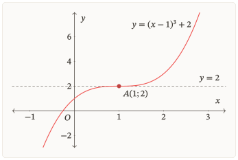{loading="lazy"}

::: r1-figcaption
Hình 01 — Tiếp tuyến ngang tại (1;2), hàm số vẫn tăng ở hai phía.
:::
::::
::::

::: {.content-visible when-format="html"}

```{=html}
<details class="zo-block zo-block-gray zo-learning-video" id="video-h03" data-youtube-id="w4PBGh11acY" data-public-playback="public">
<summary class="zo-block-title">Video: Tiếp tuyến ngang, hàm vẫn tăng?</summary>
<div class="zo-block-body">
<div class="zo-video-player"></div>
</div>
</details>
```

:::

#### 2.3. Vì sao không được đảo thành điều kiện nghiêm ngặt? {#vì-sao-không-được-đảo-thành-điều-kiện-nghiêm-ngặt}

Ví dụ 02 bác bỏ phát biểu: “Nếu $f$ đồng biến và có đạo hàm trên $K$ thì $f^\prime(x)>0$ tại mọi điểm của $K$.” Hàm số trong ví dụ đồng biến trên $\mathbb{R}$ nhưng $f^\prime(1)=0$.

Phát biểu đúng là: nếu $f$ đồng biến và có đạo hàm trên khoảng $K$, thì $f^\prime(x)\geq 0$ với mọi $x$ thuộc $K$. Với hàm nghịch biến và có đạo hàm, kết luận tương ứng là $f^\prime(x)\leq 0$.

:::: {.r1-details .zo-learning-context-note}
::: {.r1-summary .zo-learning-summary}
Đọc thêm — Giải thích bằng định nghĩa đạo hàm
:::

Có thể hiểu dấu không nghiêm ngặt này từ định nghĩa đạo hàm. Cố định $x_0$ trong $K$. Với $h\ne 0$ đủ nhỏ, tính đồng biến cho

$$\frac{f(x_0+h)-f(x_0)}{h}>0.$$

Khi $h$ tiến đến $0$, giới hạn của các số dương có thể bằng $0$. Vì vậy không thể buộc giới hạn ấy phải dương nghiêm ngặt.
::::

:::: {#dừng-lại-2-d02 .r1-task .zo-learning-task .zo-learning-task--pause .zo-lesson-activity}
<!-- zo-section dừng-lại-2-d02 lesson-activity -->

**Nhiệm vụ 06 — Một nghiệm không đổi dấu**

Cho $h$ có đạo hàm trên $\mathbb{R}$ và $h^\prime(x)=(x+2)^2$.\
Dựa vào dấu của $h^\prime$, hãy xác định chiều biến thiên của $h$ trên $\mathbb{R}$. Có cần tách thành hai khoảng đơn điệu tại $x=-2$ không? Vì sao?

::: answer-link
[Xem lời giải](#lg-d02)
:::

<!-- /zo-section -->
::::

### 3. Một chuỗi biểu diễn được dựng thế nào? {#một-chuỗi-biểu-diễn-được-dựng-thế-nào}

[]{#cach-thuc-hien-chuoi-bieu-dien}

:::: {#thử-nghĩ-trước-2 .r1-task .zo-learning-task .zo-learning-task--pause .zo-lesson-activity data-zo-lead="true"}
<!-- zo-section thử-nghĩ-trước-2 lesson-activity -->

**Gợi mở 03 — Từ dấu đạo hàm đến hình đồ thị**

Khi đủ điều kiện áp dụng định lí, dấu của đạo hàm trên từng khoảng cho biết chiều biến thiên của hàm số trên khoảng đó. Nhưng muốn điền giá trị hàm số tại các mốc thì lấy các số ấy từ đâu? Khi đã có bảng biến thiên, em có thể phác đồ thị đến mức nào?

Ta sẽ theo dõi cùng một hàm số từ công thức đến đồ thị để thấy mỗi bước dùng thêm dữ kiện gì.

<!-- /zo-section -->
::::

:::: {#ví-dụ-v03-bắt-đầu-từ-công-thức .zo-learning-example .zo-lesson-activity}

**Ví dụ 03 — Bắt đầu từ công thức**

Xét

$$p(x)=x^3-3x+1.$$

Đây là hàm đa thức nên có tập xác định $\mathbb{R}$, liên tục và có đạo hàm trên $\mathbb{R}$. Đạo hàm là

$$p^\prime(x)=3x^2-3=3(x-1)(x+1).$$

Các nghiệm của $p^\prime(x)=0$ là $-1$ và $1$. Hai mốc này chia trục số thành ba khoảng cần xét dấu.
::::

#### 3.1. Từ đạo hàm đến dấu và chiều biến thiên {#từ-đạo-hàm-đến-dấu-và-chiều-biến-thiên}

::: {#r1-table-t04 .table-scroll}
| Khoảng | Dấu $x+1$ | Dấu $x-1$ | Dấu $p^\prime(x)$ | Kết luận về $p$ |
|----|----|----|----|----|
| $(-\infty;-1)$ | Âm | Âm | Dương | Đồng biến |
| $(-1;1)$ | Dương | Âm | Âm | Nghịch biến |
| $(1;+\infty)$ | Dương | Dương | Dương | Đồng biến |
:::

Kết luận này dựa trên dấu trên từng khoảng, không chỉ trên hai đẳng thức $p^\prime(-1)=0$ và $p^\prime(1)=0$.

#### 3.2. Từ chiều biến thiên đến bảng biến thiên {#từ-chiều-biến-thiên-đến-bảng-biến-thiên}

Tính các giá trị ở mốc:

$$p(-1)=3,\quad p(1)=-1.$$

Ngoài ra, từ biểu thức đa thức bậc ba, ta có

$$\lim_{x\to-\infty}p(x)=-\infty,\quad \lim_{x\to+\infty}p(x)=+\infty.$$

Những giới hạn này được xác định từ công thức, không suy ra chỉ từ dấu của đạo hàm. Nếu chưa vững, có thể kiểm tra bằng cách viết $p(x)=x^3\left(1-\frac{3}{x^2}+\frac{1}{x^3}\right)$ với $x\ne 0$.

Bảng biến thiên là:

:::: table-scroll
::: {.r1-bbt bbt="BBT02" caption="Bảng biến thiên."}
ZO BBT placeholder
:::
::::

Đọc từng hàng theo đúng chức năng:

- Hàng $x$ ghi các mốc theo thứ tự tăng dần.
- Hàng $p^\prime(x)$ ghi dấu trên khoảng và giá trị đạo hàm tại các mốc đã tính.
- Hàng $p(x)$ ghi giá trị hoặc giới hạn đã biết, cùng mũi tên biểu thị chiều biến thiên.

Số $-1$ xuất hiện ở cả hai hàng nhưng không luôn chỉ cùng một đối tượng: $x=-1$ là một vị trí, còn $p(1)=-1$ là một giá trị hàm số.

#### 3.3. Từ bảng đến dáng điệu đồ thị {#từ-bảng-đến-dáng-điệu-đồ-thị}

Từ công thức, tính thêm $p(0)=1$. Vì vậy đồ thị đi qua $C(0;1)$, là giao điểm với trục tung. Điểm này giúp định vị đồ thị; nó không phải mốc đổi chiều trong bảng biến thiên.

Đồ thị $y=p(x)$ phải phù hợp với các thông tin sau:

- Trên $(-\infty;-1)$, đường biểu diễn đi lên khi đọc từ trái sang phải và tiến đến điểm $A(-1;3)$.
- Trên $(-1;1)$, đường biểu diễn đi xuống từ $A$ đến $B(1;-1)$; nó đi qua $C(0;1)$ do giá trị đã tính từ công thức.
- Trên $(1;+\infty)$, đường biểu diễn đi lên từ $B$.
- Đồ thị liền tại hai mốc vì $p$ liên tục; các tiếp tuyến tại $A$ và $B$ nằm ngang vì đạo hàm tại đó bằng $0$.

Đây là những ràng buộc để phác đúng dáng điệu, chưa phải toàn bộ quy trình khảo sát hàm số. Không tự thêm một giao điểm, tọa độ hoặc tính chất hình học chưa có căn cứ.

Nếu một hình gắn nhãn $y=p(x)$ lại đi lên trên $(-1;1)$, hình ấy mâu thuẫn với bảng. Nếu một bảng đặt $p(-1)=-1$, bảng ấy mâu thuẫn với công thức. Kiểm tra chéo giúp tìm lỗi ngay tại mắt xích tạo ra nó.

[Nguồn đối chiếu: Sách giáo khoa Toán 12, tập một, bộ Kết nối tri thức với cuộc sống, bài 1, trang 7–8; Sách giáo khoa Toán 12, tập một, bộ Kết nối tri thức với cuộc sống, bài 4, trang 26–27.]{.zo-source-note}

:::: r1-figure
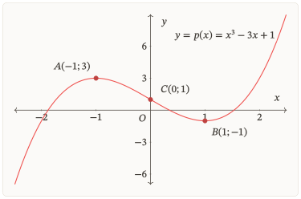{loading="lazy"}

::: r1-figcaption
Hình 02 — Đồ thị khớp bảng biến thiên của p.
:::
::::

::: {.content-visible when-format="html"}

```{=html}
<details class="zo-block zo-block-gray zo-learning-video" id="video-h04" data-youtube-id="LbgkI02HDoc" data-public-playback="public">
<summary class="zo-block-title">Video: Từ công thức, dựng bảng và đồ thị ra sao?</summary>
<div class="zo-block-body">
<div class="zo-video-player"></div>
</div>
</details>
```

:::

:::: {#dừng-lại-3-d03 .r1-task .zo-learning-task .zo-learning-task--pause .zo-lesson-activity}
<!-- zo-section dừng-lại-3-d03 lesson-activity -->

**Nhiệm vụ 07 — Kiểm nét vẽ bằng dấu đạo hàm**

Một bản vẽ cho Ví dụ 03 đi qua đúng $A(-1;3)$ và $B(1;-1)$, nhưng có một đoạn đi lên bên trong $(-1;1)$.\
Hai điểm mốc đúng đã đủ để chấp nhận bản vẽ chưa? Dữ kiện nào cho phép em kiểm tra nét vẽ đó?

::: answer-link
[Xem lời giải](#lg-d03)
:::

<!-- /zo-section -->
::::

### 4. Điều gì xảy ra tại một điểm cần xét? {#điều-gì-xảy-ra-tại-một-điểm-cần-xét}

[]{#cach-thuc-hien-diem-can-xet}

:::: {#thử-nghĩ-trước-3 .r1-task .zo-learning-task .zo-learning-task--pause .zo-lesson-activity data-zo-lead="true"}
<!-- zo-section thử-nghĩ-trước-3 lesson-activity -->

**Gợi mở 04 — Mốc đạo hàm bằng không và cực trị**

Ở Ví dụ 02, tiếp tuyến nằm ngang mà hàm số vẫn tăng. Ngược lại, ở một góc nhọn, hàm số có thể đạt cực tiểu dù đạo hàm tại đó không tồn tại. Vậy điều gì quyết định một điểm có phải là nơi đạt cực trị?

<!-- /zo-section -->
::::

::: {#gioi-thieu-cuc-tri}
<!-- zo-section gioi-thieu-cuc-tri -->

Hãy bắt đầu bằng cách so sánh giá trị hàm số tại điểm đang xét với các giá trị ở đủ gần về hai phía.

<!-- /zo-section -->
:::

#### 4.1. Định nghĩa theo so sánh trong một lân cận {#định-nghĩa-theo-so-sánh-trong-một-lân-cận}

Xét $f$ xác định và liên tục trên khoảng $(a;b)$, với $x_0$ thuộc khoảng đó.

::::: {.zo-block .zo-block-red}
:::: {#tieu-de-dinh-nghia-cuc-tri .zo-block-title}
<!-- zo-section tieu-de-dinh-nghia-cuc-tri -->

Định nghĩa cực đại và cực tiểu

<!-- /zo-section -->
::::

[]{#g01-dinh-nghia-cuc-dai}

- Hàm số đạt **cực đại tại $x_0$** nếu có số $h>0$ sao cho $(x_0-h;x_0+h)$ nằm trong $(a;b)$, và với mọi $x$ trong khoảng nhỏ này, khác $x_0$, ta có

  $$f(x)<f(x_0).$$

[]{#g01-dinh-nghia-cuc-tieu}

- Hàm số đạt **cực tiểu tại $x_0$** nếu tồn tại một khoảng nhỏ như trên mà với mọi $x\ne x_0$ trong khoảng ấy, ta có

  $$f(x)>f(x_0).$$

:::::

Từ “gần” được làm chính xác bằng việc tồn tại một khoảng nhỏ quanh $x_0$. Các bất đẳng thức là nghiêm ngặt. Không cần so sánh với mọi điểm trong toàn bộ tập xác định.

[Nguồn đối chiếu: Sách giáo khoa Toán 12, tập một, bộ Kết nối tri thức với cuộc sống, bài 1, trang 9.]{.zo-source-note}

Trong bài học này, ta dùng định nghĩa hai phía trên khoảng như trên. Một đầu mút của tập xác định không được tự động phân loại là cực trị bằng quy tắc hai phía. Những quy ước mở rộng khác không thuộc phạm vi bản học liệu này.

#### 4.2. Điều kiện đủ qua dấu đạo hàm {#điều-kiện-đủ-qua-dấu-đạo-hàm}

Giả sử $f$ liên tục trên khoảng $(a;b)$ chứa $x_0$ và có đạo hàm trên hai khoảng $(a;x_0)$, $(x_0;b)$.

::::: {.zo-block .zo-block-red}
:::: {#tieu-de-dinh-li-cuc-tri .zo-block-title}
<!-- zo-section tieu-de-dinh-li-cuc-tri -->

Xét cực trị bằng dấu đạo hàm

<!-- /zo-section -->
::::

- Nếu $f^\prime(x)>0$ trên $(a;x_0)$ và $f^\prime(x)<0$ trên $(x_0;b)$, hàm số đạt cực đại tại $x_0$.
- Nếu $f^\prime(x)<0$ trên $(a;x_0)$ và $f^\prime(x)>0$ trên $(x_0;b)$, hàm số đạt cực tiểu tại $x_0$.

:::::

Đó là định lí điều kiện đủ đang dùng. Định lí không đòi hỏi đạo hàm phải tồn tại tại chính $x_0$. Tính liên tục tại $x_0$ phải được kiểm tra; việc có đạo hàm ở hai phía không tự bảo đảm điều đó.

[Nguồn đối chiếu: Sách giáo khoa Toán 12, tập một, bộ Kết nối tri thức với cuộc sống, bài 1, trang 10.]{.zo-source-note}

::: {#vi-sao-can-lien-tuc}
<!-- zo-section vi-sao-can-lien-tuc -->

**Vì sao cần liên tục tại điểm ghép?** Gần $0$, xét hàm số $h$ bằng $x+2$ khi $x<0$, bằng $2-2x$ khi $x>0$ và có $h(0)=1$. Đạo hàm dương ở bên trái và âm ở bên phải. Nhưng hai nhánh đều tiến tới giá trị $2$ khi $x$ tiến tới $0$, khác với $h(0)$.

Với $0<\lvert x\rvert<\tfrac12$, cả hai nhánh đều cho $h(x)>h(0)$. Do đó $h$ không đạt cực đại tại $0$ dù dấu đạo hàm đổi từ dương sang âm. Dấu ở hai phía chưa cho biết giá trị ở chính điểm ghép.

<!-- /zo-section -->
:::

Khi các điều kiện trên đã được bảo đảm, có thể tóm tắt hành vi như sau:

::: {#r1-table-t05 .table-scroll}
| Dấu đạo hàm bên trái | Dấu đạo hàm bên phải | Chiều biến thiên quanh $x_0$ | Kết luận tại $x_0$ |
|------------------|------------------|------------------|------------------|
| Dương trên cả khoảng bên trái | Âm trên cả khoảng bên phải | Tăng rồi giảm | Cực đại |
| Âm trên cả khoảng bên trái | Dương trên cả khoảng bên phải | Giảm rồi tăng | Cực tiểu |
| Dương trên cả khoảng bên trái | Dương trên cả khoảng bên phải | Giữ chiều tăng | Không có cực trị |
| Âm trên cả khoảng bên trái | Âm trên cả khoảng bên phải | Giữ chiều giảm | Không có cực trị |
:::

Hai dòng cuối là kết luận trong tình huống có dấu nghiêm ngặt ở mỗi phía và liên tục tại điểm nối. Không dùng câu tắt “không đổi dấu thì không có cực trị” cho một bảng thiếu điều kiện hoặc chưa xác định được dấu trên cả hai khoảng.

:::: {#đối-chứng-thứ-nhất-đổi-dấu-và-có-cực-trị .zo-learning-example .zo-lesson-activity}

**Đối chứng thứ nhất — Đổi dấu và có cực trị**

Với $p(x)=x^3-3x+1$ trong Ví dụ 03, tính liên tục đã có vì $p$ là đa thức.

Qua $x=-1$, đạo hàm đổi dấu từ dương sang âm. Hàm số đạt cực đại tại $x=-1$, với giá trị $p(-1)=3$.

Qua $x=1$, đạo hàm đổi dấu từ âm sang dương. Hàm số đạt cực tiểu tại $x=1$, với giá trị $p(1)=-1$.

Ta không kết luận có cực trị chỉ vì giải được phương trình $p^\prime(x)=0$. Bước quyết định là kiểm tra dấu hai phía trong những điều kiện phù hợp.
::::

:::: {#đối-chứng-thứ-hai-bằng-0-nhưng-không-có-cực-trị .zo-learning-example .zo-lesson-activity}

**Đối chứng thứ hai — Bằng 0 nhưng không có cực trị**

Trở lại $f(x)=(x-1)^3+2$ trong Ví dụ 02. Hàm số liên tục tại $1$, đạo hàm dương trên cả hai phía của $1$ và bằng $0$ tại $1$.

Với $x<1$, ta có $f(x)<2$. Với $x>1$, ta có $f(x)>2$. Do đó, dù xét gần $1$ đến đâu, vẫn có giá trị nhỏ hơn $f(1)$ ở bên trái và lớn hơn $f(1)$ ở bên phải. Hàm số không đạt cực đại hoặc cực tiểu tại $1$.

Nếu $f^\prime(x_0)=0$, ta vẫn cần xét dấu đạo hàm ở hai phía của $x_0$ và kiểm tra các điều kiện của định lí trước khi kết luận hàm số có cực trị tại đó.

[Nguồn đối chiếu: chú ý về $x^3$ trong Sách giáo khoa Toán 12, tập một, bộ Kết nối tri thức với cuộc sống, bài 1, trang 11.]{.zo-source-note}
::::

:::: {#đối-chứng-thứ-ba-không-có-đạo-hàm-nhưng-có-cực-trị .zo-learning-example .zo-lesson-activity}

::: {#tieu-de-vi-du-04}
<!-- zo-section tieu-de-vi-du-04 -->

**Ví dụ 04 (đối chứng thứ ba) — Đạt cực tiểu tại điểm không có đạo hàm**

<!-- /zo-section -->
:::

$$u(x)=\lvert x\rvert.$$

Hàm số xác định và liên tục trên $\mathbb{R}$, với $u(0)=0$. Trên hai phía của $0$:

- Nếu $x<0$ thì $u(x)=-x$, nên $u^\prime(x)=-1$.
- Nếu $x>0$ thì $u(x)=x$, nên $u^\prime(x)=1$.

Tại $0$, thương sai phân là

$$\frac{u(h)-u(0)}{h}=\frac{\lvert h\rvert}{h}.$$

Thương này bằng $-1$ khi $h<0$ và bằng $1$ khi $h>0$. Hai giới hạn một phía khác nhau nên $u^\prime(0)$ không tồn tại.

Tuy nhiên, đạo hàm đổi từ âm sang dương qua $0$, và $u$ liên tục tại $0$. Theo định lí, $u$ đạt cực tiểu tại $0$. Có thể kiểm tra trực tiếp: với mọi $x\ne 0$, $u(x)=\lvert x\rvert>0=u(0)$, nên điều kiện so sánh nghiêm ngặt quanh $0$ được thỏa mãn.

[Nguồn đối chiếu: Sách giáo khoa Toán 12, tập một, bộ Kết nối tri thức với cuộc sống, bài 1, trang 6 và 14.]{.zo-source-note}

::::: table-scroll
:::: table-scroll
::: {.r1-bbt bbt="BBT12" caption="Bảng biến thiên của hàm giá trị tuyệt đối."}
ZO BBT placeholder
:::
::::
:::::

Hàng đạo hàm không có giá trị tại $0$, nhưng hàng hàm số vẫn có $u(0)=0$. Không được dùng vạch ngăn tại điểm không thuộc tập xác định ở hàng hàm số để xóa mất điểm này. Đồ thị có một góc tại $(0;0)$; đó không phải một điểm bị bỏ khỏi đồ thị.
::::

#### 4.3. Tách riêng điểm không thuộc tập xác định {#tách-riêng-điểm-không-thuộc-tập-xác-định}

[**Điểm không thuộc tập xác định.**]{.r1-unboxed-label}

Xét $v(x)=\lvert x\rvert$ nhưng chỉ trên tập xác định $D=\mathbb{R}\setminus\{0\}$. Trên mỗi phía của $0$, công thức và dấu đạo hàm giống Ví dụ 04. Tuy nhiên, $v(0)$ không tồn tại vì $0$ đã bị loại khỏi tập xác định.

Vì vậy, $0$ không thể là điểm cực trị của $v$. Dấu âm bên trái và dấu dương bên phải không tạo ra một giá trị hàm số tại vị trí không thuộc tập xác định.

:::: table-scroll
::: {.r1-bbt bbt="BBT13" caption="Bảng biến thiên khi loại 0 khỏi tập xác định."}
ZO BBT placeholder
:::
::::

Hai số 0 ở hai phía của vạch ngăn là giới hạn một phía. Hàm số không có giá trị tại 0.

Khi dựng bảng, phải thể hiện vạch ngăn tại điểm không thuộc tập xác định qua hàng hàm số; nếu ghi giới hạn tại mốc thì đó là giới hạn, không phải $v(0)$. Khi dựng đồ thị, vị trí $(0;0)$ phải là điểm hở. Đây là sự khác biệt quyết định với Ví dụ 04.

:::: r1-figure
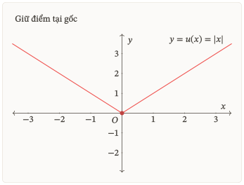{loading="lazy"}

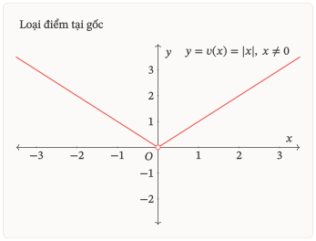{loading="lazy"}

::: r1-figcaption
Hình 03 — Cùng đường nét hai phía nhưng khác việc giữ hay bỏ điểm tại gốc.
:::
::::

::: {.content-visible when-format="html"}

```{=html}
<details class="zo-block zo-block-gray zo-learning-video" id="video-h06" data-youtube-id="3UmYIMCRVSY" data-public-playback="public">
<summary class="zo-block-title">Video: Đồ thị có góc nhọn, vẫn có cực tiểu?</summary>
<div class="zo-block-body">
<div class="zo-video-player"></div>
</div>
</details>
```

:::

#### 4.4. Trình tự xét một mốc {#trình-tự-xét-một-mốc}

1.  Mốc có thuộc tập xác định không? Nếu không, loại khỏi danh sách điểm cực trị.
2.  Có một khoảng quanh mốc đáp ứng các điều kiện của định lí không? Kiểm tra riêng tính liên tục tại mốc.
3.  Đạo hàm mang dấu gì trên từng khoảng ở hai phía?
4.  Hàm số đổi chiều hay giữ chiều? Kết luận theo trường hợp đã kiểm tra.
5.  Nếu có cực trị, tính giá trị hàm số và gọi đúng đối tượng.

Nếu thiếu giả thiết, ghi “chưa đủ điều kiện áp dụng định lí”; không chuyển câu đó thành “chắc chắn không có cực trị”.

::: {.content-visible when-format="html"}

```{=html}
<details class="zo-block zo-block-gray zo-learning-video" id="video-h05" data-youtube-id="82WJIDKVn08" data-public-playback="public">
<summary class="zo-block-title">Video: Đạo hàm bằng 0, đã chắc có cực trị?</summary>
<div class="zo-block-body">
<div class="zo-video-player"></div>
</div>
</details>
```

:::

:::: {#dừng-lại-4-d04 .r1-task .zo-learning-task .zo-learning-task--pause .zo-lesson-activity}
<!-- zo-section dừng-lại-4-d04 lesson-activity -->

**Nhiệm vụ 08 — Cực trị khi chưa biết đạo hàm tại mốc**

Hàm số $w$ liên tục trên $(-2;2)$, có đạo hàm dương trên $(-2;0)$ và đạo hàm âm trên $(0;2)$. Biết $w(0)=5$; chưa biết $w^\prime(0)$ có tồn tại hay không.\
Có đủ dữ kiện để kết luận $w$ đạt cực trị tại $0$ không? Vì sao?

::: answer-link
[Xem lời giải](#lg-d04)
:::

<!-- /zo-section -->
::::

### 5. Cực trị được gọi tên thế nào? {#cực-trị-được-gọi-tên-thế-nào}

[]{#cach-thuc-hien-goi-ten-cuc-tri}

:::: {#thử-nghĩ-trước-4 .r1-task .zo-learning-task .zo-learning-task--pause .zo-lesson-activity data-zo-lead="true"}
<!-- zo-section thử-nghĩ-trước-4 lesson-activity -->

**Gợi mở 05 — Hoành độ, giá trị hay điểm đồ thị?**

Với đồ thị của $p$ trong Ví dụ 03, ba cách ghi $-1$, $3$ và $A(-1;3)$ đều liên quan đến cùng một cực đại. Mỗi cách ghi đang nói về điều gì?

<!-- /zo-section -->
::::

::: {.content-visible when-format="html"}

```{=html}
<details class="zo-block zo-block-gray zo-learning-video" id="video-h07" data-youtube-id="YGl8QbuRnmA" data-public-playback="public">
<summary class="zo-block-title">Video: Cực trị là hoành độ hay tung độ?</summary>
<div class="zo-block-body">
<div class="zo-video-player"></div>
</div>
</details>
```

:::

#### 5.1. Ba đối tượng cần tách biệt {#ba-đối-tượng-cần-tách-biệt}

::: {#r1-table-t06 .table-scroll}
| Đối tượng | Dạng viết | Cực đại của Ví dụ 03 | Cực tiểu của Ví dụ 03 |
|------------------|------------------|------------------|------------------|
| Điểm cực trị của hàm số | Hoành độ $x_0$ | $x=-1$ | $x=1$ |
| Giá trị cực trị của hàm số | Giá trị $f(x_0)$ | $p(-1)=3$ | $p(1)=-1$ |
| Điểm cực trị của đồ thị | Điểm có hai tọa độ | $A(-1;3)$ | $B(1;-1)$ |
:::

Cách viết rõ ràng là: “Hàm số $p$ đạt cực đại tại $x=-1$, giá trị cực đại bằng $3$; điểm cực đại của đồ thị là $A(-1;3)$.”

[Nguồn đối chiếu: Sách giáo khoa Toán 12, tập một, bộ Kết nối tri thức với cuộc sống, bài 1, trang 9.]{.zo-source-note}

Trong suy luận qua dấu đạo hàm, chủ thể được kết luận đạt cực trị là hàm số $p$, không phải tự động là hàm đạo hàm $p^\prime$. Đạo hàm cũng là một hàm số, nhưng nếu muốn bàn về cực trị của nó thì đó là một câu hỏi khác.

#### 5.2. “Cục bộ” có ý nghĩa gì? {#cục-bộ-có-ý-nghĩa-gì}

Trong Ví dụ 03, $p$ đạt cực đại tại $-1$ với giá trị $3$. Nhưng $p(3)=19>3$. Điều này không mâu thuẫn: cực đại ở $-1$ chỉ yêu cầu so sánh với các điểm đủ gần $-1$.

Tương tự, từ việc $p$ đạt cực tiểu tại $1$, không được kết luận mọi giá trị của $p$ trên $\mathbb{R}$ đều lớn hơn hoặc bằng $p(1)$. Chúng ta dừng ở ý nghĩa cục bộ, không chuyển sang bài toán so sánh trên toàn tập xác định.

:::: {#dừng-lại-5-d05 .r1-task .zo-learning-task .zo-learning-task--pause .zo-lesson-activity}
<!-- zo-section dừng-lại-5-d05 lesson-activity -->

**Nhiệm vụ 09 — Gọi đúng đối tượng cực trị**

Một bạn viết: “Đồ thị của $p(x)=x^3-3x+1$ có điểm cực tiểu bằng $-1$ tại giá trị $1$.”\
Giữ các số đúng và viết lại câu để phân biệt điểm cực tiểu của hàm số, giá trị cực tiểu và điểm cực tiểu của đồ thị.

::: answer-link
[Xem lời giải](#lg-d05)
:::

<!-- /zo-section -->
::::

### 6. Từ bảng và đồ thị, kết luận được gì? {#có-thể-đọc-ngược-đến-đâu}

[]{#cach-thuc-hien-doc-nguoc}

:::: {#thử-nghĩ-trước-5 .r1-task .zo-learning-task .zo-learning-task--pause .zo-lesson-activity data-zo-lead="true"}
<!-- zo-section thử-nghĩ-trước-5 lesson-activity -->

**Gợi mở 06 — Đọc dấu và chiều biến thiên**

Thấy mũi tên đi lên trong bảng biến thiên, em có thể ghi dấu $+$ ở hàng đạo hàm không? Nếu một đường cong đi xuống, em có thể kết luận tung độ của nó âm không?

Trước khi suy luận, hãy đọc nhãn để biết dữ kiện đang mô tả hàm số hay đạo hàm, rồi xem dữ kiện ấy đủ cho kết luận nào. Nếu muốn kết luận thêm, em còn thiếu giả thiết hoặc giá trị nào?

<!-- /zo-section -->
::::

#### 6.1. Bảng có hàng đạo hàm và bảng chỉ có chiều biến thiên {#bảng-có-hàng-đạo-hàm-và-bảng-chỉ-có-chiều-biến-thiên}

Nếu bảng ghi rõ $f^\prime(x)>0$ trên một khoảng, đó là dữ kiện về đạo hàm. Nếu bảng chỉ có mũi tên đi lên ở hàng $f(x)$, ta biết hàm số đồng biến trên khoảng được biểu diễn; chưa được tự thêm dấu đạo hàm nghiêm ngặt tại mọi điểm.

Nếu có thêm giả thiết hàm số có đạo hàm trên khoảng ấy, ta kết luận được $f^\prime(x)\geq 0$. Ví dụ 02 cho thấy dấu bằng có thể xảy ra ở một điểm trong khi mũi tên vẫn đi lên ở cả hai phía.

Khi một ô không có số, hãy xác định đó là ô không cần ghi, chưa có dữ kiện, hay đạo hàm không tồn tại. Không có quy tắc “ô trống nghĩa là bằng $0$”. Trong bản này, trường hợp không tồn tại được ghi bằng chữ để tránh nhầm lẫn.

#### 6.2. Đồ thị của $f$ khác đồ thị của $f^\prime$ {#đồ-thị-của-f-khác-đồ-thị-của-fprime}

::: {#r1-table-t07 .table-scroll}
| Điều quan sát được trên khoảng $K$ | Nếu nhãn là $y=f(x)$ | Nếu nhãn là $y=f^\prime(x)$ |
|------------------------|------------------------|------------------------|
| Đường biểu diễn nằm trên trục hoành | $f(x)>0$ | $f^\prime(x)>0$; từ đó kết luận $f$ đồng biến trên $K$ |
| Đường biểu diễn nằm dưới trục hoành | $f(x)<0$ | $f^\prime(x)<0$; từ đó kết luận $f$ nghịch biến trên $K$ |
| Đường biểu diễn đi lên từ trái sang phải | $f$ đồng biến | $f^\prime$ đồng biến; riêng điều này chưa quyết định $f$ đồng biến hay nghịch biến |
| Đường biểu diễn đi qua một điểm có tung độ $0$ | Giá trị của $f$ tại đó bằng $0$ | Đạo hàm của $f$ tại đó bằng $0$; cần xem thêm dấu hai phía để xét cực trị của $f$ |
:::

Các kết luận đọc hình được hiểu trên phần tập xác định và với độ chính xác mà đề bài thực sự cung cấp. Hình chỉ có tính minh họa, không ghi tọa độ chính xác thì không đủ để buộc một đáp số chính xác.

:::: {.r1-example .zo-learning-example .zo-lesson-activity}
[]{#g01-vi-du-05}

**Ví dụ 05 — Đạo hàm đang tăng nhưng hàm số đang giảm.**

Xét lại $s(x)=x^2-2x$. Đồ thị đạo hàm là đường thẳng $y=2x-2$, đi lên từ trái sang phải. Tuy nhiên, trên $(0;1)$ đường thẳng này nằm dưới trục hoành: $s^\prime(x)<0$. Do đó $s$ nghịch biến trên $(0;1)$.

Cần đọc vị trí của đồ thị $s^\prime$ so với trục hoành để tìm dấu, không dùng việc đường thẳng ấy đang đi lên để kết luận chiều biến thiên của $s$.

[Nguồn đối chiếu: dạng bài đọc đồ thị đạo hàm trong Sách giáo khoa Toán 12, tập một, bộ Kết nối tri thức với cuộc sống, bài 1, trang 14, bài tập 1.6.]{.zo-source-note}

:::: r1-figure
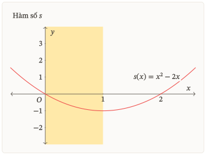{loading="lazy"}

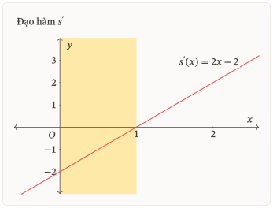{loading="lazy"}

::: r1-figcaption
Hình 04 — Hai nhãn khác nhau: s đang giảm trong khi s′ đang tăng và mang giá trị âm trên (0;1).
:::
::::
::::

::: {.content-visible when-format="html"}

```{=html}
<details class="zo-block zo-block-gray zo-learning-video" id="video-h08" data-youtube-id="gbywbcQE4Y0" data-public-playback="public">
<summary class="zo-block-title">Video: Đồ thị đạo hàm đi lên, hàm có tăng?</summary>
<div class="zo-block-body">
<div class="zo-video-player"></div>
</div>
</details>
```

:::

#### 6.3. Cùng bảng tóm tắt không có nghĩa cùng công thức {#cùng-bảng-tóm-tắt-không-có-nghĩa-cùng-công-thức}

:::: {.r1-example .zo-learning-example .zo-lesson-activity}
[]{#g01-vi-du-06}

**Ví dụ 06 — Cùng bảng biến thiên, khác công thức**

**Cùng bảng tóm tắt.** Xét hai hàm số:

$$a(x)=x^3,\quad b(x)=2x^3.$$

Chúng có cùng tập xác định $\mathbb{R}$, cùng dấu đạo hàm dương ở hai phía của $0$, đạo hàm bằng $0$ tại $0$, cùng giá trị bằng $0$ tại đó và cùng các giới hạn ở hai đầu. Vì vậy chúng có cùng bảng biến thiên tóm tắt sau, với $F$ lần lượt là $a$ hoặc $b$:

:::: table-scroll
::: {.r1-bbt bbt="BBT03" caption="Bảng biến thiên."}
ZO BBT placeholder
:::
::::

Nhưng $a(1)=1$ còn $b(1)=2$, nên hai đồ thị không trùng nhau. Một bảng ghi dấu, mốc và chiều biến thiên không đủ để xác định duy nhất công thức hàm số.

**Biết chính xác đạo hàm vẫn chưa đủ biết mọi giá trị của hàm số.** Cũng cần phân biệt “biết dấu của đạo hàm” với “biết chính xác hàm đạo hàm”. Hai dữ kiện ấy không tương đương. Chẳng hạn $x^3$ và $x^3+4$ có cùng đạo hàm nhưng khác giá trị tại $0$, nên riêng đạo hàm chưa xác định được vị trí của đồ thị theo phương thẳng đứng. Bài này không đặt nhiệm vụ khôi phục công thức từ đạo hàm.

:::: r1-figure
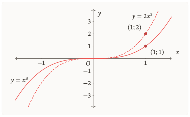{loading="lazy"}

::: r1-figcaption
Hình 05 — Hai hàm khác nhau có cùng bảng biến thiên tóm tắt.
:::
::::
::::

::: {.content-visible when-format="html"}

```{=html}
<details class="zo-block zo-block-gray zo-learning-video" id="video-h09" data-youtube-id="H6RGH9ucuos" data-public-playback="public">
<summary class="zo-block-title">Video: Cùng bảng biến thiên, vẫn khác hàm số?</summary>
<div class="zo-block-body">
<div class="zo-video-player"></div>
</div>
</details>
```

:::

#### 6.4. Vì sao không tự gộp các khoảng rời nhau? {#vì-sao-không-tự-gộp-các-khoảng-rời-nhau}

:::: {.r1-example .zo-learning-example .zo-lesson-activity}
[]{#g01-vi-du-07}

**Ví dụ 07 — Không tự gộp các khoảng rời nhau**

Xét hàm số với tập xác định $D=\mathbb{R}\setminus\{0\}$:

- $q(x)=x+2$ khi $x<0$;
- $q(x)=x-2$ khi $x>0$.

Trên mỗi khoảng $(-\infty;0)$ và $(0;+\infty)$, đạo hàm đều bằng $1$. Do đó $q$ đồng biến trên từng khoảng ấy.

Tuy nhiên, lấy hai điểm thuộc hai khoảng khác nhau:

$$-1<1,\quad q(-1)=1>-1=q(1).$$

Vì vậy, nếu mở rộng yêu cầu so sánh mọi cặp điểm ra toàn tập $D$, tính đồng biến không được thỏa mãn. Định lí trên một khoảng không cho phép tự động nối hai kết luận riêng thành một kết luận trên hợp các khoảng.

Trong bài làm của gói này, cách kết luận chuẩn là: “$q$ đồng biến trên từng khoảng $(-\infty;0)$ và $(0;+\infty)$.” Không gọi hợp hai khoảng ấy là “một khoảng”.

Đừng thay lỗi “luôn gộp được” bằng một quy tắc sai khác là “hợp các khoảng luôn sai”. Kí hiệu hợp không tự làm mọi phát biểu sai. Ví dụ, $r(x)=x$ trên $\mathbb{R}\setminus\{0\}$ vẫn thỏa mãn so sánh đồng biến cho mọi cặp điểm thuộc tập xác định. Điểm mấu chốt là phải kiểm tra cả các cặp nằm ở hai thành phần khác nhau; không chỉ xét dấu đạo hàm riêng từng nhánh.
::::

::: {.content-visible when-format="html"}

```{=html}
<details class="zo-block zo-block-gray zo-learning-video" id="video-h10" data-youtube-id="D4do-SU7MAs" data-public-playback="public">
<summary class="zo-block-title">Video: Tăng trên hai khoảng, gộp lại còn tăng?</summary>
<div class="zo-block-body">
<div class="zo-video-player"></div>
</div>
</details>
```

:::

#### 6.5. Bản đồ giới hạn suy luận {#bản-đồ-giới-hạn-suy-luận}

::: {#r1-table-t08 .table-scroll}
| Dữ kiện đang có | Có thể kết luận | Chưa đủ căn cứ để kết luận |
|---|---|---|
| Công thức $f$ và tập xác định | Giá trị, đạo hàm, dấu và chiều biến thiên sau khi tính, kiểm tra | Một kết luận đơn điệu hoặc cực trị chưa có lập luận |
| Dấu của $f^\prime$ trên các khoảng | Chiều biến thiên; vị trí cực trị nếu đủ điều kiện | Giá trị cực trị, giao điểm hoặc giới hạn chưa được cho hoặc tính |
| Bảng biến thiên | Chiều biến thiên, mốc và giá trị được ghi; cực trị nếu dữ kiện cho phép | Công thức duy nhất; mọi giá trị đạo hàm chính xác |
| Đồ thị $f$ | Đơn điệu, cực trị và tọa độ trong giới hạn thông tin của hình | Có đạo hàm tại một điểm góc; dấu đạo hàm nghiêm ngặt từ riêng nét đi lên |
| Đồ thị $f^\prime$ | Dấu của đạo hàm; chiều biến thiên của $f$ và xét cực trị khi đủ điều kiện | Coi tung độ của hình là giá trị $f(x)$ |
:::

:::: {#dừng-lại-6-d06 .r1-task .zo-learning-task .zo-learning-task--pause .zo-lesson-activity}
<!-- zo-section dừng-lại-6-d06 lesson-activity -->

**Nhiệm vụ 10 — Giới hạn suy luận từ đồ thị đạo hàm**

Cho $f$ có đạo hàm trên $\mathbb{R}$. Đồ thị $y=f^\prime(x)$ nằm dưới trục hoành khi $x<2$, đi qua $(2;0)$ và nằm trên trục hoành khi $x>2$.\
Hãy xác định các khoảng đơn điệu và vị trí cực trị của $f$. Tung độ $0$ trên đồ thị đạo hàm có đủ để kết luận giá trị cực trị bằng $0$ không?

::: answer-link
[Xem lời giải](#lg-d06)
:::

<!-- /zo-section -->
::::

### 7. Làm sao biết mình đã sửa được lỗi? {#làm-sao-biết-mình-đã-sửa-được-lỗi}

[]{#cach-thuc-hien-sua-duoc-loi}

:::: {#thử-nghĩ-trước-6 .r1-task .zo-learning-task .zo-learning-task--pause .zo-lesson-activity data-zo-lead="true"}
<!-- zo-section thử-nghĩ-trước-6 lesson-activity -->

**Gợi mở 07 — Đọc lời chữa và tự làm**

Đọc lời giải, em thấy mình đã hiểu vì sao đạo hàm bằng $0$ chưa đủ để kết luận có cực trị. Nếu đề mới cho bảng dấu thay cho công thức, em có tự nhận ra lỗi ấy và giải thích được cách sửa không?

Ta sẽ thử tách một phát biểu thành từng vế, giữ phần đúng rồi tự làm một câu với dữ kiện mới.

<!-- /zo-section -->
::::

::: {#phán-quyết-từ-đúng-giả-thiết}
<!-- zo-section phán-quyết-từ-đúng-giả-thiết -->

**Đánh giá từ đúng giả thiết.** Với một cụm phát biểu dùng chung giả thiết, xét từng ý độc lập từ giả thiết đó. Không xem kết luận của ý trước là dữ kiện cho ý sau, nhất là khi ý trước chính là điều đang cần kiểm tra.

<!-- /zo-section -->
:::

Trước khi đánh giá, viết nháp ba dòng: tập xác định và khoảng; dữ kiện đã cho; kết luận đang được hỏi. Sau đó mới chọn định nghĩa, định lí hoặc phản ví dụ phù hợp.

::: {#r1-table-t09 .table-scroll}
| Cấu trúc phát biểu | Khi nào đúng? | Căn cứ đủ để bác bỏ |
|------------------------|------------------------|------------------------|
| “A và B” | Cả A và B đều đúng | Chỉ ra ít nhất một vế sai |
| “A hoặc B” | Ít nhất một vế đúng | Phải chỉ ra cả A và B đều sai |
| “Với mọi trường hợp…” | Có lập luận bao quát mọi trường hợp trong giả thiết | Một phản ví dụ thỏa giả thiết nhưng vi phạm kết luận |
:::

Ở đây “hoặc” được dùng theo nghĩa ít nhất một vế đúng, không mặc định loại trừ trường hợp cả hai đúng. Một số ví dụ đúng không chứng minh được phát biểu “mọi”; một phản ví dụ phù hợp có thể bác bỏ phát biểu ấy.

:::: {#ví-dụ-v08-giữ-phần-đúng-khi-sửa .zo-learning-example .zo-lesson-activity}

**Ví dụ 08 — Giữ phần đúng khi sửa**

Cho $f(x)=(x-1)^3+2$ trên $\mathbb{R}$. Xét phát biểu:

> Hàm số $f$ đồng biến trên $\mathbb{R}$ và đạt cực đại tại $x=1$ vì $f^\prime(1)=0$.

**Đánh giá:** sai.

**Tách các vế:** vế đồng biến đúng theo Ví dụ 02; vế đạt cực đại tại $1$ sai vì đạo hàm dương ở cả hai phía và hàm số không đổi chiều.

**Lỗi quyết định:** xem phương trình $f^\prime(1)=0$ như điều kiện đủ của cực trị. Nếu xóa luôn vế đồng biến khi chữa, ta còn làm mất một phần vốn đúng.

**Viết lại hoàn chỉnh:** “Hàm số $f$ đồng biến trên $\mathbb{R}$ và không đạt cực trị tại $x=1$; mặc dù $f^\prime(1)=0$, đạo hàm vẫn dương ở cả hai phía của $1$.”

Lời chữa cần có lí do. Chỉ viết “không có cực trị” thì chưa cho thấy em đã thay đổi cách suy luận.
::::

::: {.content-visible when-format="html"}

```{=html}
<details class="zo-block zo-block-gray zo-learning-video" id="video-h11" data-youtube-id="2IjAhImodG8" data-public-playback="public">
<summary class="zo-block-title">Video: Lời giải sai một bước, giữ lại phần nào?</summary>
<div class="zo-block-body">
<div class="zo-video-player"></div>
</div>
</details>
```

:::

:::: {#câu-sau-chữa-cg01 .zo-learning-task .zo-learning-task--pause .zo-lesson-activity}
<!-- zo-section câu-sau-chữa-cg01 lesson-activity -->

**Nhiệm vụ 11 — Xét dấu và giới hạn dữ kiện**

Cho $g$ có đạo hàm trên $\mathbb{R}$ và $g^\prime(x)=(x-2)^2(x+1)$.

1. Lập bảng dấu của $g^\prime$ qua hai mốc $-1$ và $2$.
2. Xác định các khoảng đơn điệu. Có thể kết luận $g$ đồng biến trên toàn khoảng $(-1;+\infty)$ không?
3. Tại mốc nào $g$ đạt cực trị? Giải thích vì sao mốc còn lại cho kết luận khác.
4. Chỉ biết công thức của $g^\prime$, em có tính được giá trị cực trị của $g$ không?

::: answer-link
[Xem lời giải](#lg-cg01)
:::

<!-- /zo-section -->
::::

::: {#sau-khi-doi-chieu}
<!-- zo-section sau-khi-doi-chieu -->

[]{#một-dòng-ghi-lỗi-có-ích}[]{#r1-table-t10}[]{#tám-lỗi-để-tự-nhận-diện}[]{#r1-table-t11}Nếu còn vướng, em có thể tìm bài phù hợp trong [Chọn bài sửa lỗi](#chọn-câu-sau-chữa) và tự làm một câu mới về cùng lỗi. Dùng [Nhật kí](#nhat-ky) khi cần ghi lại chỗ vướng hoặc hẹn ngày ôn.

<!-- /zo-section -->
:::

### Khép lại bài học {#khép-lại-bài-học}

::: {#tu-kiem-cuoi-bai}
<!-- zo-section tu-kiem-cuoi-bai -->

Trước khi sang Luyện tập, em thử tự trả lời ba câu sau.

1. Muốn dùng dấu đạo hàm để xét chiều biến thiên trên một khoảng, em cần kiểm tra gì? Khi xét cực trị tại một điểm, em cần kiểm tra thêm điều gì tại chính điểm đó?
2. Bảng biến thiên hay đồ thị đang cho biết điều gì về hàm số? Kết luận nào còn cần thêm dữ kiện?
3. Nếu một lời giải sai ở một bước, em sẽ giữ phần nào, sửa chỗ nào và làm gì để biết mình đã sửa được lỗi?

<!-- /zo-section -->
:::

## Luyện tập {#phieu-luyen}

:::: {#dinh-huong-luyen-tap}
<!-- zo-section dinh-huong-luyen-tap lesson-intro -->

::: {#cach-thuc-hien-luyen-tap data-zo-instructions="required"}
[]{#lo-trinh-hoc}[]{#r1-table-t19}[]{#r1-table-t19-hint}Em hãy tự làm chín bài trong ba chặng và giữ bài làm trước khi bấm **Xem lời giải**. Cuối mỗi chặng, **Điểm dừng** giúp em đối chiếu bài làm với những việc cần làm được ở chặng đó, nhận ra chỗ còn vướng và quyết định nên làm tiếp hay ôn lại phần nào.
:::

<!-- /zo-section -->
::::

::: {.content-visible when-format="pdf"}
Trong bản in, tra đúng số nhiệm vụ trong nhóm Luyện tập của phần Lời giải. Nếu dùng phiếu chỉ có đề, đối chiếu với bản có lời giải.
:::

### Chặng 1 — Dựng và đọc chuỗi biểu diễn {#g01-c1 data-zo-outline-group="true"}

::: {#loi-dan-chang-luyen-tap-01}
<!-- zo-section loi-dan-chang-luyen-tap-01 -->

Em sẽ đối chiếu công thức, bảng biến thiên và đồ thị của cùng một hàm số để kiểm tra các kết luận về chiều biến thiên và cực trị.

<!-- /zo-section -->
:::

### Nhiệm vụ 12 – Ghép công thức, bảng và đồ thị {#lt01 .zo-learning-task .zo-learning-task--item}


Cho $f(x)=x^3-6x^2+9x-1$ trên $\mathbb{R}$.

1.  Tính $f^\prime(x)$, xét dấu và kết luận các khoảng đơn điệu.
2.  Trong hai bảng dưới đây, chọn bảng phù hợp; chỉ ra lỗi quyết định của bảng còn lại.
3.  Chọn hình A hoặc B phù hợp với công thức. Kiểm tra bằng cả chiều biến thiên và giá trị tại các mốc.
4.  Viết điểm cực đại, giá trị cực đại và điểm cực đại của đồ thị; làm tương tự cho cực tiểu.

**Bảng I**

:::: table-scroll
::: {.r1-bbt bbt="BBT04" caption="Bảng biến thiên."}
ZO BBT placeholder
:::
::::

**Bảng II**

:::: table-scroll
::: {.r1-bbt bbt="BBT05" caption="Bảng biến thiên."}
ZO BBT placeholder
:::
::::

:::: r1-figure
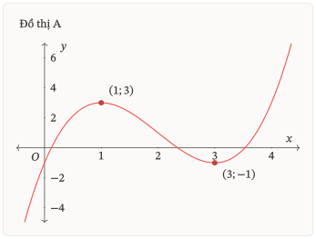{loading="lazy"}

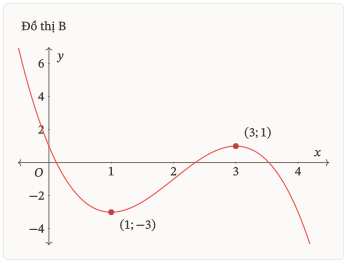{loading="lazy"}

::: r1-figcaption
nhiệm vụ 12 của Luyện tập — Hai hình để chọn; các điểm được ghi tọa độ chính xác.
:::
::::

::: answer-link
[Xem lời giải](#loi-giai-2)
:::

### Nhiệm vụ 13 – Mốc đạo hàm bằng không {#lt02 .zo-learning-task .zo-learning-task--item}


Cho $g$ có đạo hàm trên $\mathbb{R}$ và $g^\prime(x)=-(x+1)^2$.

Một bạn kết luận: “$g$ nghịch biến trên $(-\infty;-1)$ và $(-1;+\infty)$ nhưng không thể kết luận nghịch biến trên $\mathbb{R}$. Tại $-1$, hàm số có cực trị vì đạo hàm bằng $0$.”

Hãy giữ phần đúng, sửa phần sai và giải thích tại sao có thể hoặc không thể gộp kết luận đơn điệu qua $-1$.

::: answer-link
[Xem lời giải](#loi-giai-3)
:::

### Nhiệm vụ 14 – Đọc đồ thị đạo hàm {#lt03 .zo-learning-task .zo-learning-task--item}

::: {#du-kien-hinh-luyen-tap-14}
<!-- zo-section du-kien-hinh-luyen-tap-14 -->

Cho $h$ có đạo hàm trên $\mathbb{R}$. Hình sau biểu diễn $y=h^\prime(x)$. Dùng các tọa độ ghi trên hình làm dữ kiện chính xác. Hai nghiệm duy nhất của phương trình $h^\prime(x)=0$ là $-2$ và $1$. Ngoài khung hình, đạo hàm tiếp tục âm khi $x<-2$ và dương khi $x>1$. Biết thêm $h(-2)=4$.

<!-- /zo-section -->
:::

:::: r1-figure
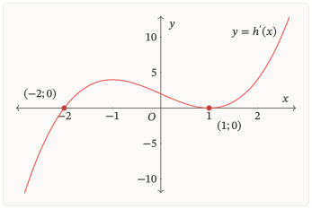{loading="lazy"}

::: r1-figcaption
nhiệm vụ 14 của Luyện tập — Đồ thị của đạo hàm, không phải đồ thị của h.
:::
::::

1.  Lập bảng dấu đạo hàm và xác định các khoảng đơn điệu của $h$.
2.  Xét cực trị của $h$ tại từng nghiệm của đạo hàm.
3.  Xác định tọa độ điểm cực trị của đồ thị $h$ mà dữ kiện cho phép biết.
4.  Một bạn đọc điểm $(1;0)$ trên hình và ghi $h(1)=0$. Cách đọc đó đúng không?

::: answer-link
[Xem lời giải](#loi-giai-4)
:::

### Nhiệm vụ 15 – Một góc và một điểm bị bỏ {#lt04 .zo-learning-task .zo-learning-task--item}


Xét $u(x)=\lvert x+1\rvert-2$ trên $\mathbb{R}$. Xét thêm $v$ có cùng công thức nhưng chỉ xác định trên $\mathbb{R}\setminus\{-1\}$.

::: {#yeu-cau-luyen-tap-15}
<!-- zo-section yeu-cau-luyen-tap-15 -->

1.  Kiểm tra tính liên tục và sự tồn tại của đạo hàm của $u$ tại $-1$; xét cực trị tại đó.
2.  $-1$ có phải điểm cực trị của $v$ không?
3.  Phác hai đồ thị và ghi rõ điểm kín hoặc điểm hở tại vị trí $(-1;-2)$. Nếu lập bảng biến thiên cho mỗi hàm số, em sẽ thể hiện điều gì ở hàng hàm số tại $x=-1$? Vì sao?

<!-- /zo-section -->
:::

::: answer-link
[Xem lời giải](#loi-giai-5)
:::

### Điểm dừng 01 {#cp-lt1}

::: {#noi-dung-diem-dung-luyen-tap-01}
<!-- zo-section noi-dung-diem-dung-luyen-tap-01 -->

1. **Tự kiểm bài làm.** Em đã xác định đúng tập xác định và khoảng đang xét, nối đúng công thức với bảng và đồ thị, rồi dùng dấu đạo hàm ở hai phía để xét và gọi đúng cực trị chưa?
2. **Chọn phần cần ôn.** Nếu sai khi áp dụng định lí, đọc dữ kiện, xét điểm ghép hoặc gọi tên cực trị, tìm bài tương ứng trong [Chọn bài sửa lỗi](#chọn-câu-sau-chữa) ở nhóm **Sau Luyện tập**. Nếu thiếu kiến thức nền, chọn [tập xác định](#nen-n-txd-01), [đạo hàm](#nen-n-dh-01), [xét dấu](#nen-n-dau-01), [bảng biến thiên](#nen-n-bbt-01), [đồ thị](#nen-n-dt-01) hoặc [điểm ghép](#nen-n-lt-01).
3. **Chọn việc tiếp theo.** Sửa phần còn vướng trước khi làm bài cần đến kiến thức đó. Em có thể học phần khác mà mình đã đủ kiến thức. Khi cần lưu kết quả hoặc nơi sẽ quay lại, dùng [Nhật kí](#nhat-ky).

<!-- /zo-section -->
:::

### Chặng 2 — Đọc bảng biến thiên và xét tính đơn điệu trên các khoảng rời {#g01-c2 data-zo-outline-group="true"}

::: {#loi-dan-chang-luyen-tap-02}
<!-- zo-section loi-dan-chang-luyen-tap-02 -->

Từ bảng biến thiên, em sẽ xem dữ kiện cho phép kết luận đến đâu, rồi kiểm tra một nhận xét về tính đơn điệu trên hai khoảng rời nhau.

<!-- /zo-section -->
:::

### Nhiệm vụ 16 – Đọc bảng không có hàng đạo hàm {#lt05 .zo-learning-task .zo-learning-task--item}

Cho $r$ liên tục trên $[-3;4]$, có bảng biến thiên sau. Không có giả thiết về đạo hàm.

:::: table-scroll
::: {.r1-bbt bbt="BBT06" caption="Bảng biến thiên."}
ZO BBT placeholder
:::
::::

1.  Nêu các khoảng đơn điệu và các cực trị ở bên trong tập xác định.
2.  Viết tọa độ các điểm cực trị của đồ thị.
3.  Có được tự điền $r^\prime(x)>0$ với mọi $x\in(0;2)$ không? Nếu biết thêm $r$ có đạo hàm trên $(0;2)$ thì kết luận được gì về dấu đạo hàm?
4.  Bảng có xác định duy nhất công thức $r$ không? Nêu lí do.

::: answer-link
[Xem lời giải](#loi-giai-6)
:::

### Nhiệm vụ 17 – Hai nhánh cùng đi lên {#lt06 .zo-learning-task .zo-learning-task--item}


Cho $q$ xác định trên $D=\mathbb{R}\setminus\{1\}$ bởi $q(x)=x+3$ khi $x<1$ và $q(x)=x-3$ khi $x>1$.

1.  Kết luận chiều biến thiên trên từng khoảng của tập xác định.
2.  Kiểm tra phát biểu “$q$ đồng biến trên toàn $D$” theo yêu cầu so sánh mọi cặp điểm thuộc $D$. Dùng một cặp điểm cụ thể nếu cần bác bỏ.
3.  Điểm $1$ có thể là điểm cực trị của $q$ không? Giải thích.

::: answer-link
[Xem lời giải](#loi-giai-7)
:::

### Điểm dừng 02 {#cp-lt2}

::: {#noi-dung-diem-dung-luyen-tap-02}
<!-- zo-section noi-dung-diem-dung-luyen-tap-02 -->

1. **Tự kiểm bài làm.** Ở mỗi kết luận, hãy chỉ ra dữ kiện cho phép em suy ra kết luận đó. Chú ý ba chỗ dễ suy quá dữ kiện: dấu đạo hàm tại mọi điểm, công thức hàm số và tính đơn điệu trên hợp các khoảng rời.
2. **Chọn phần cần ôn.** Nếu sai về tập xác định, ba đối tượng cực trị, các khoảng rời hoặc cách suy từ định lí, tìm bài phù hợp trong [Chọn bài sửa lỗi](#chọn-câu-sau-chữa) ở nhóm **Sau Luyện tập**. Nếu thiếu kiến thức nền, chọn [tập xác định](#nen-n-txd-01), [bảng biến thiên](#nen-n-bbt-01), [đồ thị](#nen-n-dt-01) hoặc [điểm ghép](#nen-n-lt-01).
3. **Chọn việc tiếp theo.** Trước khi làm bài ở chặng 3 cần kĩ năng đọc dữ kiện, hãy tự kiểm lại các lỗi quan trọng bằng bài phù hợp chưa gặp. Nếu chưa kiểm tra được, xem lại [cách kết luận từ bảng và đồ thị](#có-thể-đọc-ngược-đến-đâu) và ghi mục tiêu còn vướng vào [Nhật kí](#nhat-ky). Dành bài Kiểm tra và Ôn lại cho đúng lượt làm của chúng. Em vẫn có thể học phần khác hoặc bắt đầu Kiểm tra khi đã chuẩn bị kĩ hay đủ tự tin.

<!-- /zo-section -->
:::

### Chặng 3 — Đánh giá và sửa lập luận {#g01-c3 data-zo-outline-group="true"}

::: {#loi-dan-chang-luyen-tap-03}
<!-- zo-section loi-dan-chang-luyen-tap-03 -->

Em sẽ xét từng phát biểu từ giả thiết chung, giữ phần lập luận đúng khi sửa, rồi tự làm một bài mới để kiểm tra xem mình đã sửa được lỗi chưa.

<!-- /zo-section -->
:::

### Nhiệm vụ 18 – Đúng/sai với cùng một giả thiết {#lt07 .zo-learning-task .zo-learning-task--item}

::: {#gia-thiet-chung-luyen-tap-18}
<!-- zo-section gia-thiet-chung-luyen-tap-18 -->

Cho $t(x)=(x+2)^3-1$ trên $\mathbb{R}$. Xét đúng hay sai ở từng ý từ giả thiết này. Trong mỗi phát biểu, “hoặc” có nghĩa là ít nhất một vế đúng.

<!-- /zo-section -->
:::

a.  $t$ đồng biến trên $\mathbb{R}$ và $t^\prime(-2)>0$.

b.  $t^\prime(-2)=0$ hoặc $t$ đạt cực đại tại $-2$.

c.  Với mọi $x\in\mathbb{R}$, ta có $t^\prime(x)>0$.

d.  $t$ có cực trị tại $-2$ hoặc $t^\prime(-2)<0$.

Với mỗi ý, ghi đúng/sai và lí do. Với ý sai, viết lại cả câu thành một phát biểu đúng, giữ những vế vốn đúng.

::: answer-link
[Xem lời giải](#loi-giai-8)
:::

### Nhiệm vụ 19 – Sửa một lời giải rồi làm câu mới {#lt08 .zo-learning-task .zo-learning-task--item}


Cho $r$ liên tục trên $\mathbb{R}$, có đạo hàm trên $\mathbb{R}$ và bảng dấu sau; biết $r(-3)=5$, $r(1)=-2$.

:::: table-scroll
::: {.r1-bbt bbt="BBT07" caption="Bảng dấu đạo hàm."}
ZO BBT placeholder
:::
::::

Lời giải của một bạn:

> Đạo hàm có hai nghiệm nên hàm số có hai điểm cực trị. Hàm số có điểm cực đại là $5$ và điểm cực tiểu là $-2$.

::: {#yeu-cau-luyen-tap-19}
<!-- zo-section yeu-cau-luyen-tap-19 -->

Chỉ ra từng lỗi và viết lại kết luận. Nêu rõ điểm cực trị của hàm số, giá trị cực trị và tọa độ điểm cực trị trên đồ thị. Sau khi đối chiếu bài sửa của mình, em hãy tự làm Nhiệm vụ 20 trước khi xem lời giải của nhiệm vụ đó.

<!-- /zo-section -->
:::

::: answer-link
[Xem lời giải](#loi-giai-9)
:::

### Nhiệm vụ 20 — Xác nhận sau sửa {#g01-l08-xn01 .r1-confirmation-task}

Cho $h$ có đạo hàm trên $\mathbb{R}$ và

$$
h^\prime(x)=(x+5)^2(x-4),\quad h(4)=-7.
$$

::: {#loi-lap-luan-luyen-tap-20}
<!-- zo-section loi-lap-luan-luyen-tap-20 -->

Một bạn lập luận: “Phương trình $h^\prime(x)=0$ có hai nghiệm $-5$ và $4$, nên hàm số đạt cực trị tại cả hai điểm. Giá trị cực tiểu là $4$.” Hãy giữ phần đúng, chỉ ra các lỗi và viết lại kết luận về các khoảng đơn điệu. Nêu rõ điểm cực trị, giá trị cực trị và tọa độ điểm cực trị trên đồ thị.

<!-- /zo-section -->
:::

::: {#tieu-chi-luyen-tap-20}
<!-- zo-section tieu-chi-luyen-tap-20 -->

**Tiêu chí tự kiểm.** Xét đúng dấu của đạo hàm và dùng dấu hai phía để kiểm tra cực trị. Giữ những nhận xét đúng trong lời giải đã cho và phân biệt ba đối tượng được hỏi. Giải thích kết luận về chiều biến thiên khi đi qua $x=-5$.

<!-- /zo-section -->
:::

::: answer-link
[Xem lời giải](#lg-g01-l08-xn01)
:::

### Điểm dừng 03 {#cp-lt3}

::: {#noi-dung-diem-dung-luyen-tap-03}
<!-- zo-section noi-dung-diem-dung-luyen-tap-03 -->

1. **Tự kiểm bài làm.** Em đã xét riêng từng phát biểu từ giả thiết chung, giữ phần đúng khi sửa và gọi đúng điểm cực trị, giá trị cực trị, điểm cực trị trên đồ thị chưa?
2. **Chọn phần cần ôn.** Nếu còn nhầm điều kiện xét cực trị, đảo chiều suy luận của định lí hoặc bỏ mất phần đúng, tìm bài tương ứng trong [Chọn bài sửa lỗi](#chọn-câu-sau-chữa) ở nhóm **Sau Luyện tập**. Nếu vướng cách xét mệnh đề, làm bốn mệnh đề mới trong [Ôn nền về mệnh đề và phản ví dụ](#nen-n-lg-01). Nếu bỏ sót điều kiện liên tục, làm câu xác nhận trong [Ôn nền về liên tục và điểm ghép](#nen-n-lt-01), rồi quay lại Điểm dừng 03.
3. **Chọn việc tiếp theo.** Khi đã chuẩn bị kĩ hoặc đủ tự tin, em có thể bắt đầu [Kiểm tra](#tu-kiem-tra). Nếu cần, xem lại [Bài học](#bai-hoc), [Ôn nền](#on-nen) hoặc [Sửa lỗi](#sua-loi). Ghi mục tiêu còn sai hoặc chưa có bài mới để tự kiểm vào [Nhật kí](#nhat-ky) và giữ trạng thái chưa xác nhận khi xét điều kiện chuyển chuyên đề.

<!-- /zo-section -->
:::

## Kiểm tra {#tu-kiem-tra}

:::: {#dinh-huong-kiem-tra}
<!-- zo-section dinh-huong-kiem-tra lesson-intro -->

::: {#cach-thuc-hien-kiem-tra data-zo-instructions="required"}

Em có thể bắt đầu khi đã ôn kĩ hoặc thấy mình sẵn sàng. Hãy tự làm cả năm bài trên giấy trong cùng một buổi và trình bày rõ cách làm, kể cả những điều kiện em dùng. Trong khi làm, không tra tài liệu, xem lời giải hay nhờ người khác giúp.

:::

<!-- /zo-section -->
::::

### Đề bài {#de-kiem-tra}

::: {#thong-tin-de-kiem-tra}
<!-- zo-section thong-tin-de-kiem-tra -->

**Thời gian đề xuất: 45 phút · 20 điểm**

<!-- /zo-section -->
:::

#### Nhiệm vụ 21 – Dựng chuỗi biểu diễn {#kt01 .zo-learning-task .zo-learning-task--item}

**5 điểm.**


::: {#du-kien-kiem-tra-21}
<!-- zo-section du-kien-kiem-tra-21 -->

Cho hàm số $f(x)=-x^3+3x^2+9x-4$.

<!-- /zo-section -->
:::

a.  Xác định tập xác định và tính đạo hàm.

b.  Xét dấu đạo hàm.

c.  Nêu các khoảng đơn điệu.

d.  Lập bảng biến thiên có giá trị ở các mốc và giới hạn ở hai đầu; phác dáng điệu đồ thị khớp bảng, đánh dấu các điểm cực trị.

e.  Viết rõ điểm cực đại, giá trị cực đại, điểm cực tiểu và giá trị cực tiểu của hàm số.

#### Nhiệm vụ 22 – Xét hàm số từ đồ thị đạo hàm {#kt02 .zo-learning-task .zo-learning-task--item}

**4 điểm.**


Cho $k$ có đạo hàm trên khoảng $K=(-4;3)$. Hình sau biểu diễn $y=k^\prime(x)$ trên $K$. Các giao điểm có nhãn là chính xác; đây là toàn bộ các nghiệm của đạo hàm trong $K$.

:::: r1-figure
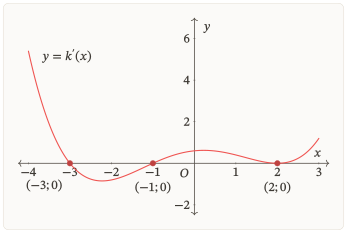{loading="lazy"}<!-- Giữ mô tả ảnh ở thuộc tính alt. -->
::::

::: {#yeu-cau-kiem-tra-22}
<!-- zo-section yeu-cau-kiem-tra-22 -->

a.  Xác định các khoảng đơn điệu của $k$. Có thể nêu một khoảng đồng biến chứa $x=2$ không? Vì sao?

b.  Xác định các điểm cực đại và cực tiểu của $k$ trong $K$.

c.  $2$ có phải điểm cực trị không? Nêu lí do.

d.  Chỉ từ hình này, có xác định được các giá trị cực trị của $k$ không? Nêu rõ hình cho biết điều gì và còn thiếu dữ kiện nào.

<!-- /zo-section -->
:::

#### Nhiệm vụ 23 – Kiểm từng phát biểu {#kt03 .zo-learning-task .zo-learning-task--item}

**4 điểm.**


::: {#gia-thiet-kiem-tra-23}
<!-- zo-section gia-thiet-kiem-tra-23 -->

Cho $r$ liên tục trên $[-4;5]$ và có bảng biến thiên dưới đây. Với mỗi ý, hãy cho biết kết luận có suy ra từ giả thiết chung hay không và nêu lí do.

<!-- /zo-section -->
:::

:::: table-scroll
::: {.r1-bbt bbt="BBT08" caption="Bảng biến thiên."}
ZO BBT placeholder
:::
::::

a.  Đồ thị $r$ có điểm cực tiểu $(-1;-3)$.

b.  Từ giả thiết đã cho, có thể khẳng định rằng $r^\prime(x)>0$ tại mọi $x$ thuộc $(-1;2)$.

c.  Giá trị cực đại của $r$ bằng $2$ hoặc giá trị cực tiểu của $r$ bằng $-3$.

d.  Bảng xác định duy nhất công thức của $r$.

#### Nhiệm vụ 24 – Tập xác định và điểm không có đạo hàm {#kt04 .zo-learning-task .zo-learning-task--item}

**4 điểm.**


Cho $u(x)=\lvert x-3\rvert+2$ trên $\mathbb{R}$ và $v$ có cùng công thức trên $\mathbb{R}\setminus\{3\}$.

::: {#yeu-cau-kiem-tra-24}
<!-- zo-section yeu-cau-kiem-tra-24 -->

a.  Xét sự tồn tại của $u^\prime(3)$ và cực trị của $u$ tại $3$, có giải thích.

b.  Hàm số $v$ có đạt cực trị tại $x=3$ không? Vì sao?

c.  Một hàm khác $w$ có tập xác định $\mathbb{R}\setminus\{0\}$, với $w(x)=x+4$ khi $x<0$ và $w(x)=x-4$ khi $x>0$. Xét tính đơn điệu của $w$ trên từng khoảng của tập xác định. Có thể kết luận $w$ đồng biến trên toàn bộ tập xác định không? Giải thích.

d.  Dựa vào ý a, chỉ ra vế đúng và sửa vế sai trong câu “$u^\prime(3)$ không tồn tại và $u$ không có cực trị tại $3$”.

<!-- /zo-section -->
:::

#### Nhiệm vụ 25 – Căn cứ kết luận {#kt05 .zo-learning-task .zo-learning-task--item}

**3 điểm.**


::: {#yeu-cau-kiem-tra-25}
<!-- zo-section yeu-cau-kiem-tra-25 -->

Cho $F$ xác định trên $(-1;1)$ và có đạo hàm trên $(-1;0)$, $(0;1)$. Biết $F^\prime(x)>0$ trên $(-1;0)$ và $F^\prime(x)<0$ trên $(0;1)$.

Một bạn viết: “Theo định lí đổi dấu đạo hàm, $F$ đạt cực đại tại $0$ và giá trị cực đại bằng $0$.”

a.  Chỉ ra điều kiện còn thiếu để áp dụng định lí xét cực trị bằng dấu đạo hàm. Có đủ căn cứ để kết luận giá trị cực đại bằng $0$ không?

b.  Nếu bổ sung điều kiện em vừa nêu ở ý a, hãy xác định loại cực trị của $F$ tại $0$. Có xác định được giá trị cực trị bằng số không? Vì sao?

<!-- /zo-section -->
:::

### Sau khi hoàn thành bài kiểm tra {#sau-khi-nộp-bài-cho-chính-mình}

::: {#cach-thuc-hien-sau-kiem-tra data-zo-instructions="required"}
<!-- zo-section cach-thuc-hien-sau-kiem-tra -->

Khi làm xong cả đề, em hãy giữ nguyên bài làm, kể cả những câu bỏ trống. Bấm [Xem lời giải](#loi-giai-kiem-tra) rồi mở nhiệm vụ cần đối chiếu. Sau khi đọc cách làm, em tự chấm từng ý theo cột **Căn cứ cho điểm** hoặc theo cách tính điểm ghi kèm lời giải.

Nếu còn vướng, xem [Điểm dừng 04](#cp-kt) để chọn phần cần ôn. Ghi riêng điểm của bài làm ban đầu và kết quả sau khi sửa. Đánh dấu những ý em đã xem lời giải hoặc dùng hỗ trợ.

<!-- /zo-section -->
:::

#### Điểm dừng 04 {#cp-kt}

::: {#noi-dung-diem-dung-kiem-tra}
<!-- zo-section noi-dung-diem-dung-kiem-tra -->

- **Sửa chỗ còn vướng.** Xem [Ôn nền](#on-nen) nếu em chưa vững kiến thức cần dùng. Nếu đã hiểu kiến thức nhưng còn sai ở một bước làm, chọn một bài trong [Chọn bài sửa lỗi](#chọn-câu-sau-chữa) ở nhóm **Sau Kiểm tra** phù hợp với lỗi đó. Hãy tự làm một bài chưa gặp để kiểm tra xem mình đã sửa được lỗi chưa.
- **Hẹn ngày ôn lại.** Khi đã tự làm đạt yêu cầu ở cả [năm kĩ năng](#học-xong-em-cần-làm-được-gì) và sửa được những lỗi cần khắc phục trước khi học tiếp, em ghi ngày hoàn tất vào [Nhật kí](#nhat-ky) và dùng ngày đó để tính lịch [Ôn lại](#on-lai). Nếu còn vướng, ghi rõ chỗ cần quay lại.

<!-- /zo-section -->
:::

<details class="zo-block">
<summary class="zo-block-title">Xem lại những ý em còn vướng</summary>
<div id="đọc-kết-quả-tự-kiểm-tra" class="zo-block-body">
<!-- zo-section đọc-kết-quả-tự-kiểm-tra -->

Sau khi tự chấm, em tìm ý mình làm sai hoặc bỏ trống trong danh sách dưới đây. Với mỗi ý, hãy xem lại bước mà câu hỏi nhắc đến.

**[Nhiệm vụ 21](#kt01) – Từ công thức đến đồ thị**

- **Ý a–d.** Khoảng tăng, giảm em ghi có khớp với dấu đạo hàm không? Khi phác đồ thị, em đã đối chiếu chiều tăng, giảm và độ cao ở các mốc với bảng biến thiên chưa?
- **Ý e.** Em đã phân biệt được điểm cực trị của hàm số (giá trị $x$), giá trị cực trị (giá trị $f(x)$) và tọa độ điểm cực trị trên đồ thị chưa?

**[Nhiệm vụ 22](#kt02) – Đọc đồ thị đạo hàm**

- **Ý a–c.** Tại mỗi vị trí đạo hàm bằng $0$, em đã so sánh dấu đạo hàm ở hai phía trước khi quyết định có tách khoảng đơn điệu hay kết luận có cực trị chưa?
- **Ý d.** Khi tìm giá trị cực trị, em đang đọc giá trị của $k$ hay của $k^\prime$? Đề đã cho giá trị nào của $k$ chưa?

**[Nhiệm vụ 23](#kt03) – Đọc bảng biến thiên**

- **Ý a và c.** Em đã dùng chiều mũi tên để xác định loại cực trị, rồi đọc đúng hoành độ và giá trị ở mốc đó chưa? Ở ý c, chỉ cần một vế đúng hay phải đúng cả hai vế?
- **Ý b và d.** Mũi tên đi lên cho biết hàm số tăng. Dữ kiện đó có đủ để khẳng định đạo hàm dương ở mọi điểm không? Các mốc trong bảng có đủ để xác định duy nhất công thức hàm số không?

**[Nhiệm vụ 24](#kt04) – Kiểm tra tập xác định trước khi kết luận**

- **Ý a và b.** Trước khi xét cực trị tại $x=3$, em đã kiểm tra $3$ có thuộc tập xác định của từng hàm $u$ và $v$ chưa? Với $u$, em có thể so sánh $u(x)$ với $u(3)$ để xét cực trị không?
- **Ý c.** Sau khi xét từng nhánh, em đã thử so sánh hai giá trị của $w$ tại hai điểm nằm ở hai phía của $0$ chưa?
- **Ý d.** Khi sửa câu, em đã giữ vế đúng và giải thích vì sao cần sửa vế còn lại chưa?

**[Nhiệm vụ 25](#kt05) – Kiểm tra căn cứ của kết luận**

- **Ý a.** Ngoài dấu đạo hàm ở hai phía, định lí còn cần điều kiện gì tại $x=0$? Em dựa vào đâu để kiểm tra khẳng định $F(0)=0$?
- **Ý b.** Sau khi bổ sung điều kiện còn thiếu, em xác định được **loại cực trị**. Để tính **giá trị cực trị** bằng số, em còn cần biết gì?

Nếu cùng một chỗ vướng xuất hiện ở nhiều ý, em chỉ cần chọn một bài [Chọn bài sửa lỗi](#chọn-câu-sau-chữa) ở nhóm **Sau Kiểm tra** để làm trước.

<!-- /zo-section -->

</div>
</details>

## Ôn lại {#on-lai}

::: {#cach-thuc-hien-on-lai data-zo-instructions="required"}
<!-- zo-section cach-thuc-hien-on-lai lesson-intro -->

Sau khi học và tự kiểm tra, em xem [Điểm dừng 04](#cp-kt) để biết mình đã hoàn tất chưa. Khi đã hoàn tất, ghi ngày đó vào [Nhật kí](#nhat-ky). Cả ba lần ôn đều tính từ ngày này.

Ví dụ, nếu em hoàn tất vào **1/3**, hãy hẹn ôn lần 1 vào **3/3 hoặc 4/3**, lần 2 vào **8/3** và lần 3 vào một ngày từ **22/3 đến 29/3**. Ghi ba ngày đã chọn vào Nhật kí.

Đến ngày hẹn, em mở lượt ôn tương ứng. Tự làm bài trước khi xem lại Bài học hoặc mở lời giải.

<!-- /zo-section -->
:::

### Ôn lần 1 — Sau 2–3 ngày {#on-lai-1 data-zo-context="round:on-lai-1"}

#### Nhiệm vụ 26 – Đọc đồ thị đạo hàm và xét cực trị {#g01-o01 .zo-learning-task .zo-learning-task--item}

::: {#du-kien-on-lai-26}
<!-- zo-section du-kien-on-lai-26 -->

Cho hàm số $f$ có đạo hàm trên $\mathbb{R}$ và $f(5)=7$. Hình dưới biểu diễn đồ thị $y=f^\prime(x)$ để đọc dấu. Hai điểm được đánh dấu là toàn bộ giao điểm của đồ thị với trục hoành. Trục tung không có thang đo.

<!-- /zo-section -->
:::

:::: r1-figure
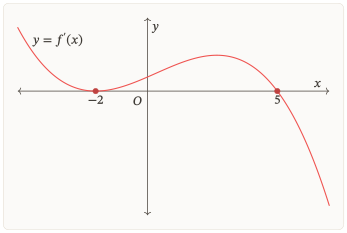{loading="lazy"}<!-- Giữ mô tả ảnh ở thuộc tính alt. -->
::::

::: {#yeu-cau-on-lai-26}
<!-- zo-section yeu-cau-on-lai-26 -->

1. Xét dấu của $f^\prime(x)$ và nêu các khoảng đơn điệu của $f$. Hai khoảng kề mốc $x=-2$ có thể gộp thành một khoảng đơn điệu không? Vì sao?
2. Xét cực trị tại $x=-2$ và $x=5$.
3. Với mỗi cực trị tìm được, nêu điểm cực trị của hàm số, giá trị cực trị và tọa độ điểm tương ứng trên đồ thị.
4. Từ đồ thị đạo hàm và giá trị $f(5)=7$, em có xác định được $f(-2)$ hoặc công thức của $f$ không? Vì sao?

<!-- /zo-section -->
:::

::: answer-link
[Xem lời giải](#lg-g01-o01)
:::

#### Điểm dừng 05 {#cp-on1}

::: {#noi-dung-diem-dung-on-lai-05}
<!-- zo-section noi-dung-diem-dung-on-lai-05 -->

Sau khi xem lời giải, đối chiếu cách em đi từ dấu đạo hàm đến khoảng đơn điệu và cực trị. Ghi riêng kết quả tự làm và phần làm được sau khi dùng hỗ trợ.

Nếu còn vướng, chọn bài chưa gặp trong [Chọn bài sửa lỗi](#chọn-câu-sau-chữa) ở nhóm **Sau Ôn lại** hoặc xem [Ôn nền](#on-nen) nếu thiếu kiến thức cần dùng. Em có thể hẹn kiểm tra lỗi đó sớm hơn và vẫn giữ lịch lượt 2.

Trong lúc chờ đến ngày ôn, em có thể học chuyên đề tiếp theo nếu đã đủ kiến thức cần thiết.

<!-- /zo-section -->
:::

### Ôn lần 2 — Sau 7 ngày {#on-lai-2 data-zo-context="round:on-lai-2"}

#### Nhiệm vụ 27 – Đọc dữ kiện biến thiên trên hai đoạn rời nhau {#g01-o02 .zo-learning-task .zo-learning-task--item}

::: {#yeu-cau-on-lai-27}
<!-- zo-section yeu-cau-on-lai-27 -->

Cho hàm số $r$ có tập xác định $D=[-4;-1]\cup[1;5]$ và liên tục trên từng đoạn của $D$. Biết rằng:

- Trên $[-4;-1]$, $r$ giảm từ $r(-4)=6$ xuống $r(-1)=0$
- Trên $[1;3]$, $r$ tăng từ $r(1)=2$ lên $r(3)=4$
- Trên $[3;5]$, $r$ giảm từ $4$ xuống $r(5)=1$

Với mỗi phát biểu, hãy cho biết kết luận có suy ra từ dữ kiện trên không. Nếu không, hãy sửa phần chưa có căn cứ và giữ phần đúng.

a. Hàm số đạt cực đại địa phương tại $x=3$, giá trị cực đại là $4$, điểm cực đại của đồ thị là $(3;4)$.

b. Vì $r$ giảm trên $[-4;-1]$ và trên $[3;5]$, có thể kết luận $r$ nghịch biến trên $[-4;-1]\cup[3;5]$.

c. Vì $r$ đồng biến trên $[1;3]$, ta có $r^\prime(x)>0$ với mọi $x\in(1;3)$.

<!-- /zo-section -->
:::

:::: {.zo-block .zo-block-gray .r1-transfer-conditional}
::: {.zo-block-title}
Ôn thêm về giá trị lớn nhất và giá trị nhỏ nhất
:::

::: {#lien-he-on-lai-27}
<!-- zo-section lien-he-on-lai-27 -->

Nếu đã học **Giá trị lớn nhất và giá trị nhỏ nhất**, em có thể dùng dữ kiện trên để tìm giá trị lớn nhất, giá trị nhỏ nhất của $r$ trên $D$ và các điểm đạt. Đây là phần ôn thêm.

<!-- /zo-section -->
:::
::::

::: answer-link
[Xem lời giải](#lg-g01-o02)
:::

#### Điểm dừng 06 {#cp-on2}

::: {#noi-dung-diem-dung-on-lai-06}
<!-- zo-section noi-dung-diem-dung-on-lai-06 -->

Đối chiếu từng phát biểu với dữ kiện đã cho, nhất là khi so sánh hai giá trị của $r$ ở hai đoạn rời nhau. Nếu còn vướng, chọn bài chưa gặp trong [Chọn bài sửa lỗi](#chọn-câu-sau-chữa) ở nhóm **Sau Ôn lại** hoặc xem [Ôn nền](#on-nen) nếu thiếu kiến thức cần dùng. Giữ ngày hẹn của lượt 3.

<!-- /zo-section -->
:::

### Ôn lần 3 — Sau 3–4 tuần {#on-lai-3 data-zo-context="round:on-lai-3"}

#### Nhiệm vụ 28 – Tự dựng chuỗi biểu diễn cho hàm từng đoạn {#g01-o03 .zo-learning-task .zo-learning-task--item}


Cho hàm số

$$
F(x)=
\begin{cases}
-(x+1)^2+1 & \text{khi } x<0,\\
x^3-3x & \text{khi } x\geq0.
\end{cases}
$$

::: {#yeu-cau-on-lai-28}
<!-- zo-section yeu-cau-on-lai-28 -->

1. Xác định tập xác định. Hàm số $F$ có liên tục tại $x=0$ không? Có đạo hàm tại đó không?
2. Tính đạo hàm trên từng khoảng thích hợp. Tự chọn các mốc cần đặt vào bảng dấu; xét dấu và nêu các khoảng đơn điệu.
3. Lập bảng biến thiên và xác định các cực trị. Với mỗi cực trị, nêu điểm cực trị của hàm số, giá trị cực trị và tọa độ điểm tương ứng trên đồ thị.
4. Một bạn viết: “$F$ nghịch biến trên $(-1;1)$, do đó $F^\prime(x)<0$ với mọi $x\in(-1;1)$.” Hãy giữ phần đúng, chỉ ra phần thiếu căn cứ và viết lại toàn bộ câu.

<!-- /zo-section -->
:::

::: answer-link
[Xem lời giải](#lg-g01-o03)
:::

#### Điểm dừng 07 {#cp-on3}

::: {#noi-dung-diem-dung-on-lai-07}
<!-- zo-section noi-dung-diem-dung-on-lai-07 -->

Đối chiếu bài làm từ bước xét tại $x=0$ đến bảng biến thiên và cực trị. Ghi vào [Nhật kí](#nhat-ky) những phần em tự làm được ở lượt này và những chỗ cần kiểm tra lại.

Nếu còn vướng, chọn bài chưa gặp trong [Chọn bài sửa lỗi](#chọn-câu-sau-chữa) ở nhóm **Sau Ôn lại** hoặc xem [Ôn nền](#on-nen). Nếu chưa có bài mới phù hợp hoặc vẫn còn sai, xem lại đúng mục [Bài học](#bai-hoc) và hẹn kiểm tra lại chỗ đó.

<!-- /zo-section -->
:::

## Ôn nền {#on-nen}

::: {#huong-dan-on-nen .r1-foundation-entry}
<!-- zo-section huong-dan-on-nen lesson-intro -->

Chọn thẻ theo chỗ em đang vướng. Đọc ví dụ, thử **Làm tiếp một bước**, rồi mở **Đối chiếu bước vừa làm**. Sau đó, tự làm nhiệm vụ mà không nhìn phần hướng dẫn. Làm xong, mở khung có cùng tên với nhiệm vụ để xem lời giải.

Dùng câu em chưa từng làm và chưa xem đáp án để tự kiểm tra. Dành bài **Kiểm tra** và **Ôn lại** cho đúng lượt. Nếu vẫn làm sai, xem lại bước em còn vướng. Nếu đã hết câu mới phù hợp, ghi “Chưa có bài mới để xác nhận thêm ở mục tiêu này”. Khi ôn xong, quay lại bài hoặc Điểm dừng em vừa rời.

<!-- /zo-section -->
:::















## Sửa lỗi {#sua-loi}


::: {#cach-thuc-hien-sua-loi data-zo-instructions="required"}

<!-- zo-section cach-thuc-hien-sua-loi lesson-intro -->

**Sửa lỗi** giúp em tìm ra vì sao mình làm sai và kiểm tra xem mình đã sửa được lỗi đó chưa. Chẳng hạn, nếu em kết luận hàm số có cực trị chỉ vì đạo hàm bằng $0$, bảng bên dưới sẽ chỉ ra em cần kiểm tra thêm điều gì và gợi ý một bài để em thử lại.

Giữ bài làm ban đầu để đối chiếu. Sửa bước sai, rồi tự làm một bài khác về cùng lỗi trước khi bấm **Xem lời giải**. Sau đó, quay về bài hoặc Điểm dừng đã dẫn em đến đây.

<!-- /zo-section -->

:::

### Chọn bài sửa lỗi {#chọn-câu-sau-chữa}

::: {#nhom-bai-sua-loi}
<!-- zo-section nhom-bai-sua-loi -->

[Sau Luyện tập](#sua-loi-sau-luyen-tap) · [Sau Kiểm tra](#sua-loi-sau-kiem-tra) · [Sau Ôn lại](#sua-loi-sau-on-lai)

<!-- /zo-section -->
:::

::: {#huong-dan-tra-bang-sua-loi}
<!-- zo-section huong-dan-tra-bang-sua-loi -->

Trong cột **Biểu hiện dễ nhầm**, tìm dòng giống với lỗi trong bài làm của em. Đọc câu hỏi và cách tháo gỡ ở dòng đó, rồi chọn một bài em chưa từng gặp trong cột **Tự kiểm tra**, theo phần em vừa làm. Nếu gặp lỗi trong **Bài học**, chọn bài ở nhóm **Sau Luyện tập**.

<!-- /zo-section -->
:::

::: {#r1-table-t12 .table-scroll data-zo-remediation="bottlenecks-v1"}

| Nút thắt nhận thức | Biểu hiện dễ nhầm | Câu hỏi và cách tháo gỡ | Tự kiểm tra |
|---|---|---|---|
| Tập xác định và khoảng đang xét | Dùng điểm bị loại để kết luận cực trị hoặc bỏ điều kiện của khoảng xét. | **Điểm đang xét có thuộc tập xác định không?** Ghi tập xác định trước rồi kiểm tra khoảng đang xét có nằm trọn trong tập đó không. Giữ nguyên những điểm đã bị loại khi rút gọn công thức. [Xem lại kiến thức](#tách-riêng-điểm-không-thuộc-tập-xác-định). | **Sau Luyện tập:** [Nhiệm vụ 37 – Mốc bị loại khỏi tập xác định](#sc01). **Sau Kiểm tra:** [Nhiệm vụ 45 – Một mốc bị loại khác](#g01-s-k-e01). **Sau Ôn lại:** Chưa có bài riêng về điểm bị loại. [Nhiệm vụ 54 – Điểm hở và điểm kín cùng hoành độ](#g01-s-o-e01) giúp kiểm cách đọc giá trị hàm số tại một hoành độ. |
| Đạo hàm bằng không và cực trị | Đếm nghiệm của phương trình đạo hàm bằng $0$ rồi coi mỗi nghiệm là một điểm cực trị. | **Đạo hàm có đổi dấu qua điểm đó không?** Kiểm tra điều kiện áp dụng và dấu ở hai phía; tiếp tuyến ngang chưa đủ để kết luận đồ thị đổi chiều. [Xem lại kiến thức](#đối-chứng-thứ-hai-bằng-0-nhưng-không-có-cực-trị). | **Sau Luyện tập:** [Nhiệm vụ 38 – Điểm có đạo hàm bằng 0 có quyết định cực trị?](#sc02). **Sau Kiểm tra:** [Nhiệm vụ 46 – Xét cực trị tại ba mốc đạo hàm bằng 0](#g01-s-k-e02). **Sau Ôn lại:** [Nhiệm vụ 55 – Đọc dấu đạo hàm qua ba mốc](#g01-s-o-e02). |
| Không có đạo hàm và không có giá trị | Loại một điểm khỏi việc xét cực trị chỉ vì đạo hàm không tồn tại. | **Hàm số có giá trị tại điểm ấy không, và các giá trị lân cận được so sánh thế nào?** Phân biệt sự tồn tại của hàm số với sự tồn tại của đạo hàm; kiểm tra cực trị bằng định nghĩa hoặc điều kiện đủ phù hợp. [Xem lại kiến thức](#đối-chứng-thứ-ba-không-có-đạo-hàm-nhưng-có-cực-trị). | **Sau Luyện tập:** [Nhiệm vụ 39 – Hai công thức nối tại một điểm](#sc03). **Sau Kiểm tra:** [Nhiệm vụ 47 – Xét cực trị tại điểm ghép](#g01-s-k-e03). **Sau Ôn lại:** [Nhiệm vụ 56 – Cực trị tại điểm ghép](#g01-s-o-e03). |
| Hoành độ, giá trị và điểm trên đồ thị | Trả lời bằng hoành độ khi được hỏi giá trị cực trị, hoặc dùng một số thay cho tọa độ điểm. | **Đề hỏi $x_0$, $f(x_0)$ hay $(x_0;f(x_0))$?** Viết riêng ba đối tượng trước khi kết luận. [Xem lại kiến thức](#ba-đối-tượng-cần-tách-biệt). | **Sau Luyện tập:** [Nhiệm vụ 40 – Đọc đúng ba đối tượng](#sc04). **Sau Kiểm tra:** [Nhiệm vụ 48 – Đọc thông tin cực trị từ mô tả biến thiên](#g01-s-k-e04). **Sau Ôn lại:** [Nhiệm vụ 57 – Hai hình, ba đối tượng](#g01-s-o-e04). |
| Đồng biến trên từng khoảng và trên hợp | Gộp hai khoảng rời chỉ vì đạo hàm cùng dương trên mỗi khoảng. | **Đã so sánh các cặp điểm thuộc hai khoảng khác nhau chưa?** Dùng dấu đạo hàm để kết luận trên từng khoảng. Muốn kết luận trên cả hợp, còn phải so sánh mọi cặp mà hai điểm thuộc hai khoảng khác nhau. [Xem lại kiến thức](#vì-sao-không-tự-gộp-các-khoảng-rời-nhau). | **Sau Luyện tập:** [Nhiệm vụ 41 – Hợp các khoảng có phải lúc nào cũng sai?](#sc05). **Sau Kiểm tra:** [Nhiệm vụ 49 – So sánh giá trị trên hai khoảng rời](#g01-s-k-e05). **Sau Ôn lại:** [Nhiệm vụ 58 – So sánh các giá trị trên tập gồm hai khoảng rời](#g01-s-o-e05). |
| Điều kiện đủ và chiều đảo | Từ đồng biến suy ra đạo hàm phải dương tại mọi điểm. | **Một hàm đồng biến có thể có đạo hàm bằng $0$ tại một điểm không?** Đối chiếu đúng chiều của định lí; khi hàm đồng biến và có đạo hàm, không tự thay dấu không âm bằng dấu dương. [Xem lại kiến thức](#vì-sao-không-được-đảo-thành-điều-kiện-nghiêm-ngặt). | **Sau Luyện tập:** [Nhiệm vụ 42 – Đọc ngược từ đồng biến](#sc06). **Sau Kiểm tra:** [Nhiệm vụ 50 – Đạo hàm có các lũy thừa chẵn](#g01-s-k-e06). **Sau Ôn lại:** [Nhiệm vụ 59 – Xét ba nhận định về một hàm số](#g01-s-o-e06). |
| Đồ thị hàm số và đồ thị đạo hàm | Đọc tung độ trên đồ thị đạo hàm thành giá trị của hàm số. | **Trục tung đang biểu diễn $f(x)$ hay $f^\prime(x)$?** Dấu của đạo hàm cho chiều biến thiên; muốn biết giá trị của hàm số phải có thêm dữ kiện phù hợp. [Xem lại kiến thức](#đồ-thị-của-f-khác-đồ-thị-của-fprime). | **Sau Luyện tập:** [Nhiệm vụ 43 – Đối chiếu hai công thức với đạo hàm](#sc07). **Sau Kiểm tra:** [Nhiệm vụ 51 – So sánh cực trị của hai hàm số](#g01-s-k-e07). **Sau Ôn lại:** [Ý cuối Nhiệm vụ 57 – Hai hình, ba đối tượng](#g01-s-o-e04). |
| Dữ kiện cho phép và điều chưa biết | Từ bảng tóm tắt hoặc đạo hàm suy ra duy nhất công thức hay độ cao của đồ thị. | **Có thể tìm hai hàm khác nhau cùng phù hợp dữ kiện không?** Phân biệt điều suy ra được, điều chưa đủ dữ kiện và điều sai; dùng hai hàm đối chứng để kiểm tra kết luận. [Xem lại kiến thức](#cùng-bảng-tóm-tắt-không-có-nghĩa-cùng-công-thức). | **Sau Luyện tập:** [Nhiệm vụ 43 – Đối chiếu hai công thức với đạo hàm](#sc07). **Sau Kiểm tra:** [Nhiệm vụ 51 – So sánh cực trị của hai hàm số](#g01-s-k-e07). **Sau Ôn lại:** [Nhiệm vụ 60 – Biết, chưa biết và sai](#g01-s-o-e07). |
| Mệnh đề ghép và phần lập luận còn đúng | Nhầm “và” với “hoặc”, hoặc xóa cả bước đúng khi chữa một kết luận sai. | **Từng vế đúng hay sai, và phép nối yêu cầu điều gì?** Đánh giá từng vế, chỉ rõ bước suy luận sai và giữ phần đúng trong bản sửa. [Xem lại kiến thức](#phán-quyết-từ-đúng-giả-thiết). | **Sau Luyện tập:** [Nhiệm vụ 44 – Đổi cách nối hai vế](#sc08). **Sau Kiểm tra:** [Nhiệm vụ 52 – Giữ từng vế đúng trong mệnh đề ghép](#g01-s-k-e08). **Sau Ôn lại:** [Nhiệm vụ 61 – Kiểm tra lập luận về cực trị](#g01-s-o-e08). |
| Đổi dấu đạo hàm và tính liên tục | Dùng dấu đạo hàm hai phía để kết luận cực trị ở điểm ghép mà chưa kiểm tra liên tục. | **Hai giới hạn một phía có cùng bằng giá trị của hàm số tại điểm ghép không?** Nếu hàm liên tục tại điểm ghép và có đạo hàm ở hai phía, dùng dấu đạo hàm theo định lí đã học. Nếu hàm gián đoạn, hãy so sánh trực tiếp các giá trị ở gần điểm ghép với giá trị tại điểm đó. [Xem lại kiến thức](#điều-kiện-đủ-qua-dấu-đạo-hàm). | **Sau Luyện tập:** [Ôn nền: Liên tục và đạo hàm tại điểm ghép](#nen-n-lt-01). **Sau Kiểm tra:** [Nhiệm vụ 53 – Kiểm tra điều kiện liên tục tại điểm ghép](#g01-s-k-e09). **Sau Ôn lại:** [Nhiệm vụ 62 – Tham số tại điểm ghép](#g01-s-o-e09). |
| Một điểm có đạo hàm bằng không và cả khoảng biến thiên | Tách khoảng đơn điệu tại mọi điểm có đạo hàm bằng $0$ dù đạo hàm không đổi dấu. | **Hàm có thực sự đổi chiều khi đi qua nghiệm đó không?** Đối chiếu trường hợp hữu hạn điểm đạo hàm bằng không và giữ khoảng đơn điệu khi đủ điều kiện đã học. [Xem lại kiến thức](#một-số-hữu-hạn-điểm-đạo-hàm-bằng-0). | **Sau Luyện tập:** [Nhiệm vụ 38 – Điểm có đạo hàm bằng 0 có quyết định cực trị?](#sc02). **Sau Kiểm tra:** [Nhiệm vụ 46 – Xét cực trị tại ba mốc đạo hàm bằng 0](#g01-s-k-e02). **Sau Ôn lại:** [Nhiệm vụ 55 – Đọc dấu đạo hàm qua ba mốc](#g01-s-o-e02). |
| Dấu của hàm số và chiều biến thiên | Thấy đồ thị nằm dưới trục hoành rồi kết luận hàm số nghịch biến. | **Khi hoành độ tăng, tung độ tăng hay giảm?** Tách câu hỏi về dấu của giá trị hàm số khỏi câu hỏi về thứ tự các giá trị. [Xem lại kiến thức](#từ-đi-lên-đến-định-nghĩa). | Chưa có bài Sửa lỗi riêng kiểm đủ biểu hiện này. Dùng phần học được dẫn để tháo gỡ; chưa coi việc đọc xong là đã tự kiểm tra. |
| So sánh mọi cặp và thử vài điểm | Dùng vài điểm trên hình để chứng minh đồng biến trên cả khoảng. | **Lập luận đã xét mọi cặp $x_1<x_2$ trong khoảng chưa?** Một cặp không thỏa bất đẳng thức đủ để bác bỏ kết luận. Muốn chứng minh đồng biến, hãy lập luận với cặp bất kì hoặc áp dụng đúng định lí. [Xem lại Nhiệm vụ 05 trong Bài học](#dừng-lại-1-d01). | Chưa có bài Sửa lỗi riêng kiểm lỗi này. Dùng phần Bài học được dẫn để xem lại cách lập luận. |
| Cực trị cục bộ và lớn nhất, nhỏ nhất | Coi cực đại là giá trị lớn nhất trên toàn tập hoặc gọi đầu mút là cực trị theo định nghĩa hai phía. | **Đang so sánh trong lân cận hay trên toàn tập được hỏi?** Nêu rõ phạm vi so sánh; không dùng kết luận cục bộ để thay kết luận toàn tập. [Xem lại kiến thức](#cục-bộ-có-ý-nghĩa-gì). | Chưa có bài Sửa lỗi riêng kiểm đủ biểu hiện này. Dùng phần học được dẫn để tháo gỡ; chưa coi việc đọc xong là đã tự kiểm tra. |

:::

::: {#sua-loi-khi-het-bai-moi}
<!-- zo-section sua-loi-khi-het-bai-moi -->

**Nếu những bài về lỗi này em đều đã làm hoặc đã xem lời giải,** hãy xem lại cách sửa ở dòng em chọn trong bảng. Em có thể học tiếp phần khác và ghi vào [Nhật kí](#nhat-ky) lỗi cần thử lại khi có bài mới.

<!-- /zo-section -->
:::

### Sau Luyện tập {#sua-loi-sau-luyen-tap data-zo-review-disclosure="closed"}

::: {#sua-loi-sau-luyen-tap-huong-dan}
<!-- zo-section sua-loi-sau-luyen-tap-huong-dan -->

Dùng nhóm này ngay khi em nhận ra lỗi trong Bài học hoặc Luyện tập. Chọn bài giúp em kiểm lại đúng bước vừa sai. Khi xong, quay về bài đang học hoặc Điểm dừng của chặng em vừa làm ([Điểm dừng 01](#cp-lt1), [Điểm dừng 02](#cp-lt2) hoặc [Điểm dừng 03](#cp-lt3)).

<!-- /zo-section -->
:::

#### Nhiệm vụ 37 – Mốc bị loại khỏi tập xác định {#sc01 .zo-learning-task .zo-learning-task--item}


::: {#sua-loi-37-de-bai}
<!-- zo-section sua-loi-37-de-bai -->

Cho $a(x)=(x-2)^2$ với tập xác định $D=\mathbb{R}\setminus\{2\}$. Xét dấu đạo hàm trên từng khoảng của tập xác định. Sửa câu “đạo hàm đổi từ âm sang dương qua $2$, nên hàm số có cực tiểu tại $2$” và giải thích vì sao. Khi phác đồ thị, em dùng điểm hở hay điểm kín tại $(2;0)$? Vì sao?

<!-- /zo-section -->
:::

::: {#sc01-tu-doi-chieu .answer-link}
<!-- zo-section sc01-tu-doi-chieu -->

[Xem lời giải](#lg-sc01)

<!-- /zo-section -->
:::

#### Nhiệm vụ 38 – Điểm có đạo hàm bằng 0 có quyết định cực trị? {#sc02 .zo-learning-task .zo-learning-task--item}


Cho $b$ có đạo hàm trên $\mathbb{R}$ và $b^\prime(x)=-(x-1)^4$. Hãy kết luận đơn điệu trên $\mathbb{R}$, xét cực trị tại $1$ và giải thích vì sao điểm có đạo hàm bằng 0 không đủ để kết luận cực trị.

::: {#sc02-tu-doi-chieu .answer-link}
<!-- zo-section sc02-tu-doi-chieu -->

[Xem lời giải](#lg-sc02)

<!-- /zo-section -->
:::

#### Nhiệm vụ 39 – Hai công thức nối tại một điểm {#sc03 .zo-learning-task .zo-learning-task--item}


Cho $c(x)=x^2$ khi $x\leq 0$ và $c(x)=x$ khi $x>0$.

Kiểm tra tính liên tục tại $0$, sự tồn tại của $c^\prime(0)$ và cực trị tại $0$. Nêu rõ điều kiện nào đã cho phép dùng dấu đạo hàm ở hai phía. Có thể kiểm tra thêm bằng định nghĩa cực trị.

::: {#sc03-tu-doi-chieu .answer-link}
<!-- zo-section sc03-tu-doi-chieu -->

[Xem lời giải](#lg-sc03)

<!-- /zo-section -->
:::

#### Nhiệm vụ 40 – Đọc đúng ba đối tượng {#sc04 .zo-learning-task .zo-learning-task--item}


Cho $d$ liên tục trên $[-4;3]$ với bảng biến thiên:

:::: table-scroll
::: {.r1-bbt bbt="BBT09" caption="Bảng biến thiên."}
ZO BBT placeholder
:::
::::

Viết điểm cực đại của hàm số, giá trị cực đại, điểm cực đại của đồ thị và ba đối tượng tương ứng ở cực tiểu. Không phân loại các đầu mút bằng định nghĩa hai phía.

::: {#sc04-tu-doi-chieu .answer-link}
<!-- zo-section sc04-tu-doi-chieu -->

[Xem lời giải](#lg-sc04)

<!-- /zo-section -->
:::

#### Nhiệm vụ 41 – Hợp các khoảng có phải lúc nào cũng sai? {#sc05 .zo-learning-task .zo-learning-task--item}


Cho $e(x)=x$ khi $x<0$ và $e(x)=x+1$ khi $x>0$, với $D=\mathbb{R}\setminus\{0\}$.

::: {#sua-loi-41-de-bai}
<!-- zo-section sua-loi-41-de-bai -->

Hàm số đồng biến trên từng khoảng của tập xác định. Nếu xét yêu cầu so sánh $e(x_1)<e(x_2)$ với mọi $x_1<x_2$ thuộc cả tập $D$, yêu cầu ấy có được thỏa mãn không? Chứng minh cho các cặp cùng một khoảng và các cặp thuộc hai phần khác nhau.

<!-- /zo-section -->
:::

::: {#sc05-tu-doi-chieu .answer-link}
<!-- zo-section sc05-tu-doi-chieu -->

[Xem lời giải](#lg-sc05)

<!-- /zo-section -->
:::

#### Nhiệm vụ 42 – Đọc ngược từ đồng biến {#sc06 .zo-learning-task .zo-learning-task--item}


Một hàm $f$ đồng biến và có đạo hàm trên $(-2;2)$. Dữ kiện bổ sung $f^\prime(0)=0$ có mâu thuẫn không? Nêu một hàm cụ thể chứng minh câu trả lời và phát biểu đúng về dấu $f^\prime$ trên khoảng.

::: {#sc06-tu-doi-chieu .answer-link}
<!-- zo-section sc06-tu-doi-chieu -->

[Xem lời giải](#lg-sc06)

<!-- /zo-section -->
:::

#### Nhiệm vụ 43 – Đối chiếu hai công thức với đạo hàm {#sc07 .zo-learning-task .zo-learning-task--item}


Đạo hàm của một hàm số trên $\mathbb{R}$ có công thức $r^\prime(x)=2x$. Hai ứng viên là $r_1(x)=x^2$ và $r_2(x)=x^2+7$.

::: {#sua-loi-43-de-bai}
<!-- zo-section sua-loi-43-de-bai -->

Với mỗi hàm đã cho, hãy kiểm tra xem đạo hàm của nó có bằng $2x$ không. Chúng có cùng điểm cực tiểu và cùng giá trị cực tiểu không? Chỉ từ đồ thị đạo hàm, có xác định được giá trị của hàm số tại điểm cực tiểu không? Giải thích dựa vào hai hàm đã cho.

<!-- /zo-section -->
:::

::: {#sc07-tu-doi-chieu .answer-link}
<!-- zo-section sc07-tu-doi-chieu -->

[Xem lời giải](#lg-sc07)

<!-- /zo-section -->
:::

#### Nhiệm vụ 44 – Đổi cách nối hai vế {#sc08 .zo-learning-task .zo-learning-task--item}


Cho $s(x)=x^3+6$ trên $\mathbb{R}$. Đặt A là phát biểu “$s^\prime(0)=0$”, B là phát biểu “$s$ đạt cực trị tại $0$”.

Xét A, B, “A và B”, “A hoặc B”. Sau đó sửa câu “A và B” thành một câu đúng, giữ vế A. Mỗi đánh giá phải có lí do.

::: {#sc08-tu-doi-chieu .answer-link}
<!-- zo-section sc08-tu-doi-chieu -->

[Xem lời giải](#lg-sc08)

<!-- /zo-section -->
:::

### Sau Kiểm tra {#sua-loi-sau-kiem-tra data-zo-review-disclosure="closed"}

::: {#sua-loi-sau-kiem-tra-huong-dan}
<!-- zo-section sua-loi-sau-kiem-tra-huong-dan -->

Dùng nhóm này khi em đã làm xong bài Kiểm tra và phát hiện lỗi lúc đối chiếu bài làm. Nếu đã gặp lỗi ấy khi luyện tập, hãy chọn một bài chưa gặp ở đây để thử lại với dữ kiện khác. Sau khi sửa, quay về [Điểm dừng 04](#cp-kt).

<!-- /zo-section -->
:::

#### Nhiệm vụ 45 – Một mốc bị loại khác {#g01-s-k-e01 .zo-learning-task .zo-learning-task--item}


Cho $p(x)=(x+2)^2+1$ trên tập xác định $D=\mathbb{R}\setminus\{-2\}$.

::: {#sua-loi-45-de-bai}
<!-- zo-section sua-loi-45-de-bai -->

1. Xét dấu $p^\prime(x)$ trên từng khoảng của $D$.
2. Một bạn kết luận: “Đạo hàm đổi từ âm sang dương qua $-2$, nên $p$ đạt cực tiểu tại $-2$ với giá trị $1$.” Hãy sửa kết luận của bạn và giải thích vì sao.
3. Khi phác đồ thị, em dùng điểm hở hay điểm kín tại $(-2;1)$? Vì sao?

<!-- /zo-section -->
:::

::: {#g01-s-k-e01-tu-doi-chieu .answer-link}
<!-- zo-section g01-s-k-e01-tu-doi-chieu -->

[Xem lời giải](#lg-g01-s-k-e01)

<!-- /zo-section -->
:::

#### Nhiệm vụ 46 – Xét cực trị tại ba mốc đạo hàm bằng 0 {#g01-s-k-e02 .zo-learning-task .zo-learning-task--item}


::: {#sua-loi-46-du-kien}
<!-- zo-section sua-loi-46-du-kien -->

Cho hàm $g$ có đạo hàm trên $\mathbb{R}$. Đạo hàm bằng $0$ tại $x=-2$, $x=1$ và $x=3$. Từ trái sang phải, dấu của đạo hàm trên bốn khoảng do ba mốc này chia ra lần lượt là dương, âm, âm và dương. Biết $g(-2)=5$ và $g(3)=-1$.

<!-- /zo-section -->
:::

:::: r1-figure
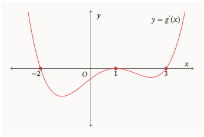{loading="lazy"}

::: r1-figcaption
Hình chỉ minh họa dấu và các nghiệm của đạo hàm $g^\prime$.
:::
::::

::: {#sua-loi-46-de-bai}
<!-- zo-section sua-loi-46-de-bai -->

1. Xác định các khoảng đơn điệu và giải thích.
2. Xét cực trị tại cả ba nghiệm của đạo hàm và nêu căn cứ cho từng kết luận.
3. Ghi các điểm cực trị của đồ thị $g$ mà dữ kiện cho phép xác định.

<!-- /zo-section -->
:::

::: {#g01-s-k-e02-tu-doi-chieu .answer-link}
<!-- zo-section g01-s-k-e02-tu-doi-chieu -->

[Xem lời giải](#lg-g01-s-k-e02)

<!-- /zo-section -->
:::

#### Nhiệm vụ 47 – Xét cực trị tại điểm ghép {#g01-s-k-e03 .zo-learning-task .zo-learning-task--item}


Cho

$$
u(x)=
\begin{cases}
-2x+1 & \text{khi } x<0,\\
x^2+1 & \text{khi } x\geq0.
\end{cases}
$$

::: {#sua-loi-47-de-bai}
<!-- zo-section sua-loi-47-de-bai -->

Kiểm tra xem $u$ có liên tục tại $0$ và có đạo hàm tại đó không. Xét cực trị tại $0$ theo hai cách: dùng dấu đạo hàm ở hai phía và dùng định nghĩa cực trị.

<!-- /zo-section -->
:::

::: {#g01-s-k-e03-tu-doi-chieu .answer-link}
<!-- zo-section g01-s-k-e03-tu-doi-chieu -->

[Xem lời giải](#lg-g01-s-k-e03)

<!-- /zo-section -->
:::

#### Nhiệm vụ 48 – Đọc thông tin cực trị từ mô tả biến thiên {#g01-s-k-e04 .zo-learning-task .zo-learning-task--item}


::: {#sua-loi-48-du-kien}
<!-- zo-section sua-loi-48-du-kien -->

Cho hàm số $m$ liên tục trên $[-5;4]$. Dữ kiện biến thiên cho biết $m$ tăng từ $m(-5)=0$ đến $m(-2)=6$, giảm đến $m(1)=-3$, rồi tăng đến $m(4)=2$. Chỉ xét cực trị tại các điểm bên trong đoạn $[-5;4]$.

<!-- /zo-section -->
:::

1. Ghi điểm cực đại, giá trị cực đại và điểm cực đại của đồ thị.
2. Ghi ba đối tượng tương ứng ở cực tiểu.
3. Sửa câu: “Hàm số có điểm cực đại bằng $6$ và điểm cực tiểu là $(1;-3)$.”

::: {#g01-s-k-e04-tu-doi-chieu .answer-link}
<!-- zo-section g01-s-k-e04-tu-doi-chieu -->

[Xem lời giải](#lg-g01-s-k-e04)

<!-- /zo-section -->
:::

#### Nhiệm vụ 49 – So sánh giá trị trên hai khoảng rời {#g01-s-k-e05 .zo-learning-task .zo-learning-task--item}


Cho

$$
q(x)=
\begin{cases}
x^3+5 & \text{khi } x<0,\\
x^3-5 & \text{khi } x>0.
\end{cases}
$$

trên $D=\mathbb{R}\setminus\{0\}$.

::: {#sua-loi-49-de-bai}
<!-- zo-section sua-loi-49-de-bai -->

Chứng minh $q$ đồng biến trên từng khoảng của $D$. Theo yêu cầu so sánh mọi cặp $x_1<x_2$ thuộc $D$, hàm $q$ có đồng biến trên toàn $D$ không? Hãy giải thích.

<!-- /zo-section -->
:::

::: {#g01-s-k-e05-tu-doi-chieu .answer-link}
<!-- zo-section g01-s-k-e05-tu-doi-chieu -->

[Xem lời giải](#lg-g01-s-k-e05)

<!-- /zo-section -->
:::

#### Nhiệm vụ 50 – Đạo hàm có các lũy thừa chẵn {#g01-s-k-e06 .zo-learning-task .zo-learning-task--item}


Cho hàm số $f$ có đạo hàm trên $\mathbb{R}$ và

$$
f^\prime(x)=x^2(x-2)^2.
$$

::: {#sua-loi-50-de-bai}
<!-- zo-section sua-loi-50-de-bai -->

1. Xét dấu đạo hàm và giải thích vì sao có thể kết luận chiều biến thiên trên toàn $\mathbb{R}$.
2. Xét cực trị tại $0$ và $2$.
3. Sửa câu: “Muốn hàm đồng biến trên $\mathbb{R}$ thì bắt buộc $f^\prime(x)>0$ với mọi $x\in\mathbb{R}$.”

<!-- /zo-section -->
:::

::: {#g01-s-k-e06-tu-doi-chieu .answer-link}
<!-- zo-section g01-s-k-e06-tu-doi-chieu -->

[Xem lời giải](#lg-g01-s-k-e06)

<!-- /zo-section -->
:::

#### Nhiệm vụ 51 – So sánh cực trị của hai hàm số {#g01-s-k-e07 .zo-learning-task .zo-learning-task--item}


Xét hai hàm

$$
r_1(x)=x^3-3x
$$

và

$$
r_2(x)=x^3-3x+5.
$$

1. Chứng minh hai hàm có cùng đạo hàm.
2. Xác định điểm cực trị của mỗi hàm theo hoành độ.
3. So sánh các giá trị cực trị và các điểm cực trị của hai đồ thị.
4. Nêu chính xác điều một đồ thị $y=r^\prime(x)$ cho biết và điều nó chưa cho biết.

::: {#g01-s-k-e07-tu-doi-chieu .answer-link}
<!-- zo-section g01-s-k-e07-tu-doi-chieu -->

[Xem lời giải](#lg-g01-s-k-e07)

<!-- /zo-section -->
:::

#### Nhiệm vụ 52 – Giữ từng vế đúng trong mệnh đề ghép {#g01-s-k-e08 .zo-learning-task .zo-learning-task--item}


Cho $p(x)=x^4$ trên $\mathbb{R}$. Đặt:

- A: “$p^\prime(0)=0$”;
- B: “$p$ đạt cực tiểu tại $0$”;
- C: “$p^\prime(x)>0$ với mọi $x\ne0$”.

1. Đánh giá A, B, C.
2. Đánh giá các mệnh đề “A và C”, “B hoặc C”, “(A và B) và C”, “A hoặc (B và C)”.
3. Một bạn nói: “B hoặc C sai vì C sai.” Hãy giữ phần đúng trong phân tích của bạn và sửa kết luận.

::: {#g01-s-k-e08-tu-doi-chieu .answer-link}
<!-- zo-section g01-s-k-e08-tu-doi-chieu -->

[Xem lời giải](#lg-g01-s-k-e08)

<!-- /zo-section -->
:::

#### Nhiệm vụ 53 – Kiểm tra điều kiện liên tục tại điểm ghép {#g01-s-k-e09 .zo-learning-task .zo-learning-task--item}


Cho

$$
h(x)=
\begin{cases}
x+1 & \text{khi } x<0,\\
0 & \text{khi } x=0,\\
-x+1 & \text{khi } x>0.
\end{cases}
$$

::: {#sua-loi-53-de-bai}
<!-- zo-section sua-loi-53-de-bai -->

1. Nêu dấu đạo hàm ở hai phía của $0$.
2. Kiểm tra tính liên tục tại $0$.
3. Một bạn dùng dấu dương bên trái, âm bên phải để kết luận giá trị tại $0$ lớn hơn các giá trị gần nó. Giải thích vì sao không áp dụng được định lí xét cực trị bằng dấu đạo hàm. Sau đó, so sánh trực tiếp $h(x)$ với $h(0)$ khi $0<|x|<1$.

<!-- /zo-section -->
:::

::: {#g01-s-k-e09-tu-doi-chieu .answer-link}
<!-- zo-section g01-s-k-e09-tu-doi-chieu -->

[Xem lời giải](#lg-g01-s-k-e09)

<!-- /zo-section -->
:::

### Sau Ôn lại {#sua-loi-sau-on-lai data-zo-review-disclosure="closed"}

::: {#sua-loi-sau-on-lai-huong-dan}
<!-- zo-section sua-loi-sau-on-lai-huong-dan -->

Dùng nhóm này khi em phát hiện lỗi trong một lượt Ôn lại. Nếu đó là lỗi em từng sửa, bài ở đây giúp em kiểm tra xem sau một thời gian em còn tự làm đúng được không. Sau khi sửa, quay về Điểm dừng của lượt đang ôn. Nếu vẫn còn vướng, ghi rõ bước cần kiểm lại và hẹn ngày ôn trong [Nhật kí](#nhat-ky).

<!-- /zo-section -->
:::

#### Nhiệm vụ 54 – Điểm hở và điểm kín cùng hoành độ {#g01-s-o-e01 .zo-learning-task .zo-learning-task--item}


Cho

$$
u(x)=
\begin{cases}
(x-1)^2 & \text{khi } x\ne1,\\
2 & \text{khi } x=1.
\end{cases}
$$

Tại hoành độ $1$, đồ thị có điểm hở và điểm kín nào? Kiểm tra tính liên tục và so sánh $u(x)$ với $u(1)$ khi $0<|x-1|<1$.

::: {#g01-s-o-e01-tu-doi-chieu .answer-link}
<!-- zo-section g01-s-o-e01-tu-doi-chieu -->

[Xem lời giải](#lg-g01-s-o-e01)

<!-- /zo-section -->
:::

#### Nhiệm vụ 55 – Đọc dấu đạo hàm qua ba mốc {#g01-s-o-e02 .zo-learning-task .zo-learning-task--item}


Cho hàm $v$ có đạo hàm trên $\mathbb{R}$ và

$$
v^\prime(x)=-(x+4)(x+1)^2(x-2).
$$

::: {#sua-loi-55-de-bai}
<!-- zo-section sua-loi-55-de-bai -->

Một bạn nói: “Đạo hàm có ba nghiệm nên hàm có ba điểm cực trị.” Hãy xét dấu đạo hàm và sửa kết luận của bạn. Có thể gộp những khoảng đồng biến nào? Vì sao?

<!-- /zo-section -->
:::

::: {#g01-s-o-e02-tu-doi-chieu .answer-link}
<!-- zo-section g01-s-o-e02-tu-doi-chieu -->

[Xem lời giải](#lg-g01-s-o-e02)

<!-- /zo-section -->
:::

#### Nhiệm vụ 56 – Cực trị tại điểm ghép {#g01-s-o-e03 .zo-learning-task .zo-learning-task--item}


Cho

$$
w(x)=
\begin{cases}
-x & \text{khi } x<0,\\
x^2 & \text{khi } x\geq0.
\end{cases}
$$

::: {#sua-loi-56-yeu-cau}
<!-- zo-section sua-loi-56-yeu-cau -->

Tại $x=0$, hãy kiểm tra tính liên tục và sự tồn tại của đạo hàm. Sau đó, xét xem $w$ có đạt cực trị tại đó không và giải thích.

<!-- /zo-section -->
:::

::: {#g01-s-o-e03-tu-doi-chieu .answer-link}
<!-- zo-section g01-s-o-e03-tu-doi-chieu -->

[Xem lời giải](#lg-g01-s-o-e03)

<!-- /zo-section -->
:::

#### Nhiệm vụ 57 – Hai hình, ba đối tượng {#g01-s-o-e04 .zo-learning-task .zo-learning-task--item}


::: {#sua-loi-57-doc-hinh}
<!-- zo-section sua-loi-57-doc-hinh -->

Quan sát hai hình dưới đây. Hình A biểu diễn $y=f(x)$. Hình B biểu diễn $y=f^\prime(x)$.

<!-- /zo-section -->
:::

:::: r1-figure
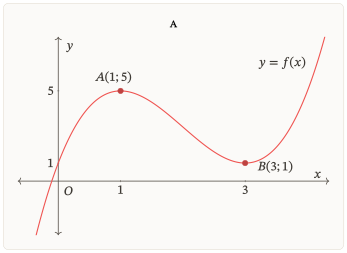{loading="lazy"}

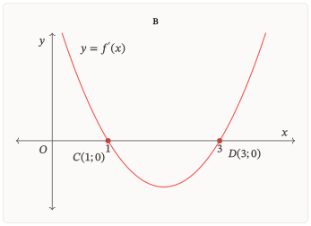{loading="lazy"}
::::

Điền sáu đại lượng: điểm cực đại và cực tiểu của hàm số; hai giá trị cực trị; hai điểm cực trị của đồ thị $f$. Sau đó giải thích vì sao $C$, $D$ không phải là hai điểm cực trị của đồ thị $f$.

::: {#g01-s-o-e04-tu-doi-chieu .answer-link}
<!-- zo-section g01-s-o-e04-tu-doi-chieu -->

[Xem lời giải](#lg-g01-s-o-e04)

<!-- /zo-section -->
:::

#### Nhiệm vụ 58 – So sánh các giá trị trên tập gồm hai khoảng rời {#g01-s-o-e05 .zo-learning-task .zo-learning-task--item}


Cho

$$
s(x)=
\begin{cases}
x^3 & \text{khi } x\leq-1,\\
x^3+1 & \text{khi } x\geq1
\end{cases}
$$

::: {#sua-loi-58-de-bai}
<!-- zo-section sua-loi-58-de-bai -->

trên $D=(-\infty;-1]\cup[1;+\infty)$. Hàm tăng trên từng thành phần. Hãy chứng minh hoặc bác bỏ khẳng định rằng $s(x_1)<s(x_2)$ với mọi $x_1<x_2$ thuộc $D$.

<!-- /zo-section -->
:::

::: {#g01-s-o-e05-tu-doi-chieu .answer-link}
<!-- zo-section g01-s-o-e05-tu-doi-chieu -->

[Xem lời giải](#lg-g01-s-o-e05)

<!-- /zo-section -->
:::

#### Nhiệm vụ 59 – Xét ba nhận định về một hàm số {#g01-s-o-e06 .zo-learning-task .zo-learning-task--item}


Cho $a(x)=x^7$ trên $\mathbb{R}$. Đánh giá ba câu:

1. $a$ đồng biến trên $\mathbb{R}$.
2. $a^\prime(x)>0$ với mọi $x\in\mathbb{R}$.
3. $0$ là điểm cực trị vì $a^\prime(0)=0$.

::: {#g01-s-o-e06-tu-doi-chieu .answer-link}
<!-- zo-section g01-s-o-e06-tu-doi-chieu -->

[Xem lời giải](#lg-g01-s-o-e06)

<!-- /zo-section -->
:::

#### Nhiệm vụ 60 – Biết, chưa biết và sai {#g01-s-o-e07 .zo-learning-task .zo-learning-task--item}


Cho $p$ có đạo hàm trên $\mathbb{R}$. Đạo hàm dương trên $(-\infty;-2)$, âm trên $(-2;1)$ và $(1;+\infty)$; bằng $0$ tại $-2$, $1$. Biết $p(-2)=4$.

::: {#sua-loi-60-de-bai}
<!-- zo-section sua-loi-60-de-bai -->

Với mỗi câu dưới đây, hãy chọn “chắc chắn đúng”, “chắc chắn sai” hoặc “chưa đủ dữ kiện” và giải thích lí do.

<!-- /zo-section -->
:::

a. Điểm cực đại của đồ thị $p$ là $(-2;4)$.

b. $p(1)=0$.

c. $p$ đạt cực tiểu tại $1$.

d. Các dữ kiện xác định duy nhất công thức của $p$.

::: {#g01-s-o-e07-tu-doi-chieu .answer-link}
<!-- zo-section g01-s-o-e07-tu-doi-chieu -->

[Xem lời giải](#lg-g01-s-o-e07)

<!-- /zo-section -->
:::

#### Nhiệm vụ 61 – Kiểm tra lập luận về cực trị {#g01-s-o-e08 .zo-learning-task .zo-learning-task--item}


Một bạn giải bài với $b(x)=-(x+3)^5+4$ như sau:

1. $b^\prime(x)=-5(x+3)^4\leq0$ trên $\mathbb{R}$.
2. Đạo hàm chỉ bằng $0$ tại $-3$, nên $b$ nghịch biến trên $\mathbb{R}$.
3. Vì $b^\prime(-3)=0$, hàm đạt cực đại tại $-3$.

::: {#sua-loi-61-de-bai}
<!-- zo-section sua-loi-61-de-bai -->

Hãy xác định bước nào đúng, bước nào sai và giải thích. Giữ các bước đúng khi viết lại lời giải.

<!-- /zo-section -->
:::

::: {#g01-s-o-e08-tu-doi-chieu .answer-link}
<!-- zo-section g01-s-o-e08-tu-doi-chieu -->

[Xem lời giải](#lg-g01-s-o-e08)

<!-- /zo-section -->
:::

#### Nhiệm vụ 62 – Tham số tại điểm ghép {#g01-s-o-e09 .zo-learning-task .zo-learning-task--item}


Với $a\in\mathbb{R}$, cho

$$
g_a(x)=
\begin{cases}
x+2 & \text{khi } x<0,\\
a & \text{khi } x=0,\\
2-x & \text{khi } x>0.
\end{cases}
$$

::: {#sua-loi-62-yeu-cau}
<!-- zo-section sua-loi-62-yeu-cau -->

1. Tìm $a$ để $g_a$ liên tục tại $0$.
2. Xét cực trị tại $0$ trong trường hợp liên tục vừa tìm được.
3. **Làm thêm.** Khi $a>2$ hoặc $a<2$, hãy so sánh $g_a(x)$ với $g_a(0)$ khi $x$ đủ gần $0$ và $x\ne0$. Giải thích vì sao không áp dụng được định lí đổi dấu đạo hàm trong hai trường hợp này.

<!-- /zo-section -->
:::

::: {#g01-s-o-e09-tu-doi-chieu .answer-link}
<!-- zo-section g01-s-o-e09-tu-doi-chieu -->

[Xem lời giải](#lg-g01-s-o-e09)

<!-- /zo-section -->
:::

## Nhật kí {#nhat-ky}



## Lời giải {#loi-giai data-zo-solution-prompts="true"}

::: {#cach-thuc-hien-dung-loi-giai data-zo-instructions="required"}
<!-- zo-section cach-thuc-hien-dung-loi-giai lesson-intro -->

Sau khi tự làm, mở lời giải của nhiệm vụ cần đối chiếu. So từng bước trong bài làm của em với lời giải, từ điều kiện áp dụng đến kết quả. Bấm **Hiện đề bài** nếu em cần đọc lại đề ngay trong khung. [Mũi tên trong mỗi khung đưa em về chỗ đã bấm **Xem lời giải**. Nếu em mở lời giải từ mục lục, mũi tên dẫn về phần đề tương ứng.]{data-zo-solution-return="inline"}

Với **Kiểm tra**, hãy làm xong cả bài rồi mới mở lời giải. Cách tính điểm từng ý nằm trong lời giải của mỗi nhiệm vụ.

<!-- /zo-section -->
:::

### Bài học {#loi-giai-bai-hoc data-zo-solution-group="true"}

#### Khởi động {#loi-giai-khoi-dong}

:::::: {#g01-loi-giai-khoi-dong .r1-solution-group}

[]{#b.1.-câu-thử-nền}

:::: {#lg-khoi-dong .r1-solution-item}
::: {#lg-g01-khoi-dong-01 .r1-details .r1-solution .zo-learning-solution}
::: {.r1-summary .zo-learning-summary}
Nhiệm vụ 01 — Tập xác định và khoảng áp dụng
:::

::: {#loi-giai-khoi-dong-01-can-cu}
<!-- zo-section loi-giai-khoi-dong-01-can-cu -->

Tập xác định là $D=\mathbb{R}\setminus\{2\}$. Khoảng $(1;3)$ chứa $2$, nên không nằm trọn trong $D$. Vì vậy, không thể áp dụng định lí về dấu đạo hàm trên cả khoảng $(1;3)$.

<!-- /zo-section -->
:::

:::

::: {#lg-g01-khoi-dong-02 .r1-details .r1-solution .zo-learning-solution}
::: {.r1-summary .zo-learning-summary}
Nhiệm vụ 02 — Đạo hàm và dấu hai phía
:::

::: {#loi-giai-02-giai-thich}
<!-- zo-section loi-giai-02-giai-thich -->

$s^\prime(x)=2x-2=2(x-1)$. Vì $2>0$, đạo hàm có cùng dấu với $x-1$. Do đó, $s^\prime(x)<0$ khi $x<1$, bằng $0$ khi $x=1$ và dương khi $x>1$.

<!-- /zo-section -->
:::

:::

::: {#lg-g01-khoi-dong-03 .r1-details .r1-solution .zo-learning-solution}
::: {.r1-summary .zo-learning-summary}
Nhiệm vụ 03 — Đọc hàng và chiều mũi tên
:::

Mũi tên đi lên trên $(-2;0)$ và đi xuống trên $(0;2)$. Số $3$ thuộc hàng $f(x)$, ở cột $x=0$; đó là $f(0)$, không phải một hoành độ.

:::

::: {#lg-g01-khoi-dong-04 .r1-details .r1-solution .zo-learning-solution}
::: {.r1-summary .zo-learning-summary}
Nhiệm vụ 04 — Phân biệt đồ thị hàm số và đạo hàm
:::

::: {#loi-giai-khoi-dong-04-can-cu}
<!-- zo-section loi-giai-khoi-dong-04-can-cu -->

Đồ thị biểu diễn $y=f^\prime(x)$ và nằm dưới trục hoành trên $K$, nên $f^\prime(x)<0$ trên $K$. Do đó $f$ nghịch biến trên $K$. Dữ kiện này chưa xác định được dấu của $f(x)$.

<!-- /zo-section -->
:::

:::

::::
::::::

::: {#loi-giai-khoi-dong-ve-de .answer-link}
<!-- zo-section loi-giai-khoi-dong-ve-de -->

[Xem đề bài](#bắt-đầu-từ-đâu)

<!-- /zo-section -->
:::

#### Nhiệm vụ trong Bài học {#g01-loi-giai-tu-kiem-tra}

:::::: {#loi-giai-1 .r1-solution-group}

[]{#b.2.-các-điểm-dừng}

:::: {#lg-d01 .r1-details .r1-solution .zo-learning-solution}
::: {.r1-summary .zo-learning-summary}
Nhiệm vụ 05 — Hai đầu mút chưa quyết định cả khoảng
:::

::: {#loi-giai-05-hai-dau-mut}
<!-- zo-section loi-giai-05-hai-dau-mut -->

Đề chỉ xét hàm số trên khoảng mở $(a;b)$, nên chưa chắc $f(a)$ và $f(b)$ tồn tại. Ngay cả khi cả hai tồn tại, bất đẳng thức $f(a)<f(b)$ chỉ so sánh được hai đầu mút. Chẳng hạn, $f(x)=x^3-3x+1$ có $f(-2)=-1<3=f(2)$, nhưng $f^\prime(x)=3x^2-3<0$ trên $(-1;1)$. Vì vậy, $f$ nghịch biến trên một phần của $(-2;2)$ và không thể đồng biến trên cả khoảng này.

<!-- /zo-section -->
:::

::: answer-link
[Xem đề bài](#dừng-lại-1-d01)
:::
::::

:::: {#lg-d02 .r1-details .r1-solution .zo-learning-solution}
::: {.r1-summary .zo-learning-summary}
Nhiệm vụ 06 — Một nghiệm không đổi dấu
:::

::: {#loi-giai-06-cung-chieu}
<!-- zo-section loi-giai-06-cung-chieu -->

Hàm $h$ có đạo hàm trên $\mathbb{R}$. Đạo hàm không âm và chỉ bằng $0$ tại $x=-2$, nên $h$ đồng biến trên $\mathbb{R}$. Có thể đánh dấu $-2$ trong bảng dấu để ghi nơi đạo hàm bằng $0$, rồi kết luận đồng biến trên cả khoảng vì dấu của đạo hàm vẫn dương ở hai phía.

<!-- /zo-section -->
:::

::: answer-link
[Xem đề bài](#dừng-lại-2-d02)
:::
::::

:::: {#lg-d03 .r1-details .r1-solution .zo-learning-solution}
::: {.r1-summary .zo-learning-summary}
Nhiệm vụ 07 — Kiểm nét vẽ bằng dấu đạo hàm
:::

::: {#loi-giai-07-net-ve}
<!-- zo-section loi-giai-07-net-ve -->

Vì $p^\prime(x)<0$ với mọi $x\in(-1;1)$, đồ thị của $p$ phải đi xuống trên cả khoảng này. Một nét đi lên giữa hai mốc làm hình vẽ sai, dù cả hai điểm mốc đều đúng.

<!-- /zo-section -->
:::

::: answer-link
[Xem đề bài](#dừng-lại-3-d03)
:::
::::

:::: {#lg-d04 .r1-details .r1-solution .zo-learning-solution}
::: {.r1-summary .zo-learning-summary}
Nhiệm vụ 08 — Cực trị khi chưa biết đạo hàm tại mốc
:::

::: {#loi-giai-08-tai-moc}
<!-- zo-section loi-giai-08-tai-moc -->

Hàm $w$ liên tục tại $0$ và có đạo hàm ở hai phía. Đạo hàm đổi dấu từ dương sang âm qua $0$, nên $w$ đạt cực đại tại $0$ với giá trị $5$. Định lí dùng dấu đạo hàm ở hai phía và tính liên tục tại mốc, nên vẫn áp dụng được khi chưa biết $w^\prime(0)$.

<!-- /zo-section -->
:::

::: answer-link
[Xem đề bài](#dừng-lại-4-d04)
:::
::::

:::: {#lg-d05 .r1-details .r1-solution .zo-learning-solution}
::: {.r1-summary .zo-learning-summary}
Nhiệm vụ 09 — Gọi đúng đối tượng cực trị
:::

::: {#loi-giai-09-ba-doi-tuong}
<!-- zo-section loi-giai-09-ba-doi-tuong -->

Hàm $p$ đạt cực tiểu tại $x=1$, với giá trị cực tiểu $p(1)=-1$. Điểm cực tiểu của đồ thị là $B(1;-1)$.

<!-- /zo-section -->
:::

::: answer-link
[Xem đề bài](#dừng-lại-5-d05)
:::
::::

:::: {#lg-d06 .r1-details .r1-solution .zo-learning-solution}
::: {.r1-summary .zo-learning-summary}
Nhiệm vụ 10 — Giới hạn suy luận từ đồ thị đạo hàm
:::

::: {#loi-giai-10-doc-do-thi}
<!-- zo-section loi-giai-10-doc-do-thi -->

Vì $f$ có đạo hàm trên $\mathbb{R}$ nên liên tục tại $2$. Đạo hàm âm trên $(-\infty;2)$, dương trên $(2;+\infty)$, nên $f$ nghịch biến rồi đồng biến qua $2$ và đạt cực tiểu tại đó. Điểm $(2;0)$ nằm trên đồ thị của đạo hàm, nên tung độ $0$ cho biết $f^\prime(2)=0$. Muốn biết giá trị cực tiểu $f(2)$, cần thêm dữ kiện về chính hàm $f$.

<!-- /zo-section -->
:::

::: answer-link
[Xem đề bài](#dừng-lại-6-d06)
:::
::::

::::::

:::::: {#g01-loi-giai-sua-loi-mau .r1-details .r1-solution .zo-learning-solution}
::: {.r1-summary .zo-learning-summary}
Nhiệm vụ 11 — Xét dấu và giới hạn dữ kiện
:::

[]{#b.3.-lời-giải-câu-sau-chữa-cg01}

:::: {#lg-cg01 .r1-solution-item}
Vì $g$ có đạo hàm trên $\mathbb{R}$, nó liên tục tại cả $-1$ và $2$. Khi $x\ne 2$, thừa số $(x-2)^2$ dương nên dấu của $g^\prime(x)$ là dấu của $x+1$.

:::: table-scroll
::: {.r1-bbt bbt="BBT10" caption="Bảng dấu đạo hàm."}
ZO BBT placeholder
:::
::::

- $g$ nghịch biến trên $(-\infty;-1)$.
- Trên $(-1;+\infty)$, đạo hàm dương trừ một điểm $x=2$ tại đó bằng $0$. Vì vậy $g$ đồng biến trên toàn khoảng $(-1;+\infty)$.
- Qua $-1$, đạo hàm đổi từ âm sang dương; $g$ đạt cực tiểu tại $-1$.
- Qua $2$, đạo hàm dương ở cả hai phía; $g$ không đạt cực trị tại $2$.
- Không có điểm cực đại: ngoài hai mốc trên, hàm số giữ chiều biến thiên trong một khoảng quanh mỗi điểm.
- Chưa xác định được giá trị $g(-1)$. Nếu một hàm $g$ thỏa dữ kiện, thì $g+1$ cũng có cùng đạo hàm nhưng giá trị tại $-1$ lớn hơn $1$ đơn vị. Đạo hàm đã cho không ấn định giá trị cực tiểu.

::: {#loi-giai-11-doi-chieu}
<!-- zo-section loi-giai-11-doi-chieu -->

<!-- Giữ điểm neo của vùng đã gộp vào lời giải. -->

<!-- /zo-section -->
:::

::: answer-link
[Xem đề bài](#câu-sau-chữa-cg01)
:::
::::
::::::

### Luyện tập {#loi-giai-luyen-tap data-zo-solution-group="true"}

::::: {#loi-giai-2 .r1-details .r1-solution .zo-learning-solution}
::: {.r1-summary .zo-learning-summary}
Nhiệm vụ 12 – Ghép công thức, bảng và đồ thị
:::

$D=\mathbb{R}$; $f$ là đa thức nên liên tục và có đạo hàm trên tập xác định. Ta có
$$f^\prime(x)=3x^2-12x+9=3(x-1)(x-3).$$
Dấu lần lượt dương, âm, dương trên $(-\infty;1)$, $(1;3)$, $(3;+\infty)$.

Vì vậy $f$ đồng biến trên $(-\infty;1)$ và $(3;+\infty)$, nghịch biến trên $(1;3)$. $f(1)=3$, $f(3)=-1$; các giới hạn ở hai đầu lần lượt là $-\infty$, $+\infty$.

::: {#loi-giai-12-doi-chieu-hinh}
<!-- zo-section loi-giai-12-doi-chieu-hinh -->

Bảng I khớp với kết quả xét dấu. Bảng II ghi dấu dương trên $(1;3)$, trong khi $f^\prime(x)<0$ trên khoảng này. Mũi tên đi lên của Bảng II cũng không phù hợp với việc giá trị giảm từ $3$ xuống $-1$.

Hình A đi xuống từ $(1;3)$ đến $(3;-1)$, đúng với chiều biến thiên và hai giá trị $f(1)=3$, $f(3)=-1$. Hình B đi lên từ $(1;-3)$ đến $(3;1)$, sai cả chiều biến thiên trên $(1;3)$ lẫn giá trị hàm số tại hai mốc.

<!-- /zo-section -->
:::

Hàm số đạt cực đại tại $1$, giá trị cực đại $3$, điểm cực đại đồ thị $(1;3)$. Hàm số đạt cực tiểu tại $3$, giá trị cực tiểu $-1$, điểm cực tiểu đồ thị $(3;-1)$.

::: {#loi-giai-12-bai-on}
<!-- zo-section loi-giai-12-bai-on -->

Nếu em còn nhầm giữa hoành độ cực trị, giá trị cực trị và tọa độ của điểm trên đồ thị, làm [Nhiệm vụ 40](#sc04) để tập ghi riêng ba đối tượng này.

<!-- /zo-section -->
:::

::: {.content-visible when-format="html"}

```{=html}
<details class="zo-block zo-block-gray zo-learning-video" id="video-l01" data-youtube-id="RshIFZEN4Cg" data-public-playback="public">
<summary class="zo-block-title">Video: Bảng và đồ thị nào khớp công thức?</summary>
<div class="zo-block-body">
<div class="zo-video-player"></div>
</div>
</details>
```

:::

::: answer-link
[Xem đề bài](#lt01)
:::
:::::

::::: {#loi-giai-3 .r1-details .r1-solution .zo-learning-solution}
::: {.r1-summary .zo-learning-summary}
Nhiệm vụ 13 – Mốc đạo hàm bằng không
:::

::::: {#loi-giai-13-dau-dao-ham}
<!-- zo-section loi-giai-13-dau-dao-ham -->

Trên $\mathbb{R}$, $g$ có đạo hàm âm tại mọi điểm trừ $x=-1$, nơi $g^\prime(-1)=0$. Đạo hàm chỉ bằng $0$ tại một điểm và âm ở mọi điểm còn lại, nên $g$ nghịch biến trên cả $\mathbb{R}$.

<!-- /zo-section -->
:::::

Hai kết luận nghịch biến trên hai khoảng nhỏ vốn đúng nhưng chưa mạnh nhất. Phần “không thể kết luận trên $\mathbb{R}$” sai. Tại $-1$, đạo hàm âm ở cả hai phía và hàm liên tục, nên không có cực trị. Phần dùng một điểm có đạo hàm bằng 0 để kết luận cực trị sai.

::: {#loi-giai-13-cau-sua}
<!-- zo-section loi-giai-13-cau-sua -->

Câu sửa: “Hàm $g$ nghịch biến trên $\mathbb{R}$. Tại $-1$, đạo hàm bằng $0$ nhưng vẫn âm ở cả hai phía, nên $g$ không đạt cực trị tại đó.”

Để kiểm tra lại kết luận khi đạo hàm bằng $0$ mà vẫn âm ở hai phía, em có thể làm [Nhiệm vụ 38](#sc02).

<!-- /zo-section -->
:::

::: answer-link
[Xem đề bài](#lt02)
:::
:::::

::::: {#loi-giai-4 .r1-details .r1-solution .zo-learning-solution}
::: {.r1-summary .zo-learning-summary}
Nhiệm vụ 14 – Đọc đồ thị đạo hàm
:::

::::: {#loi-giai-14-bang-dau}
<!-- zo-section loi-giai-14-bang-dau -->

Từ đồ thị $y=h^\prime(x)$ và dấu đã cho ngoài khung hình, ta có bảng dấu sau.

:::: table-scroll
| $x$ | $(-\infty;-2)$ | $-2$ | $(-2;1)$ | $1$ | $(1;+\infty)$ |
|:---|:---:|:---:|:---:|:---:|:---:|
| $h^\prime(x)$ | $-$ | $0$ | $+$ | $0$ | $+$ |
::::

Hàm $h$ nghịch biến trên $(-\infty;-2)$ vì $h^\prime(x)<0$ trên khoảng này. Trên $(-2;+\infty)$, $h$ có đạo hàm dương tại mọi điểm trừ $x=1$, nơi $h^\prime(1)=0$. Vì vậy, $h$ đồng biến trên cả $(-2;+\infty)$.

Hàm $h$ có đạo hàm nên liên tục tại $-2$ và $1$. Qua $-2$, đạo hàm đổi từ âm sang dương nên $h$ đạt cực tiểu. Qua $1$, đạo hàm dương ở cả hai phía nên $h$ tiếp tục đồng biến và không có cực trị tại đó.

<!-- /zo-section -->
:::::

::: {#loi-giai-14-doc-gia-tri}
<!-- zo-section loi-giai-14-doc-gia-tri -->

Do $h(-2)=4$, điểm cực tiểu của đồ thị $h$ là $(-2;4)$. Điểm $(1;0)$ trên hình cho biết $h^\prime(1)=0$. Dữ kiện chưa xác định được $h(1)$.

Nếu em lấy tung độ của đồ thị đạo hàm làm giá trị của hàm số, làm [Nhiệm vụ 43](#sc07) để xem hai hàm có cùng đạo hàm vẫn có thể khác nhau về giá trị như thế nào.

<!-- /zo-section -->
:::

::: {.content-visible when-format="html"}

```{=html}
<details class="zo-block zo-block-gray zo-learning-video" id="video-l03" data-youtube-id="GYdaSqDGxjw" data-public-playback="public">
<summary class="zo-block-title">Video: Đồ thị đạo hàm cho biết gì về giá trị hàm?</summary>
<div class="zo-block-body">
<div class="zo-video-player"></div>
</div>
</details>
```

:::

::: answer-link
[Xem đề bài](#lt03)
:::
:::::

::::::: {#loi-giai-5 .r1-details .r1-solution .zo-learning-solution}
::: {.r1-summary .zo-learning-summary}
Nhiệm vụ 15 – Một góc và một điểm bị bỏ
:::

$u$ liên tục trên $\mathbb{R}$ và $u(-1)=-2$. Bên trái $-1$, đạo hàm bằng $-1$; bên phải bằng $1$. Tại $-1$, hai giới hạn của thương sai phân bằng $-1$ và $1$, nên đạo hàm không tồn tại.

Vì $u$ liên tục và đạo hàm đổi từ âm sang dương, $u$ đạt cực tiểu tại $-1$, giá trị $-2$, điểm đồ thị $(-1;-2)$. Cũng có thể dùng $u(x)>-2$ với mọi $x\ne-1$.

Đối với $v$, $-1$ không thuộc tập xác định nên không thể là điểm cực trị. Đồ thị $u$ có điểm kín ở $(-1;-2)$, đồ thị $v$ có điểm hở. Trong bảng của $u$, hàng hàm số giữ giá trị $-2$ tại mốc dù hàng đạo hàm ghi không tồn tại. Bảng của $v$ phải thể hiện điểm không thuộc tập xác định qua hàng hàm số; giới hạn bằng $-2$ không được gọi là $v(-1)$.

:::: r1-figure
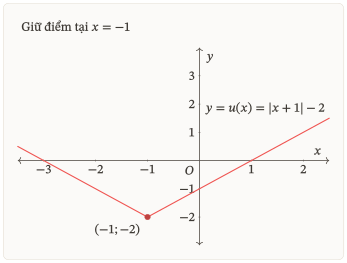{loading="lazy"}

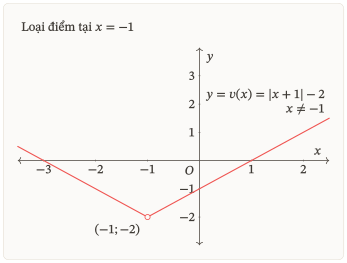{loading="lazy"}

::: r1-figcaption
Đối chiếu nhiệm vụ 15 của Luyện tập — Điểm kín và điểm hở.
:::
::::

::: {#loi-giai-15-bai-on}
<!-- zo-section loi-giai-15-bai-on -->

- Nếu em kết luận $v$ đạt cực tiểu tại $-1$, làm [Nhiệm vụ 37](#sc01) để kiểm lại tập xác định trước khi xét cực trị.
- Nếu em loại cực tiểu của $u$ chỉ vì $u^\prime(-1)$ không tồn tại, làm [Nhiệm vụ 39](#sc03) để xét cực trị tại một điểm ghép.

<!-- /zo-section -->
:::

::: {.content-visible when-format="html"}

```{=html}
<details class="zo-block zo-block-gray zo-learning-video" id="video-l04" data-youtube-id="FK-P8Nb9-0M" data-public-playback="public">
<summary class="zo-block-title">Video: Đổi tập xác định, cực trị có đổi?</summary>
<div class="zo-block-body">
<div class="zo-video-player"></div>
</div>
</details>
```

:::

::: answer-link
[Xem đề bài](#lt04)
:::
:::::::

::::: {#loi-giai-6 .r1-details .r1-solution .zo-learning-solution}
::: {.r1-summary .zo-learning-summary}
Nhiệm vụ 16 – Đọc bảng không có hàng đạo hàm
:::

$r$ nghịch biến trên $(-3;0)$ và $(2;4)$, đồng biến trên $(0;2)$. Từ bảng và tính liên tục, hàm đạt cực tiểu tại $0$ với giá trị $-2$, cực đại tại $2$ với giá trị $1$. Hai điểm cực trị đồ thị là $(0;-2)$ và $(2;1)$.

Không được điền dấu đạo hàm nghiêm ngặt vì đề chưa cho có đạo hàm. Ngay cả khi thêm có đạo hàm trên $(0;2)$, chỉ kết luận $r^\prime(x)\geq0$ trên khoảng ấy. Để thấy dấu bằng có thể xảy ra, trên $[0;2]$ dùng $r(x)=\frac32(x-1)^3-\frac12$: hàm tăng từ $-2$ đến $1$ nhưng đạo hàm tại $1$ bằng $0$. Nối liên tục với các đoạn thẳng giảm ở hai phần còn lại sẽ cho một hàm phù hợp toàn bảng.

::: {#loi-giai-16-gioi-han-bang}
<!-- zo-section loi-giai-16-gioi-han-bang -->

Bảng không xác định duy nhất công thức. Trên $[0;2]$, đường thẳng $r(x)=-2+\frac32x$ và đường cong vừa nêu đều tăng qua đúng hai giá trị đầu mút nhưng khác nhau bên trong. Giữ nguyên các phần khác sẽ được hai hàm khác nhau có cùng bảng.

Nếu em suy ra $r^\prime(x)>0$ từ mũi tên đi lên, làm [Nhiệm vụ 42](#sc06) để kiểm lại trường hợp một hàm đồng biến có đạo hàm bằng $0$ tại một điểm.

<!-- /zo-section -->
:::

::: {.content-visible when-format="html"}

```{=html}
<details class="zo-block zo-block-gray zo-learning-video" id="video-l05" data-youtube-id="Ec4Y_drZlv0" data-scheduled-at="2026-11-05T12:00:00+07:00" data-public-playback="public">
<summary class="zo-block-title">Video: Thiếu hàng đạo hàm, vẫn đọc được cực trị?</summary>
<div class="zo-block-body">
<div class="zo-video-player"></div>
</div>
</details>
```

:::

::: answer-link
[Xem đề bài](#lt05)
:::
:::::

::::: {#loi-giai-7 .r1-details .r1-solution .zo-learning-solution}
::: {.r1-summary .zo-learning-summary}
Nhiệm vụ 17 – Hai nhánh cùng đi lên
:::

Trên mỗi khoảng $(-\infty;1)$ và $(1;+\infty)$, $q^\prime(x)=1>0$, nên $q$ đồng biến trên từng khoảng.

Tuy nhiên, $0<2$ nhưng $q(0)=3>-1=q(2)$. Do đó không thỏa yêu cầu đồng biến với mọi cặp điểm trong cả tập $D$. Một cặp phản ví dụ đủ bác bỏ. Điểm $1$ bị loại khỏi tập xác định nên không thể là điểm cực trị.

::: {#loi-giai-17-hai-khoang}
<!-- zo-section loi-giai-17-hai-khoang -->

- Nếu em suy ra $q$ đồng biến trên cả $D$ chỉ vì từng nhánh đều đi lên, làm [Nhiệm vụ 41](#sc05) để kiểm tra cách so sánh hai điểm ở hai nhánh.
- Nếu em tính $q(1)$ hoặc xét cực trị tại $1$, làm [Nhiệm vụ 37](#sc01) để kiểm tra lại việc loại điểm khỏi tập xác định.

<!-- /zo-section -->
:::

::: answer-link
[Xem đề bài](#lt06)
:::
:::::

:::::: {#loi-giai-8 .r1-details .r1-solution .zo-learning-solution}
::: {.r1-summary .zo-learning-summary}
Nhiệm vụ 18 – Đúng/sai với cùng một giả thiết
:::

$t^\prime(x)=3(x+2)^2$, dương trừ tại $-2$, nơi bằng $0$. Vì vậy $t$ đồng biến trên $\mathbb{R}$ và không có cực trị tại $-2$.

::: {#r1-table-t14 .table-scroll}
| Ý | Đánh giá | Căn cứ | Cách sửa nếu sai |
|---|---|---|---|
| a | Sai | Vế đồng biến đúng, vế đạo hàm dương tại $-2$ sai | $t$ đồng biến trên $\mathbb{R}$ và $t^\prime(-2)=0$ |
| b | Đúng | Vế thứ nhất đúng, đủ để mệnh đề “hoặc” đúng | Giữ nguyên |
| c | Sai | $x=-2$ là phản ví dụ cho “mọi” | Với mọi $x\ne-2$, ta có $t^\prime(x)>0$; tại $-2$ đạo hàm bằng $0$ |
| d | Sai | Cả hai vế đều sai | $t$ không có cực trị tại $-2$ hoặc $t^\prime(-2)=0$ |
:::

::: {#loi-giai-18-menh-de}
<!-- zo-section loi-giai-18-menh-de -->

Ở ý d, cả hai vế ban đầu đều sai. Câu sửa trong bảng có cả hai vế đúng. Một vế sai đủ để bác bỏ mệnh đề “và”. Với mệnh đề “hoặc”, cần kiểm tra vế còn lại.

Nếu em bác bỏ ý b chỉ vì vế nói về cực đại sai, làm [Nhiệm vụ 44](#sc08) để kiểm lại cách xét hai vế của mệnh đề “hoặc”.

<!-- /zo-section -->
:::

::: answer-link
[Xem đề bài](#lt07)
:::
::::::

::::: {#loi-giai-9 .r1-details .r1-solution .zo-learning-solution}
::: {.r1-summary .zo-learning-summary}
Nhiệm vụ 19 – Sửa một lời giải rồi làm câu mới
:::

Hàm $r$ tăng trên $(-\infty;-3)$ rồi giảm trên $(-3;+\infty)$; mốc $1$ chỉ là một điểm đạo hàm bằng $0$ trong khoảng giảm. Qua $-3$, đạo hàm đổi từ dương sang âm nên $r$ đạt cực đại. Qua $1$, đạo hàm âm ở cả hai phía nên không có cực trị.

Lời giải mắc “coi đạo hàm bằng 0 là đủ để có cực trị” khi đếm điểm có đạo hàm bằng 0 thành số điểm cực trị, và “nhầm điểm, giá trị và tọa độ cực trị” khi gọi các giá trị $5$, $-2$ là điểm cực trị của hàm số.

Kết luận đúng: hàm số có một điểm cực trị, đó là điểm cực đại $x=-3$; giá trị cực đại $r(-3)=5$; điểm cực đại đồ thị $(-3;5)$. Tại $1$ không có cực trị, dù $r(1)=-2$ là một giá trị được cho.

::: {#loi-giai-19-bai-xac-nhan}
<!-- zo-section loi-giai-19-bai-xac-nhan -->

Sau khi sửa xong lời giải của Nhiệm vụ 19, làm [Nhiệm vụ 20 – Xác nhận sau sửa](#g01-l08-xn01) để kiểm tra xem em có phân biệt được nghiệm của đạo hàm với điểm cực trị trong một bài mới hay không.

<!-- /zo-section -->
:::

::: {.content-visible when-format="html"}

```{=html}
<details class="zo-block zo-block-gray zo-learning-video" id="video-l08" data-youtube-id="zg_XSrCBKbg" data-scheduled-at="2026-11-07T12:00:00+07:00" data-public-playback="public">
<summary class="zo-block-title">Video: Hai nghiệm đạo hàm: Lời giải sai ở đâu?</summary>
<div class="zo-block-body">
<div class="zo-video-player"></div>
</div>
</details>
```

:::

::: answer-link
[Xem đề bài](#lt08)
:::
:::::

::::: {#lg-g01-l08-xn01 .r1-details .r1-solution .zo-learning-solution}
::: {.r1-summary .zo-learning-summary}
Đáp án câu xác nhận sau nhiệm vụ 19 của Luyện tập
:::

Đạo hàm âm trên $(-\infty;-5)$ và $(-5;4)$, dương trên $(4;+\infty)$. Vì $h$ có đạo hàm trên $\mathbb{R}$ và dấu âm ở hai phía của $-5$, hàm nghịch biến trên toàn $(-\infty;4)$. Hàm đồng biến trên $(4;+\infty)$.

Tại $-5$, đạo hàm không đổi dấu nên không có cực trị. Tại $4$, dấu đổi từ âm sang dương nên $h$ đạt cực tiểu. Điểm cực tiểu của hàm số là $4$; giá trị cực tiểu là $-7$; điểm cực tiểu của đồ thị là $(4;-7)$. Nhận xét “đạo hàm có hai nghiệm $-5$, $4$” đúng; hai lỗi là đếm mọi nghiệm thành cực trị và dùng hoành độ $4$ làm giá trị cực tiểu.

::: answer-link
[Xem đề bài](#g01-l08-xn01)
:::
:::::

### Kiểm tra {#loi-giai-kiem-tra data-zo-solution-group="true"}

:::::::::: {#loi-giai-10 .r1-details .r1-solution .zo-learning-solution}
::: {.r1-summary .zo-learning-summary}
Nhiệm vụ 21 – Dựng chuỗi biểu diễn
:::

::: {#r1-table-t15 .table-scroll}
| Ý | Căn cứ cho điểm | Điểm |
|---|---|---|
| a | $D=\mathbb{R}$; $f^\prime(x)=-3x^2+6x+9=-3(x+1)(x-3)$. Tập xác định: $0{,}25$ điểm; đạo hàm: $0{,}75$ điểm. | $1$ |
| b | Dấu âm, dương, âm trên ba khoảng tách bởi $-1$, $3$; bằng $0$ tại hai mốc | $1$ |
| c | Nghịch biến trên $(-\infty;-1)$ và $(3;+\infty)$; đồng biến trên $(-1;3)$ | $1$ |
| d | Bảng và phác hình như dưới, cùng tập xác định và mốc. Bảng: $0{,}5$ điểm; hình: $0{,}5$ điểm. | $1$ |
| e | Cực tiểu tại $-1$, giá trị $-9$; cực đại tại $3$, giá trị $23$. Mỗi cặp: $0{,}5$ điểm. | $1$ |
:::

Vì $f$ là đa thức nên các giả thiết liên tục và có đạo hàm được bảo đảm. Ta có $f(-1)=-9$, $f(3)=23$. Hệ số bậc ba âm cho giới hạn ở $-\infty$ là $+\infty$, ở $+\infty$ là $-\infty$.

:::: table-scroll
::: {.r1-bbt bbt="BBT11" caption="Bảng biến thiên."}
ZO BBT placeholder
:::
::::

:::: r1-figure
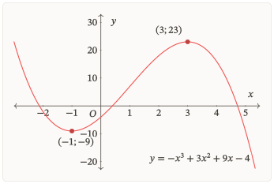{loading="lazy"}

::: r1-figcaption
nhiệm vụ 21 của Kiểm tra — Dáng điệu đồ thị để đối chiếu sau khi làm.
:::
::::

Hình học sinh không cần trùng tỉ lệ hình mẫu, nhưng phải có đúng thứ tự tăng giảm, đúng mốc, tung độ và sự nối liền. Không đòi giao điểm với trục hoành hoặc những tính chất ngoài câu hỏi.

::: {#loi-giai-21-bai-on}
<!-- zo-section loi-giai-21-bai-on -->

- Nếu em đặt sai dấu giữa $-1$ và $3$, xem thẻ [Xét dấu biểu thức có nhân tử](#nen-n-dau-01) và kiểm lại dấu của từng thừa số.
- Nếu em nhầm hoành độ với giá trị cực trị, làm [Nhiệm vụ 48](#g01-s-k-e04) để luyện cách ghi riêng hoành độ, giá trị và tọa độ điểm trên đồ thị.

<!-- /zo-section -->
:::

::::::::::

::::: {#loi-giai-11 .r1-details .r1-solution .zo-learning-solution}
::: {.r1-summary .zo-learning-summary}
Nhiệm vụ 22 – Xét hàm số từ đồ thị đạo hàm
:::

::::: {#loi-giai-22-cac-y}
<!-- zo-section loi-giai-22-cac-y -->

a.  Đạo hàm $k^\prime$ dương trên $(-4;-3)$, âm trên $(-3;-1)$, dương trên $(-1;2)$ và $(2;3)$. Đạo hàm bằng $0$ tại $-3$, $-1$ và $2$. Hàm $k$ đồng biến trên $(-4;-3)$ và nghịch biến trên $(-3;-1)$. Trên $(-1;3)$, $k$ có đạo hàm dương ở mọi điểm trừ $x=2$, nơi $k^\prime(2)=0$. Vì vậy, $k$ đồng biến trên cả $(-1;3)$. **1 điểm:** 0,5 cho các khoảng nhỏ đúng; 0,5 cho kết luận qua $2$ và lí do.

b.  $k$ có đạo hàm trên $K$ nên liên tục tại các mốc. Dương sang âm tại $-3$ cho cực đại; âm sang dương tại $-1$ cho cực tiểu. **1 điểm:** mỗi mốc và lí do 0,5.

c.  $2$ không là điểm cực trị vì đạo hàm dương ở cả hai phía, dù bằng $0$ tại $2$. **1 điểm:** kết luận 0,5; lí do 0,5.

d.  Chưa biết các giá trị cực trị. Nếu $k$ phù hợp thì $k+C$ có cùng đạo hàm nhưng dịch mọi giá trị thêm $C$. Không có giá trị nào của $k$ được cho để định vị tung độ. **1 điểm:** kết luận 0,5; lí do 0,5.

<!-- /zo-section -->
:::::

::: {#loi-giai-22-xem-lai}
<!-- zo-section loi-giai-22-xem-lai -->

- Nếu em kết luận $x=2$ là điểm cực trị, làm [Nhiệm vụ 46](#g01-s-k-e02) để kiểm tra dấu đạo hàm ở hai phía.
- Nếu em tách khoảng đồng biến tại $x=2$, làm [Nhiệm vụ 50](#g01-s-k-e06) để kiểm lại khi nào có thể gộp hai khoảng qua một điểm có đạo hàm bằng $0$.
- Nếu em lấy tung độ của đồ thị $k^\prime$ làm giá trị cực trị của $k$, làm [Nhiệm vụ 51](#g01-s-k-e07).

<!-- /zo-section -->
:::

:::::

:::::: {#loi-giai-12 .r1-details .r1-solution .zo-learning-solution}
::: {.r1-summary .zo-learning-summary}
Nhiệm vụ 23 – Kiểm từng phát biểu
:::

Mỗi ý 1 điểm: 0,5 cho đánh giá, 0,5 cho căn cứ hợp lệ.

::: {#r1-table-t16 .table-scroll}
| Ý | Đánh giá | Căn cứ |
|------------------------|------------------------|------------------------|
| a | Suy ra | Hàm giảm rồi tăng qua $-1$, liên tục và có $r(-1)=-3$ |
| b | Không suy ra | Không có giả thiết có đạo hàm; ngay cả nếu có thì mũi tên tăng không buộc đạo hàm dương nghiêm ngặt ở mọi điểm |
| c | Suy ra | Vế “giá trị cực đại bằng $2$” sai vì giá trị đó là $4$; vế “giá trị cực tiểu bằng $-3$” đúng, đủ cho “hoặc” |
| d | Không suy ra | Các mũi tên và giá trị mốc chưa xác định mọi giá trị bên trong từng khoảng; có thể có nhiều đường cong cùng thỏa bảng |
:::

::: {#loi-giai-23-phan-vi-du}
<!-- zo-section loi-giai-23-phan-vi-du -->

**Ý b.** Trên $[-1;2]$, xét $r(x)=\frac{28}{27}\left(x-\frac12\right)^3+\frac12$. Hàm đồng biến từ $r(-1)=-3$ đến $r(2)=4$, nhưng $r^\prime\left(\frac12\right)=0$. Để có một hàm khớp toàn bộ bảng, nối đoạn giữa này với hai đoạn thẳng qua $(-4;2)$, $(-1;-3)$ và qua $(2;4)$, $(5;1)$.

**Ý d.** Giữ nguyên hai đoạn ngoài và thay đường cong ở giữa bằng đoạn thẳng nối $(-1;-3)$ với $(2;4)$. Hai hàm khác nhau ở bên trong khoảng $(-1;2)$ nhưng vẫn có cùng bảng biến thiên. Vì vậy, bảng không xác định duy nhất công thức của $r$.

Khi tự chấm, em vẫn tính điểm cho một lập luận khác nếu lập luận đó giải thích đúng kết luận của ý đang xét.

<!-- /zo-section -->
:::

::: {#loi-giai-23-bai-on}
<!-- zo-section loi-giai-23-bai-on -->

- Nếu em suy ra $r^\prime(x)>0$ chỉ từ mũi tên đi lên ở ý b, làm [Nhiệm vụ 50](#g01-s-k-e06).
- Nếu em đánh giá ý c sai chỉ vì vế nói về giá trị cực đại sai, làm [Nhiệm vụ 52](#g01-s-k-e08) để kiểm lại khi nào mệnh đề “hoặc” đúng.

<!-- /zo-section -->
:::

::::::

::::: {#loi-giai-13 .r1-details .r1-solution .zo-learning-solution}
::: {.r1-summary .zo-learning-summary}
Nhiệm vụ 24 – Tập xác định và điểm không có đạo hàm
:::

a.  $u$ liên tục tại $3$, $u(3)=2$; các đạo hàm một phía bằng $-1$, $1$ nên $u^\prime(3)$ không tồn tại. Đạo hàm đổi âm sang dương nên $u$ đạt cực tiểu tại $3$, giá trị $2$. Có thể dùng trực tiếp $u(x)>2$ khi $x\ne3$. **1 điểm:** đạo hàm không tồn tại có lí do 0,5; cực tiểu có lí do 0,5.

b.  $3$ không thuộc tập xác định của $v$, nên không thể là điểm cực trị. **1 điểm:** kết luận 0,5; căn cứ tập xác định 0,5.

c.  $w^\prime(x)=1$ trên mỗi khoảng $(-\infty;0)$ và $(0;+\infty)$ nên hàm tăng trên từng khoảng. Tuy nhiên $-1<1$ mà $w(-1)=3>-3=w(1)$, bác bỏ tính đồng biến theo mọi cặp điểm trong cả tập xác định. **1 điểm:** từng khoảng 0,5; phản ví dụ chéo 0,5.

d.  Câu sửa: “$u^\prime(3)$ không tồn tại và $u$ đạt cực tiểu tại $3$.” Giữ vế đầu đúng, sửa vế sau sai, dẫn lại lí do ở a. **1 điểm:** câu sửa 0,5; xác định vế đúng/sai và lí do 0,5.

::: {#loi-giai-24-bai-on}
<!-- zo-section loi-giai-24-bai-on -->

- Nếu em loại cực tiểu của $u$ vì $u^\prime(3)$ không tồn tại, làm [Nhiệm vụ 47](#g01-s-k-e03).
- Nếu em vẫn xét cực trị của $v$ tại $3$ dù $3$ không thuộc tập xác định, làm [Nhiệm vụ 45](#g01-s-k-e01).
- Nếu em kết luận $w$ đồng biến trên cả tập xác định vì từng nhánh đều đi lên, làm [Nhiệm vụ 49](#g01-s-k-e05).

<!-- /zo-section -->
:::

:::::

::::: {#loi-giai-14 .r1-details .r1-solution .zo-learning-solution}
::: {.r1-summary .zo-learning-summary}
Nhiệm vụ 25 – Căn cứ kết luận
:::

::: {#cham-diem-kiem-tra-25}
<!-- zo-section cham-diem-kiem-tra-25 -->

**Ý a (2 điểm)**

- **1,5 điểm** khi nêu đúng điều kiện còn thiếu là $F$ liên tục tại $0$. Trên hai khoảng còn lại, $F$ đã có đạo hàm nên liên tục.
- **0,5 điểm** khi chỉ ra rằng đề chưa cho dữ kiện để kết luận $F(0)=0$.

**Ý b (1 điểm)**

- **0,5 điểm** khi kết luận $F$ đạt cực đại tại $0$: sau khi bổ sung tính liên tục, đạo hàm đổi dấu từ dương sang âm qua $0$.
- **0,5 điểm** khi chỉ ra giá trị cực đại là $F(0)$ và dữ kiện chưa đủ để tính giá trị này bằng số. Thật vậy, cộng một hằng số vào $F$ vẫn giữ tính liên tục tại $0$ và giữ nguyên đạo hàm ở hai phía, nhưng làm thay đổi giá trị cực đại.

<!-- /zo-section -->
:::

Để thấy dữ kiện ban đầu chưa quyết định được kết luận, xét hai hàm trên $(-1;1)$. Hàm $F_1(x)=-x^2$ thỏa các dấu đạo hàm đã cho và đạt cực đại tại $0$. Hàm $F_2(x)=-x^2$ khi $x\ne0$, còn $F_2(0)=-1$, có cùng dấu đạo hàm ở hai phía. Nhưng với $0<|x|<1$, ta có $F_2(x)>F_2(0)$, nên $F_2$ không đạt cực đại tại $0$. Hai trường hợp cho thấy không thể xác nhận kết luận ban đầu chỉ từ dấu đạo hàm ở hai phía.

::: {#kt05-xem-lai-dieu-kien-lien-tuc}
<!-- zo-section kt05-xem-lai-dieu-kien-lien-tuc -->

- Nếu em dùng dấu đạo hàm hai phía mà chưa kiểm tra $F$ có liên tục tại $0$ hay không, làm [Nhiệm vụ 53](#g01-s-k-e09). Nếu còn vướng ở bước tính giới hạn một phía, mở thẻ [Liên tục và đạo hàm tại điểm ghép](#nen-n-lt-01).
- Nếu em cho rằng cực đại tại $0$ thì giá trị cực đại cũng bằng $0$, làm [Nhiệm vụ 51](#g01-s-k-e07) để so sánh hai hàm có cùng đạo hàm và khác giá trị cực trị.

<!-- /zo-section -->
:::

:::::


::: {#loi-giai-kiem-tra-ve-de .answer-link}
<!-- zo-section loi-giai-kiem-tra-ve-de -->

[Xem đề bài](#de-kiem-tra)

<!-- /zo-section -->
:::

### Ôn lại {#loi-giai-on-lai-moi data-zo-solution-group="true"}

:::: {#lg-g01-o01 .r1-details .r1-solution .zo-learning-solution}
::: {.r1-summary .zo-learning-summary}
Nhiệm vụ 26 – Đọc đồ thị đạo hàm và xét cực trị
:::

Ta có $f^\prime(x)>0$ trên $(-\infty;-2)$ và $(-2;5)$; $f^\prime(x)<0$ trên $(5;+\infty)$; đạo hàm bằng $0$ tại $-2$, $5$.

Vì $f$ có đạo hàm trên $\mathbb{R}$ và đạo hàm dương ở hai phía của $-2$, hàm đồng biến trên toàn $(-\infty;5)$. Tại $-2$, đạo hàm không đổi dấu nên không có cực trị. Tại $5$, đạo hàm đổi từ dương sang âm nên $f$ đạt cực đại.

::: {#loi-giai-26-du-kien}
<!-- zo-section loi-giai-26-du-kien -->

Giá trị cực đại là $f(5)=7$ và điểm cực đại của đồ thị là $(5;7)$. Vì $f$ đồng biến giữa $-2$ và $5$ và liên tục tại $5$, ta suy ra $f(-2)<7$.

Hình cho biết dấu của đạo hàm, nên chưa cho biết $f$ tăng bao nhiêu giữa hai mốc. Chẳng hạn, hàm $g(x)=7+2[f(x)-7]$ vẫn có $g(5)=7$. Đạo hàm $g^\prime(x)=2f^\prime(x)$ có cùng dấu và cùng các nghiệm với $f^\prime$, nhưng $g(-2)\ne f(-2)$. Do đó, dữ kiện chưa đủ để tính chính xác $f(-2)$ hoặc xác định công thức của $f$.

<!-- /zo-section -->
:::

::: {#tro-giup-sau-on-lai-26}
<!-- zo-section tro-giup-sau-on-lai-26 -->

- Nếu em kết luận cả $-2$ và $5$ đều là điểm cực trị vì đạo hàm bằng $0$, làm [Nhiệm vụ 55](#g01-s-o-e02).
- Nếu em nhầm $5$, $7$ và $(5;7)$ khi ghi cực trị, làm [Nhiệm vụ 57](#g01-s-o-e04).
- Nếu em cho rằng các dấu trên hình đủ để tính $f(-2)$, làm [Nhiệm vụ 60](#g01-s-o-e07) để kiểm lại giới hạn của dữ kiện.

<!-- /zo-section -->
:::

::: {.content-visible when-format="html"}

```{=html}
<details class="zo-block zo-block-gray zo-learning-video" id="video-o01" data-youtube-id="Px4-xYMs2XA" data-scheduled-at="2026-11-08T12:00:00+07:00" data-public-playback="public">
<summary class="zo-block-title">Video: Hai nghiệm đạo hàm, có mấy cực trị?</summary>
<div class="zo-block-body">
<div class="zo-video-player"></div>
</div>
</details>
```

:::

::: answer-link
[Xem đề bài](#g01-o01)
:::
::::

:::: {#lg-g01-o02 .r1-details .r1-solution .zo-learning-solution}
::: {.r1-summary .zo-learning-summary}
Nhiệm vụ 27 – Đọc dữ kiện biến thiên trên hai đoạn rời nhau
:::

::: {#giai-on-lai-27}
<!-- zo-section giai-on-lai-27 -->

a. Suy ra. Hàm số $r$ tăng rồi giảm qua $x=3$. Điểm cực đại là $3$, giá trị cực đại là $4$ và điểm tương ứng trên đồ thị là $(3;4)$.

b. Không suy ra. Hàm số $r$ nghịch biến trên từng đoạn $[-4;-1]$ và $[3;5]$. Trên hợp hai đoạn, cặp $-1<5$ có $r(-1)=0<1=r(5)$, nên $r$ không nghịch biến trên hợp đó.

c. Không suy ra. Dữ kiện cho biết $r$ đồng biến trên $[1;3]$. Đề chưa cho biết $r$ có đạo hàm trên $(1;3)$ hay không. Ngay cả nếu có đạo hàm, từ tính đồng biến chỉ suy ra $r^\prime(x)\geq0$ trên $(1;3)$.

**Phần ôn thêm.** So sánh các giá trị trên cả hai đoạn của $D$, ta được giá trị lớn nhất $6$ tại $x=-4$ và giá trị nhỏ nhất $0$ tại $x=-1$.

- Nếu em kết luận $r$ nghịch biến trên hợp hai đoạn chỉ vì từng đoạn đều giảm, làm [Nhiệm vụ 58](#g01-s-o-e05) để phân biệt cặp điểm cùng đoạn và khác đoạn.
- Nếu em suy ra $r^\prime(x)>0$ từ mũi tên đi lên, làm [Nhiệm vụ 59](#g01-s-o-e06) để kiểm tra lại cách suy từ tính đồng biến sang dấu đạo hàm.

<!-- /zo-section -->
:::

::: {.content-visible when-format="html"}

```{=html}
<details class="zo-block zo-block-gray zo-learning-video" id="video-o02" data-youtube-id="6pWDBdsYEWw" data-scheduled-at="2026-11-09T12:00:00+07:00" data-public-playback="public">
<summary class="zo-block-title">Video: Giảm trên từng đoạn, gộp lại còn giảm?</summary>
<div class="zo-block-body">
<div class="zo-video-player"></div>
</div>
</details>
```

:::

::: answer-link
[Xem đề bài](#g01-o02)
:::
::::

:::: {#lg-g01-o03 .r1-details .r1-solution .zo-learning-solution}
::: {.r1-summary .zo-learning-summary}
Nhiệm vụ 28 – Tự dựng chuỗi biểu diễn cho hàm từng đoạn
:::

Tập xác định là $\mathbb{R}$. Ta có

$$
\lim_{x\to0^-}F(x)=0=F(0)=\lim_{x\to0^+}F(x),
$$

nên $F$ liên tục tại $0$.

Với $x<0$, $F^\prime(x)=-2(x+1)$. Với $x>0$, $F^\prime(x)=3x^2-3=3(x-1)(x+1)$. Đạo hàm trái tại $0$ bằng $-2$, đạo hàm phải bằng $-3$, nên $F^\prime(0)$ không tồn tại.

::: {#loi-giai-28-qua-diem-ghep}
<!-- zo-section loi-giai-28-qua-diem-ghep -->

Các mốc cần xét là $-1$, $0$ và $1$. Đạo hàm dương trên $(-\infty;-1)$ và $(1;+\infty)$, âm trên $(-1;0)$ và $(0;1)$. Vì $F$ liên tục tại $0$ và nghịch biến trên từng khoảng sát hai bên, nếu $-1<x<0<y<1$ thì $F(x)>F(0)>F(y)$. Vậy $F$ nghịch biến trên cả $(-1;1)$.

<!-- /zo-section -->
:::

Từ hai công thức, giới hạn của $F$ ở $-\infty$ là $-\infty$ và ở $+\infty$ là $+\infty$. Bảng giữ giá trị $F(0)=0$ dù đạo hàm không tồn tại ở đó; $0$ không phải điểm bị loại khỏi tập xác định.

:::: table-scroll
::: {.r1-bbt bbt="BBT14" caption="Bảng biến thiên của F; tại 0 hàm có giá trị, nhưng không có đạo hàm."}
ZO BBT placeholder
:::
::::

Hàm số đồng biến trên $(-\infty;-1)$ và $(1;+\infty)$; nghịch biến trên $(-1;1)$. Tại $-1$, hàm đổi từ tăng sang giảm nên đạt cực đại; $F(-1)=1$. Tại $1$, hàm đổi từ giảm sang tăng nên đạt cực tiểu; $F(1)=-2$. Tại $0$, hàm tiếp tục giảm nên không có cực trị dù đạo hàm không tồn tại.

- Điểm cực đại của hàm số: $x=-1$; giá trị cực đại: $1$; điểm cực đại của đồ thị: $(-1;1)$.
- Điểm cực tiểu của hàm số: $x=1$; giá trị cực tiểu: $-2$; điểm cực tiểu của đồ thị: $(1;-2)$.

Phần “$F$ nghịch biến trên $(-1;1)$” đúng. Phần suy ra $F^\prime(x)<0$ tại mọi điểm sai vì $F^\prime(0)$ không tồn tại. Câu sửa: “$F$ nghịch biến trên $(-1;1)$; đạo hàm âm trên $(-1;0)$ và $(0;1)$, còn $F^\prime(0)$ không tồn tại.”

::: {#tro-giup-sau-on-lai-28}
<!-- zo-section tro-giup-sau-on-lai-28 -->

- Nếu em chưa tách được hai câu hỏi “$F$ có liên tục tại $0$ không?” và “$F^\prime(0)$ có tồn tại không?”, làm [Nhiệm vụ 56](#g01-s-o-e03).
- Nếu em coi $x=0$ là điểm cực trị chỉ vì đạo hàm không tồn tại ở đó, đối chiếu Nhiệm vụ 56 với bài này. Ở cả hai bài đều cần so sánh giá trị hàm số tại điểm ghép với các giá trị ở hai phía.
- Nếu em bỏ cả kết luận nghịch biến khi sửa phát biểu cuối, làm [Nhiệm vụ 61](#g01-s-o-e08) để luyện cách giữ bước đúng và sửa bước sai.

<!-- /zo-section -->
:::

::: {.content-visible when-format="html"}

```{=html}
<details class="zo-block zo-block-gray zo-learning-video" id="video-o03" data-youtube-id="_hy8AcdCwYo" data-scheduled-at="2026-11-10T12:00:00+07:00" data-public-playback="public">
<summary class="zo-block-title">Video: Hàm nghịch biến có nhất thiết có đạo hàm?</summary>
<div class="zo-block-body">
<div class="zo-video-player"></div>
</div>
</details>
```

:::

::: answer-link
[Xem đề bài](#g01-o03)
:::
::::

### Sửa lỗi {#g01-loi-giai-sua-loi data-zo-solution-group="true"}

#### Sau Luyện tập {#loi-giai-sua-loi-sau-luyen-tap}

:::: {#loi-giai-15 .r1-solution-group}

:::: {#lg-sc01 .r1-details .r1-solution .zo-learning-solution}
::: {.r1-summary .zo-learning-summary}
Nhiệm vụ 37 – Mốc bị loại khỏi tập xác định
:::

::: {#sc01-giai-thich}
<!-- zo-section sc01-giai-thich -->

Đạo hàm $a^\prime(x)=2(x-2)$ âm trên $(-\infty;2)$ và dương trên $(2;+\infty)$. Vì vậy, $a$ nghịch biến trên khoảng thứ nhất và đồng biến trên khoảng thứ hai. Vì $2$ bị loại khỏi tập xác định, $x=2$ không thể là điểm cực trị của $a$.

Parabol $y=(x-2)^2$ đi qua $(2;0)$. Khi vẽ đồ thị của $a$, dùng vòng tròn rỗng tại $(2;0)$ để cho biết điểm đó không thuộc đồ thị.

<!-- /zo-section -->
:::

::: answer-link
[Xem đề bài](#sc01)
:::
::::

:::: {#lg-sc02 .r1-details .r1-solution .zo-learning-solution}
::: {.r1-summary .zo-learning-summary}
Nhiệm vụ 38 – Điểm có đạo hàm bằng 0 có quyết định cực trị?
:::

::: {#sc02-giai-thich}
<!-- zo-section sc02-giai-thich -->

Đạo hàm của $b$ âm tại mọi điểm khác $1$ và bằng $0$ tại $1$. Vì $b$ có đạo hàm trên $\mathbb{R}$ và đạo hàm không dương, chỉ bằng $0$ tại một điểm, ta áp dụng kết quả ở mục 2.2 của Bài học để kết luận $b$ nghịch biến trên $\mathbb{R}$. Do đó, $b$ không đạt cực trị tại $1$.

<!-- /zo-section -->
:::

::: answer-link
[Xem đề bài](#sc02)
:::
::::

:::: {#lg-sc03 .r1-details .r1-solution .zo-learning-solution}
::: {.r1-summary .zo-learning-summary}
Nhiệm vụ 39 – Hai công thức nối tại một điểm
:::

::: {#sc03-giai-thich}
<!-- zo-section sc03-giai-thich -->

Ta có $c(0)=0$. Hai giới hạn một phía của $c(x)$ khi $x$ tiến đến $0$ đều bằng $0$, nên $c$ liên tục tại $0$.

Thương sai phân tại $0$ bằng $h$ khi $h<0$ và bằng $1$ khi $h>0$. Khi $h$ tiến đến $0$ từ hai phía, hai giới hạn lần lượt là $0$ và $1$, nên $c^\prime(0)$ không tồn tại.

Đạo hàm $c^\prime(x)=2x$ âm khi $x<0$, còn $c^\prime(x)=1$ dương khi $x>0$. Vì $c$ liên tục tại $0$, định lí cho biết hàm đạt cực tiểu tại $0$, với giá trị cực tiểu bằng $0$. Cũng có thể thấy trực tiếp $c(x)>c(0)$ với mọi $x\ne0$.

<!-- /zo-section -->
:::

::: answer-link
[Xem đề bài](#sc03)
:::
::::

:::: {#lg-sc04 .r1-details .r1-solution .zo-learning-solution}
::: {.r1-summary .zo-learning-summary}
Nhiệm vụ 40 – Đọc đúng ba đối tượng
:::

::: {#sc04-giai-thich}
<!-- zo-section sc04-giai-thich -->

Hàm đạt cực đại tại $x=-2$, với giá trị cực đại bằng $6$. Điểm cực đại trên đồ thị là $(-2;6)$. Hàm đạt cực tiểu tại $x=1$, với giá trị cực tiểu bằng $-4$. Điểm cực tiểu trên đồ thị là $(1;-4)$.

<!-- /zo-section -->
:::

::: answer-link
[Xem đề bài](#sc04)
:::
::::

:::: {#lg-sc05 .r1-details .r1-solution .zo-learning-solution}
::: {.r1-summary .zo-learning-summary}
Nhiệm vụ 41 – Hợp các khoảng có phải lúc nào cũng sai?
:::

::: {#sc05-giai-thich}
<!-- zo-section sc05-giai-thich -->

Có. Nếu $x_1<x_2$ cùng thuộc một khoảng của $D$, ta có $e(x_2)-e(x_1)=x_2-x_1>0$. Nếu hai điểm thuộc hai khoảng khác nhau thì $x_1<0<x_2$. Khi đó $e(x_1)=x_1<0$ và $e(x_2)=x_2+1>1$, nên $e(x_1)<e(x_2)$. Hai trường hợp này bao quát mọi cặp $x_1<x_2$ thuộc $D$. Phép so sánh được thỏa mãn trên toàn bộ $D$, dù $D$ gồm hai khoảng rời nhau.

<!-- /zo-section -->
:::

::: answer-link
[Xem đề bài](#sc05)
:::
::::

:::: {#lg-sc06 .r1-details .r1-solution .zo-learning-solution}
::: {.r1-summary .zo-learning-summary}
Nhiệm vụ 42 – Đọc ngược từ đồng biến
:::

::: {#sc06-giai-thich}
<!-- zo-section sc06-giai-thich -->

Dữ kiện $f^\prime(0)=0$ không mâu thuẫn với tính đồng biến. Chẳng hạn, $f(x)=x^5$ đồng biến trên $(-2;2)$ vì $f^\prime(x)=5x^4$ dương tại mọi điểm khác $0$ và chỉ bằng $0$ tại $0$. Từ giả thiết hàm đồng biến và có đạo hàm trên một khoảng, ta suy ra $f^\prime(x)\geq0$ trên khoảng ấy.

<!-- /zo-section -->
:::

::: answer-link
[Xem đề bài](#sc06)
:::
::::

:::: {#lg-sc07 .r1-details .r1-solution .zo-learning-solution}
::: {.r1-summary .zo-learning-summary}
Nhiệm vụ 43 – Đối chiếu hai công thức với đạo hàm
:::

::: {#sc07-giai-thich}
<!-- zo-section sc07-giai-thich -->

Cả hai hàm đều phù hợp vì có cùng đạo hàm $2x$. Đạo hàm đổi dấu từ âm sang dương tại $0$, nên cả hai hàm đều đạt cực tiểu tại đó. Giá trị cực tiểu của $r_1$ là $0$, còn của $r_2$ là $7$. Như vậy, cùng một đồ thị đạo hàm vẫn có thể ứng với những giá trị cực tiểu khác nhau.

<!-- /zo-section -->
:::

::: answer-link
[Xem đề bài](#sc07)
:::
::::

:::: {#lg-sc08 .r1-details .r1-solution .zo-learning-solution}
::: {.r1-summary .zo-learning-summary}
Nhiệm vụ 44 – Đổi cách nối hai vế
:::

::: {#sc08-giai-thich}
<!-- zo-section sc08-giai-thich -->

Ta có $s^\prime(x)=3x^2$, nên $s^\prime(0)=0$ và A đúng. Đạo hàm dương ở hai phía của $0$, vì vậy $s$ tiếp tục đồng biến qua $0$ và B sai. Mệnh đề “A và B” sai vì B sai. Mệnh đề “A hoặc B” đúng vì A đúng. Có thể sửa câu ban đầu thành “$s^\prime(0)=0$ và $s$ không đạt cực trị tại $0$”.

<!-- /zo-section -->
:::

::: answer-link
[Xem đề bài](#sc08)
:::
::::
::::

#### Sau Kiểm tra {#loi-giai-sua-loi-sau-kiem-tra}

:::: {#lg-g01-s-k-e01 .r1-details .r1-solution .zo-learning-solution}
::: {.r1-summary .zo-learning-summary}
Nhiệm vụ 45 – Một mốc bị loại khác
:::

::::: {#loi-giai-45-diem-ho}
<!-- zo-section loi-giai-45-diem-ho -->

Đạo hàm $p^\prime(x)=2(x+2)$ âm trên $(-\infty;-2)$ và dương trên $(-2;+\infty)$. Do đó, $p$ nghịch biến trên $(-\infty;-2)$ và đồng biến trên $(-2;+\infty)$. Vì $-2\notin D$, $p(-2)$ không xác định và $x=-2$ không thể là điểm cực trị của $p$.

Parabol $y=(x+2)^2+1$ đi qua $(-2;1)$. Khi vẽ đồ thị của $p$, dùng vòng tròn rỗng tại $(-2;1)$ vì hoành độ $-2$ bị loại khỏi tập xác định.

<!-- /zo-section -->
:::::

::: {#g01-s-k-e01-xem-lai}
<!-- zo-section g01-s-k-e01-xem-lai -->

Nếu em vẫn dùng $p(-2)$ khi xét cực trị, mở thẻ [Tập xác định và khoảng xét](#nen-n-txd-01) để kiểm lại điểm $-2$ có thuộc tập xác định hay không.

<!-- /zo-section -->
:::

::: answer-link
[Xem đề bài](#g01-s-k-e01)
:::
::::

:::: {#lg-g01-s-k-e02 .r1-details .r1-solution .zo-learning-solution}
::: {.r1-summary .zo-learning-summary}
Nhiệm vụ 46 – Xét cực trị tại ba mốc đạo hàm bằng 0
:::

::::: {#loi-giai-46-khoang-don-dieu}
<!-- zo-section loi-giai-46-khoang-don-dieu -->

Đạo hàm $g^\prime$ dương trên $(-\infty;-2)$ và $(3;+\infty)$, nên $g$ đồng biến trên hai khoảng này. Trên $(-2;3)$, $g$ có đạo hàm âm tại mọi điểm trừ $x=1$, nơi $g^\prime(1)=0$. Vì vậy, $g$ nghịch biến trên cả $(-2;3)$.

<!-- /zo-section -->
:::::

Qua $-2$, dấu đổi từ dương sang âm nên $g$ đạt cực đại tại $-2$. Qua $1$, dấu vẫn âm nên không có cực trị. Qua $3$, dấu đổi từ âm sang dương nên $g$ đạt cực tiểu tại $3$.

Hai điểm cực trị của đồ thị là $(-2;5)$ và $(3;-1)$.

::: {#e02-quay-ve-dau-dao-ham}
<!-- zo-section e02-quay-ve-dau-dao-ham -->

Nếu em cũng chọn $x=1$ là điểm cực trị, xem [Ví dụ 02](#đối-chứng-v02-đạo-hàm-bằng-0-nhưng-không-đổi-chiều) để đối chiếu dấu đạo hàm ở hai phía của một nghiệm.

<!-- /zo-section -->
:::

::: answer-link
[Xem đề bài](#g01-s-k-e02)
:::
::::

:::: {#lg-g01-s-k-e03 .r1-details .r1-solution .zo-learning-solution}
::: {.r1-summary .zo-learning-summary}
Nhiệm vụ 47 – Xét cực trị tại điểm ghép
:::

$u(0)=1$ và hai giới hạn một phía đều bằng $1$, nên $u$ liên tục tại $0$. Đạo hàm trái bằng $-2$, đạo hàm phải bằng $0$, nên $u^\prime(0)$ không tồn tại.

::: {#sua-loi-47-hai-cach-xet}
<!-- zo-section sua-loi-47-hai-cach-xet -->

Ở bên trái $0$, ta có $u^\prime(x)=-2<0$. Ở bên phải $0$, ta có $u^\prime(x)=2x>0$. Hàm liên tục tại $0$ và đạo hàm đổi dấu từ âm sang dương qua $0$, nên $u$ đạt cực tiểu tại $0$, với giá trị cực tiểu bằng $1$.

Theo định nghĩa, khi $x<0$, ta có $u(x)=-2x+1>1$. Khi $x>0$, ta có $u(x)=x^2+1>1$. Vậy $u(x)>u(0)$ với mọi $x\ne0$ đủ gần $0$, nên $u$ đạt cực tiểu tại $0$.

<!-- /zo-section -->
:::

::: {#g01-s-k-e03-xem-lai}
<!-- zo-section g01-s-k-e03-xem-lai -->

Nếu em đã tính hai giới hạn của $u(x)$ rồi dùng chúng để kết luận $u^\prime(0)$ tồn tại, mở thẻ [Liên tục và đạo hàm tại điểm ghép](#nen-n-lt-01) để phân biệt hai phép kiểm.

<!-- /zo-section -->
:::

::: answer-link
[Xem đề bài](#g01-s-k-e03)
:::
::::

:::: {#lg-g01-s-k-e04 .r1-details .r1-solution .zo-learning-solution}
::: {.r1-summary .zo-learning-summary}
Nhiệm vụ 48 – Đọc thông tin cực trị từ mô tả biến thiên
:::

Hàm số đạt cực đại tại $x=-2$; giá trị cực đại là $6$; điểm cực đại của đồ thị là $(-2;6)$. Hàm số đạt cực tiểu tại $x=1$; giá trị cực tiểu là $-3$; điểm cực tiểu của đồ thị là $(1;-3)$.

Câu sửa: “Hàm số có điểm cực đại $x=-2$, giá trị cực đại $6$; có điểm cực tiểu $x=1$, giá trị cực tiểu $-3$.” Có thể bổ sung hai điểm của đồ thị nếu câu hỏi yêu cầu tọa độ.

::: {#g01-s-k-e04-xem-lai}
<!-- zo-section g01-s-k-e04-xem-lai -->

Nếu em gọi $6$ là điểm cực đại của hàm số, xem lại [Ba đối tượng cần tách biệt](#ba-đối-tượng-cần-tách-biệt) và đối chiếu $-2$, $6$ với $(-2;6)$.

<!-- /zo-section -->
:::

::: answer-link
[Xem đề bài](#g01-s-k-e04)
:::
::::

:::: {#lg-g01-s-k-e05 .r1-details .r1-solution .zo-learning-solution}
::: {.r1-summary .zo-learning-summary}
Nhiệm vụ 49 – So sánh giá trị trên hai khoảng rời
:::

Trên mỗi khoảng $(-\infty;0)$ và $(0;+\infty)$, hàm $x^3$ đồng biến; cộng một hằng số không đổi chiều biến thiên. Vì vậy $q$ đồng biến trên từng khoảng.

::: {#loi-giai-49-cung-va-khac-khoang}
<!-- zo-section loi-giai-49-cung-va-khac-khoang -->

Chọn hai điểm ở hai khoảng khác nhau: $-1<1$ nhưng $q(-1)=4>-4=q(1)$. Phản ví dụ này cho thấy $q$ không đồng biến trên toàn $D$.

<!-- /zo-section -->
:::

::: {#g01-s-k-e05-xem-lai}
<!-- zo-section g01-s-k-e05-xem-lai -->

Nếu em mới so sánh các cặp điểm trong cùng một khoảng, xem [Vì sao không tự gộp các khoảng rời nhau?](#vì-sao-không-tự-gộp-các-khoảng-rời-nhau) để kiểm lại trường hợp $x_1<0<x_2$.

<!-- /zo-section -->
:::

::: answer-link
[Xem đề bài](#g01-s-k-e05)
:::
::::

:::: {#lg-g01-s-k-e06 .r1-details .r1-solution .zo-learning-solution}
::: {.r1-summary .zo-learning-summary}
Nhiệm vụ 50 – Đạo hàm có các lũy thừa chẵn
:::

::::: {#loi-giai-50-dau-dao-ham}
<!-- zo-section loi-giai-50-dau-dao-ham -->

Vì $f^\prime(x)=x^2(x-2)^2$, đạo hàm bằng $0$ tại $x=0$ và $x=2$ và dương tại mọi điểm còn lại trên $\mathbb{R}$. Hàm $f$ có đạo hàm trên cả $\mathbb{R}$, nên $f$ đồng biến trên $\mathbb{R}$. Do $f$ vẫn đồng biến qua cả hai mốc, $f$ không có cực trị tại $0$ hay $2$.

<!-- /zo-section -->
:::::

Câu sửa: “Nếu $f$ có đạo hàm và đồng biến trên một khoảng thì $f^\prime(x)\geq0$ trên khoảng; đạo hàm có thể bằng $0$ tại một số điểm.”

::: {#g01-s-k-e06-xem-lai}
<!-- zo-section g01-s-k-e06-xem-lai -->

Nếu em cho rằng hàm số đồng biến thì đạo hàm phải dương tại mọi điểm, xem [Vì sao không được đảo thành điều kiện nghiêm ngặt?](#vì-sao-không-được-đảo-thành-điều-kiện-nghiêm-ngặt).

<!-- /zo-section -->
:::

::: answer-link
[Xem đề bài](#g01-s-k-e06)
:::
::::

:::: {#lg-g01-s-k-e07 .r1-details .r1-solution .zo-learning-solution}
::: {.r1-summary .zo-learning-summary}
Nhiệm vụ 51 – So sánh cực trị của hai hàm số
:::

::: {#sua-loi-51-can-cu}
<!-- zo-section sua-loi-51-can-cu -->

$$r_1^\prime(x)=r_2^\prime(x)=3x^2-3=3(x-1)(x+1).$$

Đạo hàm dương trên $(-\infty;-1)$ và $(1;+\infty)$, âm trên $(-1;1)$. Qua $-1$, đạo hàm đổi dấu từ dương sang âm nên cả hai hàm đạt cực đại tại $-1$. Qua $1$, đạo hàm đổi dấu từ âm sang dương nên cả hai hàm đạt cực tiểu tại $1$.

<!-- /zo-section -->
:::

Với $r_1$, giá trị cực đại là $2$, giá trị cực tiểu là $-2$; hai điểm đồ thị là $(-1;2)$, $(1;-2)$. Với $r_2$, các giá trị tương ứng là $7$, $3$; hai điểm đồ thị là $(-1;7)$, $(1;3)$.

Đồ thị đạo hàm cho dấu, nghiệm của phương trình đạo hàm bằng $0$, chiều biến thiên và vị trí hoành độ của các cực trị khi đủ điều kiện. Nó không tự cho công thức của hàm, các giá trị cực trị hoặc vị trí thẳng đứng của đồ thị hàm số.

::: {#g01-s-k-e07-xem-lai}
<!-- zo-section g01-s-k-e07-xem-lai -->

Nếu em đọc được hoành độ cực trị từ đồ thị $r^\prime$ rồi gán luôn tung độ cho đồ thị $r$, mở thẻ [Phân biệt đồ thị hàm với đồ thị đạo hàm](#nen-n-dt-01).

<!-- /zo-section -->
:::

::: answer-link
[Xem đề bài](#g01-s-k-e07)
:::
::::

:::: {#lg-g01-s-k-e08 .r1-details .r1-solution .zo-learning-solution}
::: {.r1-summary .zo-learning-summary}
Nhiệm vụ 52 – Giữ từng vế đúng trong mệnh đề ghép
:::

::: {#sua-loi-52-can-cu}
<!-- zo-section sua-loi-52-can-cu -->

A đúng vì $p^\prime(x)=4x^3$ nên $p^\prime(0)=0$. B đúng vì $p(0)=0$ và $p(x)=x^4>0$ với mọi $x\ne0$. C sai vì $p^\prime(x)<0$ khi $x<0$.

<!-- /zo-section -->
:::

- “A và C” sai.
- “B hoặc C” đúng vì B đúng.
- “(A và B) và C” sai vì C sai.
- “A hoặc (B và C)” đúng vì A đúng.

Bạn đã nhận đúng rằng C sai, nhưng kết luận về phép “hoặc” sai. Câu sửa: “C sai, B đúng; vì có ít nhất một vế đúng nên ‘B hoặc C’ đúng.”

::: {#g01-s-k-e08-xem-lai}
<!-- zo-section g01-s-k-e08-xem-lai -->

Nếu em cho rằng “B hoặc C” sai chỉ vì C sai, mở thẻ [Mệnh đề và phản ví dụ](#nen-n-lg-01) để kiểm lại vai trò của vế B.

<!-- /zo-section -->
:::

::: answer-link
[Xem đề bài](#g01-s-k-e08)
:::
::::

:::: {#lg-g01-s-k-e09 .r1-details .r1-solution .zo-learning-solution}
::: {.r1-summary .zo-learning-summary}
Nhiệm vụ 53 – Kiểm tra điều kiện liên tục tại điểm ghép
:::

Với $x<0$, $h^\prime(x)=1>0$; với $x>0$, $h^\prime(x)=-1<0$. Tuy nhiên

$$
\lim_{x\to0^-}h(x)=\lim_{x\to0^+}h(x)=1\ne0=h(0),
$$

nên $h$ không liên tục tại $0$. Không được áp dụng định lí đổi dấu đạo hàm để kết luận cực đại.

::: {#sua-loi-53-so-sanh}
<!-- zo-section sua-loi-53-so-sanh -->

Với $0<|x|<1$, ta có $h(x)=1-|x|>0=h(0)$. So sánh trực tiếp này trái với kết luận cho rằng giá trị tại $0$ lớn hơn các giá trị gần nó.

<!-- /zo-section -->
:::

::: {#g01-s-k-e09-xem-lai}
<!-- zo-section g01-s-k-e09-xem-lai -->

Nếu em kết luận cực đại chỉ từ dấu đạo hàm hai phía, làm nhiệm vụ bổ sung trong thẻ [Liên tục và đạo hàm tại điểm ghép](#nen-n-lt-01) để kiểm lại bước so sánh giới hạn với giá trị hàm số tại điểm ghép.

<!-- /zo-section -->
:::

::: answer-link
[Xem đề bài](#g01-s-k-e09)
:::
::::

#### Sau Ôn lại {#loi-giai-sua-loi-sau-on-lai}

:::: {#lg-g01-s-o-e01 .r1-details .r1-solution .zo-learning-solution}
::: {.r1-summary .zo-learning-summary}
Nhiệm vụ 54 – Điểm hở và điểm kín cùng hoành độ
:::

::: {#sua-loi-54-so-sanh}
<!-- zo-section sua-loi-54-so-sanh -->

Đồ thị có điểm hở $(1;0)$ của nhánh $(x-1)^2$ và điểm kín $(1;2)$ vì $u(1)=2$. Hàm không liên tục tại $1$ vì $\lim_{x\to1}u(x)=0\ne2=u(1)$. Khi $0<|x-1|<1$, ta có $u(x)=(x-1)^2<1<2=u(1)$.

<!-- /zo-section -->
:::

::: {#g01-s-o-e01-ho-tro}
<!-- zo-section g01-s-o-e01-ho-tro -->

Nếu em đọc $u(1)=0$ từ điểm hở, xem phần điểm kín và điểm hở trong thẻ [Phân biệt đồ thị hàm với đồ thị đạo hàm](#nen-n-dt-01).

<!-- /zo-section -->
:::

::: answer-link
[Xem đề bài](#g01-s-o-e01)
:::
::::

:::: {#lg-g01-s-o-e02 .r1-details .r1-solution .zo-learning-solution}
::: {.r1-summary .zo-learning-summary}
Nhiệm vụ 55 – Đọc dấu đạo hàm qua ba mốc
:::

::::: {#loi-giai-55-dau-dao-ham}
<!-- zo-section loi-giai-55-dau-dao-ham -->

Đạo hàm $v^\prime$ bằng $0$ tại $-4$, $-1$ và $2$. Đạo hàm âm trên $(-\infty;-4)$ và $(2;+\infty)$, dương trên $(-4;-1)$ và $(-1;2)$.

Qua $-4$, đạo hàm đổi từ âm sang dương nên $v$ đạt cực tiểu. Qua $2$, đạo hàm đổi từ dương sang âm nên $v$ đạt cực đại. Tại $-1$, đạo hàm dương ở cả hai phía nên $v$ không có cực trị. Dữ kiện chưa đủ để tính các giá trị cực trị.

Trên $(-4;2)$, $v$ có đạo hàm dương tại mọi điểm trừ $x=-1$, nơi $v^\prime(-1)=0$. Vì vậy, hai khoảng $(-4;-1)$ và $(-1;2)$ nằm trong cùng một khoảng đồng biến $(-4;2)$.

<!-- /zo-section -->
:::::

::: {#g01-s-o-e02-ho-tro}
<!-- zo-section g01-s-o-e02-ho-tro -->

Nếu bảng của em đổi dấu tại $-1$, xem thẻ [Xét dấu biểu thức có nhân tử](#nen-n-dau-01) để kiểm lại dấu của $(x+1)^2$ ở hai phía.

<!-- /zo-section -->
:::

::: answer-link
[Xem đề bài](#g01-s-o-e02)
:::
::::

:::: {#lg-g01-s-o-e03 .r1-details .r1-solution .zo-learning-solution}
::: {.r1-summary .zo-learning-summary}
Nhiệm vụ 56 – Cực trị tại điểm ghép
:::

$w$ liên tục tại $0$ vì hai giới hạn và $w(0)$ đều bằng $0$. Đạo hàm trái bằng $-1$, đạo hàm phải bằng $0$, nên $w^\prime(0)$ không tồn tại. Với $x\ne0$ đủ gần $0$, $w(x)>0=w(0)$; do đó $w$ đạt cực tiểu tại $0$.

::: answer-link
[Xem đề bài](#g01-s-o-e03)
:::
::::

:::: {#lg-g01-s-o-e04 .r1-details .r1-solution .zo-learning-solution}
::: {.r1-summary .zo-learning-summary}
Nhiệm vụ 57 – Hai hình, ba đối tượng
:::

::: {#sua-loi-57-loi-giai}
<!-- zo-section sua-loi-57-loi-giai -->

Từ hình A, hàm số đạt cực đại tại $x=1$, với giá trị cực đại $f(1)=5$. Điểm cực đại của đồ thị là $A(1;5)$. Hàm số đạt cực tiểu tại $x=3$, với giá trị cực tiểu $f(3)=1$. Điểm cực tiểu của đồ thị là $B(3;1)$.

Hai điểm $C(1;0)$ và $D(3;0)$ thuộc đồ thị đạo hàm. Tung độ $0$ của chúng cho biết $f^\prime(1)=f^\prime(3)=0$, còn các giá trị $f(1)$ và $f(3)$ được đọc từ hình A.

<!-- /zo-section -->
:::

::: {#g01-s-o-e04-ho-tro}
<!-- zo-section g01-s-o-e04-ho-tro -->

Nếu em đọc $f(1)=0$ từ điểm $C(1;0)$, xem thẻ [Phân biệt đồ thị hàm với đồ thị đạo hàm](#nen-n-dt-01) để kiểm lại điểm $C$ thuộc đường nào.

<!-- /zo-section -->
:::

::: answer-link
[Xem đề bài](#g01-s-o-e04)
:::
::::

:::: {#lg-g01-s-o-e05 .r1-details .r1-solution .zo-learning-solution}
::: {.r1-summary .zo-learning-summary}
Nhiệm vụ 58 – So sánh các giá trị trên tập gồm hai khoảng rời
:::

::: {#sua-loi-58-can-cu}
<!-- zo-section sua-loi-58-can-cu -->

Nếu $x_1<x_2$ cùng thuộc một khoảng của $D$, ta có $x_1^3<x_2^3$ vì hàm $x\mapsto x^3$ đồng biến. Trên khoảng bên phải, cộng $1$ vào cả hai giá trị vẫn giữ nguyên bất đẳng thức. Do đó, trong cả hai khoảng, $s(x_1)<s(x_2)$.

Nếu hai điểm thuộc hai khoảng khác nhau thì $x_1\leq-1$ và $x_2\geq1$. Khi đó $s(x_1)=x_1^3\leq-1$ và $s(x_2)=x_2^3+1\geq2$, nên $s(x_1)<s(x_2)$. Hai trường hợp trên bao quát mọi cặp $x_1<x_2$ thuộc $D$.

<!-- /zo-section -->
:::

::: answer-link
[Xem đề bài](#g01-s-o-e05)
:::
::::

:::: {#lg-g01-s-o-e06 .r1-details .r1-solution .zo-learning-solution}
::: {.r1-summary .zo-learning-summary}
Nhiệm vụ 59 – Xét ba nhận định về một hàm số
:::

::: {#sua-loi-59-can-cu}
<!-- zo-section sua-loi-59-can-cu -->

1. **Đúng.** Đạo hàm $a^\prime(x)=7x^6$ không âm trên $\mathbb{R}$ và chỉ bằng $0$ tại $x=0$, nên $a$ đồng biến trên $\mathbb{R}$.
2. **Sai.** Tại $x=0$, ta có $a^\prime(0)=0$.
3. **Sai.** Vì $a$ đồng biến qua $0$, các giá trị ở bên trái nhỏ hơn $a(0)$ và các giá trị ở bên phải lớn hơn $a(0)$. Vậy $0$ không phải là điểm cực trị.

<!-- /zo-section -->
:::

::: {#g01-s-o-e06-ho-tro}
<!-- zo-section g01-s-o-e06-ho-tro -->

Nếu em dùng tính đồng biến để kết luận $a^\prime(0)>0$, xem [Vì sao không được đảo thành điều kiện nghiêm ngặt?](#vì-sao-không-được-đảo-thành-điều-kiện-nghiêm-ngặt).

<!-- /zo-section -->
:::

::: answer-link
[Xem đề bài](#g01-s-o-e06)
:::
::::

:::: {#lg-g01-s-o-e07 .r1-details .r1-solution .zo-learning-solution}
::: {.r1-summary .zo-learning-summary}
Nhiệm vụ 60 – Biết, chưa biết và sai
:::

::: {#sua-loi-60-can-cu}
<!-- zo-section sua-loi-60-can-cu -->

a. **Chắc chắn đúng.** Đạo hàm đổi từ dương sang âm tại $-2$, nên $p$ đạt cực đại tại $-2$. Vì $p(-2)=4$, điểm cực đại của đồ thị là $(-2;4)$.

b. **Chưa đủ dữ kiện.** Hàm giảm từ $-2$ đến $1$, nên $p(1)<4$. Để thấy vì sao chưa biết $p(1)$ có bằng $0$ hay không, xét $q_c(x)=4+c[p(x)-4]$ với $c>0$. Khi đó $q_c(-2)=4$ và $q_c^\prime(x)=cp^\prime(x)$ có cùng dấu và cùng nghiệm với $p^\prime(x)$. Nếu chọn $c=\frac{4}{4-p(1)}$ thì $q_c(1)=0$. Nếu dùng hệ số gấp đôi thì giá trị tại $1$ bằng $-4$. Cả hai hàm đều phù hợp với dữ kiện.

c. **Chắc chắn sai.** Đạo hàm âm ở hai phía của $1$, nên $p$ tiếp tục nghịch biến qua $1$ và không đạt cực tiểu tại đó.

d. **Chắc chắn sai.** Hai hàm trong ý b cùng phù hợp với dữ kiện nhưng có giá trị khác nhau tại $1$. Vì vậy, dữ kiện không xác định duy nhất công thức của hàm.

<!-- /zo-section -->
:::

::: {#g01-s-o-e07-ho-tro}
<!-- zo-section g01-s-o-e07-ho-tro -->

Nếu em suy ra $p(1)=0$ từ $p^\prime(1)=0$, xem thẻ [Phân biệt đồ thị hàm với đồ thị đạo hàm](#nen-n-dt-01) để xem hai tung độ biểu thị gì.

<!-- /zo-section -->
:::

::: answer-link
[Xem đề bài](#g01-s-o-e07)
:::
::::

:::: {#lg-g01-s-o-e08 .r1-details .r1-solution .zo-learning-solution}
::: {.r1-summary .zo-learning-summary}
Nhiệm vụ 61 – Kiểm tra lập luận về cực trị
:::

::: {#sua-loi-61-lap-luan}
<!-- zo-section sua-loi-61-lap-luan -->

**Hai bước đầu đúng.** Bạn tính đúng đạo hàm và kết luận đúng rằng $b$ nghịch biến trên $\mathbb{R}$. **Bước cuối sai** vì $b^\prime(-3)=0$ chưa đủ để kết luận $b$ đạt cực đại.

**Lời giải sau khi sửa.** Theo quy tắc đạo hàm hàm hợp, $b^\prime(x)=-5(x+3)^4$. Đạo hàm âm tại mọi $x\ne-3$ và bằng $0$ tại $x=-3$, nên $b$ nghịch biến trên $\mathbb{R}$. Nếu $x<-3<y$ thì $b(x)>b(-3)>b(y)$. Do đó, $b$ không đạt cực trị tại $-3$.

<!-- /zo-section -->
:::

::: {#g01-s-o-e08-ho-tro}
<!-- zo-section g01-s-o-e08-ho-tro -->

<!-- Giữ điểm neo của vùng đã gộp vào lời giải. -->

<!-- /zo-section -->
:::

::: answer-link
[Xem đề bài](#g01-s-o-e08)
:::
::::

:::: {#lg-g01-s-o-e09 .r1-details .r1-solution .zo-learning-solution}
::: {.r1-summary .zo-learning-summary}
Nhiệm vụ 62 – Tham số tại điểm ghép
:::

Hai giới hạn một phía tại $0$ đều bằng $2$, nên hàm liên tục tại $0$ khi và chỉ khi $a=2$. Khi ấy, $g_2(x)=2-|x|<2=g_2(0)$ với mọi $x\ne0$ đủ gần $0$, nên hàm đạt cực đại tại $0$, giá trị cực đại $2$.

::: {#sua-loi-62-giai-thich-y-them}
<!-- zo-section sua-loi-62-giai-thich-y-them -->

Ở ý làm thêm, nếu $a>2$ thì $g_a(x)=2-|x|<a$ với $x\ne0$. Nếu $a<2$, chọn $0<\delta<2-a$. Khi $0<|x|<\delta$, ta có $g_a(x)=2-|x|>a=g_a(0)$. Hàm gián đoạn tại $0$ trong cả hai trường hợp, nên không áp dụng được định lí đổi dấu đạo hàm.

<!-- /zo-section -->
:::

::: answer-link
[Xem đề bài](#g01-s-o-e09)
:::
::::

## Nguồn tài liệu {#nguon}

::: {#tai-lieu-doi-chieu}
<!-- zo-section tai-lieu-doi-chieu lesson-intro -->

- **Chương trình giáo dục phổ thông môn Toán.** Bộ Giáo dục và Đào tạo, 2018. Phần Toán lớp 12, trang 105–106, dùng để đối chiếu yêu cầu cần đạt về tính đơn điệu, bảng biến thiên, điểm cực trị và giá trị cực trị.
- **Toán 12, tập một — Kết nối tri thức với cuộc sống.** Nhà xuất bản Giáo dục Việt Nam, bản mẫu tháng 1/2024.
  - **Bài 1.** Đối chiếu định nghĩa, điều kiện xét tính đơn điệu và cực trị, cùng cách đọc đồ thị đạo hàm. Trang in 6–11 và 14 (trang PDF 8–13 và 16).
  - **Bài 4.** Đối chiếu cách dùng dấu đạo hàm để lập bảng biến thiên và vẽ đồ thị. Trang in 26–27 (trang PDF 28–29).

ZO Math biên soạn các ví dụ, câu hỏi, phản ví dụ, lời giải và hướng dẫn chấm trong chuyên đề.

<!-- /zo-section -->
:::

## Tải PDF {#tai-tai-lieu}

[]{#cach-thuc-hien-su-dung-tai-lieu}

::: {#huong-dan-tai-pdf}
<!-- zo-section huong-dan-tai-pdf lesson-intro -->

<!-- Mốc bố cục thẻ Tải PDF. -->

<!-- /zo-section -->
:::

::: r1-downloads
:::

::: r1-section-downloads
:::

::: r1-download-support
:::

:::::::::::::::::::::::::::::::::::::::::::::::::::::::::::::::::::::::::::::::::::::::::::::::::::::::::::::::::::::::::::::::::::::::::::::::
