::::::::::::::::::::::::::::::::::::::::::::::::::::::::::::::::::::::::::::::::::::::::::::::::::::::::::::::::::::::::::::::::::::::::::::::: {.zo-on-thi-package .r1-g01 r1-code="R1-G01" r1-title="Đơn điệu và cực trị"}
## Bắt đầu {#bat-dau}

::: {.r1-status}
Có thể học
:::

Học liệu “Đơn điệu và cực trị” là gói củng cố kiến thức nền và chẩn đoán lỗi thuộc chương trình [Ôn thi Toán THPT 2027](../../tot_nghiep_thpt/2027/index.qmd). Học liệu giúp em đọc đúng công thức, bảng biến thiên và đồ thị; dùng dấu đạo hàm để giải thích kết luận về tính đơn điệu và cực trị. Bài kiểm tra cuối gói nhằm xác định mức độ em làm chủ những nội dung này; đây không phải là đề mô phỏng cấu trúc đề thi tốt nghiệp THPT.

[**Học xong, em cần làm được gì?**]{#học-xong-em-cần-làm-được-gì .r1-orientation-label}

Học xong lượt chính, em cần có bài làm cho thấy mình làm được năm việc:

::: {#r1-table-t02 .table-scroll}
| Mục tiêu | Việc em cần làm được |
|------------------------------------|------------------------------------|
| Dùng đúng điều kiện | Ghi tập xác định, khoảng xét và điều kiện áp dụng định lí trước khi kết luận. |
| Nối các biểu diễn | Nối công thức, đạo hàm, dấu, chiều biến thiên, bảng và dáng điệu đồ thị; phát hiện biểu diễn không khớp. |
| Xét và gọi đúng cực trị | Kiểm điều kiện và dấu hai phía; phân biệt điểm cực trị của hàm số, giá trị cực trị và điểm cực trị của đồ thị. |
| Đọc trong giới hạn dữ kiện | Tách điều biết và chưa biết; không tự thêm đạo hàm, công thức hoặc giá trị chưa được cho. |
| Đánh giá và sửa lập luận | Đánh giá từng kết luận bằng lí do cụ thể, giữ phần đúng khi sửa; khi cần kiểm tra lại, tự giải một bài khác về đúng lỗi vừa sửa trước khi xem lời giải. |
:::

**Tiên quyết.** Em cần biết tính đạo hàm đa thức, xét dấu biểu thức và đọc giá trị hàm số. Ở các bài về điểm ghép, cần tính được giới hạn một phía đơn giản và dùng thương sai phân một phía để kiểm tra đạo hàm tại điểm đó. Khi thiếu thao tác nào, dùng đúng thẻ [Ôn nền](#on-nen) được dẫn trong bài. Bốn nhiệm vụ Khởi động chỉ khảo sát một số phần nền, không kiểm hết tiên quyết hoặc mục tiêu của gói.

### Cách học {#cách-học-với-tài-liệu-này}

Chuẩn bị giấy để ghi chép. Tự làm trước khi mở lời giải; em có thể chia việc học thành nhiều buổi.

#### Chọn nơi bắt đầu

- Nếu chưa học hoặc cần học lại chủ đề, vào [Bài học](#bai-hoc). Làm đúng các nhiệm vụ Khởi động chưa đủ để kết luận đã đạt cả gói.
- Nếu đã nắm phần học, vào [Luyện tập](#phieu-luyen). Khi vướng, xem lại đúng phần cần thiết rồi trở về đúng chỗ đang vướng.
- Nếu đã chuẩn bị kĩ lưỡng hoặc đủ tự tin, có thể thực hiện [Kiểm tra](#tu-kiem-tra). Không được chia Kiểm tra thành nhiều đợt.

#### Bản đồ học

::: {data-learning-main=""}
[Bài học](#bai-hoc) → [Luyện tập](#phieu-luyen) → [Kiểm tra](#tu-kiem-tra) → [Ôn lại](#on-lai)
:::

Đây là mạch học chính. Em có thể đi tới hoặc quay lại phần cần thiết; phần bỏ qua không tự được xem là đã đạt. Ôn lại được thực hiện theo ngày đã hẹn.

Trong Bài học, Luyện tập, Ôn lại và sau khi kết thúc Kiểm tra, em có thể dùng hỗ trợ theo nhu cầu:

::: {#r1-table-t01 .table-scroll}
| Khi cần                         | Nơi dùng                            | Sau đó                                                              |
| ------------------------------- | ----------------------------------- | ------------------------------------------------------------------- |
| Xem lại kiến thức đang vận dụng | Đúng đoạn trong [Bài học](#bai-hoc)             | Trở về nhiệm vụ đang vướng                                          |
| Bổ sung kiến thức nền           | Đúng tài nguyên [Ôn nền](#on-nen)              | Tự làm câu xác nhận của tài nguyên rồi trở về                       |
| Kiểm lại bài làm                | [Lời giải](#loi-giai); [Sửa lỗi](#sua-loi) nếu phát hiện lỗi | Đối chiếu, sửa và xác nhận theo chỉ dẫn của nhiệm vụ hoặc Điểm dừng |
| Lưu kết quả và việc tiếp theo   | [Nhật kí](#nhat-ky)                             | Ghi nơi sẽ tiếp tục và lịch Ôn lại khi có                           |
:::

**Trong lúc Kiểm tra, phải tự lực hoàn toàn:** không dùng Bài học, Ôn nền, Lời giải hoặc Sửa lỗi để trợ giúp bài đang làm. Nếu cần hỗ trợ, kết thúc lượt kiểm tra và giữ bài làm ban đầu trước.

#### Khi cần hỗ trợ {#g01-ho-tro-khi-can}

**Chưa biết cách làm:** nếu vướng kiến thức của gói, xem lại đúng lời giải thích hoặc ví dụ trong Bài học; nếu thiếu kiến thức nền, mở đúng tài nguyên Ôn nền. Không cần đọc lại cả gói để tiếp tục một nhiệm vụ.

**Muốn kiểm lại bài làm:** giữ bài tự làm trước khi mở Lời giải. Đối chiếu điều kiện, lập luận và kết quả. Nếu có lỗi, xác định bước sai và dùng hướng dẫn hoặc nhiệm vụ Sửa lỗi được chỉ định. Khi cần xác nhận sau hỗ trợ, tự làm nhiệm vụ phù hợp còn chưa xem đáp án; quay về đúng nhiệm vụ hoặc Điểm dừng đang vướng.

**Ở Điểm dừng:** dựa vào bài làm và tiêu chí để chọn đi tiếp hay nhận hỗ trợ. Nếu đã đáp ứng tiêu chí, không cần qua mọi nhánh hỗ trợ. Sau Kiểm tra, giữ riêng kết quả ban đầu với kết quả sau sửa.

**Đã xem đáp án hoặc không còn nhiệm vụ mới phù hợp:** dùng bài đã xem để học, không tính là kết quả tự làm một bài mới. Ghi phần chưa được xác nhận và làm theo chỉ dẫn tại Điểm dừng; không tự đánh dấu đã đạt.

**Khi có quyết định hoặc kết thúc buổi học:** ghi kết quả, hỗ trợ đã dùng, nơi đang dừng và việc tiếp theo vào Nhật kí. Chỉ điền thông tin đã có; không cần ghi sau mọi thao tác. Nếu vào thẳng phần hỗ trợ, chọn nhiệm vụ hoặc hoạt động em muốn quay về.

#### Khi nào có thể chuyển sang gói tiếp theo? {#g01-chuyen-goi}

Em có thể chuyển sang gói tiếp theo khi bài làm độc lập cho thấy em đáp ứng các mục tiêu thiết yếu và các lỗi cản trở việc tiếp tục đã được kiểm tra lại sau sửa. Giữ riêng kết quả ban đầu và kết quả sau hỗ trợ; ghi phần còn hạn chế cùng ngày Ôn lại vào Nhật kí. Chọn gói tiếp theo phù hợp với kiến thức em đã có, đồng thời giữ lịch Ôn lại của gói này; không cần chờ hết các lượt ôn mới học tiếp.

Hẹn Ôn lại sau khoảng **2–3 ngày, 7 ngày và 3–4 tuần**, tính từ ngày đáp ứng các điều kiện trên. Đến ngày hẹn, tự làm nhiệm vụ của lượt Ôn lại trước khi đối chiếu. Một lượt ôn chỉ cho biết kết quả ở những nội dung được kiểm tra trong lượt đó, không có nghĩa em đã làm chủ mọi tình huống của cả chủ đề. Nếu một nội dung vừa phải sửa lại, ghi thêm ngày kiểm lại sớm nội dung ấy.

## Bài học {#bai-hoc}

::: lesson-toc
:::

:::: {#dinh-huong-bai-hoc .r1-details .r1-lesson-orientation .zo-learning-guidance}
::: {.r1-summary .zo-learning-summary}
[Câu hỏi dẫn đường]{#câu-hỏi-dẫn-đường}
:::

Một công thức đạo hàm, một bảng biến thiên và một đồ thị có thể cùng nói về một hàm số. Nhưng chúng không nói cùng một lượng thông tin. Làm thế nào để chuyển từ biểu diễn này sang biểu diễn khác mà không kết luận thêm điều dữ kiện chưa cho phép?

Trong bài này, em sẽ tập trả lời ba câu hỏi trước mỗi kết luận:

1.  Ta đang xét hàm số nào, trên tập xác định và khoảng nào?
2.  Dữ kiện đang nói về $f$, về $f^\prime$, hay chỉ về chiều biến thiên?
3.  Điều kiện nào cho phép đi từ dữ kiện đến kết luận?

Bài này không học giá trị lớn nhất, giá trị nhỏ nhất, tiệm cận, tối ưu hoặc toàn bộ quy trình khảo sát hàm số. Chỉ ôn lại kiến thức nền đúng lúc cần dùng.

::::

### Khởi động {#bắt-đầu-từ-đâu}

::: {#cach-thuc-hien-bat-dau data-zo-instructions="required"}

Tự làm bốn câu hỏi trên giấy trước khi mở lời giải. Sau khi đối chiếu, dùng bảng bên dưới để chọn đúng phần nền còn vướng.

:::

:::: {#bốn-câu-thử-nền-tn01-đến-tn04 .r1-kickoff-questions}

:::: {.zo-learning-task .zo-learning-task--pause}

::: {#g01-khoi-dong-01 .r1-task .zo-learning-task .zo-learning-task--pause data-zo-function="function.warmup" data-zo-number="1"}
[**Nhiệm vụ 01 — Tập xác định và khoảng áp dụng**]{.r1-task-label}

Hàm số $r(x)=\frac{1}{x-2}$ có tập xác định nào? Có thể áp dụng định lí dấu đạo hàm cho $r$ trên cả khoảng $(1;3)$ không?

::: answer-link
[Xem lời giải](#lg-g01-khoi-dong-01)
:::
:::
::: {#g01-khoi-dong-02 .r1-task .zo-learning-task .zo-learning-task--pause data-zo-function="function.warmup" data-zo-number="2"}
[**Nhiệm vụ 02 — Đạo hàm và dấu hai phía**]{.r1-task-label}

Tính đạo hàm của $s(x)=x^2-2x$ và xác định dấu của đạo hàm ở hai phía của $x=1$.

::: answer-link
[Xem lời giải](#lg-g01-khoi-dong-02)
:::
:::
::: {#g01-khoi-dong-03 .r1-task .zo-learning-task .zo-learning-task--pause data-zo-function="function.warmup" data-zo-number="3"}
[**Nhiệm vụ 03 — Đọc hàng và chiều mũi tên**]{.r1-task-label}

Một bảng biến thiên cho biết $f$ đồng biến trên $(-2;0)$, đạt giá trị $3$ tại $x=0$, rồi nghịch biến trên $(0;2)$. Khi đi từ trái sang phải, mũi tên ở hai khoảng phải hướng thế nào? Số $3$ nằm ở hàng $x$ hay hàng $f(x)$?

::: answer-link
[Xem lời giải](#lg-g01-khoi-dong-03)
:::
:::
::: {#g01-khoi-dong-04 .r1-task .zo-learning-task .zo-learning-task--pause data-zo-function="function.warmup" data-zo-number="4"}
[**Nhiệm vụ 04 — Phân biệt đồ thị hàm số và đạo hàm**]{.r1-task-label}

Một hình được ghi nhãn $y=f^\prime(x)$. Trên khoảng $K$, toàn bộ đường biểu diễn nằm dưới trục hoành. Dữ kiện này nói $f(x)<0$ hay $f^\prime(x)<0$?

::: answer-link
[Xem lời giải](#lg-g01-khoi-dong-04)
:::
:::

::::

::::

#### Sau khi làm xong {#sau-khi-lam-xong}

Tự làm xong rồi mới đối chiếu lời giải bốn nhiệm vụ Khởi động. Câu nào còn vướng sẽ chỉ ra đúng phần cần ôn; không cần tính điểm.

##### Chọn phần cần ôn {#chọn-đúng-phần-cần-ôn}

::: {#r1-table-t03 .table-scroll aria-label="Chọn đúng phần cần ôn"}
| Câu còn vướng | Kiến thức cần ôn | Đi đến | Sau đó |
|------------------------|------------------------|------------------------|------------------------|
| Nhiệm vụ 01 của Khởi động | Mẫu số phải khác $0$; một khoảng xét phải nằm trong tập xác định | [Ôn nền: Tập xác định](#nen-n-txd-01) | Quay lại nhiệm vụ 01 của Khởi động rồi tiếp tục. |
| Nhiệm vụ 02 của Khởi động | Đạo hàm đa thức; dấu của biểu thức có nhân tử | [Ôn nền: Đạo hàm](#nen-n-dh-01), rồi [Ôn nền: Xét dấu](#nen-n-dau-01) nếu cần | Quay lại nhiệm vụ 02 của Khởi động rồi tiếp tục. |
| Nhiệm vụ 03 của Khởi động | Hàng $x$ ghi vị trí; hàng $f(x)$ ghi giá trị và chiều biến thiên | [Ôn nền: Bảng biến thiên](#nen-n-bbt-01) | Quay lại nhiệm vụ 03 của Khởi động rồi tiếp tục. |
| Nhiệm vụ 04 của Khởi động | Phân biệt nhãn $y=f(x)$ với $y=f^\prime(x)$ | [Ôn nền: Đồ thị hàm và đạo hàm](#nen-n-dt-01) | Quay lại nhiệm vụ 04 của Khởi động rồi tiếp tục. |
:::

Sau khi ôn, làm lại đúng câu còn vướng. Nếu bốn câu đã rõ, đi thẳng vào Mục 1; không cần học lại cả chương đạo hàm.

### 1. Đơn điệu nói điều gì? {#đơn-điệu-nói-điều-gì}

[]{#cach-thuc-hien-don-dieu}

:::: {#thử-nghĩ-trước .r1-task .zo-learning-task .zo-learning-task--pause}
[**Gợi mở 01 — Ba giá trị có quyết định cả khoảng?**]{.r1-task-label}

Thử trả lời trước khi đọc tiếp.

Em tính được $f(0)<f(1)<f(2)$. Chừng đó đã đủ để khẳng định $f$ đồng biến trên $(0;2)$ chưa?
::::

Chưa. Các giá trị đã tính chỉ cho biết kết quả tại một vài điểm. Muốn kết luận hàm số đồng biến trên $(0;2)$ theo định nghĩa, phải chứng minh rằng với mọi $x_1,x_2$ thuộc khoảng này, nếu $x_1<x_2$ thì $f(x_1)<f(x_2)$.

#### 1.1. Từ “đi lên” đến định nghĩa {#từ-đi-lên-đến-định-nghĩa}

Cho hàm số $y=f(x)$ có tập xác định $D$. Xét $K$ là một khoảng, một đoạn hoặc một nửa khoảng nằm trong $D$.

::::: {.zo-block .zo-block-red}
:::: {.zo-block-title}
Đơn điệu: Định nghĩa hàm số đồng biến và nghịch biến
::::

[]{#g01-dinh-nghia-dong-bien}

- Hàm số **đồng biến** trên $K$ nếu với mọi $x_1,x_2$ thuộc $K$, khi $x_1<x_2$ thì $f(x_1)<f(x_2)$.

[]{#g01-dinh-nghia-nghich-bien}

- Hàm số **nghịch biến** trên $K$ nếu với mọi $x_1,x_2$ thuộc $K$, khi $x_1<x_2$ thì $f(x_1)>f(x_2)$.

:::::

Hai điều phải giữ nguyên là “với mọi cặp điểm” và “trên $K$”. Khi đọc đồ thị từ trái sang phải, “đi lên” hay “đi xuống” là cách hình dung hai quan hệ ấy, không phải một cách thay thế điều kiện của định nghĩa.

[Nguồn đối chiếu: Sách giáo khoa Toán 12, tập một, bộ Kết nối tri thức với cuộc sống, bài 1, trang 6.]{.zo-source-note}

#### 1.2. Ví dụ 01 — Chứng minh mà chưa dùng đạo hàm {#ví-dụ-v01-chứng-minh-mà-chưa-dùng-đạo-hàm .r1-example-heading .zo-learning-example-heading}

:::: {.zo-learning-example}
Xét $f(x)=2x-1$ trên $\mathbb{R}$. Lấy bất kì $x_1<x_2$. Ta có

$$f(x_2)-f(x_1)=2(x_2-x_1)>0.$$

Vì vậy $f(x_1)<f(x_2)$. Hàm số đồng biến trên $\mathbb{R}$.

Nếu thay bằng $g(x)=-2x+1$ thì

$$g(x_2)-g(x_1)=-2(x_2-x_1)<0.$$

Hàm số $g$ nghịch biến trên $\mathbb{R}$.

Lập luận này dùng đúng định nghĩa. Đạo hàm sẽ giúp ta xử lí những công thức phức tạp hơn, nhưng không làm thay đổi ý nghĩa của đồng biến, nghịch biến.
::::

:::: {#dừng-lại-1-d01 .r1-task .zo-learning-task .zo-learning-task--pause}
[**Nhiệm vụ 05 — Hai đầu mút chưa quyết định cả khoảng**]{.r1-task-label}

Một bạn viết: “Hàm số $f$ đồng biến trên $(a;b)$ vì $f(a)<f(b)$.” Chỉ ra hai điều chưa ổn trong lập luận này, kể cả khi hai giá trị ở đầu mút tình cờ tồn tại.

::: answer-link
[Xem lời giải](#lg-d01)
:::
::::

### 2. Dấu đạo hàm cho phép kết luận gì? {#dấu-đạo-hàm-cho-phép-kết-luận-gì}

[]{#cach-thuc-hien-dau-dao-ham}

:::: {#thử-nghĩ-trước-1 .r1-task .zo-learning-task .zo-learning-task--pause}
[**Gợi mở 02 — Dấu đạo hàm tại điểm và trên khoảng**]{.r1-task-label}

Thử trả lời trước khi đọc tiếp.

Nếu đạo hàm dương ở một điểm thì ta biết điều gì ở điểm đó? Nếu đạo hàm dương trên cả một khoảng thì ta được kết luận thêm điều gì?
::::

Đạo hàm tại một điểm cho biết hệ số góc của tiếp tuyến tại điểm ấy khi đạo hàm tồn tại. Định lí sau đây mới là căn cứ để đi từ dấu đạo hàm trên một khoảng đến chiều biến thiên trên khoảng đó.

#### 2.1. Định lí và phạm vi áp dụng {#định-lí-và-phạm-vi-áp-dụng}

Cho $f$ có đạo hàm trên khoảng $K$.

::::: {.zo-block .zo-block-red}
:::: {.zo-block-title}
Đơn điệu: Dấu đạo hàm và chiều biến thiên
::::

- Nếu $f^\prime(x)>0$ với mọi $x$ thuộc $K$ thì $f$ đồng biến trên $K$.
- Nếu $f^\prime(x)<0$ với mọi $x$ thuộc $K$ thì $f$ nghịch biến trên $K$.

:::::

Khi áp dụng, viết đủ ba ý: hàm số có đạo hàm trên khoảng đang xét; dấu của đạo hàm trên cả khoảng; kết luận chiều biến thiên trên chính khoảng đó.

[Nguồn đối chiếu: Sách giáo khoa Toán 12, tập một, bộ Kết nối tri thức với cuộc sống, bài 1, trang 7.]{.zo-source-note}

Chẳng hạn, với $s(x)=x^2-2x$, ta có $D=\mathbb{R}$ và $s^\prime(x)=2(x-1)$. Đạo hàm âm trên $(-\infty;1)$, dương trên $(1;+\infty)$. Do đó $s$ nghịch biến trên $(-\infty;1)$ và đồng biến trên $(1;+\infty)$.

Chú ý cách nói: dấu của $s^\prime$ cho biết chiều biến thiên của $s$. Không viết “đạo hàm đồng biến nên hàm số đồng biến”; sự tăng giảm của đạo hàm là thông tin khác với dấu của đạo hàm.

#### 2.2. Một số hữu hạn điểm đạo hàm bằng 0 {#một-số-hữu-hạn-điểm-đạo-hàm-bằng-0}

Vẫn giả sử $f$ có đạo hàm trên khoảng $K$. Kết luận trên vẫn đúng nếu đạo hàm giữ dấu nghiêm ngặt tương ứng, chỉ bằng $0$ tại một số hữu hạn điểm trong khoảng. Cụ thể:

::::: {.zo-block .zo-block-red}
:::: {.zo-block-title}
Đơn điệu: Đạo hàm bằng $0$ tại một số hữu hạn điểm
::::

- $f^\prime(x)\geq 0$ trên $K$, và chỉ bằng $0$ tại một số hữu hạn điểm, thì $f$ đồng biến trên $K$.
- $f^\prime(x)\leq 0$ trên $K$, và chỉ bằng $0$ tại một số hữu hạn điểm, thì $f$ nghịch biến trên $K$.

:::::

Không được rút gọn thành “đạo hàm có hữu hạn nghiệm thì hàm số đơn điệu”: còn phải kiểm tra dấu ở các điểm còn lại. Cũng không được bỏ điều kiện về các điểm bằng $0$ rồi khẳng định đồng biến chỉ từ $f^\prime(x)\geq 0$. Ví dụ hàm hằng $f(x)=5$ có đạo hàm bằng $0$ ở mọi điểm nhưng không đồng biến theo định nghĩa nghiêm ngặt ở Mục 1.

[Nguồn đối chiếu: Sách giáo khoa Toán 12, tập một, bộ Kết nối tri thức với cuộc sống, bài 1, trang 7.]{.zo-source-note}

#### 2.3. Ví dụ 02 — Đạo hàm bằng 0 nhưng không đổi chiều {#đối-chứng-v02-đạo-hàm-bằng-0-nhưng-không-đổi-chiều}

:::: {.zo-learning-example}
Xét hàm số sau:

$$f(x)=(x-1)^3+2.$$

Hàm số có đạo hàm trên $\mathbb{R}$ và

$$f^\prime(x)=3(x-1)^2.$$

Đạo hàm dương với mọi $x\ne 1$, chỉ bằng $0$ tại $x=1$. Bởi chú ý vừa nêu, $f$ đồng biến trên toàn bộ $\mathbb{R}$.

Giữ mốc $x=1$ trong bảng để thấy điều gì xảy ra ở đó:

:::: table-scroll
::: {.r1-bbt bbt="BBT01" caption="Bảng biến thiên."}
ZO BBT placeholder
:::
::::

Hai mũi tên đều đi lên, gặp nhau ở giá trị $f(1)=2$. Tiếp tuyến tại điểm $(1;2)$ nằm ngang vì hệ số góc bằng $f^\prime(1)=0$, nhưng hàm số không chuyển từ tăng sang giảm hay ngược lại.

Một điểm có tiếp tuyến ngang không làm cho cả một khoảng trở thành đoạn nằm ngang.

:::: r1-figure
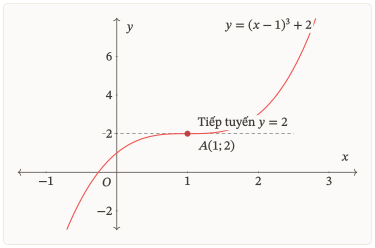{loading="lazy"}

::: r1-figcaption
Hình 01 — Tiếp tuyến ngang tại (1;2), hàm số vẫn tăng ở hai phía.
:::
::::
::::

#### 2.4. Vì sao không được đảo thành điều kiện nghiêm ngặt? {#vì-sao-không-được-đảo-thành-điều-kiện-nghiêm-ngặt}

[**Không đảo định lí thành dấu nghiêm ngặt.**]{.r1-unboxed-label}

Ví dụ 02 bác bỏ phát biểu: “Nếu $f$ đồng biến và có đạo hàm trên $K$ thì $f^\prime(x)>0$ tại mọi điểm của $K$.” Hàm số trong ví dụ đồng biến trên $\mathbb{R}$ nhưng $f^\prime(1)=0$.

Phát biểu đúng là: nếu $f$ đồng biến và có đạo hàm trên khoảng $K$, thì $f^\prime(x)\geq 0$ với mọi $x$ thuộc $K$. Với hàm nghịch biến và có đạo hàm, kết luận tương ứng là $f^\prime(x)\leq 0$.

:::: {.r1-details .zo-learning-context-note}
::: {.r1-summary .zo-learning-summary}
Đọc thêm — Giải thích bằng định nghĩa đạo hàm
:::

Có thể hiểu dấu không nghiêm ngặt này từ định nghĩa đạo hàm. Cố định $x_0$ trong $K$. Với $h\ne 0$ đủ nhỏ, tính đồng biến cho

$$\frac{f(x_0+h)-f(x_0)}{h}>0.$$

Khi $h$ tiến đến $0$, giới hạn của các số dương có thể bằng $0$. Vì vậy không thể buộc giới hạn ấy phải dương nghiêm ngặt.
::::

:::: {#dừng-lại-2-d02 .r1-task .zo-learning-task .zo-learning-task--pause}
[**Nhiệm vụ 06 — Một nghiệm không đổi dấu**]{.r1-task-label}

Cho $h$ có đạo hàm trên $\mathbb{R}$ và $h^\prime(x)=(x+2)^2$. Hãy kết luận chiều biến thiên trên $\mathbb{R}$ và phản biện câu: “Phải tách thành hai khoảng đơn điệu vì đạo hàm bằng $0$ tại $-2$.”

::: answer-link
[Xem lời giải](#lg-d02)
:::
::::

### 3. Một chuỗi biểu diễn được dựng thế nào? {#một-chuỗi-biểu-diễn-được-dựng-thế-nào}

[]{#cach-thuc-hien-chuoi-bieu-dien}

:::: {#thử-nghĩ-trước-2 .r1-task .zo-learning-task .zo-learning-task--pause}
[**Gợi mở 03 — Từ dấu đạo hàm đến hình đồ thị**]{.r1-task-label}

Thử trả lời trước khi đọc tiếp.

Nếu đã có bảng dấu đạo hàm thì còn thiếu gì để viết được giá trị hàm số tại các mốc? Nếu đã có bảng biến thiên thì đã có duy nhất một đồ thị chính xác chưa?
::::

Ta theo dõi một ví dụ xuyên suốt để thấy mỗi bước dùng và bổ sung thông tin nào.

#### 3.1. Ví dụ 03 — Bắt đầu từ công thức {#ví-dụ-v03-bắt-đầu-từ-công-thức}

:::: {.zo-learning-example}
Xét

$$p(x)=x^3-3x+1.$$

Đây là hàm đa thức nên có tập xác định $\mathbb{R}$, liên tục và có đạo hàm trên $\mathbb{R}$. Đạo hàm là

$$p^\prime(x)=3x^2-3=3(x-1)(x+1).$$

Các nghiệm của $p^\prime(x)=0$ là $-1$ và $1$. Hai mốc này chia trục số thành ba khoảng cần xét dấu.
::::

#### 3.2. Từ đạo hàm đến dấu và chiều biến thiên {#từ-đạo-hàm-đến-dấu-và-chiều-biến-thiên}

::: {#r1-table-t04 .table-scroll}
| Khoảng | Dấu $x+1$ | Dấu $x-1$ | Dấu $p^\prime(x)$ | Kết luận về $p$ |
|----|----|----|----|----|
| $(-\infty;-1)$ | Âm | Âm | Dương | Đồng biến |
| $(-1;1)$ | Dương | Âm | Âm | Nghịch biến |
| $(1;+\infty)$ | Dương | Dương | Dương | Đồng biến |
:::

Kết luận này dựa trên dấu trên từng khoảng, không chỉ trên hai đẳng thức $p^\prime(-1)=0$ và $p^\prime(1)=0$.

#### 3.3. Từ chiều biến thiên đến bảng biến thiên {#từ-chiều-biến-thiên-đến-bảng-biến-thiên}

Tính các giá trị ở mốc:

$$p(-1)=3,\quad p(1)=-1.$$

Ngoài ra, từ biểu thức đa thức bậc ba, ta có

$$\lim_{x\to-\infty}p(x)=-\infty,\quad \lim_{x\to+\infty}p(x)=+\infty.$$

Những giới hạn này được xác định từ công thức, không suy ra chỉ từ dấu của đạo hàm. Nếu chưa vững, có thể kiểm tra bằng cách viết $p(x)=x^3\left(1-\frac{3}{x^2}+\frac{1}{x^3}\right)$ với $x\ne 0$.

Bảng biến thiên là:

:::: table-scroll
::: {.r1-bbt bbt="BBT02" caption="Bảng biến thiên."}
ZO BBT placeholder
:::
::::

Đọc từng hàng theo đúng chức năng:

- Hàng $x$ ghi các mốc theo thứ tự tăng dần.
- Hàng $p^\prime(x)$ ghi dấu trên khoảng và giá trị đạo hàm tại các mốc đã tính.
- Hàng $p(x)$ ghi giá trị hoặc giới hạn đã biết, cùng mũi tên biểu thị chiều biến thiên.

Số $-1$ xuất hiện ở cả hai hàng nhưng không luôn chỉ cùng một đối tượng: $x=-1$ là một vị trí, còn $p(1)=-1$ là một giá trị hàm số.

#### 3.4. Từ bảng đến dáng điệu đồ thị {#từ-bảng-đến-dáng-điệu-đồ-thị}

Từ công thức, tính thêm $p(0)=1$. Vì vậy đồ thị đi qua $C(0;1)$, là giao điểm với trục tung. Điểm này giúp định vị đồ thị; nó không phải mốc đổi chiều trong bảng biến thiên.

Đồ thị $y=p(x)$ phải phù hợp với các thông tin sau:

- Trên $(-\infty;-1)$, đường biểu diễn đi lên khi đọc từ trái sang phải và tiến đến điểm $A(-1;3)$.
- Trên $(-1;1)$, đường biểu diễn đi xuống từ $A$ đến $B(1;-1)$; nó đi qua $C(0;1)$ do giá trị đã tính từ công thức.
- Trên $(1;+\infty)$, đường biểu diễn đi lên từ $B$.
- Đồ thị liền tại hai mốc vì $p$ liên tục; các tiếp tuyến tại $A$ và $B$ nằm ngang vì đạo hàm tại đó bằng $0$.

Đây là những ràng buộc để phác đúng dáng điệu, chưa phải toàn bộ quy trình khảo sát hàm số. Không tự thêm một giao điểm, tọa độ hoặc tính chất hình học chưa có căn cứ.

Nếu một hình gắn nhãn $y=p(x)$ lại đi lên trên $(-1;1)$, hình ấy mâu thuẫn với bảng. Nếu một bảng đặt $p(-1)=-1$, bảng ấy mâu thuẫn với công thức. Kiểm tra chéo giúp tìm lỗi ngay tại mắt xích tạo ra nó.

[Nguồn đối chiếu: Sách giáo khoa Toán 12, tập một, bộ Kết nối tri thức với cuộc sống, bài 1, trang 7–8; Sách giáo khoa Toán 12, tập một, bộ Kết nối tri thức với cuộc sống, bài 4, trang 26–27.]{.zo-source-note}

:::: r1-figure
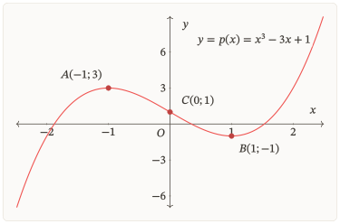{loading="lazy"}

::: r1-figcaption
Hình 02 — Đồ thị khớp bảng biến thiên của p.
:::
::::

:::: {#dừng-lại-3-d03 .r1-task .zo-learning-task .zo-learning-task--pause}
[**Nhiệm vụ 07 — Kiểm nét vẽ bằng dấu đạo hàm**]{.r1-task-label}

Một bản vẽ cho Ví dụ 03 đi qua đúng $A(-1;3)$ và $B(1;-1)$, nhưng có một đoạn đi lên nằm bên trong $(-1;1)$. Bản vẽ có thể được chấp nhận vì đã đặt đúng hai điểm mốc không? Nêu dữ kiện quyết định.

::: answer-link
[Xem lời giải](#lg-d03)
:::
::::

### 4. Điều gì xảy ra tại một điểm cần xét? {#điều-gì-xảy-ra-tại-một-điểm-cần-xét}

[]{#cach-thuc-hien-diem-can-xet}

:::: {#thử-nghĩ-trước-3 .r1-task .zo-learning-task .zo-learning-task--pause}
[**Gợi mở 04 — Mốc đạo hàm bằng không và cực trị**]{.r1-task-label}

Thử trả lời trước khi đọc tiếp.

Cùng có đạo hàm bằng $0$, tại sao có điểm làm hàm số đổi chiều còn có điểm không? Một điểm không có đạo hàm có thể vẫn là nơi hàm số đổi chiều không?
::::

Trước hết, hãy hình dung: khi hàm số đạt cực đại tại một điểm, giá trị tại đó lớn hơn các giá trị tại những điểm khác ở đủ gần hai phía. Với cực tiểu, giá trị tại điểm đang xét nhỏ hơn các giá trị ở những điểm khác đủ gần hai phía. Định nghĩa đầy đủ và cách gọi tên sẽ được viết ở Mục 5.

#### 4.1. Điều kiện đủ qua dấu đạo hàm {#điều-kiện-đủ-qua-dấu-đạo-hàm}

Giả sử $f$ liên tục trên khoảng $(a;b)$ chứa $x_0$ và có đạo hàm trên hai khoảng $(a;x_0)$, $(x_0;b)$.

::::: {.zo-block .zo-block-red}
:::: {.zo-block-title}
Cực trị: Điều kiện đủ qua dấu đạo hàm
::::

- Nếu $f^\prime(x)>0$ trên $(a;x_0)$ và $f^\prime(x)<0$ trên $(x_0;b)$, hàm số đạt cực đại tại $x_0$.
- Nếu $f^\prime(x)<0$ trên $(a;x_0)$ và $f^\prime(x)>0$ trên $(x_0;b)$, hàm số đạt cực tiểu tại $x_0$.

:::::

Đó là định lí điều kiện đủ đang dùng. Định lí không đòi hỏi đạo hàm phải tồn tại tại chính $x_0$. Tính liên tục tại $x_0$ phải được kiểm tra; việc có đạo hàm ở hai phía không tự bảo đảm điều đó.

[Nguồn đối chiếu: Sách giáo khoa Toán 12, tập một, bộ Kết nối tri thức với cuộc sống, bài 1, trang 10.]{.zo-source-note}

Khi các điều kiện trên đã được bảo đảm, có thể tóm tắt hành vi như sau:

::: {#r1-table-t05 .table-scroll}
| Dấu đạo hàm bên trái | Dấu đạo hàm bên phải | Chiều biến thiên quanh $x_0$ | Kết luận tại $x_0$ |
|------------------|------------------|------------------|------------------|
| Dương trên cả khoảng bên trái | Âm trên cả khoảng bên phải | Tăng rồi giảm | Cực đại |
| Âm trên cả khoảng bên trái | Dương trên cả khoảng bên phải | Giảm rồi tăng | Cực tiểu |
| Dương trên cả khoảng bên trái | Dương trên cả khoảng bên phải | Giữ chiều tăng | Không có cực trị |
| Âm trên cả khoảng bên trái | Âm trên cả khoảng bên phải | Giữ chiều giảm | Không có cực trị |
:::

Hai dòng cuối là kết luận trong tình huống có dấu nghiêm ngặt ở mỗi phía và liên tục tại điểm nối. Không dùng câu tắt “không đổi dấu thì không có cực trị” cho một bảng thiếu điều kiện hoặc chưa xác định được dấu trên cả hai khoảng.

#### 4.2. Đối chứng thứ nhất — Đổi dấu và có cực trị {#đối-chứng-thứ-nhất-đổi-dấu-và-có-cực-trị}

:::: {.zo-learning-example}
Với $p(x)=x^3-3x+1$ trong Ví dụ 03, tính liên tục đã có vì $p$ là đa thức.

Qua $x=-1$, đạo hàm đổi dấu từ dương sang âm. Hàm số đạt cực đại tại $x=-1$, với giá trị $p(-1)=3$.

Qua $x=1$, đạo hàm đổi dấu từ âm sang dương. Hàm số đạt cực tiểu tại $x=1$, với giá trị $p(1)=-1$.

Ta không kết luận có cực trị chỉ vì giải được phương trình $p^\prime(x)=0$. Bước quyết định là kiểm tra dấu hai phía trong những điều kiện phù hợp.
::::

#### 4.3. Đối chứng thứ hai — Bằng 0 nhưng không có cực trị {#đối-chứng-thứ-hai-bằng-0-nhưng-không-có-cực-trị}

:::: {.zo-learning-example}
Trở lại $f(x)=(x-1)^3+2$ trong Ví dụ 02. Hàm số liên tục tại $1$, đạo hàm dương trên cả hai phía của $1$ và bằng $0$ tại $1$.

Với $x<1$, ta có $f(x)<2$. Với $x>1$, ta có $f(x)>2$. Do đó, dù xét gần $1$ đến đâu, vẫn có giá trị nhỏ hơn $f(1)$ ở bên trái và lớn hơn $f(1)$ ở bên phải. Hàm số không đạt cực đại hoặc cực tiểu tại $1$.

Nếu $f^\prime(x_0)=0$, ta vẫn cần xét dấu đạo hàm ở hai phía của $x_0$ và kiểm tra các điều kiện của định lí trước khi kết luận hàm số có cực trị tại đó.

[Nguồn đối chiếu: chú ý về $x^3$ trong Sách giáo khoa Toán 12, tập một, bộ Kết nối tri thức với cuộc sống, bài 1, trang 11.]{.zo-source-note}
::::

#### 4.4. Đối chứng thứ ba — Không có đạo hàm nhưng có cực trị {#đối-chứng-thứ-ba-không-có-đạo-hàm-nhưng-có-cực-trị}

:::: {.zo-learning-example}
Ví dụ 04 — Không có đạo hàm nhưng có cực trị:

$$u(x)=\lvert x\rvert.$$

Hàm số xác định và liên tục trên $\mathbb{R}$, với $u(0)=0$. Trên hai phía của $0$:

- Nếu $x<0$ thì $u(x)=-x$, nên $u^\prime(x)=-1$.
- Nếu $x>0$ thì $u(x)=x$, nên $u^\prime(x)=1$.

Tại $0$, thương sai phân là

$$\frac{u(h)-u(0)}{h}=\frac{\lvert h\rvert}{h}.$$

Thương này bằng $-1$ khi $h<0$ và bằng $1$ khi $h>0$. Hai giới hạn một phía khác nhau nên $u^\prime(0)$ không tồn tại.

Tuy nhiên, đạo hàm đổi từ âm sang dương qua $0$, và $u$ liên tục tại $0$. Theo định lí, $u$ đạt cực tiểu tại $0$. Có thể kiểm tra trực tiếp: với mọi $x\ne 0$, $u(x)=\lvert x\rvert>0=u(0)$, nên điều kiện so sánh nghiêm ngặt quanh $0$ được thỏa mãn.

[Nguồn đối chiếu: Sách giáo khoa Toán 12, tập một, bộ Kết nối tri thức với cuộc sống, bài 1, trang 6 và 14.]{.zo-source-note}

::::: table-scroll
:::: table-scroll
::: {.r1-bbt bbt="BBT12" caption="Bảng biến thiên của hàm giá trị tuyệt đối."}
ZO BBT placeholder
:::
::::
:::::

Hàng đạo hàm không có giá trị tại $0$, nhưng hàng hàm số vẫn có $u(0)=0$. Không được dùng vạch ngăn tại điểm không thuộc tập xác định ở hàng hàm số để xóa mất điểm này. Đồ thị có một góc tại $(0;0)$; đó không phải một điểm bị bỏ khỏi đồ thị.
::::

#### 4.5. Tách riêng điểm không thuộc tập xác định {#tách-riêng-điểm-không-thuộc-tập-xác-định}

[**Điểm không thuộc tập xác định.**]{.r1-unboxed-label}

Xét $v(x)=\lvert x\rvert$ nhưng chỉ trên tập xác định $D=\mathbb{R}\setminus\{0\}$. Trên mỗi phía của $0$, công thức và dấu đạo hàm giống Ví dụ 04. Tuy nhiên, $v(0)$ không tồn tại vì $0$ đã bị loại khỏi tập xác định.

Vì vậy, $0$ không thể là điểm cực trị của $v$. Dấu âm bên trái và dấu dương bên phải không tạo ra một giá trị hàm số tại vị trí không thuộc tập xác định.

:::: table-scroll
::: {.r1-bbt bbt="BBT13" caption="Bảng biến thiên khi loại 0 khỏi tập xác định."}
ZO BBT placeholder
:::
::::

Hai số 0 ở hai phía của vạch ngăn là giới hạn một phía. Hàm số không có giá trị tại 0.

Khi dựng bảng, phải thể hiện vạch ngăn tại điểm không thuộc tập xác định qua hàng hàm số; nếu ghi giới hạn tại mốc thì đó là giới hạn, không phải $v(0)$. Khi dựng đồ thị, vị trí $(0;0)$ phải là điểm hở. Đây là sự khác biệt quyết định với Ví dụ 04.

:::: r1-figure
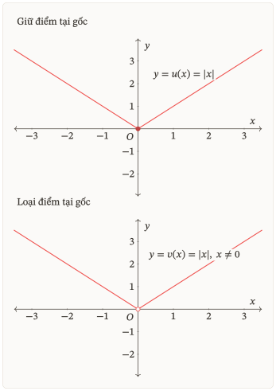{loading="lazy"}

::: r1-figcaption
Hình 03 — Cùng đường nét hai phía nhưng khác việc giữ hay bỏ điểm tại gốc.
:::
::::

#### 4.6. Trình tự xét một mốc {#trình-tự-xét-một-mốc}

[**Trình tự xét một mốc.**]{.r1-unboxed-label}

1.  Mốc có thuộc tập xác định không? Nếu không, loại khỏi danh sách điểm cực trị.
2.  Có một khoảng quanh mốc đáp ứng các điều kiện của định lí không? Kiểm tra riêng tính liên tục tại mốc.
3.  Đạo hàm mang dấu gì trên từng khoảng ở hai phía?
4.  Hàm số đổi chiều hay giữ chiều? Kết luận theo trường hợp đã kiểm tra.
5.  Nếu có cực trị, tính giá trị hàm số và gọi đúng đối tượng.

Nếu thiếu giả thiết, ghi “chưa đủ điều kiện áp dụng định lí”; không chuyển câu đó thành “chắc chắn không có cực trị”.

:::: {#dừng-lại-4-d04 .r1-task .zo-learning-task .zo-learning-task--pause}
[**Nhiệm vụ 08 — Cực trị khi chưa biết đạo hàm tại mốc**]{.r1-task-label}

Cho $w$ liên tục trên $(-2;2)$, có đạo hàm trên $(-2;0)$ và $(0;2)$; đạo hàm dương trên khoảng bên trái, âm trên khoảng bên phải. Biết $w(0)=5$ nhưng chưa biết $w^\prime(0)$ có tồn tại hay không. Có kết luận được cực trị tại $0$ không? Vì sao?

::: answer-link
[Xem lời giải](#lg-d04)
:::
::::

### 5. Cực trị được gọi tên thế nào? {#cực-trị-được-gọi-tên-thế-nào}

[]{#cach-thuc-hien-goi-ten-cuc-tri}

:::: {#thử-nghĩ-trước-4 .r1-task .zo-learning-task .zo-learning-task--pause}
[**Gợi mở 05 — Hoành độ, giá trị hay điểm đồ thị?**]{.r1-task-label}

Thử trả lời trước khi đọc tiếp.

Với Ví dụ 03, câu “cực đại là $-1$” có đủ rõ không? Người viết đang nói về hoành độ, giá trị hàm số hay một điểm trên đồ thị?
::::

#### 5.1. Định nghĩa theo so sánh trong một lân cận {#định-nghĩa-theo-so-sánh-trong-một-lân-cận}

Xét $f$ xác định và liên tục trên khoảng $(a;b)$, với $x_0$ thuộc khoảng đó.

::::: {.zo-block .zo-block-red}
:::: {.zo-block-title}
Cực trị: Định nghĩa trong một lân cận
::::

[]{#g01-dinh-nghia-cuc-dai}

- Hàm số đạt **cực đại tại $x_0$** nếu có số $h>0$ sao cho $(x_0-h;x_0+h)$ nằm trong $(a;b)$, và với mọi $x$ trong khoảng nhỏ này, khác $x_0$, ta có

  $$f(x)<f(x_0).$$

[]{#g01-dinh-nghia-cuc-tieu}

- Hàm số đạt **cực tiểu tại $x_0$** nếu tồn tại một khoảng nhỏ như trên mà với mọi $x\ne x_0$ trong khoảng ấy, ta có

  $$f(x)>f(x_0).$$

:::::

Từ “gần” được làm chính xác bằng việc tồn tại một khoảng nhỏ quanh $x_0$. Các bất đẳng thức là nghiêm ngặt. Không cần so sánh với mọi điểm trong toàn bộ tập xác định.

[Nguồn đối chiếu: Sách giáo khoa Toán 12, tập một, bộ Kết nối tri thức với cuộc sống, bài 1, trang 9.]{.zo-source-note}

Trong bài học này, ta dùng định nghĩa hai phía trên khoảng như trên. Một đầu mút của tập xác định không được tự động phân loại là cực trị bằng quy tắc hai phía. Những quy ước mở rộng khác không thuộc phạm vi bản học liệu này.

#### 5.2. Ba đối tượng cần tách biệt {#ba-đối-tượng-cần-tách-biệt}

::: {#r1-table-t06 .table-scroll}
| Đối tượng | Dạng viết | Cực đại của Ví dụ 03 | Cực tiểu của Ví dụ 03 |
|------------------|------------------|------------------|------------------|
| Điểm cực trị của hàm số | Hoành độ $x_0$ | $x=-1$ | $x=1$ |
| Giá trị cực trị của hàm số | Giá trị $f(x_0)$ | $p(-1)=3$ | $p(1)=-1$ |
| Điểm cực trị của đồ thị | Điểm có hai tọa độ | $A(-1;3)$ | $B(1;-1)$ |
:::

Cách viết rõ ràng là: “Hàm số $p$ đạt cực đại tại $x=-1$, giá trị cực đại bằng $3$; điểm cực đại của đồ thị là $A(-1;3)$.”

[Nguồn đối chiếu: Sách giáo khoa Toán 12, tập một, bộ Kết nối tri thức với cuộc sống, bài 1, trang 9.]{.zo-source-note}

Trong suy luận qua dấu đạo hàm, chủ thể được kết luận đạt cực trị là hàm số $p$, không phải tự động là hàm đạo hàm $p^\prime$. Đạo hàm cũng là một hàm số, nhưng nếu muốn bàn về cực trị của nó thì đó là một câu hỏi khác.

#### 5.3. “Cục bộ” có ý nghĩa gì? {#cục-bộ-có-ý-nghĩa-gì}

[**Ý nghĩa của “cục bộ”.**]{.r1-unboxed-label}

Trong Ví dụ 03, $p$ đạt cực đại tại $-1$ với giá trị $3$. Nhưng $p(3)=19>3$. Điều này không mâu thuẫn: cực đại ở $-1$ chỉ yêu cầu so sánh với các điểm đủ gần $-1$.

Tương tự, từ việc $p$ đạt cực tiểu tại $1$, không được kết luận mọi giá trị của $p$ trên $\mathbb{R}$ đều lớn hơn hoặc bằng $p(1)$. Chúng ta dừng ở ý nghĩa cục bộ, không chuyển sang bài toán so sánh trên toàn tập xác định.

:::: {#dừng-lại-5-d05 .r1-task .zo-learning-task .zo-learning-task--pause}
[**Nhiệm vụ 09 — Gọi đúng đối tượng cực trị**]{.r1-task-label}

Sửa câu sau mà vẫn giữ các số đúng: “Đồ thị của $p(x)=x^3-3x+1$ có điểm cực tiểu bằng $-1$ tại giá trị $1$.” Hãy viết riêng điểm cực tiểu của hàm số, giá trị cực tiểu và điểm cực tiểu của đồ thị.

::: answer-link
[Xem lời giải](#lg-d05)
:::
::::

### 6. Có thể đọc ngược đến đâu? {#có-thể-đọc-ngược-đến-đâu}

Ở Mục 5, em đã tập gọi đúng đối tượng cực trị. Bây giờ cần kiểm tra thêm một việc: từ bảng, hình hoặc đạo hàm đã cho, ta thực sự biết được bao nhiêu về những đối tượng ấy?

[]{#cach-thuc-hien-doc-nguoc}

:::: {#thử-nghĩ-trước-5 .r1-task .zo-learning-task .zo-learning-task--pause}
[**Gợi mở 06 — Đọc dấu và chiều biến thiên**]{.r1-task-label}

Thử trả lời trước khi đọc tiếp.

Một mũi tên đi lên trong bảng biến thiên có đủ để viết dấu $+$ ở mọi điểm của hàng đạo hàm không? Một đường cong đang đi xuống có luôn biểu diễn một hàm số âm không?
::::

Hai câu hỏi này buộc ta tách chiều biến thiên khỏi dấu của giá trị, đồng thời đọc đúng đối tượng được biểu diễn.

Trong cả Mục 6, mỗi lần đọc ngược, hãy dừng ở ba câu hỏi:

1.  Dữ kiện đang nói về $f$, $f^\prime$ hay chỉ về chiều biến thiên?
2.  Kết luận nào theo trực tiếp từ dữ kiện ấy?
3.  Muốn kết luận thêm thì còn thiếu giả thiết hoặc giá trị nào?

#### 6.1. Bảng có hàng đạo hàm và bảng chỉ có chiều biến thiên {#bảng-có-hàng-đạo-hàm-và-bảng-chỉ-có-chiều-biến-thiên}

[**Phân biệt dữ kiện về đạo hàm và chiều biến thiên.**]{.r1-unboxed-label}

Nếu bảng ghi rõ $f^\prime(x)>0$ trên một khoảng, đó là dữ kiện về đạo hàm. Nếu bảng chỉ có mũi tên đi lên ở hàng $f(x)$, ta biết hàm số đồng biến trên khoảng được biểu diễn; chưa được tự thêm dấu đạo hàm nghiêm ngặt tại mọi điểm.

Nếu có thêm giả thiết hàm số có đạo hàm trên khoảng ấy, ta kết luận được $f^\prime(x)\geq 0$. Ví dụ 02 cho thấy dấu bằng có thể xảy ra ở một điểm trong khi mũi tên vẫn đi lên ở cả hai phía.

Khi một ô không có số, hãy xác định đó là ô không cần ghi, chưa có dữ kiện, hay đạo hàm không tồn tại. Không có quy tắc “ô trống nghĩa là bằng $0$”. Trong bản này, trường hợp không tồn tại được ghi bằng chữ để tránh nhầm lẫn.

#### 6.2. Đồ thị của $f$ khác đồ thị của $f^\prime$ {#đồ-thị-của-f-khác-đồ-thị-của-fprime}

::: {#r1-table-t07 .table-scroll}
| Điều quan sát được trên khoảng $K$ | Nếu nhãn là $y=f(x)$ | Nếu nhãn là $y=f^\prime(x)$ |
|------------------------|------------------------|------------------------|
| Đường biểu diễn nằm trên trục hoành | $f(x)>0$ | $f^\prime(x)>0$; từ đó kết luận $f$ đồng biến trên $K$ |
| Đường biểu diễn nằm dưới trục hoành | $f(x)<0$ | $f^\prime(x)<0$; từ đó kết luận $f$ nghịch biến trên $K$ |
| Đường biểu diễn đi lên từ trái sang phải | $f$ đồng biến | $f^\prime$ đồng biến; riêng điều này chưa quyết định $f$ đồng biến hay nghịch biến |
| Đường biểu diễn đi qua một điểm có tung độ $0$ | Giá trị của $f$ tại đó bằng $0$ | Đạo hàm của $f$ tại đó bằng $0$; cần xem thêm dấu hai phía để xét cực trị của $f$ |
:::

Các kết luận đọc hình được hiểu trên phần tập xác định và với độ chính xác mà đề bài thực sự cung cấp. Hình chỉ có tính minh họa, không ghi tọa độ chính xác thì không đủ để buộc một đáp số chính xác.

:::: {.r1-example .zo-learning-example}
[]{#g01-vi-du-05}

[**Ví dụ 05 — Đạo hàm đang tăng nhưng hàm số đang giảm.**]{.r1-example-label}

Xét lại $s(x)=x^2-2x$. Đồ thị đạo hàm là đường thẳng $y=2x-2$, đi lên từ trái sang phải. Tuy nhiên, trên $(0;1)$ đường thẳng này nằm dưới trục hoành: $s^\prime(x)<0$. Do đó $s$ nghịch biến trên $(0;1)$.

Cần đọc vị trí của đồ thị $s^\prime$ so với trục hoành để tìm dấu, không dùng việc đường thẳng ấy đang đi lên để kết luận chiều biến thiên của $s$.

[Nguồn đối chiếu: dạng bài đọc đồ thị đạo hàm trong Sách giáo khoa Toán 12, tập một, bộ Kết nối tri thức với cuộc sống, bài 1, trang 14, bài tập 1.6.]{.zo-source-note}

:::: r1-figure
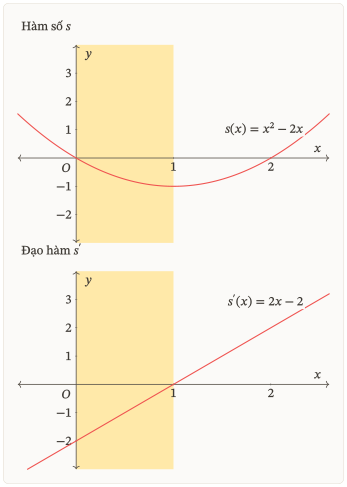{loading="lazy"}

::: r1-figcaption
Hình 04 — Hai nhãn khác nhau: s đang giảm trong khi s′ đang tăng và mang giá trị âm trên (0;1).
:::
::::
::::

#### 6.3. Cùng bảng tóm tắt không có nghĩa cùng công thức {#cùng-bảng-tóm-tắt-không-có-nghĩa-cùng-công-thức}

:::: {.r1-example .zo-learning-example}
[]{#g01-vi-du-06}

**Cùng bảng tóm tắt.** Xét hai hàm số trong [Ví dụ 06 — Cùng bảng biến thiên, khác công thức:]{.r1-example-label}

$$a(x)=x^3,\quad b(x)=2x^3.$$

Chúng có cùng tập xác định $\mathbb{R}$, cùng dấu đạo hàm dương ở hai phía của $0$, đạo hàm bằng $0$ tại $0$, cùng giá trị bằng $0$ tại đó và cùng các giới hạn ở hai đầu. Vì vậy chúng có cùng bảng biến thiên tóm tắt sau, với $F$ lần lượt là $a$ hoặc $b$:

:::: table-scroll
::: {.r1-bbt bbt="BBT03" caption="Bảng biến thiên."}
ZO BBT placeholder
:::
::::

Nhưng $a(1)=1$ còn $b(1)=2$, nên hai đồ thị không trùng nhau. Một bảng ghi dấu, mốc và chiều biến thiên không đủ để xác định duy nhất công thức hàm số.

**Biết chính xác đạo hàm vẫn chưa đủ biết mọi giá trị của hàm số.** Cũng cần phân biệt “biết dấu của đạo hàm” với “biết chính xác hàm đạo hàm”. Hai dữ kiện ấy không tương đương. Chẳng hạn $x^3$ và $x^3+4$ có cùng đạo hàm nhưng khác giá trị tại $0$, nên riêng đạo hàm chưa xác định được vị trí của đồ thị theo phương thẳng đứng. Bài này không đặt nhiệm vụ khôi phục công thức từ đạo hàm.

:::: r1-figure
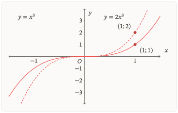{loading="lazy"}

::: r1-figcaption
Hình 05 — Hai hàm khác nhau có cùng bảng biến thiên tóm tắt.
:::
::::
::::

#### 6.4. Vì sao không tự gộp các khoảng rời nhau? {#vì-sao-không-tự-gộp-các-khoảng-rời-nhau}

:::: {.r1-example .zo-learning-example}
[]{#g01-vi-du-07}

Xét [Ví dụ 07 — Không tự gộp các khoảng rời nhau]{.r1-example-label} với tập xác định $D=\mathbb{R}\setminus\{0\}$:

- $q(x)=x+2$ khi $x<0$;
- $q(x)=x-2$ khi $x>0$.

Trên mỗi khoảng $(-\infty;0)$ và $(0;+\infty)$, đạo hàm đều bằng $1$. Do đó $q$ đồng biến trên từng khoảng ấy.

Tuy nhiên, lấy hai điểm thuộc hai khoảng khác nhau:

$$-1<1,\quad q(-1)=1>-1=q(1).$$

Vì vậy, nếu mở rộng yêu cầu so sánh mọi cặp điểm ra toàn tập $D$, tính đồng biến không được thỏa mãn. Định lí trên một khoảng không cho phép tự động nối hai kết luận riêng thành một kết luận trên hợp các khoảng.

Trong bài làm của gói này, cách kết luận chuẩn là: “$q$ đồng biến trên từng khoảng $(-\infty;0)$ và $(0;+\infty)$.” Không gọi hợp hai khoảng ấy là “một khoảng”.

Đừng thay lỗi “luôn gộp được” bằng một quy tắc sai khác là “hợp các khoảng luôn sai”. Kí hiệu hợp không tự làm mọi phát biểu sai. Ví dụ, $r(x)=x$ trên $\mathbb{R}\setminus\{0\}$ vẫn thỏa mãn so sánh đồng biến cho mọi cặp điểm thuộc tập xác định. Điểm mấu chốt là phải kiểm tra cả các cặp nằm ở hai thành phần khác nhau; không chỉ xét dấu đạo hàm riêng từng nhánh.
::::

#### 6.5. Bản đồ giới hạn suy luận {#bản-đồ-giới-hạn-suy-luận}

::: {#r1-table-t08 .table-scroll}
| Dữ kiện xuất phát | Kết luận có căn cứ | Điều không được tự thêm |
|------------------------|------------------------|------------------------|
| Công thức $f$ và tập xác định | Giá trị, đạo hàm, dấu và chiều biến thiên sau khi tính, kiểm tra | Một kết luận đơn điệu hoặc cực trị chưa có lập luận |
| Dấu của $f^\prime$ trên các khoảng | Chiều biến thiên; vị trí cực trị nếu đủ điều kiện | Giá trị cực trị, giao điểm hoặc giới hạn chưa được cho hoặc tính |
| Bảng biến thiên | Chiều biến thiên, mốc và giá trị được ghi; cực trị nếu dữ kiện cho phép | Công thức duy nhất; mọi giá trị đạo hàm chính xác |
| Đồ thị $f$ | Đơn điệu, cực trị và tọa độ trong giới hạn thông tin của hình | Có đạo hàm tại một điểm góc; dấu đạo hàm nghiêm ngặt từ riêng nét đi lên |
| Đồ thị $f^\prime$ | Dấu của đạo hàm; chiều biến thiên của $f$ và xét cực trị khi đủ điều kiện | Coi tung độ của hình là giá trị $f(x)$ |
:::

:::: {#dừng-lại-6-d06 .r1-task .zo-learning-task .zo-learning-task--pause}
[**Nhiệm vụ 10 — Giới hạn suy luận từ đồ thị đạo hàm**]{.r1-task-label}

Cho $f$ có đạo hàm trên $\mathbb{R}$. Đồ thị $y=f^\prime(x)$ nằm dưới trục hoành khi $x<2$, đi qua $(2;0)$ và nằm trên trục hoành khi $x>2$.

Hãy cho biết khoảng đơn điệu và vị trí cực trị của $f$. Có đủ dữ kiện để kết luận giá trị cực trị bằng $0$ không?

::: answer-link
[Xem lời giải](#lg-d06)
:::
::::

### 7. Làm sao biết mình đã sửa được lỗi? {#làm-sao-biết-mình-đã-sửa-được-lỗi}

[]{#cach-thuc-hien-sua-duoc-loi}

:::: {#thử-nghĩ-trước-6 .r1-task .zo-learning-task .zo-learning-task--pause}
[**Gợi mở 07 — Đọc lời chữa và tự làm**]{.r1-task-label}

Thử trả lời trước khi đọc tiếp.

Em đã đọc lời giải và thấy hợp lí. Điều đó có chứng minh em sẽ không mắc lại lỗi khi câu hỏi đổi từ công thức sang bảng dấu không?
::::

Chưa. Đọc hiểu lời chữa và tự làm đúng một câu mới là hai bằng chứng khác nhau. Mục này hướng dẫn cách sửa lỗi đầy đủ, không chỉ đổi nhãn “sai” thành “đúng”.

Mục 6 giúp em kiểm tra một kết luận có vượt quá dữ kiện hay không. Mục 7 dùng chính cách kiểm tra ấy để tách từng vế của một phát biểu, giữ phần đúng và sửa đúng chỗ sai.

#### 7.1. Đánh giá từ đúng giả thiết {#phán-quyết-từ-đúng-giả-thiết}

[**Đánh giá từng kết luận từ giả thiết đã cho.**]{.r1-unboxed-label}

Với một cụm phát biểu dùng chung giả thiết, xét từng ý độc lập từ giả thiết đó. Không xem kết luận của ý trước là dữ kiện cho ý sau, nhất là khi ý trước chính là điều đang cần kiểm tra.

Trước khi đánh giá, viết nháp ba dòng: tập xác định và khoảng; dữ kiện đã cho; kết luận đang được hỏi. Sau đó mới chọn định nghĩa, định lí hoặc phản ví dụ phù hợp.

::: {#r1-table-t09 .table-scroll}
| Cấu trúc phát biểu | Khi nào đúng? | Căn cứ đủ để bác bỏ |
|------------------------|------------------------|------------------------|
| “A và B” | Cả A và B đều đúng | Chỉ ra ít nhất một vế sai |
| “A hoặc B” | Ít nhất một vế đúng | Phải chỉ ra cả A và B đều sai |
| “Với mọi trường hợp…” | Có lập luận bao quát mọi trường hợp trong giả thiết | Một phản ví dụ thỏa giả thiết nhưng vi phạm kết luận |
:::

Ở đây “hoặc” được dùng theo nghĩa ít nhất một vế đúng, không mặc định loại trừ trường hợp cả hai đúng. Một số ví dụ đúng không chứng minh được phát biểu “mọi”; một phản ví dụ phù hợp có thể bác bỏ phát biểu ấy.

#### 7.2. Ví dụ 08 — Giữ phần đúng khi sửa {#ví-dụ-v08-giữ-phần-đúng-khi-sửa}

:::: {.zo-learning-example}
Cho $f(x)=(x-1)^3+2$ trên $\mathbb{R}$. Xét phát biểu:

> Hàm số $f$ đồng biến trên $\mathbb{R}$ và đạt cực đại tại $x=1$ vì $f^\prime(1)=0$.

**Đánh giá:** sai.

**Tách các vế:** vế đồng biến đúng theo Ví dụ 02; vế đạt cực đại tại $1$ sai vì đạo hàm dương ở cả hai phía và hàm số không đổi chiều.

**Lỗi quyết định:** xem phương trình $f^\prime(1)=0$ như điều kiện đủ của cực trị. Nếu xóa luôn vế đồng biến khi chữa, ta còn làm mất một phần vốn đúng.

**Viết lại hoàn chỉnh:** “Hàm số $f$ đồng biến trên $\mathbb{R}$ và không đạt cực trị tại $x=1$; mặc dù $f^\prime(1)=0$, đạo hàm vẫn dương ở cả hai phía của $1$.”

Lời chữa cần có lí do. Chỉ viết “không có cực trị” thì chưa cho thấy em đã thay đổi cách suy luận.
::::

#### Nhiệm vụ 11 — Xét dấu và giới hạn dữ kiện {#câu-sau-chữa-cg01}

:::: {.zo-learning-task .zo-learning-task--pause}
Đổi dạng dữ kiện từ công thức hàm số sang công thức đạo hàm. Cho $g$ có đạo hàm trên $\mathbb{R}$ và

$$g^\prime(x)=(x-2)^2(x+1).$$

Chưa cho giá trị nào của $g$. Hãy tự làm bốn việc:

**Lượt 1 — Xét dấu và cực trị**

1.  Lập bảng dấu $g^\prime$ với các mốc $-1$ và $2$.
2.  Kết luận các khoảng đơn điệu; xem có thể kết luận đồng biến trên toàn khoảng $(-1;+\infty)$ không.
3.  Xác định mốc nào là điểm cực trị, mốc nào không; nêu lí do.

**Lượt 2 — Kiểm tra giới hạn của dữ kiện**

4.  Chưa cho giá trị nào của $g$. Có tính được giá trị cực trị chỉ từ công thức $g^\prime$ hay không?

Chỉ mở lời giải nhiệm vụ 11 của Nhiệm vụ trong Bài học sau khi đã tự viết. Câu này kiểm tra lại lỗi “điểm có đạo hàm bằng $0$ là điểm cực trị”, đồng thời yêu cầu không tự thêm giá trị hàm số từ dữ kiện về đạo hàm.

::: answer-link
[Xem lời giải](#lg-cg01)
:::
::::

#### 7.3. Một dòng ghi lỗi có ích {#một-dòng-ghi-lỗi-có-ích}

Sau khi đối chiếu, ghi ngắn gọn theo mẫu:

::: {#r1-table-t10 .table-scroll}
| Nội dung cần ghi | Minh họa cho lỗi “coi đạo hàm bằng 0 là đủ để có cực trị” |
|------------------------------------|------------------------------------|
| Bước đã sai | Kết luận có hai điểm cực trị vì đạo hàm có hai nghiệm |
| Điều đã bỏ | Chưa kiểm tra dấu hai phía của từng nghiệm |
| Cách sửa | Xét dấu; chỉ dùng định lí khi đủ giả thiết và có đổi dấu phù hợp |
| Câu kiểm tra lại | [Nhiệm vụ 11 trong Bài học](#câu-sau-chữa-cg01) |
| Bằng chứng | Ghi kết quả bài tự làm và lí do ở từng mốc, không chép sẵn “đã đúng” |
| Việc tiếp theo | Nếu còn nhầm tại $2$, xem lại Ví dụ 02 để học; bài vừa xem không là bằng chứng mới. Ở Luyện tập, dùng bài sửa được chỉ định chưa gặp trước đó; nếu hết bài phù hợp, ghi mục tiêu chưa xác nhận |
:::

Sau khi xem lời chữa, tự giải một bài khác về cùng lỗi trước khi mở đáp án. Nếu giải đúng và giải thích được, ghi phần em đã tự làm được. Để biết mình còn nhớ sau vài ngày, thực hiện lượt Ôn lại theo lịch. Nếu không còn bài phù hợp chưa biết lời giải, ghi rõ phần cần được kiểm tra thêm.

#### 7.4. Tám lỗi để tự nhận diện {#tám-lỗi-để-tự-nhận-diện}

::: {#r1-table-t11 .table-scroll}
| Số | Dấu hiệu của lỗi | Câu hỏi giúp tự sửa |
|------------------------|------------------------|------------------------|
| 1 | Bỏ tập xác định hoặc khoảng xét | Mọi điểm đang dùng có thuộc tập xác định không? |
| 2 | Đạo hàm bằng $0$ nên có cực trị | Dấu ở hai phía là gì? |
| 3 | Không có đạo hàm nên không có cực trị | Hàm có xác định, liên tục và đổi chiều phù hợp tại đó không? |
| 4 | Nhầm hoành độ, giá trị và điểm đồ thị | Câu hỏi đang đòi $x_0$, $f(x_0)$ hay cả cặp tọa độ? |
| 5 | Gộp các khoảng rời một cách tự động | Đã kiểm tra cặp điểm thuộc hai nhánh khác nhau chưa? |
| 6 | Đảo định lí thành dấu nghiêm ngặt | Ví dụ 02 có bác bỏ kết luận này không? |
| 7 | Thêm thông tin không có trong hình hoặc bảng | Dữ kiện nào thực sự cho biết điều vừa viết? |
| 8 | Xử lí sai “và”, “hoặc”, “mọi”, hoặc làm mất phần đúng khi chữa | Từng vế đúng hay sai, và kết nối logic yêu cầu điều gì? |
:::

Hãy nhận diện lỗi trong từng lập luận, rồi chọn việc cần sửa.

### Khép lại bài học {#khép-lại-bài-học}

Một lời giải tốt không chỉ kết thúc bằng “đồng biến”, “nghịch biến” hoặc “cực trị”. Nó cho thấy đúng hàm số, đúng tập xác định, đúng điều kiện và đúng chiều suy luận.

Trước khi chuyển sang phần luyện tập, hãy tự nói lại năm điều:

1.  Đơn điệu được định nghĩa bằng so sánh giá trị trên một tập đang xét; dấu đạo hàm là công cụ để kết luận khi đủ điều kiện.
2.  Một điểm đạo hàm bằng $0$ chưa quyết định được cực trị; một điểm không có đạo hàm cũng chưa loại trừ cực trị.
3.  Bảng dấu, bảng biến thiên và đồ thị phải nhất quán về đối tượng, tập xác định, mốc và chiều biến thiên.
4.  Một bảng hoặc hình không cho phép suy ra mọi điều về hàm số; phải phân biệt điều được cho với điều tự thêm.
5.  Sửa lỗi cần kết thúc bằng một câu mới tự làm, không chỉ bằng việc đọc lời giải.

Nếu chưa giải thích được một ý, quay lại ví dụ tương ứng trước khi làm nhiệm vụ phối hợp. Các câu hỏi tự kiểm tra trong bài chỉ giúp kiểm tra ngay sau khi học; chúng không phải kết quả tự làm rằng em đã đạt tất cả mục tiêu của bài học.

## Luyện tập {#phieu-luyen}

Ở lượt đầu, tự làm tám bài theo ba chặng dưới đây. Với mỗi bài, giữ bài làm trước khi mở lời giải; ghi tập xác định, khoảng xét và lí do cho kết luận. Sau mỗi chặng, dùng Điểm dừng tương ứng để quyết định đi tiếp hay nhận hỗ trợ. Ghi lỗi vào Nhật kí không tự có nghĩa lỗi đã được sửa.

Dùng các số liệu trong hình có nhãn như dữ kiện chính xác; chỉ xét phần tập xác định được đề bài chỉ rõ. Không dùng kết luận của một câu như giả thiết của câu khác.

:::: {#lo-trinh-hoc .r1-learning-stages}
**Ba chặng Luyện tập**

::: {#r1-table-t19 .table-scroll}
| Chặng | Việc cần làm được | Bài và nơi đối chiếu |
|---|---|---|
| Dựng và đọc chuỗi biểu diễn | Dùng đúng điều kiện, nối các biểu diễn; xét và gọi đúng cực trị | [Nhiệm vụ 12](#lt01); [Điểm dừng 01](#cp-lt1) |
| Giới hạn của đọc ngược | Đọc đúng điều kiện và lượng dữ kiện; kiểm việc so sánh trên tập rời | [Nhiệm vụ 16](#lt05); [Điểm dừng 02](#cp-lt2) |
| Đánh giá và sửa lập luận | Kiểm từng phát biểu, giữ phần đúng khi sửa và tự làm câu xác nhận | [Nhiệm vụ 18](#lt07) và [câu xác nhận riêng sau Bài 08](#g01-l08-xn01); [Điểm dừng 03](#cp-lt3) |
:::
::::

::: {#cach-thuc-hien-luyen-tap data-zo-instructions="required"}

Nếu làm sai, giữ bài ban đầu và đối chiếu lời giải để tìm bước sai, rồi dùng hướng dẫn hoặc nhiệm vụ Sửa lỗi tương ứng. Cách tự kiểm tra sau hỗ trợ được giải thích ở đầu phần Sửa lỗi.

Nếu thiếu thao tác nền, làm câu xác nhận trong đúng thẻ Ôn nền rồi trở lại bài đang dừng. Làm lại bài gốc để nối tiếp việc học; không tính bài đã gặp trước đó là kết quả tự làm một bài mới.

Trên màn hình, mở lời giải bằng liên kết của từng bài. Với bản in, tra nhóm Luyện tập và số bài tương ứng trong Lời giải; phiếu chỉ có đề cần dùng cùng bản có lời giải. Giữ bài làm trước khi tra.

:::

### Chặng 1 — Dựng và đọc chuỗi biểu diễn {#g01-c1}

Dùng đúng điều kiện, nối các biểu diễn; xét và gọi đúng cực trị.

### Nhiệm vụ 12 – Ghép công thức, bảng và đồ thị {#lt01 .zo-learning-task .zo-learning-task--item}

Cho $f(x)=x^3-6x^2+9x-1$ trên $\mathbb{R}$.

1.  Tính $f^\prime(x)$, xét dấu và kết luận các khoảng đơn điệu.
2.  Trong hai bảng dưới đây, chọn bảng phù hợp; chỉ ra lỗi quyết định của bảng còn lại.
3.  Chọn hình A hoặc B phù hợp với công thức. Kiểm tra bằng cả chiều biến thiên và giá trị tại các mốc.
4.  Viết điểm cực đại, giá trị cực đại và điểm cực đại của đồ thị; làm tương tự cho cực tiểu.

**Bảng I**

:::: table-scroll
::: {.r1-bbt bbt="BBT04" caption="Bảng biến thiên."}
ZO BBT placeholder
:::
::::

**Bảng II**

:::: table-scroll
::: {.r1-bbt bbt="BBT05" caption="Bảng biến thiên."}
ZO BBT placeholder
:::
::::

:::: r1-figure
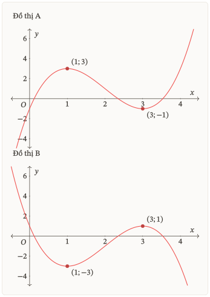{loading="lazy"}

::: r1-figcaption
nhiệm vụ 12 của Luyện tập — Hai hình để chọn; các điểm được ghi tọa độ chính xác.
:::
::::

::: answer-link
[Xem lời giải](#loi-giai-2)
:::

### Nhiệm vụ 13 – Mốc đạo hàm bằng không {#lt02 .zo-learning-task .zo-learning-task--item}

Cho $g$ có đạo hàm trên $\mathbb{R}$ và $g^\prime(x)=-(x+1)^2$.

Một bạn kết luận: “$g$ nghịch biến trên $(-\infty;-1)$ và $(-1;+\infty)$ nhưng không thể kết luận nghịch biến trên $\mathbb{R}$. Tại $-1$, hàm số có cực trị vì đạo hàm bằng $0$.”

Hãy giữ phần đúng, sửa phần sai và giải thích tại sao có thể hoặc không thể gộp kết luận đơn điệu qua $-1$.

::: answer-link
[Xem lời giải](#loi-giai-3)
:::

### Nhiệm vụ 14 – Đọc đồ thị đạo hàm {#lt03 .zo-learning-task .zo-learning-task--item}

Cho $h$ có đạo hàm trên $\mathbb{R}$. Hình sau biểu diễn $y=h^\prime(x)$; các nghiệm duy nhất của đạo hàm là $-2$ và $1$. Ngoài khung hình, đạo hàm tiếp tục âm khi $x<-2$ và dương khi $x>1$. Biết thêm $h(-2)=4$.

:::: r1-figure
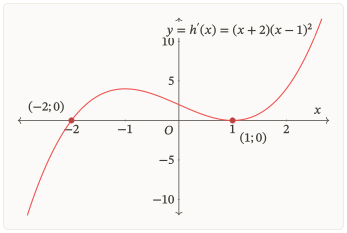{loading="lazy"}

::: r1-figcaption
nhiệm vụ 14 của Luyện tập — Đồ thị của đạo hàm, không phải đồ thị của h.
:::
::::

1.  Lập bảng dấu đạo hàm và xác định các khoảng đơn điệu của $h$.
2.  Xét cực trị của $h$ tại từng nghiệm của đạo hàm.
3.  Xác định tọa độ điểm cực trị của đồ thị $h$ mà dữ kiện cho phép biết.
4.  Một bạn đọc điểm $(1;0)$ trên hình và ghi $h(1)=0$. Cách đọc đó đúng không?

::: answer-link
[Xem lời giải](#loi-giai-4)
:::

### Nhiệm vụ 15 – Một góc và một điểm bị bỏ {#lt04 .zo-learning-task .zo-learning-task--item}

Xét $u(x)=\lvert x+1\rvert-2$ trên $\mathbb{R}$. Xét thêm $v$ có cùng công thức nhưng chỉ xác định trên $\mathbb{R}\setminus\{-1\}$.

1.  Kiểm tra tính liên tục và sự tồn tại của đạo hàm của $u$ tại $-1$; xét cực trị tại đó.
2.  $-1$ có phải điểm cực trị của $v$ không?
3.  Phác hai đồ thị, ghi rõ điểm kín hoặc điểm hở tại vị trí $(-1;-2)$; giải thích khác biệt ở hàng hàm số trong hai bảng biến thiên.

::: answer-link
[Xem lời giải](#loi-giai-5)
:::

### Điểm dừng 01 {#cp-lt1}

1. Giữ bài làm của chặng 1 cùng mức hỗ trợ đã dùng.
2. Tại điểm này, tự kiểm ba việc: đã ghi đúng tập xác định và khoảng xét; nối đúng công thức–đạo hàm–dấu–chiều biến thiên–bảng–đồ thị; xét cực trị bằng dấu hai phía và gọi đúng đối tượng.
3. Ghi mục tiêu đã đạt, còn sai hoặc chưa đủ bằng chứng; không lấy đáp số nhớ được làm xác nhận.
4. Nếu bài làm còn sai về tập xác định, điều kiện xét cực trị, điểm ghép, cách gọi cực trị, cách dùng định lí hoặc suy luận từ dữ kiện, chọn bài tương ứng trong [Sửa lỗi sau Luyện tập](#sua-loi-sau-luyen-tap). Tự làm trước khi mở đáp án và đối chiếu đúng tiêu chí của bài đó.
5. Nếu chưa đủ nền, đi đúng tuyến [tập xác định](#nen-n-txd-01), [đạo hàm](#nen-n-dh-01), [xét dấu](#nen-n-dau-01), [bảng biến thiên](#nen-n-bbt-01), [đồ thị](#nen-n-dt-01) hoặc [điểm ghép](#nen-n-lt-01); tự làm câu xác nhận chưa gặp trước đó của thẻ rồi quay về nhiệm vụ đang dừng.
6. Trước khi làm những bài cần dùng kết quả của chặng này, kiểm lại ba việc: xác định đúng tập và khoảng xét, nối đúng các biểu diễn, xét và gọi đúng cực trị. Nếu còn sai, dùng hỗ trợ tương ứng trong bảng rồi quay lại phần ấy. Em vẫn có thể xem hoặc làm nội dung khác mà mình đã đủ kiến thức; việc chuyển sang phần khác không có nghĩa phần đang vướng đã hoàn tất. [Ghi Nhật kí](#nhat-ky) khi cần lưu kết quả hoặc nơi sẽ tiếp tục.

### Chặng 2 — Giới hạn của đọc ngược {#g01-c2}

Đọc trong giới hạn dữ kiện; dùng đúng tập đang xét và kiểm so sánh chéo trên tập rời.

### Nhiệm vụ 16 – Đọc bảng không có hàng đạo hàm {#lt05 .zo-learning-task .zo-learning-task--item}

Cho $r$ liên tục trên $[-3;4]$, có bảng biến thiên sau. Không có giả thiết về đạo hàm.

:::: table-scroll
::: {.r1-bbt bbt="BBT06" caption="Bảng biến thiên."}
ZO BBT placeholder
:::
::::

1.  Nêu các khoảng đơn điệu và các cực trị ở bên trong tập xác định.
2.  Viết tọa độ các điểm cực trị của đồ thị.
3.  Có được tự điền $r^\prime(x)>0$ với mọi $x\in(0;2)$ không? Nếu biết thêm $r$ có đạo hàm trên $(0;2)$ thì kết luận được gì về dấu đạo hàm?
4.  Bảng có xác định duy nhất công thức $r$ không? Nêu lí do.

::: answer-link
[Xem lời giải](#loi-giai-6)
:::

### Nhiệm vụ 17 – Hai nhánh cùng đi lên {#lt06 .zo-learning-task .zo-learning-task--item}

Cho $q$ xác định trên $D=\mathbb{R}\setminus\{1\}$ bởi $q(x)=x+3$ khi $x<1$ và $q(x)=x-3$ khi $x>1$.

1.  Kết luận chiều biến thiên trên từng khoảng của tập xác định.
2.  Kiểm tra phát biểu “$q$ đồng biến trên toàn $D$” theo yêu cầu so sánh mọi cặp điểm thuộc $D$. Dùng một cặp điểm cụ thể nếu cần bác bỏ.
3.  Điểm $1$ có thể là điểm cực trị của $q$ không? Giải thích.

::: answer-link
[Xem lời giải](#loi-giai-7)
:::

### Điểm dừng 02 {#cp-lt2}

1. Giữ bài làm của chặng 2 cùng mức hỗ trợ đã dùng.
2. Tại điểm này, tự kiểm việc dùng đúng điều kiện và đọc ngược đúng giới hạn: không tự gán dấu đạo hàm nghiêm ngặt, công thức hàm hoặc kết luận xuyên các khoảng rời; mọi kết luận phải nêu đúng dữ kiện cho phép suy ra.
3. Ghi mục tiêu đã đạt, còn sai hoặc chưa đủ bằng chứng; không lấy đáp số nhớ được làm xác nhận.
4. Nếu bài làm cho thấy lỗi về tập xác định, ba đối tượng cực trị, hợp các khoảng rời, chiều suy luận của định lí hoặc giới hạn của dữ kiện, làm đúng bài tương ứng trong [Sửa lỗi sau Luyện tập](#sua-loi-sau-luyen-tap).
5. Nếu thiếu nền, đi [tập xác định](#nen-n-txd-01), [bảng biến thiên](#nen-n-bbt-01), [đồ thị](#nen-n-dt-01) hoặc [điểm ghép](#nen-n-lt-01); tự làm câu xác nhận chưa gặp trước đó rồi quay về bài đang dừng.
6. Để làm phần phụ thuộc ở chặng 3, cần đã đọc ngược mà không thêm dữ kiện và đã xác nhận mọi lỗi thiết yếu vừa quan sát. Nếu bài phù hợp đã gặp trước đó hoặc còn sai sau hỗ trợ, ghi “Chưa có bài mới để xác nhận thêm ở mục tiêu này”; xem lại [giới hạn của đọc ngược](#có-thể-đọc-ngược-đến-đâu) và ghi mục tiêu chưa xác nhận. Không mượn bài Kiểm tra hoặc Ôn lại để lấp bằng chứng. Em vẫn có thể xem trước phần khác hoặc bắt đầu Kiểm tra khi đã chuẩn bị kĩ hay đủ tự tin; việc đi tiếp không tự chứng nhận mục tiêu đã đạt. [Ghi Nhật kí](#nhat-ky) khi cần lưu kết quả và quyết định tiếp theo.

### Chặng 3 — Đánh giá và sửa lập luận {#g01-c3}

Đánh giá từng mệnh đề có căn cứ, giữ phần đúng khi sửa và tự làm câu xác nhận riêng sau Bài 08.

### Nhiệm vụ 18 – Đúng/sai với cùng một giả thiết {#lt07 .zo-learning-task .zo-learning-task--item}

Cho $t(x)=(x+2)^3-1$ trên $\mathbb{R}$. Xét từng ý độc lập; “hoặc” có nghĩa ít nhất một vế đúng.

a.  $t$ đồng biến trên $\mathbb{R}$ và $t^\prime(-2)>0$.

b.  $t^\prime(-2)=0$ hoặc $t$ đạt cực đại tại $-2$.

c.  Với mọi $x\in\mathbb{R}$, ta có $t^\prime(x)>0$.

d.  $t$ có cực trị tại $-2$ hoặc $t^\prime(-2)<0$.

Với mỗi ý, ghi đúng/sai và lí do. Với ý sai, viết lại cả câu thành một phát biểu đúng, giữ những vế vốn đúng.

::: answer-link
[Xem lời giải](#loi-giai-8)
:::

### Nhiệm vụ 19 – Sửa một lời giải rồi làm câu mới {#lt08 .zo-learning-task .zo-learning-task--item}

Cho $r$ liên tục trên $\mathbb{R}$, có đạo hàm trên $\mathbb{R}$ và bảng dấu sau; biết $r(-3)=5$, $r(1)=-2$.

:::: table-scroll
::: {.r1-bbt bbt="BBT07" caption="Bảng dấu đạo hàm."}
ZO BBT placeholder
:::
::::

Lời giải của một bạn:

> Đạo hàm có hai nghiệm nên hàm số có hai điểm cực trị. Hàm số có điểm cực đại là $5$ và điểm cực tiểu là $-2$.

Chỉ ra từng lỗi, viết lại kết luận đúng và phân biệt ba đối tượng ở cực trị thực sự. Sau khi chữa, tự làm câu xác nhận riêng dưới đây trước khi mở đáp án.

::: answer-link
[Xem lời giải](#loi-giai-9)
:::

### Nhiệm vụ 20 — Xác nhận sau sửa {#g01-l08-xn01 .r1-confirmation-task}

Cho $h$ có đạo hàm trên $\mathbb{R}$ và

$$
h^\prime(x)=(x+5)^2(x-4),\quad h(4)=-7.
$$

Một bạn kết luận: “Hàm có các nghiệm của phương trình đạo hàm bằng $0$ $-5$, $4$ nên có hai điểm cực trị tại $-5$, $4$; giá trị cực tiểu là $4$.” Hãy giữ những nhận xét đúng, chỉ ra các lỗi và viết lại kết luận đúng về đơn điệu cùng ba đối tượng ở cực trị.

**Tiêu chí:** xét đúng dấu; không đếm nghiệm của phương trình đạo hàm bằng $0$ thành cực trị; gọi đúng ba đối tượng; giữ nhận xét đúng về hai nghiệm của phương trình đạo hàm bằng $0$; giải thích được vì sao có thể gộp hai khoảng nghịch biến qua $-5$.

::: answer-link
[Xem lời giải](#lg-g01-l08-xn01)
:::

### Điểm dừng 03 {#cp-lt3}

1. Giữ bài làm của chặng 3 cùng mức hỗ trợ đã dùng.
2. Tại điểm này, tự kiểm ba việc: đánh giá riêng từng mệnh đề có căn cứ, giữ phần đúng khi sửa và gọi đúng điểm cực trị, giá trị cực trị, điểm cực trị của đồ thị.
3. Ghi mục tiêu đã đạt, còn sai hoặc chưa đủ bằng chứng; không lấy đáp số nhớ được làm xác nhận.
4. Nếu còn coi đạo hàm bằng $0$ là đủ để có cực trị, đảo chiều suy luận của định lí hoặc làm mất phần đúng khi sửa, làm đúng bài tương ứng trong [Sửa lỗi sau Luyện tập](#sua-loi-sau-luyen-tap).
5. Nếu thiếu nền logic, đi [Ôn nền: Mệnh đề và phản ví dụ](#nen-n-lg-01), làm bốn mệnh đề mới rồi quay về ý đang dừng. Nếu bỏ điều kiện liên tục trước Kiểm tra, dùng [Ôn nền: Liên tục và điểm ghép](#nen-n-lt-01), làm câu xác nhận hẹp trong thẻ rồi quay về Điểm dừng 03.
6. Khi đã chuẩn bị kĩ hoặc đủ tự tin, em có thể bắt đầu [Kiểm tra](#tu-kiem-tra). Nếu còn vướng, xem lại đúng phần [Bài học](#bai-hoc), [Ôn nền](#on-nen) hoặc [Sửa lỗi](#sua-loi) trước. Quyết định làm Kiểm tra không có nghĩa là đã đạt các mục tiêu. Nếu bài phù hợp đã gặp trước đó hoặc còn sai, ghi “Chưa có bài mới để xác nhận thêm ở mục tiêu này” và mục tiêu chưa xác nhận vào [Nhật kí](#nhat-ky); không tự ghi đủ điều kiện chuyển gói. [Ghi Nhật kí](#nhat-ky) khi cần lưu kết quả và quyết định tiếp theo.

## Kiểm tra {#tu-kiem-tra}

**Thời gian đề xuất: 45 phút. Tổng điểm: 20.**

Đã chuẩn bị kĩ lưỡng hoặc đủ tự tin, em có thể thực hiện Kiểm tra. Không được chia Kiểm tra thành nhiều đợt.

Tự làm cả năm nhiệm vụ trên giấy, ghi lập luận và điều kiện đã sử dụng. Trong lúc Kiểm tra, phải tự lực hoàn toàn: không dùng Bài học, Ôn nền, Lời giải hoặc Sửa lỗi để trợ giúp bài đang làm. Chỉ mở hướng dẫn chấm sau khi hoàn thành. Nếu cần hỗ trợ, kết thúc lượt kiểm tra và giữ bài làm ban đầu trước; phần đã dùng hỗ trợ không còn là kết quả tự làm một bài mới. Đủ tự tin để bắt đầu không tự chứng nhận đã đạt mục tiêu.

Thời gian 45 phút là đề xuất cho học liệu này và có thể điều chỉnh sau khi sử dụng. Tổng điểm 20 giúp phân tích bài làm, không mô phỏng thang điểm của kì thi THPT.

::: {#cach-thuc-hien-kiem-tra data-zo-instructions="required"}

Chuẩn bị giấy và đồng hồ; ghi thời điểm bắt đầu, kết thúc và phần chưa làm được. Kết thúc lượt làm rồi mới tra nhóm Kiểm tra trong Lời giải để chấm. Giữ nguyên bài làm lần đầu trước khi ghi kết quả.

:::

### Nhiệm vụ 21 – Dựng chuỗi biểu diễn {#kt01 .zo-learning-task .zo-learning-task--item}

**5 điểm.**

Cho $f(x)=-x^3+3x^2+9x-4$ trên $\mathbb{R}$.

a.  Xác định tập xác định và tính đạo hàm.

b.  Xét dấu đạo hàm.

c.  Nêu các khoảng đơn điệu.

d.  Lập bảng biến thiên có giá trị ở các mốc và giới hạn ở hai đầu; phác dáng điệu đồ thị khớp bảng, đánh dấu các điểm cực trị.

e.  Viết rõ điểm cực đại, giá trị cực đại, điểm cực tiểu và giá trị cực tiểu của hàm số.

::: answer-link
[Xem lời giải](#loi-giai-10)
:::

### Nhiệm vụ 22 – Đọc một biểu diễn mới {#kt02 .zo-learning-task .zo-learning-task--item}

**4 điểm.**

Cho $k$ có đạo hàm trên khoảng $K=(-4;3)$. Hình sau biểu diễn $y=k^\prime(x)$ trên $K$. Các giao điểm có nhãn là chính xác; đây là toàn bộ các nghiệm của đạo hàm trong $K$.

:::: r1-figure
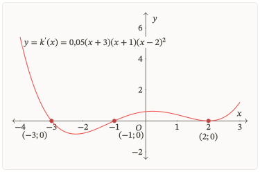{loading="lazy"}

::: r1-figcaption
nhiệm vụ 22 của Kiểm tra — Đồ thị đạo hàm trên khoảng (-4;3).
:::
::::

a.  Xác định các khoảng đơn điệu của $k$; có thể kết luận trên một khoảng lớn hơn đi xuyên qua $2$ không?

b.  Xác định các điểm cực đại và cực tiểu của $k$ trong $K$.

c.  $2$ có phải điểm cực trị không? Nêu lí do.

d.  Chỉ từ hình này, có biết được các giá trị cực trị của $k$ không? Giải thích bằng lượng dữ kiện đã cho.

::: answer-link
[Xem lời giải](#loi-giai-11)
:::

### Nhiệm vụ 23 – Kiểm từng phát biểu {#kt03 .zo-learning-task .zo-learning-task--item}

**4 điểm.**

Cho $r$ liên tục trên $[-4;5]$ và có bảng biến thiên dưới đây; không có thêm giả thiết về đạo hàm. Xét mỗi ý độc lập từ giả thiết chung.

Với các ý nói về điều “có thể khẳng định từ giả thiết”, đánh giá tính có căn cứ của kết luận. Việc chưa đủ dữ kiện để khẳng định một tính chất không có nghĩa tính chất ấy chắc chắn không xảy ra.

:::: table-scroll
::: {.r1-bbt bbt="BBT08" caption="Bảng biến thiên."}
ZO BBT placeholder
:::
::::

a.  Đồ thị $r$ có điểm cực tiểu $(-1;-3)$.

b.  Từ giả thiết đã cho, có thể khẳng định rằng $r^\prime(x)>0$ tại mọi $x$ thuộc $(-1;2)$.

c.  Giá trị cực đại của $r$ bằng $2$ hoặc giá trị cực tiểu của $r$ bằng $-3$.

d.  Bảng xác định duy nhất công thức của $r$.

Ghi đúng/sai và lí do cho từng ý; chỉ chọn nhãn không được trọn điểm.

::: answer-link
[Xem lời giải](#loi-giai-12)
:::

### Nhiệm vụ 24 – Tập xác định và điểm không có đạo hàm {#kt04 .zo-learning-task .zo-learning-task--item}

**4 điểm.**

Cho $u(x)=\lvert x-3\rvert+2$ trên $\mathbb{R}$ và $v$ có cùng công thức trên $\mathbb{R}\setminus\{3\}$.

a.  Xét sự tồn tại của $u^\prime(3)$ và cực trị của $u$ tại $3$, có giải thích.

b.  Xét khả năng $3$ là điểm cực trị của $v$.

c.  Một hàm khác $w$ có tập xác định $\mathbb{R}\setminus\{0\}$, với $w(x)=x+4$ khi $x<0$ và $w(x)=x-4$ khi $x>0$. Kết luận đơn điệu trên từng khoảng; kiểm tra việc gộp thành một kết luận trên cả tập xác định bằng so sánh chéo.

d.  Sửa toàn bộ câu “$u^\prime(3)$ không tồn tại và $u$ không có cực trị tại $3$”, giữ vế đúng.

::: answer-link
[Xem lời giải](#loi-giai-13)
:::

### Nhiệm vụ 25 – Căn cứ kết luận {#kt05 .zo-learning-task .zo-learning-task--item}

**3 điểm.**

Cho $F$ xác định trên $(-1;1)$ và có đạo hàm trên $(-1;0)$, $(0;1)$. Biết $F^\prime(x)>0$ ở khoảng bên trái và $F^\prime(x)<0$ ở khoảng bên phải. Đề không cho giá trị $F(0)$ hoặc tính liên tục tại $0$.

Một bạn viết: “Theo định lí đổi dấu đạo hàm, $F$ đạt cực đại tại $0$ và giá trị cực đại bằng $0$.”

a.  Chỉ ra điều kiện còn thiếu để áp dụng định lí xét cực trị bằng dấu đạo hàm. Có đủ căn cứ để kết luận giá trị cực đại bằng $0$ không?

b.  **Nếu bổ sung giả thiết $F$ liên tục tại $0$**, hãy phát biểu kết luận đúng về cực trị tại $0$ và nêu điều chưa xác định được bằng số.

Ở ý a, chỉ dùng dữ kiện ban đầu. Ở ý b, tính liên tục tại $0$ là giả thiết được bổ sung công khai cho một tình huống mới.

::: answer-link
[Xem lời giải](#loi-giai-14)
:::

### Sau khi hoàn thành bài kiểm tra {#sau-khi-nộp-bài-cho-chính-mình}

Mở hướng dẫn chấm, ghi điểm từng ý và giữ nguyên bài làm lần đầu. Dùng bảng [Đọc kết quả](#đọc-kết-quả-tự-kiểm-tra) để xem bằng chứng cho từng mục tiêu. Tổng điểm không bù cho một mục tiêu thiết yếu chưa có bằng chứng.

::: {#cach-thuc-hien-sau-kiem-tra data-zo-instructions="required"}

Ghi riêng kết quả sau sửa với điểm ban đầu. Đánh dấu phần đã xem đáp án hoặc dùng hỗ trợ; không tính việc nhớ lại đáp án là kết quả tự làm. Nếu một bài có nhiều lỗi, đối chiếu từng tiêu chí.

:::

### Điểm dừng 04 {#cp-kt}

Tại điểm này, dùng bảng [Đọc kết quả](#đọc-kết-quả-tự-kiểm-tra), không dùng tổng điểm để che một lỗi thiết yếu. Nếu còn vướng, chọn đúng bài trong [Sửa lỗi sau Kiểm tra](#sua-loi-sau-kiem-tra); thiếu thao tác nền thì dùng đúng thẻ [Ôn nền](#on-nen). Giữ điểm ban đầu riêng với kết quả sau sửa. Chỉ ghi đã xác nhận sau sửa khi tự làm bài phù hợp chưa gặp trước đó và đáp ứng tiêu chí của nó.

Khi cả năm mục tiêu thiết yếu có bài tự làm đáp ứng yêu cầu và lỗi cản trở việc học tiếp đã được xác nhận sau sửa, ghi ngày hoàn tất lượt chính và hẹn Ôn lại. Không mắc lỗi trong Kiểm tra không buộc em làm thêm nhiệm vụ 38 của Sửa lỗi sau Luyện tập: mục tiêu Đánh giá và sửa lập luận dùng bằng chứng phù hợp ở Kiểm tra, nhiệm vụ 19 của Luyện tập và câu xác nhận riêng.

Nếu không còn bài phù hợp chưa gặp trước đó hoặc còn sai sau hỗ trợ, ghi “Chưa có bài mới để xác nhận thêm ở mục tiêu này”; xem lại mục học tương ứng và ghi mục tiêu chưa xác nhận. Chỉ tiếp tục phần độc lập không phụ thuộc mục tiêu còn vướng; chưa ghi hoàn tất lượt chính. Không dùng bài Ôn lại hoặc bài đã xem để lấp chỗ thiếu.

[Ghi Nhật kí](#nhat-ky) khi cần lưu quyết định, nơi tiếp tục hoặc kết thúc buổi học. Bài làm và kết quả đối chiếu có thể giữ ngay trên giấy đang dùng.

### Đọc kết quả {#đọc-kết-quả-tự-kiểm-tra}

Tổng điểm là số liệu tóm tắt, không thay thế việc xem lỗi. Không dùng một ngưỡng điểm chung để bỏ qua một mục tiêu còn vướng.

::: {#r1-table-t17 .table-scroll}
| Mục tiêu | Các bằng chứng cần xem | Cách ghi kết quả |
|------------------------|------------------------|------------------------|
| Dùng đúng điều kiện | Kiểm tra 01 ý a và lí do dùng định lí; Kiểm tra 04 ý a–b; Kiểm tra 05 ý a–b | Giữ đúng tập/khoảng; phân biệt đạo hàm, liên tục, điểm bị loại và giả thiết bổ sung |
| Nối các biểu diễn | Kiểm tra 01 ý a–d; Kiểm tra 02 ý a | Đạo hàm, dấu, khoảng, mốc, giới hạn, bảng và hình khớp nhau; không ngắt khoảng máy móc tại mốc đạo hàm bằng $0$ |
| Xét và gọi đúng cực trị | Kiểm tra 01 ý e cùng các điểm trên hình ở d; Kiểm tra 02 ý b–c; Kiểm tra 03 ý a, c; Kiểm tra 04 ý a–b | Xét đúng điều kiện/dấu; gọi đúng đối tượng được hỏi, không đếm nghiệm của phương trình đạo hàm bằng $0$ thành cực trị. Ý e của Bài 01 không tự đo đủ ba đối tượng |
| Đọc trong giới hạn dữ kiện | Kiểm tra 02 ý d; Kiểm tra 03 ý b, d; Kiểm tra 04 ý c; Kiểm tra 05 ý a–b | Tách điều biết/chưa biết; không lấy đồ thị đạo hàm làm giá trị hàm, không gộp tập rời thiếu so sánh chéo |
| Đánh giá và sửa lập luận | Kiểm tra 03 ý a–d; Kiểm tra 04 ý d; Kiểm tra 05 ý a–b; Nhiệm vụ 19 và câu xác nhận riêng hoặc bài sửa chưa gặp trước đó khi cần | Từng phán quyết có căn cứ; giữ vế đúng; sửa điều kiện/phép nối. Bằng chứng sau hỗ trợ được ghi riêng với bài làm ban đầu |
:::

Kết quả lần này cho biết những gì em tự làm được ở hiện tại. Hãy dùng lịch Ôn lại để kiểm tra khả năng nhớ sau một thời gian. Nếu một mục tiêu đã có bài tự làm đáp ứng tiêu chí, không cần làm thêm bài Sửa lỗi cho mục tiêu đó. [Điểm dừng 04](#cp-kt).

## Ôn lại {#on-lai}

**Ngày gốc là ngày hoàn tất lượt chính**, ghi tại [Điểm dừng 04](#cp-kt). Lịch mặc định: nhiệm vụ 26 của Ôn lại sau 2–3 ngày; nhiệm vụ 27 của Ôn lại sau 7 ngày; nhiệm vụ 28 của Ôn lại sau 3–4 tuần kể từ ngày gốc.

Ở mỗi lượt, đóng Bài học và Lời giải, tự nhớ và làm nhiệm vụ riêng trước khi đối chiếu; ghi mức hỗ trợ và kết quả sau khoảng trễ. Bài từng sai dùng để nhớ nguyên nhân, không phải kết quả tự làm một bài mới.

Hoàn tất lượt chính không đồng nghĩa đã kiểm tra khả năng nhớ sau một thời gian. Em có thể học gói tiếp phù hợp tiên quyết trong lúc chờ lịch Ôn lại, không phải chờ 3–4 tuần. Nếu cần kiểm sớm một lỗi vừa sửa, hẹn riêng mục tiêu ấy và ghi rõ; không thay ngày gốc hoặc coi lần kiểm sớm là toàn bộ lượt Ôn lại.

::: {#r1-table-t20 .table-scroll}
| Ngày hẹn tính từ ngày hoàn tất lượt chính | Nhiệm vụ cần tự làm | Điểm dừng |
|---|---|---|
| Sau khoảng $2$–$3$ ngày | [Nhiệm vụ 26](#g01-o01) | [Điểm dừng 05](#cp-on1) |
| Sau khoảng $7$ ngày | [Nhiệm vụ 27](#g01-o02) | [Điểm dừng 06](#cp-on2) |
| Sau khoảng $3$–$4$ tuần | [Nhiệm vụ 28](#g01-o03) | [Điểm dừng 07](#cp-on3) |
:::

::: {#cach-thuc-hien-on-lai data-zo-instructions="required"}

Ghi ngày gốc và ba ngày hẹn vào Nhật kí. Sau mỗi lượt, dùng Điểm dừng tương ứng để giữ lịch hoặc hẹn kiểm sớm phần còn vướng. Không dùng bài đã gặp trước đó hoặc đã làm ở lượt trước làm bằng chứng mới. Phần liên hệ với Giá trị lớn nhất và giá trị nhỏ nhất chỉ thực hiện khi đã học nội dung đó; không cần học gói mới để ôn gói này.

:::

### Nhiệm vụ 26 – Một nghiệm đổi dấu, một nghiệm không đổi dấu {#g01-o01 .zo-learning-task .zo-learning-task--item}

**Thời điểm mặc định:** sau 2–3 ngày. **Mục tiêu:** dùng đúng tập xác định và điều kiện; nối đúng chuỗi biểu diễn; xét và gọi đúng các đối tượng cực trị; đọc hình trong giới hạn dữ kiện. **Điểm dừng:** Điểm dừng 05. **Lỗi cần quan sát:** đếm nghiệm của phương trình đạo hàm bằng $0$ thay cho xét đổi dấu; nhầm ba đối tượng cực trị; suy quá dữ kiện hình.

Đóng tài liệu trước khi làm.

Cho hàm số $f$ có đạo hàm trên $\mathbb{R}$. Hình biểu diễn định tính đồ thị $y=f^\prime(x)$ tiếp xúc trục hoành tại $x=-2$, cắt trục hoành tại $x=5$, dương khi $x<5$ trừ $x=-2$, và âm khi $x>5$. Đây là toàn bộ nghiệm của đạo hàm. Hình không cho thang tung độ hoặc công thức. Biết $f(5)=7$.

:::: r1-figure
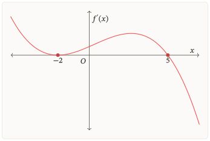{loading="lazy"}

::: r1-figcaption
Hình chỉ mã hóa nghiệm, dấu và cách cắt hoặc tiếp xúc của đạo hàm.
:::
::::

1. Nêu dấu của $f^\prime(x)$ và các khoảng đơn điệu của $f$; giải thích có gộp qua $-2$ được không.
2. Xét cực trị tại $x=-2$ và $x=5$.
3. Gọi đúng điểm cực trị của hàm số, giá trị cực trị và điểm cực trị của đồ thị xác định được.
4. Có biết $f(-2)$ hoặc công thức của $f$ không? Nêu lí do.

**Tiêu chí đạt:** không đếm hai nghiệm của đạo hàm thành hai điểm cực trị; gộp đúng khoảng đồng biến qua $x=-2$ và nêu được căn cứ; gọi đúng $5$, $7$, $(5;7)$; không tự suy ra $f(-2)$ hoặc công thức của $f$.

**Tuyến sau bài:** đạt thì quay về Điểm dừng 05 và giữ lịch nhiệm vụ 27 của Ôn lại; sai vì đếm nghiệm của phương trình đạo hàm bằng $0$ thì làm [Một mốc không đổi dấu nằm giữa hai mốc đổi dấu](#g01-s-o-e02); sai cách gọi ba đối tượng thì làm [Hai hình, ba đối tượng](#g01-s-o-e04); suy quá dữ kiện hình thì làm [Biết, chưa biết và sai](#g01-s-o-e07).

::: answer-link
[Xem lời giải](#lg-g01-o01)
:::

### Điểm dừng 05 {#cp-on1}

Tại điểm này, đối chiếu nhiệm vụ 26 của Ôn lại theo bốn mục tiêu ghi trong đề. Nếu lỗi tái diễn, làm đúng bài sửa lỗi sau Ôn lại; nếu thiếu nền, đi đúng tuyến Nền, làm câu kiểm tra lại mới rồi quay về chính Điểm dừng 05. Đạt thì giữ lịch nhiệm vụ 27 của Ôn lại.

[Ghi Nhật kí](#nhat-ky) khi cần lưu quyết định, nơi tiếp tục hoặc kết thúc buổi học. Bài làm và kết quả đối chiếu có thể giữ ngay trên giấy đang dùng.

### Nhiệm vụ 27 – Bảng biến thiên trên hai thành phần {#g01-o02 .zo-learning-task .zo-learning-task--item}

**Thời điểm mặc định:** sau khoảng 7 ngày. **Mục tiêu:** dùng đúng tập xác định và điều kiện; xét và gọi đúng các đối tượng cực trị; đọc bảng trong giới hạn dữ kiện; đánh giá và sửa lập luận mà vẫn giữ phần đúng. **Điểm dừng:** Điểm dừng 06. **Lỗi cần quan sát:** gộp khoảng rời; đảo chiều suy luận của định lí; suy quá dữ kiện bảng; làm mất phần đúng khi chữa.

Đóng tài liệu trước khi làm.

Cho hàm số $r$ liên tục trên từng thành phần của tập xác định

$$
D=[-4;-1]\cup[1;5].
$$

Bảng biến thiên không có hàng đạo hàm cho biết:

- trên $[-4;-1]$, $r$ giảm từ $r(-4)=6$ xuống $r(-1)=0$;
- trên $[1;3]$, $r$ tăng từ $r(1)=2$ lên $r(3)=4$;
- trên $[3;5]$, $r$ giảm từ $4$ xuống $r(5)=1$.

Đánh giá từng phát biểu sau và sửa toàn bộ phát biểu sai mà không làm mất phần đúng:

a. Hàm số đạt cực đại địa phương tại $x=3$, giá trị cực đại là $4$, điểm cực đại của đồ thị là $(3;4)$.

b. Vì $r$ giảm trên $[-4;-1]$ và trên $[3;5]$, có thể kết luận $r$ nghịch biến trên $[-4;-1]\cup[3;5]$.

c. Vì bảng có mũi tên đi lên trên $[1;3]$, ta có $r^\prime(x)>0$ với mọi $x\in(1;3)$.

**Tiêu chí đạt của lượt Ôn lại:** xét đủ hai thành phần của tập xác định; dùng được cặp $-1<5$ để bác bỏ phép gộp sai hoặc đưa ra một cặp chéo hợp lệ khác; không tự thêm hàng đạo hàm vào bảng; sửa câu sai nhưng giữ hai kết luận giảm riêng vốn đúng.

:::: {.zo-block .zo-block-gray .r1-transfer-conditional}
::: {.zo-block-title}
Phối hợp sau khi học Giá trị lớn nhất và giá trị nhỏ nhất
:::

Khi đã hoàn tất học liệu “Giá trị lớn nhất và giá trị nhỏ nhất”, dùng lại bảng này để tìm giá trị lớn nhất, giá trị nhỏ nhất của $r$ trên $D$ và các điểm đạt. Phần này không tính vào điều kiện hoàn tất lượt Ôn lại của học liệu hiện tại và không phải một kết quả tự làm một bài mới của học liệu phối hợp.
::::

**Tuyến sau bài:** đạt thì quay về Điểm dừng 06 và giữ lịch nhiệm vụ 28 của Ôn lại; gộp khoảng rời thì làm [Tự chứng minh so sánh chéo](#g01-s-o-e05); suy dấu nghiêm ngặt thì làm [Đồng biến nhưng đạo hàm có thể bằng không](#g01-s-o-e06); suy quá dữ kiện bảng thì làm [Biết, chưa biết và sai](#g01-s-o-e07); làm mất phần đúng khi chữa thì làm [Hai bước đúng, một bước sai](#g01-s-o-e08).

::: answer-link
[Xem lời giải](#lg-g01-o02)
:::

### Điểm dừng 06 {#cp-on2}

Tại điểm này, đối chiếu nhiệm vụ 27 của Ôn lại theo bốn mục tiêu ghi trong đề. Lỗi tái diễn thì làm đúng bài sửa lỗi sau Ôn lại; thiếu nền thì đi đúng tuyến Nền và làm câu kiểm tra lại mới trước khi quay về Điểm dừng 06. Đạt thì giữ lịch nhiệm vụ 28 của Ôn lại.

[Ghi Nhật kí](#nhat-ky) khi cần lưu quyết định, nơi tiếp tục hoặc kết thúc buổi học. Bài làm và kết quả đối chiếu có thể giữ ngay trên giấy đang dùng.

### Nhiệm vụ 28 – Tự dựng chuỗi biểu diễn cho hàm từng đoạn {#g01-o03 .zo-learning-task .zo-learning-task--item}

**Thời điểm mặc định:** sau khoảng 3–4 tuần. **Mục tiêu:** phối hợp toàn bộ mục tiêu của gói. **Điểm dừng:** Điểm dừng 07. **Lỗi cần quan sát:** coi đạo hàm bằng $0$ là đủ; loại cực trị khi đạo hàm không tồn tại; nhầm ba đối tượng cực trị; đảo chiều suy luận của định lí; sửa sai logic; bỏ điều kiện liên tục.

Đóng tài liệu trước khi làm.

Cho hàm số

$$
F(x)=
\begin{cases}
-(x+1)^2+1 & \text{khi } x<0,\\
x^3-3x & \text{khi } x\geq0.
\end{cases}
$$

1. Xác định tập xác định. Kiểm tra tính liên tục và sự tồn tại của $F^\prime(0)$.
2. Tính đạo hàm trên từng khoảng thích hợp. Tự chọn các mốc cần đặt vào bảng dấu; xét dấu và nêu các khoảng đơn điệu.
3. Lập bảng biến thiên, xác định các cực trị và gọi đúng ba đối tượng ở mỗi cực trị.
4. Một bạn viết: “$F$ nghịch biến trên $(-1;1)$, do đó $F^\prime(x)<0$ với mọi $x\in(-1;1)$.” Hãy giữ phần đúng, chỉ ra phần thiếu căn cứ và viết lại toàn bộ câu.

**Tiêu chí đạt:** kiểm tra riêng liên tục và đạo hàm tại điểm ghép; chọn đủ ba mốc $-1$, $0$, $1$ nhưng không đếm mọi mốc thành cực trị; gộp đúng khoảng nghịch biến qua điểm ghép bằng tính liên tục và hành vi hai phía; gọi đúng ba đối tượng tại hai cực trị; giữ phần đúng khi sửa lập luận và không biến tính đơn điệu thành dấu đạo hàm nghiêm ngặt tại mọi điểm.

**Tuyến sau bài:** đạt thì quay về Điểm dừng 07, ghi nhận hoàn tất lượt duy trì hiện tại của gói; sai tại điểm ghép thì làm [Cực trị tại điểm ghép](#g01-s-o-e03) hoặc [Tham số tại điểm ghép](#g01-s-o-e09) theo nguồn lỗi; đếm mốc đạo hàm bằng $0$ thì làm [Một mốc không đổi dấu nằm giữa hai mốc đổi dấu](#g01-s-o-e02); nhầm ba đối tượng thì làm [Hai hình, ba đối tượng](#g01-s-o-e04); suy dấu nghiêm ngặt hoặc sửa sai logic thì làm [Đồng biến nhưng đạo hàm có thể bằng không](#g01-s-o-e06) hoặc [Hai bước đúng, một bước sai](#g01-s-o-e08).

::: answer-link
[Xem lời giải](#lg-g01-o03)
:::

### Điểm dừng 07 {#cp-on3}

Tại điểm này, đối chiếu nhiệm vụ 28 của Ôn lại theo toàn bộ mục tiêu của gói. Nếu lỗi tái diễn, làm đúng bài sửa lỗi sau Ôn lại, đi tuyến Nền khi cần, tự làm bài sửa chưa gặp trước đó và hẹn kiểm lại phần đang vướng; mọi đường đều quay về chính Điểm dừng 07. Đạt thì ghi nhận hoàn tất lượt duy trì hiện tại của gói. Nếu bài phù hợp đã gặp trước đó hoặc còn sai, ghi “Chưa có bài mới để xác nhận thêm ở mục tiêu này”; xem lại mục học tương ứng, chưa ghi mục tiêu đã xác nhận.

[Ghi Nhật kí](#nhat-ky) khi cần lưu quyết định, nơi tiếp tục hoặc kết thúc buổi học. Bài làm và kết quả đối chiếu có thể giữ ngay trên giấy đang dùng.

## Ôn nền {#on-nen}

::: {.r1-foundation-entry}
Chỉ chọn phần em thực sự còn thiếu. Mỗi thẻ có ví dụ, nhiệm vụ xác nhận khác ví dụ, đáp án–tiêu chí và chỉ dẫn quay về. Tự làm câu xác nhận trước khi mở đáp án; nếu đã xem đáp án, câu ấy chỉ còn là tài nguyên học trong lượt này.

Nếu câu phù hợp đã gặp trước đó hoặc còn sai sau hỗ trợ, ghi “Chưa có bài mới để xác nhận thêm ở mục tiêu này”, xem lại giải thích của đúng thẻ và ghi mục tiêu chưa xác nhận. Không mượn đề Kiểm tra hoặc Ôn lại để lấp chỗ thiếu. Sau hỗ trợ quay về đúng bài hoặc Điểm dừng đã gọi, không tự chuyển chặng chỉ vì đọc xong thẻ.
:::















## Sửa lỗi {#sua-loi}

Chọn bài theo phần học đã xuất hiện lỗi và bước thực sự sai. Sau khi xem lại giải thích, hãy tự giải một bài khác về đúng lỗi ấy trước khi mở đáp án. Nếu tự giải đúng và giải thích được theo tiêu chí, em đã kiểm lại được phần vừa sửa trong lần học này; kết quả đó chưa cho biết em đã làm chủ mọi nội dung của học liệu.

Nếu đã gặp bài kiểm tra lại, đã dùng bài đó hoặc vẫn chưa làm đúng sau trợ giúp, ghi “Chưa có bài mới để xác nhận thêm ở mục tiêu này”. Xem lại đúng mục Bài học được dẫn tại bài sửa, ghi phần còn vướng rồi quay lại bài hoặc Điểm dừng đã dẫn em đến đây. Không làm trước bài Kiểm tra, bài Ôn lại hoặc bài Sửa lỗi dành cho lượt Ôn lại sau để thay chỗ thiếu. Khi có bài bổ sung được kiểm tra nội dung và tiêu chí phù hợp, em có thể dùng bài đó để tự kiểm tra.

::: {#cach-thuc-hien-sua-loi data-zo-instructions="required"}

Giữ bài làm sai ban đầu, chỉ rõ điều kiện hoặc bước suy luận đã bỏ, rồi viết lại lập luận cho đúng. Tự làm bài khắc phục lỗi tương ứng trước khi mở lời giải. Nếu có nhiều lỗi, xử lí từng lỗi; không chỉ chọn lỗi dễ nhất.

:::

### Chọn bài sửa lỗi {#chọn-câu-sau-chữa}

**Tra theo nơi phát hiện:** [sau Luyện tập](#sua-loi-sau-luyen-tap) · [sau Kiểm tra](#sua-loi-sau-kiem-tra) · [sau Ôn lại](#sua-loi-sau-on-lai).

::: {#r1-table-t12 .table-scroll data-zo-remediation="bottlenecks-v1"}

Mỗi dòng dưới đây chỉ ra một điều cần phân biệt để hiểu bài vững hơn. Đối chiếu với bài làm của em, thử trả lời câu hỏi rồi xem lại phần học được dẫn khi cần. Chọn đúng bài và đúng ý theo nơi phát hiện; nếu đang học Bài học, có thể dùng nhóm Sau Luyện tập. Chỉ tự kiểm tra bằng bài phù hợp chưa gặp trước đó; trong lượt Kiểm tra phải kết thúc lượt trước khi dùng hỗ trợ.

| Nút thắt nhận thức | Biểu hiện dễ nhầm | Câu hỏi và cách tháo gỡ | Tự kiểm tra |
|---|---|---|---|
| Tập xác định và khoảng đang xét | Dùng điểm bị loại để kết luận cực trị hoặc bỏ điều kiện của khoảng xét. | **Điểm đang xét có thuộc tập xác định không?** Ghi tập xác định trước; xét từng khoảng mà hàm số có nghĩa, không thêm điểm sau phép rút gọn. [Xem lại kiến thức](#tách-riêng-điểm-không-thuộc-tập-xác-định). | **Sau Luyện tập:** [Nhiệm vụ 37 – Mốc bị loại khỏi tập xác định](#sc01). **Sau Kiểm tra:** [Nhiệm vụ 45 – Một mốc bị loại khác](#g01-s-k-e01). **Sau Ôn lại:** [Nhiệm vụ 54 – Điểm hở và điểm kín cùng hoành độ](#g01-s-o-e01). |
| Đạo hàm bằng không và cực trị | Đếm nghiệm của phương trình đạo hàm bằng $0$ rồi coi mỗi nghiệm là một điểm cực trị. | **Đạo hàm có đổi dấu qua điểm đó không?** Kiểm tra điều kiện áp dụng và dấu ở hai phía; tiếp tuyến ngang chưa đủ để kết luận đồ thị đổi chiều. [Xem lại kiến thức](#đối-chứng-thứ-hai-bằng-0-nhưng-không-có-cực-trị). | **Sau Luyện tập:** [Nhiệm vụ 38 – Điểm có đạo hàm bằng 0 có quyết định cực trị?](#sc02). **Sau Kiểm tra:** [Nhiệm vụ 46 – Ba nghiệm của đạo hàm, chỉ hai cực trị](#g01-s-k-e02). **Sau Ôn lại:** [Nhiệm vụ 55 – Một mốc không đổi dấu nằm giữa hai mốc đổi dấu](#g01-s-o-e02). |
| Không có đạo hàm và không có giá trị | Loại một điểm khỏi việc xét cực trị chỉ vì đạo hàm không tồn tại. | **Hàm số có giá trị tại điểm ấy không, và các giá trị lân cận được so sánh thế nào?** Phân biệt sự tồn tại của hàm số với sự tồn tại của đạo hàm; kiểm tra cực trị bằng định nghĩa hoặc điều kiện đủ phù hợp. [Xem lại kiến thức](#đối-chứng-thứ-ba-không-có-đạo-hàm-nhưng-có-cực-trị). | **Sau Luyện tập:** [Nhiệm vụ 39 – Hai công thức nối tại một điểm](#sc03). **Sau Kiểm tra:** [Nhiệm vụ 47 – Điểm ghép không có đạo hàm vẫn là cực trị](#g01-s-k-e03). **Sau Ôn lại:** [Nhiệm vụ 56 – Cực trị tại điểm ghép](#g01-s-o-e03). |
| Hoành độ, giá trị và điểm trên đồ thị | Trả lời bằng hoành độ khi được hỏi giá trị cực trị, hoặc dùng một số thay cho tọa độ điểm. | **Đề hỏi $x_0$, $f(x_0)$ hay $(x_0;f(x_0))$?** Viết riêng ba đối tượng trước khi kết luận. [Xem lại kiến thức](#ba-đối-tượng-cần-tách-biệt). | **Sau Luyện tập:** [Nhiệm vụ 40 – Đọc đúng ba đối tượng](#sc04). **Sau Kiểm tra:** [Nhiệm vụ 48 – Đọc đúng ba đối tượng từ bảng mới](#g01-s-k-e04). **Sau Ôn lại:** [Nhiệm vụ 57 – Hai hình, ba đối tượng](#g01-s-o-e04). |
| Đồng biến trên từng khoảng và trên hợp | Gộp hai khoảng rời chỉ vì đạo hàm cùng dương trên mỗi khoảng. | **Đã so sánh các cặp điểm thuộc hai khoảng khác nhau chưa?** Kết luận từ dấu đạo hàm trên từng khoảng; nếu xét quan hệ trên cả hợp, phải kiểm tra thêm mọi cặp điểm chéo. [Xem lại kiến thức](#vì-sao-không-tự-gộp-các-khoảng-rời-nhau). | **Sau Luyện tập:** [Nhiệm vụ 41 – Hợp các khoảng có phải lúc nào cũng sai?](#sc05). **Sau Kiểm tra:** [Nhiệm vụ 49 – Hai nhánh cùng tăng nhưng không tăng trên hợp](#g01-s-k-e05). **Sau Ôn lại:** [Nhiệm vụ 58 – Tự chứng minh so sánh chéo](#g01-s-o-e05). |
| Điều kiện đủ và chiều đảo | Từ đồng biến suy ra đạo hàm phải dương tại mọi điểm. | **Một hàm đồng biến có thể có đạo hàm bằng $0$ tại một điểm không?** Đối chiếu đúng chiều của định lí; khi hàm đồng biến và có đạo hàm, không tự thay dấu không âm bằng dấu dương. [Xem lại kiến thức](#vì-sao-không-được-đảo-thành-điều-kiện-nghiêm-ngặt). | **Sau Luyện tập:** [Nhiệm vụ 42 – Đọc ngược từ đồng biến](#sc06). **Sau Kiểm tra:** [Nhiệm vụ 50 – Đạo hàm có các lũy thừa chẵn](#g01-s-k-e06). **Sau Ôn lại:** [Nhiệm vụ 59 – Đồng biến nhưng đạo hàm có thể bằng không](#g01-s-o-e06). |
| Đồ thị hàm số và đồ thị đạo hàm | Đọc tung độ trên đồ thị đạo hàm thành giá trị của hàm số. | **Trục tung đang biểu diễn $f(x)$ hay $f^\prime(x)$?** Dấu của đạo hàm cho chiều biến thiên; muốn biết giá trị của hàm số phải có thêm dữ kiện phù hợp. [Xem lại kiến thức](#đồ-thị-của-f-khác-đồ-thị-của-fprime). | **Sau Luyện tập:** [Nhiệm vụ 43 – Hai hàm cùng đạo hàm](#sc07). **Sau Kiểm tra:** [Nhiệm vụ 51 – Cùng đạo hàm, khác giá trị cực trị](#g01-s-k-e07). **Sau Ôn lại:** [Nhiệm vụ 60 – Biết, chưa biết và sai](#g01-s-o-e07). |
| Dữ kiện cho phép và điều chưa biết | Từ bảng tóm tắt hoặc đạo hàm suy ra duy nhất công thức hay độ cao của đồ thị. | **Có thể tìm hai hàm khác nhau cùng phù hợp dữ kiện không?** Phân biệt điều suy ra được, điều chưa đủ dữ kiện và điều sai; dùng hai hàm đối chứng để kiểm tra kết luận. [Xem lại kiến thức](#cùng-bảng-tóm-tắt-không-có-nghĩa-cùng-công-thức). | **Sau Luyện tập:** [Nhiệm vụ 43 – Hai hàm cùng đạo hàm](#sc07). **Sau Kiểm tra:** [Nhiệm vụ 51 – Cùng đạo hàm, khác giá trị cực trị](#g01-s-k-e07). **Sau Ôn lại:** [Nhiệm vụ 60 – Biết, chưa biết và sai](#g01-s-o-e07). |
| Mệnh đề ghép và phần lập luận còn đúng | Nhầm “và” với “hoặc”, hoặc xóa cả bước đúng khi chữa một kết luận sai. | **Từng vế đúng hay sai, và phép nối yêu cầu điều gì?** Đánh giá từng vế, chỉ rõ bước suy luận sai và giữ phần đúng trong bản sửa. [Xem lại kiến thức](#phán-quyết-từ-đúng-giả-thiết). | **Sau Luyện tập:** [Nhiệm vụ 44 – Đổi cách nối hai vế](#sc08). **Sau Kiểm tra:** [Nhiệm vụ 52 – Giữ từng vế đúng trong mệnh đề ghép](#g01-s-k-e08). **Sau Ôn lại:** [Nhiệm vụ 61 – Hai bước đúng, một bước sai](#g01-s-o-e08). |
| Đổi dấu đạo hàm và tính liên tục | Dùng dấu đạo hàm hai phía để kết luận cực trị ở điểm ghép mà chưa kiểm tra liên tục. | **Giá trị tại điểm ghép có khớp giới hạn cần thiết không?** Kiểm đủ giả thiết của điều kiện đủ; nếu thiếu, quay về so sánh trong định nghĩa cực trị. [Xem lại kiến thức](#điều-kiện-đủ-qua-dấu-đạo-hàm). | **Sau Luyện tập:** [Ôn nền: Liên tục và đạo hàm tại điểm ghép](#nen-n-lt-01). **Sau Kiểm tra:** [Nhiệm vụ 53 – Dấu đổi nhưng hàm không liên tục tại điểm ghép](#g01-s-k-e09). **Sau Ôn lại:** [Nhiệm vụ 62 – Tham số tại điểm ghép](#g01-s-o-e09). |
| Một điểm có đạo hàm bằng không và cả khoảng biến thiên | Tách khoảng đơn điệu tại mọi điểm có đạo hàm bằng $0$ dù đạo hàm không đổi dấu. | **Hàm có thực sự đổi chiều khi đi qua nghiệm đó không?** Đối chiếu trường hợp hữu hạn điểm đạo hàm bằng không và giữ khoảng đơn điệu khi đủ điều kiện đã học. [Xem lại kiến thức](#một-số-hữu-hạn-điểm-đạo-hàm-bằng-0). | **Sau Luyện tập:** [Nhiệm vụ 38 – Điểm có đạo hàm bằng 0 có quyết định cực trị?](#sc02). **Sau Kiểm tra:** [Nhiệm vụ 46 – Ba nghiệm của đạo hàm, chỉ hai cực trị](#g01-s-k-e02). **Sau Ôn lại:** [Nhiệm vụ 55 – Một mốc không đổi dấu nằm giữa hai mốc đổi dấu](#g01-s-o-e02). |
| Dấu của hàm số và chiều biến thiên | Thấy đồ thị nằm dưới trục hoành rồi kết luận hàm số nghịch biến. | **Khi hoành độ tăng, tung độ tăng hay giảm?** Tách câu hỏi về dấu của giá trị hàm số khỏi câu hỏi về thứ tự các giá trị. [Xem lại kiến thức](#từ-đi-lên-đến-định-nghĩa). | Chưa có bài Sửa lỗi riêng kiểm đủ biểu hiện này. Dùng phần học được dẫn để tháo gỡ; chưa coi việc đọc xong là đã tự kiểm tra. |
| So sánh mọi cặp và thử vài điểm | Dùng vài điểm trên hình để chứng minh đồng biến trên cả khoảng. | **Lập luận đã bao phủ mọi cặp $x_1<x_2$ trong khoảng chưa?** Thử điểm giúp phát hiện sai; chứng minh cần lập luận cho cặp bất kì hoặc áp dụng đúng định lí. [Xem lại kiến thức](#từ-đi-lên-đến-định-nghĩa). | **Sau Luyện tập:** [Nhiệm vụ 41 – Hợp các khoảng có phải lúc nào cũng sai?](#sc05). **Sau Kiểm tra:** [Nhiệm vụ 49 – Hai nhánh cùng tăng nhưng không tăng trên hợp](#g01-s-k-e05). **Sau Ôn lại:** [Nhiệm vụ 58 – Tự chứng minh so sánh chéo](#g01-s-o-e05). |
| Cực trị cục bộ và lớn nhất, nhỏ nhất | Coi cực đại là giá trị lớn nhất trên toàn tập hoặc gọi đầu mút là cực trị theo định nghĩa hai phía. | **Đang so sánh trong lân cận hay trên toàn tập được hỏi?** Nêu rõ phạm vi so sánh; không dùng kết luận cục bộ để thay kết luận toàn tập. [Xem lại kiến thức](#cục-bộ-có-ý-nghĩa-gì). | Chưa có bài Sửa lỗi riêng kiểm đủ biểu hiện này. Dùng phần học được dẫn để tháo gỡ; chưa coi việc đọc xong là đã tự kiểm tra. |

:::

### Sau Luyện tập {#sua-loi-sau-luyen-tap}

Tự làm bài phù hợp chưa gặp trước đó rồi đối chiếu tiêu chí. Đạt thì quay về đúng Điểm dừng đã gọi hỗ trợ, không mặc định quay về chặng 1. Khi mở trực tiếp, chọn nơi đang học: [Điểm dừng 01](#cp-lt1), [Điểm dừng 02](#cp-lt2) hoặc [Điểm dừng 03](#cp-lt3). Bài đã xem chỉ dùng để học; nếu thiếu bài xác nhận, áp dụng quy tắc ở đầu Sửa lỗi.

#### Nhiệm vụ 37 – Mốc bị loại khỏi tập xác định {#sc01 .zo-learning-task .zo-learning-task--item}

Cho $a(x)=(x-2)^2$ với tập xác định $D=\mathbb{R}\setminus\{2\}$. Xét dấu đạo hàm trên từng khoảng của tập xác định. Sửa câu “đạo hàm đổi từ âm sang dương qua $2$, nên hàm số có cực tiểu tại $2$”. Hình đồ thị cần có điểm kín hay điểm hở ở $(2;0)$?

**Tiêu chí:** giữ đúng tập xác định, loại mốc không thuộc tập, chọn điểm hở và sửa kết luận có căn cứ.

::: answer-link
[Xem lời giải](#lg-sc01)
:::

#### Nhiệm vụ 38 – Điểm có đạo hàm bằng 0 có quyết định cực trị? {#sc02 .zo-learning-task .zo-learning-task--item}

Cho $b$ có đạo hàm trên $\mathbb{R}$ và $b^\prime(x)=-(x-1)^4$. Hãy kết luận đơn điệu trên $\mathbb{R}$, xét cực trị tại $1$ và giải thích vì sao điểm có đạo hàm bằng 0 không đủ để kết luận cực trị.

**Tiêu chí:** dấu âm ở hai phía, nối được khoảng nghịch biến qua mốc đạo hàm bằng $0$ mà không đổi dấu, không suy cực trị từ một nghiệm của phương trình đạo hàm bằng $0$.

::: answer-link
[Xem lời giải](#lg-sc02)
:::

#### Nhiệm vụ 39 – Hai công thức nối tại một điểm {#sc03 .zo-learning-task .zo-learning-task--item}

Cho $c(x)=x^2$ khi $x\leq 0$ và $c(x)=x$ khi $x>0$.

Kiểm tra tính liên tục tại $0$, sự tồn tại của $c^\prime(0)$ và cực trị tại $0$. Nêu rõ điều kiện nào đã cho phép dùng dấu đạo hàm ở hai phía. Có thể kiểm tra thêm bằng định nghĩa cực trị.

**Tiêu chí:** tách giá trị hàm, giới hạn và thương sai phân; phân biệt liên tục, có đạo hàm và cực trị, nêu điều kiện của kết luận.

::: answer-link
[Xem lời giải](#lg-sc03)
:::

#### Nhiệm vụ 40 – Đọc đúng ba đối tượng {#sc04 .zo-learning-task .zo-learning-task--item}

Cho $d$ liên tục trên $[-4;3]$ với bảng biến thiên:

:::: table-scroll
::: {.r1-bbt bbt="BBT09" caption="Bảng biến thiên."}
ZO BBT placeholder
:::
::::

Viết điểm cực đại của hàm số, giá trị cực đại, điểm cực đại của đồ thị và ba đối tượng tương ứng ở cực tiểu. Không phân loại các đầu mút bằng định nghĩa hai phía.

**Tiêu chí:** gọi đúng ba đối tượng ở mỗi cực trị bên trong; không dùng đầu mút làm cực trị theo định nghĩa hai phía.

::: answer-link
[Xem lời giải](#lg-sc04)
:::

#### Nhiệm vụ 41 – Hợp các khoảng có phải lúc nào cũng sai? {#sc05 .zo-learning-task .zo-learning-task--item}

Cho $e(x)=x$ khi $x<0$ và $e(x)=x+1$ khi $x>0$, với $D=\mathbb{R}\setminus\{0\}$.

Hàm số đồng biến trên từng khoảng của tập xác định. Nếu xét yêu cầu so sánh $e(x_1)<e(x_2)$ với mọi $x_1<x_2$ thuộc cả tập $D$, yêu cầu ấy có được thỏa mãn không? Chứng minh cho các cặp cùng một khoảng và các cặp thuộc hai phần khác nhau. Không chỉ thử một cặp số.

**Tiêu chí:** lập luận cho mọi cặp cùng nhánh và mọi cặp chéo, không thay yêu cầu ấy bằng một ví dụ số.

::: answer-link
[Xem lời giải](#lg-sc05)
:::

#### Nhiệm vụ 42 – Đọc ngược từ đồng biến {#sc06 .zo-learning-task .zo-learning-task--item}

Một hàm $f$ đồng biến và có đạo hàm trên $(-2;2)$. Dữ kiện bổ sung $f^\prime(0)=0$ có mâu thuẫn không? Nêu một hàm cụ thể chứng minh câu trả lời và phát biểu đúng về dấu $f^\prime$ trên khoảng.

**Tiêu chí:** phát biểu đúng dấu không nghiêm ngặt và có phản ví dụ hợp lệ bác bỏ chiều đảo nghiêm ngặt.

::: answer-link
[Xem lời giải](#lg-sc06)
:::

#### Nhiệm vụ 43 – Hai hàm cùng đạo hàm {#sc07 .zo-learning-task .zo-learning-task--item}

Đạo hàm của một hàm số trên $\mathbb{R}$ có công thức $r^\prime(x)=2x$. Hai ứng viên là $r_1(x)=x^2$ và $r_2(x)=x^2+7$.

Ứng viên nào phù hợp với dữ kiện? Chúng có cùng điểm cực tiểu và cùng giá trị cực tiểu không? Dùng kết quả để giải thích vì sao chỉ đọc một đồ thị đạo hàm chưa biết giá trị của hàm số tại mốc cực trị.

**Tiêu chí:** phân biệt dữ kiện đạo hàm, hoành độ và giá trị hàm; đối chiếu đủ hai ứng viên.

::: answer-link
[Xem lời giải](#lg-sc07)
:::

#### Nhiệm vụ 44 – Đổi cách nối hai vế {#sc08 .zo-learning-task .zo-learning-task--item}

Cho $s(x)=x^3+6$ trên $\mathbb{R}$. Đặt A là phát biểu “$s^\prime(0)=0$”, B là phát biểu “$s$ đạt cực trị tại $0$”.

Xét A, B, “A và B”, “A hoặc B”. Sau đó sửa câu “A và B” thành một câu đúng, giữ vế A. Mỗi đánh giá phải có lí do.

**Tiêu chí:** đánh giá riêng từng vế và phép nối, giữ vế vốn đúng khi sửa, giải thích từng kết luận.

::: answer-link
[Xem lời giải](#lg-sc08)
:::

### Sau Kiểm tra {#sua-loi-sau-kiem-tra}

Sau Điểm dừng sau Kiểm tra, chọn nhiệm vụ đúng lỗi đã quan sát. Làm độc lập trước khi mở lời giải. Đạt tiêu chí thì quay về [Điểm dừng 04](#cp-kt); nếu còn lỗi hoặc bài đã gặp trước đó, áp dụng quy tắc chưa xác nhận ở đầu Sửa lỗi, không làm lại chính câu vừa xem làm bằng chứng mới.

#### Nhiệm vụ 45 – Một mốc bị loại khác {#g01-s-k-e01 .zo-learning-task .zo-learning-task--item}

**Kích hoạt khi:** học sinh dùng điểm ngoài tập xác định hoặc bỏ khoảng xét trong Kiểm tra.

Cho $p(x)=(x+2)^2+1$ trên tập xác định $D=\mathbb{R}\setminus\{-2\}$.

1. Xét dấu $p^\prime(x)$ trên từng khoảng của $D$.
2. Một bạn kết luận: “Đạo hàm đổi từ âm sang dương qua $-2$, nên $p$ đạt cực tiểu tại $-2$ với giá trị $1$.” Hãy sửa toàn bộ câu.
3. Nêu điểm kín hoặc điểm hở cần dùng tại vị trí $(-2;1)$ nếu phác đồ thị.

**Tiêu chí xác nhận lỗi đã sửa:** ghi đúng $D$ trước khi dùng dấu đạo hàm; không gọi $1$ là giá trị cực tiểu của hàm đã cho; chọn điểm hở và nêu đúng lí do.

**Điểm quay về:** đạt thì quay về Điểm dừng sau Kiểm tra. Nếu còn dùng điểm bị loại, học [Tập xác định và khoảng xét](#nen-n-txd-01); tự làm câu xác nhận của thẻ nếu chưa gặp trước đó. Nếu bài phù hợp đã gặp trước đó hoặc còn sai sau hỗ trợ, ghi “Chưa có bài mới để xác nhận thêm ở mục tiêu này” và quay về bài hoặc Điểm dừng đã dẫn đến đây với trạng thái chưa xác nhận; không tự tìm bài mới để ghi đạt.

::: answer-link
[Xem lời giải](#lg-g01-s-k-e01)
:::

#### Nhiệm vụ 46 – Ba nghiệm của đạo hàm, chỉ hai cực trị {#g01-s-k-e02 .zo-learning-task .zo-learning-task--item}

**Kích hoạt khi:** học sinh coi $f^\prime(x_0)=0$ là đủ để kết luận cực trị.

Hình biểu diễn đồ thị $y=g^\prime(x)$ của một hàm $g$ có đạo hàm trên $\mathbb{R}$. Đồ thị cắt trục hoành tại $x=-2$ và $x=3$, tiếp xúc với trục hoành tại $x=1$. Dấu của đạo hàm lần lượt là dương, âm, âm, dương trên các khoảng tách bởi ba mốc. Biết $g(-2)=5$, $g(3)=-1$.

:::: r1-figure
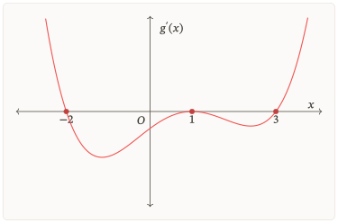{loading="lazy"}

::: r1-figcaption
Đồ thị của đạo hàm, không phải đồ thị của $g$.
:::
::::

1. Nêu các khoảng đơn điệu.
2. Xét cực trị tại cả ba nghiệm của đạo hàm.
3. Ghi các điểm cực trị của đồ thị $g$ mà dữ kiện cho phép xác định.

**Tiêu chí xác nhận lỗi đã sửa:** xét dấu hai phía của từng nghiệm; không chọn $x=1$ làm điểm cực trị; gộp đúng khoảng nghịch biến qua $1$.

**Điểm quay về:** đạt thì quay về Điểm dừng sau Kiểm tra. Nếu vẫn đếm nghiệm, quay lại Mục 2.3 và 4.3 của Bài học; nếu xét dấu yếu, học [Xét dấu biểu thức có nhân tử](#nen-n-dau-01). Nếu bài phù hợp đã gặp trước đó hoặc còn sai sau hỗ trợ, ghi “Chưa có bài mới để xác nhận thêm ở mục tiêu này” và quay về bài hoặc Điểm dừng đã dẫn đến đây với trạng thái chưa xác nhận; không tự tìm bài mới để ghi đạt.

::: answer-link
[Xem lời giải](#lg-g01-s-k-e02)
:::

#### Nhiệm vụ 47 – Điểm ghép không có đạo hàm vẫn là cực trị {#g01-s-k-e03 .zo-learning-task .zo-learning-task--item}

**Kích hoạt khi:** học sinh loại một điểm khỏi danh sách ứng viên chỉ vì đạo hàm không tồn tại.

Cho

$$
u(x)=
\begin{cases}
-2x+1 & \text{khi } x<0,\\
x^2+1 & \text{khi } x\geq0.
\end{cases}
$$

Kiểm tra tính liên tục, sự tồn tại của $u^\prime(0)$ và cực trị tại $0$. Trình bày thêm một cách kiểm tra bằng định nghĩa cực trị.

**Tiêu chí xác nhận lỗi đã sửa:** tách kiểm tra liên tục khỏi kiểm tra đạo hàm; không dùng “đạo hàm không tồn tại” để phủ định cực trị; dùng được so sánh lân cận hoặc chiều biến thiên hai phía.

**Điểm quay về:** đạt thì quay về Điểm dừng sau Kiểm tra. Nếu còn nhầm điểm ghép, học [Liên tục và đạo hàm tại điểm ghép](#nen-n-lt-01). Nếu bài phù hợp đã gặp trước đó hoặc còn sai sau hỗ trợ, ghi “Chưa có bài mới để xác nhận thêm ở mục tiêu này” và quay về bài hoặc Điểm dừng đã dẫn đến đây với trạng thái chưa xác nhận; không tự tìm bài mới để ghi đạt.

::: answer-link
[Xem lời giải](#lg-g01-s-k-e03)
:::

#### Nhiệm vụ 48 – Đọc đúng ba đối tượng từ bảng mới {#g01-s-k-e04 .zo-learning-task .zo-learning-task--item}

**Kích hoạt khi:** học sinh nhầm điểm cực trị, giá trị cực trị và điểm cực trị của đồ thị.

Cho hàm số $m$ liên tục trên $[-5;4]$. Bảng biến thiên cho biết $m$ tăng từ $m(-5)=0$ đến $m(-2)=6$, giảm đến $m(1)=-3$, rồi tăng đến $m(4)=2$. Không phân loại hai đầu mút theo định nghĩa cực trị hai phía.

1. Ghi điểm cực đại, giá trị cực đại và điểm cực đại của đồ thị.
2. Ghi ba đối tượng tương ứng ở cực tiểu.
3. Sửa câu: “Hàm số có điểm cực đại bằng $6$ và điểm cực tiểu là $(1;-3)$.”

**Tiêu chí xác nhận lỗi đã sửa:** không dùng một số tung độ để trả lời câu hỏi về điểm của hàm số; không dùng một cặp tọa độ để trả lời câu hỏi về hoành độ cực trị; gọi đúng cả sáu đại lượng.

**Điểm quay về:** đạt thì quay về Điểm dừng sau Kiểm tra. Nếu còn nhầm hàng bảng, học [Đọc hàng của bảng biến thiên](#nen-n-bbt-01); nếu còn nhầm điểm đồ thị, học [Phân biệt đồ thị hàm với đồ thị đạo hàm](#nen-n-dt-01). Nếu bài phù hợp đã gặp trước đó hoặc còn sai sau hỗ trợ, ghi “Chưa có bài mới để xác nhận thêm ở mục tiêu này” và quay về bài hoặc Điểm dừng đã dẫn đến đây với trạng thái chưa xác nhận; không tự tìm bài mới để ghi đạt.

::: answer-link
[Xem lời giải](#lg-g01-s-k-e04)
:::

#### Nhiệm vụ 49 – Hai nhánh cùng tăng nhưng không tăng trên hợp {#g01-s-k-e05 .zo-learning-task .zo-learning-task--item}

**Kích hoạt khi:** học sinh tự gộp các khoảng rời mà không kiểm tra các cặp điểm chéo.

Cho

$$
q(x)=
\begin{cases}
x^3+5 & \text{khi } x<0,\\
x^3-5 & \text{khi } x>0.
\end{cases}
$$

trên $D=\mathbb{R}\setminus\{0\}$.

Chứng minh $q$ đồng biến trên từng khoảng của $D$. Sau đó quyết định có thể gọi $q$ đồng biến trên toàn $D$ theo yêu cầu so sánh mọi cặp $x_1<x_2$ thuộc $D$ hay không.

**Tiêu chí xác nhận lỗi đã sửa:** phân biệt kết luận trên từng khoảng với kết luận trên hợp; tự đưa ra một cặp chéo hợp lệ và tính đúng giá trị; không dùng điểm $0$ vì điểm này không thuộc tập xác định.

**Điểm quay về:** đạt thì quay về Điểm dừng sau Kiểm tra. Nếu còn chọn điểm ngoài tập, học [Tập xác định và khoảng xét](#nen-n-txd-01); nếu chưa hiểu yêu cầu “mọi cặp”, quay lại Mục 6.4. Nếu bài phù hợp đã gặp trước đó hoặc còn sai sau hỗ trợ, ghi “Chưa có bài mới để xác nhận thêm ở mục tiêu này” và quay về bài hoặc Điểm dừng đã dẫn đến đây với trạng thái chưa xác nhận; không tự tìm bài mới để ghi đạt.

::: answer-link
[Xem lời giải](#lg-g01-s-k-e05)
:::

#### Nhiệm vụ 50 – Đạo hàm có các lũy thừa chẵn {#g01-s-k-e06 .zo-learning-task .zo-learning-task--item}

**Kích hoạt khi:** học sinh đảo “đồng biến và có đạo hàm” thành “đạo hàm dương tại mọi điểm”.

Cho hàm số $f$ có đạo hàm trên $\mathbb{R}$ và

$$
f^\prime(x)=x^2(x-2)^2.
$$

1. Xét dấu đạo hàm và kết luận chiều biến thiên trên $\mathbb{R}$.
2. Xét cực trị tại $0$ và $2$.
3. Sửa câu: “Muốn hàm đồng biến trên $\mathbb{R}$ thì bắt buộc $f^\prime(x)>0$ với mọi $x\in\mathbb{R}$.”

**Tiêu chí xác nhận lỗi đã sửa:** xử lí đúng hai thừa số bình phương; không tách thành ba kết luận đồng biến rời nếu có thể gộp; phát biểu chiều đảo bằng dấu không âm, không phải dấu dương nghiêm ngặt.

**Điểm quay về:** đạt thì quay về Điểm dừng sau Kiểm tra. Nếu xét dấu sai, học [Xét dấu biểu thức có nhân tử](#nen-n-dau-01); nếu còn đảo định lí, quay lại Mục 2.4. Nếu bài phù hợp đã gặp trước đó hoặc còn sai sau hỗ trợ, ghi “Chưa có bài mới để xác nhận thêm ở mục tiêu này” và quay về bài hoặc Điểm dừng đã dẫn đến đây với trạng thái chưa xác nhận; không tự tìm bài mới để ghi đạt.

::: answer-link
[Xem lời giải](#lg-g01-s-k-e06)
:::

#### Nhiệm vụ 51 – Cùng đạo hàm, khác giá trị cực trị {#g01-s-k-e07 .zo-learning-task .zo-learning-task--item}

**Kích hoạt khi:** học sinh suy công thức hoặc tung độ của $f$ chỉ từ đồ thị hay công thức của $f^\prime$.

Xét hai hàm

$$
r_1(x)=x^3-3x
$$

và

$$
r_2(x)=x^3-3x+5.
$$

1. Chứng minh hai hàm có cùng đạo hàm.
2. Xác định điểm cực trị của mỗi hàm theo hoành độ.
3. So sánh các giá trị cực trị và các điểm cực trị của hai đồ thị.
4. Nêu chính xác điều một đồ thị $y=r^\prime(x)$ cho biết và điều nó chưa cho biết.

**Tiêu chí xác nhận lỗi đã sửa:** giữ đúng các hoành độ cực trị chung; nhận ra phép cộng hằng số làm đổi tung độ nhưng không đổi đạo hàm; phân loại rõ dữ kiện biết được và chưa biết được.

**Điểm quay về:** đạt thì quay về Điểm dừng sau Kiểm tra. Nếu còn nhầm đồ thị hàm và đạo hàm, học [Phân biệt đồ thị hàm với đồ thị đạo hàm](#nen-n-dt-01); nếu còn đọc quá bảng, học [Đọc hàng của bảng biến thiên](#nen-n-bbt-01). Nếu bài phù hợp đã gặp trước đó hoặc còn sai sau hỗ trợ, ghi “Chưa có bài mới để xác nhận thêm ở mục tiêu này” và quay về bài hoặc Điểm dừng đã dẫn đến đây với trạng thái chưa xác nhận; không tự tìm bài mới để ghi đạt.

::: answer-link
[Xem lời giải](#lg-g01-s-k-e07)
:::

#### Nhiệm vụ 52 – Giữ từng vế đúng trong mệnh đề ghép {#g01-s-k-e08 .zo-learning-task .zo-learning-task--item}

**Kích hoạt khi:** học sinh xử lí sai “và”, “hoặc” hoặc sửa một câu bằng cách bỏ cả phần vốn đúng.

Cho $p(x)=x^4$ trên $\mathbb{R}$. Đặt:

- A: “$p^\prime(0)=0$”;
- B: “$p$ đạt cực tiểu tại $0$”;
- C: “$p^\prime(x)>0$ với mọi $x\ne0$”.

1. Đánh giá A, B, C.
2. Đánh giá các mệnh đề “A và C”, “B hoặc C”, “(A và B) và C”, “A hoặc (B và C)”.
3. Một bạn nói: “B hoặc C sai vì C sai.” Hãy giữ phần đúng trong phân tích của bạn và sửa kết luận.

**Tiêu chí xác nhận lỗi đã sửa:** đánh giá từng mệnh đề đơn trước khi nối; không dùng một vế sai để bác bỏ mệnh đề “hoặc”; giữ nhận xét đúng “C sai” khi sửa toàn bộ câu.

**Điểm quay về:** đạt thì quay về Điểm dừng sau Kiểm tra. Nếu còn nhầm phép nối hoặc điều kiện cần–đủ, học [Mệnh đề và phản ví dụ](#nen-n-lg-01), làm bốn mệnh đề mới rồi quay lại.

::: answer-link
[Xem lời giải](#lg-g01-s-k-e08)
:::

#### Nhiệm vụ 53 – Dấu đổi nhưng hàm không liên tục tại điểm ghép {#g01-s-k-e09 .zo-learning-task .zo-learning-task--item}

**Kích hoạt khi:** học sinh dùng định lí đổi dấu đạo hàm qua một điểm chưa kiểm tra tính liên tục.

Cho

$$
h(x)=
\begin{cases}
x+1 & \text{khi } x<0,\\
0 & \text{khi } x=0,\\
-x+1 & \text{khi } x>0.
\end{cases}
$$

1. Nêu dấu đạo hàm ở hai phía của $0$.
2. Kiểm tra tính liên tục tại $0$.
3. Một bạn dùng dấu dương bên trái, âm bên phải để kết luận giá trị tại $0$ lớn hơn các giá trị gần nó. Hãy bác bỏ cách dùng định lí; với $0<|x|<1$, so sánh trực tiếp $h(x)$ với $h(0)$ và giải thích vì sao chỉ nhìn dấu đạo hàm hai phía dẫn tới kết luận sai về giá trị ở điểm ghép.

**Tiêu chí xác nhận lỗi đã sửa:** kiểm tra tính liên tục trước khi gọi định lí; bác bỏ đúng suy luận; so sánh trực tiếp đúng trong lân cận. Không bắt buộc gọi tên cực trị tại điểm gián đoạn theo một quy ước ngoài phạm vi đã học.

**Điểm quay về:** đạt thì quay về Điểm dừng sau Kiểm tra. Nếu còn bỏ điều kiện liên tục, học [Liên tục và đạo hàm tại điểm ghép](#nen-n-lt-01); tự làm câu xác nhận hẹp nếu chưa gặp trước đó, chỉ ghi đúng phạm vi điều kiện liên tục. Nếu bài phù hợp đã gặp trước đó hoặc còn sai sau hỗ trợ, ghi “Chưa có bài mới để xác nhận thêm ở mục tiêu này” và quay về bài hoặc Điểm dừng đã dẫn đến đây với trạng thái chưa xác nhận; không tự tìm bài mới để ghi đạt.

::: answer-link
[Xem lời giải](#lg-g01-s-k-e09)
:::

### Sau Ôn lại {#sua-loi-sau-on-lai}

Các nhiệm vụ dưới đây giúp kiểm lại những lỗi vừa xuất hiện trong lượt Ôn lại. Tự làm trước khi mở đáp án, rồi trở về Điểm dừng của lượt đang thực hiện. Nếu đã gặp hoặc đã dùng bài phù hợp, hay vẫn còn sai sau trợ giúp, ghi “Chưa có bài mới để xác nhận thêm ở mục tiêu này”; xem lại đúng mục Bài học hoặc thẻ Ôn nền và hẹn ngày kiểm lại phần còn vướng. Không làm trước bài của lượt Ôn lại sau để thay cho bài kiểm lại hiện còn thiếu.

#### Nhiệm vụ 54 – Điểm hở và điểm kín cùng hoành độ {#g01-s-o-e01 .zo-learning-task .zo-learning-task--item}

Cho

$$
u(x)=
\begin{cases}
(x-1)^2 & \text{khi } x\ne1,\\
2 & \text{khi } x=1.
\end{cases}
$$

Tại hoành độ $1$, đồ thị có điểm hở và điểm kín nào? Kiểm tra tính liên tục và so sánh $u(x)$ với $u(1)$ khi $0<|x-1|<1$.

**Tiêu chí và điểm quay về:** đạt khi dùng điểm kín làm giá trị hàm, không lấy tung độ của điểm hở làm $u(1)$, nhận ra hàm không liên tục và so sánh đúng trong lân cận. Không bắt buộc gọi tên cực trị theo quy ước ngoài phạm vi đã học. Đạt hoặc chưa đạt đều quay về Điểm dừng Ôn lại đã kích hoạt; nếu sai, học [Tập xác định và khoảng xét](#nen-n-txd-01) hoặc [Phân biệt đồ thị hàm với đồ thị đạo hàm](#nen-n-dt-01) theo nguồn lỗi. Nếu bài phù hợp đã gặp trước đó hoặc còn sai sau hỗ trợ, ghi “Chưa có bài mới để xác nhận thêm ở mục tiêu này” và quay về bài hoặc Điểm dừng đã dẫn đến đây với trạng thái chưa xác nhận; không tự tìm bài mới để ghi đạt.

::: answer-link
[Xem lời giải](#lg-g01-s-o-e01)
:::

#### Nhiệm vụ 55 – Một mốc không đổi dấu nằm giữa hai mốc đổi dấu {#g01-s-o-e02 .zo-learning-task .zo-learning-task--item}

Cho hàm $v$ có đạo hàm trên $\mathbb{R}$ và

$$
v^\prime(x)=-(x+4)(x+1)^2(x-2).
$$

Một bạn nói: “Đạo hàm có ba nghiệm nên hàm có ba điểm cực trị.” Hãy xét dấu, sửa kết luận và nêu có thể gộp các khoảng đồng biến nào.

**Tiêu chí và điểm quay về:** đạt khi xét đúng dấu âm, dương, dương, âm; chỉ giữ cực tiểu tại $-4$, cực đại tại $2$; gộp đúng khoảng đồng biến $(-4;2)$ và không tự tạo tung độ. Quay về Điểm dừng Ôn lại đang hoạt động; nếu sai, xem lại lỗi coi đạo hàm bằng $0$ là đủ, học [Xét dấu biểu thức có nhân tử](#nen-n-dau-01) nếu cần. Nếu bài phù hợp đã gặp trước đó hoặc còn sai sau hỗ trợ, ghi “Chưa có bài mới để xác nhận thêm ở mục tiêu này” và quay về bài hoặc Điểm dừng đã dẫn đến đây với trạng thái chưa xác nhận; không tự tìm bài mới để ghi đạt.

::: answer-link
[Xem lời giải](#lg-g01-s-o-e02)
:::

#### Nhiệm vụ 56 – Cực trị tại điểm ghép {#g01-s-o-e03 .zo-learning-task .zo-learning-task--item}

Cho

$$
w(x)=
\begin{cases}
-x & \text{khi } x<0,\\
x^2 & \text{khi } x\geq0.
\end{cases}
$$

Không tính dài dòng, hãy xét tính liên tục, sự tồn tại đạo hàm và cực trị tại $0$.

**Tiêu chí và điểm quay về:** đạt khi tách ba câu hỏi liên tục–đạo hàm–cực trị và không loại cực trị vì đạo hàm không tồn tại. Quay về Điểm dừng Ôn lại đang hoạt động; nếu sai, học [Liên tục và đạo hàm tại điểm ghép](#nen-n-lt-01). Nếu bài phù hợp đã gặp trước đó hoặc còn sai sau hỗ trợ, ghi “Chưa có bài mới để xác nhận thêm ở mục tiêu này” và quay về bài hoặc Điểm dừng đã dẫn đến đây với trạng thái chưa xác nhận; không tự tìm bài mới để ghi đạt.

::: answer-link
[Xem lời giải](#lg-g01-s-o-e03)
:::

#### Nhiệm vụ 57 – Hai hình, ba đối tượng {#g01-s-o-e04 .zo-learning-task .zo-learning-task--item}

Hình A là đồ thị $y=f(x)$, có điểm cực đại $A(-1;3)$ và điểm cực tiểu $B(2;-2)$. Hình B là đồ thị $y=f^\prime(x)$, cắt trục hoành tại $C(-1;0)$ và $D(2;0)$ với dấu đổi phù hợp.

:::: r1-figure
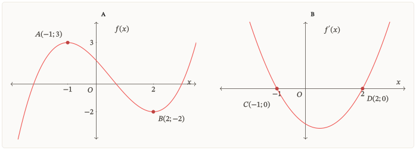{loading="lazy"}

::: r1-figcaption
Hai đồ thị dùng để phân biệt hoành độ, giá trị cực trị và điểm cực trị.
:::
::::

Điền sáu đại lượng: điểm cực đại và cực tiểu của hàm số; hai giá trị cực trị; hai điểm cực trị của đồ thị $f$. Sau đó giải thích vì sao $C$, $D$ không phải là hai điểm cực trị của đồ thị $f$.

**Tiêu chí và điểm quay về:** đạt khi gọi đúng cả sáu đại lượng và tách hai đồ thị. Quay về Điểm dừng Ôn lại đang hoạt động; nếu sai, học [Phân biệt đồ thị hàm với đồ thị đạo hàm](#nen-n-dt-01) và ghi phần cần kiểm lại. Nếu bài phù hợp đã gặp trước đó hoặc còn sai sau hỗ trợ, ghi “Chưa có bài mới để xác nhận thêm ở mục tiêu này” và quay về bài hoặc Điểm dừng đã dẫn đến đây với trạng thái chưa xác nhận; không tự tìm bài mới để ghi đạt.

::: answer-link
[Xem lời giải](#lg-g01-s-o-e04)
:::

#### Nhiệm vụ 58 – Tự chứng minh so sánh chéo {#g01-s-o-e05 .zo-learning-task .zo-learning-task--item}

Cho

$$
s(x)=
\begin{cases}
x^3 & \text{khi } x\leq-1,\\
x^3+1 & \text{khi } x\geq1
\end{cases}
$$

trên $D=(-\infty;-1]\cup[1;+\infty)$. Hàm tăng trên từng thành phần. Hãy quyết định nó có thỏa $s(x_1)<s(x_2)$ với mọi $x_1<x_2$ thuộc $D$ hay không; không chỉ thử một cặp.

**Tiêu chí và điểm quay về:** đạt khi xét đủ cặp cùng thành phần và cặp chéo, không dùng quy tắc máy móc “hợp khoảng luôn không đơn điệu”. Quay về Điểm dừng Ôn lại đang hoạt động; nếu sai, xem lại [So sánh trên các khoảng rời](#vì-sao-không-tự-gộp-các-khoảng-rời-nhau). Nếu [Nhiệm vụ 41 của Sửa lỗi](#sc05) chưa gặp trước đó và chưa dùng, tự làm để kiểm tra yêu cầu so sánh mọi cặp; bài đã xem chỉ dùng để học. Nếu không còn bài phù hợp chưa gặp trước đó, ghi “Chưa có bài mới để xác nhận thêm ở mục tiêu này” vào [Nhật kí](#nhat-ky), trở về Điểm dừng đang gọi với trạng thái chưa xác nhận và tiếp tục phần không phụ thuộc; không tự tìm câu mới hoặc lấy bài Ôn lại khác để ghi đạt.

::: answer-link
[Xem lời giải](#lg-g01-s-o-e05)
:::

#### Nhiệm vụ 59 – Đồng biến nhưng đạo hàm có thể bằng không {#g01-s-o-e06 .zo-learning-task .zo-learning-task--item}

Cho $a(x)=x^7$ trên $\mathbb{R}$. Đánh giá ba câu:

1. $a$ đồng biến trên $\mathbb{R}$.
2. $a^\prime(x)>0$ với mọi $x\in\mathbb{R}$.
3. $0$ là điểm cực trị vì $a^\prime(0)=0$.

**Tiêu chí và điểm quay về:** đạt khi giữ câu 1 đúng, sửa dấu nghiêm ngặt ở câu 2 và không suy cực trị từ một nghiệm của phương trình đạo hàm bằng $0$. Quay về Điểm dừng Ôn lại đang hoạt động; nếu sai, học [Xét dấu biểu thức có nhân tử](#nen-n-dau-01) hoặc xem lại chiều suy luận của định lí theo nguồn lỗi.

::: answer-link
[Xem lời giải](#lg-g01-s-o-e06)
:::

#### Nhiệm vụ 60 – Biết, chưa biết và sai {#g01-s-o-e07 .zo-learning-task .zo-learning-task--item}

Cho $p$ có đạo hàm trên $\mathbb{R}$. Đạo hàm dương trên $(-\infty;-2)$, âm trên $(-2;1)$ và $(1;+\infty)$; bằng $0$ tại $-2$, $1$. Biết $p(-2)=4$.

Phân loại mỗi câu là “chắc chắn đúng”, “chắc chắn sai” hoặc “chưa đủ dữ kiện”:

a. Điểm cực đại của đồ thị $p$ là $(-2;4)$.

b. $p(1)=0$.

c. $p$ đạt cực tiểu tại $1$.

d. Các dữ kiện xác định duy nhất công thức của $p$.

**Tiêu chí và điểm quay về:** đạt khi không tự gán $p(1)$, không tạo cực trị tại $1$ và phân biệt dữ kiện định tính với công thức. Quay về Điểm dừng Ôn lại đang hoạt động; nếu sai, học [Phân biệt đồ thị hàm với đồ thị đạo hàm](#nen-n-dt-01) hoặc [Đọc hàng của bảng biến thiên](#nen-n-bbt-01). Nếu bài phù hợp đã gặp trước đó hoặc còn sai sau hỗ trợ, ghi “Chưa có bài mới để xác nhận thêm ở mục tiêu này” và quay về bài hoặc Điểm dừng đã dẫn đến đây với trạng thái chưa xác nhận; không tự tìm bài mới để ghi đạt.

::: answer-link
[Xem lời giải](#lg-g01-s-o-e07)
:::

#### Nhiệm vụ 61 – Hai bước đúng, một bước sai {#g01-s-o-e08 .zo-learning-task .zo-learning-task--item}

Một bạn giải bài với $b(x)=-(x+3)^5+4$ như sau:

1. $b^\prime(x)=-5(x+3)^4\leq0$ trên $\mathbb{R}$.
2. Đạo hàm chỉ bằng $0$ tại $-3$, nên $b$ nghịch biến trên $\mathbb{R}$.
3. Vì $b^\prime(-3)=0$, hàm đạt cực đại tại $-3$.

Hãy giữ nguyên hai bước đúng, chỉ ra bước sai và viết kết luận hoàn chỉnh.

**Tiêu chí và điểm quay về:** đạt khi không xóa hai bước đúng và sửa đúng bước 3. Quay về Điểm dừng Ôn lại đang hoạt động; nếu sai, học [Mệnh đề và phản ví dụ](#nen-n-lg-01) hoặc xem lại cách giữ phần đúng khi sửa. Nếu bài phù hợp đã gặp trước đó hoặc còn sai sau hỗ trợ, ghi “Chưa có bài mới để xác nhận thêm ở mục tiêu này” và quay về bài hoặc Điểm dừng đã dẫn đến đây với trạng thái chưa xác nhận; không tự tìm bài mới để ghi đạt.

::: answer-link
[Xem lời giải](#lg-g01-s-o-e08)
:::

#### Nhiệm vụ 62 – Tham số tại điểm ghép {#g01-s-o-e09 .zo-learning-task .zo-learning-task--item}

Với $a\in\mathbb{R}$, cho

$$
g_a(x)=
\begin{cases}
x+2 & \text{khi } x<0,\\
a & \text{khi } x=0,\\
2-x & \text{khi } x>0.
\end{cases}
$$

1. Tìm $a$ để $g_a$ liên tục tại $0$.
2. Xét cực trị tại $0$ trong trường hợp liên tục vừa tìm được.
3. Đối chiếu bổ sung: khi $a>2$ hoặc $a<2$, so sánh $g_a(x)$ với $g_a(0)$ ở đủ gần $0$ và giải thích vì sao không áp dụng định lí đổi dấu đã học. Phần này không phải cổng bắt buộc của lượt Ôn lại cốt lõi.

**Tiêu chí và điểm quay về:** đạt phần cốt lõi khi tìm đúng $a=2$ và, trong trường hợp liên tục ấy, xác định đúng cực đại tại $0$ với giá trị $2$. Phần đối chiếu bổ sung đạt khi so sánh đúng cho $a>2$, $a<2$ và không gọi định lí ngoài giả thiết. Quay về Điểm dừng Ôn lại đang hoạt động; nếu sai, học [Liên tục và đạo hàm tại điểm ghép](#nen-n-lt-01) và ghi phần cần kiểm lại. Nếu bài phù hợp đã gặp trước đó hoặc còn sai sau hỗ trợ, ghi “Chưa có bài mới để xác nhận thêm ở mục tiêu này” và quay về bài hoặc Điểm dừng đã dẫn đến đây với trạng thái chưa xác nhận; không tự tìm bài mới để ghi đạt.

::: answer-link
[Xem lời giải](#lg-g01-s-o-e09)
:::

## Nhật kí {#nhat-ky}



## Lời giải {#loi-giai}

::: {#cach-thuc-hien-dung-loi-giai data-zo-instructions="required"}

Chỉ mở lời giải của câu đã tự làm. Đối chiếu điều kiện và lí do trước đáp số; dùng liên kết Xem lời giải của từng câu để đến đúng chỗ. Lời giải và thang chấm do ZO Math biên soạn.

:::

### Bài học {#loi-giai-bai-hoc}

#### Khởi động {#loi-giai-khoi-dong}

:::::: {#g01-loi-giai-khoi-dong .r1-solution-group}

[]{#b.1.-câu-thử-nền}

:::: {#lg-khoi-dong .r1-solution-item}
::: {#lg-g01-khoi-dong-01 .r1-details .r1-solution .zo-learning-solution}
::: {.r1-summary .zo-learning-summary}
Nhiệm vụ 01 — Tập xác định và khoảng áp dụng
:::

$D=\mathbb{R}\setminus\{2\}$. Không áp dụng định lí trên cả $(1;3)$ vì khoảng này chứa $2$, tại đó hàm số không xác định. Cần xét riêng những khoảng nằm trong tập xác định. Lỗi cần phát hiện: “bỏ sót tập xác định hoặc khoảng xét”.

::: answer-link
[Xem đề bài](#g01-khoi-dong-01)
:::
:::

::: {#lg-g01-khoi-dong-02 .r1-details .r1-solution .zo-learning-solution}
::: {.r1-summary .zo-learning-summary}
Nhiệm vụ 02 — Đạo hàm và dấu hai phía
:::

$s^\prime(x)=2x-2=2(x-1)$. Đạo hàm âm khi $x<1$, bằng $0$ khi $x=1$, dương khi $x>1$. Nếu tính sai, ôn lại đạo hàm đa thức; nếu xét dấu sai, kiểm tra dấu của $x-1$.

::: answer-link
[Xem đề bài](#g01-khoi-dong-02)
:::
:::

::: {#lg-g01-khoi-dong-03 .r1-details .r1-solution .zo-learning-solution}
::: {.r1-summary .zo-learning-summary}
Nhiệm vụ 03 — Đọc hàng và chiều mũi tên
:::

Mũi tên đi lên trên $(-2;0)$ và đi xuống trên $(0;2)$. Số $3$ thuộc hàng $f(x)$, ở cột $x=0$; đó là $f(0)$, không phải một hoành độ.

::: answer-link
[Xem đề bài](#g01-khoi-dong-03)
:::
:::

::: {#lg-g01-khoi-dong-04 .r1-details .r1-solution .zo-learning-solution}
::: {.r1-summary .zo-learning-summary}
Nhiệm vụ 04 — Phân biệt đồ thị hàm số và đạo hàm
:::

Dữ kiện nói $f^\prime(x)<0$ trên $K$, không nói $f(x)<0$. Từ đó có thể kết luận $f$ nghịch biến trên $K$. Lỗi cần phát hiện: “kết luận vượt quá dữ kiện”.

::: answer-link
[Xem đề bài](#g01-khoi-dong-04)
:::
:::

::::
::::::

#### Nhiệm vụ trong Bài học {#g01-loi-giai-tu-kiem-tra}

:::::: {#loi-giai-1 .r1-solution-group}

Chỉ đọc mục tương ứng sau khi đã thử. Đây là lời giải của các câu nhúng trong bài học, chưa phải tập lời giải cho phần luyện tập hoặc cụm kiểm tra cuối gói.

[]{#b.2.-các-điểm-dừng}

:::: {#lg-d01 .r1-details .r1-solution .zo-learning-solution}
::: {.r1-summary .zo-learning-summary}
Nhiệm vụ 05 — Hai đầu mút chưa quyết định cả khoảng
:::

Thứ nhất, hàm số chỉ được xét trên khoảng mở $(a;b)$ nên chưa chắc có các giá trị $f(a)$, $f(b)$. Thứ hai, ngay cả khi hai giá trị ấy tồn tại, một phép so sánh hai đầu mút vẫn không kiểm soát mọi cặp điểm trong khoảng. Chẳng hạn $f(x)=x^3-3x+1$ có $f(-2)=-1<3=f(2)$ nhưng lại nghịch biến trên $(-1;1)$; nó không đồng biến trên $(-2;2)$. Lỗi: “bỏ sót tập xác định hoặc khoảng xét”, “kết luận vượt quá dữ kiện”.

::: answer-link
[Xem đề bài](#dừng-lại-1-d01)
:::
::::

:::: {#lg-d02 .r1-details .r1-solution .zo-learning-solution}
::: {.r1-summary .zo-learning-summary}
Nhiệm vụ 06 — Một nghiệm không đổi dấu
:::

Vì $h$ có đạo hàm trên $\mathbb{R}$, $h^\prime(x)>0$ khi $x\ne-2$ và chỉ bằng $0$ tại $-2$, nên $h$ đồng biến trên $\mathbb{R}$. Có thể giữ mốc $-2$ trong bảng dấu để kiểm tra, nhưng không bắt buộc tách kết luận đơn điệu ở mốc ấy. Điểm có đạo hàm bằng 0 không tự làm hàm số đổi chiều. Lỗi cần sửa ở đây là ngắt khoảng máy móc tại mọi nghiệm của phương trình đạo hàm bằng $0$: dấu đã được cho, không phải suy chiều đảo từ đồng biến.

::: answer-link
[Xem đề bài](#dừng-lại-2-d02)
:::
::::

:::: {#lg-d03 .r1-details .r1-solution .zo-learning-solution}
::: {.r1-summary .zo-learning-summary}
Nhiệm vụ 07 — Kiểm nét vẽ bằng dấu đạo hàm
:::

Không. Ta đã có $p^\prime(x)<0$ với mọi $x$ thuộc $(-1;1)$ nên $p$ nghịch biến trên cả khoảng. Một đoạn đi lên bên trong khoảng ấy mâu thuẫn với kết luận này. Hai điểm mốc đúng không bảo đảm toàn bộ đường biểu diễn đúng. Lỗi: “kết luận vượt quá dữ kiện”.

::: answer-link
[Xem đề bài](#dừng-lại-3-d03)
:::
::::

:::: {#lg-d04 .r1-details .r1-solution .zo-learning-solution}
::: {.r1-summary .zo-learning-summary}
Nhiệm vụ 08 — Cực trị khi chưa biết đạo hàm tại mốc
:::

Có. $w$ liên tục trên khoảng chứa $0$, có đạo hàm ở hai phía và đạo hàm đổi từ dương sang âm. Theo định lí, $w$ đạt cực đại tại $0$, giá trị cực đại là $5$. Không cần biết $w^\prime(0)$ để áp dụng định lí này. Lỗi: “coi không có đạo hàm là không có cực trị”.

::: answer-link
[Xem đề bài](#dừng-lại-4-d04)
:::
::::

:::: {#lg-d05 .r1-details .r1-solution .zo-learning-solution}
::: {.r1-summary .zo-learning-summary}
Nhiệm vụ 09 — Gọi đúng đối tượng cực trị
:::

Hàm số $p$ có điểm cực tiểu $x=1$, giá trị cực tiểu $p(1)=-1$; điểm cực tiểu của đồ thị là $B(1;-1)$. Lỗi: “nhầm điểm, giá trị và tọa độ cực trị”.

::: answer-link
[Xem đề bài](#dừng-lại-5-d05)
:::
::::

:::: {#lg-d06 .r1-details .r1-solution .zo-learning-solution}
::: {.r1-summary .zo-learning-summary}
Nhiệm vụ 10 — Giới hạn suy luận từ đồ thị đạo hàm
:::

Vì $f$ có đạo hàm trên $\mathbb{R}$ nên liên tục tại $2$. Đạo hàm âm trên $(-\infty;2)$ và dương trên $(2;+\infty)$, do đó $f$ nghịch biến trên khoảng thứ nhất, đồng biến trên khoảng thứ hai và đạt cực tiểu tại $2$. Điểm $(2;0)$ nằm trên đồ thị đạo hàm nên cho $f^\prime(2)=0$, không cho $f(2)=0$. Chưa đủ dữ kiện xác định giá trị cực tiểu. Lỗi: “kết luận vượt quá dữ kiện”.

::: answer-link
[Xem đề bài](#dừng-lại-6-d06)
:::
::::

::::::

:::::: {#g01-loi-giai-sua-loi-mau .r1-details .r1-solution .zo-learning-solution}
::: {.r1-summary .zo-learning-summary}
Nhiệm vụ 11 — Xét dấu và giới hạn dữ kiện
:::

[]{#b.3.-lời-giải-câu-sau-chữa-cg01}

:::: {#lg-cg01 .r1-solution-item}
Vì $g$ có đạo hàm trên $\mathbb{R}$, nó liên tục tại cả $-1$ và $2$. Khi $x\ne 2$, thừa số $(x-2)^2$ dương nên dấu của $g^\prime(x)$ là dấu của $x+1$.

:::: table-scroll
::: {.r1-bbt bbt="BBT10" caption="Bảng dấu đạo hàm."}
ZO BBT placeholder
:::
::::

- $g$ nghịch biến trên $(-\infty;-1)$.
- Trên $(-1;+\infty)$, đạo hàm dương trừ một điểm $x=2$ tại đó bằng $0$. Vì vậy $g$ đồng biến trên toàn khoảng $(-1;+\infty)$.
- Qua $-1$, đạo hàm đổi từ âm sang dương; $g$ đạt cực tiểu tại $-1$.
- Qua $2$, đạo hàm dương ở cả hai phía; $g$ không đạt cực trị tại $2$.
- Không có điểm cực đại: ngoài hai mốc trên, hàm số giữ chiều biến thiên trong một khoảng quanh mỗi điểm.
- Chưa xác định được giá trị $g(-1)$. Nếu một hàm $g$ thỏa dữ kiện, thì $g+1$ cũng có cùng đạo hàm nhưng giá trị tại $-1$ lớn hơn $1$ đơn vị. Đạo hàm đã cho không ấn định giá trị cực tiểu.

**Tự kiểm việc sửa lỗi:** chỉ coi lượt này đã xử lí được “coi đạo hàm bằng 0 là đủ để có cực trị” nếu em không chọn $2$ là điểm cực trị và có lí do bằng dấu hai phía. Nếu chỉ đoán đúng số điểm cực trị, vẫn cần viết lại lập luận. Việc không tự gán $g(-1)=0$ là bằng chứng bổ sung cho “kết luận vượt quá dữ kiện”.

::: answer-link
[Xem đề bài](#câu-sau-chữa-cg01)
:::
::::
::::::

### Luyện tập {#loi-giai-luyen-tap}

::::: {#loi-giai-2 .r1-details .r1-solution .zo-learning-solution}
::: {.r1-summary .zo-learning-summary}
Nhiệm vụ 12 – Ghép công thức, bảng và đồ thị
:::

$D=\mathbb{R}$; $f$ là đa thức nên liên tục và có đạo hàm trên tập xác định. Ta có
$$f^\prime(x)=3x^2-12x+9=3(x-1)(x-3).$$
Dấu lần lượt dương, âm, dương trên $(-\infty;1)$, $(1;3)$, $(3;+\infty)$.

Vì vậy $f$ đồng biến trên $(-\infty;1)$ và $(3;+\infty)$, nghịch biến trên $(1;3)$. $f(1)=3$, $f(3)=-1$; các giới hạn ở hai đầu lần lượt là $-\infty$, $+\infty$.

Bảng I và hình A phù hợp. Bảng II sai dấu trên $(1;3)$; nó còn đặt mũi tên đi lên từ giá trị $3$ đến giá trị $-1$, trái với thứ tự hai giá trị. Hình B không khớp chiều biến thiên và các tung độ tại mốc.

Hàm số đạt cực đại tại $1$, giá trị cực đại $3$, điểm cực đại đồ thị $(1;3)$. Hàm số đạt cực tiểu tại $3$, giá trị cực tiểu $-1$, điểm cực tiểu đồ thị $(3;-1)$.

**Nếu sai:** “nhầm điểm, giá trị và tọa độ cực trị” dẫn đến nhiệm vụ 40 của Sửa lỗi sau Luyện tập; “kết luận vượt quá dữ kiện” dẫn đến nhiệm vụ 43 của Sửa lỗi sau Luyện tập. Nếu sai dấu, xét riêng hai thừa số rồi làm lại bước xét dấu ở ý 1, không dùng một hình trông quen để đoán.

::: answer-link
[Xem đề bài](#lt01)
:::
:::::

::::: {#loi-giai-3 .r1-details .r1-solution .zo-learning-solution}
::: {.r1-summary .zo-learning-summary}
Nhiệm vụ 13 – Mốc đạo hàm bằng không
:::

$g^\prime(x)<0$ khi $x\ne-1$ và chỉ bằng $0$ tại $-1$. Vì $g$ có đạo hàm trên cả $\mathbb{R}$, chú ý hữu hạn điểm bằng $0$ cho phép kết luận $g$ nghịch biến trên $\mathbb{R}$.

Hai kết luận nghịch biến trên hai khoảng nhỏ vốn đúng nhưng chưa mạnh nhất. Phần “không thể kết luận trên $\mathbb{R}$” sai. Tại $-1$, đạo hàm âm ở cả hai phía và hàm liên tục, nên không có cực trị. Phần dùng một điểm có đạo hàm bằng 0 để kết luận cực trị sai.

Câu đã sửa: “$g$ nghịch biến trên $\mathbb{R}$; tại $-1$, đạo hàm bằng $0$ nhưng dấu vẫn âm ở hai phía nên $g$ không đạt cực trị.” Nếu còn đếm nghiệm thành cực trị hoặc ngắt khoảng tại mọi nghiệm của phương trình đạo hàm bằng $0$, dùng [Điểm có đạo hàm bằng 0 có quyết định cực trị?](#sc02), đối chiếu cả tiêu chí nối khoảng. Ở bài này dấu đạo hàm đã cho; ngắt khoảng không phải suy chiều đảo của định lí.

::: answer-link
[Xem đề bài](#lt02)
:::
:::::

::::: {#loi-giai-4 .r1-details .r1-solution .zo-learning-solution}
::: {.r1-summary .zo-learning-summary}
Nhiệm vụ 14 – Đọc đồ thị đạo hàm
:::

Từ hình, $h^\prime$ âm trên $(-\infty;-2)$, bằng $0$ tại $-2$, dương trên $(-2;1)$, bằng $0$ tại $1$, dương trên $(1;+\infty)$.

$h$ nghịch biến trên $(-\infty;-2)$ và đồng biến trên $(-2;+\infty)$, vì trên khoảng thứ hai chỉ có một điểm đạo hàm bằng $0$. $h$ có đạo hàm nên liên tục tại các mốc. Đổi dấu âm sang dương tại $-2$ cho cực tiểu; dấu dương ở hai phía của $1$ cho thấy $1$ không là điểm cực trị.

Do $h(-2)=4$, điểm cực tiểu của đồ thị $h$ là $(-2;4)$. Điểm $(1;0)$ trên hình cho $h^\prime(1)=0$, không cho $h(1)=0$. Đây là lỗi “kết luận vượt quá dữ kiện”; làm nhiệm vụ 43 của Sửa lỗi sau Luyện tập. Nếu chọn thêm cực trị tại $1$, ghi “coi đạo hàm bằng 0 là đủ để có cực trị” và làm nhiệm vụ 38 của Sửa lỗi sau Luyện tập.

::: answer-link
[Xem đề bài](#lt03)
:::
:::::

::::::: {#loi-giai-5 .r1-details .r1-solution .zo-learning-solution}
::: {.r1-summary .zo-learning-summary}
Nhiệm vụ 15 – Một góc và một điểm bị bỏ
:::

$u$ liên tục trên $\mathbb{R}$ và $u(-1)=-2$. Bên trái $-1$, đạo hàm bằng $-1$; bên phải bằng $1$. Tại $-1$, hai giới hạn của thương sai phân bằng $-1$ và $1$, nên đạo hàm không tồn tại.

Vì $u$ liên tục và đạo hàm đổi từ âm sang dương, $u$ đạt cực tiểu tại $-1$, giá trị $-2$, điểm đồ thị $(-1;-2)$. Cũng có thể dùng $u(x)>-2$ với mọi $x\ne-1$.

Đối với $v$, $-1$ không thuộc tập xác định nên không thể là điểm cực trị. Đồ thị $u$ có điểm kín ở $(-1;-2)$, đồ thị $v$ có điểm hở. Trong bảng của $u$, hàng hàm số giữ giá trị $-2$ tại mốc dù hàng đạo hàm ghi không tồn tại. Bảng của $v$ phải thể hiện điểm không thuộc tập xác định qua hàng hàm số; giới hạn bằng $-2$ không được gọi là $v(-1)$.

:::: r1-figure
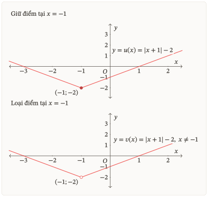{loading="lazy"}

::: r1-figcaption
Đối chiếu nhiệm vụ 15 của Luyện tập — Điểm kín và điểm hở.
:::
::::

**“bỏ sót tập xác định hoặc khoảng xét”:** nhiệm vụ 37 của Sửa lỗi sau Luyện tập; **“coi không có đạo hàm là không có cực trị”:** nhiệm vụ 39 của Sửa lỗi sau Luyện tập.

::: answer-link
[Xem đề bài](#lt04)
:::
:::::::

::::: {#loi-giai-6 .r1-details .r1-solution .zo-learning-solution}
::: {.r1-summary .zo-learning-summary}
Nhiệm vụ 16 – Đọc bảng không có hàng đạo hàm
:::

$r$ nghịch biến trên $(-3;0)$ và $(2;4)$, đồng biến trên $(0;2)$. Từ bảng và tính liên tục, hàm đạt cực tiểu tại $0$ với giá trị $-2$, cực đại tại $2$ với giá trị $1$. Hai điểm cực trị đồ thị là $(0;-2)$ và $(2;1)$.

Không được điền dấu đạo hàm nghiêm ngặt vì đề chưa cho có đạo hàm. Ngay cả khi thêm có đạo hàm trên $(0;2)$, chỉ kết luận $r^\prime(x)\geq0$ trên khoảng ấy. Để thấy dấu bằng có thể xảy ra, trên $[0;2]$ dùng $r(x)=\frac32(x-1)^3-\frac12$: hàm tăng từ $-2$ đến $1$ nhưng đạo hàm tại $1$ bằng $0$. Nối liên tục với các đoạn thẳng giảm ở hai phần còn lại sẽ cho một hàm phù hợp toàn bảng.

Bảng không xác định duy nhất công thức. Trên $[0;2]$, đường thẳng $r(x)=-2+\frac32x$ và đường cong vừa nêu đều tăng qua đúng hai giá trị đầu mút nhưng khác nhau bên trong. Giữ nguyên các phần khác sẽ được hai hàm khác nhau có cùng bảng. **“suy dấu đạo hàm nghiêm ngặt từ tính đơn điệu”:** nhiệm vụ 42 của Sửa lỗi sau Luyện tập; **“kết luận vượt quá dữ kiện”:** nhiệm vụ 43 của Sửa lỗi sau Luyện tập.

::: answer-link
[Xem đề bài](#lt05)
:::
:::::

::::: {#loi-giai-7 .r1-details .r1-solution .zo-learning-solution}
::: {.r1-summary .zo-learning-summary}
Nhiệm vụ 17 – Hai nhánh cùng đi lên
:::

Trên mỗi khoảng $(-\infty;1)$ và $(1;+\infty)$, $q^\prime(x)=1>0$, nên $q$ đồng biến trên từng khoảng.

Tuy nhiên, $0<2$ nhưng $q(0)=3>-1=q(2)$. Do đó không thỏa yêu cầu đồng biến với mọi cặp điểm trong cả tập $D$. Một cặp phản ví dụ đủ bác bỏ. Điểm $1$ bị loại khỏi tập xác định nên không thể là điểm cực trị.

Không chữa thành quy tắc “hợp các khoảng luôn sai”; vấn đề là so sánh chéo chưa được kiểm tra. **“gộp các khoảng mà chưa kiểm tra”:** nhiệm vụ 41 của Sửa lỗi sau Luyện tập; **“bỏ sót tập xác định hoặc khoảng xét”:** nhiệm vụ 37 của Sửa lỗi sau Luyện tập.

::: answer-link
[Xem đề bài](#lt06)
:::
:::::

:::::: {#loi-giai-8 .r1-details .r1-solution .zo-learning-solution}
::: {.r1-summary .zo-learning-summary}
Nhiệm vụ 18 – Đúng/sai với cùng một giả thiết
:::

$t^\prime(x)=3(x+2)^2$, dương trừ tại $-2$, nơi bằng $0$. Vì vậy $t$ đồng biến trên $\mathbb{R}$ và không có cực trị tại $-2$.

::: {#r1-table-t14 .table-scroll}
| Ý | Đánh giá | Lí do | Câu sửa nếu sai |
|------------------|------------------|------------------|------------------|
| a | Sai | Vế đồng biến đúng, vế đạo hàm dương tại $-2$ sai | $t$ đồng biến trên $\mathbb{R}$ và $t^\prime(-2)=0$ |
| b | Đúng | Vế thứ nhất đúng, đủ để mệnh đề “hoặc” đúng | Giữ nguyên |
| c | Sai | $x=-2$ là phản ví dụ cho “mọi” | Với mọi $x\ne-2$, ta có $t^\prime(x)>0$; tại $-2$ đạo hàm bằng $0$ |
| d | Sai | Cả hai vế đều sai | $t$ không có cực trị tại $-2$ hoặc $t^\prime(-2)=0$ |
:::

Ở d, không có vế đúng ban đầu cần giữ; câu sửa được chọn có cả hai vế đúng. Một vế sai chỉ đủ bác bỏ mệnh đề “và”; không đủ bác bỏ mệnh đề “hoặc”. **“sai logic hoặc làm mất vế đúng”:** nhiệm vụ 44 của Sửa lỗi sau Luyện tập; **“suy dấu đạo hàm nghiêm ngặt từ tính đơn điệu”:** nhiệm vụ 42 của Sửa lỗi sau Luyện tập.

::: answer-link
[Xem đề bài](#lt07)
:::
::::::

::::: {#loi-giai-9 .r1-details .r1-solution .zo-learning-solution}
::: {.r1-summary .zo-learning-summary}
Nhiệm vụ 19 – Sửa một lời giải rồi làm câu mới
:::

Hàm $r$ tăng trên $(-\infty;-3)$ rồi giảm trên $(-3;+\infty)$; mốc $1$ chỉ là một điểm đạo hàm bằng $0$ trong khoảng giảm. Qua $-3$, đạo hàm đổi từ dương sang âm nên $r$ đạt cực đại. Qua $1$, đạo hàm âm ở cả hai phía nên không có cực trị.

Lời giải mắc “coi đạo hàm bằng 0 là đủ để có cực trị” khi đếm điểm có đạo hàm bằng 0 thành số điểm cực trị, và “nhầm điểm, giá trị và tọa độ cực trị” khi gọi các giá trị $5$, $-2$ là điểm cực trị của hàm số.

Kết luận đúng: hàm số có một điểm cực trị, đó là điểm cực đại $x=-3$; giá trị cực đại $r(-3)=5$; điểm cực đại đồ thị $(-3;5)$. Tại $1$ không có cực trị, dù $r(1)=-2$ là một giá trị được cho.

Sau khi viết lại, làm câu xác nhận riêng sau nhiệm vụ 19 của Luyện tập khi chưa xem đáp án; nếu còn nhầm thuật ngữ, mở lại phần Ba đối tượng cần tách biệt trước khi tự làm câu xác nhận.

::: answer-link
[Xem đề bài](#lt08)
:::
:::::

::::: {#lg-g01-l08-xn01 .r1-details .r1-solution .zo-learning-solution}
::: {.r1-summary .zo-learning-summary}
Đáp án câu xác nhận sau nhiệm vụ 19 của Luyện tập
:::

Đạo hàm âm trên $(-\infty;-5)$ và $(-5;4)$, dương trên $(4;+\infty)$. Vì $h$ có đạo hàm trên $\mathbb{R}$ và dấu âm ở hai phía của $-5$, hàm nghịch biến trên toàn $(-\infty;4)$. Hàm đồng biến trên $(4;+\infty)$.

Tại $-5$, đạo hàm không đổi dấu nên không có cực trị. Tại $4$, dấu đổi từ âm sang dương nên $h$ đạt cực tiểu. Điểm cực tiểu của hàm số là $4$; giá trị cực tiểu là $-7$; điểm cực tiểu của đồ thị là $(4;-7)$. Nhận xét “đạo hàm có hai nghiệm $-5$, $4$” đúng; hai lỗi là đếm mọi nghiệm thành cực trị và dùng hoành độ $4$ làm giá trị cực tiểu.

::: answer-link
[Xem đề bài](#g01-l08-xn01)
:::
:::::

### Kiểm tra {#loi-giai-kiem-tra}

:::::::::: {#loi-giai-10 .r1-details .r1-solution .zo-learning-solution}
::: {.r1-summary .zo-learning-summary}
Nhiệm vụ 21 – Dựng chuỗi biểu diễn
:::

::: {#r1-table-t15 .table-scroll}
| Ý | Đáp án, căn cứ | Điểm |
|------------------------|------------------------|------------------------|
| a | $D=\mathbb{R}$; $f^\prime(x)=-3x^2+6x+9=-3(x+1)(x-3)$ | 1: tập xác định 0,25; đạo hàm 0,75 |
| b | Dấu âm, dương, âm trên ba khoảng tách bởi $-1$, $3$; bằng $0$ tại hai mốc | 1 |
| c | Nghịch biến trên $(-\infty;-1)$ và $(3;+\infty)$; đồng biến trên $(-1;3)$ | 1 |
| d | Bảng và phác hình như dưới, cùng tập xác định và mốc | 1: bảng 0,5; hình 0,5 |
| e | Cực tiểu tại $-1$, giá trị $-9$; cực đại tại $3$, giá trị $23$ | 1: mỗi cặp 0,5 |
:::

Vì $f$ là đa thức nên các giả thiết liên tục và có đạo hàm được bảo đảm. Ta có $f(-1)=-9$, $f(3)=23$. Hệ số bậc ba âm cho giới hạn ở $-\infty$ là $+\infty$, ở $+\infty$ là $-\infty$.

:::: table-scroll
::: {.r1-bbt bbt="BBT11" caption="Bảng biến thiên."}
ZO BBT placeholder
:::
::::

:::: r1-figure
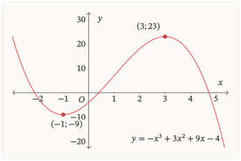{loading="lazy"}

::: r1-figcaption
nhiệm vụ 21 của Kiểm tra — Dáng điệu đồ thị để đối chiếu sau khi làm.
:::
::::

Hình học sinh không cần trùng tỉ lệ hình mẫu, nhưng phải có đúng thứ tự tăng giảm, đúng mốc, tung độ và sự nối liền. Không đòi giao điểm với trục hoành hoặc những tính chất ngoài câu hỏi.

Nếu dùng sai tập hoặc khoảng, chọn [Một mốc bị loại khác](#g01-s-k-e01); nếu coi đạo hàm bằng 0 là đủ để có cực trị, chọn [Ba nghiệm của đạo hàm, chỉ hai cực trị](#g01-s-k-e02); nếu nhầm điểm, giá trị và tọa độ, chọn [Đọc đúng ba đối tượng từ bảng mới](#g01-s-k-e04). Chỉ dùng bài phù hợp với lỗi quan sát được và chưa gặp trước đó; lỗi tính đạo hàm hoặc xét dấu thì dùng đúng thẻ Ôn nền.

::: answer-link
[Xem đề bài](#kt01)
:::
::::::::::

::::: {#loi-giai-11 .r1-details .r1-solution .zo-learning-solution}
::: {.r1-summary .zo-learning-summary}
Nhiệm vụ 22 – Đọc một biểu diễn mới
:::

a.  Đạo hàm dương trên $(-4;-3)$, âm trên $(-3;-1)$, dương trên $(-1;2)$ và $(2;3)$; bằng $0$ tại $-3$, $-1$, $2$. Hàm $k$ đồng biến trên $(-4;-3)$ và $(-1;3)$, nghịch biến trên $(-3;-1)$. Được gộp qua $2$ nhờ chú ý hữu hạn điểm bằng $0$. **1 điểm:** 0,5 cho các khoảng nhỏ đúng; 0,5 cho kết luận qua $2$ và lí do.

b.  $k$ có đạo hàm trên $K$ nên liên tục tại các mốc. Dương sang âm tại $-3$ cho cực đại; âm sang dương tại $-1$ cho cực tiểu. **1 điểm:** mỗi mốc và lí do 0,5.

c.  $2$ không là điểm cực trị vì đạo hàm dương ở cả hai phía, dù bằng $0$ tại $2$. **1 điểm:** kết luận 0,5; lí do 0,5.

d.  Chưa biết các giá trị cực trị. Nếu $k$ phù hợp thì $k+C$ có cùng đạo hàm nhưng dịch mọi giá trị thêm $C$. Không có giá trị nào của $k$ được cho để định vị tung độ. **1 điểm:** kết luận 0,5; lí do 0,5.

Chỉ xét $K=(-4;3)$; không suy diễn ra ngoài phần tập xác định đề đã cho. Nếu đếm nghiệm của phương trình đạo hàm bằng $0$ thành cực trị, dùng [Ba nghiệm của đạo hàm, chỉ hai cực trị](#g01-s-k-e02); nếu suy giá trị cực trị từ đồ thị đạo hàm, dùng [Cùng đạo hàm, khác giá trị cực trị](#g01-s-k-e07). Nếu ngắt khoảng máy móc tại mọi nghiệm, xem lại chú ý hữu hạn điểm bằng $0$ ở Mục 2 và dùng [Đạo hàm có các lũy thừa chẵn](#g01-s-k-e06) khi bài ấy chưa gặp trước đó, đối chiếu tiêu chí nối khoảng. Ngắt khoảng từ dấu đã biết không phải lỗi suy chiều đảo của định lí.

::: answer-link
[Xem đề bài](#kt02)
:::
:::::

:::::: {#loi-giai-12 .r1-details .r1-solution .zo-learning-solution}
::: {.r1-summary .zo-learning-summary}
Nhiệm vụ 23 – Kiểm từng phát biểu
:::

Mỗi ý 1 điểm: 0,5 cho đánh giá, 0,5 cho căn cứ hợp lệ.

::: {#r1-table-t16 .table-scroll}
| Ý | Đánh giá | Căn cứ |
|------------------------|------------------------|------------------------|
| a | Đúng | Hàm giảm rồi tăng qua $-1$, liên tục và có $r(-1)=-3$ |
| b | Sai | Không có giả thiết có đạo hàm; ngay cả nếu có thì mũi tên tăng không buộc đạo hàm dương nghiêm ngặt ở mọi điểm |
| c | Đúng | Vế “giá trị cực đại bằng $2$” sai vì giá trị đó là $4$; vế “giá trị cực tiểu bằng $-3$” đúng, đủ cho “hoặc” |
| d | Sai | Các mũi tên và giá trị mốc chưa xác định mọi giá trị bên trong từng khoảng; có thể có nhiều đường cong cùng thỏa bảng |
:::

Một phản ví dụ cụ thể cho b: trên $[-1;2]$, dùng $r(x)=\frac{28}{27}(x-\frac12)^3+\frac12$. Hàm tăng từ $-3$ đến $4$ nhưng $r^\prime(\frac12)=0$. Nối với các đoạn thẳng qua hai cặp điểm $(-4;2)$, $(-1;-3)$ và $(2;4)$, $(5;1)$ sẽ được hàm liên tục phù hợp toàn bảng. Không yêu cầu học sinh tự tạo đúng công thức này để nhận điểm; phản biện bằng điều kiện hoặc một phản ví dụ hợp lệ khác được chấp nhận.

Nhầm đối tượng cực trị thì dùng [Đọc đúng ba đối tượng từ bảng mới](#g01-s-k-e04); suy dấu đạo hàm nghiêm ngặt từ tính đơn điệu thì dùng [Đạo hàm có các lũy thừa chẵn](#g01-s-k-e06); thêm công thức hoặc dữ kiện thì dùng [Cùng đạo hàm, khác giá trị cực trị](#g01-s-k-e07); sai phép nối thì dùng [Giữ từng vế đúng trong mệnh đề ghép](#g01-s-k-e08). Chỉ chọn bài đúng lỗi quan sát, không bắt làm cả bốn.

::: answer-link
[Xem đề bài](#kt03)
:::
::::::

::::: {#loi-giai-13 .r1-details .r1-solution .zo-learning-solution}
::: {.r1-summary .zo-learning-summary}
Nhiệm vụ 24 – Tập xác định và điểm không có đạo hàm
:::

a.  $u$ liên tục tại $3$, $u(3)=2$; các đạo hàm một phía bằng $-1$, $1$ nên $u^\prime(3)$ không tồn tại. Đạo hàm đổi âm sang dương nên $u$ đạt cực tiểu tại $3$, giá trị $2$. Có thể dùng trực tiếp $u(x)>2$ khi $x\ne3$. **1 điểm:** đạo hàm không tồn tại có lí do 0,5; cực tiểu có lí do 0,5.

b.  $3$ không thuộc tập xác định của $v$, nên không thể là điểm cực trị. **1 điểm:** kết luận 0,5; căn cứ tập xác định 0,5.

c.  $w^\prime(x)=1$ trên mỗi khoảng $(-\infty;0)$ và $(0;+\infty)$ nên hàm tăng trên từng khoảng. Tuy nhiên $-1<1$ mà $w(-1)=3>-3=w(1)$, bác bỏ tính đồng biến theo mọi cặp điểm trong cả tập xác định. **1 điểm:** từng khoảng 0,5; phản ví dụ chéo 0,5.

d.  Câu sửa: “$u^\prime(3)$ không tồn tại và $u$ đạt cực tiểu tại $3$.” Giữ vế đầu đúng, sửa vế sau sai, dẫn lại lí do ở a. **1 điểm:** câu sửa 0,5; xác định vế đúng/sai và lí do 0,5.

Nếu loại cực trị vì không có đạo hàm, dùng [Điểm ghép không có đạo hàm vẫn là cực trị](#g01-s-k-e03); dùng mốc bị loại thì dùng [Một mốc bị loại khác](#g01-s-k-e01); gộp tập rời thì dùng [Hai nhánh cùng tăng nhưng không tăng trên hợp](#g01-s-k-e05); xóa vế đúng khi sửa thì dùng [Giữ từng vế đúng trong mệnh đề ghép](#g01-s-k-e08). Chọn theo lỗi ở từng ý.

::: answer-link
[Xem đề bài](#kt04)
:::
:::::

::::: {#loi-giai-14 .r1-details .r1-solution .zo-learning-solution}
::: {.r1-summary .zo-learning-summary}
Nhiệm vụ 25 – Căn cứ kết luận
:::

Lời giải chưa đủ căn cứ: **0,5 điểm** khi xác định đúng điều này.

Định lí đang dùng cần tính liên tục tại điểm nối $0$, ngoài đạo hàm ở hai phía. Đề chưa cho và lời giải chưa chứng minh điều kiện đó: **1 điểm**.

Đề cũng không cho $F(0)=0$; hoành độ $0$ không xác định giá trị hàm số ở đó: **0,5 điểm**.

Ở ý b, với giả thiết bổ sung $F$ liên tục tại $0$, hàm số đạt cực đại tại $0$; giá trị cực đại là $F(0)$, chưa xác định được bằng số. **1 điểm:** kết luận cực đại đúng 0,5; chỉ rõ giá trị chưa xác định bằng số và phân biệt giả thiết bổ sung với dữ kiện ban đầu 0,5.

Vì hàm đã có đạo hàm trên hai khoảng hai phía, nó liên tục tại mọi điểm của hai khoảng ấy. Bổ sung tính liên tục tại $0$ sẽ đủ cho giả thiết liên tục trên cả khoảng. Không chữa thành “$F$ không có cực trị”, vì thiếu căn cứ cho một định lí không phải bằng chứng phủ định kết luận.

Để thấy dữ kiện ban đầu chưa quyết định được kết luận, xét hai hàm trên $(-1;1)$. Hàm $F_1(x)=-x^2$ thỏa các dấu đạo hàm đã cho và đạt cực đại tại $0$. Hàm $F_2(x)=-x^2$ khi $x\ne0$, còn $F_2(0)=-1$, có cùng dấu đạo hàm ở hai phía. Nhưng với $0<|x|<1$, ta có $F_2(x)>F_2(0)$, nên $F_2$ không đạt cực đại tại $0$. Hai trường hợp cho thấy không thể xác nhận kết luận ban đầu chỉ từ dấu đạo hàm ở hai phía.

Bỏ điều kiện liên tục thì xem lại Mục 4.1 và dùng [Dấu đổi nhưng hàm không liên tục tại điểm ghép](#g01-s-k-e09); tự gán giá trị hàm số thì dùng [Cùng đạo hàm, khác giá trị cực trị](#g01-s-k-e07). Nếu chưa tính được giới hạn một phía, dùng [Liên tục và đạo hàm tại điểm ghép](#nen-n-lt-01); không dùng bài Sửa lỗi sau Luyện tập thay bài xác nhận sau Kiểm tra.

::: answer-link
[Xem đề bài](#kt05)
:::
:::::

### Ôn lại {#loi-giai-on-lai-moi}

:::: {#lg-g01-o01 .r1-details .r1-solution .zo-learning-solution}
::: {.r1-summary .zo-learning-summary}
Nhiệm vụ 26 – Một nghiệm đổi dấu, một nghiệm không đổi dấu
:::

Ta có $f^\prime(x)>0$ trên $(-\infty;-2)$ và $(-2;5)$; $f^\prime(x)<0$ trên $(5;+\infty)$; đạo hàm bằng $0$ tại $-2$, $5$.

Vì $f$ có đạo hàm trên $\mathbb{R}$ và đạo hàm dương ở hai phía của $-2$, hàm đồng biến trên toàn $(-\infty;5)$. Tại $-2$, đạo hàm không đổi dấu nên không có cực trị. Tại $5$, đạo hàm đổi từ dương sang âm nên $f$ đạt cực đại.

Điểm cực đại của hàm số là $5$; giá trị cực đại là $f(5)=7$; điểm cực đại của đồ thị là $(5;7)$. Chưa đủ dữ kiện xác định $f(-2)$ hoặc công thức của $f$: hình chỉ mã hóa dấu và nghiệm của đạo hàm, không cho độ lớn của đạo hàm.

::: answer-link
[Xem đề bài](#g01-o01)
:::
::::

:::: {#lg-g01-o02 .r1-details .r1-solution .zo-learning-solution}
::: {.r1-summary .zo-learning-summary}
Nhiệm vụ 27 – Bảng biến thiên trên hai thành phần
:::

a. Đúng. Bảng cho thấy $r$ tăng rồi giảm qua $3$; ba đối tượng được gọi đúng.

b. Sai. Hai kết luận giảm trên từng thành phần là đúng, nhưng chưa thể gộp tự động. Chẳng hạn $-1<5$ nhưng $r(-1)=0<1=r(5)$, trái với yêu cầu của một kết luận nghịch biến trên toàn tập hợp được nêu. Câu sửa: “$r$ nghịch biến trên từng khoảng $[-4;-1]$ và $[3;5]$; không nghịch biến trên hợp hai khoảng ấy vì so sánh chéo không thỏa.”

c. Sai. Bảng chỉ cho tính tăng, không cho giả thiết tồn tại đạo hàm. Ngay cả khi biết thêm có đạo hàm trên $(1;3)$, chỉ có thể kết luận $r^\prime(x)\geq0$ trên khoảng. Câu sửa: “$r$ đồng biến trên $[1;3]$; bảng hiện có không đủ để khẳng định đạo hàm dương tại mọi điểm.”

**Phối hợp sau học liệu “Giá trị lớn nhất và giá trị nhỏ nhất”.** So sánh các giá trị trên cả hai thành phần cho giá trị lớn nhất $6$, đạt tại $x=-4$, và giá trị nhỏ nhất $0$, đạt tại $x=-1$. Kết quả này không thuộc tiêu chí hoàn tất lượt Ôn lại của học liệu hiện tại.

::: answer-link
[Xem đề bài](#g01-o02)
:::
::::

:::: {#lg-g01-o03 .r1-details .r1-solution .zo-learning-solution}
::: {.r1-summary .zo-learning-summary}
Nhiệm vụ 28 – Tự dựng chuỗi biểu diễn cho hàm từng đoạn
:::

Tập xác định là $\mathbb{R}$. Ta có

$$
\lim_{x\to0^-}F(x)=0=F(0)=\lim_{x\to0^+}F(x),
$$

nên $F$ liên tục tại $0$.

Với $x<0$, $F^\prime(x)=-2(x+1)$. Với $x>0$, $F^\prime(x)=3x^2-3=3(x-1)(x+1)$. Đạo hàm trái tại $0$ bằng $-2$, đạo hàm phải bằng $-3$, nên $F^\prime(0)$ không tồn tại.

Các mốc cần xét là $-1$, $0$, $1$. Đạo hàm dương trên $(-\infty;-1)$; âm trên $(-1;0)$ và $(0;1)$; dương trên $(1;+\infty)$. Vì $F$ liên tục tại $0$ và giảm ở cả hai phía, có thể gộp thành khoảng nghịch biến $(-1;1)$.

Từ hai công thức, giới hạn của $F$ ở $-\infty$ là $-\infty$ và ở $+\infty$ là $+\infty$. Bảng giữ giá trị $F(0)=0$ dù đạo hàm không tồn tại ở đó; $0$ không phải điểm bị loại khỏi tập xác định.

:::: table-scroll
::: {.r1-bbt bbt="BBT14" caption="Bảng biến thiên của F; tại 0 hàm có giá trị, nhưng không có đạo hàm."}
ZO BBT placeholder
:::
::::

Hàm số đồng biến trên $(-\infty;-1)$ và $(1;+\infty)$; nghịch biến trên $(-1;1)$. Tại $-1$, hàm đổi từ tăng sang giảm nên đạt cực đại; $F(-1)=1$. Tại $1$, hàm đổi từ giảm sang tăng nên đạt cực tiểu; $F(1)=-2$. Tại $0$, hàm tiếp tục giảm nên không có cực trị dù đạo hàm không tồn tại.

- Điểm cực đại của hàm số: $x=-1$; giá trị cực đại: $1$; điểm cực đại của đồ thị: $(-1;1)$.
- Điểm cực tiểu của hàm số: $x=1$; giá trị cực tiểu: $-2$; điểm cực tiểu của đồ thị: $(1;-2)$.

Phần “$F$ nghịch biến trên $(-1;1)$” đúng. Phần suy ra $F^\prime(x)<0$ tại mọi điểm sai vì $F^\prime(0)$ không tồn tại. Câu sửa: “$F$ nghịch biến trên $(-1;1)$; đạo hàm âm trên $(-1;0)$ và $(0;1)$, còn $F^\prime(0)$ không tồn tại.”

::: answer-link
[Xem đề bài](#g01-o03)
:::
::::

### Sửa lỗi {#g01-loi-giai-sua-loi}

#### Sau Luyện tập {#loi-giai-sua-loi-sau-luyen-tap}

:::: {#loi-giai-15 .r1-solution-group}

:::: {#lg-sc01 .r1-details .r1-solution .zo-learning-solution}
::: {.r1-summary .zo-learning-summary}
Nhiệm vụ 37 – Mốc bị loại khỏi tập xác định
:::

Tập xác định không chứa $2$. Đạo hàm $a^\prime(x)=2(x-2)$ âm trên $(-\infty;2)$, dương trên $(2;+\infty)$. Hàm giảm trên khoảng thứ nhất, tăng trên khoảng thứ hai, nhưng không có cực trị tại $2$ vì $a(2)$ không xác định. Hình phải có điểm hở tại $(2;0)$. Em đã sửa được lỗi trong bài này khi giữ đúng tập xác định và không dùng dấu hai nhánh để tạo một điểm thuộc hàm số.

::: answer-link
[Xem đề bài](#sc01)
:::
::::

:::: {#lg-sc02 .r1-details .r1-solution .zo-learning-solution}
::: {.r1-summary .zo-learning-summary}
Nhiệm vụ 38 – Điểm có đạo hàm bằng 0 có quyết định cực trị?
:::

Đạo hàm âm trừ một điểm $1$, nơi bằng $0$. $b$ có đạo hàm trên $\mathbb{R}$ nên nghịch biến trên $\mathbb{R}$ theo chú ý hữu hạn điểm bằng $0$. Dấu âm ở hai phía và tính liên tục cho thấy không có cực trị tại $1$. Em đã sửa được lỗi trong bài này khi lí do dùng dấu hai phía, không đếm điểm có đạo hàm bằng 0.

::: answer-link
[Xem đề bài](#sc02)
:::
::::

:::: {#lg-sc03 .r1-details .r1-solution .zo-learning-solution}
::: {.r1-summary .zo-learning-summary}
Nhiệm vụ 39 – Hai công thức nối tại một điểm
:::

$c(0)=0$; giới hạn bên trái của $x^2$ và bên phải của $x$ đều bằng $0$, nên $c$ liên tục tại $0$. Thương sai phân bên trái bằng $h$ và tiến đến $0$, bên phải bằng $1$; đạo hàm tại $0$ không tồn tại. Bên trái, $c^\prime(x)=2x<0$; bên phải, $c^\prime(x)=1>0$. Do đó $c$ đạt cực tiểu tại $0$, giá trị $0$. Trực tiếp, $c(x)>0$ với mọi $x\ne0$. Em đã sửa được lỗi trong bài này khi kiểm tra liên tục riêng, không nhầm không có đạo hàm với không có cực trị.

::: answer-link
[Xem đề bài](#sc03)
:::
::::

:::: {#lg-sc04 .r1-details .r1-solution .zo-learning-solution}
::: {.r1-summary .zo-learning-summary}
Nhiệm vụ 40 – Đọc đúng ba đối tượng
:::

Cực đại: điểm của hàm số $-2$, giá trị $6$, điểm đồ thị $(-2;6)$. Cực tiểu: điểm của hàm số $1$, giá trị $-4$, điểm đồ thị $(1;-4)$. Em đã sửa được lỗi trong bài này khi cả ba loại đối tượng được gọi đúng.

::: answer-link
[Xem đề bài](#sc04)
:::
::::

:::: {#lg-sc05 .r1-details .r1-solution .zo-learning-solution}
::: {.r1-summary .zo-learning-summary}
Nhiệm vụ 41 – Hợp các khoảng có phải lúc nào cũng sai?
:::

Có. Trên cùng một khoảng, $e(x_2)-e(x_1)=x_2-x_1>0$. Với cặp chéo $x_1<0<x_2$, ta có $e(x_1)=x_1<0$ và $e(x_2)=x_2+1>1$, nên $e(x_1)<e(x_2)$. Hai loại cặp bao quát mọi trường hợp. Đây là kiểm tra mở rộng yêu cầu so sánh ra cả tập $D$; $D$ vẫn không phải một khoảng. Em đã sửa được lỗi trong bài này khi chứng minh mọi cặp chéo, không chỉ thử một cặp.

::: answer-link
[Xem đề bài](#sc05)
:::
::::

:::: {#lg-sc06 .r1-details .r1-solution .zo-learning-solution}
::: {.r1-summary .zo-learning-summary}
Nhiệm vụ 42 – Đọc ngược từ đồng biến
:::

Không mâu thuẫn. Ví dụ $f(x)=x^5$ đồng biến trên $(-2;2)$, có đạo hàm $5x^4$ dương trừ tại $0$, nơi bằng $0$. Từ đồng biến và có đạo hàm chỉ suy ra $f^\prime(x)\geq0$ trên khoảng. Em đã sửa được lỗi trong bài này khi giữ đúng dấu không nghiêm ngặt và có phản ví dụ hợp lệ cho chiều đảo nghiêm ngặt.

::: answer-link
[Xem đề bài](#sc06)
:::
::::

:::: {#lg-sc07 .r1-details .r1-solution .zo-learning-solution}
::: {.r1-summary .zo-learning-summary}
Nhiệm vụ 43 – Hai hàm cùng đạo hàm
:::

Cả hai ứng viên phù hợp vì đều có đạo hàm $2x$. Chúng cùng có điểm cực tiểu $0$, nhưng giá trị cực tiểu lần lượt là $0$ và $7$. Vì thế tung độ của đồ thị đạo hàm không phải tung độ của đồ thị hàm số. Em đã sửa được lỗi trong bài này khi tách vị trí cực trị khỏi giá trị cực trị.

::: answer-link
[Xem đề bài](#sc07)
:::
::::

:::: {#lg-sc08 .r1-details .r1-solution .zo-learning-solution}
::: {.r1-summary .zo-learning-summary}
Nhiệm vụ 44 – Đổi cách nối hai vế
:::

$s^\prime(x)=3x^2$, bằng $0$ tại $0$ và dương ở hai phía; $s$ không đạt cực trị tại $0$. A đúng, B sai; “A và B” sai, “A hoặc B” đúng. Câu sửa: “$s^\prime(0)=0$ và $s$ không đạt cực trị tại $0$.” Em đã sửa được lỗi trong bài này khi xử lí đúng cả hai phép nối và giữ vế A.

::: answer-link
[Xem đề bài](#sc08)
:::
::::
::::

#### Sau Kiểm tra {#loi-giai-sua-loi-sau-kiem-tra}

:::: {#lg-g01-s-k-e01 .r1-details .r1-solution .zo-learning-solution}
::: {.r1-summary .zo-learning-summary}
Nhiệm vụ 45 – Một mốc bị loại khác
:::

$p^\prime(x)=2(x+2)$, âm trên $(-\infty;-2)$ và dương trên $(-2;+\infty)$. Tuy nhiên $-2\notin D$, nên $p(-2)$ không tồn tại và $-2$ không thể là điểm cực trị. Câu sửa: “$p$ nghịch biến trên $(-\infty;-2)$, đồng biến trên $(-2;+\infty)$; không có cực trị tại $-2$ vì điểm này bị loại khỏi tập xác định.” Đồ thị có điểm hở tại $(-2;1)$.

::: answer-link
[Xem đề bài](#g01-s-k-e01)
:::
::::

:::: {#lg-g01-s-k-e02 .r1-details .r1-solution .zo-learning-solution}
::: {.r1-summary .zo-learning-summary}
Nhiệm vụ 46 – Ba nghiệm của đạo hàm, chỉ hai cực trị
:::

Đạo hàm dương trên $(-\infty;-2)$, âm trên $(-2;1)$ và $(1;3)$, dương trên $(3;+\infty)$. Vì $g$ có đạo hàm trên $\mathbb{R}$ và $1$ chỉ là một điểm đạo hàm bằng $0$ trong vùng dấu âm, $g$ nghịch biến trên toàn $(-2;3)$.

Qua $-2$, dấu đổi từ dương sang âm nên $g$ đạt cực đại tại $-2$. Qua $1$, dấu vẫn âm nên không có cực trị. Qua $3$, dấu đổi từ âm sang dương nên $g$ đạt cực tiểu tại $3$.

Hai điểm cực trị của đồ thị là $(-2;5)$ và $(3;-1)$.

::: answer-link
[Xem đề bài](#g01-s-k-e02)
:::
::::

:::: {#lg-g01-s-k-e03 .r1-details .r1-solution .zo-learning-solution}
::: {.r1-summary .zo-learning-summary}
Nhiệm vụ 47 – Điểm ghép không có đạo hàm vẫn là cực trị
:::

$u(0)=1$ và hai giới hạn một phía đều bằng $1$, nên $u$ liên tục tại $0$. Đạo hàm trái bằng $-2$, đạo hàm phải bằng $0$, nên $u^\prime(0)$ không tồn tại.

Khi $x<0$ và đủ gần $0$, $u(x)=-2x+1>1$. Khi $x>0$, $u(x)=x^2+1>1$. Vì vậy $u(x)>u(0)$ với mọi $x\ne0$ đủ gần $0$; hàm đạt cực tiểu tại $0$, giá trị cực tiểu $1$.

::: answer-link
[Xem đề bài](#g01-s-k-e03)
:::
::::

:::: {#lg-g01-s-k-e04 .r1-details .r1-solution .zo-learning-solution}
::: {.r1-summary .zo-learning-summary}
Nhiệm vụ 48 – Đọc đúng ba đối tượng từ bảng mới
:::

Hàm số đạt cực đại tại $x=-2$; giá trị cực đại là $6$; điểm cực đại của đồ thị là $(-2;6)$. Hàm số đạt cực tiểu tại $x=1$; giá trị cực tiểu là $-3$; điểm cực tiểu của đồ thị là $(1;-3)$.

Câu sửa: “Hàm số có điểm cực đại $x=-2$, giá trị cực đại $6$; có điểm cực tiểu $x=1$, giá trị cực tiểu $-3$.” Có thể bổ sung hai điểm của đồ thị nếu câu hỏi yêu cầu tọa độ.

::: answer-link
[Xem đề bài](#g01-s-k-e04)
:::
::::

:::: {#lg-g01-s-k-e05 .r1-details .r1-solution .zo-learning-solution}
::: {.r1-summary .zo-learning-summary}
Nhiệm vụ 49 – Hai nhánh cùng tăng nhưng không tăng trên hợp
:::

Trên mỗi khoảng $(-\infty;0)$ và $(0;+\infty)$, hàm $x^3$ đồng biến; cộng một hằng số không đổi chiều biến thiên. Vì vậy $q$ đồng biến trên từng khoảng.

Tuy nhiên $-1<1$ mà $q(-1)=4>-4=q(1)$. Cặp chéo này bác bỏ tính đồng biến trên toàn $D$ theo yêu cầu so sánh mọi cặp.

::: answer-link
[Xem đề bài](#g01-s-k-e05)
:::
::::

:::: {#lg-g01-s-k-e06 .r1-details .r1-solution .zo-learning-solution}
::: {.r1-summary .zo-learning-summary}
Nhiệm vụ 50 – Đạo hàm có các lũy thừa chẵn
:::

$f^\prime(x)\geq0$ trên $\mathbb{R}$; bằng $0$ chỉ tại $0$, $2$ và dương ở các điểm còn lại. Theo chú ý về hữu hạn điểm đạo hàm bằng $0$, $f$ đồng biến trên $\mathbb{R}$. Đạo hàm không đổi dấu qua $0$ hoặc $2$, nên không có cực trị tại hai điểm ấy.

Câu sửa: “Nếu $f$ có đạo hàm và đồng biến trên một khoảng thì $f^\prime(x)\geq0$ trên khoảng; đạo hàm có thể bằng $0$ tại một số điểm.”

::: answer-link
[Xem đề bài](#g01-s-k-e06)
:::
::::

:::: {#lg-g01-s-k-e07 .r1-details .r1-solution .zo-learning-solution}
::: {.r1-summary .zo-learning-summary}
Nhiệm vụ 51 – Cùng đạo hàm, khác giá trị cực trị
:::

$$r_1^\prime(x)=r_2^\prime(x)=3x^2-3=3(x-1)(x+1).$$
Cả hai hàm đạt cực đại tại $x=-1$ và cực tiểu tại $x=1$.

Với $r_1$, giá trị cực đại là $2$, giá trị cực tiểu là $-2$; hai điểm đồ thị là $(-1;2)$, $(1;-2)$. Với $r_2$, các giá trị tương ứng là $7$, $3$; hai điểm đồ thị là $(-1;7)$, $(1;3)$.

Đồ thị đạo hàm cho dấu, nghiệm của phương trình đạo hàm bằng $0$, chiều biến thiên và vị trí hoành độ của các cực trị khi đủ điều kiện. Nó không tự cho công thức của hàm, các giá trị cực trị hoặc vị trí thẳng đứng của đồ thị hàm số.

::: answer-link
[Xem đề bài](#g01-s-k-e07)
:::
::::

:::: {#lg-g01-s-k-e08 .r1-details .r1-solution .zo-learning-solution}
::: {.r1-summary .zo-learning-summary}
Nhiệm vụ 52 – Giữ từng vế đúng trong mệnh đề ghép
:::

$p^\prime(x)=4x^3$. Do đó A đúng. Vì $p(x)=x^4\geq0=p(0)$, B đúng. C sai vì đạo hàm âm khi $x<0$.

- “A và C” sai.
- “B hoặc C” đúng vì B đúng.
- “(A và B) và C” sai vì C sai.
- “A hoặc (B và C)” đúng vì A đúng.

Bạn đã nhận đúng rằng C sai, nhưng kết luận về phép “hoặc” sai. Câu sửa: “C sai, B đúng; vì có ít nhất một vế đúng nên ‘B hoặc C’ đúng.”

::: answer-link
[Xem đề bài](#g01-s-k-e08)
:::
::::

:::: {#lg-g01-s-k-e09 .r1-details .r1-solution .zo-learning-solution}
::: {.r1-summary .zo-learning-summary}
Nhiệm vụ 53 – Dấu đổi nhưng hàm không liên tục tại điểm ghép
:::

Với $x<0$, $h^\prime(x)=1>0$; với $x>0$, $h^\prime(x)=-1<0$. Tuy nhiên

$$
\lim_{x\to0^-}h(x)=\lim_{x\to0^+}h(x)=1\ne0=h(0),
$$

nên $h$ không liên tục tại $0$. Không được áp dụng định lí đổi dấu đạo hàm để kết luận cực đại.

Với $0<|x|<1$, ta có $h(x)=1-|x|>0=h(0)$. So sánh trực tiếp này trái với kết luận cho rằng giá trị tại $0$ lớn hơn các giá trị gần nó. Trong phạm vi đã học, không cần gắn nhãn cực trị cho trường hợp gián đoạn này.

::: answer-link
[Xem đề bài](#g01-s-k-e09)
:::
::::

#### Sau Ôn lại {#loi-giai-sua-loi-sau-on-lai}

:::: {#lg-g01-s-o-e01 .r1-details .r1-solution .zo-learning-solution}
::: {.r1-summary .zo-learning-summary}
Nhiệm vụ 54 – Điểm hở và điểm kín cùng hoành độ
:::

Đồ thị có điểm hở $(1;0)$ của nhánh $(x-1)^2$ và điểm kín $(1;2)$ vì $u(1)=2$. Hàm không liên tục tại $1$ vì $\lim_{x\to1}u(x)=0\ne2=u(1)$. Khi $0<|x-1|<1$, ta có $u(x)=(x-1)^2<1<2=u(1)$. Phép so sánh này là kết luận bắt buộc; không cần gắn nhãn cực trị theo quy ước ngoài phạm vi đã học.

::: answer-link
[Xem đề bài](#g01-s-o-e01)
:::
::::

:::: {#lg-g01-s-o-e02 .r1-details .r1-solution .zo-learning-solution}
::: {.r1-summary .zo-learning-summary}
Nhiệm vụ 55 – Một mốc không đổi dấu nằm giữa hai mốc đổi dấu
:::

Các mốc là $-4$, $-1$, $2$. Dấu của đạo hàm lần lượt là âm, dương, dương, âm. Vì vậy $v$ đạt cực tiểu tại $-4$, cực đại tại $2$; không có cực trị tại $-1$. Hàm đồng biến trên $(-4;2)$ vì đạo hàm dương trừ một điểm cô lập trong khoảng. Không biết giá trị cực trị từ dữ kiện đã cho.

::: answer-link
[Xem đề bài](#g01-s-o-e02)
:::
::::

:::: {#lg-g01-s-o-e03 .r1-details .r1-solution .zo-learning-solution}
::: {.r1-summary .zo-learning-summary}
Nhiệm vụ 56 – Cực trị tại điểm ghép
:::

$w$ liên tục tại $0$ vì hai giới hạn và $w(0)$ đều bằng $0$. Đạo hàm trái bằng $-1$, đạo hàm phải bằng $0$, nên $w^\prime(0)$ không tồn tại. Với $x\ne0$ đủ gần $0$, $w(x)>0=w(0)$; do đó $w$ đạt cực tiểu tại $0$.

::: answer-link
[Xem đề bài](#g01-s-o-e03)
:::
::::

:::: {#lg-g01-s-o-e04 .r1-details .r1-solution .zo-learning-solution}
::: {.r1-summary .zo-learning-summary}
Nhiệm vụ 57 – Hai hình, ba đối tượng
:::

Điểm cực đại của hàm số là $-1$, điểm cực tiểu là $2$; giá trị cực đại là $3$, giá trị cực tiểu là $-2$; hai điểm cực trị của đồ thị $f$ là $(-1;3)$ và $(2;-2)$. Các điểm $C(-1;0)$, $D(2;0)$ nằm trên đồ thị đạo hàm nên chỉ thể hiện $f^\prime(-1)=f^\prime(2)=0$.

::: answer-link
[Xem đề bài](#g01-s-o-e04)
:::
::::

:::: {#lg-g01-s-o-e05 .r1-details .r1-solution .zo-learning-solution}
::: {.r1-summary .zo-learning-summary}
Nhiệm vụ 58 – Tự chứng minh so sánh chéo
:::

Với hai điểm trong cùng thành phần, kết luận đúng vì hàm bậc ba tăng. Với cặp chéo $x_1\leq-1<1\leq x_2$, ta có $s(x_1)=x_1^3\leq-1$ và $s(x_2)=x_2^3+1\geq2$, nên $s(x_1)<s(x_2)$. Do đó yêu cầu so sánh được thỏa trên toàn $D$.

::: answer-link
[Xem đề bài](#g01-s-o-e05)
:::
::::

:::: {#lg-g01-s-o-e06 .r1-details .r1-solution .zo-learning-solution}
::: {.r1-summary .zo-learning-summary}
Nhiệm vụ 59 – Đồng biến nhưng đạo hàm có thể bằng không
:::

$a$ đồng biến trên $\mathbb{R}$. Ta có $a^\prime(x)=7x^6\geq0$, bằng $0$ tại $0$, nên câu 2 sai. Đạo hàm dương ở hai phía của $0$, hàm tiếp tục tăng qua mốc nên câu 3 sai.

::: answer-link
[Xem đề bài](#g01-s-o-e06)
:::
::::

:::: {#lg-g01-s-o-e07 .r1-details .r1-solution .zo-learning-solution}
::: {.r1-summary .zo-learning-summary}
Nhiệm vụ 60 – Biết, chưa biết và sai
:::

a chắc chắn đúng vì đạo hàm đổi dương sang âm tại $-2$ và đã biết giá trị hàm. b chưa đủ dữ kiện. c chắc chắn sai vì đạo hàm âm ở hai phía của $1$. d chắc chắn sai; nhiều đạo hàm khác nhau có thể cùng dấu và nghiệm như mô tả, nên dữ kiện càng không xác định duy nhất công thức hàm.

::: answer-link
[Xem đề bài](#g01-s-o-e07)
:::
::::

:::: {#lg-g01-s-o-e08 .r1-details .r1-solution .zo-learning-solution}
::: {.r1-summary .zo-learning-summary}
Nhiệm vụ 61 – Hai bước đúng, một bước sai
:::

Hai bước đầu đúng. Bước 3 sai vì đạo hàm âm ở cả hai phía của $-3$; hàm tiếp tục giảm qua điểm này. Kết luận: $b$ nghịch biến trên $\mathbb{R}$ và không có cực trị tại $-3$, dù $b^\prime(-3)=0$.

::: answer-link
[Xem đề bài](#g01-s-o-e08)
:::
::::

:::: {#lg-g01-s-o-e09 .r1-details .r1-solution .zo-learning-solution}
::: {.r1-summary .zo-learning-summary}
Nhiệm vụ 62 – Tham số tại điểm ghép
:::

Hai giới hạn một phía tại $0$ đều bằng $2$, nên hàm liên tục tại $0$ khi và chỉ khi $a=2$. Khi ấy, $g_2(x)=2-|x|<2=g_2(0)$ với mọi $x\ne0$ đủ gần $0$, nên hàm đạt cực đại tại $0$, giá trị cực đại $2$.

Đối chiếu bổ sung: nếu $a>2$, các giá trị đủ gần $0$ nhỏ hơn $a$; nếu $a<2$, chọn $0<\delta<2-a$ thì $0<|x|<\delta$ cho $2-|x|>a$. Hai trường hợp này không liên tục tại $0$, vì vậy không áp dụng định lí đổi dấu đã học. Phần so sánh bổ sung không phải cổng bắt buộc để hoàn tất lượt Ôn lại cốt lõi.

::: answer-link
[Xem đề bài](#g01-s-o-e09)
:::
::::

## Nguồn {#nguon}

- Bộ Giáo dục và Đào tạo, *Chương trình giáo dục phổ thông môn Toán* (2018), phần lớp 12, trang 105–106: tính đơn điệu, bảng biến thiên, điểm cực trị và giá trị cực trị.
- *Toán 12, tập một — Kết nối tri thức với cuộc sống*, Bài 1, trang in 6–11 và 14 (trang PDF 8–13 và 16 trong bản được cung cấp); Bài 4, trang in 26–27 (trang PDF 28–29).

Các định nghĩa và điều kiện áp dụng được đối chiếu với SGK. Ví dụ, câu hỏi, phản ví dụ, lời giải và thang điểm trong học liệu do ZO Math biên soạn. Bản SGK đối chiếu có ghi “Bản mẫu”; số trang nêu trên gắn với bản này.

## Tải PDF {#tai-tai-lieu}

[]{#cach-thuc-hien-su-dung-tai-lieu}

Chọn bản phù hợp với cách học của bạn. Dùng **Bản học và bài tập** để tự làm; chỉ dùng **Bản đầy đủ** khi cần đối chiếu lời giải. Số trang dưới đây được kiểm tra trực tiếp từ tệp PDF hiện hành.

::: r1-downloads
:::

::: r1-section-downloads
:::

::: r1-download-support
:::

::: r1-footer
ZO Math · Đơn điệu và cực trị · Phiên bản 1.3
:::
:::::::::::::::::::::::::::::::::::::::::::::::::::::::::::::::::::::::::::::::::::::::::::::::::::::::::::::::::::::::::::::::::::::::::::::::
