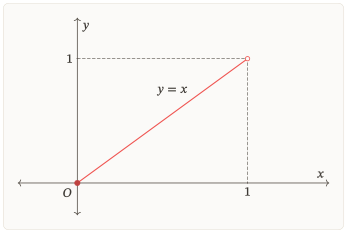
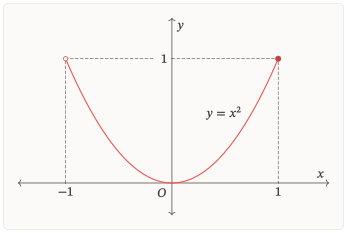
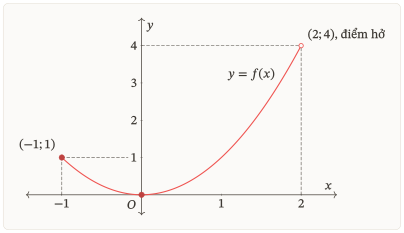
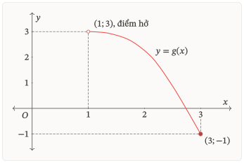
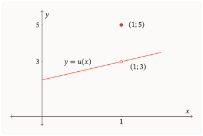
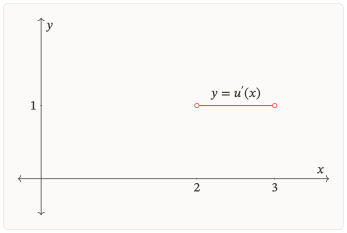

:::::::::::::::::::::::::::::::::::::::::::::::::::::::::::::::::::::::::::::::::::::::::::::::::::::::::::::::::::::::::::::::::::::::::::::::::::::::::::::::: {.zo-on-thi-package .r1-g01 .r1-g02 r1-code="R1-G02" r1-lesson-count="7" r1-title="Giá trị lớn nhất và giá trị nhỏ nhất"}
## Bắt đầu {#bat-dau}

::: {.r1-status}
Có thể học
:::

<!-- zo-section tong-quan overview -->

**Khi nào hàm số có giá trị lớn nhất hoặc giá trị nhỏ nhất trên tập đang xét?**\
**Từ dữ kiện của bài, làm thế nào để tìm mỗi giá trị và xác định những điểm đạt giá trị đó?**

Em sẽ dùng công thức, bảng biến thiên hoặc đồ thị để so sánh các giá trị của hàm số và kiểm tra điểm đạt có thuộc tập đang xét hay không.

**Chọn phần học**

- [Bài học](#bai-hoc) — Lí thuyết và ví dụ về sự tồn tại, cách tìm và điểm đạt của giá trị lớn nhất, giá trị nhỏ nhất.
- [Luyện tập](#phieu-luyen) — Bài tập về đọc đồ thị, xét sự tồn tại và xử lí ràng buộc.
- [Kiểm tra](#tu-kiem-tra) — Bài tự kiểm tra về cách chọn điểm cần xét và giải thích kết quả.
- [Ôn lại](#on-lai) — Ba lượt ôn sau 2–3 ngày, 7 ngày và 3–4 tuần, tính từ ngày đủ điều kiện chuyển sang gói tiếp theo.

[**Học xong, em cần làm được gì?**]{#học-xong-em-cần-làm-được-gì .r1-orientation-label}

::: {#r1-g02-table-t09 .table-scroll}
| Mục tiêu | Việc em cần làm được |
|:---------|:----------------------|
| Đọc đúng đối tượng | Em **xác định được tập xác định và tập đang xét** từ dữ kiện của bài. Em nhận ra khi nào có thể thay số vào biểu thức mà hàm số vẫn không xác định tại điểm đó. |
| Kiểm tra hai điều kiện | Em phân biệt được cực trị với giá trị lớn nhất và giá trị nhỏ nhất. Để kết luận một giá trị là lớn nhất, em chứng minh giá trị đó lớn hơn hoặc bằng mọi giá trị của hàm số trên tập đang xét và hàm số đạt giá trị đó tại **ít nhất một điểm thuộc tập ấy**. Với giá trị nhỏ nhất, em dùng so sánh nhỏ hơn hoặc bằng. |
| Tìm trên đoạn đóng | Em **dùng tính liên tục trên cả đoạn để kết luận giá trị lớn nhất và giá trị nhỏ nhất tồn tại**. Nếu chỉ có hữu hạn điểm bên trong đoạn mà đạo hàm bằng $0$ hoặc không tồn tại, em so sánh giá trị của hàm số tại các điểm ấy và hai đầu mút. |
| Giải thích sự tồn tại | Trên khoảng mở, tập gồm nhiều phần rời nhau hoặc tập không bị chặn, em **phân biệt được cận với giá trị hàm số thực sự đạt** và giải thích được giá trị lớn nhất, giá trị nhỏ nhất có tồn tại hay không. |
| Mô hình và ràng buộc | Trong bài toán thực tế, em lập được hàm biểu diễn đại lượng cần tối ưu, xác định những giá trị mà biến được phép nhận và chọn cách giải phù hợp. Em **kiểm tra phương án theo ràng buộc của đề**, chẳng hạn số sản phẩm phải là số nguyên, rồi ghi kết quả kèm đơn vị. |
:::

**Kiến thức cần dùng.** Em cần biết tìm tập xác định, tính giá trị hàm số, tính và xét dấu đạo hàm của các hàm số quen thuộc. Em cũng cần đọc được khoảng đồng biến, nghịch biến và cực trị từ bảng biến thiên, đồng thời phân biệt được đồ thị hàm số với đồ thị đạo hàm. Nếu còn vướng kĩ năng nào, em có thể xem lại ở phần [Ôn nền](#on-nen).

<!-- /zo-section -->

### Cách học {#cách-học-với-tài-liệu-này}

Chuẩn bị giấy để ghi chép. Tự làm trước khi mở lời giải; em có thể chia việc học thành nhiều buổi.

[Sau Khởi động, chọn phần Bài học cần đọc; Luyện tập là phần tiếp theo khi đã nắm phần học.]{#cach-thuc-hien-su-dung-tai-lieu}

#### Chọn nơi bắt đầu {#chọn-nơi-bắt-đầu}

- Nếu chưa học hoặc cần học lại chủ đề, vào [Bài học](#bai-hoc). Làm đúng các nhiệm vụ Khởi động chưa đủ để kết luận đã đạt cả gói.
- Nếu đã nắm phần học, vào [Luyện tập](#phieu-luyen). Khi vướng, xem lại đúng phần cần thiết rồi trở về đúng chỗ đang vướng.
- Nếu đã chuẩn bị kĩ lưỡng hoặc đủ tự tin, có thể thực hiện [Kiểm tra](#tu-kiem-tra). Không được chia Kiểm tra thành nhiều đợt.

#### Bản đồ học {#bản-đồ-học}

::: {data-learning-main=""}
[Bài học](#bai-hoc) → [Luyện tập](#phieu-luyen) → [Kiểm tra](#tu-kiem-tra) → [Ôn lại](#on-lai)
:::

Đây là mạch học chính. Em có thể đi tới hoặc quay lại phần cần thiết; phần bỏ qua không tự được xem là đã đạt. Ôn lại được thực hiện theo ngày đã hẹn.

Trong Bài học, Luyện tập, Ôn lại và sau khi kết thúc Kiểm tra, em có thể dùng hỗ trợ theo nhu cầu:

::: {#r1-g02-table-t08 .table-scroll}
| Khi cần | Mở phần nào? | Sau đó làm gì? |
|---|---|---|
| Xem lại kiến thức đang vận dụng | Đúng đoạn trong [Bài học](#bai-hoc) | Trở về nhiệm vụ đang vướng |
| Bổ sung kiến thức nền | Đúng tài nguyên [Ôn nền](#on-nen) | Tự làm câu xác nhận của tài nguyên rồi trở về |
| Kiểm lại bài làm | [Lời giải](#loi-giai); [Sửa lỗi](#sua-loi) nếu phát hiện lỗi | Đối chiếu, sửa và xác nhận theo chỉ dẫn của nhiệm vụ hoặc Điểm dừng |
| Lưu kết quả và việc tiếp theo | [Nhật kí](#nhat-ky) | Ghi nơi sẽ tiếp tục và lịch Ôn lại khi có |
:::

**Trong lúc Kiểm tra, phải tự lực hoàn toàn:** không dùng Bài học, Ôn nền, Lời giải hoặc Sửa lỗi để trợ giúp bài đang làm. Nếu cần hỗ trợ, kết thúc lượt kiểm tra và giữ bài làm ban đầu trước.

#### Khi cần hỗ trợ {#g02-ho-tro-khi-can}

**Chưa biết cách làm:** nếu vướng kiến thức của gói, xem lại đúng lời giải thích hoặc ví dụ trong Bài học; nếu thiếu kiến thức nền, mở đúng tài nguyên Ôn nền. Không cần đọc lại cả gói để tiếp tục một nhiệm vụ.

**Muốn kiểm lại bài làm:** giữ bài tự làm trước khi mở Lời giải. Đối chiếu điều kiện, lập luận và kết quả. Nếu có lỗi, xác định bước sai và dùng hướng dẫn hoặc nhiệm vụ Sửa lỗi được chỉ định. Khi cần xác nhận sau hỗ trợ, tự làm nhiệm vụ phù hợp còn chưa xem đáp án; quay về đúng nhiệm vụ hoặc Điểm dừng đang vướng.

**Ở Điểm dừng:** dựa vào bài làm và tiêu chí để chọn đi tiếp hay nhận hỗ trợ. Nếu đã đáp ứng tiêu chí, không cần qua mọi nhánh hỗ trợ. Sau Kiểm tra, giữ riêng kết quả ban đầu với kết quả sau sửa.

**Đã xem đáp án hoặc không còn nhiệm vụ mới phù hợp:** dùng bài đã xem để học, không tính là kết quả tự làm một bài mới. Ghi phần chưa được xác nhận và làm theo chỉ dẫn tại Điểm dừng; không tự đánh dấu đã đạt.

**Khi có quyết định hoặc kết thúc buổi học:** ghi kết quả, hỗ trợ đã dùng, nơi đang dừng và việc tiếp theo vào Nhật kí. Chỉ điền thông tin đã có; không cần ghi sau mọi thao tác. Nếu vào thẳng phần hỗ trợ, chọn nhiệm vụ hoặc hoạt động em muốn quay về.

#### Khi nào có thể chuyển sang gói tiếp theo? {#g02-chuyen-goi}

Em có thể chuyển sang gói tiếp theo khi bài làm độc lập cho thấy em đáp ứng các mục tiêu thiết yếu và các lỗi cản trở việc tiếp tục đã được kiểm tra lại sau sửa. Giữ riêng kết quả ban đầu và kết quả sau hỗ trợ; ghi phần còn hạn chế cùng ngày Ôn lại vào Nhật kí. Chọn gói tiếp theo phù hợp với kiến thức em đã có, đồng thời giữ lịch Ôn lại của gói này; không cần chờ hết các lượt ôn mới học tiếp.

Hẹn Ôn lại sau khoảng **2–3 ngày, 7 ngày và 3–4 tuần**, tính từ ngày đáp ứng các điều kiện trên. Đến ngày hẹn, tự làm nhiệm vụ của lượt Ôn lại trước khi đối chiếu. Một lượt ôn chỉ cho biết kết quả ở những nội dung được kiểm tra trong lượt đó, không có nghĩa em đã làm chủ mọi tình huống của cả chủ đề. Nếu một nội dung vừa phải sửa lại, ghi thêm ngày kiểm lại sớm nội dung ấy.

Em có thể làm mục [Luyện thêm](#chuyen-giao) khi đã học phần lượng giác, mũ hoặc lôgarit tương ứng. Em có thể hoàn tất năm mục tiêu cốt lõi mà chưa làm phần này.

## Bài học {#bai-hoc}

::: {.content-visible when-format="html"}

```{=html}
<link rel="stylesheet" href="../r1_g01/giao_dien/video.css">
<script src="../r1_g01/giao_dien/video.js" defer></script>
```

:::

::: lesson-toc
:::

:::: {#dinh-huong-bai-hoc .zo-lesson-intro}
<!-- zo-section dinh-huong-bai-hoc lesson-intro -->

[]{#câu-hỏi-dẫn-đường}Một hàm số đạt giá trị lớn nhất tại một đầu mút của đoạn đang xét. Nếu bỏ đầu mút ấy, làm sao biết trên tập còn lại hàm số có giá trị lớn nhất hay không?

Em sẽ dùng công thức, bảng biến thiên và đồ thị để so sánh các giá trị của hàm số, rồi kiểm tra giá trị cần tìm có được đạt tại một điểm thuộc tập đang xét hay không.

<!-- /zo-section -->
::::

### Khởi động {#bắt-đầu-từ-đâu}

::: {#cach-thuc-hien-bat-dau data-zo-instructions="required"}
<!-- zo-section cach-thuc-hien-bat-dau -->

Em hãy tự làm ba câu dưới đây rồi đối chiếu lời giải. Nếu còn vướng, dùng phần [Chọn kiến thức cần ôn](#chọn-đúng-phần-cần-ôn) để quay lại đúng chỗ.

<!-- /zo-section -->
:::

::: {#ba-câu-khởi-động .r1-kickoff-questions}

::::: {#g02-khoi-dong-01 .zo-learning-task .zo-learning-task--pause .zo-lesson-activity}
[]{#nhiệm-vụ-01}

**Nhiệm vụ 01 — Cực đại và giá trị lớn nhất**

Hàm số $r$ liên tục trên $[-3; 4]$ và biến thiên như bảng dưới đây. Tại $x = 2$, hàm số có giá trị cực đại bằng $1$. Giá trị cực đại ấy có phải là giá trị lớn nhất trên đoạn không? Dựa vào bảng, hãy tìm giá trị lớn nhất và giá trị nhỏ nhất của $r$ trên đoạn này.

:::: table-scroll
::: {.r1-bbt bbt="BBT01" caption="Bảng biến thiên của hàm số r trên đoạn từ −3 đến 4."}
ZO BBT placeholder
:::
:::

:::::

::::: {#g02-khoi-dong-02 .zo-learning-task .zo-learning-task--pause .zo-lesson-activity}
[]{#nhiệm-vụ-02}

**Nhiệm vụ 02 — Tập đang xét và điểm đạt**

Cho hàm số $f(x)=(x-2)^2$. Một bạn nhận xét: “Giá trị nhỏ nhất của $f$ trên $K=(2;5]$ bằng $0$ vì $f(2)=0$.” Nhận xét này đúng không? Vì sao?

:::::

::::: {#g02-khoi-dong-03 .zo-learning-task .zo-learning-task--pause .zo-lesson-activity}
[]{#nhiệm-vụ-03}

**Nhiệm vụ 03 — Đọc đúng đồ thị đạo hàm**

Đồ thị của đạo hàm $y = f^\prime(x)$ đi qua điểm $(1; 0)$. Dữ kiện này có đủ để kết luận $f(1) = 0$ không? Vì sao?
:::::
:::

::: {#sau-khi-lam-xong .answer-link}
[Xem lời giải](#loi-giai-khoi-dong)
:::

:::::: {#chọn-đúng-phần-cần-ôn .r1-details .zo-learning-guidance}
::: {.r1-summary .zo-learning-summary}
Chọn kiến thức cần ôn
:::

<!-- zo-section chọn-đúng-phần-cần-ôn block-table -->
::: {#r1-g02-table-t10 .table-scroll}
| Chỗ còn vướng | Phần cần ôn |
|---|---|
| Nhiệm vụ 01: Cực đại và giá trị lớn nhất | Xem [Cực trị và giá trị lớn nhất, nhỏ nhất](#cực-trị-và-giá-trị-lớn-nhất-nhỏ-nhất) để phân biệt cách so sánh gần một điểm và trên cả tập. |
| Nhiệm vụ 02: Tập đang xét và điểm đạt | Xem [Tập xác định và tập đang xét](#doi-tuong) hoặc ôn lại [Tập xác định](#nen-n-txd-01). |
| Nhiệm vụ 03: Đồ thị hàm số và đồ thị đạo hàm | Ôn lại [Đọc nhãn đồ thị](#nen-n-dt-01) để biết tung độ trên hình là giá trị của hàm số hay của đạo hàm. |
| Tìm giá trị lớn nhất, nhỏ nhất trên đoạn đóng | Xem [Cách lập danh sách điểm cần xét](#quy-trình-so-sánh-một-danh-sách-hữu-hạn). |
| Khoảng mở hoặc tập gồm nhiều phần rời nhau | Xem [Thay tập đang xét](#tap-khac) hoặc ôn lại [Cận](#nen-n-gh-01). |
| Bài toán thực tế | Xem [Đại lượng và ràng buộc](#loi-van) hoặc ôn lại [Cách lập hàm số](#nen-n-mh-01). |
:::

Ôn xong, em hãy quay lại làm nhiệm vụ còn vướng.
<!-- /zo-section -->
::::::

### 1. Tập xác định và tập đang xét khác nhau thế nào? {#doi-tuong}

[]{#cach-thuc-hien-doi-tuong}

:::: {#g02-goi-mo-01 .r1-task .zo-learning-task .zo-learning-task--pause data-zo-type="task" data-zo-task="G02-GM01" data-zo-function="function.guided_thinking" data-zo-number="1" .zo-lesson-activity data-zo-lead="true"}
<!-- zo-section g02-goi-mo-01 lesson-activity -->

**Gợi mở 01 — Tập xác định và tập đang xét**

Trong Nhiệm vụ 02, giá trị $f(2)$ tính được. Vì sao khi tìm giá trị nhỏ nhất trên $K=(2;5]$, em còn phải kiểm tra xem $2$ có thuộc $K$ hay không?

<!-- /zo-section -->
::::

::: {#g02-dinh-nghia-ham-so}
[**Quy tắc và tập xác định.**]{#quy-tac-va-tap-xac-dinh} Để xác định một hàm số, cần biết biến số được phép nhận những giá trị nào và quy tắc gán cho mỗi giá trị ấy một giá trị duy nhất của hàm số. Tập các giá trị mà biến số được phép nhận gọi là **tập xác định $D$ của hàm số**.
:::

:::: {.zo-block .zo-block-red}
::: {.zo-block-title}
Đọc đầy đủ dữ kiện trước khi tìm $D$
:::

- Nếu đề cho hàm số có tập xác định $K$, thì $D = K$. Công thức phải có nghĩa với mọi $x \in K$.
- Nếu chỉ cho công thức và **không chỉ rõ tập xác định**, ta mới theo quy ước lấy tất cả số thực làm biểu thức có nghĩa.
::::

[Nguồn đối chiếu: Sách giáo khoa Toán 10, tập hai, bộ Kết nối tri thức với cuộc sống, bài 15, trang 6 (trang 7 của tệp PDF), phần định nghĩa và chú ý về trường hợp không chỉ rõ tập xác định.]{.zo-source-note}

:::::::::: {#trở-lại-câu-khởi-động-tính-được-f2-vì-sao-không-được-lấy-2-làm-điểm-đạt .zo-learning-example .zo-lesson-activity}

**Ví dụ 01 — Tập xác định và điểm đạt**

Trở lại Nhiệm vụ 02. Đề cho $f(x) = (x - 2)^2$ mà không giới hạn tập xác định, nên $D = \mathbb{R}$. Khi tìm giá trị nhỏ nhất trên $K = (2; 5]$, ta chỉ so sánh các giá trị tại những điểm thuộc $K$.

::: {#r1-g02-table-t01 .table-scroll}
| Đối tượng cần đọc | Kết luận trong bài này |
|:------------------|:------------------------|
| Tập xác định $D$  | $\mathbb{R}$: công thức có nghĩa với mọi số thực và đề không cho giới hạn khác. |
| Tập đang xét $K$  | $(2;5]$: chỉ so sánh giá trị tại các điểm thuộc tập này. |
| Đầu mút $2$       | $2\in D$ nhưng $2\notin K$. Giá trị $f(2)=0$ có nghĩa; $2$ không được dùng làm điểm đạt trên $K$. |
| Đầu mút $5$       | $5\in K$. Giá trị $f(5)=9$ được đưa vào so sánh. |
:::

[**Cần phân biệt ba việc: thay số vào biểu thức, tính giá trị hàm số và xét điểm đạt trên $K$.**]{#bieu-thuc-va-ham-so .r1-unboxed-label}

Với $f$ ở câu khởi động, cả phép tính $(2-2)^2=0$ và kí hiệu $f(2)=0$ đều đúng. Điều bị bỏ sót là $2\notin K$.

Nếu một đề khác cho hàm số $g$ có tập xác định $(2;5]$, với $g(x)=(x-2)^2$, thì $g(2)$ không xác định. Phép thay $2$ vào biểu thức vẫn tính được $0$, nhưng không phải là giá trị của $g$ tại $2$. Cùng công thức chưa đủ để kết luận hai hàm số có cùng tập xác định.

Vì vậy, **$D$ là tập xác định của hàm số đã cho; $K$ là tập được yêu cầu xét**. Hai tập có thể trùng nhau. Nếu xét trên một phần của $D$ thì phải có $K\subseteq D$. Không tự mặc định $D$ lớn hơn $K$, cũng không tự đổi $D$ của một hàm số đã được xác định rõ.

Trước mỗi bài, hãy tự hỏi: đề đang cho tập xác định của hàm số, hay đang yêu cầu so sánh các giá trị trên một tập được chỉ định? Đọc trọn yêu cầu rồi mới quyết định $D$ và $K$.

::::::::::

### 2. Khi nào một giá trị là lớn nhất hoặc nhỏ nhất? {#dinh-nghia}

[]{#cach-thuc-hien-dinh-nghia}

:::: {#g02-goi-mo-02 .r1-task .zo-learning-task .zo-learning-task--pause data-zo-type="task" data-zo-task="G02-GM02" data-zo-function="function.guided_thinking" data-zo-number="2" .zo-lesson-activity data-zo-lead="true"}
<!-- zo-section g02-goi-mo-02 lesson-activity -->

**Gợi mở 02 — So sánh chưa đủ để có giá trị lớn nhất**

Biết $f(x)\le M$ với mọi $x\in K$ đã đủ để kết luận $M$ là giá trị lớn nhất của $f$ trên $K$ chưa? Em cần kiểm tra thêm điều gì?

<!-- /zo-section -->
::::

#### 2.1. Giá trị lớn nhất, nhỏ nhất {#dinh-nghia-tren-tap-dang-xet}

Cho hàm số $f$ có tập xác định $D$. Với tập không rỗng $K \subseteq D$ (có thể $K = D$), số $M$ là **giá trị lớn nhất** của $f$ trên $K$ khi:

:::: {#g02-dinh-nghia-gia-tri-lon-nhat .zo-block .zo-block-red}
::: {.zo-block-title}
Giá trị lớn nhất trên một tập
:::

1.  $f(x) \le M$ với mọi $x \in K$.
2.  Có ít nhất một điểm $x_0 \in K$ sao cho $f(x_0) = M$.

Kí hiệu: $\max_{x\in K} f(x)=M$.
::::

:::: {#g02-dinh-nghia-gia-tri-nho-nhat .zo-block .zo-block-red}
::: {.zo-block-title}
Giá trị nhỏ nhất trên một tập
:::

Số $m$ là **giá trị nhỏ nhất** của $f$ trên $K$ khi:

1. $f(x) \ge m$ với mọi $x \in K$.
2. Có ít nhất một điểm $x_1 \in K$ sao cho $f(x_1) = m$.

Kí hiệu: $\min_{x\in K} f(x)=m$.
::::

[Nguồn đối chiếu: Sách giáo khoa Toán 12, tập một, bộ Kết nối tri thức với cuộc sống, bài 2, trang 15 (trang 17 của tệp PDF), phần định nghĩa.]{.zo-source-note}

Tập được yêu cầu xét là $K$; khi xét toàn bộ tập xác định thì $K=D$. Cả điều kiện so sánh và điều kiện đạt được đều phải dùng cùng tập $K$.

Hãy viết đủ: **“Giá trị lớn nhất bằng $M$, đạt tại $x=x_0$.”** Số $M$ là giá trị; $x_0$ là điểm đạt giá trị của hàm số; $(x_0;M)$ là một điểm trên đồ thị. Một giá trị lớn nhất có thể đạt tại nhiều điểm.

[]{#áp-dụng-cho-fxx-22-trên-k25}

Xét $f(x)=(x-2)^2$ trên $K=(2;5]$.

::: {#cau-hoi-bai-hoc-01 .r1-task .r1-g02-pause .zo-learning-task .zo-learning-task--pause .zo-lesson-activity}
[]{#nhiệm-vụ-01-1}

**Nhiệm vụ 04 — Điểm bị loại và sự đạt được**

Khi xét hàm số trên $K$, em không được dùng $x=2$. Hàm số có đạt giá trị $0$ tại điểm nào khác thuộc $K$ không? Nếu không, liệu hàm số có giá trị nhỏ nhất dương trên $K$ không?

::: answer-link
[Xem lời giải](#loi-giai-bai-hoc-01)
:::
:::

#### 2.2. Cận và giá trị đạt được {#cận-chưa-chắc-là-giá-trị-đạt-được}
<!-- zo-section cận-chưa-chắc-là-giá-trị-đạt-được reading-prefix -->

Nếu $f(x)\le M$ với mọi $x\in K$ thì $M$ là một **cận trên** của $f$ trên $K$. Tương tự, nếu $f(x)\ge m$ với mọi $x\in K$ thì $m$ là một **cận dưới**. Có cận trên thì $f$ **bị chặn trên**, có cận dưới thì $f$ **bị chặn dưới**. Khi có cả hai loại cận, ta nói $f$ **bị chặn**.

Chẳng hạn, với $f(x)=x$ trên $(0;1)$, mọi giá trị đều nằm giữa $0$ và $1$. Với mỗi $x\in(0;1)$, hai điểm $\frac{x}{2}$ và $\frac{x+1}{2}$ cũng thuộc khoảng này và lần lượt cho giá trị nhỏ hơn và lớn hơn $f(x)$. Vì thế, trên $(0;1)$ hàm số không có giá trị nhỏ nhất và cũng không có giá trị lớn nhất.

Nếu hàm số không đạt một cận trên thì số đó vẫn là cận trên và không thể là giá trị lớn nhất. Ví dụ, hàm số hằng $f(x)=3$ trên $(0;1)$ có cận trên $10$, còn giá trị lớn nhất là $3$, đạt tại mọi điểm của khoảng.

<!-- /zo-section -->
::: {.content-visible when-format="html"}

```{=html}
<details class="zo-block zo-block-gray zo-learning-video" id="video-h02" data-youtube-id="oFjvBqg9_RM" data-scheduled-at="2026-11-09T05:00:00+07:00" data-public-playback="public">
<summary class="zo-block-title">Video: Có cận trên, đã có giá trị lớn nhất?</summary>
<div class="zo-block-body">
<div class="zo-video-player"></div>
</div>
</details>
```

:::

<!-- zo-section cực-trị-và-giá-trị-lớn-nhất-nhỏ-nhất reading-heading -->
#### 2.3. Phân biệt cực trị với giá trị lớn nhất, nhỏ nhất {#cực-trị-và-giá-trị-lớn-nhất-nhỏ-nhất}
<!-- /zo-section -->

**Nhắc lại cách nhận biết cực trị.** Xét hàm số $f$ liên tục trên một khoảng chứa $x_0$. Hàm số đạt cực đại tại $x_0$ nếu, trong một khoảng đủ nhỏ quanh $x_0$, giá trị $f(x_0)$ **lớn hơn** mọi giá trị $f(x)$ với $x\ne x_0$. Hàm số đạt cực tiểu tại $x_0$ nếu giá trị $f(x_0)$ **nhỏ hơn** mọi giá trị như vậy. Việc so sánh xét các điểm ở cả hai phía của $x_0$; bằng nhau không thỏa điều kiện lớn hơn hoặc nhỏ hơn này.

::: {#r1-g02-table-t02 .table-scroll}
| Điều cần phân biệt | Cực đại, cực tiểu | Giá trị lớn nhất, nhỏ nhất trên $K$ |
|---|---|---|
| Phạm vi so sánh | So sánh với các điểm đủ gần ở cả hai phía; dùng bất đẳng thức nghiêm ngặt. | So sánh với mọi điểm thuộc $K$. |
| Giá trị ở vị trí khác | Giá trị cực đại có thể bị một giá trị ở xa vượt qua. | Giá trị lớn nhất không bị bất cứ giá trị nào trên $K$ vượt qua. |
| Vai trò của đầu mút | Một đầu mút của tập xác định không có khoảng nhỏ quanh nó nằm trọn trong tập xác định, nên không thỏa điều kiện hai phía nêu trên. | Đầu mút thuộc $K$ có thể là nơi đạt giá trị lớn nhất hoặc nhỏ nhất. Nếu điểm đó nằm bên trong $D$, phải xét hàm số ở cả hai phía mới kết luận về cực trị. |
:::

Một điểm cực trị thuộc $K$ là một điểm cần xem xét khi tìm giá trị lớn nhất, nhỏ nhất trên $K$. Ngược lại, điểm đạt giá trị lớn nhất, nhỏ nhất chưa chắc là điểm cực trị: giá trị ấy có thể đạt tại đầu mút, hoặc bằng các giá trị ở những điểm lân cận.

::: {#cau-hoi-bai-hoc-02 .r1-task .r1-g02-pause .zo-learning-task .zo-learning-task--pause .zo-lesson-activity}
[]{#nhiệm-vụ-02-1}

**Nhiệm vụ 05 — Hàm hằng và cực trị**

Cho hàm số $f(x) = 2$ có tập xác định $(0; 1)$. Hàm số có giá trị lớn nhất, nhỏ nhất không? Có điểm cực đại hoặc cực tiểu không? Hãy giải thích bằng cách so sánh giá trị tại một điểm với các giá trị ở những điểm gần nó.

::: answer-link
[Xem lời giải](#loi-giai-bai-hoc-02)
:::
:::

### 3. Trên đoạn đóng, cần so sánh tại những điểm nào? {#tren-doan}

[]{#cach-thuc-hien-tren-doan}

:::: {#g02-goi-mo-03 .r1-task .zo-learning-task .zo-learning-task--pause data-zo-type="task" data-zo-task="G02-GM03" data-zo-function="function.guided_thinking" data-zo-number="3" .zo-lesson-activity data-zo-lead="true"}
<!-- zo-section g02-goi-mo-03 lesson-activity -->

**Gợi mở 03 — Danh sách điểm cần so sánh**

Khi tìm giá trị lớn nhất và giá trị nhỏ nhất của một hàm số trên đoạn đóng, một bạn chỉ xét các điểm có đạo hàm bằng $0$. Bạn ấy có thể bỏ sót những điểm nào?

<!-- /zo-section -->
::::

#### 3.1. Điều kiện tồn tại {#dieu-kien-bao-dam-ton-tai}

:::: {#g02-dinh-li-ton-tai .zo-block .zo-block-red}
::: {.zo-block-title}
Bảo đảm tồn tại
:::

Nếu $f$ liên tục trên đoạn $[a; b]$, với $a < b$, thì $f$ có cả giá trị lớn nhất và giá trị nhỏ nhất trên đoạn đó.
::::

Cần kiểm tra $[a; b] \subseteq D$ và tính liên tục trên toàn đoạn. Một hàm được cho bởi công thức đa thức trên cả đoạn thì liên tục trên đoạn ấy; với công thức phân thức phải kiểm tra mẫu khác 0 ở mọi điểm của đoạn. Liên tục ở đầu mút được xét từ phía bên trong đoạn.

Đây là **điều kiện đủ**. Nếu thiếu điều kiện, em chưa được dùng bảo đảm trên; em cũng chưa được kết luận rằng giá trị lớn nhất, nhỏ nhất không tồn tại.

::: {#cau-hoi-bai-hoc-03 .r1-task .r1-g02-pause .zo-learning-task .zo-learning-task--pause .zo-lesson-activity}
[]{#nhiệm-vụ-03-1}

**Nhiệm vụ 06 — Kiểm điều kiện liên tục**

<!-- zo-section cau-hoi-bai-hoc-03 block-prefix -->
Hàm $q$ có tập xác định $[0;1]$, với $q(x)=x$ khi $0\le x<1$ và $q(1)=0$. Một bạn chỉ so sánh $q(0)=q(1)=0$ rồi kết luận giá trị lớn nhất bằng $0$. Bạn đã bỏ qua giả thiết nào của quy trình tìm giá trị lớn nhất trên đoạn đóng? Hãy tính giá trị của $q$ tại một điểm để bác bỏ kết luận của bạn ấy.
<!-- /zo-section -->

::: answer-link
[Xem lời giải](#loi-giai-bai-hoc-03)
:::
:::

::: {.content-visible when-format="html"}

```{=html}
<details class="zo-block zo-block-gray zo-learning-video" id="video-h04" data-youtube-id="ZsY9HykmkNI" data-scheduled-at="2026-11-10T05:00:00+07:00" data-public-playback="public">
<summary class="zo-block-title">Video: Đoạn đóng, đã chắc có cả lớn nhất và nhỏ nhất?</summary>
<div class="zo-block-body">
<div class="zo-video-player"></div>
</div>
</details>
```

:::

#### 3.2. So sánh các ứng viên {#quy-trình-so-sánh-một-danh-sách-hữu-hạn}

<!-- zo-section quy-trình-so-sánh-một-danh-sách-hữu-hạn reading-prefix -->

Nếu $f$ liên tục trên $[a;b]$, hai giá trị cần tìm đều tồn tại. Ta có thể tìm chúng bằng cách so sánh một danh sách hữu hạn nếu trong $(a;b)$ chỉ có hữu hạn điểm mà $f^\prime(x)=0$ và hữu hạn điểm mà $f$ không có đạo hàm.

1.  **Lập danh sách điểm.** Ghi hai đầu mút $a$, $b$ và tất cả các điểm trong $(a;b)$ mà $f^\prime(x)=0$ hoặc $f$ không có đạo hàm.
2.  **Tính giá trị của $f$** tại từng điểm trong danh sách.
3.  **So sánh các giá trị.** Ghi giá trị lớn nhất, giá trị nhỏ nhất và mọi điểm trong danh sách đạt mỗi giá trị ấy.

[Nguồn đối chiếu: Sách giáo khoa Toán 12, tập một, bộ Kết nối tri thức với cuộc sống, bài 2, trang 18 (trang 20 của tệp PDF), phần quy trình và giả thiết.]{.zo-source-note}

Điểm đạt giá trị lớn nhất hoặc nhỏ nhất có thể là đầu mút, nên luôn đưa $a$ và $b$ vào danh sách. Tại một điểm đạt nằm trong $(a;b)$, nếu đạo hàm tồn tại thì đạo hàm bằng $0$. Vì vậy, dù có đạo hàm hay không, điểm đạt nằm bên trong đều thuộc danh sách trên.

Nếu phương trình $f^\prime(x)=0$ có vô số nghiệm, cách liệt kê này không cho một danh sách hữu hạn. Chẳng hạn, với hàm hằng, có thể tìm ngay giá trị lớn nhất và nhỏ nhất từ định nghĩa.

<!-- /zo-section -->
:::::::::: {#g02-vi-du-tren-doan .zo-learning-example .zo-lesson-activity}

**Ví dụ 02 — So sánh các ứng viên**

Xét $a(x)=x^2-2x$ trên $[-1;3]$. Hàm số là đa thức, liên tục trên đoạn; đạo hàm $a^\prime(x)=2x-2$ tồn tại và chỉ bằng $0$ tại $x=1$ bên trong đoạn.

Danh sách cần xét gồm $-1$, $1$, $3$. Ta tính $a(-1)=3$, $a(1)=-1$, $a(3)=3$. Vì vậy giá trị nhỏ nhất là $-1$ tại $x=1$; giá trị lớn nhất là $3$, đạt tại **cả hai** điểm $x=-1$ và $x=3$.

Kiểm tra trực tiếp: $a(x)=(x-1)^2-1$ và $0\le(x-1)^2\le4$ trên đoạn. Kết luận dựa vào giá trị của hàm số, không phải điểm nào có hoành độ lớn nhất. Ví dụ đã giải này dùng để học phương pháp, không tính là bài làm độc lập của em.

::::::::::

::: {.content-visible when-format="html"}

```{=html}
<details class="zo-block zo-block-gray zo-learning-video" id="video-h05" data-youtube-id="MyX19fPKeoE" data-scheduled-at="2026-11-10T19:00:00+07:00" data-public-playback="public">
<summary class="zo-block-title">Video: Tìm lớn nhất, nhỏ nhất: Dễ sót điểm nào?</summary>
<div class="zo-block-body">
<div class="zo-video-player"></div>
</div>
</details>
```

:::

[]{#ví-dụ-làm-mẫu-so-sánh-giá-trị-không-so-sánh-hoành-độ}

:::: {.r1-self-check-example}

::: {#cau-hoi-bai-hoc-04 .r1-task .r1-g02-pause .zo-learning-task .zo-learning-task--pause .zo-lesson-activity}
[]{#nhiệm-vụ-04}

**Nhiệm vụ 07 — Lập đủ điểm cần so sánh**

Cho hàm số $p(x)=x^2-4x+1$. Tìm giá trị lớn nhất, nhỏ nhất của $p$ trên đoạn $[-1;4]$.
Em sẽ đưa những điểm nào vào danh sách? Vì sao?

::: answer-link
[Xem lời giải](#loi-giai-bai-hoc-04)
:::
:::
::::

### 4. Đổi tập đang xét, kết quả có đổi không? {#tap-khac}

[]{#cach-thuc-hien-tap-khac}

:::: {#g02-goi-mo-04 .r1-task .zo-learning-task .zo-learning-task--pause data-zo-type="task" data-zo-task="G02-GM04" data-zo-function="function.guided_thinking" data-zo-number="4" .zo-lesson-activity data-zo-lead="true"}
<!-- zo-section g02-goi-mo-04 lesson-activity -->

**Gợi mở 04 — Đầu mút có được lấy không?**

Hàm số $F(x)=x$ đạt giá trị nhỏ nhất ở đầu mút trái và giá trị lớn nhất ở đầu mút phải của đoạn $[0;1]$. Nếu chỉ bỏ đầu mút phải, giá trị nào còn đạt được? Nếu bỏ cả hai đầu mút thì sao?

<!-- /zo-section -->
::::

#### 4.1. Thay tập đang xét {#doc-su-dat-duoc-khi-thay-tap}
<!-- zo-section doc-su-dat-duoc-khi-thay-tap reading-structured -->

Khi đầu mút không thuộc $K$, hãy xét giới hạn một phía khi $x$ tiến đến đầu mút từ phía thuộc $K$. Nếu giới hạn ấy tồn tại và hữu hạn, muốn biết hàm số có đạt giá trị đó trên $K$ hay không, ta phải tìm một điểm thuộc $K$ cho giá trị ấy.

Bảng dưới giữ nguyên hàm số $F(x)=x$ có tập xác định $\mathbb{R}$ và lần lượt thay tập $K$. Hãy để ý kết quả thay đổi thế nào khi bỏ một hoặc cả hai đầu mút khỏi tập đang xét.

::: {#r1-g02-table-t03 .table-scroll}
| Tập $K$ đang xét của $F$ | Giá trị nhỏ nhất | Giá trị lớn nhất |
|:-------------------------|:------------------|:------------------|
| Trên $[0;1]$             | $0$ tại $x=0$    | $1$ tại $x=1$    |
| Trên $[0;1)$             | $0$ tại $x=0$    | Không có          |
| Trên $(0;1]$             | Không có          | $1$ tại $x=1$    |
| Trên $(0;1)$             | Không có          | Không có          |
:::

Ví dụ, trên $K=[0;1)$, mỗi điểm $x$ luôn có một điểm $y=\frac{x+1}{2}$ thuộc cùng tập với $F(y)>F(x)$. Vì thế $F$ không có giá trị lớn nhất trên $K$. Dù $F(1)=1$ có nghĩa với hàm số đã cho trên $\mathbb{R}$, điểm $1$ không thuộc $K$ và không có điểm nào khác trong $K$ cho giá trị $1$.

Trên một tập không bị chặn, không được suy ngay rằng hàm số không có giá trị lớn nhất hoặc nhỏ nhất. Chẳng hạn $x^2$ trên $\mathbb{R}$ vẫn có giá trị nhỏ nhất bằng $0$.

[**Một điểm hở không loại luôn cả một giá trị.**]{.r1-unboxed-label}

Chẳng hạn, xét $q(x)=x^2$ với tập xác định $(-1;1]$. Ở $x=-1$, hàm số không xác định. Giá trị $1$ vẫn đạt tại $x=1$ và là giá trị lớn nhất vì $q(x)\le1$ trên toàn tập xác định. Cần kiểm tra mọi điểm có thể cho cùng tung độ.

<figure id="fig-g02-diem-dat" class="r1-figure zo-graph-pair">

{loading="lazy"}

{loading="lazy"}

<figcaption>

Trên $[0;1)$, mọi điểm thuộc đồ thị $y=x$ đều có tung độ nhỏ hơn $1$ và $(1;1)$ là điểm hở. Trên $(-1;1]$, đồ thị $y=x^2$ có điểm hở $(-1;1)$ nhưng vẫn đạt tung độ lớn nhất $1$ tại điểm kín $(1;1)$.

</figcaption>

</figure>

::: {.content-visible when-format="html"}

```{=html}
<details class="zo-block zo-block-gray zo-learning-video" id="video-h06" data-youtube-id="1rQ83W5nu5M" data-scheduled-at="2026-11-11T05:00:00+07:00" data-public-playback="pending">
<summary class="zo-block-title">Video: Bỏ một điểm, còn giá trị lớn nhất?</summary>
<div class="zo-block-body">
<div class="zo-video-player"></div>
</div>
</details>
```

:::

<!-- /zo-section -->
#### 4.2. Tập nhiều thành phần {#khi-k-gồm-nhiều-thành-phần-rời-nhau}
<!-- zo-section khi-k-gồm-nhiều-thành-phần-rời-nhau reading-prefix -->

Xét $f(x)=x$ trên $K=[0;1)\cup[2;3]$. Trên $[0;1)$, mọi giá trị đều nhỏ hơn $1$ và không có giá trị lớn nhất. Trên $[2;3]$, giá trị lớn nhất là $3$, đạt tại $x=3$. Vì $3$ cũng lớn hơn mọi giá trị trên $[0;1)$, đây là giá trị lớn nhất trên toàn bộ $K$.

Khi $K$ gồm nhiều phần rời nhau, hãy xét từng phần rồi so sánh trên toàn bộ $K$. Nếu dùng bảng biến thiên, mỗi mũi tên chỉ cho biết hàm tăng hay giảm trên phần được biểu diễn. Muốn so sánh giá trị ở các phần khác nhau, cần đọc thêm các giá trị hoặc cận tương ứng.

<!-- /zo-section -->
::: {.content-visible when-format="html"}

```{=html}
<details class="zo-block zo-block-gray zo-learning-video" id="video-h07" data-youtube-id="g8BKAWhZvI0" data-scheduled-at="2026-11-11T19:00:00+07:00" data-public-playback="pending">
<summary class="zo-block-title">Video: Một phần không có giá trị lớn nhất, cả tập thì sao?</summary>
<div class="zo-block-body">
<div class="zo-video-player"></div>
</div>
</details>
```

:::

#### 4.3. Chọn công cụ {#chọn-công-cụ-từ-dữ-kiện}
<!-- zo-section chọn-công-cụ-từ-dữ-kiện reading-body -->

- **Công thức** có thể giúp tìm cận và điểm đạt bằng biến đổi hoặc bất đẳng thức. Nếu dùng đạo hàm để lập danh sách điểm cần so sánh trên một đoạn, hãy kiểm tra các giả thiết ở mục 3.2.
- **Bảng biến thiên** cho biết hàm tăng, giảm ở đâu. Hãy xác định phần của bảng ứng với $K$, rồi phân biệt giá trị tại một điểm với giới hạn khi tiến đến đầu mút.
- **Đồ thị** cần được đọc từ nhãn để biết hình vẽ biểu diễn $f$ hay $f^\prime$. Trên đồ thị của $f$, điểm kín ở hoành độ thuộc $K$ cho một giá trị đạt được. Với điểm hở, hãy xem có điểm khác trên đồ thị cùng tung độ và có hoành độ thuộc $K$ hay không. Chỉ đọc giá trị chính xác khi hình hoặc dữ kiện cho phép xác định giá trị đó.
- **Bài toán bằng lời** cần được chuyển thành một hàm số. Trước khi tính, hãy xác định đại lượng cần tìm, biến số, các giá trị được phép của biến và đơn vị.

<!-- /zo-section -->
### 5. Ràng buộc của bài toán ảnh hưởng thế nào đến kết quả? {#loi-van}

[]{#cach-thuc-hien-loi-van}

:::: {#g02-goi-mo-05 .r1-task .zo-learning-task .zo-learning-task--pause data-zo-type="task" data-zo-task="G02-GM05" data-zo-function="function.guided_thinking" data-zo-number="5" .zo-lesson-activity data-zo-lead="true"}
<!-- zo-section g02-goi-mo-05 lesson-activity -->

**Gợi mở 05 — Giữ ràng buộc khi chọn điểm đạt**

Trong bài toán tìm số sản phẩm cho lợi nhuận lớn nhất, giả sử em cho số sản phẩm nhận giá trị thực để tính trước. Nếu điểm đạt tìm được không nguyên, em có thể dùng ngay kết quả đó để trả lời bài toán không?

<!-- /zo-section -->
::::

#### 5.1. Đại lượng và ràng buộc {#dai-luong-ham-muc-tieu-rang-buoc}
<!-- zo-section dai-luong-ham-muc-tieu-rang-buoc reading-structured -->

Để tìm số sản phẩm cho lợi nhuận lớn nhất, gọi $x$ là số sản phẩm. Nếu $R(x)$ là doanh thu và $C(x)$ là tổng chi phí ứng với $x$ sản phẩm thì lợi nhuận là

$$P(x) = R(x) - C(x)$$

[Lợi nhuận = doanh thu $-$ tổng chi phí.]{.caption}

Nếu đề cho **chi phí bình quân cho một sản phẩm** là $G(x)$, hãy nhân với số sản phẩm để có tổng chi phí $C(x)=xG(x)$. Sau đó, tìm giá trị lớn nhất của $P$ trên tập các số sản phẩm được phép và nêu số sản phẩm cho mức lợi nhuận ấy.

::: {.content-visible when-format="html"}

```{=html}
<details class="zo-block zo-block-gray zo-learning-video" id="video-h08" data-youtube-id="PODuX8K1_Iw" data-scheduled-at="2026-11-12T05:00:00+07:00" data-public-playback="pending">
<summary class="zo-block-title">Video: Từ chi phí bình quân, tính tổng thế nào?</summary>
<div class="zo-block-body">
<div class="zo-video-player"></div>
</div>
</details>
```

:::

Nếu $x$ là số sản phẩm thì chỉ nhận các giá trị nguyên được phép. Có thể xét thêm một hàm số cùng công thức với biến thực để tìm vùng cần kiểm tra. Nếu hàm số này tăng rồi giảm và hoành độ điểm cực đại nằm giữa hai số nguyên liên tiếp đều được phép chọn, hãy tính và so sánh lợi nhuận tại hai số nguyên đó. Nếu lợi nhuận khác nhau, chọn số sản phẩm cho lợi nhuận lớn hơn. Nếu lợi nhuận bằng nhau, cả hai số sản phẩm đều cho lợi nhuận lớn nhất.

::: {#cau-hoi-bai-hoc-05 .r1-task .r1-g02-pause .zo-learning-task .zo-learning-task--pause .zo-lesson-activity}
[]{#nhiệm-vụ-05}

**Nhiệm vụ 08 — Chọn giá trị nguyên thỏa mãn điều kiện**

Một hàm $P$ tăng đến $x=2{,}2$ rồi giảm. Chỉ được chọn $x=2$ hoặc $x=3$, với $P(2)=8$ và $P(3)=9{,}2$. Lựa chọn nào cho giá trị lớn hơn? Vì sao trong bài này không thể chỉ dựa vào việc số nguyên nào gần $2{,}2$ hơn?

::: answer-link
[Xem lời giải](#loi-giai-bai-hoc-05)
:::
:::

<!-- /zo-section -->
#### 5.2. Từ tọa độ đến tốc độ {#g02-toc-do}
<!-- zo-section g02-toc-do reading-prefix -->

Một vật chuyển động thẳng có tọa độ $s(t)=t^2-2t$, tính bằng mét, với $t$ tính bằng giây. Trong ba giây đầu, vật chuyển động chậm nhất và nhanh nhất vào lúc nào?

Tọa độ $s(t)$ cho biết vị trí của vật. Vận tốc $v(t)=s^\prime(t)$ cho biết cả chiều chuyển động, còn tốc độ là độ lớn $\lvert v(t)\rvert$. Vận tốc và tốc độ ở đây đều tính bằng mét trên giây. Để trả lời câu hỏi, ta so sánh tốc độ trên $[0;3]$.

Vận tốc là $v(t)=2t-2$, nên tốc độ là $\lvert2t-2\rvert$. Tốc độ giảm từ $2$ xuống $0$ trên $[0;1]$ và tăng từ $0$ lên $4$ trên $[1;3]$. Vật chậm nhất lúc $t=1$ s, với tốc độ $0$ m/s, và nhanh nhất lúc $t=3$ s, với tốc độ $4$ m/s. Thời điểm $t=1$ vẫn phải được xét vì hàm tốc độ có giá trị tại đó dù không có đạo hàm.

**Làm tiếp một bước.** Trong năm giây đầu, một vật chuyển động thẳng có tọa độ $s(t)=t^2-4t$ (m) và vận tốc $v(t)=2t-4$ (m/s), với $t$ tính bằng giây. Hãy viết hàm tốc độ, xác định thời điểm cần tách để bỏ dấu giá trị tuyệt đối, rồi tìm lúc vật chậm nhất và nhanh nhất cùng tốc độ tương ứng.

<!-- /zo-section -->
:::: {.r1-details .zo-learning-guidance}
::: {.r1-summary .zo-learning-summary}
Đối chiếu bước vừa làm
:::

Tốc độ là $\lvert2t-4\rvert$, giảm trên $[0;2]$ và tăng trên $[2;5]$. So sánh tốc độ tại $t=0,2,5$, lần lượt là $4,0,6$ m/s. Vật chậm nhất tại $t=2$ s, tốc độ $0$ m/s; nhanh nhất tại $t=5$ s, tốc độ $6$ m/s. Giá trị vận tốc âm trước $2$ s cho biết chiều chuyển động, không phải tốc độ âm.
::::

Ví dụ và bước làm tiếp này dùng để học cách chọn đại lượng. Một bài làm sau khi đã xem cách giải không được tính là kết quả tự làm của lượt Ôn lại.

#### 5.3. Phạm vi vận dụng {#pham-vi-van-dung}
<!-- zo-section pham-vi-van-dung reading-body -->

Ở bài này, công thức hoặc dữ kiện để lập hàm số đã được cho. Các bài phải tự lập mô hình hình học qua nhiều bước, xử lí nhiều ràng buộc hoặc phân loại theo tham số sẽ được học ở phần vận dụng tiếp theo.

<!-- /zo-section -->
### Khép lại bài học {#khép-lại-bài-học}
<!-- zo-section khép-lại-bài-học reading-body -->

Trước khi sang Luyện tập, em thử tự trả lời ba câu sau.

1. Nếu hàm số liên tục trên đoạn đóng, em có thể kết luận gì về sự tồn tại của giá trị lớn nhất và giá trị nhỏ nhất? Khi cách liệt kê hữu hạn các điểm cần xét áp dụng được, em cần xét những nhóm điểm nào?
2. Với $F(x)=x$ trên $[0;1]$, bỏ đầu mút $1$. Với $q(x)=x^2$ trên $[-1;1]$, bỏ đầu mút $-1$. Vì sao $F$ không còn giá trị lớn nhất trên tập còn lại, còn $q$ vẫn có giá trị lớn nhất?
3. Trong bài toán tìm số sản phẩm cho lợi nhuận lớn nhất, em cần lập hàm nào? Khi chọn số sản phẩm và ghi mức lợi nhuận tương ứng, em cần kiểm tra điều kiện gì và ghi đơn vị nào?

<!-- /zo-section -->

## Luyện tập {#phieu-luyen}

:::: {#dinh-huong-luyen-tap}
<!-- zo-section dinh-huong-luyen-tap lesson-intro -->

::: {#cach-thuc-hien-luyen-tap data-zo-instructions="required"}
[]{#lo-trinh-hoc}[]{#r1-g02-table-t11}[]{#r1-g02-table-t11-hint}Em hãy tự làm chín bài trong ba chặng và giữ bài làm trước khi bấm **Xem lời giải**. Cuối mỗi chặng, **Điểm dừng** giúp em đối chiếu bài làm, nhận ra chỗ còn vướng và quyết định nên đi tiếp hay ôn lại phần nào.

Hai bài [Luyện thêm](#chuyen-giao) dành cho các họ hàm em đã học đạo hàm.
:::

<!-- /zo-section -->
::::

::: {.content-visible when-format="pdf"}
Trong bản in, tra lời giải theo số nhiệm vụ. Nếu dùng phiếu chỉ có đề, đối chiếu với bản có lời giải.
:::

### Chặng 1 — Tìm giá trị lớn nhất, nhỏ nhất trên đoạn {#g02-c1 data-zo-outline-group="true"}

Em sẽ tìm các điểm cần so sánh trên đoạn, rồi ghi giá trị lớn nhất, nhỏ nhất và tất cả các điểm đạt từng giá trị.

::::::::: {#l01 .r1-task .zo-learning-task .zo-learning-task--item}
### Nhiệm vụ 09 – Cực đại có phải lớn nhất? {#bài-luyện-tập-01.-cực-đại-có-phải-lớn-nhất}

Cho hàm số $f(x)=x^3-3x$ và đoạn $\left[-2;3\right]$.

1. Tìm các điểm cực trị trong khoảng $\left(-2;3\right)$ và tính giá trị hàm số tại các điểm đó.
2. Tìm giá trị lớn nhất, nhỏ nhất của $f$ trên đoạn và ghi mọi điểm đạt.
3. Một bạn nói “Giá trị cực đại bằng $2$ nên giá trị lớn nhất trên đoạn bằng $2$.” Dựa vào các giá trị vừa tính, hãy chỉ ra phần đúng và sửa kết luận.

::: answer-link
[Xem lời giải](#loi-giai-l01)
:::
:::::::::

:::::::: {#l02 .r1-task .zo-learning-task .zo-learning-task--item}
### Nhiệm vụ 10 – Một điểm không có đạo hàm {#bài-luyện-tập-02.-một-điểm-không-có-đạo-hàm}

Cho hàm số $g(x)=\left|x+2\right|$. Một bạn muốn tìm giá trị lớn nhất, nhỏ nhất của $g$ trên đoạn $\left[-4;1\right]$. Vì phương trình $g^\prime(x)=0$ vô nghiệm, bạn chỉ so sánh giá trị tại hai đầu mút.

1. Bạn đã bỏ sót điểm nào? Tìm giá trị lớn nhất, nhỏ nhất trên đoạn và ghi nơi đạt từng giá trị.
2. Dùng cách hiểu $g(x)$ là khoảng cách trên trục số để kiểm tra kết quả.

::: answer-link
[Xem lời giải](#loi-giai-l02)
:::
::::::::

:::::: {#l10 .r1-task .zo-learning-task .zo-learning-task--item}
### Nhiệm vụ 11 – Chọn cách so sánh trực tiếp {#bài-luyện-tập-10.-chọn-cách-so-sánh-trực-tiếp}

Cho $s(x)=\sqrt{4-\left(x-1\right)^2}$. Tìm tập xác định $D$ của $s$. Trên đoạn $K=\left[0;3\right]$, hãy tìm giá trị lớn nhất, nhỏ nhất mà không tính đạo hàm. Trình bày cách so sánh và ghi mọi điểm đạt.

::: answer-link
[Xem lời giải](#loi-giai-l10)
:::
::::::

### Điểm dừng 01 {#cp-lt1}

1. **Tự kiểm bài làm.** Em đã phân biệt tập xác định với đoạn đang xét chưa? Nếu lập danh sách điểm cần so sánh, hãy kiểm tra cả hai đầu mút và các điểm cần xét bên trong. Nếu so sánh trực tiếp, hãy giải thích vì sao các bất đẳng thức đủ để kết luận. Với mỗi giá trị lớn nhất hoặc nhỏ nhất tìm được, kiểm tra xem đã ghi đủ các hoành độ đạt giá trị đó chưa.
2. **Chọn phần cần ôn.** Nếu nhầm cực trị với giá trị trên toàn đoạn, bỏ đầu mút hoặc bỏ điểm không có đạo hàm, dùng [bảng Tra lỗi](#chọn-bài-tập-khắc-phục-lỗi) để tìm bài ở nhóm **Sau Luyện tập**. Nếu còn nhầm tập đang xét hoặc cách ghi các điểm cùng đạt, xem lại [cách phân biệt hai tập](#doi-tuong) hoặc [ví dụ so sánh giá trị](#g02-vi-du-tren-doan).
3. **Chọn việc tiếp theo.** Tự làm một bài phù hợp chưa gặp để kiểm tra chỗ vừa sửa. Khi đã giải thích được các kết luận về giá trị lớn nhất, nhỏ nhất trên đoạn, sang [Chặng 2](#g02-c2). Nếu chưa có bài mới phù hợp, ghi chỗ còn cần tự kiểm vào [Nhật kí](#nhat-ky).

### Chặng 2 — Kiểm tra giá trị lớn nhất, nhỏ nhất có tồn tại không {#g02-c2 data-zo-outline-group="true"}

Dựa vào công thức hoặc đồ thị, em sẽ giải thích vì sao hàm số có hoặc không có giá trị lớn nhất, nhỏ nhất trên một khoảng, một tập gồm nhiều phần hoặc một tập không bị chặn.

:::::::: {#l03 .r1-task .zo-learning-task .zo-learning-task--item}
### Nhiệm vụ 12 – Tập không bị chặn, hàm vẫn bị chặn {#bài-luyện-tập-03.-tập-không-bị-chặn-hàm-vẫn-bị-chặn}

Xét $h(x)=\frac{1}{1+x^2}$ trên $\mathbb{R}$. Tìm giá trị lớn nhất và cho biết hàm số đạt giá trị đó tại $x$ nào. Hàm số có giá trị nhỏ nhất không? Giải thích cả hai kết luận.

:::: {.r1-details .r1-guidance .zo-learning-hint}
::: {.r1-summary .zo-learning-summary}
Cần một gợi ý?
:::

Với mỗi $x$ đã chọn, em có thể thay $x$ bằng số nào để mẫu số lớn hơn $1+x^2$?
::::

::: answer-link
[Xem lời giải](#loi-giai-l03)
:::
::::::::

:::::: {#l04 .r1-task .zo-learning-task .zo-learning-task--item}
### Nhiệm vụ 13 – Hai thành phần đều cần được xét {#bài-luyện-tập-04.-hai-thành-phần-đều-cần-được-xét}

Cho hàm số $f(x)=x$ và tập $K=\left[-2;-1\right]\cup\left(0;1\right)$. Tìm giá trị lớn nhất, nhỏ nhất của $f$ trên $K$, nếu có. Xét từng thành phần của $K$, rồi dùng kết quả đó để kết luận trên cả tập.

::: answer-link
[Xem lời giải](#loi-giai-l04)
:::
::::::

:::::::: {#l06 .r1-task .zo-learning-task .zo-learning-task--item}
### Nhiệm vụ 14 – Đọc giá trị và sự đạt được trên đồ thị {#bài-luyện-tập-06.-đọc-giá-trị-và-sự-đạt-được-trên-đồ-thị}

Hàm số $f$ xác định trên $\mathbb{R}$. Xét $f$ trên $K=\left[-1;2\right)$. Dựa vào Hình 01 để trả lời hai câu dưới đây, rồi mở công thức để kiểm tra.

:::: {.r1-figure r1-id="fig-r1-g02-do-thi-01"}
{loading="lazy"}

::: r1-figcaption
Hình 01 — Đồ thị của $f$ trên $K$.
:::
::::

1.  Tìm giá trị nhỏ nhất trên $K$ và tọa độ điểm trên đồ thị tương ứng.
2.  Có giá trị lớn nhất trên $K$ không? Dựa vào cả hai nhánh, giải thích vì sao điểm hở $(2;4)$ có liên quan đến kết luận.

::: answer-link
[Xem công thức để kiểm tra](#loi-giai-l06-cong-thuc)
:::

::: answer-link
[Xem lời giải](#loi-giai-l06)
:::
::::::::

:::::: {#l09 .r1-task .zo-learning-task .zo-learning-task--item}
### Nhiệm vụ 15 – Điểm nào được dùng để so sánh? {#bài-luyện-tập-09.-nghiệm-đạo-hàm-nào-được-giữ-lại}

Cho $f(x)=\frac{\left(x-3\right)^2}{x+1}$ và $K=\left(-1;+\infty\right)$.

1. Tìm tập xác định $D$ và giải phương trình $f^\prime(x)=0$. Với mỗi nghiệm, cho biết nghiệm đó có thuộc $D$ và có thuộc $K$ không.
2. Dùng dấu đạo hàm để tìm giá trị nhỏ nhất của $f$ trên $K$, nếu có. Kiểm tra kết quả này bằng một cách không dùng đạo hàm. Hàm số có giá trị lớn nhất trên $K$ không? Giải thích.

::: answer-link
[Xem lời giải](#loi-giai-l09)
:::
::::::

### Điểm dừng 02 {#cp-lt2}

1. **Tự kiểm bài làm.** Với giá trị lớn nhất hoặc nhỏ nhất tìm được, hãy kiểm tra bất đẳng thức so sánh trên toàn bộ tập và ghi các điểm đạt. Nếu kết luận không có giá trị lớn nhất hoặc nhỏ nhất, hãy giải thích vì sao. Khi có điểm hở, kiểm tra xem tung độ đó có được đạt tại một điểm khác thuộc tập đang xét không.
2. **Chọn phần cần ôn.** Nếu chọn sai tập, nhầm cận với giá trị đạt được, bỏ sót một phần của tập hoặc dùng định lí khi thiếu giả thiết, dùng [bảng Tra lỗi](#chọn-bài-tập-khắc-phục-lỗi) để tìm bài ở nhóm **Sau Luyện tập**. Nếu nhầm nhãn đồ thị, xem lại [Ôn nền đọc đồ thị](#nen-n-dt-01), tự làm [Nhiệm vụ 35 – Đọc hai hình](#g02-nen-do-thi-xac-nhan) nếu chưa gặp, rồi bấm **Xem lời giải** ngay dưới đề.
3. **Chọn việc tiếp theo.** Tự kiểm chỗ vừa sửa bằng một bài chưa gặp trong nhóm **Sau Luyện tập** hoặc phần Ôn nền được dẫn ở trên. Nếu chưa có bài phù hợp, ghi kĩ năng còn cần tự kiểm vào [Nhật kí](#nhat-ky). Khi đã đủ kiến thức để làm bài tiếp theo, sang [Chặng 3](#g02-c3).

### Chặng 3 — Tìm phương án có lợi nhuận lớn nhất {#g02-c3 data-zo-outline-group="true"}

Em sẽ lập hàm lợi nhuận và tìm mức sản xuất phù hợp trong hai tình huống: khối lượng sản phẩm tính theo tấn và số sản phẩm phải là số nguyên.

::::::::: {#l05 .r1-task .zo-learning-task .zo-learning-task--item}
### Nhiệm vụ 16 – Từ doanh thu đến lợi nhuận {#bài-luyện-tập-05.-từ-doanh-thu-đến-lợi-nhuận}

Một cơ sở sản xuất $x$ tấn sản phẩm, với $x$ là số thực từ $1$ đến $10$. Doanh thu $R(x)$ và tổng chi phí $C(x)$ đều tính bằng triệu đồng.

$$
\begin{aligned}
R(x)&=30x,\\
C(x)&=\frac{x^3}{4}+3x+12.
\end{aligned}
$$

1. Lập hàm lợi nhuận.
2. Tìm lượng sản phẩm cho lợi nhuận lớn nhất và ghi mức lợi nhuận cùng đơn vị.
3. Dùng biến đổi đại số để kiểm tra kết quả.

:::: {.r1-details .r1-guidance .zo-learning-hint}
::: {.r1-summary .zo-learning-summary}
Cần một gợi ý?
:::

Lấy mức lợi nhuận em tìm được ở ý 2 trừ lợi nhuận ứng với một lượng sản phẩm bất kì trong giới hạn đề bài. Hãy biến đổi hiệu để kiểm tra xem nó có luôn không âm không.
::::

::: answer-link
[Xem lời giải](#loi-giai-l05)
:::
:::::::::

:::::::: {#l11 .r1-task .zo-learning-task .zo-learning-task--item}
### Nhiệm vụ 17 – Chi phí bình quân và ràng buộc nguyên {#bài-luyện-tập-11.-chi-phí-bình-quân-và-ràng-buộc-nguyên}

Trong một ca, một cơ sở có thể sản xuất từ $1$ đến $12$ sản phẩm. Nếu sản xuất $x$ sản phẩm thì doanh thu là $R(x)=40x$ nghìn đồng và chi phí bình quân là

$$
G(x)=2x+9+\frac{30}{x}
$$

nghìn đồng trên mỗi sản phẩm.

1. Lập hàm tổng chi phí và hàm lợi nhuận.
2. Tìm số sản phẩm cho lợi nhuận lớn nhất. Ghi mức lợi nhuận và đơn vị.
3. Nếu dùng đạo hàm cho hàm phụ có cùng công thức lợi nhuận với biến thực, em sẽ dựa vào kết quả ấy thế nào để chọn và so sánh các số nguyên được phép?

::: answer-link
[Xem lời giải](#loi-giai-l11)
:::
::::::::

### Điểm dừng 03 {#cp-lt3}

1. **Tự kiểm bài làm.** Em đã lập hàm lợi nhuận từ doanh thu và tổng chi phí, chọn đúng tập giá trị của biến và giải thích vì sao phương án em chọn cho lợi nhuận lớn nhất chưa? Kiểm tra đơn vị của cả mức sản xuất và lợi nhuận.
2. **Chọn phần cần ôn.** Nếu còn nhầm tổng chi phí với chi phí bình quân hoặc chưa biết chọn số nguyên để so sánh, xem lại [Hàm mục tiêu và đơn vị](#nen-n-mh-01) hoặc [Cách chọn số nguyên cần thử](#nen-n-nguyen-01). Sau khi đối chiếu bài ban đầu, tự làm [Nhiệm vụ 44](#s04) nếu em chưa gặp bài này, rồi mới xem lời giải của nhiệm vụ đó.
3. **Chọn việc tiếp theo.** Khi đã chuẩn bị kĩ hoặc đủ tự tin, em có thể bắt đầu [Kiểm tra](#tu-kiem-tra). Ghi mục tiêu còn vướng hoặc chưa có bài mới để tự kiểm vào [Nhật kí](#nhat-ky).

### Luyện thêm — Lượng giác, mũ và lôgarit {#chuyen-giao data-zo-outline-group="true"}

Ở Nhiệm vụ 19, em có thể làm riêng từng ý. Khi đối chiếu, chỉ mở lời giải của ý đã làm.

:::::: {#l07 .r1-task .zo-learning-task .zo-learning-task--item}
#### Nhiệm vụ 18 – Hàm lượng giác {#bài-luyện-tập-07.-kiểm-tra-chuyển-giao-hàm-lượng-giác}

Cho hàm số $f(x)=2\sin x-x$, với $x$ đo bằng radian. Tìm giá trị lớn nhất, nhỏ nhất của $f$ trên đoạn $\left[0;\frac{\pi}{2}\right]$ và ghi nơi đạt. Dùng dấu của đạo hàm để giải thích cách hàm số biến thiên trên đoạn này.

::: answer-link
[Xem lời giải](#loi-giai-l07)
:::
::::::

:::::: {#l08 .r1-task .zo-learning-task .zo-learning-task--item}
#### Nhiệm vụ 19 – Hàm mũ và lôgarit {#bài-luyện-tập-08.-chuyển-giao-hàm-mũ-và-lôgarit}

Với mỗi hàm số sau, tìm giá trị lớn nhất, nhỏ nhất và ghi mọi điểm đạt trên đoạn đã cho.

a. $u(x)=x^2e^{-x}$ trên đoạn $\left[0;4\right]$.
b. $v(x)=\frac{\ln x}{x}$ trên đoạn $\left[1;e^2\right]$.

::: answer-link
[Xem lời giải](#loi-giai-l08)
:::
::::::

#### Điểm dừng 04 {#cp-p}

1. **Tự kiểm bài làm.** Với mỗi bài hoặc ý đã làm, kiểm tra đoạn đang xét có nằm trong tập xác định không. Sau đó đối chiếu đạo hàm, các điểm cần so sánh, giá trị lớn nhất, nhỏ nhất và các điểm đạt.
2. **Chọn phần cần ôn.** Nếu vướng ở bước tính hoặc xét dấu đạo hàm, xem [Đạo hàm lượng giác](#nen-n-dh-02) hoặc [Đạo hàm mũ và lôgarit](#nen-n-dh-03). Sau khi đối chiếu bài ban đầu, nếu chưa gặp bài tương ứng, tự làm [Nhiệm vụ 46](#thu-lai-chuyen-giao) để kiểm tra phần lượng giác hoặc [Nhiệm vụ 47](#s-p02) để kiểm tra phần lôgarit. Chỉ mở lời giải sau khi tự làm. Với hàm mũ, nếu đã biết lời giải của ý a ở Nhiệm vụ 19, cần một bài hàm mũ mới để tự kiểm.
3. **Chọn việc tiếp theo.** Nếu chưa có bài mới phù hợp, em có thể ghi họ hàm cần kiểm tra thêm vào [Nhật kí](#nhat-ky). Em vẫn có thể tiếp tục [lịch Ôn lại](#on-lai) của ba chặng cốt lõi.

## Kiểm tra {#tu-kiem-tra}

:::: {#dinh-huong-kiem-tra}
<!-- zo-section dinh-huong-kiem-tra lesson-intro -->

::: {#cach-thuc-hien-kiem-tra data-zo-instructions="required"}
Em có thể bắt đầu khi đã chuẩn bị kĩ lưỡng hoặc đủ tự tin. Làm cả năm nhiệm vụ trên giấy, không chia thành nhiều đợt. Nêu căn cứ cho từng kết luận.

Trong khi làm, em cần tự lực hoàn toàn, không tra tài liệu, xem lời giải hay nhờ người khác giúp. Nếu cần hỗ trợ, hãy kết thúc lượt kiểm tra và giữ nguyên bài làm.
:::

<!-- /zo-section -->
::::

### Đề bài {#de-kiem-tra}

**Thời gian đề xuất: 45 phút · 20 điểm**

:::::: {#kt01 .r1-task .zo-learning-task .zo-learning-task--item}
#### Nhiệm vụ 20 – Đọc đồ thị trên tập được chỉ định {#bài-kiểm-tra-01.-đọc-đồ-thị-trên-tập-được-chỉ-định}

**4 điểm.**

Hàm số $g$ xác định trên $\mathbb{R}$ và có $g(1)=3$. Hình 02 chỉ biểu diễn phần đồ thị trên $K=\left(1;3\right]$. Các tọa độ ghi trên hình là chính xác.

:::: {.r1-figure r1-id="fig-r1-g02-do-thi-02"}
{loading="lazy"}

::: r1-figcaption
Hình 02 — Đồ thị của $g$ trên $K$.
:::
::::

a. Từ hình, tìm giá trị lớn nhất, nhỏ nhất của $g$ trên $K$, nếu có, và ghi nơi đạt. Giải thích từng kết luận.

b. Một bạn nói “$g(1)=3$ nên giá trị lớn nhất trên $K$ bằng $3$.” Hãy chỉ ra vế đúng, sửa vế sai và giải thích điểm hở $(1;3)$ biểu thị điều gì.

::::::

:::::: {#kt02 .r1-task .zo-learning-task .zo-learning-task--item}
#### Nhiệm vụ 21 – Giá trị trên một đoạn {#bài-kiểm-tra-02.-có-thể-đạt-tại-nhiều-điểm}

**4 điểm.**

Cho hàm số $h(x)=x^3-3x^2+1$ và đoạn $\left[-1;3\right]$.

a. Dùng đạo hàm để tìm giá trị lớn nhất, nhỏ nhất của $h$ trên đoạn và ghi tất cả các điểm đạt từng giá trị.

b. Kiểm tra các giá trị và điểm đạt bằng một cách không dùng đạo hàm.

::::::

::::::: {#kt03 .r1-task .zo-learning-task .zo-learning-task--item}
#### Nhiệm vụ 22 – Xét giá trị lớn nhất, nhỏ nhất trên hai tập {#bài-kiểm-tra-03.-đọc-toàn-bảng}

**5 điểm.**

Hàm số $f$ có tập xác định $K=\left[-3;-1\right]\cup\left(0;2\right]$, liên tục trên từng phần của $K$ và có bảng biến thiên dưới đây. Số $0$ ở hàng $f(x)$ là giới hạn khi $x$ tiến đến $0$ từ bên phải.

:::: table-scroll
::: {.r1-bbt bbt="BBT04" caption="Bảng biến thiên trên tập gồm đoạn từ −3 đến −1 và khoảng nửa kín từ 0 đến 2; số 0 ở hàng giá trị hàm số là giới hạn bên phải."}
ZO BBT placeholder
:::
::::

a. Tìm giá trị lớn nhất, nhỏ nhất của $f$ trên $K$, nếu có. Giải thích vì sao không thể chọn ngay số nhỏ nhất ghi ở hàng $f(x)$ làm giá trị nhỏ nhất của hàm.

b. Xét hàm số $h(x)=\left(x+1\right)^2$ trên $\left(-\infty;0\right]$. Tìm giá trị lớn nhất, nhỏ nhất, nếu có. Dựa vào các giá trị hàm số để giải thích từng kết luận.

:::::::

::::::: {#kt04 .r1-task .zo-learning-task .zo-learning-task--item}
#### Nhiệm vụ 23 – Biến nhận giá trị nguyên {#bài-kiểm-tra-04.-biến-nhận-giá-trị-nguyên}

**4 điểm.**

Một xưởng có thể sản xuất từ $1$ đến $20$ sản phẩm. Nếu sản xuất $x$ sản phẩm thì doanh thu là $R(x)=72x$ nghìn đồng và chi phí bình quân là $G(x)=2x+10+\frac{50}{x}$ nghìn đồng trên mỗi sản phẩm.

a. Lập hàm tổng chi phí và hàm lợi nhuận.

b. Tìm tất cả số sản phẩm cho lợi nhuận lớn nhất và ghi mức lợi nhuận cùng đơn vị. Giải thích cách xét các số nguyên được phép.

:::::::

:::::: {#kt05 .r1-task .zo-learning-task .zo-learning-task--item}
#### Nhiệm vụ 24 – Phản biện lời giải dùng đạo hàm {#bài-kiểm-tra-05.-phản-biện-lời-giải-dùng-đạo-hàm}

**3 điểm.**

Cho hàm số $u(x)=2-\left|x-1\right|$. Khi tìm giá trị lớn nhất, nhỏ nhất của $u$ trên đoạn $\left[-2;3\right]$, một bạn viết: “Phương trình $u^\prime(x)=0$ không có nghiệm; so sánh $u(-2)=-1$ và $u(3)=0$, nên giá trị lớn nhất bằng $0$.”

a. Chỉ ra và giải thích bước sai trong lời giải của bạn.

b. Tìm giá trị lớn nhất, nhỏ nhất trên đoạn và ghi nơi đạt từng giá trị.

::::::

### Sau khi hoàn thành bài kiểm tra {#sau-khi-hoan-thanh-kiem-tra}

::: {#cach-thuc-hien-sau-kiem-tra data-zo-instructions="required"}
Giữ nguyên bài làm, kể cả các ý bỏ trống. Bấm [Xem lời giải](#loi-giai-kiem-tra), mở nhiệm vụ cần chấm và dùng **Căn cứ cho điểm**. Bấm **Hiện đề bài** nếu cần đọc lại đề. Ghi riêng điểm ban đầu và kết quả sau hỗ trợ. Đánh dấu các ý đã dùng hỗ trợ.
:::

#### Điểm dừng 05 {#cp-kt}

- **Sửa chỗ còn vướng.** Thiếu kiến thức thì xem [Ôn nền](#on-nen). Sai ở một bước làm thì chọn bài tương ứng trong nhóm [Sau Kiểm tra](#sua-loi-sau-kiem-tra) của Sửa lỗi. Tự làm một bài chưa gặp để kiểm tra chỗ vừa sửa. Nếu chưa có bài phù hợp, ghi kĩ năng cần kiểm tra vào [Nhật kí](#nhat-ky).
- **Hẹn ngày ôn lại.** Khi đã có bài tự làm đạt yêu cầu ở cả [năm mục tiêu](#học-xong-em-cần-làm-được-gì) và đã sửa những lỗi cản trở việc học tiếp, ghi ngày hoàn tất vào [Nhật kí](#nhat-ky) để tính lịch [Ôn lại](#on-lai).

::: {.zo-post-test-review}

<details class="zo-block">
<summary class="zo-block-title">Xem lại những ý em còn vướng</summary>
<div id="đọc-kết-quả-tự-kiểm-tra" class="zo-block-body">
<!-- zo-section đọc-kết-quả-tự-kiểm-tra -->

[]{#r1-g02-table-t12}[]{#r1-g02-table-t12-hint}Tìm ý em làm sai hoặc bỏ trống và dùng câu hỏi dưới đây để xác định bước cần xem lại.

**[Nhiệm vụ 20](#kt01) – Đọc đồ thị trên tập được chỉ định**

- **Ý a.** Điểm kín có tung độ nào? Tung độ của điểm hở có đạt ở nơi khác trên phần đồ thị đang xét không? Với mỗi giá trị đã đạt, có giá trị nào lớn hơn không?
- **Ý b.** Em đã phân biệt điểm thuộc tập xác định với điểm thuộc phần đồ thị trên tập đang xét chưa?

**[Nhiệm vụ 21](#kt02) – Giá trị trên một đoạn**

- **Ý a.** Em đã xét cả hai đầu mút và các điểm cần xét bên trong chưa? Khi nhiều điểm cho cùng một giá trị lớn nhất hoặc nhỏ nhất, em đã ghi đủ chưa?
- **Ý b.** Cách kiểm tra của em có chứng minh được hai giá trị tìm được là lớn nhất, nhỏ nhất và chỉ ra đủ các điểm đạt không?

**[Nhiệm vụ 22](#kt03) – Xét giá trị lớn nhất, nhỏ nhất trên hai tập**

- **Ý a.** Em đã xét cả hai phần của tập chưa? Số ở mốc hở là giá trị hàm số hay giới hạn? Em đã kiểm tra số đó có đạt ở điểm khác không?
- **Ý b.** Em đã chỉ ra nơi hàm số bằng cận dưới chưa? Làm thế nào để thấy các giá trị của hàm số có thể lớn tùy ý?

**[Nhiệm vụ 23](#kt04) – Biến nhận giá trị nguyên**

- **Ý a.** Em đã đổi chi phí bình quân thành tổng chi phí trước khi trừ khỏi doanh thu chưa?
- **Ý b.** Em đã xét đủ các số nguyên được phép, ghi mọi phương án tối ưu và ghi đơn vị của lợi nhuận chưa?

**[Nhiệm vụ 24](#kt05) – Phản biện lời giải dùng đạo hàm**

- **Ý a.** Khi phương trình đạo hàm bằng không vô nghiệm, em đã kiểm tra các điểm mà hàm số có giá trị nhưng không có đạo hàm chưa?
- **Ý b.** Lập luận của em đã bao quát cả đoạn, kể cả hai đầu mút, chưa?

<!-- /zo-section -->
</div>
</details>

:::

## Ôn lại {#on-lai}

::: {#cach-thuc-hien-on-lai data-zo-instructions="required"}
<!-- zo-section cach-thuc-hien-on-lai lesson-intro -->

[]{#r1-g02-table-t05}[]{#r1-g02-table-t05-hint}Khi đạt yêu cầu ở [Điểm dừng 05](#cp-kt), lấy ngày đó làm mốc tính cả ba lần ôn. Ghi ngày làm mốc và ba ngày hẹn vào [Nhật kí](#nhat-ky).

Ví dụ, nếu hoàn tất vào **1/3**, em có thể hẹn ôn lần 1 vào **3/3 hoặc 4/3**, lần 2 vào **8/3** và lần 3 vào một ngày từ **22/3 đến 29/3**.

Đến ngày hẹn, mở lượt ôn tương ứng. Tự làm bài trước khi mở lời giải hoặc xem lại Bài học. Giữ riêng bài tự làm để ghi kết quả đối chiếu.

<!-- /zo-section -->
:::

### Ôn lần 1 — Sau 2–3 ngày {#on-lai-1 data-zo-context="round:on-lai-1"}

#### Nhiệm vụ 25 – Đầu mút và giá trị của hàm số {#o01 .zo-learning-task .zo-learning-task--item}

Cho hàm số $f(x)=x$ có tập xác định $D=(-1;2]$.

1. Tìm giá trị lớn nhất và giá trị nhỏ nhất của $f$ trên $D$, nếu có. Với mỗi giá trị tìm được, cho biết $f$ đạt giá trị đó tại đâu.
2. Thay $x=-1$ vào biểu thức $x$ cho kết quả $-1$. Có thể viết $f(-1)=-1$ không? Vì sao?

::: answer-link
[Xem lời giải](#loi-giai-on-lai-01)
:::

#### Điểm dừng 06 {#cp-on1}

Sau khi xem lời giải, kiểm lại đầu mút nào thuộc $D$ và lập luận về giá trị lớn nhất, nhỏ nhất. Nếu còn nhầm khi thay một đầu mút vào công thức, xem [Tập xác định và khoảng xét](#nen-n-txd-01), rồi thử [Nhiệm vụ 55](#s-o-e02) nếu em chưa làm bài đó và chưa xem lời giải.

Ghi riêng kết quả tự làm và kết quả sau hỗ trợ vào [Nhật kí](#nhat-ky). Em có thể hẹn kiểm tra lại lỗi vừa sửa sớm hơn và vẫn giữ lịch lượt 2.

### Ôn lần 2 — Sau 7 ngày {#on-lai-2 data-zo-context="round:on-lai-2"}

#### Nhiệm vụ 26 – Giá trị lớn nhất, nhỏ nhất trên tập số thực {#o02 .zo-learning-task .zo-learning-task--item}

Cho $g(x)=\frac{1}{x^2+4}$ với $x\in\mathbb{R}$. Tìm giá trị lớn nhất và giá trị nhỏ nhất của $g$, nếu có. Với mỗi giá trị tìm được, cho biết $g$ đạt giá trị đó tại đâu. Giải thích vì sao kết luận đúng trên toàn bộ $\mathbb{R}$.

::: answer-link
[Xem lời giải](#loi-giai-on-lai-02)
:::

#### Điểm dừng 07 {#cp-on2}

Sau khi xem lời giải, kiểm xem lập luận của em có áp dụng cho mọi $x\in\mathbb{R}$ không. Nếu em dựa vào việc tập xác định không bị chặn để kết luận ngay, xem [Khi nào hàm số đạt cận?](#nen-n-gh-01). Sau đó thử [Nhiệm vụ 33](#nen-n-gh-01-xn01) để kiểm lại cách xét một cận có đạt được hay không, nếu em chưa làm bài đó và chưa xem lời giải.

Ghi riêng kết quả tự làm vào [Nhật kí](#nhat-ky) và giữ lịch lượt 3.

### Ôn lần 3 — Sau 3–4 tuần {#on-lai-3 data-zo-context="round:on-lai-3"}

#### Nhiệm vụ 27 – Vật chuyển động nhanh nhất và chậm nhất khi nào? {#o03 .zo-learning-task .zo-learning-task--item}

Một vật chuyển động thẳng có tọa độ $s(t)=t^3-6t^2+12t$ (m), với $0\le t\le4$ và $t$ tính bằng giây. Xét từ $t=1$ đến $t=3$, kể cả hai thời điểm này. Vật chuyển động chậm nhất và nhanh nhất vào những thời điểm nào? Nêu tốc độ tương ứng.

::: answer-link
[Xem lời giải](#loi-giai-on-lai-03)
:::

#### Điểm dừng 08 {#cp-on3}

Đối chiếu đại lượng em đã chọn, các thời điểm cần xét và đơn vị của tốc độ.

Nếu còn nhầm tọa độ, vận tốc và tốc độ, xem [Từ tọa độ đến tốc độ](#g02-toc-do). Sau đó tự làm [ý (b) của Nhiệm vụ 36](#nen-n-mh-01-xn01-b) nếu em chưa làm ý này và chưa xem lời giải.

Nếu bỏ sót thời điểm cần xét, xem [Cách lập danh sách điểm cần xét](#quy-trình-so-sánh-một-danh-sách-hữu-hạn) và chọn bài phù hợp trong [Sửa lỗi sau Ôn lại](#sua-loi-sau-on-lai).

Ghi vào [Nhật kí](#nhat-ky) phần em tự làm được và bước cần quay lại khi có bài mới phù hợp.

## Ôn nền {#on-nen}

::: {#huong-dan-on-nen .r1-foundation-entry}
<!-- zo-section huong-dan-on-nen lesson-intro -->

Chọn thẻ theo chỗ em đang vướng. Đọc ví dụ, thử **Làm tiếp một bước** rồi mở **Đối chiếu bước vừa làm**. Nếu đã nắm cách làm, em có thể vào thẳng nhiệm vụ tự kiểm. Làm xong, bấm **Xem lời giải** ngay dưới đề để đối chiếu.

Chọn bài em chưa làm và chưa xem lời giải. Dành bài **Kiểm tra** và **Ôn lại** cho đúng lượt. Nếu vẫn làm sai, xem lại bước em còn vướng. Khi đã hết bài mới phù hợp, ghi vào [Nhật kí](#nhat-ky) chỗ cần kiểm tra lại.

<!-- /zo-section -->
:::



:::::: {#g02-nen-txd-xac-nhan-the .r1-foundation-confirmation data-zo-owner="nen-n-txd-01"}

:::: {#g02-nen-txd-xac-nhan .zo-learning-task .zo-learning-task--pause}
#### Nhiệm vụ 29 – Hai hàm cùng công thức

Làm thêm bài này nếu em vẫn nhầm phép thay vào công thức với giá trị của hàm. Hai hàm $a$ và $b$ cùng có công thức $(x+3)^2$, với tập xác định lần lượt là $D_a=\mathbb{R}$ và $D_b=(-3;0]$.

1. Thay $x=-3$ vào công thức, em được số nào? Với từng hàm, cho biết số đó có phải là giá trị của hàm tại $x=-3$ không.
2. Khi tìm giá trị nhỏ nhất của $a$ trên $K=(-3;0]$, có được xét $x=-3$ không? Vì sao?

::::

:::: {#lg-g02-nen-txd-xac-nhan .r1-details .r1-solution .zo-learning-solution}
::: {.r1-summary .zo-learning-summary}
Xem lời giải
:::

Thay $x=-3$ vào biểu thức cho $0$. Vì $-3\in D_a$, ta có $a(-3)=0$. Vì $-3\notin D_b$, $b(-3)$ không xác định. Khi xét $a$ trên $K$, điểm $-3$ bị loại vì $-3\notin K$, dù hàm $a$ có giá trị tại đó.

::::

::::::









:::::: {#g02-nen-do-thi-xac-nhan-the .r1-foundation-confirmation data-zo-owner="nen-n-dt-01"}

:::: {#g02-nen-do-thi-xac-nhan .zo-learning-task .zo-learning-task--pause}
#### Nhiệm vụ 35 – Đọc hai hình

Nếu em còn nhầm giá trị của hàm với giá trị của đạo hàm, hãy đọc hai hình dưới đây. Hàm số $u$ có tập xác định $\mathbb{R}$. Mỗi hình chỉ cho dữ kiện trên phần được vẽ.

<figure id="fig-nen-do-thi-01" class="r1-figure">

{fig-alt="Hình A: phần đồ thị y = u(x) từ x = 0 đến x = 1,5. Tại x = 1, hình có điểm kín (1;5) và điểm hở (1;3)."}

<figcaption id="fig-nen-do-thi-01-caption-0ceaefa1-69ba-4598-a22c-09a6ac19f8ca">

Hình A — Đồ thị của $u$ trên phần được vẽ.

</figcaption>

</figure>

<figure id="fig-nen-do-thi-02" class="r1-figure">

{fig-alt="Hình B. Phần đồ thị y = u′(x) trên khoảng (2;3) nằm ngang ở tung độ 1, với hai điểm hở (2;1) và (3;1)."}

<figcaption id="fig-nen-do-thi-02-caption-0ceaefa1-69ba-4598-a22c-09a6ac19f8ca">

Hình B — Đồ thị của đạo hàm $u^\prime$ trên phần được vẽ.

</figcaption>

</figure>

Nêu $u(1)$ và dấu của $u^\prime(2{,}5)$. Hai hình có đủ dữ kiện để kết luận $u(2{,}5)>0$ không? Giải thích dựa vào nhãn của từng đồ thị và các điểm được đánh dấu.

::::

:::: {#lg-g02-nen-do-thi-xac-nhan .r1-details .r1-solution .zo-learning-solution}
::: {.r1-summary .zo-learning-summary}
Xem lời giải
:::

Hình A biểu diễn $u$. Tại $x=1$, điểm kín có tung độ $5$, nên $u(1)=5$. Điểm hở ở tung độ $3$ không cho giá trị tại $x=1$.

Hình B biểu diễn $u^\prime$. Tại $x=2{,}5$, đồ thị nằm phía trên trục hoành nên $u^\prime(2{,}5)>0$. Hình A không cho giá trị của $u$ tại điểm đó, còn hình B chỉ cho dữ kiện về đạo hàm. Vì vậy chưa thể kết luận $u(2{,}5)>0$.

::::

::::::









### Quay về {#nen-quay-ve}

Nếu đến đây từ một bài hoặc Điểm dừng, bấm **Quay lại** sau khi ôn xong. Nếu mở Ôn nền trực tiếp, chọn [Khởi động](#bắt-đầu-từ-đâu), [Bài học](#bai-hoc), [Điểm dừng 01 (Chặng 1)](#cp-lt1), [Điểm dừng 02 (Chặng 2)](#cp-lt2), [Điểm dừng 03 (Chặng 3)](#cp-lt3), [Điểm dừng 04 (Luyện thêm)](#cp-p), [Điểm dừng 05 (Kiểm tra)](#cp-kt), [Điểm dừng 06 (Ôn lại)](#cp-on1), [Điểm dừng 07 (Ôn lại)](#cp-on2) hoặc [Điểm dừng 08 (Ôn lại)](#cp-on3) theo bài đang làm.

## Sửa lỗi {#sua-loi}

::: {#cach-thuc-hien-sua-loi data-zo-instructions="required"}
<!-- zo-section cach-thuc-hien-sua-loi lesson-intro -->

Giữ bài làm ban đầu để đối chiếu. Dùng bảng bên dưới để tìm chỗ sai và sửa lại. Chẳng hạn, nếu em lấy giá trị cực đại làm giá trị lớn nhất, bảng sẽ giúp em kiểm lại những điểm cần so sánh.

Sau khi sửa, tự làm một bài về cùng lỗi mà em chưa làm và chưa xem lời giải. Làm xong, bấm **Xem lời giải** để đối chiếu rồi quay về bài hoặc Điểm dừng đã dẫn em đến đây.

<!-- /zo-section -->
:::

### Tra lỗi {#chọn-bài-tập-khắc-phục-lỗi data-zo-remediation-chooser="true"}

<!-- zo-section chọn-bài-tập-khắc-phục-lỗi reading-prefix -->
Tìm dòng giống với lỗi của em trong cột **Biểu hiện dễ nhầm**. Đọc câu hỏi và cách tháo gỡ ở dòng đó, rồi chọn bài trong cột **Tự kiểm tra** theo phần em vừa làm. Nếu gặp lỗi trong **Bài học**, chọn nhóm **Sau Luyện tập**. Nếu đang làm **Kiểm tra**, hãy kết thúc lượt trước khi dùng phần này.
<!-- /zo-section -->

::: {#r1-g02-table-t04 .table-scroll data-zo-remediation="bottlenecks-v1"}

| Nút thắt nhận thức | Biểu hiện dễ nhầm | Câu hỏi và cách tháo gỡ | Tự kiểm tra |
|---|---|---|---|
| Cực trị cục bộ và giá trị trên toàn tập | Lấy ngay một giá trị cực đại làm giá trị lớn nhất. | **Em đã so sánh giá trị ấy với giá trị hàm số tại tất cả các điểm cần xét chưa?** Xác định tập đang xét và so sánh đầy đủ; cực trị không tự quyết định lớn nhất, nhỏ nhất. [Xem lại kiến thức](#cực-trị-và-giá-trị-lớn-nhất-nhỏ-nhất). | **Sau Luyện tập:** [Nhiệm vụ 40 – Cực đại và toàn đoạn](#s00). **Sau Kiểm tra:** [Nhiệm vụ 48 – Cực trị không thay cho giá trị lớn nhất, nhỏ nhất](#s-k-e01). **Sau Ôn lại:** [Nhiệm vụ 54 – Kiểm tra lập luận về cực trị](#s-o-e01). |
| Điểm tới hạn và đầu mút | Chỉ giải phương trình đạo hàm bằng $0$, bỏ hai đầu mút của đoạn. | **Em đã xét cả hai đầu mút của đoạn chưa?** Lập đủ danh sách trước khi tính và so sánh giá trị hàm số. [Xem lại kiến thức](#quy-trình-so-sánh-một-danh-sách-hữu-hạn). | **Sau Luyện tập:** [Nhiệm vụ 40 – Cực đại và toàn đoạn](#s00). **Sau Kiểm tra:** [Nhiệm vụ 48 – Cực trị không thay cho giá trị lớn nhất, nhỏ nhất](#s-k-e01). **Sau Ôn lại:** [Nhiệm vụ 54 – Kiểm tra lập luận về cực trị](#s-o-e01). |
| Công thức, tập xác định và tập đang xét | Tính được biểu thức tại một số rồi coi số đó là điểm đạt hợp lệ. | **Điểm ấy có thuộc cả tập xác định và tập đang xét không?** Đọc đầy đủ dữ kiện; phép thay vào biểu thức không tự tạo giá trị của hàm số ngoài tập xác định. [Xem lại kiến thức](#quy-tac-va-tap-xac-dinh). | **Sau Luyện tập:** [Nhiệm vụ 41 – Xét đầu mút bị loại](#s01). **Sau Kiểm tra:** [Nhiệm vụ 49 – Cùng công thức, khác tập xác định](#s-k-e02). **Sau Ôn lại:** [Nhiệm vụ 55 – Khoảng nửa kín và điểm ngoài tập](#s-o-e02). |
| Cận và giá trị hàm số đạt được | Kết luận giá trị lớn nhất hoặc nhỏ nhất bằng một số mà hàm chỉ tiến gần. | **Hàm số có bằng cận đó tại điểm nào thuộc tập đang xét không?** Để chứng minh không có giá trị lớn nhất, hãy chỉ ra rằng với mỗi giá trị hàm đạt được, hàm còn đạt một giá trị lớn hơn. Để chứng minh không có giá trị nhỏ nhất, với mỗi giá trị hàm đạt được, hãy tìm một giá trị hàm nhỏ hơn. [Xem lại kiến thức](#cận-chưa-chắc-là-giá-trị-đạt-được). | **Sau Luyện tập:** [Nhiệm vụ 41 – Xét đầu mút bị loại](#s01). **Sau Kiểm tra:** [Nhiệm vụ 49 – Cùng công thức, khác tập xác định](#s-k-e02). **Sau Ôn lại:** [Nhiệm vụ 55 – Khoảng nửa kín và điểm ngoài tập](#s-o-e02). |
| Giá trị hàm số và sự tồn tại của đạo hàm | Bỏ điểm gãy dù hàm số có giá trị tại đó. | **Đạo hàm không tồn tại có làm mất giá trị hàm số không?** Giữ điểm hợp lệ có thể đạt lớn nhất, nhỏ nhất trong danh sách cần so sánh. [Xem lại kiến thức](#quy-trình-so-sánh-một-danh-sách-hữu-hạn). | **Sau Luyện tập:** [Nhiệm vụ 42 – Điểm gãy và tọa độ](#s02). **Sau Kiểm tra:** [Nhiệm vụ 50 – Xét điểm gãy](#s-k-e03). **Sau Ôn lại:** [Nhiệm vụ 56 – Điểm gãy và tọa độ](#s-o-e03). |
| Từng thành phần và toàn bộ tập | Chỉ xét một nhánh hoặc nối kết luận đơn điệu qua điểm bị loại. | **Đã xét và so sánh kết quả của mọi thành phần chưa?** Làm việc trên từng thành phần, sau đó đối chiếu trên toàn tập đang xét. [Xem lại kiến thức](#khi-k-gồm-nhiều-thành-phần-rời-nhau). | **Sau Luyện tập:** [Nhiệm vụ 43 – Đọc hai thành phần](#s03). **Sau Kiểm tra:** [Nhiệm vụ 51 – Hai thành phần và một giá trị đạt](#s-k-e04). **Sau Ôn lại:** [Nhiệm vụ 57 – Hai khoảng xét và đầu mút bị loại](#s-o-e04). |
| Điểm hở và một giá trị có thể đạt ở nơi khác | Thấy điểm hở rồi loại luôn tung độ ấy khỏi tập giá trị. | **Tung độ đó có được đạt tại một điểm khác không?** Phân biệt một điểm không thuộc đồ thị với một giá trị không bao giờ đạt được. [Xem lại kiến thức](#khi-k-gồm-nhiều-thành-phần-rời-nhau). | **Sau Luyện tập:** [Nhiệm vụ 43 – Đọc hai thành phần](#s03). **Sau Kiểm tra:** [Nhiệm vụ 51 – Hai thành phần và một giá trị đạt](#s-k-e04). **Sau Ôn lại:** [Nhiệm vụ 57 – Hai khoảng xét và đầu mút bị loại](#s-o-e04). |
| Hoành độ, giá trị và điểm đạt | So sánh hoành độ thay cho giá trị hoặc ghi hoành độ vào chỗ giá trị lớn nhất, nhỏ nhất. | **Đề hỏi giá trị nào và điểm nào cho giá trị ấy?** So sánh các giá trị hàm số; kết luận riêng giá trị và hoành độ điểm đạt. [Xem lại kiến thức](#g02-vi-du-tren-doan). | **Sau Luyện tập:** [Nhiệm vụ 42 – Điểm gãy và tọa độ](#s02). **Sau Kiểm tra:** [Nhiệm vụ 50 – Xét điểm gãy](#s-k-e03). **Sau Ôn lại:** [Nhiệm vụ 56 – Điểm gãy và tọa độ](#s-o-e03). |
| Một điểm đạt và tất cả điểm đạt | Chỉ ghi một phương án khi nhiều điểm cùng cho giá trị tối ưu. | **Còn điểm hợp lệ nào cho cùng giá trị tốt nhất không?** Đối chiếu mọi ứng viên và ghi đủ các điểm đạt được đề bài yêu cầu. [Xem lại kiến thức](#g02-vi-du-tren-doan). | **Sau Luyện tập:** [Nhiệm vụ 45 – Kiểm tra một kết luận](#s05). **Sau Kiểm tra:** [Nhiệm vụ 48](#s-k-e01). **Sau Ôn lại:** [Nhiệm vụ 58](#s-o-e05) kiểm nhiều phương án nguyên cùng tối ưu. |
| Đồ thị hàm số và đồ thị đạo hàm | Đọc tung độ của đạo hàm thành giá trị lớn nhất của hàm số. | **Đồ thị được cho là của đại lượng nào?** Dùng dấu đạo hàm để xét biến thiên; giá trị hàm số cần dữ kiện riêng. [Xem lại kiến thức](#chọn-công-cụ-từ-dữ-kiện). | Nếu chưa làm bài và chưa xem lời giải, dùng [Nhiệm vụ 35 trong Ôn nền](#g02-nen-do-thi-xac-nhan) để tự kiểm cách đọc giá trị hàm số và dấu đạo hàm từ hai đồ thị. Chưa có bài riêng về việc kiểm tra xem đồ thị đạo hàm có cho đủ dữ kiện để kết luận giá trị lớn nhất của hàm số hay không. |
| Chi phí bình quân và tổng chi phí | Lấy doanh thu trừ chi phí bình quân để tính lợi nhuận. | **Đơn vị của hai đại lượng đem trừ có giống nhau không?** Lập tổng chi phí bằng số lượng nhân chi phí bình quân, rồi mới lập hàm mục tiêu. [Xem lại kiến thức](#dai-luong-ham-muc-tieu-rang-buoc). | **Sau Luyện tập:** [Nhiệm vụ 44 – Tổng chi phí và số nguyên](#s04). **Sau Kiểm tra:** [Nhiệm vụ 52 – Đỉnh nằm giữa hai số nguyên](#s-k-e05). **Sau Ôn lại:** Chưa có bài riêng về cách tính tổng chi phí. [Nhiệm vụ 58](#s-o-e05) kiểm cách chọn số sản phẩm khi đã biết hàm lợi nhuận. |
| Nghiệm tối ưu liên tục và ràng buộc số nguyên | Giữ nghiệm không nguyên hoặc làm tròn ngay mà không so sánh. | **Những giá trị nguyên nào hợp lệ và cho giá trị mục tiêu tốt nhất?** Dùng biến thiên để tìm ứng viên nguyên cần xét, so sánh trực tiếp và ghi đủ các phương án tối ưu. [Xem lại kiến thức](#dai-luong-ham-muc-tieu-rang-buoc). | **Sau Luyện tập:** [Nhiệm vụ 44 – Tổng chi phí và số nguyên](#s04). **Sau Kiểm tra:** [Nhiệm vụ 52 – Đỉnh nằm giữa hai số nguyên](#s-k-e05). **Sau Ôn lại:** [Nhiệm vụ 58 – So sánh theo số sản phẩm](#s-o-e05). |
| Điều kiện bảo đảm và điều kiện cần | Cho rằng đoạn đóng luôn bảo đảm tồn tại, hoặc thiếu liên tục thì chắc chắn không có lớn nhất, nhỏ nhất. | **Đã đủ giả thiết để dùng định lí chưa; nếu chưa, định nghĩa cho biết gì?** Kiểm tra liên tục trên đoạn; không áp dụng được định lí không đồng nghĩa kết luận ngược lại đúng. [Xem lại kiến thức](#dieu-kien-bao-dam-ton-tai). | **Sau Luyện tập:** [Nhiệm vụ 45 – Kiểm tra một kết luận](#s05). **Sau Kiểm tra:** [Nhiệm vụ 53 – Kiểm tra giả thiết của định lí](#s-k-e06). **Sau Ôn lại:** [Nhiệm vụ 59 – Quay về định nghĩa khi hàm gián đoạn](#s-o-e06). |

:::

**Nếu em đã làm hoặc đã xem lời giải của mọi bài phù hợp,** đọc lại cách sửa ở dòng em chọn trong bảng. Ghi lỗi cần thử lại vào [Nhật kí](#nhat-ky) khi cần.

### Sau Luyện tập {#sua-loi-sau-luyen-tap data-zo-review-disclosure="closed"}

Dùng nhóm này khi em phát hiện lỗi trong Bài học hoặc Luyện tập. Chọn bài giúp em kiểm lại đúng bước vừa sai.

#### Nhiệm vụ 40 – Cực đại và toàn đoạn {#s00 .zo-learning-task .zo-learning-task--item}

::: {#bài-tập-khắc-phục-lỗi-01.-cực-đại-và-toàn-đoạn}
Cho hàm số $f(x)=x^3-12x+4$. Tìm giá trị lớn nhất và giá trị nhỏ nhất của $f$ trên $[-3;5]$ và nêu nơi đạt mỗi giá trị. Giá trị cực đại của $f$ có phải là giá trị lớn nhất trên đoạn này không? Giải thích.
:::

::: answer-link
[Xem lời giải](#loi-giai-s00)
:::

#### Nhiệm vụ 41 – Xét đầu mút bị loại {#s01 .zo-learning-task .zo-learning-task--item}

::: {#bài-tập-khắc-phục-lỗi-02.-có-cận-nhưng-không-đạt}
Cho hàm số $f$ có tập xác định $D=(-1;2]$, với $f(x)=5-(x+1)^2$. Phép tính $5-(-1+1)^2=5$ có phải là tính $f(-1)$ không? Tìm giá trị lớn nhất và giá trị nhỏ nhất của $f$ trên $D$, nếu có. Nếu một trong hai giá trị không tồn tại, giải thích vì sao.
:::

::: answer-link
[Xem lời giải](#loi-giai-s01)
:::

#### Nhiệm vụ 42 – Điểm gãy và tọa độ {#s02 .zo-learning-task .zo-learning-task--item}

::: {#bài-tập-khắc-phục-lỗi-03.-điểm-gãy-và-tọa-độ}
Cho hàm số $v(x)=1-\lvert x+2\rvert$.

1. Tìm giá trị lớn nhất và giá trị nhỏ nhất của $v$ trên $[-4;1]$. Giải thích vì sao cần xét điểm mà $v$ không có đạo hàm.
2. Ghi riêng hoành độ đạt giá trị lớn nhất, giá trị lớn nhất và tọa độ điểm tương ứng trên đồ thị $y=v(x)$. Nếu một hình khác ghi $y=v^\prime(x)$, có được lấy tung độ trên hình đó làm $v(x)$ không?
:::

::: answer-link
[Xem lời giải](#loi-giai-s02)
:::

#### Nhiệm vụ 43 – Đọc hai thành phần {#s03 .zo-learning-task .zo-learning-task--item}

::: {#bài-tập-khắc-phục-lỗi-04.-đọc-hai-thành-phần}
Hàm số $f$ có tập xác định $K=[-2;0)\cup[1;3]$ và liên tục trên từng thành phần của $K$. Trên $[-2;0)$, hàm nghịch biến từ $f(-2)=4$ và tiến tới $1$ khi $x$ tiến đến $0$ từ bên trái. Trên $[1;3]$, hàm nghịch biến từ $f(1)=6$ đến $f(3)=2$. Tìm tập giá trị trên từng thành phần. Hàm có đạt giá trị $1$ ở đâu trên $K$ không? Xác định giá trị lớn nhất và giá trị nhỏ nhất của $f$ trên $K$, nếu có.
:::

::: answer-link
[Xem lời giải](#loi-giai-s03)
:::

#### Nhiệm vụ 44 – Tổng chi phí và số nguyên {#s04 .zo-learning-task .zo-learning-task--item}

::: {#bài-tập-khắc-phục-lỗi-05.-tổng-chi-phí-và-số-nguyên}
Số sản phẩm $x$ là số nguyên từ $1$ đến $15$. Doanh thu là $R(x)=50x$ nghìn đồng. Chi phí bình quân là $G(x)=3x+7+\frac{10}{x}$ nghìn đồng trên một sản phẩm. Lập hàm lợi nhuận rồi tìm số sản phẩm cho lợi nhuận lớn nhất và mức lợi nhuận đó.
:::

::: answer-link
[Xem lời giải](#loi-giai-s04)
:::

#### Nhiệm vụ 45 – Kiểm tra một kết luận {#s05 .zo-learning-task .zo-learning-task--item}

::: {#bài-tập-khắc-phục-lỗi-06.-đoạn-đóng-chưa-đủ}
Hàm số $r$ có tập xác định $D=[0;1]$, được cho bởi $r(0)=1$ và $r(x)=x$ với $0<x\le1$. Một bạn nói “Tập đang xét là đoạn đóng nên hàm có cả giá trị lớn nhất và nhỏ nhất.” Phát biểu đó đúng không? Kiểm tra giả thiết của định lí rồi tìm giá trị lớn nhất và giá trị nhỏ nhất của hàm trên $D$, nếu có. Với mỗi giá trị tìm được, hãy ghi tất cả các giá trị của $x$ tại đó hàm đạt giá trị ấy.
:::

::: answer-link
[Xem lời giải](#loi-giai-s05)
:::

### Sau Luyện thêm {#g02-sua-loi-chuyen-giao data-zo-review-disclosure="closed"}

Dùng nhóm này sau khi sửa bài [Luyện thêm](#chuyen-giao). Chọn bài lượng giác hoặc lôgarit theo phần em vừa học rồi quay về [Điểm dừng 04](#cp-p).

#### Nhiệm vụ 46 – Hàm lượng giác mới {#thu-lai-chuyen-giao .zo-learning-task .zo-learning-task--item}

::: {#nhiệm-vụ-46-hàm-lượng-giác-mới}
Cho $a(x)=\sin 2x-x$, với góc đo bằng radian. Dùng đạo hàm tìm giá trị lớn nhất và giá trị nhỏ nhất của $a$ trên $\left[0;\frac{\pi}{2}\right]$. Nêu các điểm cần xét và các điểm đạt.
:::

::: answer-link
[Xem lời giải](#loi-giai-thu-lai-chuyen-giao)
:::

#### Nhiệm vụ 47 – Hàm lôgarit mới {#s-p02 .zo-learning-task .zo-learning-task--item}

::: {#thử-lại-chuyển-giao-hàm-lôgarit-mới}
Cho

$$
h(x)=\frac{\ln x}{x^2}
$$

trên đoạn $[1;e^2]$.

1.  Tìm tập xác định của $h$. Đoạn $[1;e^2]$ có nằm trọn trong tập xác định đó không?
2.  Tìm giá trị lớn nhất, giá trị nhỏ nhất của $h$ trên đoạn và điểm đạt.
3.  Trình bày danh sách ứng viên trước khi so sánh.
:::

::: answer-link
[Xem lời giải](#loi-giai-s-p02)
:::

### Sau Kiểm tra {#sua-loi-sau-kiem-tra data-zo-review-disclosure="closed"}

Khi đã kết thúc lượt Kiểm tra, chọn bài theo lỗi em nhận ra ở [Điểm dừng 05](#cp-kt).

#### Nhiệm vụ 48 – Cực trị không thay cho giá trị lớn nhất, nhỏ nhất {#s-k-e01 .zo-learning-task .zo-learning-task--item}

::: {#sửa-lỗi-sau-kiểm-tra-1.-cực-trị-không-thay-cho-giá-trị-lớn-nhất-nhỏ-nhất}
Cho $f(x)=x^4-2x^2$ trên đoạn $[-2;2]$.

1.  Tìm giá trị lớn nhất, giá trị nhỏ nhất của $f$ trên đoạn.
2.  Ghi tất cả các điểm đạt mỗi giá trị.
3.  $x=0$ là điểm cực đại hay cực tiểu của $f$? Vì sao giá trị hàm số tại điểm đó chưa đủ để kết luận về giá trị lớn nhất trên đoạn?
:::

::: answer-link
[Xem lời giải](#loi-giai-s-k-e01)
:::

#### Nhiệm vụ 49 – Cùng công thức, khác tập xác định {#s-k-e02 .zo-learning-task .zo-learning-task--item}

::: {#sửa-lỗi-sau-kiểm-tra-2.-cùng-công-thức-khác-tập-xác-định}
Hai hàm $f$ và $g$ cùng có công thức $(x+2)^2+1$. Hàm $f$ có tập xác định $D_f=\mathbb{R}\setminus\{-2\}$, còn hàm $g$ có tập xác định $D_g=[-3;1]$.

1. Thay $x=-2$ vào biểu thức, em được số nào? $f(-2)$ và $g(-2)$ có xác định không?
2. Xét cả hai hàm trên $K=[-3;0]\setminus\{-2\}$. Có được dùng $g(-2)$ khi tìm giá trị lớn nhất, nhỏ nhất trên $K$ không? Tìm các giá trị ấy, nếu có, và ghi rõ chúng đạt tại đâu.
:::

::: answer-link
[Xem lời giải](#loi-giai-s-k-e02)
:::

#### Nhiệm vụ 50 – Xét điểm gãy {#s-k-e03 .zo-learning-task .zo-learning-task--item}

::: {#sửa-lỗi-sau-kiểm-tra-3.-điểm-không-có-đạo-hàm-vẫn-có-thể-là-ứng-viên}
Cho $v(x)=\lvert x-1\rvert$ trên đoạn $[-1;4]$.

1.  Tìm giá trị lớn nhất và giá trị nhỏ nhất.
2.  Ghi điểm đạt dưới cả hai dạng: hoành độ và tọa độ điểm trên đồ thị.
3.  Giải thích vì sao việc $v^\prime(1)$ không tồn tại không loại $x=1$ khỏi danh sách ứng viên.
:::

::: answer-link
[Xem lời giải](#loi-giai-s-k-e03)
:::

#### Nhiệm vụ 51 – Hai thành phần và một giá trị đạt {#s-k-e04 .zo-learning-task .zo-learning-task--item}

::: {#sửa-lỗi-sau-kiểm-tra-4.-hai-thành-phần-và-một-giá-trị-đạt}
Cho

$$
K=[-2;0)\cup[1;3]
$$

và hàm số

$$
f(x)=
\begin{cases}
x+4 & \text{khi } x\in[-2;0),\\
5-x & \text{khi } x\in[1;3].
\end{cases}
$$

Tìm giá trị lớn nhất, giá trị nhỏ nhất của $f$ trên $K$ và ghi tất cả các điểm đạt. Phải nêu riêng kết quả trên từng thành phần trước khi kết luận cho toàn bộ $K$.
:::

::: answer-link
[Xem lời giải](#loi-giai-s-k-e04)
:::

#### Nhiệm vụ 52 – Đỉnh nằm giữa hai số nguyên {#s-k-e05 .zo-learning-task .zo-learning-task--item}

::: {#sửa-lỗi-sau-kiểm-tra-5.-đỉnh-nằm-giữa-hai-số-nguyên}
Số sản phẩm $x$ là số nguyên từ $1$ đến $15$. Doanh thu là $R(x)=30x$ nghìn đồng. Chi phí bình quân là

$$
G(x)=2x+4+\frac{42}{x}
$$

nghìn đồng trên một sản phẩm.

Tìm mọi số sản phẩm cho lợi nhuận lớn nhất và mức lợi nhuận đó. Viết công thức tổng chi phí và hàm lợi nhuận. Ghi các giá trị nguyên được phép của $x$ và giải thích cách dùng đỉnh của parabol để chọn số sản phẩm cần so sánh.
:::

::: answer-link
[Xem lời giải](#loi-giai-s-k-e05)
:::

#### Nhiệm vụ 53 – Kiểm tra giả thiết của định lí {#s-k-e06 .zo-learning-task .zo-learning-task--item}

::: {#sửa-lỗi-sau-kiểm-tra-6.-đoạn-đóng-chưa-đủ-để-dùng-định-lí-tồn-tại}
Cho hàm số có tập xác định $D=[0;1]$:

$$
f(x)=
\begin{cases}
0 & \text{khi } x=0,\\
\frac{1}{x} & \text{khi } 0<x\le 1.
\end{cases}
$$

1.  Có thể áp dụng trực tiếp định lí về giá trị lớn nhất, nhỏ nhất của hàm liên tục trên đoạn hay không?
2.  Hãy dùng định nghĩa để xác định giá trị lớn nhất, giá trị nhỏ nhất nếu có.
:::

::: answer-link
[Xem lời giải](#loi-giai-s-k-e06)
:::

### Sau Ôn lại {#sua-loi-sau-on-lai data-zo-review-disclosure="closed"}

Chọn bài theo lỗi em vừa gặp. Làm xong, quay về Điểm dừng của lượt em đang ôn. Nếu cần thử lại lỗi đó sớm hơn, ghi một ngày riêng vào Nhật kí và giữ lịch Ôn lại đã hẹn.

#### Nhiệm vụ 54 – Kiểm tra lập luận về cực trị {#s-o-e01 .zo-learning-task .zo-learning-task--item}

::: {#sửa-lỗi-sau-ôn-lại-1.-xen-kẽ-cực-trị-và-giá-trị-lớn-nhất}
Cho $h(x)=2x^3-3x^2$ trên $[-1;3]$. Một bạn làm như sau.

1. Tính được $h^\prime(x)=6x(x-1)$, nên đạo hàm bằng $0$ tại $x=0$ và $x=1$.
2. Dựa vào dấu của đạo hàm, xác định $x=0$ là điểm cực đại và $x=1$ là điểm cực tiểu.
3. Kết luận giá trị lớn nhất trên đoạn là $h(0)=0$, còn giá trị nhỏ nhất là $h(1)=-1$.

Bước nào đúng, bước nào sai? Giữ lại các bước đúng rồi bổ sung phần còn thiếu để tìm giá trị lớn nhất, giá trị nhỏ nhất trên đoạn và tất cả các điểm đạt.
:::

::: answer-link
[Xem lời giải](#loi-giai-s-o-e01)
:::

#### Nhiệm vụ 55 – Khoảng nửa kín và điểm ngoài tập {#s-o-e02 .zo-learning-task .zo-learning-task--item}

::: {#sửa-lỗi-sau-ôn-lại-2.-khoảng-nửa-kín-và-điểm-ngoài-tập}
Cho $D=(0;2]$ và $f(x)=x+1$ với $x\in D$. Tìm giá trị lớn nhất, giá trị nhỏ nhất nếu có. Giải thích vì sao kết quả của phép thay $x=0$ vào biểu thức không phải là một giá trị của hàm.
:::

::: answer-link
[Xem lời giải](#loi-giai-s-o-e02)
:::

#### Nhiệm vụ 56 – Điểm gãy và tọa độ {#s-o-e03 .zo-learning-task .zo-learning-task--item}

::: {#sửa-lỗi-sau-ôn-lại-3.-điểm-gãy-và-tọa-độ}
Cho $f(x)=\lvert2x-3\rvert$ trên $[0;2]$. Tìm giá trị lớn nhất, giá trị nhỏ nhất; ghi hoành độ và tọa độ điểm đạt mỗi giá trị. Nêu vai trò của điểm không có đạo hàm.
:::

::: answer-link
[Xem lời giải](#loi-giai-s-o-e03)
:::

#### Nhiệm vụ 57 – Hai khoảng xét và đầu mút bị loại {#s-o-e04 .zo-learning-task .zo-learning-task--item}

::: {#sửa-lỗi-sau-ôn-lại-4.-tập-rời-và-điểm-hở}
Cho $K=(-1;0]\cup(2;4]$ và $f(x)=x$ trên $K$. Tìm tập giá trị của $f$ trên từng thành phần của $K$. Từ đó, xác định giá trị lớn nhất và giá trị nhỏ nhất của $f$ trên $K$, nếu có. Giá trị $2$ có được đạt ở thành phần nào không?
:::

::: answer-link
[Xem lời giải](#loi-giai-s-o-e04)
:::

#### Nhiệm vụ 58 – So sánh theo số sản phẩm {#s-o-e05 .zo-learning-task .zo-learning-task--item}

::: {#sửa-lỗi-sau-ôn-lại-5.-hai-nghiệm-nguyên-cùng-tối-ưu}
Lợi nhuận theo mô hình là

$$
P(x)=-x^2+7x-5
$$

nghìn đồng, trong đó $x\in\{1;2;\ldots;9\}$ là số sản phẩm. Tìm mọi số sản phẩm cho lợi nhuận lớn nhất và mức lợi nhuận đó. Nêu các số sản phẩm cần so sánh và giải thích vì sao.
:::

::: answer-link
[Xem lời giải](#loi-giai-s-o-e05)
:::

#### Nhiệm vụ 59 – Quay về định nghĩa khi hàm gián đoạn {#s-o-e06 .zo-learning-task .zo-learning-task--item}

::: {#sửa-lỗi-sau-ôn-lại-6.-quay-về-định-nghĩa-khi-hàm-gián-đoạn}
Cho hàm số trên $D=[0;2]$:

$$
f(x)=
\begin{cases}
x^2 & \text{khi } 0\le x<2,\\
-1 & \text{khi } x=2.
\end{cases}
$$

Kiểm tra xem hàm có liên tục trên $D$ không. Dùng định nghĩa để tìm giá trị lớn nhất và giá trị nhỏ nhất của hàm, nếu có.
:::

::: answer-link
[Xem lời giải](#loi-giai-s-o-e06)
:::

## Nhật kí {#nhat-ky}



## Lời giải {#loi-giai data-zo-solution-prompts="true"}

::: {#cach-thuc-hien-dung-loi-giai data-zo-instructions="required"}

<!-- zo-section cach-thuc-hien-dung-loi-giai lesson-intro -->

Sau khi tự làm, mở lời giải của nhiệm vụ cần đối chiếu. So từng bước trong bài làm của em, từ tập đang xét và điều kiện áp dụng đến kết quả. Bấm **Hiện đề bài** nếu cần đọc lại đề ngay trong khung. [Mũi tên đưa em về chỗ đã bấm **Xem lời giải**, hoặc về đề gốc nếu em mở từ mục lục.]{data-zo-solution-return="inline"}

Với **Kiểm tra**, hãy làm xong cả bài rồi mới mở lời giải. Căn cứ cho điểm từng ý nằm trong lời giải của mỗi nhiệm vụ.

<!-- /zo-section -->

:::

### Bài học {#g02-loi-giai-bai-hoc data-zo-solution-group="true"}

#### Khởi động {#loi-giai-khoi-dong}

::: {#loi-giai-khoi-dong-01}

:::: {#lg-g02-khoi-dong-01 .r1-details .r1-solution .zo-learning-solution}
::: {.r1-summary .zo-learning-summary}
Nhiệm vụ 01 — Cực đại và giá trị lớn nhất
:::

Giá trị cực đại $1$ tại $x=2$ chưa phải là giá trị lớn nhất vì $r(-3)=5>1$. Theo các chiều biến thiên trong bảng, giá trị lớn nhất trên đoạn là $5$, đạt tại $x=-3$, và giá trị nhỏ nhất là $-2$, đạt tại $x=0$.

::: answer-link
[Xem đề bài](#g02-khoi-dong-01)
:::
::::

:::: {#lg-g02-khoi-dong-02 .r1-details .r1-solution .zo-learning-solution}
::: {.r1-summary .zo-learning-summary}
Nhiệm vụ 02 — Tập đang xét và điểm đạt
:::

Phép tính $f(2)=0$ đúng. Tuy nhiên, $2\notin K$. Với mọi $x\in K$, ta có $x>2$ nên $(x-2)^2>0$. Vì vậy, $f$ không đạt giá trị $0$ trên $K$.

::: answer-link
[Xem đề bài](#g02-khoi-dong-02)
:::
::::

:::: {#lg-g02-khoi-dong-03 .r1-details .r1-solution .zo-learning-solution}
::: {.r1-summary .zo-learning-summary}
Nhiệm vụ 03 — Đọc đúng đồ thị đạo hàm
:::

Điểm $(1;0)$ nằm trên đồ thị $y=f^\prime(x)$ nên ta biết $f^\prime(1)=0$. Muốn kết luận $f(1)=0$, cần dữ kiện về giá trị của chính hàm số $f$ tại $x=1$.

::: answer-link
[Xem đề bài](#g02-khoi-dong-03)
:::
::::

Nếu em dùng $f(2)$ để kết luận về giá trị trên $K$, xem lại [quy tắc, tập xác định và tập đang xét](#doi-tuong).


:::

#### Nhiệm vụ trong Bài học {#loi-giai-bai-hoc}

:::: {#loi-giai-bai-hoc-01 .r1-details .r1-solution .zo-learning-solution}
::: {.r1-summary .zo-learning-summary}
Nhiệm vụ 04 — Điểm bị loại và sự đạt được
:::

<!-- zo-section loi-giai-bai-hoc-01 block-solution-prefix -->
[]{data-zo-solution-return="inline" hidden=""}Với mọi $x\in K$, $0<(x-2)^2\le9$; dấu bằng bên phải xảy ra tại $x=5$. Vì vậy giá trị lớn nhất bằng $9$ tại $x=5$. Giá trị $0$ không được đạt trên $K$ vì phương trình $(x-2)^2=0$ chỉ có nghiệm $2$, mà $2\notin K$.

Để loại cả khả năng có một giá trị nhỏ nhất dương, lấy bất kì $x\in K$ và đặt $y=\frac{x+2}{2}$. Khi đó $2<y<x\le5$ và $f(y)=\frac{f(x)}{4}<f(x)$. Vậy $f$ không có giá trị nhỏ nhất trên $K$.
<!-- /zo-section -->

::: answer-link
[Xem đề bài](#cau-hoi-bai-hoc-01)
:::
::::

:::: {#loi-giai-bai-hoc-02 .r1-details .r1-solution .zo-learning-solution}
::: {.r1-summary .zo-learning-summary}
Nhiệm vụ 05 — Hàm hằng và cực trị
:::

<!-- zo-section loi-giai-bai-hoc-02 block-solution-prefix -->
[]{data-zo-solution-return="inline" hidden=""}Hàm luôn bằng $2$ trên $(0;1)$ nên giá trị lớn nhất và giá trị nhỏ nhất đều bằng $2$, đạt tại mọi điểm của khoảng. Hàm không có điểm cực đại hay cực tiểu vì tại mỗi điểm, giá trị hàm bằng giá trị tại các điểm lân cận.
<!-- /zo-section -->

::: answer-link
[Xem đề bài](#cau-hoi-bai-hoc-02)
:::
::::

:::: {#loi-giai-bai-hoc-03 .r1-details .r1-solution .zo-learning-solution}
::: {.r1-summary .zo-learning-summary}
Nhiệm vụ 06 — Kiểm điều kiện liên tục
:::

<!-- zo-section loi-giai-bai-hoc-03 block-solution-prefix -->
[]{data-zo-solution-return="inline" hidden=""}Bạn chưa kiểm tra tính liên tục trên cả đoạn. Khi $x$ tiến đến $1$ từ bên trái, $q(x)$ tiến đến $1$, còn $q(1)=0$. Vậy $q$ không liên tục trên đoạn nên chưa đủ giả thiết để dùng quy trình. Ngay tại $x=\frac{1}{2}$, ta có $q\left(\frac{1}{2}\right)=\frac{1}{2}>0$, đủ để bác bỏ kết luận của bạn ấy.

Xét trực tiếp, $q$ có giá trị nhỏ nhất bằng $0$ tại $x=0$ và $x=1$. Với mỗi giá trị $c\in[0;1)$, điểm $y=\frac{c+1}{2}$ thuộc $(0;1)$ và cho $q(y)=y>c$. Vì vậy $q$ không có giá trị lớn nhất.

Một hàm gián đoạn vẫn có thể có cả hai giá trị. Chẳng hạn, hàm bằng $0$ trên $[0;1)$ và bằng $1$ tại $x=1$ có giá trị nhỏ nhất là $0$ và giá trị lớn nhất là $1$.
<!-- /zo-section -->

::: answer-link
[Xem đề bài](#cau-hoi-bai-hoc-03)
:::
::::

::::: {#loi-giai-bai-hoc-04 .r1-details .r1-solution .zo-learning-solution}
::: {.r1-summary .zo-learning-summary}
Nhiệm vụ 07 — Lập đủ điểm cần so sánh
:::

<!-- zo-section loi-giai-bai-hoc-04 block-solution-prefix -->
[]{data-zo-solution-return="inline" hidden=""}Hàm số $p$ xác định trên $\mathbb{R}$ và liên tục trên $K=[-1;4]$. Trong khoảng $(-1;4)$, đạo hàm $p^\prime(x)=2x-4$ chỉ bằng $0$ tại $x=2$. So sánh $p(2)$ với các giá trị tại hai đầu mút.
<!-- /zo-section -->

::: {#r1-g02-table-t06 .table-scroll}
| $x$    | $-1$ | $2$  | $4$ |
|:-------|-----:|-----:|----:|
| $p(x)$ | $6$  | $-3$ | $1$ |
:::

Giá trị lớn nhất bằng $6$ tại $x=-1$; giá trị nhỏ nhất bằng $-3$ tại $x=2$.

**Kiểm tra bằng biểu diễn khác:** $p(x)=(x-2)^2-3$. Trên $[-1;4]$, khoảng cách từ $x$ đến $2$ nhỏ nhất bằng $0$, lớn nhất bằng $3$. Vì vậy $-3\le p(x)\le6$, với dấu bằng tại các điểm vừa tìm.

Tuy $4>2$, bảng cho $p(4)=1$ và $p(2)=-3$. Khi tìm giá trị lớn nhất, đọc hàng $p(x)$ và so sánh cả $p(-1)=6$.

::: answer-link
[Xem đề bài](#cau-hoi-bai-hoc-04)
:::
:::::

:::: {#loi-giai-bai-hoc-05 .r1-details .r1-solution .zo-learning-solution}
::: {.r1-summary .zo-learning-summary}
Nhiệm vụ 08 — Chọn giá trị nguyên thỏa mãn điều kiện
:::

<!-- zo-section loi-giai-bai-hoc-05 block-solution-prefix -->
[]{data-zo-solution-return="inline" hidden=""}Chọn $x=3$ vì $P(3)=9{,}2>P(2)=8$. Số $2$ gần $2{,}2$ hơn số $3$, nhưng khoảng cách đến $2{,}2$ không cho biết giá trị $P$ nào lớn hơn. Ta cần so sánh $P$ tại hai số nguyên được phép chọn.
<!-- /zo-section -->

::: {.content-visible when-format="html"}

```{=html}
<details class="zo-block zo-block-gray zo-learning-video" id="video-h09" data-youtube-id="xGq7LZnQGaM" data-scheduled-at="2026-11-12T19:00:00+07:00" data-public-playback="pending">
<summary class="zo-block-title">Video: Số nguyên gần đỉnh nhất, đã chắc tối ưu?</summary>
<div class="zo-block-body">
<div class="zo-video-player"></div>
</div>
</details>
```

:::

::: answer-link
[Xem đề bài](#cau-hoi-bai-hoc-05)
:::
::::

### Luyện tập {#loi-giai-luyen-tap data-zo-solution-group="true"}

::::: {#loi-giai-l01 .r1-details .r1-solution .zo-learning-solution}
::: {.r1-summary .zo-learning-summary}
Nhiệm vụ 09 – Cực đại có phải lớn nhất?
:::

Hàm số liên tục trên đoạn. $f^\prime(x)=3(x-1)(x+1)$. Đạo hàm đổi dấu từ dương sang âm tại $-1$, từ âm sang dương tại $1$. Hàm số có giá trị cực đại $f(-1)=2$, giá trị cực tiểu $f(1)=-2$.

::: {#r1-g02-table-t07 .table-scroll}
| $x$    | $-2$ | $-1$ | $1$  | $3$  |
|:-------|-----:|-----:|-----:|-----:|
| $f(x)$ | $-2$ | $2$  | $-2$ | $18$ |
:::

Giá trị lớn nhất là $18$ tại $x=3$. Giá trị nhỏ nhất là $-2$, đạt tại $x=-2$ và $x=1$.

Nhận xét sai vì tại đầu mút $x=3$, ta có $f(3)=18>f(-1)=2$.

::: {.content-visible when-format="html"}

```{=html}
<details class="zo-block zo-block-gray zo-learning-video" id="video-h03" data-youtube-id="X3zu-NXSnEY" data-scheduled-at="2026-11-09T19:00:00+07:00" data-public-playback="public">
<summary class="zo-block-title">Video: Cực đại đã là giá trị lớn nhất?</summary>
<div class="zo-block-body">
<div class="zo-video-player"></div>
</div>
</details>
```

:::

::: answer-link
[Xem đề bài](#l01)
:::
:::::
:::: {#loi-giai-l02 .r1-details .r1-solution .zo-learning-solution}
::: {.r1-summary .zo-learning-summary}
Nhiệm vụ 10 – Một điểm không có đạo hàm
:::

Hàm số liên tục trên đoạn. Trên $(-4;-2)$, đạo hàm bằng $-1$; trên $(-2;1)$, đạo hàm bằng $1$; tại $-2$ đạo hàm không tồn tại nhưng giá trị hàm số vẫn có.

Cần so sánh $g(-4) = 2, g(-2) = 0, g(1) = 3$.

Giá trị nhỏ nhất bằng $0$ tại $x=-2$; giá trị lớn nhất bằng $3$ tại $x=1$.

Khoảng cách từ $x$ đến $-2$ trên đoạn đã cho nhỏ nhất bằng $0$, lớn nhất bằng $3$. Cách đọc này kiểm tra được kết quả mà không dùng đạo hàm.

::: answer-link
[Xem đề bài](#l02)
:::
::::
:::: {#loi-giai-l10 .r1-details .r1-solution .zo-learning-solution}
::: {.r1-summary .zo-learning-summary}
Nhiệm vụ 11 – Chọn cách so sánh trực tiếp
:::

Điều kiện $4-(x-1)^2\ge0$ cho $D=[-1;3]$, còn $K=[0;3]$ là một phần của $D$. Trên $K$, $0\le s(x)\le2$.

Giá trị lớn nhất bằng $2$, đạt tại $x=1$. Phương trình $s(x)=0$ có hai nghiệm $-1$ và $3$, nhưng chỉ $3$ thuộc $K$. Giá trị nhỏ nhất trên $K$ bằng $0$ tại $x=3$. So sánh trực tiếp đã đủ để kết luận, không cần tính đạo hàm. Tại đầu mút $3$, hàm vẫn có giá trị dù công thức đạo hàm ở bên trong không áp dụng tại đó.

::: answer-link
[Xem đề bài](#l10)
:::
::::
:::: {#loi-giai-l03 .r1-details .r1-solution .zo-learning-solution}
::: {.r1-summary .zo-learning-summary}
Nhiệm vụ 12 – Tập không bị chặn, hàm vẫn bị chặn
:::

Với mọi $x$ thực, $0<h(x)\le1$, và $h(0)=1$. Vậy giá trị lớn nhất là $1$ tại $x=0$.

Không có giá trị nhỏ nhất. Với bất cứ $x$ nào, chọn $y=\sqrt{x^2+1}$; khi đó $h(y)=\frac{1}{x^2+2}<h(x)$. Như vậy, với mỗi giá trị của hàm số, luôn có một giá trị khác nhỏ hơn.

Khi $x\to+\infty$, $h(x)$ tiến tới $0$. Hàm có thể nhận giá trị dương gần $0$ tùy ý.

::: answer-link
[Xem đề bài](#l03)
:::
::::
:::: {#loi-giai-l04 .r1-details .r1-solution .zo-learning-solution}
::: {.r1-summary .zo-learning-summary}
Nhiệm vụ 13 – Hai thành phần đều cần được xét
:::

Vì $f(x)=x$, tập giá trị trên $[-2;-1]$ là $[-2;-1]$ và tập giá trị trên $(0;1)$ là $(0;1)$. Hàm đạt giá trị nhỏ nhất $-2$ tại $x=-2$.

Trên phần đầu, mọi giá trị đều nhỏ hơn $f\left(\frac{1}{2}\right)=\frac{1}{2}$. Với mỗi $x\in(0;1)$, lấy $y=\frac{x+1}{2}\in(0;1)$ thì $f(y)>f(x)$. Vậy hàm không có giá trị lớn nhất trên $K$.

Chỉ xét thành phần đầu sẽ cho kết luận sai rằng $-1$ là giá trị lớn nhất trên $K$.

::: answer-link
[Xem đề bài](#l04)
:::
::::
:::: {#loi-giai-l06-cong-thuc .r1-details .r1-solution .zo-learning-solution}
::: {.r1-summary .zo-learning-summary}
Công thức để đối chiếu sau khi đọc hình
:::

$f(x)=x^2$ trên $\mathbb{R}$. Hãy kiểm tra giá trị và điểm đạt trên $K$.

::: answer-link
[Xem đề bài](#l06)
:::
::::
:::: {#loi-giai-l06 .r1-details .r1-solution .zo-learning-solution}
::: {.r1-summary .zo-learning-summary}
Nhiệm vụ 14 – Đọc giá trị và sự đạt được trên đồ thị
:::

**Đọc từ hình.** Hai nhánh gặp nhau ở điểm thấp nhất $(0;0)$, nên giá trị nhỏ nhất là $0$ tại $x=0$. Nhánh trái chỉ có tung độ từ $0$ đến $1$. Nhánh phải đi lên, có tung độ tiến sát $4$ nhưng không đạt $4$ vì $(2;4)$ là điểm hở. Vì cả hai nhánh đều có tung độ nhỏ hơn $4$ và nhánh phải có điểm tiến sát mức này tùy ý, hàm số không có giá trị lớn nhất trên $K$.

**Kiểm tra bằng công thức.** Trên $K$, ta có $0\le x^2<4$ và $x^2=0$ đúng khi $x=0$. Với mỗi $x\in K$, lấy $t=\frac{\lvert x\rvert+2}{2}$. Khi đó $\lvert x\rvert<t<2$ và $t\in K$, nên $f(t)>f(x)$. Hàm số có giá trị $f(2)=4$ trên tập xác định, nhưng $2$ nằm ngoài $K$.

::: answer-link
[Xem đề bài](#l06)
:::
::::
:::: {#loi-giai-l09 .r1-details .r1-solution .zo-learning-solution}
::: {.r1-summary .zo-learning-summary}
Nhiệm vụ 15 – Điểm nào được dùng để so sánh?
:::

$D=\mathbb{R}\setminus\{-1\}$. Với $x\in D$, $f^\prime(x)=\frac{(x-3)(x+5)}{(x+1)^2}$. Phương trình $f^\prime(x)=0$ có hai nghiệm. Nghiệm $-5$ thuộc $D$ nhưng nằm ngoài $K$. Nghiệm $3$ thuộc cả $D$ và $K$.

Trên $K$, đạo hàm âm khi $-1<x<3$ và dương khi $x>3$. Giá trị nhỏ nhất bằng $0$ tại $x=3$. Kiểm tra trực tiếp: mẫu $x+1$ dương, tử $(x-3)^2$ không âm, bằng $0$ đúng tại $3$.

Không có giá trị lớn nhất. Với $x>-1$, $f(x)=x-7+\frac{16}{x+1}>x-7$. Cho bất kì số $M$ nào, chọn $x>\max\{-1;M+7\}$ thì $f(x)>M$. Các giá trị trên $K$ không bị chặn trên.

::: answer-link
[Xem đề bài](#l09)
:::
::::
:::: {#loi-giai-l05 .r1-details .r1-solution .zo-learning-solution}
::: {.r1-summary .zo-learning-summary}
Nhiệm vụ 16 – Từ doanh thu đến lợi nhuận
:::

Lấy doanh thu trừ tổng chi phí, ta được $P(x)=-\frac{x^3}{4}+27x-12$ (triệu đồng). Theo mô hình, $P$ xác định và liên tục trên $[1;10]$. Trong khoảng $(1;10)$, đạo hàm $P^\prime(x)=27-\frac{3x^2}{4}$ chỉ bằng $0$ tại $x=6$. So sánh $P(6)$ với lợi nhuận tại hai đầu mút.

$P(1) = \frac{59}{4}; P(6) = 96; P(10) = 8$.

Sản xuất 6 tấn cho lợi nhuận lớn nhất 96 triệu đồng theo mô hình.

Kiểm tra: $96-P(x)=\frac{(x-6)^2(x+12)}{4}\ge0$ trên $[1;10]$, bằng $0$ đúng khi $x=6$. Đây cũng là một chứng minh trực tiếp cho kết quả.

::: answer-link
[Xem đề bài](#l05)
:::
::::
:::: {#loi-giai-l11 .r1-details .r1-solution .zo-learning-solution}
::: {.r1-summary .zo-learning-summary}
Nhiệm vụ 17 – Chi phí bình quân và ràng buộc nguyên
:::

Tổng chi phí là

$$
C(x)=xG(x)=2x^2+9x+30
$$

nghìn đồng. Do đó lợi nhuận là

$$
P(x)=R(x)-C(x)=-2x^2+31x-30,
$$

với tập xác định của bài toán là $\{1;2;\ldots;12\}$.

Xét hàm phụ $Q$ có tập xác định $\mathbb{R}$ và cùng công thức:

$$
Q(t)=-2t^2+31t-30.
$$

Parabol quay xuống và có đỉnh tại $t=\frac{31}{4}=7{,}75$. Vì biến của bài toán phải nguyên, cần so sánh hai số nguyên được phép nằm hai phía của đỉnh:

$$
P(7)=89,\quad P(8)=90.
$$

Các số nguyên còn lại ở xa trục đối xứng hơn nên cho giá trị nhỏ hơn. Vậy cơ sở nên sản xuất $8$ sản phẩm, với lợi nhuận lớn nhất là $90$ nghìn đồng.

Nếu nhầm chi phí bình quân với tổng chi phí, xem [Chọn hàm mục tiêu và đơn vị](#nen-n-mh-01).

Nếu chỉ làm tròn hoành độ đỉnh, xem [Khi biến là số nguyên](#nen-n-nguyen-01). Dùng [Nhiệm vụ 44](#s04) để thử lại bước còn vướng nếu em chưa làm bài và chưa xem lời giải. Sau đó quay về [Điểm dừng 03](#cp-lt3).

::: answer-link
[Xem đề bài](#l11)
:::
::::

#### Luyện thêm {#loi-giai-chuyen-giao}

:::: {#loi-giai-l07 .r1-details .r1-solution .zo-learning-solution}
::: {.r1-summary .zo-learning-summary}
Nhiệm vụ 18 – Hàm lượng giác
:::

Hàm số liên tục trên đoạn. $f^\prime(x)=2\cos x-1$, bằng $0$ tại $x=\frac{\pi}{3}$ trong đoạn. Đạo hàm dương trên $\left(0;\frac{\pi}{3}\right)$ và âm trên $\left(\frac{\pi}{3};\frac{\pi}{2}\right)$.

Các giá trị cần so sánh:
$$f(0) = 0; f\left(\frac{\pi}{3}\right) = \sqrt{3} - \frac{\pi}{3}; f\left(\frac{\pi}{2}\right) = 2 - \frac{\pi}{2}.$$

Giá trị lớn nhất bằng $\sqrt{3}-\frac{\pi}{3}$ tại $x=\frac{\pi}{3}$. Giá trị nhỏ nhất bằng $0$ tại $x=0$.

Chiều biến thiên bảo đảm giá trị ở $\frac{\pi}{3}$ lớn hơn hai đầu mút; giữa hai đầu mút, $2-\frac{\pi}{2}>0$ vì $\pi<4$.

::: answer-link
[Xem đề bài](#l07)
:::
::::

:::: {#loi-giai-l08 .r1-details .r1-solution .zo-learning-solution}
::: {.r1-summary .zo-learning-summary}
Nhiệm vụ 19 – Hàm mũ và lôgarit
:::

```{=html}
<details class="zo-learning-guidance">
<summary>Ý a – Hàm mũ</summary>
```

::: {.content-visible when-format="pdf"}
**Ý a – Hàm mũ**
:::

$u^\prime(x)=e^{-x}x(2-x)$. Hàm tăng trên $[0;2]$ và giảm trên $[2;4]$, nên giá trị lớn nhất là $u(2)=\frac{4}{e^2}$, chỉ đạt tại $x=2$. Vì $u(x)>0$ với $0<x\le4$ và $u(0)=0$, giá trị nhỏ nhất là $0$, chỉ đạt tại $x=0$.

```{=html}
</details>
```

```{=html}
<details class="zo-learning-guidance">
<summary>Ý b – Hàm lôgarit</summary>
```

::: {.content-visible when-format="pdf"}
**Ý b – Hàm lôgarit**
:::

Đoạn $[1;e^2]$ nằm trong tập xác định $(0;+\infty)$ của $v$. Trong khoảng $(1;e^2)$, $v^\prime(x)=\frac{1-\ln x}{x^2}$. Hàm tăng trên $[1;e]$ và giảm trên $[e;e^2]$, nên giá trị lớn nhất là $v(e)=\frac{1}{e}$, chỉ đạt tại $x=e$. Ta có $v(1)=0$ và $v(x)>0$ với $1<x\le e^2$, nên giá trị nhỏ nhất là $0$, chỉ đạt tại $x=1$.

```{=html}
</details>
```

::: answer-link
[Xem đề bài](#l08)
:::
::::

### Kiểm tra {#loi-giai-kiem-tra data-zo-solution-group="true"}

:::: {#loi-giai-kt01 .r1-details .r1-solution .zo-learning-solution}
::: {.r1-summary .zo-learning-summary}
Nhiệm vụ 20 – Đọc đồ thị trên tập được chỉ định
:::

**Ý a.** Hàm nghịch biến trên $K$ nên giá trị nhỏ nhất bằng $-1$, đạt tại $x=3$. Không có giá trị lớn nhất: với bất kì $x\in K$, điểm $y=\frac{x+1}{2}$ thỏa $1<y<x\le3$, nên $g(y)>g(x)$.

**Ý b.** Vế $g(1)=3$ đúng. Điểm hở cho biết $(1;3)$ nằm ngoài phần đồ thị trên $K$ vì $1\notin K$. Trên tập này, mọi giá trị của $g$ đều nhỏ hơn $3$, nên vế kết luận sai.

**Căn cứ cho điểm**

**Ý a (2 điểm)**

- 1 điểm nếu nêu đúng giá trị nhỏ nhất và nơi đạt, đồng thời giải thích bằng chiều biến thiên trên đồ thị hoặc lập luận tương đương.
- 1 điểm nếu giải thích được vì sao không có giá trị lớn nhất.

**Ý b (2 điểm)**

- 1 điểm nếu chỉ đúng vế về giá trị tại mốc và sửa đúng kết luận.
- 1 điểm nếu giải thích điểm hở biểu thị việc loại mốc khỏi tập đang xét.

::: answer-link
[Xem đề bài](#kt01)
:::
::::

:::: {#loi-giai-kt02 .r1-details .r1-solution .zo-learning-solution}
::: {.r1-summary .zo-learning-summary}
Nhiệm vụ 21 – Giá trị trên một đoạn
:::

**Ý a.** Hàm liên tục trên đoạn. Đạo hàm $h^\prime(x)=3x(x-2)$ bằng $0$ tại $x=0$ và $x=2$. Tính tại hai điểm này và hai đầu mút, ta được $h(-1)=h(2)=-3$ và $h(0)=h(3)=1$.

Giá trị lớn nhất bằng $1$ tại $x=0$ và $x=3$; nhỏ nhất bằng $-3$ tại $x=-1$ và $x=2$.

**Ý b.** Trên $[-1;3]$, $h(x)-1=x^2(x-3)\le0$, bằng $0$ khi $x=0$ hoặc $x=3$. Đồng thời $h(x)+3=(x+1)(x-2)^2\ge0$, bằng $0$ khi $x=-1$ hoặc $x=2$. Hai bất đẳng thức cho lại cả hai giá trị và đủ các điểm đạt.

**Căn cứ cho điểm**

**Ý a (3 điểm)**

- 1 điểm nếu tính đúng đạo hàm và chọn đủ điểm cần so sánh.
- 1 điểm nếu tính đúng các giá trị.
- 1 điểm nếu kết luận đúng hai giá trị và ghi đủ điểm đạt.

**Ý b (1 điểm)**

- 0,5 điểm cho mỗi giá trị được kiểm tra bằng cách không dùng đạo hàm, có giải thích và ghi đủ điểm đạt giá trị đó.

::: answer-link
[Xem đề bài](#kt02)
:::
::::

:::: {#loi-giai-kt03 .r1-details .r1-solution .zo-learning-solution}
::: {.r1-summary .zo-learning-summary}
Nhiệm vụ 22 – Xét giá trị lớn nhất, nhỏ nhất trên hai tập
:::

**Ý a.** Nhờ tính liên tục và chiều biến thiên đã cho, tập giá trị trên $[-3;-1]$ là $[2;5]$, còn trên $(0;2]$ là $(0;4]$. Tập giá trị của $f$ trên toàn $K$ là $(0;5]$.

Giá trị lớn nhất bằng $5$ tại $x=-3$. Một nửa của bất kì giá trị đã đạt nào cũng thuộc tập giá trị, nên hàm số không có giá trị nhỏ nhất. Số $0$ ở mốc hở là giới hạn bên phải và không thuộc tập giá trị.

**Ý b.** Với $h$, $h(x)\ge0$ và $h(-1)=0$, nên giá trị nhỏ nhất bằng $0$ tại $-1$. Không có giá trị lớn nhất: tại $x=-1-t$, với $t\ge0$, ta có $h(x)=t^2$, lớn tùy ý khi $t$ tăng.

**Căn cứ cho điểm**

**Ý a (3 điểm)**

- 1 điểm nếu xét đủ cả hai phần của tập và so sánh kết quả.
- 1 điểm nếu tìm đúng giá trị lớn nhất và nơi đạt.
- 1 điểm nếu giải thích đúng vì sao không có giá trị nhỏ nhất, kể cả ý nghĩa của số ở mốc hở.

**Ý b (2 điểm)**

- 1 điểm nếu tìm đúng giá trị nhỏ nhất và nơi đạt, có giải thích.
- 1 điểm nếu chứng minh hàm số không có giá trị lớn nhất.

::: answer-link
[Xem đề bài](#kt03)
:::
::::

::::: {#loi-giai-kt04 .r1-details .r1-solution .zo-learning-solution}
::: {.r1-summary .zo-learning-summary}
Nhiệm vụ 23 – Biến nhận giá trị nguyên
:::

**Ý a.** Tổng chi phí:

$$C(x) = xG(x) = 2x^2 + 10x + 50.$$

Lợi nhuận:

$$P(x) = -2x^2 + 62x - 50 = \frac{861}{2} - 2\left(x - \frac{31}{2}\right)^2.$$

**Ý b.** Nếu cho biến nhận giá trị thực, biểu thức lợi nhuận lớn nhất tại $15{,}5$. Trong các số nguyên từ $1$ đến $20$, hai số $15$ và $16$ gần $15{,}5$ nhất. Bình phương trong công thức đạt nhỏ nhất tại cả hai số này, nên sản xuất $15$ hoặc $16$ sản phẩm đều cho lợi nhuận lớn nhất là $430$ nghìn đồng.

**Căn cứ cho điểm**

**Ý a (1 điểm)**

- 0,5 điểm nếu lập đúng hàm tổng chi phí.
- 0,5 điểm nếu lập đúng hàm lợi nhuận.

**Ý b (3 điểm)**

- 1 điểm nếu giải thích được cách chọn các số nguyên cần so sánh hoặc dùng một lập luận bao quát mọi số nguyên được phép.
- 1 điểm nếu tìm đủ hai phương án tối ưu.
- 1 điểm nếu ghi đúng mức lợi nhuận và đơn vị.

::: answer-link
[Xem đề bài](#kt04)
:::
:::::

:::: {#loi-giai-kt05 .r1-details .r1-solution .zo-learning-solution}
::: {.r1-summary .zo-learning-summary}
Nhiệm vụ 24 – Phản biện lời giải dùng đạo hàm
:::

**Ý a.** Lời giải đã bỏ điểm $x=1$, nơi $u$ có giá trị nhưng không có đạo hàm.

**Ý b.** Hàm tăng trên $[-2;1]$ và giảm trên $[1;3]$, nên chỉ cần xét $x=1$ và hai đầu mút. Ta có $u(-2)=-1$, $u(1)=2$ và $u(3)=0$.

Giá trị lớn nhất bằng $2$ tại $x=1$; nhỏ nhất bằng $-1$ tại $x=-2$.

Kiểm tra bằng khoảng cách: $\lvert x-1\rvert$ nhỏ nhất bằng $0$ tại $1$ và lớn nhất bằng $3$ tại $-2$.

**Căn cứ cho điểm**

**Ý a (1 điểm)**

- 0,5 điểm nếu chỉ đúng điểm bị bỏ sót.
- 0,5 điểm nếu giải thích vì sao vẫn phải xét điểm đó.

**Ý b (2 điểm)**

- 1 điểm nếu lập luận đúng trên cả đoạn, chẳng hạn bằng cách so sánh đủ các điểm cần xét hoặc dùng ý nghĩa khoảng cách.
- 1 điểm nếu nêu đúng giá trị lớn nhất, nhỏ nhất và nơi đạt.

::: answer-link
[Xem đề bài](#kt05)
:::
::::


### Ôn lại {#loi-giai-on-lai data-zo-solution-group="true"}

:::: {#loi-giai-on-lai-01 .r1-details .r1-solution .zo-learning-solution}
::: {.r1-summary .zo-learning-summary}
Nhiệm vụ 25 – Đầu mút và giá trị của hàm số
:::

Trên $D$, ta có $f(x)=x\le 2$ và dấu bằng xảy ra tại $x=2$. Vậy giá trị lớn nhất bằng $2$, đạt tại $x=2$.

Với mỗi $x\in D$, lấy $y$ nằm chính giữa $-1$ và $x$ trên trục số. Khi đó $-1<y<x\le 2$, nên $y\in D$ và $f(y)<f(x)$. Vì mỗi giá trị của $f$ đều có một giá trị nhỏ hơn, $f$ không có giá trị nhỏ nhất trên $D$.

Ở ý 2, phép thay $x=-1$ vào biểu thức $x$ cho kết quả $-1$. Vì $-1\notin D$, $f(-1)$ không xác định.

Quay về [Điểm dừng 06](#cp-on1) để đối chiếu bài làm.

::: answer-link
[Xem đề bài](#o01)
:::
::::

:::: {#loi-giai-on-lai-02 .r1-details .r1-solution .zo-learning-solution}
::: {.r1-summary .zo-learning-summary}
Nhiệm vụ 26 – Giá trị lớn nhất, nhỏ nhất trên tập số thực
:::

Vì $x^2+4\ge 4$, ta có $0<g(x)\le\frac{1}{4}$. Dấu bằng ở cận trên xảy ra khi $x=0$. Vậy giá trị lớn nhất bằng $\frac{1}{4}$, đạt tại $x=0$.

Với mỗi $x\in\mathbb{R}$, chọn $y$ sao cho $\lvert y\rvert>\lvert x\rvert$. Khi đó $y^2+4>x^2+4$, nên $g(y)<g(x)$. Mỗi giá trị của $g$ đều có một giá trị nhỏ hơn, nên $g$ không có giá trị nhỏ nhất.

Quay về [Điểm dừng 07](#cp-on2) để đối chiếu bài làm.

::: answer-link
[Xem đề bài](#o02)
:::
::::

:::: {#loi-giai-on-lai-03 .r1-details .r1-solution .zo-learning-solution}
::: {.r1-summary .zo-learning-summary}
Nhiệm vụ 27 – Vật chuyển động nhanh nhất và chậm nhất khi nào?
:::

Vận tốc của vật là $v(t)=s^\prime(t)=3(t-2)^2$ (m/s). Vì $v(t)\ge 0$, tốc độ bằng $\lvert v(t)\rvert=v(t)$.

Trên $[1;3]$, khoảng cách từ $t$ đến $2$ nhỏ nhất bằng $0$ tại $t=2$ và lớn nhất bằng $1$ tại hai đầu mút. Vì vậy:

- Vật chậm nhất tại $t=2$ giây, với tốc độ $0$ m/s.
- Vật nhanh nhất tại $t=1$ và $t=3$ giây, với tốc độ $3$ m/s.

Quay về [Điểm dừng 08](#cp-on3) để đối chiếu bài làm.

::: answer-link
[Xem đề bài](#o03)
:::
::::


### Sửa lỗi {#g02-loi-giai-sua-loi data-zo-solution-group="true"}

#### Sau Luyện tập {#loi-giai-sua-loi}

:::: {#loi-giai-s00 .r1-details .r1-solution .zo-learning-solution}
::: {.r1-summary .zo-learning-summary}
Nhiệm vụ 40 – Cực đại và toàn đoạn
:::

[]{data-zo-solution-return="inline" hidden=""}$f^\prime(x)=3(x-2)(x+2)$. Hàm liên tục trên đoạn; xét các điểm $-3,-2,2,5$ với giá trị lần lượt $13,20,-12,69$.

Giá trị lớn nhất là $69$, đạt tại $x=5$. Giá trị nhỏ nhất là $-12$, đạt tại $x=2$. Đạo hàm đổi dấu từ dương sang âm qua $x=-2$, nên $f(-2)=20$ là giá trị cực đại. Vì $f(5)=69>20$, giá trị cực đại ấy không phải là giá trị lớn nhất trên đoạn.

::: answer-link
[Xem đề bài](#s00)
:::
::::

:::: {#loi-giai-s01 .r1-details .r1-solution .zo-learning-solution}
::: {.r1-summary .zo-learning-summary}
Nhiệm vụ 41 – Xét đầu mút bị loại
:::

[]{data-zo-solution-return="inline" hidden=""}Phép tính đã cho chỉ tính giá trị của biểu thức tại $-1$. Vì $-1\notin D$ nên $f(-1)$ không xác định. Hàm giảm trên $(-1;2]$. Giá trị nhỏ nhất bằng $-4$ tại $x=2$. Không có giá trị lớn nhất. Với mỗi $x$ trong tập, điểm $y=-1+\frac{x+1}{2}$ thỏa $-1<y<x$, nên $f(y)>f(x)$.


::: answer-link
[Xem đề bài](#s01)
:::
::::

:::: {#loi-giai-s02 .r1-details .r1-solution .zo-learning-solution}
::: {.r1-summary .zo-learning-summary}
Nhiệm vụ 42 – Điểm gãy và tọa độ
:::

[]{data-zo-solution-return="inline" hidden=""}Hàm liên tục trên $[-4;1]$. Hàm tăng trên $[-4;-2]$ và giảm trên $[-2;1]$, nên cần xét hai đầu mút và điểm gãy $x=-2$. Tại ba điểm $-4$, $-2$ và $1$, các giá trị lần lượt là $-1$, $1$ và $-2$. Giá trị lớn nhất bằng $1$ tại $x=-2$; nhỏ nhất bằng $-2$ tại $x=1$. Tại $-2$, hàm có giá trị nhưng không có đạo hàm.

Ba đối tượng: $x=-2$; giá trị $1$; điểm $(-2;1)$ trên đồ thị $v$. Tung độ của đồ thị $v^\prime$ biểu diễn $v^\prime(x)$, không biểu diễn $v(x)$.

::: answer-link
[Xem đề bài](#s02)
:::
::::

:::: {#loi-giai-s03 .r1-details .r1-solution .zo-learning-solution}
::: {.r1-summary .zo-learning-summary}
Nhiệm vụ 43 – Đọc hai thành phần
:::

[]{data-zo-solution-return="inline" hidden=""}Từ tính liên tục và chiều biến thiên, tập giá trị trên hai thành phần lần lượt là $(1;4]$ và $[2;6]$. Hợp của hai tập là $(1;6]$, nên hàm không đạt giá trị $1$ trên $K$. Giá trị lớn nhất là $6$, đạt tại $x=1$. Hàm không có giá trị nhỏ nhất vì tập $(1;6]$ chứa các số tùy ý gần $1$ từ phía trên.

::: answer-link
[Xem đề bài](#s03)
:::
::::

:::: {#loi-giai-s04 .r1-details .r1-solution .zo-learning-solution}
::: {.r1-summary .zo-learning-summary}
Nhiệm vụ 44 – Tổng chi phí và số nguyên
:::

[]{data-zo-solution-return="inline" hidden=""}Tổng chi phí là $xG(x)=3x^2+7x+10$. Lợi nhuận $P(x)=-3x^2+43x-10$. Tập xác định của $P$ là $\{1;2;\ldots;15\}$. Dùng hàm phụ $Q$ có tập xác định $\mathbb{R}$, $Q(t)=-3t^2+43t-10$: $Q$ tăng trên $\left(-\infty;\frac{43}{6}\right)$, giảm trên $\left(\frac{43}{6};+\infty\right)$. Tại các số nguyên được phép, $P$ và $Q$ có cùng giá trị. Vì $7<\frac{43}{6}<8$, trên các số nguyên chỉ cần so sánh $7$ và $8$; những số nguyên khác ở xa đỉnh hơn.

$P(7) = 144; P(8) = 142$. Vậy 7 sản phẩm cho lợi nhuận lớn nhất 144 nghìn đồng.

::: answer-link
[Xem đề bài](#s04)
:::
::::

:::: {#loi-giai-s05 .r1-details .r1-solution .zo-learning-solution}
::: {.r1-summary .zo-learning-summary}
Nhiệm vụ 45 – Kiểm tra một kết luận
:::

[]{data-zo-solution-return="inline" hidden=""}Hàm không liên tục tại $0$: giới hạn từ bên phải bằng $0$, khác $r(0)=1$. Vì vậy không thể dùng bảo đảm cho hàm liên tục trên đoạn.

Trên $D$, ta có $r(x)\le 1$. Vậy giá trị lớn nhất là $1$, đạt tại $x=0$ và $x=1$. Với mọi $x\in(0;1]$, ta có $r\left(\frac{x}{2}\right)<r(x)$. Tại $x=0$, ta có $r\left(\frac{1}{2}\right)=\frac{1}{2}<r(0)=1$. Vậy hàm không có giá trị nhỏ nhất.

Ví dụ vừa bác bỏ việc chỉ kiểm tra đoạn đóng, vừa cho thấy thiếu tính liên tục không đồng nghĩa với không có giá trị lớn nhất.

::: answer-link
[Xem đề bài](#s05)
:::
::::

#### Sau Luyện thêm {#loi-giai-sua-loi-chuyen-giao}

:::: {#loi-giai-thu-lai-chuyen-giao .r1-details .r1-solution .zo-learning-solution}
::: {.r1-summary .zo-learning-summary}
Nhiệm vụ 46 – Hàm lượng giác mới
:::

[]{data-zo-solution-return="inline" hidden=""}$a$ liên tục trên đoạn. $a^\prime(x)=2\cos 2x-1$, bằng $0$ tại $\frac{\pi}{6}$, dương trước và âm sau điểm đó trong đoạn. So sánh $a(0)=0$, $a\left(\frac{\pi}{6}\right)=\frac{\sqrt{3}}{2}-\frac{\pi}{6}$, $a\left(\frac{\pi}{2}\right)=-\frac{\pi}{2}$. Giá trị lớn nhất bằng $\frac{\sqrt{3}}{2}-\frac{\pi}{6}$ tại $\frac{\pi}{6}$; nhỏ nhất bằng $-\frac{\pi}{2}$ tại $\frac{\pi}{2}$.

::: answer-link
[Xem đề bài](#thu-lai-chuyen-giao)
:::
::::

:::: {#loi-giai-s-p02 .r1-details .r1-solution .zo-learning-solution}
::: {.r1-summary .zo-learning-summary}
Nhiệm vụ 47 – Hàm lôgarit mới
:::

[]{data-zo-solution-return="inline" hidden=""}Hàm có tập xác định $(0;+\infty)$, nên đoạn $[1;e^2]$ nằm trong tập xác định. Ta có

$$
h^\prime(x)=\frac{1-2\ln x}{x^3}.
$$

Vì $x^3>0$, đạo hàm đổi dấu từ dương sang âm khi đi qua nghiệm

$$
1-2\ln x=0\quad\Longleftrightarrow\quad x=\sqrt{e}.
$$

Các ứng viên là $1$, $\sqrt{e}$ và $e^2$. Giá trị tương ứng:

$$
h(1)=0,\quad h\left(\sqrt{e}\right)=\frac{1}{2e},\quad h(e^2)=\frac{2}{e^4}.
$$

Hàm tăng trên $\left[1;\sqrt{e}\right]$ và giảm trên $\left[\sqrt{e};e^2\right]$. Do đó giá trị lớn nhất là $\frac{1}{2e}$, đạt tại $x=\sqrt{e}$; giá trị nhỏ nhất là $0$, đạt tại $x=1$.

Nếu vướng cách lấy đạo hàm của thương có lôgarit, xem [Đạo hàm mũ và lôgarit](#nen-n-dh-03). Nếu bỏ sót điểm cần xét, xem lại [cách tìm giá trị lớn nhất và nhỏ nhất trên đoạn](#tren-doan). Sau đó quay về [Điểm dừng 04](#cp-p).

::: answer-link
[Xem đề bài](#s-p02)
:::
::::

#### Sau Kiểm tra {#loi-giai-sua-loi-sau-kiem-tra}

:::: {#loi-giai-s-k-e01 .r1-details .r1-solution .zo-learning-solution}
::: {.r1-summary .zo-learning-summary}
Nhiệm vụ 48 – Cực trị không thay cho giá trị lớn nhất, nhỏ nhất
:::

[]{data-zo-solution-return="inline" hidden=""}Ta có

$$
f^\prime(x)=4x(x^2-1).
$$

Các điểm tới hạn trong khoảng là $x=-1,0,1$. So sánh tại các ứng viên:

$$
f(-2)=f(2)=8,\quad f(-1)=f(1)=-1,\quad f(0)=0.
$$

Vậy giá trị lớn nhất là $8$, đạt tại $x=-2$ và $x=2$; giá trị nhỏ nhất là $-1$, đạt tại $x=-1$ và $x=1$.

Đạo hàm dương ngay bên trái $0$ và âm ngay bên phải $0$, nên $x=0$ là điểm cực đại. Giá trị cực đại bằng $0$, còn $f(2)=8>0$. Vì vậy giá trị cực đại đó không phải là giá trị lớn nhất trên đoạn.

Nếu vẫn nhầm cực đại với giá trị lớn nhất, xem lại [phạm vi so sánh của hai khái niệm](#cực-trị-và-giá-trị-lớn-nhất-nhỏ-nhất).

::: answer-link
[Xem đề bài](#s-k-e01)
:::
::::

:::: {#loi-giai-s-k-e02 .r1-details .r1-solution .zo-learning-solution}
::: {.r1-summary .zo-learning-summary}
Nhiệm vụ 49 – Cùng công thức, khác tập xác định
:::

[]{data-zo-solution-return="inline" hidden=""}Thay $x=-2$ vào biểu thức được $1$. Vì $-2\notin D_f$ nên $f(-2)$ không xác định. Vì $-2\in D_g$ nên $g(-2)=1$. Tuy nhiên, $-2\notin K$ nên $g(-2)$ không được xét khi tìm giá trị lớn nhất, nhỏ nhất trên $K$.

Với mọi $x\in K$, ta có $0<|x+2|\le2$. Dấu bằng trong bất đẳng thức $|x+2|\le2$ chỉ xảy ra tại $x=0$ trên $K$. Vì vậy, cả hai hàm đều đạt giá trị lớn nhất $5$ chỉ tại $x=0$.

Cả hai hàm đều không có giá trị nhỏ nhất trên $K$. Thật vậy, với bất kì $x\in K$, trung điểm của $x$ và $-2$ vẫn thuộc $K$ và cách $-2$ gần hơn, nên tại đó giá trị $(x+2)^2+1$ nhỏ hơn.

Nếu còn nhầm điểm nào thuộc tập xác định hoặc tập đang xét, xem [Tập xác định và khoảng xét](#nen-n-txd-01). Nếu nhầm cận với giá trị đạt được, xem [Khi nào hàm số đạt cận?](#nen-n-gh-01).

::: answer-link
[Xem đề bài](#s-k-e02)
:::
::::

:::: {#loi-giai-s-k-e03 .r1-details .r1-solution .zo-learning-solution}
::: {.r1-summary .zo-learning-summary}
Nhiệm vụ 50 – Xét điểm gãy
:::

[]{data-zo-solution-return="inline" hidden=""}Với $x\le 1$, ta có $v(x)=1-x$ nên hàm nghịch biến trên $[-1;1]$. Với $x\ge 1$, ta có $v(x)=x-1$ nên hàm đồng biến trên $[1;4]$. Vì vậy, để tìm giá trị lớn nhất và nhỏ nhất trên cả đoạn, chỉ cần so sánh tại điểm gãy $x=1$ và hai đầu mút:

$$
v(-1)=2,\quad v(1)=0,\quad v(4)=3.
$$

Giá trị nhỏ nhất là $0$, đạt tại hoành độ $x=1$, tức điểm $(1;0)$ trên đồ thị. Giá trị lớn nhất là $3$, đạt tại hoành độ $x=4$, tức điểm $(4;3)$.

Điều kiện $v^\prime(x)=0$ không phải là cách duy nhất tạo ứng viên. Điểm thuộc tập đang xét mà tại đó đạo hàm không tồn tại cũng phải được kiểm tra.

Nếu vẫn bỏ qua điểm gãy, xem [Liên tục và đạo hàm tại điểm ghép](#nen-n-lt-01).

::: answer-link
[Xem đề bài](#s-k-e03)
:::
::::

:::: {#loi-giai-s-k-e04 .r1-details .r1-solution .zo-learning-solution}
::: {.r1-summary .zo-learning-summary}
Nhiệm vụ 51 – Hai thành phần và một giá trị đạt
:::

[]{data-zo-solution-return="inline" hidden=""}Trên $[-2;0)$, hàm $x+4$ có tập giá trị $[2;4)$. Giá trị $2$ đạt tại $x=-2$, còn $4$ chỉ là cận trên và không đạt trên thành phần này.

Trên $[1;3]$, hàm $5-x$ có tập giá trị $[2;4]$. Giá trị $4$ đạt tại $x=1$ và giá trị $2$ đạt tại $x=3$.

Gộp hai thành phần, giá trị lớn nhất của $f$ trên $K$ là $4$, đạt tại $x=1$. Giá trị nhỏ nhất là $2$, đạt tại $x=-2$ và $x=3$.

Nếu bỏ sót một thành phần, xem [cách xét tập gồm nhiều thành phần](#khi-k-gồm-nhiều-thành-phần-rời-nhau).

::: answer-link
[Xem đề bài](#s-k-e04)
:::
::::

:::: {#loi-giai-s-k-e05 .r1-details .r1-solution .zo-learning-solution}
::: {.r1-summary .zo-learning-summary}
Nhiệm vụ 52 – Đỉnh nằm giữa hai số nguyên
:::

[]{data-zo-solution-return="inline" hidden=""}Tổng chi phí là

$$
C(x)=xG(x)=2x^2+4x+42
$$

nghìn đồng. Lợi nhuận là

$$
P(x)=-2x^2+26x-42,\quad x\in\{1;2;\ldots;15\}.
$$

Xét hàm bậc hai cùng biểu thức trên $\mathbb{R}$. Hàm tăng đến $x=\frac{13}{2}=6{,}5$ và giảm sau mốc đó. Trong các số nguyên được phép, lợi nhuận lớn nhất ở phía trái mốc đạt tại $x=6$, còn ở phía phải đạt tại $x=7$. Ta so sánh:

$$
P(6)=42,\quad P(7)=42.
$$

Vậy cả $6$ và $7$ sản phẩm đều cho lợi nhuận lớn nhất là $42$ nghìn đồng. Nếu chỉ làm tròn $6{,}5$ theo một quy ước, học sinh sẽ bỏ mất một phương án tối ưu.

Nếu nhầm cách tính tổng chi phí, xem [Chọn hàm mục tiêu và đơn vị](#nen-n-mh-01). Nếu làm tròn hoành độ đỉnh rồi chỉ thử một số, xem [Khi biến là số nguyên](#nen-n-nguyen-01).

::: answer-link
[Xem đề bài](#s-k-e05)
:::
::::

:::: {#loi-giai-s-k-e06 .r1-details .r1-solution .zo-learning-solution}
::: {.r1-summary .zo-learning-summary}
Nhiệm vụ 53 – Kiểm tra giả thiết của định lí
:::

[]{data-zo-solution-return="inline" hidden=""}Khi $x$ tiến đến $0$ từ bên phải, $\frac{1}{x}$ tiến đến $+\infty$, còn $f(0)=0$. Hàm $f$ không liên tục tại $0$ nên chưa đủ giả thiết để áp dụng định lí.

Ta có $f(0)=0$, còn với mọi $x\in(0;1]$ thì $f(x)=\frac{1}{x}\ge1$. Do đó giá trị nhỏ nhất là $0$, đạt tại $x=0$.

Hàm không có giá trị lớn nhất. Tại $x=0$, ta có $f(0)=0<f(1)$. Với mỗi $x\in(0;1]$, số $\frac{x}{2}$ vẫn thuộc $(0;1]$ và

$$
f\left(\frac{x}{2}\right)=\frac{2}{x}>\frac{1}{x}=f(x).
$$

Nếu còn vướng giả thiết liên tục, xem [điều kiện bảo đảm giá trị lớn nhất và nhỏ nhất tồn tại](#dieu-kien-bao-dam-ton-tai).

::: answer-link
[Xem đề bài](#s-k-e06)
:::
::::

#### Sau Ôn lại {#loi-giai-sua-loi-sau-on-lai}

:::: {#loi-giai-s-o-e01 .r1-details .r1-solution .zo-learning-solution}
::: {.r1-summary .zo-learning-summary}
Nhiệm vụ 54 – Kiểm tra lập luận về cực trị
:::

[]{data-zo-solution-return="inline" hidden=""}Bước 1 đúng. Bước 2 cũng đúng vì $h^\prime$ đổi dấu từ dương sang âm qua $0$ và từ âm sang dương qua $1$.

Bước 3 sai vì bạn chưa so sánh với giá trị của hàm tại hai đầu mút. Hàm liên tục trên đoạn và khả vi trong khoảng $(-1;3)$, nên chỉ cần so sánh giá trị tại hai đầu mút và hai điểm có đạo hàm bằng $0$.

$$
h(-1)=-5,\quad h(0)=0,\quad h(1)=-1,\quad h(3)=27.
$$

Vậy giá trị lớn nhất là $27$, chỉ đạt tại $x=3$, và giá trị nhỏ nhất là $-5$, chỉ đạt tại $x=-1$.

::: answer-link
[Xem đề bài](#s-o-e01)
:::
::::

:::: {#loi-giai-s-o-e02 .r1-details .r1-solution .zo-learning-solution}
::: {.r1-summary .zo-learning-summary}
Nhiệm vụ 55 – Khoảng nửa kín và điểm ngoài tập
:::

[]{data-zo-solution-return="inline" hidden=""}Trên $(0;2]$, hàm tăng nên giá trị lớn nhất là $3$, đạt tại $x=2$. Với mỗi $x\in(0;2]$, ta có $\frac{x}{2}\in(0;2]$ và $f\left(\frac{x}{2}\right)<f(x)$. Vì vậy, hàm không có giá trị nhỏ nhất. Phép thay $x=0$ vào biểu thức cho $1$, nhưng $0\notin D$, nên $f(0)$ không xác định.

Nếu em còn nhầm kết quả thay số với giá trị của hàm, thử [Nhiệm vụ 29 trong Ôn nền](#g02-nen-txd-xac-nhan) khi chưa làm bài đó và chưa xem lời giải.

::: answer-link
[Xem đề bài](#s-o-e02)
:::
::::

:::: {#loi-giai-s-o-e03 .r1-details .r1-solution .zo-learning-solution}
::: {.r1-summary .zo-learning-summary}
Nhiệm vụ 56 – Điểm gãy và tọa độ
:::

[]{data-zo-solution-return="inline" hidden=""}Hàm giảm trên $\left[0;\frac{3}{2}\right]$ và tăng trên $\left[\frac{3}{2};2\right]$. Vì vậy, chỉ cần so sánh giá trị tại hai đầu mút và tại điểm gãy $x=\frac{3}{2}$:

$$
f(0)=3,\quad f\left(\frac{3}{2}\right)=0,\quad f(2)=1.
$$

Giá trị lớn nhất là $3$, đạt tại $x=0$, tức điểm $(0;3)$. Giá trị nhỏ nhất là $0$, đạt tại $x=\frac{3}{2}$, tức điểm $\left(\frac{3}{2};0\right)$. Điểm không có đạo hàm vẫn là một ứng viên cần xét.

::: answer-link
[Xem đề bài](#s-o-e03)
:::
::::

:::: {#loi-giai-s-o-e04 .r1-details .r1-solution .zo-learning-solution}
::: {.r1-summary .zo-learning-summary}
Nhiệm vụ 57 – Hai khoảng xét và đầu mút bị loại
:::

[]{data-zo-solution-return="inline" hidden=""}Trên $(-1;0]$, tập giá trị là $(-1;0]$; trên $(2;4]$, tập giá trị là $(2;4]$. Do đó giá trị lớn nhất là $4$, đạt tại $x=4$. Hàm không có giá trị nhỏ nhất vì các giá trị tiến tùy ý gần $-1$ từ phía trên và không bằng $-1$. Giá trị $2$ không đạt trên $K$. Số $2$ nằm ngoài tập giá trị của thành phần thứ nhất và là đầu mút bị loại của tập giá trị trên thành phần thứ hai.

::: answer-link
[Xem đề bài](#s-o-e04)
:::
::::

:::: {#loi-giai-s-o-e05 .r1-details .r1-solution .zo-learning-solution}
::: {.r1-summary .zo-learning-summary}
Nhiệm vụ 58 – So sánh theo số sản phẩm
:::

[]{data-zo-solution-return="inline" hidden=""}Parabol của biểu thức $-x^2+7x-5$ quay xuống và có đỉnh tại hoành độ $x=\frac{7}{2}=3{,}5$. Biểu thức càng lớn khi $x$ càng gần hoành độ đỉnh, nên chỉ cần so sánh lợi nhuận tại hai số nguyên gần nhất là $3$ và $4$.

$$
P(3)=7,\quad P(4)=7.
$$

Vậy $3$ và $4$ sản phẩm đều cho lợi nhuận lớn nhất là $7$ nghìn đồng.

Nếu còn bỏ sót phương án khi đỉnh nằm giữa hai số nguyên, xem [Khi biến là số nguyên](#nen-n-nguyen-01).

::: answer-link
[Xem đề bài](#s-o-e05)
:::
::::

:::: {#loi-giai-s-o-e06 .r1-details .r1-solution .zo-learning-solution}
::: {.r1-summary .zo-learning-summary}
Nhiệm vụ 59 – Quay về định nghĩa khi hàm gián đoạn
:::

[]{data-zo-solution-return="inline" hidden=""}Hàm không liên tục tại $x=2$: giới hạn bên trái bằng $4$, khác $f(2)=-1$. Với $0\le x<2$, ta có $f(x)=x^2\ge0>-1=f(2)$. Giá trị nhỏ nhất là $-1$, chỉ đạt tại $x=2$.

Với mọi $x\in[0;2)$, chọn $y=\frac{x+2}{2}$. Khi đó $0\le x<y<2$ và $f(y)=y^2>x^2=f(x)$. Tại $x=2$, ta có $f(0)=0>f(2)=-1$. Vậy hàm không có giá trị lớn nhất.

::: answer-link
[Xem đề bài](#s-o-e06)
:::
::::

## Tài liệu {#nguon}

<!-- zo-section nguon reading-body -->

::: {#tai-lieu-doi-chieu}

- **Chương trình giáo dục phổ thông môn Toán.** Bộ Giáo dục và Đào tạo, 2018, ban hành kèm Thông tư 32/2018/TT-BGDĐT. Trang 106 của phần Toán lớp 12 nêu yêu cầu nhận biết giá trị lớn nhất và giá trị nhỏ nhất trên tập cho trước, đồng thời tìm các giá trị này bằng đạo hàm trong những trường hợp đơn giản.
- **Toán 10, tập hai — Kết nối tri thức với cuộc sống.** Nhà xuất bản Giáo dục Việt Nam, bản mẫu tháng 12/2021. **Bài 15 — Hàm số**, trang in 6–7 (trang PDF 7–8). Đối chiếu định nghĩa hàm số, tập xác định và cách đọc đồ thị khi đã biết tập xác định.
- **Toán 12, tập một — Kết nối tri thức với cuộc sống.** Nhà xuất bản Giáo dục Việt Nam, bản mẫu tháng 1/2024. **Bài 2 — Giá trị lớn nhất và giá trị nhỏ nhất của hàm số**, trang in 15–19 (trang PDF 17–21). Đối chiếu định nghĩa và cách tìm giá trị lớn nhất, giá trị nhỏ nhất trên một đoạn.
- **Toán 12 — Sách giáo viên, bộ Kết nối tri thức với cuộc sống.** Nhà xuất bản Giáo dục Việt Nam, 2024. **Bài 2**, trang in 41–42 (trang PDF 42–43). Đối chiếu mục tiêu bài học và cách tổ chức hoạt động từ nhận biết khái niệm đến luyện tập.
- **[Đơn điệu và cực trị](https://zomath.vn/content/thpt/on_thi_toan_thpt/hoc_lieu/r1_g01/index.html).** Học liệu của ZO Math dùng để nối kiến thức về tập xác định, tính đơn điệu, cực trị, bảng biến thiên và đồ thị.

ZO Math biên soạn các tình huống có số liệu trong chuyên đề. Các ví dụ và nhiệm vụ hướng dẫn học sinh xác định tập đang xét, kiểm tra hàm có đạt giá trị cần tìm và giải thích kết luận. Bài toán tối ưu tổng hợp, tiệm cận và biện luận theo tham số thuộc các chuyên đề khác.

:::

<!-- /zo-section -->

## Tải PDF {#tai-tai-lieu}

::: {#huong-dan-tai-pdf}
<!-- zo-section huong-dan-tai-pdf lesson-intro -->

<!-- Mốc bố cục thẻ Tải PDF. -->

<!-- /zo-section -->
:::

::: r1-downloads
:::

::: r1-section-downloads
:::

::: r1-download-support
:::
::::::::::::::::::::::::::::::::::::::::::::::::::::::::::::::::::::::::::::::::::::::::::::::::::::::::::::::::::::::::::::::::::::::::::::::::::::::::::::::::
