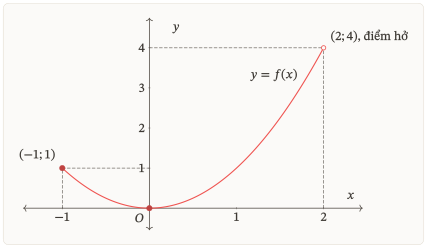
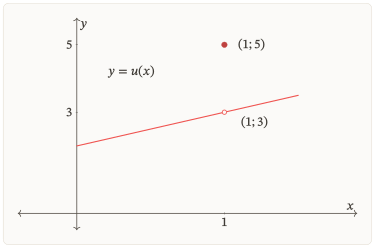
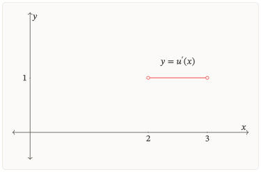

:::::::::::::::::::::::::::::::::::::::::::::::::::::::::::::::::::::::::::::::::::::::::::::::::::::::::::::::::::::::::::::::::::::::::::::::::::::::::::::::: {.zo-on-thi-package .r1-g01 .r1-g02 r1-code="R1-G02" r1-lesson-count="7" r1-title="Giá trị lớn nhất và giá trị nhỏ nhất"}
## Bắt đầu {#bat-dau}

::: {.r1-status}
Có thể học
:::

Học liệu “Giá trị lớn nhất và giá trị nhỏ nhất” thuộc chương trình [Ôn thi Toán THPT 2027](../../tot_nghiep_thpt/2027/index.qmd).

**Mục tiêu.** Học xong phần cốt lõi, em cần:

- **Đọc đúng đối tượng:** xác định đúng hàm số, tập xác định và tập đang xét.
- **Kiểm tra hai điều kiện:** phân biệt cực trị với giá trị lớn nhất, nhỏ nhất; kiểm tra so sánh và sự đạt được.
- **Tìm trên đoạn đóng:** tìm đủ điểm cần xét và so sánh các giá trị.
- **Giải thích sự tồn tại:** xác định sự tồn tại hoặc không tồn tại trên khoảng hở, tập rời và tập không bị chặn.
- **Mô hình và ràng buộc:** chọn công cụ, lập hàm mục tiêu và kiểm tra ràng buộc, đơn vị.

**Tiên quyết.** Em cần biết tính đạo hàm, đọc dấu và chiều biến thiên; phân biệt đồ thị hàm số với đồ thị đạo hàm. Khi thiếu thao tác nào, dùng đúng thẻ [Ôn nền](#on-nen) được dẫn trong bài. Ba nhiệm vụ Khởi động chỉ khảo sát một số phần nền, không kiểm hết tiên quyết hoặc mục tiêu của gói. Kiểm tra dùng để đọc bằng chứng theo mục tiêu, không phải đề mô phỏng thi.

### Cách học {#cách-học-với-tài-liệu-này}

Chuẩn bị giấy để ghi chép. Tự làm trước khi mở lời giải; em có thể chia việc học thành nhiều buổi.

#### Chọn nơi bắt đầu {#chọn-nơi-bắt-đầu}

- Nếu chưa học hoặc cần học lại chủ đề, vào [Bài học](#bai-hoc). Làm đúng các nhiệm vụ Khởi động chưa đủ để kết luận đã đạt cả gói.
- Nếu đã nắm phần học, vào [Luyện tập](#phieu-luyen). Khi vướng, xem lại đúng phần cần thiết rồi trở về đúng chỗ đang vướng.
- Nếu đã chuẩn bị kĩ lưỡng hoặc đủ tự tin, có thể thực hiện [Kiểm tra](#tu-kiem-tra). Không được chia Kiểm tra thành nhiều đợt.

#### Bản đồ học {#bản-đồ-học}

::: {data-learning-main=""}
[Bài học](#bai-hoc) → [Luyện tập](#phieu-luyen) → [Kiểm tra](#tu-kiem-tra) → [Ôn lại](#on-lai)
:::

Đây là mạch học chính. Em có thể đi tới hoặc quay lại phần cần thiết; phần bỏ qua không tự được xem là đã đạt. Ôn lại được thực hiện theo ngày đã hẹn.

Trong Bài học, Luyện tập, Ôn lại và sau khi kết thúc Kiểm tra, em có thể dùng hỗ trợ theo nhu cầu:

::: {#r1-g02-table-t08 .table-scroll}
| Khi cần                         | Nơi dùng                            | Sau đó                                                              |
| ------------------------------- | ----------------------------------- | ------------------------------------------------------------------- |
| Xem lại kiến thức đang vận dụng | Đúng đoạn trong [Bài học](#bai-hoc)             | Trở về nhiệm vụ đang vướng                                          |
| Bổ sung kiến thức nền           | Đúng tài nguyên [Ôn nền](#on-nen)              | Tự làm câu xác nhận của tài nguyên rồi trở về                       |
| Kiểm lại bài làm                | [Lời giải](#loi-giai); [Sửa lỗi](#sua-loi) nếu phát hiện lỗi | Đối chiếu, sửa và xác nhận theo chỉ dẫn của nhiệm vụ hoặc Điểm dừng |
| Lưu kết quả và việc tiếp theo   | [Nhật kí](#nhat-ky)                             | Ghi nơi sẽ tiếp tục và lịch Ôn lại khi có                           |
:::

**Trong lúc Kiểm tra, phải tự lực hoàn toàn:** không dùng Bài học, Ôn nền, Lời giải hoặc Sửa lỗi để trợ giúp bài đang làm. Nếu cần hỗ trợ, kết thúc lượt kiểm tra và giữ bài làm ban đầu trước.

#### Khi cần hỗ trợ {#g02-ho-tro-khi-can}

**Chưa biết cách làm:** nếu vướng kiến thức của gói, xem lại đúng lời giải thích hoặc ví dụ trong Bài học; nếu thiếu kiến thức nền, mở đúng tài nguyên Ôn nền. Không cần đọc lại cả gói để tiếp tục một nhiệm vụ.

**Muốn kiểm lại bài làm:** giữ bài tự làm trước khi mở Lời giải. Đối chiếu điều kiện, lập luận và kết quả. Nếu có lỗi, xác định bước sai và dùng hướng dẫn hoặc nhiệm vụ Sửa lỗi được chỉ định. Khi cần xác nhận sau hỗ trợ, tự làm nhiệm vụ phù hợp còn chưa xem đáp án; quay về đúng nhiệm vụ hoặc Điểm dừng đang vướng.

**Ở Điểm dừng:** dựa vào bài làm và tiêu chí để chọn đi tiếp hay nhận hỗ trợ. Nếu đã đáp ứng tiêu chí, không cần qua mọi nhánh hỗ trợ. Sau Kiểm tra, giữ riêng kết quả ban đầu với kết quả sau sửa.

**Đã xem đáp án hoặc không còn nhiệm vụ mới phù hợp:** dùng bài đã xem để học, không tính là bằng chứng độc lập mới. Ghi phần chưa được xác nhận và làm theo chỉ dẫn tại Điểm dừng; không tự đánh dấu đã đạt.

**Khi có quyết định hoặc kết thúc buổi học:** ghi kết quả, hỗ trợ đã dùng, nơi đang dừng và việc tiếp theo vào Nhật kí. Chỉ điền thông tin đã có; không cần ghi sau mọi thao tác. Nếu vào thẳng phần hỗ trợ, chọn nhiệm vụ hoặc hoạt động em muốn quay về.

#### Khi nào có thể chuyển sang gói tiếp theo? {#g02-chuyen-goi}

Em có thể chuyển sang gói tiếp theo khi bài làm độc lập cho thấy em đáp ứng các mục tiêu thiết yếu và các lỗi cản trở việc tiếp tục đã được kiểm tra lại sau sửa. Giữ riêng kết quả ban đầu và kết quả sau hỗ trợ; ghi phần còn hạn chế cùng ngày Ôn lại vào Nhật kí. Chọn gói tiếp theo phù hợp với kiến thức em đã có, đồng thời giữ lịch Ôn lại của gói này; không cần chờ hết các lượt ôn mới học tiếp.

Hẹn Ôn lại sau khoảng **2–3 ngày, 7 ngày và 3–4 tuần**, tính từ ngày đáp ứng các điều kiện trên. Đến ngày hẹn, tự làm nhiệm vụ của lượt Ôn lại trước khi đối chiếu. Một lượt ôn chỉ cho biết kết quả ở những nội dung được kiểm tra trong lượt đó, không có nghĩa em đã làm chủ mọi tình huống của cả chủ đề. Nếu một nội dung vừa phải sửa lại, ghi thêm ngày kiểm lại sớm nội dung ấy.

Nhánh [Chuyển giao](#chuyen-giao) chỉ dùng khi đã học nền lượng giác, mũ hoặc lôgarit tương ứng; không phải điều kiện để hoàn tất năm mục tiêu cốt lõi.

## Bài học {#bai-hoc}

::: lesson-toc
:::

:::: {#dinh-huong-bai-hoc .r1-details .r1-lesson-orientation .zo-learning-guidance}
::: {.r1-summary .zo-learning-summary}
Định hướng bài học
:::

[**Câu hỏi dẫn đường**]{#câu-hỏi-dẫn-đường .r1-orientation-label}

Khi tìm giá trị lớn nhất, giá trị nhỏ nhất trên một tập được chỉ định, em cần
trả lời hai câu hỏi:

1.  Giá trị nào không bị vượt qua trên tập đang xét?
2.  Giá trị ấy có thực sự đạt được tại một điểm thuộc tập đang xét không?

[**Học xong, em cần làm được gì?**]{#học-xong-em-cần-làm-được-gì .r1-orientation-label}

::: {#r1-g02-table-t09 .table-scroll}
| Mục tiêu | Việc em cần làm được |
|:---------|:----------------------|
| Đọc đúng đối tượng | Xác định $D$ và tập đang xét từ đầy đủ dữ kiện; phân biệt biểu thức với hàm số. |
| Kiểm tra hai điều kiện | Phân biệt cực trị với giá trị lớn nhất, nhỏ nhất; kiểm tra so sánh và sự đạt được. |
| Tìm trên đoạn đóng | Kiểm tra điều kiện, lập đủ danh sách điểm cần xét và so sánh các giá trị hàm số. |
| Giải thích sự tồn tại | Đọc công thức, bảng và đồ thị để xác định hoặc bác bỏ sự tồn tại trên khoảng hở, tập rời hoặc không bị chặn. |
| Mô hình và ràng buộc | Chọn công cụ, xác định hàm mục tiêu, tập được phép và đơn vị; kiểm tra cả ràng buộc nguyên khi có. |
| Chuyển giao có điều kiện | Dùng quy trình với hàm lượng giác, mũ hoặc lôgarit sau khi đã học tiên quyết riêng; đây không phải điều kiện để hoàn thành năm mục tiêu cốt lõi trên. |
:::

**Kiến thức cần trước:** tập xác định, khoảng đơn điệu, cực trị, dấu đạo hàm,
đọc bảng biến thiên và phân biệt đồ thị của hàm số với đồ thị của đạo hàm. Em
cũng cần tính được đạo hàm và giá trị của các hàm số quen thuộc.

[Điều kiện chuyển giao](#chuyen-giao) được ghi riêng; chưa học tiên quyết của nhánh đó không phủ nhận kết quả cốt lõi đã có bằng chứng.

[Sau Khởi động, chọn phần Bài học cần đọc; Luyện tập là phần tiếp theo khi đã nắm phần học.]{#cach-thuc-hien-su-dung-tai-lieu}
::::

### Khởi động {#bắt-đầu-từ-đâu}

:::: {#cach-thuc-hien-bat-dau .r1-details .r1-guidance .zo-learning-guidance}
::: {.r1-summary .zo-learning-summary}
Cách thực hiện
:::

1.  Tự trả lời ba câu khởi động trên giấy.
2.  Đối chiếu lời giải và xác định câu còn vướng.
3.  Dùng câu hỏi dẫn đường, mục tiêu và chỉ dẫn chọn phần cần ôn để quyết định
    điểm bắt đầu phù hợp.
::::

::: {#ba-câu-khởi-động .r1-kickoff-questions}

Hãy thử trả lời trên giấy trước khi mở lời giải. Không cần tính điểm; câu nào còn vướng sẽ chỉ ra phần cần ôn.

::::: {#g02-khoi-dong-01 .zo-learning-task .zo-learning-task--pause}
#### Nhiệm vụ 01 — Cực đại và giá trị lớn nhất {#nhiệm-vụ-01}

Hàm số $r$ liên tục trên $[-3; 4]$, biến thiên đúng như bảng. Tại $x = 2$, hàm số có giá trị cực đại bằng $1$. Có thể kết luận $1$ là giá trị lớn nhất trên đoạn này không? Giá trị lớn nhất, nhỏ nhất thực tế là bao nhiêu?

:::: table-scroll
::: {.r1-bbt bbt="BBT01" caption="Bảng biến thiên của hàm số r trên đoạn từ −3 đến 4."}
ZO BBT placeholder
:::
:::

::: answer-link
[Xem lời giải](#lg-g02-khoi-dong-01)
:::
:::::

::::: {#g02-khoi-dong-02 .zo-learning-task .zo-learning-task--pause}
#### Nhiệm vụ 02 — Tập đang xét và điểm đạt {#nhiệm-vụ-02}

Cho hàm số $f(x)=(x-2)^2$. Một bạn nhận xét: “Giá trị nhỏ nhất của $f$ trên $K=(2;5]$ bằng $0$ vì $f(2)=0$.” Nhận xét này đúng không? Vì sao?

::: answer-link
[Xem lời giải](#lg-g02-khoi-dong-02)
:::
:::::

::::: {#g02-khoi-dong-03 .zo-learning-task .zo-learning-task--pause}
#### Nhiệm vụ 03 — Đọc đúng đồ thị đạo hàm {#nhiệm-vụ-03}

Trên một hình ghi nhãn $y = f^\prime(x)$, điểm $(1; 0)$ thuộc đường biểu diễn. Có thể ghi $f(1) = 0$ không?

::: answer-link
[Xem lời giải](#lg-g02-khoi-dong-03)
:::
:::::
:::

#### Sau khi làm xong {#sau-khi-lam-xong}

Nếu chưa học một mục, đọc đúng phần giải thích trong Bài học. Nếu thiếu kiến thức nền, dùng đúng tài nguyên Ôn nền, tự làm nhiệm vụ xác nhận rồi quay về câu đang vướng. Làm đúng ba câu không có nghĩa đã đạt cả gói. Nếu đã chuẩn bị kĩ lưỡng hoặc đủ tự tin, em có thể vào Kiểm tra; sự tự tin không thay cho kết quả bài làm.

#### Chọn đúng phần cần ôn {#chọn-đúng-phần-cần-ôn}

::: {#r1-g02-table-t10 .table-scroll}
| Còn vướng | Kiến thức cần xem lại | Đi đến | Sau đó |
|:----------|:---------------------|:-------|:-------|
| Tập xác định và tập đang xét | Phân biệt quy tắc, tập xác định và tập được chỉ định | [Đối tượng đang xét](#doi-tuong); [Tập xác định](#nen-n-txd-01) | Trở về nhiệm vụ đang vướng |
| Cực trị với giá trị lớn nhất, nhỏ nhất | Kiểm tra so sánh và sự đạt được | [So sánh và sự đạt được](#dinh-nghia) | Trở về nhiệm vụ đang vướng |
| Quy trình trên đoạn đóng | Lập đủ ứng viên và so sánh giá trị | [Trên đoạn đóng](#tren-doan) | Trở về nhiệm vụ đang vướng |
| Khoảng hở hoặc tập nhiều thành phần | Kiểm tra cận, điểm hở và từng thành phần | [Các tập khác đoạn đóng](#tap-khac); [Cận](#nen-n-gh-01) | Trở về nhiệm vụ đang vướng |
| Bài toán thực tiễn | Chọn đại lượng, tập được phép và đơn vị | [Mô hình và ràng buộc](#loi-van); [Mô hình](#nen-n-mh-01) | Trở về nhiệm vụ đang vướng |
:::

### 1. Hàm số và tập đang xét {#doi-tuong}

:::: {#cach-thuc-hien-doi-tuong .r1-details .r1-guidance .zo-learning-guidance}
::: {.r1-summary .zo-learning-summary}
Cách thực hiện
:::

1.  Đọc trọn dữ kiện và xác định tập xác định $D$.
2.  Xác định tập đang xét $K$ và kiểm tra quan hệ giữa $K$ với $D$.
3.  Quyết định điểm hoặc giá trị nào được dùng trong phép so sánh trên $K$.
::::

:::: {#g02-goi-mo-01 .r1-task .zo-learning-task .zo-learning-task--pause data-zo-type="task" data-zo-task="G02-GM01" data-zo-function="function.guided_thinking" data-zo-number="1"}
[**Gợi mở 01 — Tập xác định và tập đang xét**]{.r1-task-label}

Thử trả lời trước khi đọc tiếp.

Tính được $f(2)$ có đủ để dùng $2$ làm điểm đạt trên tập $K=(2;5]$ không?

Đọc tiếp để phân biệt tập xác định, tập đang xét và điểm được phép dùng.
::::

#### 1.1. Quy tắc và tập xác định {#quy-tac-va-tap-xac-dinh}

::: {#g02-dinh-nghia-ham-so}
Để xác định một hàm số, cần biết biến số được phép nhận những giá trị nào và quy tắc gán cho mỗi giá trị ấy một giá trị duy nhất của hàm số. Tập các giá trị mà biến số được phép nhận gọi là **tập xác định $D$ của hàm số**.
:::

:::: {.zo-block .zo-block-red}
::: {.zo-block-title}
Đọc đầy đủ dữ kiện trước khi tìm $D$
:::

- Nếu đề cho hàm số có tập xác định $K$, thì $D = K$. Công thức phải có nghĩa với mọi $x \in K$.
- Nếu chỉ cho công thức và **không chỉ rõ tập xác định**, ta mới theo quy ước lấy tất cả số thực làm biểu thức có nghĩa.
::::

[Nguồn đối chiếu: Sách giáo khoa Toán 10, tập hai, bộ Kết nối tri thức với cuộc sống, bài 15, trang 6 (trang 7 của tệp PDF), phần định nghĩa và chú ý về trường hợp không chỉ rõ tập xác định.]{.zo-source-note}

#### 1.2. Ví dụ 01 — Tập xác định và điểm đạt {#trở-lại-câu-khởi-động-tính-được-f2-vì-sao-không-được-lấy-2-làm-điểm-đạt .r1-example-heading .zo-learning-example-heading}

Tính được $f(2)$ chưa chắc có điểm đạt.

Đề cho $f(x) = (x - 2)^2$ mà không giới hạn tập xác định, nên $D = \mathbb{R}$. Yêu cầu tìm giá trị nhỏ nhất trên $K = (2; 5]$ chỉ giới hạn các điểm được đưa vào so sánh.

::: {#r1-g02-table-t01 .table-scroll}
| Đối tượng cần đọc | Kết luận trong bài này |
|:------------------|:------------------------|
| Tập xác định $D$  | $\mathbb{R}$: công thức có nghĩa với mọi số thực và đề không cho giới hạn khác. |
| Tập đang xét $K$  | $(2;5]$: chỉ so sánh giá trị tại các điểm thuộc tập này. |
| Đầu mút $2$       | $2\in D$ nhưng $2\notin K$. Giá trị $f(2)=0$ có nghĩa; $2$ không được dùng làm điểm đạt trên $K$. |
| Đầu mút $5$       | $5\in K$. Giá trị $f(5)=9$ được đưa vào so sánh. |
:::

[**Cần phân biệt ba việc: thay số vào biểu thức, tính giá trị hàm số và xét điểm đạt trên $K$.**]{#bieu-thuc-va-ham-so .r1-unboxed-label}

Với $f$ ở câu khởi động, cả phép tính $(2-2)^2=0$ và kí hiệu $f(2)=0$ đều đúng. Điều bị bỏ sót là $2\notin K$.

Nếu một đề khác cho hàm số $g$ có tập xác định $(2;5]$, với $g(x)=(x-2)^2$, thì $g(2)$ không xác định. Phép thay $2$ vào biểu thức vẫn tính được $0$, nhưng không phải là giá trị của $g$ tại $2$. Cùng công thức chưa đủ để kết luận hai hàm số có cùng tập xác định.

Vì vậy, **$D$ là tập xác định của hàm số đã cho; $K$ là tập được yêu cầu xét**. Hai tập có thể trùng nhau. Nếu xét trên một phần của $D$ thì phải có $K\subseteq D$. Không tự mặc định $D$ lớn hơn $K$, cũng không tự đổi $D$ của một hàm số đã được xác định rõ.

Trước mỗi bài, hãy tự hỏi: đề đang cho tập xác định của hàm số, hay đang yêu cầu so sánh các giá trị trên một tập được chỉ định? Đọc trọn yêu cầu rồi mới quyết định $D$ và $K$.

### 2. So sánh và sự đạt được {#dinh-nghia}

:::: {#cach-thuc-hien-dinh-nghia .r1-details .r1-guidance .zo-learning-guidance}
::: {.r1-summary .zo-learning-summary}
Cách thực hiện
:::

- Kiểm tra điều kiện so sánh với mọi điểm thuộc $K$.
- Kiểm tra có điểm thuộc $K$ tại đó giá trị được đạt.
::::

:::: {#g02-goi-mo-02 .r1-task .zo-learning-task .zo-learning-task--pause data-zo-type="task" data-zo-task="G02-GM02" data-zo-function="function.guided_thinking" data-zo-number="2"}
[**Gợi mở 02 — So sánh chưa đủ để có giá trị lớn nhất**]{.r1-task-label}

Thử trả lời trước khi đọc tiếp.

Biết $f(x)\le M$ với mọi $x\in K$ đã đủ để gọi $M$ là giá trị lớn nhất trên $K$ chưa?

Định nghĩa dưới đây còn yêu cầu giá trị ấy được đạt tại một điểm thuộc $K$.
::::

#### 2.1. Giá trị lớn nhất, nhỏ nhất {#dinh-nghia-tren-tap-dang-xet}

Cho hàm số $f$ có tập xác định $D$. Với tập không rỗng $K \subseteq D$ (có thể $K = D$), số $M$ là **giá trị lớn nhất** của $f$ trên $K$ khi:

:::: {#g02-dinh-nghia-gia-tri-lon-nhat .zo-block .zo-block-red}
::: {.zo-block-title}
Giá trị lớn nhất trên một tập
:::

1.  $f(x) \le M$ với mọi $x \in K$.
2.  Có ít nhất một điểm $x_0 \in K$ sao cho $f(x_0) = M$.

Kí hiệu: $\max_{x\in K} f(x)=M$.
::::

:::: {#g02-dinh-nghia-gia-tri-nho-nhat .zo-block .zo-block-red}
::: {.zo-block-title}
Giá trị nhỏ nhất trên một tập
:::

Số $m$ là **giá trị nhỏ nhất** của $f$ trên $K$ khi:

1. $f(x) \ge m$ với mọi $x \in K$.
2. Có ít nhất một điểm $x_1 \in K$ sao cho $f(x_1) = m$.

Kí hiệu: $\min_{x\in K} f(x)=m$.
::::

[Nguồn đối chiếu: Sách giáo khoa Toán 12, tập một, bộ Kết nối tri thức với cuộc sống, bài 2, trang 15 (trang 17 của tệp PDF), phần định nghĩa.]{.zo-source-note}

Tập được yêu cầu xét là $K$; khi xét toàn bộ tập xác định thì $K=D$. Cả điều kiện so sánh và điều kiện đạt được đều phải dùng cùng tập $K$.

Hãy viết đủ: **“Giá trị lớn nhất bằng $M$, đạt tại $x=x_0$.”** Số $M$ là giá trị; $x_0$ là điểm đạt giá trị của hàm số; $(x_0;M)$ là một điểm trên đồ thị. Một giá trị lớn nhất có thể đạt tại nhiều điểm.

#### 2.2. Sự đạt được {#áp-dụng-cho-fxx-22-trên-k25}

Xét $f(x)=(x-2)^2$ trên $K=(2;5]$.

::: {#cau-hoi-bai-hoc-01 .r1-task .r1-g02-pause .zo-learning-task .zo-learning-task--pause}
[]{#nhiệm-vụ-01-1}

**Tự kiểm tra 01 — Điểm bị loại và sự đạt được.**

Không được lấy $x=2$. Vậy $0$ có thể là giá trị nhỏ nhất không? Nếu $0$ không phải giá trị nhỏ nhất, liệu có một số dương nào nhỏ nhất?

::: answer-link
[Xem lời giải](#loi-giai-bai-hoc-01)
:::
:::

#### 2.3. Cận và giá trị đạt được {#cận-chưa-chắc-là-giá-trị-đạt-được}

Nếu chỉ có $f(x) \le M$ với mọi $x \in K$, ta mới có một **cận trên**. Nếu chỉ có $f(x) \ge m$, ta có một **cận dưới**. "Bị chặn trên", "bị chặn dưới" nói về sự tồn tại của những cận như vậy; "bị chặn" nghĩa là có cả hai.

Ví dụ, trên $(0; 1)$, hàm số $f(x) = x$ có $0 < f(x) < 1$. Hàm số bị chặn nhưng không đạt $0$ hoặc $1$. Với mỗi $x \in (0; 1)$, điểm $\frac{x}{2}$ cho giá trị nhỏ hơn, còn điểm $\frac{x+1}{2}$ cho giá trị lớn hơn. Vì vậy hàm số không có cả giá trị nhỏ nhất lẫn lớn nhất trên khoảng này.

[**Không đạt một cận tùy ý chưa đủ để kết luận không có giá trị lớn nhất.**]{.r1-unboxed-label}

Hàm số hằng $f(x) = 3$ không đạt cận trên $10$, nhưng có giá trị lớn nhất bằng $3$. Muốn bác bỏ sự tồn tại, cần lập luận loại được mọi giá trị có thể là lớn nhất.

#### 2.4. Cực trị và giá trị toàn tập {#cực-trị-và-giá-trị-lớn-nhất-nhỏ-nhất}

**Nhắc lại cách nhận biết cực trị.** Xét hàm số $f$ liên tục trên một khoảng chứa $x_0$. Hàm số đạt cực đại tại $x_0$ nếu, trong một khoảng đủ nhỏ quanh $x_0$, giá trị $f(x_0)$ **lớn hơn** mọi giá trị $f(x)$ với $x\ne x_0$. Hàm số đạt cực tiểu tại $x_0$ nếu giá trị $f(x_0)$ **nhỏ hơn** mọi giá trị như vậy. Việc so sánh xét các điểm ở cả hai phía của $x_0$; bằng nhau không thỏa điều kiện lớn hơn hoặc nhỏ hơn này.

::: {#r1-g02-table-t02 .table-scroll}
| Cực đại, cực tiểu | Giá trị lớn nhất, nhỏ nhất trên $K$ |
|:------------------|:-------------------------------------|
| So sánh với các điểm đủ gần ở cả hai phía; dùng bất đẳng thức nghiêm ngặt. | So sánh với mọi điểm thuộc $K$. |
| Giá trị cực đại có thể bị một giá trị ở xa vượt qua. | Giá trị lớn nhất không bị bất cứ giá trị nào trên $K$ vượt qua. |
| Một đầu mút của tập xác định không có khoảng nhỏ quanh nó nằm trọn trong tập xác định, nên không thỏa điều kiện hai phía nêu trên. | Đầu mút thuộc $K$ có thể là nơi đạt giá trị lớn nhất hoặc nhỏ nhất. Nếu điểm đó nằm bên trong $D$, phải xét hàm số ở cả hai phía mới kết luận về cực trị. |
:::

Một điểm cực trị thuộc $K$ là một điểm cần xem xét khi tìm giá trị lớn nhất, nhỏ nhất trên $K$. Ngược lại, điểm đạt giá trị lớn nhất, nhỏ nhất chưa chắc là điểm cực trị: giá trị ấy có thể đạt tại đầu mút, hoặc bằng các giá trị ở những điểm lân cận.

::: {#cau-hoi-bai-hoc-02 .r1-task .r1-g02-pause .zo-learning-task .zo-learning-task--pause}
#### Tự kiểm tra 02 — Hàm hằng và cực trị {#nhiệm-vụ-02-1}

Cho hàm số $f(x) = 2$ có tập xác định $(0; 1)$. Hàm số có giá trị lớn nhất, nhỏ nhất không? Có điểm cực đại hoặc cực tiểu không? Hãy giải thích bằng cách so sánh giá trị tại một điểm với các giá trị ở những điểm gần nó.

::: answer-link
[Xem lời giải](#loi-giai-bai-hoc-02)
:::
:::

### 3. Tìm trên đoạn đóng {#tren-doan}

:::: {#cach-thuc-hien-tren-doan .r1-details .r1-guidance .zo-learning-guidance}
::: {.r1-summary .zo-learning-summary}
Cách thực hiện
:::

1.  Kiểm tra đoạn đang xét nằm trong tập xác định và hàm số liên tục trên đoạn.
2.  Lập đủ danh sách điểm cần xét.
3.  Tính giá trị hàm số tại từng điểm trong danh sách.
4.  So sánh các giá trị và ghi tất cả điểm đạt.
::::

:::: {#g02-goi-mo-03 .r1-task .zo-learning-task .zo-learning-task--pause data-zo-type="task" data-zo-task="G02-GM03" data-zo-function="function.guided_thinking" data-zo-number="3"}
[**Gợi mở 03 — Danh sách điểm cần so sánh**]{.r1-task-label}

Thử trả lời trước khi đọc tiếp.

Khi tìm giá trị lớn nhất, nhỏ nhất trên một đoạn, chỉ tìm nghiệm của đạo hàm có đủ không?

Hãy đối chiếu điều kiện tồn tại rồi lập đủ danh sách các điểm cần xét trong quy trình dưới đây.
::::

#### 3.1. Điều kiện tồn tại {#dieu-kien-bao-dam-ton-tai}

:::: {#g02-dinh-li-ton-tai .zo-block .zo-block-red}
::: {.zo-block-title}
Bảo đảm tồn tại
:::

Nếu $f$ liên tục trên đoạn $[a; b]$, với $a < b$, thì $f$ có cả giá trị lớn nhất và giá trị nhỏ nhất trên đoạn đó.
::::

Cần kiểm tra $[a; b] \subseteq D$ và tính liên tục trên toàn đoạn. Một hàm được cho bởi công thức đa thức trên cả đoạn thì liên tục trên đoạn ấy; với công thức phân thức phải kiểm tra mẫu khác 0 ở mọi điểm của đoạn. Liên tục ở đầu mút được xét từ phía bên trong đoạn.

Đây là **điều kiện đủ**. Nếu thiếu điều kiện, em chưa được dùng bảo đảm trên; em cũng chưa được kết luận rằng giá trị lớn nhất, nhỏ nhất không tồn tại.

::: {#cau-hoi-bai-hoc-03 .r1-task .r1-g02-pause .zo-learning-task .zo-learning-task--pause}
#### Tự kiểm tra 03 — Kiểm điều kiện liên tục {#nhiệm-vụ-03-1}

Hàm $q$ có tập xác định $[0;1]$, với $q(x)=x$ khi $0\le x<1$ và $q(1)=0$. Một bạn chỉ so sánh $q(0)=q(1)=0$ rồi kết luận giá trị lớn nhất bằng $0$. Bạn đã bỏ điều kiện nào?

::: answer-link
[Xem lời giải](#loi-giai-bai-hoc-03)
:::
:::

#### 3.2. So sánh các ứng viên {#quy-trình-so-sánh-một-danh-sách-hữu-hạn}

Giả sử $f$ liên tục trên $[a; b]$, có đạo hàm trên $(a; b)$ trừ nhiều nhất một số hữu hạn điểm, và chỉ có hữu hạn điểm bên trong đoạn thỏa $f^\prime(x) = 0$.

1.  **Lập danh sách điểm:** hai đầu mút $a, b$; các điểm thuộc $(a; b)$ mà $f^\prime(x) = 0$; các điểm thuộc $(a; b)$ mà hàm số có giá trị nhưng không có đạo hàm.
2.  **Tính giá trị của $f$** tại tất cả các điểm trong danh sách.
3.  **So sánh các giá trị**, rồi ghi giá trị lớn nhất, nhỏ nhất và tất cả điểm đạt được tìm thấy.

[Nguồn đối chiếu: Sách giáo khoa Toán 12, tập một, bộ Kết nối tri thức với cuộc sống, bài 2, trang 18 (trang 20 của tệp PDF), phần quy trình và giả thiết.]{.zo-source-note}

**Vì sao phải có ba nhóm điểm?** Giá trị lớn nhất, nhỏ nhất đã được bảo đảm tồn tại. Điểm đạt có thể là đầu mút. Nếu nằm bên trong và hàm số có đạo hàm tại đó, đạo hàm phải bằng 0; nếu không có đạo hàm, điểm ấy cần được xét riêng.

Không cần tính đạo hàm tại đầu mút để đưa đầu mút vào danh sách. Khi phương trình $f^\prime(x) = 0$ có vô số nghiệm, quy trình liệt kê hữu hạn này không áp dụng nguyên dạng. Chẳng hạn với hàm hằng, có thể kết luận ngay từ định nghĩa.

#### 3.3. Ví dụ 02 — So sánh các ứng viên {#g02-vi-du-tren-doan .zo-learning-example-heading}

Xét $a(x)=x^2-2x$ trên $[-1;3]$. Hàm số là đa thức, liên tục trên đoạn; đạo hàm $a^\prime(x)=2x-2$ tồn tại và chỉ bằng $0$ tại $x=1$ bên trong đoạn.

Danh sách cần xét gồm $-1$, $1$, $3$. Ta tính $a(-1)=3$, $a(1)=-1$, $a(3)=3$. Vì vậy giá trị nhỏ nhất là $-1$ tại $x=1$; giá trị lớn nhất là $3$, đạt tại **cả hai** điểm $x=-1$ và $x=3$.

Kiểm tra trực tiếp: $a(x)=(x-1)^2-1$ và $0\le(x-1)^2\le4$ trên đoạn. Kết luận dựa vào giá trị của hàm số, không phải điểm nào có hoành độ lớn nhất. Ví dụ đã giải này dùng để học phương pháp, không tính là bài làm độc lập của em.

#### 3.4. So sánh giá trị {#ví-dụ-làm-mẫu-so-sánh-giá-trị-không-so-sánh-hoành-độ}

:::: {.r1-self-check-example}

::: {#cau-hoi-bai-hoc-04 .r1-task .r1-g02-pause .zo-learning-task .zo-learning-task--pause}
[]{#nhiệm-vụ-04}

**Tự kiểm tra 04 — Lập đủ điểm cần so sánh.**

Cho hàm số $p(x)=x^2-4x+1$. Tìm giá trị lớn nhất, nhỏ nhất của $p$ trên đoạn $[-1;4]$.
Em sẽ đưa những điểm nào vào danh sách? Vì sao?

::: answer-link
[Xem lời giải](#loi-giai-bai-hoc-04)
:::
:::
::::

### 4. Các tập khác đoạn đóng {#tap-khac}

:::: {#cach-thuc-hien-tap-khac .r1-details .r1-guidance .zo-learning-guidance}
::: {.r1-summary .zo-learning-summary}
Cách thực hiện
:::

1.  Trở về hai điều kiện trong định nghĩa.
2.  Xét từng thành phần của $K$ và ghi các giá trị đạt được hoặc cận liên quan.
3.  Phân biệt giá trị hàm số với giới hạn và kiểm tra sự đạt được.
4.  So sánh trên toàn bộ $K$ rồi mới kết luận.
::::

:::: {#g02-goi-mo-04 .r1-task .zo-learning-task .zo-learning-task--pause data-zo-type="task" data-zo-task="G02-GM04" data-zo-function="function.guided_thinking" data-zo-number="4"}
[**Gợi mở 04 — Đầu mút có được lấy không?**]{.r1-task-label}

Thử trả lời trước khi đọc tiếp.

Nếu đổi đoạn đóng thành khoảng hở, kết quả lớn nhất, nhỏ nhất có nhất thiết được giữ nguyên không?

Các ví dụ dưới đây giữ công thức nhưng đổi tập đang xét để kiểm riêng sự đạt được.
::::

#### 4.1. Thay tập đang xét {#doc-su-dat-duoc-khi-thay-tap}

Hãy trở về hai điều kiện của định nghĩa. Bảng biến thiên hoặc đồ thị giúp thấy hướng thay đổi. Một giới hạn hữu hạn ở đầu mút hở không tự tạo ra giá trị của hàm số tại đầu mút đó. Muốn gọi một số là giá trị lớn nhất hoặc nhỏ nhất trên $K$, vẫn phải tìm được điểm thuộc $K$ tại đó hàm số đạt số ấy.

Ở bảng sau, cho rõ hàm số $F(x)=x$ có tập xác định $\mathbb{R}$. Ta giữ nguyên hàm số $F$ và lần lượt thay tập $K$ được yêu cầu xét.

::: {#r1-g02-table-t03 .table-scroll}
| Tập $K$ đang xét của $F$ | Giá trị nhỏ nhất | Giá trị lớn nhất |
|:-------------------------|:------------------|:------------------|
| Trên $[0;1]$             | $0$ tại $x=0$    | $1$ tại $x=1$    |
| Trên $[0;1)$             | $0$ tại $x=0$    | Không có          |
| Trên $(0;1]$             | Không có          | $1$ tại $x=1$    |
| Trên $(0;1)$             | Không có          | Không có          |
:::

Ví dụ, trên $K=[0;1)$, mỗi điểm $x$ luôn có một điểm $y=\frac{x+1}{2}$ thuộc cùng tập với $F(y)>F(x)$. Vì thế $F$ không có giá trị lớn nhất trên $K$. Dù $F(1)=1$ có nghĩa với hàm số đã cho trên $\mathbb{R}$, điểm $1$ không thuộc $K$ và không có điểm nào khác trong $K$ cho giá trị $1$.

Trên một tập không bị chặn, không được suy ngay rằng hàm số không có giá trị lớn nhất hoặc nhỏ nhất. Chẳng hạn $x^2$ trên $\mathbb{R}$ vẫn có giá trị nhỏ nhất bằng $0$.

[**Một điểm hở không loại luôn cả một giá trị.**]{.r1-unboxed-label}

Chẳng hạn, hàm số $q$ có tập xác định $(-1;1]$, với $q(x)=x^2$, không có giá trị $q(-1)$. Tuy nhiên, giá trị $1$ vẫn được đạt tại $x=1$ và là giá trị lớn nhất, vì $q(x)\le1$ trên toàn tập xác định. Cần kiểm tra mọi điểm có thể cho cùng tung độ, không chỉ đầu mút bị loại.

#### 4.2. Tập nhiều thành phần {#khi-k-gồm-nhiều-thành-phần-rời-nhau}

Xét trường hợp tập $K$ gồm nhiều thành phần rời nhau.

Xét từng thành phần, ghi rõ các giá trị đạt được và các cận liên quan, rồi so sánh trên **toàn bộ $K$**. Một mũi tên chỉ cho biết biến thiên trên phần mà nó biểu diễn. Không nối qua chỗ bị loại để kết luận đơn điệu trên cả tập.

Một thành phần không có giá trị lớn nhất không có nghĩa cả tập cũng không có. Chẳng hạn với $f(x) = x$ trên $[0; 1) \cup [2; 3]$, thành phần đầu không có giá trị lớn nhất, nhưng toàn tập có giá trị lớn nhất bằng 3 tại $x = 3$.

#### 4.3. Chọn công cụ {#chọn-công-cụ-từ-dữ-kiện}

- **Công thức:** dùng biến đổi, bất đẳng thức đơn giản hoặc đạo hàm; chọn cách làm ngắn mà đủ lập luận.
- **Bảng biến thiên:** đọc toàn bảng, tập đang xét, giá trị tại điểm và giới hạn. Không tự thêm dữ kiện đạo hàm nếu bảng không cho.
- **Đồ thị:** đọc nhãn, tập được biểu diễn, tung độ, điểm kín và điểm hở. Kiểm tra xem tung độ ở một điểm hở có được đạt tại điểm khác thuộc $K$ hay không. Hình phác không cho phép đoán chính xác một giá trị chưa được ghi hoặc xác định.
- **Lời văn:** xác định đại lượng cần tìm, biến số, tập giá trị được phép và đơn vị.

### 5. Mô hình và ràng buộc {#loi-van}

:::: {#cach-thuc-hien-loi-van .r1-details .r1-guidance .zo-learning-guidance}
::: {.r1-summary .zo-learning-summary}
Cách thực hiện
:::

1.  Xác định đại lượng cần tối ưu và biến số.
2.  Lập hàm mục tiêu.
3.  Ghi rõ tập giá trị được phép của biến và tìm giá trị tối ưu trên tập đó.
4.  Diễn giải kết quả cùng đơn vị trong bối cảnh bài toán.
::::

:::: {#g02-goi-mo-05 .r1-task .zo-learning-task .zo-learning-task--pause data-zo-type="task" data-zo-task="G02-GM05" data-zo-function="function.guided_thinking" data-zo-number="5"}
[**Gợi mở 05 — Giữ ràng buộc khi chọn điểm đạt**]{.r1-task-label}

Thử trả lời trước khi đọc tiếp.

Nếu biến chỉ nhận giá trị nguyên, có thể lấy ngay điểm đạt của mô hình liên tục làm đáp án không?

Phần tiếp theo phân biệt đại lượng cần tối ưu với miền giá trị được phép chọn.
::::

#### 5.1. Đại lượng và ràng buộc {#dai-luong-ham-muc-tieu-rang-buoc}

Trong gói này, công thức doanh thu và chi phí đã được cung cấp. Em cần lập đúng hàm lợi nhuận, xác định tập đang xét rồi tìm và diễn giải giá trị lớn nhất.

$$P(x) = R(x) - C(x)$$

[Lợi nhuận = doanh thu $-$ tổng chi phí.]{.caption}

Nếu đề cho **chi phí bình quân cho một sản phẩm** là $G(x)$, thì tổng chi phí là $C(x) = xG(x)$, không phải $G(x)$.

Đọc kĩ $x$ là lượng đo có thể nhận giá trị thực hay số sản phẩm phải nguyên. Nếu chỉ nhận giá trị nguyên, hàm lợi nhuận của bài toán được xét trên tập các số nguyên được phép. Có thể dùng một **hàm phụ nhận biến thực** có cùng công thức để tìm ứng viên, nhưng phải gọi rõ đó là hàm phụ. Khi hàm phụ tăng rồi giảm và đỉnh nằm giữa hai số nguyên liên tiếp được phép, so sánh hai số ấy; không dùng việc làm tròn như một quy tắc chung.

::: {#cau-hoi-bai-hoc-05 .r1-task .r1-g02-pause .zo-learning-task .zo-learning-task--pause}
#### Tự kiểm tra 05 — Chọn trong miền nguyên {#nhiệm-vụ-05}

Một hàm $P$ tăng đến $x=2{,}2$ rồi giảm. Chỉ được chọn $x=2$ hoặc $x=3$, với $P(2)=8$ và $P(3)=9{,}2$. Chọn số nguyên gần $2{,}2$ nhất có cho giá trị lớn nhất không?

::: answer-link
[Xem lời giải](#loi-giai-bai-hoc-05)
:::
:::

#### 5.2. Phạm vi vận dụng {#pham-vi-van-dung}

[**Chỗ dừng của gói.**]{.r1-unboxed-label}

Chưa tự xây dựng mô hình hình học nhiều bước, chưa xử lí nhiều ràng buộc hoặc phân loại tham số. Những việc đó dành cho gói bài toán tối ưu và phần vận dụng tiếp theo.

### Khép lại bài học {#khép-lại-bài-học}

Gói về tiệm cận sẽ làm rõ hơn hành vi của đồ thị khi biến tiến đến một điểm bị loại hoặc ra vô cực. Gói bài toán tối ưu sẽ yêu cầu tự chọn biến, xây dựng hàm mục tiêu và xác định các ràng buộc. Nền em mang theo là: **xét đúng tập, kiểm tra sự đạt được và giải thích kết quả trong bối cảnh**.

## Luyện tập {#phieu-luyen}

Luyện tập gồm ba chặng, mỗi chặng có một Điểm dừng. Tự làm theo thứ tự nhiệm vụ trong từng chặng trước khi đối chiếu. Với mỗi bài, ghi tập đang xét, căn cứ kết luận, giá trị và mọi điểm đạt. Hai bài chuyển giao lượng giác, mũ–lôgarit thuộc nhánh riêng sau phần cốt lõi; thiếu nền của nhánh ấy không làm mất kết quả cốt lõi đã có bằng chứng.

:::: {#lo-trinh-hoc .r1-learning-stages}
**Ba chặng Luyện tập**

::: {#r1-g02-table-t11 .table-scroll}
| Chặng | Việc cần làm được | Bài và nơi đối chiếu |
|---|---|---|
| Đúng đối tượng và tìm đủ trên đoạn | Phân biệt tập xác định với tập đang xét; tìm đủ ứng viên và mọi điểm đạt | [Luyện tập 01–03](#l01); [Điểm dừng chặng 1 của Luyện tập](#cp-lt1) |
| Sự tồn tại trên tập khác đoạn đóng | Xét đủ thành phần; phân biệt cận với giá trị được đạt; giải thích tồn tại hoặc không tồn tại | [Luyện tập 04–07](#l03); [Điểm dừng chặng 2 của Luyện tập](#cp-lt2) |
| Chọn mô hình và xử lí ràng buộc | Lập đúng hàm mục tiêu, giữ đơn vị và kiểm tra ràng buộc thực hoặc nguyên | [Luyện tập 08–09](#l05); [Điểm dừng chặng 3 của Luyện tập](#cp-lt3) |
:::
::::

:::: {#cach-thuc-hien-luyen-tap .r1-details .r1-guidance .zo-learning-guidance}
::: {.r1-summary .zo-learning-summary}
Cách thực hiện
:::

- Làm theo ba chặng dưới đây; nếu đã có bài làm phù hợp, dùng tiêu chí tại Điểm dừng để chọn nơi tiếp tục.
- Với mỗi bài, ghi tập đang xét, căn cứ kết luận, giá trị và mọi điểm đạt.
- Chỉ mở gợi ý khi đã thử nhưng chưa tìm được hướng tiếp tục.
- Chỉ mở lời giải của bài đã hoàn thành hoặc cần đối chiếu sau khi tự làm.
::::

### Chặng 1 — Đúng đối tượng và tìm đủ trên đoạn {#g02-c1}

**Khi cần xem lại:** [Đối tượng và tập đang xét](#doi-tuong), [Giá trị và sự đạt được](#dinh-nghia), [Quy trình trên đoạn](#tren-doan). Chỉ xem lại đúng phần đang vướng, rồi trở về nhiệm vụ đang làm; không học và luyện xen kẽ theo từng mục.

**Bằng chứng cần giữ:** tập xác định và tập đang xét; danh sách ứng viên đủ đầu mút, nghiệm đạo hàm và điểm không có đạo hàm; giá trị cùng mọi điểm đạt. Tự làm ba bài sau trước khi mở lời giải.

::::::::: {#l01 .r1-task .zo-learning-task .zo-learning-task--item}
### Nhiệm vụ 01 – Cực đại có phải lớn nhất? {#bài-luyện-tập-01.-cực-đại-có-phải-lớn-nhất}

Cho hàm số $f(x) = x^3 - 3x$. Thực hiện các yêu cầu sau trên đoạn $[-2; 3]$.

1.  Xác định các cực trị bên trong đoạn.
2.  Tìm giá trị lớn nhất, nhỏ nhất trên đoạn, ghi mọi điểm đạt.
3.  Bác bỏ nhận xét: "Giá trị cực đại bằng 2 nên giá trị lớn nhất bằng 2."

:::: {.r1-details .r1-guidance .zo-learning-hint}
::: {.r1-summary .zo-learning-summary}
Cần một gợi ý?
:::

Lập đủ danh sách hai đầu mút và các nghiệm đạo hàm thuộc bên trong đoạn. Đừng chọn chỉ một điểm nếu nhiều điểm cho cùng giá trị.
::::

::: answer-link
[Xem lời giải](#loi-giai-l01)
:::
:::::::::

:::::::: {#l02 .r1-task .zo-learning-task .zo-learning-task--item}
### Nhiệm vụ 02 – Một điểm không có đạo hàm {#bài-luyện-tập-02.-một-điểm-không-có-đạo-hàm}

Cho hàm số $g(x)=\lvert x+2\rvert$. Tìm giá trị lớn nhất, nhỏ nhất của $g$ trên đoạn $[-4;1]$. Một bạn không tìm thấy nghiệm $g^\prime(x)=0$ nên chỉ so sánh hai đầu mút. Hãy chỉ ra điểm bị bỏ và kiểm tra kết quả bằng ý nghĩa khoảng cách.

:::: {.r1-details .r1-guidance .zo-learning-hint}
::: {.r1-summary .zo-learning-summary}
Cần một gợi ý?
:::

Điểm đổi công thức của dấu giá trị tuyệt đối có thuộc đoạn không? Hàm số có giá trị và có đạo hàm tại đó không?
::::

::: answer-link
[Xem lời giải](#loi-giai-l02)
:::
::::::::

:::::: {#l10 .r1-task .zo-learning-task .zo-learning-task--item}
### Nhiệm vụ 03 – Chọn cách so sánh trực tiếp {#bài-luyện-tập-10.-chọn-cách-so-sánh-trực-tiếp}

Cho $s(x)=\sqrt{4-(x-1)^2}$. Xác định $D$, rồi tìm giá trị lớn nhất, nhỏ nhất của $s$ trên $K=[0;3]$. Có cần tính đạo hàm không? Ghi tất cả điểm đạt thuộc $K$.

::: answer-link
[Xem lời giải](#loi-giai-l10)
:::
::::::

### Điểm dừng {#cp-lt1}

1. Giữ nguyên bài làm [Nhiệm vụ 01](#l01), [Nhiệm vụ 02](#l02) và [Nhiệm vụ 03](#l10), ghi mức hỗ trợ của từng bài.
2. Đối chiếu lời giải: nhiệm vụ 01 không lấy cực đại thay cho lớn nhất, giữ đủ mọi điểm đạt; nhiệm vụ 02 xét điểm gãy; nhiệm vụ 03 phân biệt tập xác định với tập đang xét và chọn so sánh trực tiếp.
3. Ghi riêng mục tiêu đã có bằng chứng, còn sai và chưa đủ bằng chứng.
4. Quên ứng viên hoặc nhầm toàn đoạn đi [Nhiệm vụ 01](#s00); nhầm tập đi [Nhiệm vụ 02](#s01); bỏ điểm gãy đi [Nhiệm vụ 03](#s02).
5. Thiếu tiên quyết đi [Tập xác định](#nen-n-txd-01), [Đạo hàm đa thức](#nen-n-dh-01), [Liên tục và điểm ghép](#nen-n-lt-01) hoặc [Đọc nhãn đồ thị](#nen-n-dt-01) theo đúng nguyên nhân. Làm câu mới chưa lộ trước khi xác nhận; câu đã xem lời giải chỉ nối lại việc học.
6. Có đủ bằng chứng các điều kiện trên thì sang [Chặng 2](#g02-c2); chưa đủ thì xử lí đúng phần còn vướng, không dùng tổng số câu đúng để quyết định. [Ghi Nhật kí](#nhat-ky) khi cần lưu quyết định, nơi tiếp tục hoặc kết thúc buổi học; bài làm và kết quả đối chiếu có thể giữ ngay trên giấy đang dùng.

### Chặng 2 — Sự tồn tại trên tập khác đoạn đóng {#g02-c2}

**Khi cần xem lại:** [Đổi tập đang xét](#tap-khac). **Bằng chứng cần giữ:** xét đủ từng thành phần; phân biệt cận với giá trị được đạt; chứng minh trường hợp không tồn tại thay vì chỉ chỉ vào điểm hở hoặc vô cực. Tự làm bốn bài sau.

:::::::: {#l03 .r1-task .zo-learning-task .zo-learning-task--item}
### Nhiệm vụ 04 – Tập không bị chặn, hàm vẫn bị chặn {#bài-luyện-tập-03.-tập-không-bị-chặn-hàm-vẫn-bị-chặn}

Xét $h(x)=\frac{1}{1+x^2}$ trên $\mathbb{R}$. Tìm giá trị lớn nhất. Hàm số có giá trị nhỏ nhất không? Không dùng riêng câu “vì $x$ tiến ra vô cực” thay cho lập luận về sự đạt được.

:::: {.r1-details .r1-guidance .zo-learning-hint}
::: {.r1-summary .zo-learning-summary}
Cần một gợi ý?
:::

Muốn chứng minh không có giá trị nhỏ nhất, thử tạo một điểm mới cho mẫu số lớn hơn mẫu số tại điểm đang xét.
::::

::: answer-link
[Xem lời giải](#loi-giai-l03)
:::
::::::::

:::::: {#l04 .r1-task .zo-learning-task .zo-learning-task--item}
### Nhiệm vụ 05 – Hai thành phần đều cần được xét {#bài-luyện-tập-04.-hai-thành-phần-đều-cần-được-xét}

Cho hàm số $f(x)=x$. Tìm giá trị lớn nhất, nhỏ nhất của $f$ trên $K=[-2;-1]\cup(0;1)$, nếu có. Giải thích vì sao chỉ xét đoạn $[-2;-1]$ là chưa đủ.

::: answer-link
[Xem lời giải](#loi-giai-l04)
:::
::::::

:::::::: {#l06 .r1-task .zo-learning-task .zo-learning-task--item}
### Nhiệm vụ 06 – Đọc giá trị và sự đạt được trên đồ thị {#bài-luyện-tập-06.-đọc-giá-trị-và-sự-đạt-được-trên-đồ-thị}

Cho hàm số $f$ có tập xác định $\mathbb{R}$. Hình dưới chỉ biểu diễn phần đồ thị ứng với $K=[-1;2)$. Hãy đọc hình để trả lời hai câu đầu, rồi mới mở công thức để kiểm tra.

:::: {.r1-figure r1-id="fig-r1-g02-do-thi-01"}
{loading="lazy"}

::: r1-figcaption
Hình 01 — Đồ thị của $f$ trên $K=[-1;2)$. Điểm kín thuộc đồ thị đang xét; điểm hở chỉ vị trí bị loại.
:::
::::

1.  Tìm giá trị nhỏ nhất trên $K$ và tọa độ điểm trên đồ thị tương ứng.
2.  Có giá trị lớn nhất trên $K$ không? Giải thích vai trò của điểm hở $(2;4)$.
3.  Sau khi trả lời từ hình, mở công thức và kiểm tra lại kết quả.

::: answer-link
[Xem công thức để kiểm tra](#loi-giai-l06-cong-thuc)
:::

::: answer-link
[Xem lời giải](#loi-giai-l06)
:::
::::::::

:::::: {#l09 .r1-task .zo-learning-task .zo-learning-task--item}
### Nhiệm vụ 07 – Nghiệm đạo hàm nào được giữ lại? {#bài-luyện-tập-09.-nghiệm-đạo-hàm-nào-được-giữ-lại}

Cho $f(x)=\frac{(x-3)^2}{x+1}$. Xác định tập xác định $D$, rồi tìm giá trị lớn nhất, nhỏ nhất trên $K=(-1;+\infty)$, nếu có. Dùng đạo hàm và kiểm tra kết quả bằng một cách khác. Khi loại một nghiệm đạo hàm, hãy nói rõ điểm đó nằm ngoài $D$ hay chỉ nằm ngoài $K$.

::: answer-link
[Xem lời giải](#loi-giai-l09)
:::
::::::

### Điểm dừng {#cp-lt2}

1. Giữ bài làm [Nhiệm vụ 04](#l03), [Nhiệm vụ 05](#l04), [Nhiệm vụ 06](#l06), [Nhiệm vụ 07](#l09) và mức hỗ trợ.
2. Đối chiếu: tập không bị chặn chưa quyết định kết quả; mọi thành phần phải được xét; điểm hở không cho giá trị đạt tại điểm ấy; nghiệm đạo hàm chỉ được giữ khi thuộc tập đang xét.
3. Ghi mục tiêu đã đạt, còn sai, chưa đủ bằng chứng; không chấm đạt từ đáp số đúng do nhớ.
4. Nhầm tập/cận đi [Nhiệm vụ 02](#s01); bỏ thành phần đi [Nhiệm vụ 04](#s03); nhầm nhãn đi [Xác nhận nền đọc đồ thị](#g02-nen-do-thi-xac-nhan) nếu chưa lộ; dùng định lí sai điều kiện đi [Nhiệm vụ 06](#s05).
5. Thiếu nền chọn [Tập xác định](#nen-n-txd-01), [Liên tục](#nen-n-lt-01), [Cận và sự đạt được](#nen-n-gh-01) hoặc [Đồ thị](#nen-n-dt-01). Một nhiệm vụ chưa lộ, làm độc lập và phù hợp với lỗi đang xét đủ để xác nhận phần đó; không bắt buộc làm thêm một nhiệm vụ chỉ để đủ lượt. Không dùng bài cũ đã xem lời giải làm phép đo mới.
6. Sau hỗ trợ, quay về điểm này. Khi có lập luận độc lập cho các mục tiêu trên, tiếp tục [Chặng 3](#g02-c3). Nếu còn vướng, xử lí phần phụ thuộc; em vẫn có thể học mục tiêu khác độc lập hoặc bắt đầu Kiểm tra khi đã chuẩn bị kĩ lưỡng hoặc đủ tự tin. [Ghi Nhật kí](#nhat-ky) khi cần lưu quyết định, nơi tiếp tục hoặc kết thúc buổi học; bài làm và kết quả đối chiếu có thể giữ ngay trên giấy đang dùng.

### Chặng 3 — Chọn mô hình và xử lí ràng buộc {#g02-c3}

**Khi cần xem lại:** [Bài toán có lời văn](#loi-van). **Bằng chứng cần giữ:** hàm mục tiêu đúng, tập giá trị thực hoặc nguyên đúng, cách chọn ứng viên và kết luận có đơn vị. Tự làm hai bài sau.

::::::::: {#l05 .r1-task .zo-learning-task .zo-learning-task--item}
### Nhiệm vụ 08 – Từ doanh thu đến lợi nhuận {#bài-luyện-tập-05.-từ-doanh-thu-đến-lợi-nhuận}

Một cơ sở điều chỉnh lượng sản phẩm $x$ (tấn), với $1\le x\le10$; $x$ nhận giá trị thực. Doanh thu và tổng chi phí, cùng tính bằng triệu đồng, theo mô hình:

$$
\begin{aligned}
R(x)&=30x,\\
C(x)&=\frac{x^3}{4}+3x+12.
\end{aligned}
$$

Lập hàm lợi nhuận và tìm lượng sản phẩm cho lợi nhuận lớn nhất theo mô hình. Ghi cả lợi nhuận và đơn vị. Đối chiếu kết quả bằng biến đổi đại số.

:::: {.r1-details .r1-guidance .zo-learning-hint}
::: {.r1-summary .zo-learning-summary}
Cần một gợi ý?
:::

Hàm cần tối đa là lợi nhuận. Sau khi lập hàm, em đã trở về bài toán trên một đoạn đóng.
::::

::: answer-link
[Xem lời giải](#loi-giai-l05)
:::
:::::::::

:::::::: {#l11 .r1-task .zo-learning-task .zo-learning-task--item}
### Nhiệm vụ 09 – Chi phí bình quân và ràng buộc nguyên {#bài-luyện-tập-11.-chi-phí-bình-quân-và-ràng-buộc-nguyên}

Một cơ sở có thể sản xuất $x$ sản phẩm trong một ca, với

$$
x\in\{1;2;\ldots;12\}.
$$

Doanh thu là $R(x)=40x$ nghìn đồng. Chi phí bình quân cho một sản phẩm là

$$
G(x)=2x+9+\frac{30}{x}
$$

nghìn đồng trên một sản phẩm.

1.  Lập tổng chi phí và hàm lợi nhuận.
2.  Tìm số sản phẩm cho lợi nhuận lớn nhất.
3.  Ghi mức lợi nhuận lớn nhất và đơn vị.
4.  Giải thích vì sao không được lấy số nguyên bằng cách làm tròn máy móc điểm cực đại của hàm phụ biến thực.

::: answer-link
[Xem lời giải](#loi-giai-l11)
:::
::::::::

### Điểm dừng {#cp-lt3}

1. Giữ bài làm [Nhiệm vụ 08](#l05), [Nhiệm vụ 09](#l11) cùng mức hỗ trợ.
2. Đối chiếu: lập lợi nhuận từ doanh thu và tổng chi phí; đổi chi phí bình quân thành tổng chi phí; tối ưu trên đúng tập; so sánh ứng viên nguyên, không chỉ làm tròn; kết luận đủ lượng, giá trị, đơn vị.
3. Tách lỗi lập mô hình khỏi lỗi tối ưu và lỗi đơn vị; ghi rõ phần chưa đủ bằng chứng.
4. Sai mô hình hoặc ràng buộc đi [Nhiệm vụ 05](#s04).
5. Thiếu nền chọn [Hàm mục tiêu và đơn vị](#nen-n-mh-01) hoặc [Ứng viên nguyên](#nen-n-nguyen-01). Sau nền, tự làm nhiệm vụ mới chưa lộ rồi quay lại điểm này.
6. Khi đã chuẩn bị kĩ hoặc đủ tự tin, em có thể bắt đầu [Kiểm tra](#tu-kiem-tra). Nếu còn vướng, xem lại đúng phần Bài học, Ôn nền hoặc Sửa lỗi trước; quyết định làm Kiểm tra không có nghĩa là đã đạt mục tiêu. [Ghi Nhật kí](#nhat-ky) khi cần lưu quyết định, nơi tiếp tục hoặc kết thúc buổi học; bài làm và kết quả đối chiếu có thể giữ ngay trên giấy đang dùng.

### Chuyển giao có điều kiện {#chuyen-giao}

Chỉ mở khi phần cốt lõi đã vững và em có nền đạo hàm tương ứng. Hai bài dưới kiểm tra khả năng chuyển giao sang họ hàm khác; đây không phải chặng cốt lõi thứ tư.

:::::: {#l07 .r1-task .zo-learning-task .zo-learning-task--item}
#### Nhiệm vụ 01 – Hàm lượng giác {#bài-luyện-tập-07.-kiểm-tra-chuyển-giao-hàm-lượng-giác}

Làm ở một lượt riêng, chưa xem lời giải. Cần nêu điều kiện, xét đủ điểm và giải thích kết quả. Nếu chưa làm được, ôn cách tính và xét dấu đạo hàm lượng giác rồi thử lại bằng [Nhiệm vụ 03](#thu-lai-chuyen-giao).

Cho hàm số $f(x)=2\sin x-x$. Tìm giá trị lớn nhất, nhỏ nhất của $f$ trên đoạn $\left[0;\frac{\pi}{2}\right]$. Góc đo bằng radian. Hãy dùng dấu đạo hàm để giải thích điểm bên trong nào cần xét.

::: answer-link
[Xem lời giải](#loi-giai-l07)
:::
::::::

:::::: {#l08 .r1-task .zo-learning-task .zo-learning-task--item}
#### Nhiệm vụ 02 – Hàm mũ và lôgarit {#bài-luyện-tập-08.-chuyển-giao-hàm-mũ-và-lôgarit}

[Chỉ làm khi đã có nền đạo hàm tương ứng]{.pill}

Cho hai hàm số $u(x)=x^2e^{-x}$ và $v(x)=\frac{\ln x}{x}$. Tìm giá trị lớn nhất, nhỏ nhất: (a) của $u$ trên đoạn $[0;4]$; (b) của $v$ trên đoạn $[1;e^2]$.

::: answer-link
[Xem lời giải](#loi-giai-l08)
:::
::::::

#### Điểm dừng {#cp-p}

Giữ kết quả từng họ hàm và mức hỗ trợ riêng. Đạt khi điều kiện, đạo hàm, danh sách ứng viên, giá trị và điểm đạt đều đúng. Thiếu nền lượng giác dùng [Đạo hàm lượng giác](#nen-n-dh-02); thiếu nền mũ–lôgarit dùng [Đạo hàm mũ và lôgarit](#nen-n-dh-03). Sau hỗ trợ chọn [Nhiệm vụ 03](#thu-lai-chuyen-giao) chưa lộ cho lượng giác hoặc [Nhiệm vụ 04](#s-p02) chưa lộ cho lôgarit, rồi quay về điểm này. Nhiệm vụ 04 không xác nhận nhánh mũ; nếu bài mũ đã lộ và chưa có bằng chứng phù hợp, ghi nhánh mũ chưa xác nhận, ôn đúng nền rồi tiếp tục phần không phụ thuộc.

Nếu đã xem cả bài chuyển giao và bài thử lại, ngân hàng hiện tại không còn phép đo mới cho nhánh đó. Ghi “chưa đủ bằng chứng mới”, quay lại đúng bước [lập ứng viên](#tren-doan) hoặc nền tương ứng; không tự lấy bài đã lộ làm xác nhận. Kết quả nhánh này không hạ kết quả cốt lõi chỉ vì thiếu tiên quyết của một họ hàm.

Tiếp tục lịch [Ôn lại](#on-lai) của phần cốt lõi. [Ghi Nhật kí](#nhat-ky) khi cần lưu quyết định, nơi tiếp tục hoặc kết thúc buổi học; không cần mở Nhật kí chỉ để đi tiếp.

## Kiểm tra {#tu-kiem-tra}

Nếu đã chuẩn bị kĩ lưỡng hoặc đủ tự tin, em có thể làm Kiểm tra. Làm trọn lượt, không chia thành nhiều đợt.

**Trong lúc Kiểm tra, phải tự lực hoàn toàn:** đóng Bài học, Luyện tập, Ôn nền, Lời giải và Sửa lỗi. Nếu cần hỗ trợ, kết thúc lượt kiểm tra và giữ bài làm ban đầu trước; ghi riêng kết quả sau hỗ trợ, không tính là bài kiểm tra độc lập ban đầu.

Đáp số đúng cần đi cùng tập đang xét, lí do tồn tại hoặc không tồn tại, và điểm đạt nếu có. Đây là kiểm tra mục tiêu của gói, không phải đề mô phỏng thi.

:::: {#cach-thuc-hien-kiem-tra .r1-details .r1-guidance .zo-learning-guidance}
::: {.r1-summary .zo-learning-summary}
Cách thực hiện
:::

Làm năm nhiệm vụ độc lập trên giấy, trong một lượt đã chuẩn bị. Ghi
cả kết luận, tập đang xét và căn cứ cho sự tồn tại hoặc không tồn tại. Chỉ mở
hướng dẫn chấm sau khi đã hoàn thành lượt làm ban đầu.
::::

:::::: {#kt01 .r1-task .zo-learning-task .zo-learning-task--item}
### Nhiệm vụ 01 – Đọc đồ thị trên tập được chỉ định {#bài-kiểm-tra-01.-đọc-đồ-thị-trên-tập-được-chỉ-định}

Hàm số $g$ có tập xác định $\mathbb{R}$ và $g(1)=3$. Hình dưới chỉ biểu diễn phần đồ thị ứng với $K=(1;3]$.

:::: {.r1-figure r1-id="fig-r1-g02-do-thi-02"}
![Đồ thị nghịch biến của $g$ trên $K=(1;3]$, gồm điểm hở tại $x=1$ và điểm kín tại $x=3$.](giao_dien/assets/figures_0_4/do_thi_02.svg){loading="lazy"}

::: r1-figcaption
Hình 02 — Phần đồ thị của $g$ trên $K=(1;3]$; các tọa độ được ghi chính xác và hàm nghịch biến trên $K$.
:::
::::

Từ hình, tìm giá trị lớn nhất, nhỏ nhất của $g$ trên $K$, nếu có. Một bạn nói: “$g(1)=3$ nên giá trị lớn nhất trên $K$ bằng $3$.” Hãy chỉ ra chỗ sai và giải thích ý nghĩa của điểm hở $(1;3)$.

::: answer-link
[Xem lời giải](#loi-giai-kt01)
:::
::::::

:::::: {#kt02 .r1-task .zo-learning-task .zo-learning-task--item}
### Nhiệm vụ 02 – Có thể đạt tại nhiều điểm {#bài-kiểm-tra-02.-có-thể-đạt-tại-nhiều-điểm}

Cho hàm số $h(x) = x^3 - 3x^2 + 1$. Dùng đạo hàm tìm giá trị lớn nhất, nhỏ nhất của h trên đoạn $[-1; 3]$; ghi tất cả điểm đạt trên đoạn này. Kiểm tra bằng dấu của $h(x) - 1$ và $h(x) + 3$.

::: answer-link
[Xem lời giải](#loi-giai-kt02)
:::
::::::

::::::: {#kt03 .r1-task .zo-learning-task .zo-learning-task--item}
### Nhiệm vụ 03 – Đọc toàn bảng {#bài-kiểm-tra-03.-đọc-toàn-bảng}

Hàm số $f$ có tập xác định $K=[-3;-1]\cup(0;2]$ và liên tục trên từng thành phần của $K$. Chiều biến thiên và các giá trị được cho trong bảng. Số $0$ ở hàng $f(x)$ là giới hạn khi $x$ tiến đến $0$ từ bên phải, không phải giá trị $f(0)$, vì $0$ không thuộc tập xác định.

:::: table-scroll
::: {.r1-bbt bbt="BBT04" caption="Bảng biến thiên trên tập gồm đoạn từ −3 đến −1 và khoảng nửa kín từ 0 đến 2; số 0 ở hàng giá trị hàm số là giới hạn bên phải."}
ZO BBT placeholder
:::
:::

Tìm giá trị lớn nhất, nhỏ nhất nếu có. Giải thích vì sao chỉ lấy số nhỏ nhất trong các số ghi ở bảng có thể sai.

**Thêm một tập đang xét:** Với $h(x)=(x+1)^2$, tìm giá trị lớn nhất, nhỏ nhất trên $(-\infty;0]$, nếu có. Giải thích vì sao tập không bị chặn chưa quyết định câu trả lời.

::: answer-link
[Xem lời giải](#loi-giai-kt03)
:::
:::::::

::::::: {#kt04 .r1-task .zo-learning-task .zo-learning-task--item}
### Nhiệm vụ 04 – Biến nhận giá trị nguyên {#bài-kiểm-tra-04.-biến-nhận-giá-trị-nguyên}

Một xưởng làm $x$ sản phẩm, $x\in\{1;2;\ldots;20\}$. Doanh thu là $R(x)=72x$ nghìn đồng. Chi phí bình quân cho một sản phẩm là $G(x)=2x+10+\frac{50}{x}$ nghìn đồng/sản phẩm.

Lập hàm lợi nhuận; xác định số sản phẩm cho lợi nhuận lớn nhất và mức lợi nhuận đó. Giải thích cách xử lí ràng buộc $x$ nguyên.

::: answer-link
[Xem lời giải](#loi-giai-kt04)
:::
:::::::

:::::: {#kt05 .r1-task .zo-learning-task .zo-learning-task--item}
### Nhiệm vụ 05 – Phản biện lời giải dùng đạo hàm {#bài-kiểm-tra-05.-phản-biện-lời-giải-dùng-đạo-hàm}

Cho hàm số $u(x)=2-\lvert x-1\rvert$. Khi tìm giá trị lớn nhất, nhỏ nhất của $u$ trên đoạn $[-2;3]$, một bạn viết: “Phương trình $u^\prime(x)=0$ không có nghiệm; so sánh $u(-2)=-1$ và $u(3)=0$, nên giá trị lớn nhất bằng $0$.” Hãy chỉ ra bước sai và giải lại.

::: answer-link
[Xem lời giải](#loi-giai-kt05)
:::
::::::

### Điểm dừng {#cp-kt}

1. Giữ năm bài làm ban đầu; chỉ đối chiếu sau khi kết thúc lượt kiểm tra. Ghi riêng bài tự lực và kết quả sau hỗ trợ.
2. [Đọc kết quả](#đọc-kết-quả-tự-kiểm-tra) theo mục tiêu: bài 01 kiểm tập và sự đạt được; bài 02, 05 kiểm danh sách ứng viên; bài 03 kiểm toàn tập và tồn tại; bài 04 kiểm mô hình, số nguyên và đơn vị.
3. Ghi mục tiêu đã đạt, còn sai, chưa đủ bằng chứng; không dùng tổng số câu đúng để che lỗi thiết yếu.
4. Nếu phát hiện lỗi, chọn đúng nhiệm vụ trong [Sửa lỗi sau Kiểm tra](#sua-loi-sau-kiem-tra) theo biểu hiện thực tế; nếu thiếu tiên quyết thì dùng [Ôn nền](#on-nen) đúng phần trước.
5. Khi cần xác nhận sau sửa, tự làm bài phù hợp chưa lộ, đối chiếu tiêu chí rồi quay về điểm này. Không lấy bài Kiểm tra đã xem lời giải làm bằng chứng mới. Nếu đã đủ tiêu chí, giữ kết quả; không cần làm thêm bài Sửa lỗi.
6. Chỉ lên lịch [Ôn lại](#on-lai) khi mục tiêu cốt lõi có bằng chứng độc lập và lỗi chặn đã được xử lí. Nhánh [Chuyển giao](#chuyen-giao) được ghi riêng. [Ghi Nhật kí](#nhat-ky) khi cần lưu quyết định, nơi tiếp tục hoặc kết thúc buổi học; giữ riêng bài làm ban đầu và kết quả sau hỗ trợ trên giấy đang dùng.

### Đọc kết quả {#đọc-kết-quả-tự-kiểm-tra}

::: {#r1-g02-table-t12 .table-scroll}
| Mục tiêu | Các bằng chứng cần xem | Cách ghi kết quả |
|---|---|---|
| Đọc đúng đối tượng | [Kiểm tra 01](#kt01): xác định D, K và ý nghĩa của giá trị tại mốc | Phân biệt điểm của tập xác định với điểm được dùng để so sánh trên K |
| Kiểm tra hai điều kiện | [Kiểm tra 01](#kt01): so sánh và sự đạt được | Không đồng nhất cận với giá trị được đạt trên tập đang xét |
| Tìm trên đoạn đóng | [Kiểm tra 02](#kt02), [05](#kt05): ứng viên và phép kiểm tra độc lập | Xét đủ đầu mút, điểm dừng và điểm không có đạo hàm; ghi mọi điểm đạt |
| Giải thích sự tồn tại | [Kiểm tra 01](#kt01), cả hai ý của [03](#kt03) | Xét toàn tập; giải thích tồn tại hoặc không tồn tại thay vì chỉ ghi đáp số |
| Mô hình và ràng buộc | [Kiểm tra 04](#kt04): hàm lợi nhuận, số nguyên và đơn vị | Giữ ràng buộc của biến; so sánh ứng viên được phép và diễn giải kết quả |
:::

Khả năng chuyển giao được ghi riêng từ [nhánh Chuyển giao](#chuyen-giao), không suy ra từ kết quả cốt lõi. Mục tiêu còn vướng thì chọn đúng [Sửa lỗi sau Kiểm tra](#sua-loi-sau-kiem-tra) hoặc [Ôn nền](#on-nen), chỉ sau khi lượt kiểm tra đã kết thúc. Giữ bài làm ban đầu riêng; nếu hết câu phù hợp chưa lộ, ghi “chưa xác nhận” và trở về [Điểm dừng](#cp-kt), không dùng tổng số câu đúng để che lỗi thiết yếu.

## Ôn lại {#on-lai}

Đến mỗi lượt, đóng tài liệu và tự nhắc: **Đang xét trên tập nào? Đã so sánh với mọi giá trị chưa? Giá trị kết luận có được đạt không?**

:::: {#cach-thuc-hien-on-lai .r1-details .r1-guidance .zo-learning-guidance}
::: {.r1-summary .zo-learning-summary}
Cách thực hiện
:::

1.  Chọn ngày quay lại và ghi nhiệm vụ cần làm.
2.  Đến buổi ôn, đóng tài liệu rồi tự giải nhiệm vụ mới.
3.  Đối chiếu đáp án, ghi kết quả và lỗi còn lặp.
4.  Đưa mục tiêu chưa vững vào lượt gần nhất. Khi tự làm đúng một nhiệm vụ chưa lộ sau khoảng nghỉ và giải thích được, có thể giãn lịch ôn mục tiêu đó; không bỏ lịch của những mục tiêu còn vướng.

::::

Các mốc tính từ ngày đủ điều kiện chuyển sang gói tiếp theo, được ghi vào Nhật kí. Có thể học gói tiếp theo phù hợp trong khi vẫn giữ lịch Ôn lại. Nếu nhiệm vụ đã lộ đáp án, không dùng lại để chứng nhận một kết quả độc lập mới.

::: {#r1-g02-table-t05 .table-scroll}
| Ngày hẹn tính từ ngày hoàn tất lượt chính | Nhiệm vụ cần tự làm | Điểm dừng |
|---|---|---|
| Sau khoảng $2$–$3$ ngày | [Nhiệm vụ 01](#o01) | [Điểm dừng lượt 1](#cp-on1) |
| Sau khoảng $7$ ngày | [Nhiệm vụ 02](#o02) | [Điểm dừng lượt 2](#cp-on2) |
| Sau khoảng $3$–$4$ tuần | [Nhiệm vụ 03](#o03) | [Điểm dừng lượt 3](#cp-on3) |
:::

### Nhiệm vụ 01 – Tập xác định và sự đạt được {#o01 .zo-learning-task .zo-learning-task--item}

**Mục tiêu:** phân biệt tập xác định, tập đang xét, cận và giá trị đạt được. **Điểm dừng:** [Ôn lại 1](#cp-on1). **Lỗi cần quan sát:** dùng điểm bị loại hoặc gọi cận là giá trị nhỏ nhất.

**Thời điểm gợi ý:** sau 2–3 ngày tính từ ngày đủ điều kiện chuyển sang gói tiếp theo. Đóng tài liệu trước khi làm; giữ riêng bài làm ban đầu và mức hỗ trợ.

Cho $f$ có tập xác định $D=(-1;2]$, $f(x)=x$. Tìm giá trị lớn nhất, nhỏ nhất nếu có; phân biệt phép thay $x=-1$ vào biểu thức với kí hiệu $f(-1)$.

::: answer-link
[Xem lời giải](#loi-giai-on-lai-01)
:::

### Điểm dừng {#cp-on1}

Đạt khi xác định đúng tập, không dùng điểm bị loại, ghi đúng giá trị lớn nhất cùng điểm đạt và bác bỏ mọi ứng viên nhỏ nhất bằng lập luận. Đây chỉ là phép kiểm các mục tiêu vừa nêu, không xác nhận toàn bộ gói.

Nếu còn nhầm tập, dùng [Tập xác định](#nen-n-txd-01); nếu nhầm cận với giá trị, dùng [Cận và sự đạt được](#nen-n-gh-01). Sau đó chọn đúng bài trong [Sửa lỗi sau Ôn lại](#sua-loi-sau-on-lai), làm độc lập nếu bài chưa lộ rồi quay về điểm này. Đạt thì giữ lịch [Nhiệm vụ 02](#o02). [Ghi Nhật kí](#nhat-ky) khi cần lưu quyết định, nơi tiếp tục hoặc kết thúc buổi học; bài làm và kết quả đối chiếu có thể giữ ngay trên giấy đang dùng.

### Nhiệm vụ 02 – Một tập không bị chặn {#o02 .zo-learning-task .zo-learning-task--item}

**Mục tiêu:** chứng minh so sánh trên toàn tập và kiểm tra sự đạt được, không suy tồn tại chỉ từ hình dạng tập. **Điểm dừng:** [Ôn lại 2](#cp-on2). **Lỗi cần quan sát:** coi cận dưới là giá trị nhỏ nhất hoặc thấy tập không bị chặn rồi kết luận ngay.

**Thời điểm gợi ý:** sau 7 ngày tính từ ngày đủ điều kiện chuyển sang gói tiếp theo. Không xem lại đáp án của lượt trước để thay cho tự làm lượt này.

Với $g(x)=\frac{1}{x^2+4}$ trên $\mathbb{R}$, xác định các giá trị lớn nhất, nhỏ nhất nếu có. Kiểm tra bằng bất đẳng thức.

::: answer-link
[Xem lời giải](#loi-giai-on-lai-02)
:::

### Điểm dừng {#cp-on2}

Đạt khi chứng minh được giá trị lớn nhất, điểm đạt và việc không có giá trị nhỏ nhất; không kết luận chỉ từ việc tập không bị chặn. Nếu sai, đi [Cận và sự đạt được](#nen-n-gh-01) hoặc [Điều kiện tồn tại](#tren-doan) theo nguyên nhân, rồi [Sửa lỗi sau Ôn lại](#sua-loi-sau-on-lai). Quay về đúng điểm này, không quay mặc định về lượt 1. Đạt thì giữ lịch [Nhiệm vụ 03](#o03). [Ghi Nhật kí](#nhat-ky) khi cần lưu quyết định, nơi tiếp tục hoặc kết thúc buổi học; bài làm và kết quả đối chiếu có thể giữ ngay trên giấy đang dùng.

### Nhiệm vụ 03 – Chọn đại lượng trong bối cảnh {#o03 .zo-learning-task .zo-learning-task--item}

**Mục tiêu:** chọn đúng đại lượng cần tối ưu, tìm đủ điểm và ghi đơn vị trong bối cảnh chuyển động. **Điểm dừng:** [Ôn lại 3](#cp-on3). **Lỗi cần quan sát:** tối ưu quãng đường thay tốc độ, bỏ điểm bên trong hoặc thiếu đơn vị.

**Thời điểm gợi ý:** sau 3–4 tuần tính từ ngày đủ điều kiện chuyển sang gói tiếp theo. Đóng tài liệu trước khi làm.

Một vật chuyển động thẳng có tọa độ $s(t)=t^3-6t^2+12t$ (m), với $0\le t\le4$ và $t$ tính bằng giây. Trong khoảng thời gian từ $t=1$ đến $t=3$, tìm thời điểm vật chuyển động chậm nhất và nhanh nhất; ghi tốc độ tương ứng. Tự chọn đại lượng và công cụ cần dùng.

::: answer-link
[Xem lời giải](#loi-giai-on-lai-03)
:::

### Điểm dừng {#cp-on3}

Đạt khi chọn tốc độ thay vì tọa độ, xét đúng đoạn thời gian, so sánh đủ ứng viên và kết luận đủ thời điểm, tốc độ, đơn vị. Sai mô hình đi [Chọn hàm mục tiêu và đơn vị](#nen-n-mh-01); sai danh sách ứng viên quay về [Quy trình trên đoạn](#tren-doan). Nếu có lỗi, dùng [Sửa lỗi sau Ôn lại](#sua-loi-sau-on-lai) theo lỗi thực tế rồi quay về điểm này. Nếu đã đạt, giữ kết quả; không cần làm thêm bài Sửa lỗi.

Nếu lỗi lặp lại, đưa đúng mục tiêu vào lượt gần nhất và rút ngắn lịch. Nếu tự làm đúng nhiệm vụ chưa lộ sau khoảng nghỉ và giải thích được, có thể giãn lịch của mục tiêu ấy. Ba bài ôn chỉ lấy mẫu một số mục tiêu, không tự chứng nhận toàn bộ kiến thức. [Ghi Nhật kí](#nhat-ky) khi cần lưu quyết định, nơi tiếp tục hoặc kết thúc buổi học; bài làm và kết quả đối chiếu có thể giữ ngay trên giấy đang dùng.

## Ôn nền {#on-nen}

Chỉ ôn phần gây vướng. Thẻ dùng chung cung cấp nhớ lại, ví dụ và tự kiểm tra mới; các câu bổ sung dưới đây kiểm đúng tình huống về giá trị lớn nhất và giá trị nhỏ nhất. Làm độc lập trước khi mở đáp án. Đúng bài đã lộ chỉ nối lại việc học, không xác nhận mới.



:::::: {#g02-nen-txd-xac-nhan-the .r1-details .r1-foundation-confirmation data-zo-owner="nen-n-txd-01"}
::: {.r1-summary .zo-learning-summary}
Xác nhận nền · Tập xác định
:::

:::: {#g02-nen-txd-xac-nhan .zo-learning-task .zo-learning-task--pause}
#### Nhiệm vụ 02 – Hai hàm cùng công thức

 $a(x)=(x+3)^2$ với $D_a=\mathbb{R}$; $b(x)=(x+3)^2$ với $D_b=(-3;0]$. Phân biệt phép thay $x=-3$ vào biểu thức, $a(-3)$ và $b(-3)$. Khi tìm giá trị nhỏ nhất của $a$ trên $K=(-3;0]$, có được dùng $x=-3$ không?

::::

:::: {#lg-g02-nen-txd-xac-nhan .r1-details .r1-solution .zo-learning-solution}
::: {.r1-summary .zo-learning-summary}
Đối chiếu hai hàm cùng công thức
:::

Biểu thức tại $-3$ bằng $0$ và $a(-3)=0$ có nghĩa; $b(-3)$ không xác định. Điểm $-3$ cũng không thuộc $K$, nên không dùng làm điểm đạt khi xét $a$ trên $K$. Đạt khi phân biệt đủ biểu thức, tập xác định và tập đang xét.

::::

::::::









:::::: {#g02-nen-do-thi-xac-nhan-the .r1-details .r1-foundation-confirmation data-zo-owner="nen-n-dt-01"}
::: {.r1-summary .zo-learning-summary}
Xác nhận nền · Đọc hai hình mới
:::

:::: {#g02-nen-do-thi-xac-nhan .zo-learning-task .zo-learning-task--pause}
#### Nhiệm vụ 08 – Đọc hai hình

Sau thẻ đọc đồ thị, đóng đáp án rồi đọc hai hình dưới đây. Hàm số $u$ có tập xác định $\mathbb{R}$; các hình chỉ cho một phần dữ kiện, không cho phép kéo dài đường vẽ sang phần chưa thể hiện.

{#fig-nen-do-thi-01}

{#fig-nen-do-thi-02}

Hãy nêu $u(1)$, dấu của $u^\prime(2{,}5)$, và xem có đủ dữ kiện để kết luận $u(2{,}5)>0$ hay không. Giải thích vai trò nhãn và điểm kín, điểm hở; không đo tung độ bằng mắt để suy ra một dữ kiện chưa cho.

::::

:::: {#lg-g02-nen-do-thi-xac-nhan .r1-details .r1-solution .zo-learning-solution}
::: {.r1-summary .zo-learning-summary}
Đối chiếu sau khi tự đọc hai hình
:::

$u(1)=5$; $u^\prime(2{,}5)>0$. Chưa đủ dữ kiện để biết dấu của $u(2{,}5)$: hình B cho thông tin về đạo hàm, còn hình A không cho giá trị hàm trên khoảng $(2;3)$. Đạt khi đúng cả ba kết luận và giải thích được nhãn, điểm kín, điểm hở; sai thì giữ bài làm, ôn lại đúng chỗ vướng và ghi phần cần một câu mới vào [Nhật kí](#nhat-ky).

::::

Quay về đúng điểm đã gọi Ôn nền bằng nút quay về; nếu mở trực tiếp, dùng [danh sách nơi quay về](#nen-quay-ve).

::::::









### Quay về {#nen-quay-ve}

Nếu vào Ôn nền từ một bài hoặc điểm dừng, quay về đúng đích đã gọi sau khi tự kiểm tra. Nếu mở trực tiếp, chọn [Khởi động](#bắt-đầu-từ-đâu), [Bài học](#bai-hoc), [Chặng 1](#cp-lt1), [Chặng 2](#cp-lt2), [Chặng 3](#cp-lt3), [Kiểm tra](#cp-kt), [Ôn lại 1](#cp-on1), [Ôn lại 2](#cp-on2), [Ôn lại 3](#cp-on3) hoặc [Chuyển giao](#cp-p) theo bài đang làm, không mặc định quay về lượt Ôn lại đầu tiên.

Nếu tự kiểm tra vẫn sai hoặc đã xem đáp án, ghi phần chưa vững vào [Nhật kí](#nhat-ky). Không coi việc đọc xong thẻ là đã có bằng chứng độc lập. Các hướng dẫn quay về câu khởi động của thẻ dùng chung được điều chỉnh theo ngữ cảnh của học liệu này; luôn ưu tiên bài và điểm dừng đã gọi thẻ.

## Sửa lỗi {#sua-loi}

Sau khi tự làm một nhiệm vụ trong Bài học, Luyện tập, sau khi kết thúc Kiểm tra hoặc trong Ôn lại, em có thể đối chiếu rồi sửa bước sai. Chọn dòng giống bài làm của em. Tự viết lại một câu giải thích đúng, rồi làm câu thử lại được chỉ dẫn mà chưa mở lời giải. Chọn đúng nhóm theo nguồn phát hiện: sau Luyện tập, sau Kiểm tra hoặc sau Ôn lại; không lấy một bài đã lộ ở nhóm khác làm phép đo độc lập mới.

Nếu một nhiệm vụ khắc phục vẫn sai, ôn lại đúng [mục Bài học](#bai-hoc) hoặc [thẻ Nền](#on-nen) được chỉ dẫn. Khi cả câu nền và câu khắc phục đã lộ, ngân hàng hiện tại chưa còn câu xác nhận mới cho lỗi ấy: ghi “chưa đủ bằng chứng mới” trong [Nhật kí](#nhat-ky), không làm lại câu cũ rồi chấm đạt. Có thể tiếp tục mục tiêu không phụ thuộc, nhưng chưa vượt điểm dừng của mục tiêu còn chặn.

:::: {#cach-thuc-hien-sua-loi .r1-details .r1-guidance .zo-learning-guidance}
::: {.r1-summary .zo-learning-summary}
Cách thực hiện
:::

1.  Giữ nguyên bài làm ban đầu.
2.  Đối chiếu bảng để xác định điều kiện hoặc bước suy luận đã bỏ sót.
3.  Viết lại lập luận cho đúng.
4.  Làm bài tập khắc phục lỗi tương ứng trước khi mở lời giải.

Nếu một bài mắc nhiều lỗi, xử lí từng lỗi; không chỉ chọn lỗi dễ nhất.
::::

### Chọn bài sửa lỗi {#chọn-bài-tập-khắc-phục-lỗi}

::: {#r1-g02-table-t04 .table-scroll}
| Dấu hiệu cần sửa | Sau Luyện tập | Sau Kiểm tra | Sau Ôn lại |
|:---|:---|:---|:---|
| Nhầm cực trị với lớn nhất, nhỏ nhất; thiếu đầu mút | [Nhiệm vụ 01 – Cực đại và toàn đoạn](#s00) | [Nhiệm vụ 07 – Cực trị không thay cho giá trị lớn nhất, nhỏ nhất](#s-k-e01) | [Nhiệm vụ 13 – Xen kẽ cực trị và giá trị lớn nhất](#s-o-e01) |
| Nhầm tập xác định, tập đang xét hoặc sự đạt được | [Nhiệm vụ 02 – Có cận nhưng không đạt](#s01) | [Nhiệm vụ 08 – Cùng công thức, khác tập xác định](#s-k-e02) | [Nhiệm vụ 14 – Khoảng nửa kín và điểm ngoài tập](#s-o-e02) |
| Bỏ điểm không có đạo hàm | [Nhiệm vụ 03 – Điểm gãy và tọa độ](#s02) | [Nhiệm vụ 09 – Điểm không có đạo hàm vẫn có thể là ứng viên](#s-k-e03) | [Nhiệm vụ 15 – Điểm gãy và tọa độ](#s-o-e03) |
| Bỏ thành phần hoặc đọc sai điểm hở và giới hạn | [Nhiệm vụ 04 – Đọc hai thành phần](#s03) | [Nhiệm vụ 10 – Hai thành phần và một giá trị đạt](#s-k-e04) | [Nhiệm vụ 16 – Tập rời và điểm hở](#s-o-e04) |
| Nhầm hoành độ, giá trị và điểm trên đồ thị | [Nhiệm vụ 03 – Điểm gãy và tọa độ](#s02) | [Nhiệm vụ 09 – Điểm không có đạo hàm vẫn có thể là ứng viên](#s-k-e03) | [Nhiệm vụ 15 – Điểm gãy và tọa độ](#s-o-e03) |
| Đọc nhầm đồ thị đạo hàm | [Xác nhận nền đọc đồ thị](#g02-nen-do-thi-xac-nhan), nếu chưa lộ | [Xác nhận nền đọc đồ thị](#g02-nen-do-thi-xac-nhan), nếu chưa lộ; chỉ sau khi kết thúc Kiểm tra | [Xác nhận nền đọc đồ thị](#g02-nen-do-thi-xac-nhan), nếu chưa lộ |
| Sai tổng chi phí hoặc điều kiện số nguyên | [Nhiệm vụ 05 – Tổng chi phí và số nguyên](#s04) | [Nhiệm vụ 11 – Đỉnh nằm giữa hai số nguyên](#s-k-e05) | [Nhiệm vụ 17 – Hai nghiệm nguyên cùng tối ưu](#s-o-e05) |
| Dùng sai định lí tồn tại | [Nhiệm vụ 06 – Đoạn đóng chưa đủ](#s05) | [Nhiệm vụ 12 – Đoạn đóng chưa đủ để dùng định lí tồn tại](#s-k-e06) | [Nhiệm vụ 18 – Quay về định nghĩa khi hàm gián đoạn](#s-o-e06) |
:::

:::: {.r1-details .zo-learning-hint}
::: {.r1-summary .zo-learning-summary}
Cách sửa theo lỗi
:::

- **Nhầm cực trị với lớn nhất, nhỏ nhất; thiếu đầu mút.** Thấy cực đại rồi kết luận lớn nhất; chỉ giải $f^\prime(x)=0$; quên đầu mút. Ghi lại $K$, lập đủ danh sách điểm và so sánh các giá trị của $f$.

- **Nhầm tập xác định, tập đang xét hoặc sự đạt được.** Đồng nhất $D$ với $K$; bỏ dữ kiện về tập xác định rồi tự lấy $D=\mathbb{R}$; viết $f(a)$ dù $a\notin D$; đưa điểm ngoài $K$ vào so sánh; coi cận là giá trị đạt được. Đọc $D$ từ đầy đủ đề. Phân biệt tính biểu thức với tính $f(a)$; nếu xét trên $K\subseteq D$ thì kiểm tra thêm $a\in K$. Muốn bác bỏ sự tồn tại, chỉ ra vì sao mọi ứng viên đều bị một giá trị khác vượt qua.

- **Bỏ điểm không có đạo hàm.** Bỏ điểm không có đạo hàm dù hàm số có giá trị ở đó. Tách câu hỏi “$f$ có giá trị?” khỏi “$f$ có đạo hàm?”. Xét điểm đổi công thức.

- **Bỏ thành phần hoặc đọc sai điểm hở và giới hạn.** Bỏ một thành phần; kéo kết luận đơn điệu qua chỗ bị loại; đọc giới hạn thành giá trị; thấy điểm hở rồi loại luôn tung độ ấy. Ghi tập giá trị của từng thành phần, rồi so sánh trên toàn $K$. Kiểm tra giá trị ở điểm hở có được đạt tại một điểm khác hay không.

- **Nhầm hoành độ, giá trị và điểm trên đồ thị.** Nhầm hoành độ, tung độ và điểm trên đồ thị. Viết riêng $x_0$, $f(x_0)$, $(x_0;f(x_0))$.

- **Đọc nhầm đồ thị đạo hàm.** Đọc đồ thị $f^\prime$ thành $f$. Đọc nhãn trước; tung độ của hình $f^\prime$ không cho giá trị $f$.

- **Sai tổng chi phí hoặc điều kiện số nguyên.** Lấy $R-G$ khi $G$ là chi phí bình quân; giữ nghiệm không nguyên hoặc tự làm tròn. Lập tổng chi phí $xG$; xét đúng tập giá trị của $x$; so sánh và ghi đơn vị.

- **Dùng sai định lí tồn tại.** Dùng bảo đảm liên tục trên đoạn khi thiếu điều kiện; hoặc thiếu điều kiện thì kết luận không tồn tại. Kiểm tra từng giả thiết. Nếu không áp dụng được, quay về định nghĩa.
::::

### Sau Luyện tập {#sua-loi-sau-luyen-tap}

:::::: {#s00 .r1-task .zo-learning-task .zo-learning-task--item}
#### Nhiệm vụ 01 – Cực đại và toàn đoạn {#bài-tập-khắc-phục-lỗi-01.-cực-đại-và-toàn-đoạn}

Cho hàm số $f(x)=x^3-12x+4$. Tìm giá trị lớn nhất, nhỏ nhất của $f$ trên đoạn $[-3;5]$. Giải thích vì sao giá trị cực đại $20$ chưa quyết định đáp án.

::: answer-link
[Xem lời giải](#loi-giai-s00)
:::
::::::

:::::: {#s01 .r1-task .zo-learning-task .zo-learning-task--item}
#### Nhiệm vụ 02 – Có cận nhưng không đạt {#bài-tập-khắc-phục-lỗi-02.-có-cận-nhưng-không-đạt}

Cho hàm số $f$ có tập xác định $D=(-1;2]$, với $f(x)=5-(x+1)^2$. Phép tính $5-(-1+1)^2=5$ có phải là tính $f(-1)$ không? Tìm giá trị lớn nhất, nhỏ nhất nếu có; giải thích đầy đủ trường hợp không tồn tại.

::: answer-link
[Xem lời giải](#loi-giai-s01)
:::
::::::

:::::: {#s02 .r1-task .zo-learning-task .zo-learning-task--item}
#### Nhiệm vụ 03 – Điểm gãy và tọa độ {#bài-tập-khắc-phục-lỗi-03.-điểm-gãy-và-tọa-độ}

1.  Cho hàm số $v(x)=1-\lvert x+2\rvert$. Tìm giá trị lớn nhất, nhỏ nhất của $v$ trên đoạn $[-4;1]$.
2.  Ghi riêng điểm đạt giá trị lớn nhất của hàm số, giá trị lớn nhất và tọa độ điểm tương ứng trên đồ thị $y=v(x)$. Nếu một hình khác ghi $y=v^\prime(x)$, có được lấy tung độ trên hình đó làm $v(x)$ không?

::: answer-link
[Xem lời giải](#loi-giai-s02)
:::
::::::

:::::: {#s03 .r1-task .zo-learning-task .zo-learning-task--item}
#### Nhiệm vụ 04 – Đọc hai thành phần {#bài-tập-khắc-phục-lỗi-04.-đọc-hai-thành-phần}

Hàm số $f$ có tập xác định $K=[-2;0)\cup[1;3]$ và liên tục trên từng thành phần của $K$. Trên $[-2;0)$, hàm nghịch biến từ $f(-2)=4$ và tiến tới $1$ khi $x$ tiến đến $0$ từ bên trái. Trên $[1;3]$, hàm nghịch biến từ $f(1)=6$ đến $f(3)=2$. Tìm giá trị lớn nhất, nhỏ nhất nếu có.

::: answer-link
[Xem lời giải](#loi-giai-s03)
:::
::::::

:::::: {#s04 .r1-task .zo-learning-task .zo-learning-task--item}
#### Nhiệm vụ 05 – Tổng chi phí và số nguyên {#bài-tập-khắc-phục-lỗi-05.-tổng-chi-phí-và-số-nguyên}

Số sản phẩm $x$ là số nguyên từ $1$ đến $15$. Doanh thu $R(x)=50x$ nghìn đồng; chi phí bình quân $G(x)=3x+7+\frac{10}{x}$ nghìn đồng/sản phẩm. Tìm số sản phẩm cho lợi nhuận lớn nhất.

::: answer-link
[Xem lời giải](#loi-giai-s04)
:::
::::::

:::::: {#s05 .r1-task .zo-learning-task .zo-learning-task--item}
#### Nhiệm vụ 06 – Đoạn đóng chưa đủ {#bài-tập-khắc-phục-lỗi-06.-đoạn-đóng-chưa-đủ}

Hàm số $r$ có tập xác định $D=[0;1]$, được cho bởi $r(0)=1$ và $r(x)=x$ với $0<x\le1$. Một bạn nói: “Tập đang xét là đoạn đóng nên hàm có cả giá trị lớn nhất và nhỏ nhất.” Kiểm tra phát biểu rồi xác định điều thực sự đúng.

::: answer-link
[Xem lời giải](#loi-giai-s05)
:::
::::::

[**Tiêu chí xác nhận đã sửa lỗi.**]{.r1-unboxed-label}

**Chỉ coi là đã sửa khi:** em làm được câu mới và giải thích được điều kiện từng bỏ sót. Nếu vẫn sai, ghi một lỗi cụ thể cần xử lí ở lượt gần nhất, thay vì làm tiếp nhiều câu cùng cách sai.

### Sau Chuyển giao {#g02-sua-loi-chuyen-giao}

::: {#thu-lai-chuyen-giao .r1-task .r1-g02-pause .zo-learning-task .zo-learning-task--pause}
#### Nhiệm vụ 03 – Hàm lượng giác mới

Sau khi sửa lỗi ở nhiệm vụ 01 của Chuyển giao, thử một câu mới.

Cho $a(x)=\sin 2x-x$. Dùng đạo hàm tìm giá trị lớn nhất, nhỏ nhất trên $\left[0;\frac{\pi}{2}\right]$, góc đo bằng radian. Hãy làm ở lượt sau, khi đã đóng lời giải nhiệm vụ 01 của Chuyển giao.

::: answer-link
[Xem lời giải](#loi-giai-thu-lai-chuyen-giao)
:::
:::

:::::: {#s-p02 .r1-task .zo-learning-task .zo-learning-task--item}
#### Nhiệm vụ 04 – Hàm lôgarit mới {#thử-lại-chuyển-giao-hàm-lôgarit-mới}

[Kích hoạt khi học sinh đã bổ sung [Ôn nền đạo hàm mũ–lôgarit](#nen-n-dh-03) hoặc cần xác nhận lại khả năng chuyển quy trình tối ưu sang hàm lôgarit]{.pill}

Cho

$$
h(x)=\frac{\ln x}{x^2}
$$

trên đoạn $[1;e^2]$.

1.  Xác định tập xác định và kiểm tra đoạn đang xét có hợp lệ hay không.
2.  Tìm giá trị lớn nhất, giá trị nhỏ nhất của $h$ trên đoạn và điểm đạt.
3.  Trình bày danh sách ứng viên trước khi so sánh.

::: answer-link
[Xem lời giải](#loi-giai-s-p02)
:::
::::::

### Sau Kiểm tra {#sua-loi-sau-kiem-tra}

Sau [Điểm dừng sau Kiểm tra](#cp-kt), chọn đúng nhiệm vụ theo họ lỗi đã quan sát. Làm độc lập trước khi mở lời giải; đạt thì quay lại điểm đã gọi. Nếu thiếu nền, dùng đúng thẻ được chỉ dẫn rồi chọn nhiệm vụ phù hợp chưa lộ trong bảng Sửa lỗi. Nếu không còn câu phù hợp, ghi “Chưa có bài mới để xác nhận thêm ở mục tiêu này” vào Nhật kí; không tự đặt thêm bài để chứng nhận.

:::::: {#s-k-e01 .r1-task .zo-learning-task .zo-learning-task--item}
#### Nhiệm vụ 07 – Cực trị không thay cho giá trị lớn nhất, nhỏ nhất {#sửa-lỗi-sau-kiểm-tra-1.-cực-trị-không-thay-cho-giá-trị-lớn-nhất-nhỏ-nhất}

Cho $f(x)=x^4-2x^2$ trên đoạn $[-2;2]$.

1.  Tìm giá trị lớn nhất, giá trị nhỏ nhất của $f$ trên đoạn.
2.  Ghi tất cả các điểm đạt mỗi giá trị.
3.  Cho biết điểm $x=0$ có vai trò gì và vì sao không thể dùng riêng điểm đó để kết luận giá trị lớn nhất trên đoạn.

::: answer-link
[Xem lời giải](#loi-giai-s-k-e01)
:::
::::::

:::::: {#s-k-e02 .r1-task .zo-learning-task .zo-learning-task--item}
#### Nhiệm vụ 08 – Cùng công thức, khác tập xác định {#sửa-lỗi-sau-kiểm-tra-2.-cùng-công-thức-khác-tập-xác-định}

Xét hai hàm có cùng công thức biểu diễn:

- $f$ có tập xác định $D_f=\mathbb{R}$ và được yêu cầu tìm giá trị lớn nhất, nhỏ nhất trên $K=(1;4]$;
- $g$ có tập xác định $D_g=(1;4]$;
- với mọi $x$ thuộc tập xác định tương ứng, $f(x)=g(x)=(x-1)^2$.

Với mỗi hàm, hãy xác định giá trị lớn nhất, giá trị nhỏ nhất trên tập đang xét. Sau đó phân biệt ba phát biểu: “thay $x=1$ vào biểu thức được $0$”, “$f(1)=0$” và “$g(1)=0$”.

::: answer-link
[Xem lời giải](#loi-giai-s-k-e02)
:::
::::::

:::::: {#s-k-e03 .r1-task .zo-learning-task .zo-learning-task--item}
#### Nhiệm vụ 09 – Điểm không có đạo hàm vẫn có thể là ứng viên {#sửa-lỗi-sau-kiểm-tra-3.-điểm-không-có-đạo-hàm-vẫn-có-thể-là-ứng-viên}

Cho $v(x)=\lvert x-1\rvert$ trên đoạn $[-1;4]$.

1.  Tìm giá trị lớn nhất và giá trị nhỏ nhất.
2.  Ghi điểm đạt dưới cả hai dạng: hoành độ và tọa độ điểm trên đồ thị.
3.  Giải thích vì sao việc $v^\prime(1)$ không tồn tại không loại $x=1$ khỏi danh sách ứng viên.

::: answer-link
[Xem lời giải](#loi-giai-s-k-e03)
:::
::::::

:::::: {#s-k-e04 .r1-task .zo-learning-task .zo-learning-task--item}
#### Nhiệm vụ 10 – Hai thành phần và một giá trị đạt {#sửa-lỗi-sau-kiểm-tra-4.-hai-thành-phần-và-một-giá-trị-đạt}

Cho

$$
K=[-2;0)\cup[1;3]
$$

và hàm số

$$
f(x)=
\begin{cases}
x+4 & \text{khi } x\in[-2;0),\\
5-x & \text{khi } x\in[1;3].
\end{cases}
$$

Tìm giá trị lớn nhất, giá trị nhỏ nhất của $f$ trên $K$ và ghi tất cả các điểm đạt. Phải nêu riêng kết quả trên từng thành phần trước khi kết luận cho toàn bộ $K$.

::: answer-link
[Xem lời giải](#loi-giai-s-k-e04)
:::
::::::

:::::: {#s-k-e05 .r1-task .zo-learning-task .zo-learning-task--item}
#### Nhiệm vụ 11 – Đỉnh nằm giữa hai số nguyên {#sửa-lỗi-sau-kiểm-tra-5.-đỉnh-nằm-giữa-hai-số-nguyên}

Số sản phẩm $x$ là số nguyên từ $1$ đến $15$. Doanh thu là $R(x)=30x$ nghìn đồng. Chi phí bình quân là

$$
G(x)=2x+4+\frac{42}{x}
$$

nghìn đồng trên một sản phẩm.

Tìm mọi số sản phẩm cho lợi nhuận lớn nhất và mức lợi nhuận đó. Bài làm phải chỉ rõ tổng chi phí, tập xác định của bài toán và cách xử lí điểm tối ưu của hàm phụ biến thực.

::: answer-link
[Xem lời giải](#loi-giai-s-k-e05)
:::
::::::

:::::: {#s-k-e06 .r1-task .zo-learning-task .zo-learning-task--item}
#### Nhiệm vụ 12 – Đoạn đóng chưa đủ để dùng định lí tồn tại {#sửa-lỗi-sau-kiểm-tra-6.-đoạn-đóng-chưa-đủ-để-dùng-định-lí-tồn-tại}

Cho hàm số có tập xác định $D=[0;1]$:

$$
f(x)=
\begin{cases}
0 & \text{khi } x=0,\\
\frac{1}{x} & \text{khi } 0<x\le 1.
\end{cases}
$$

1.  Có thể áp dụng trực tiếp định lí về giá trị lớn nhất, nhỏ nhất của hàm liên tục trên đoạn hay không?
2.  Hãy dùng định nghĩa để xác định giá trị lớn nhất, giá trị nhỏ nhất nếu có.

::: answer-link
[Xem lời giải](#loi-giai-s-k-e06)
:::
::::::

### Sau Ôn lại {#sua-loi-sau-on-lai}

Nếu một họ lỗi tái xuất hiện ở Điểm dừng Ôn lại đang thực hiện, làm đúng nhiệm vụ tương ứng dưới đây nếu chưa lộ. Đạt thì quay lại lượt Ôn lại; sai thì xem lại đúng phần được chỉ dẫn và rút ngắn lịch ôn. Nếu không còn nhiệm vụ phù hợp chưa lộ, ghi “Chưa có bài mới để xác nhận thêm ở mục tiêu này” vào Nhật kí; có thể tiếp tục mục tiêu khác độc lập với phần đang vướng.

:::::: {#s-o-e01 .r1-task .zo-learning-task .zo-learning-task--item}
#### Nhiệm vụ 13 – Xen kẽ cực trị và giá trị lớn nhất {#sửa-lỗi-sau-ôn-lại-1.-xen-kẽ-cực-trị-và-giá-trị-lớn-nhất}

Cho $f(x)=(x^2-1)^2$ trên $[-2;2]$. Tìm giá trị lớn nhất, giá trị nhỏ nhất và mọi điểm đạt. Cho biết $x=0$ là điểm cực trị nào và có tạo ra giá trị lớn nhất hay nhỏ nhất trên đoạn hay không.

::: answer-link
[Xem lời giải](#loi-giai-s-o-e01)
:::
::::::

:::::: {#s-o-e02 .r1-task .zo-learning-task .zo-learning-task--item}
#### Nhiệm vụ 14 – Khoảng nửa kín và điểm ngoài tập {#sửa-lỗi-sau-ôn-lại-2.-khoảng-nửa-kín-và-điểm-ngoài-tập}

Cho $D=(0;2]$ và $f(x)=x+1$ với $x\in D$. Tìm giá trị lớn nhất, giá trị nhỏ nhất nếu có. Giải thích vì sao kết quả của phép thay $x=0$ vào biểu thức không phải là một giá trị của hàm.

::: answer-link
[Xem lời giải](#loi-giai-s-o-e02)
:::
::::::

:::::: {#s-o-e03 .r1-task .zo-learning-task .zo-learning-task--item}
#### Nhiệm vụ 15 – Điểm gãy và tọa độ {#sửa-lỗi-sau-ôn-lại-3.-điểm-gãy-và-tọa-độ}

Cho $f(x)=\lvert2x-3\rvert$ trên $[0;2]$. Tìm giá trị lớn nhất, giá trị nhỏ nhất; ghi hoành độ và tọa độ điểm đạt mỗi giá trị. Nêu vai trò của điểm không có đạo hàm.

::: answer-link
[Xem lời giải](#loi-giai-s-o-e03)
:::
::::::

:::::: {#s-o-e04 .r1-task .zo-learning-task .zo-learning-task--item}
#### Nhiệm vụ 16 – Tập rời và điểm hở {#sửa-lỗi-sau-ôn-lại-4.-tập-rời-và-điểm-hở}

Cho $K=(-1;0]\cup(2;4]$ và $f(x)=x$ trên $K$. Tìm giá trị lớn nhất, giá trị nhỏ nhất nếu có và giải thích bằng từng thành phần của $K$.

::: answer-link
[Xem lời giải](#loi-giai-s-o-e04)
:::
::::::

:::::: {#s-o-e05 .r1-task .zo-learning-task .zo-learning-task--item}
#### Nhiệm vụ 17 – Hai nghiệm nguyên cùng tối ưu {#sửa-lỗi-sau-ôn-lại-5.-hai-nghiệm-nguyên-cùng-tối-ưu}

Lợi nhuận theo mô hình là

$$
P(x)=-x^2+7x-5
$$

nghìn đồng, trong đó $x\in\{1;2;\ldots;9\}$ là số sản phẩm. Tìm mọi số sản phẩm cho lợi nhuận lớn nhất và mức lợi nhuận đó. Không dùng quy tắc làm tròn.

::: answer-link
[Xem lời giải](#loi-giai-s-o-e05)
:::
::::::

:::::: {#s-o-e06 .r1-task .zo-learning-task .zo-learning-task--item}
#### Nhiệm vụ 18 – Quay về định nghĩa khi hàm gián đoạn {#sửa-lỗi-sau-ôn-lại-6.-quay-về-định-nghĩa-khi-hàm-gián-đoạn}

Cho hàm số trên $D=[0;2]$:

$$
f(x)=
\begin{cases}
x^2 & \text{khi } 0\le x<2,\\
-1 & \text{khi } x=2.
\end{cases}
$$

Không viện dẫn máy móc định lí về hàm liên tục trên đoạn. Hãy xác định giá trị lớn nhất, giá trị nhỏ nhất nếu có và nêu căn cứ.

::: answer-link
[Xem lời giải](#loi-giai-s-o-e06)
:::
::::::

## Nhật kí {#nhat-ky}



[Ví dụ ghi nhật kí dùng chung ở trên minh họa một lượt học gói Đơn điệu và cực trị; khi dùng cho gói này, ghi tên bài và điểm dừng thực tế của em.]{#nhat-ky-vi-du}

## Lời giải {#loi-giai}

:::: {#cach-thuc-hien-dung-loi-giai .r1-details .r1-guidance .zo-learning-guidance}
::: {.r1-summary .zo-learning-summary}
Cách thực hiện
:::

Chỉ mở lời giải của bài đã tự làm. Khi đối chiếu, kiểm tra tập đang xét, điều
kiện và lí do trước khi so sánh đáp số; giữ lại bài làm ban đầu để nhận diện
đúng chỗ cần sửa.
::::

### Bài học {#g02-loi-giai-bai-hoc}

#### Khởi động {#loi-giai-khoi-dong}

::: {#loi-giai-khoi-dong-01}

:::: {#lg-g02-khoi-dong-01 .r1-details .r1-solution .zo-learning-solution}
::: {.r1-summary .zo-learning-summary}
Nhiệm vụ 01 — Cực đại và giá trị lớn nhất
:::

Không. Giá trị $1$ chỉ là cực đại cục bộ; $r(-3)=5>1$. Toàn bảng cho giá trị lớn nhất $5$ tại $-3$ và nhỏ nhất $-2$ tại $0$.

::: answer-link
[Xem đề bài](#g02-khoi-dong-01)
:::
::::

:::: {#lg-g02-khoi-dong-02 .r1-details .r1-solution .zo-learning-solution}
::: {.r1-summary .zo-learning-summary}
Nhiệm vụ 02 — Tập đang xét và điểm đạt
:::

Nhận xét sai. Phép tính $f(2)=0$ đúng, nhưng $2\notin K$. Với mọi $x\in K$, ta có $f(x)>0$, nên $0$ không phải giá trị nhỏ nhất trên $K$. Việc có một giá trị nhỏ nhất khác hay không sẽ được xét ở Giá trị lớn nhất, nhỏ nhất.

::: answer-link
[Xem đề bài](#g02-khoi-dong-02)
:::
::::

:::: {#lg-g02-khoi-dong-03 .r1-details .r1-solution .zo-learning-solution}
::: {.r1-summary .zo-learning-summary}
Nhiệm vụ 03 — Đọc đúng đồ thị đạo hàm
:::

Chỉ suy ra $f^\prime(1) = 0$. Tung độ trên đồ thị đạo hàm không phải giá trị của hàm số ban đầu.

::: answer-link
[Xem đề bài](#g02-khoi-dong-03)
:::
::::

Nếu vướng câu 2, đọc mục [Hàm số được cho bằng cả quy tắc và tập xác định](#doi-tuong). Nếu vướng câu 3, hãy đọc nhãn trên hình trước: với nhãn $y=f(x)$, tung độ là $f(x)$; với nhãn $y=f^\prime(x)$, tung độ là $f^\prime(x)$.

:::

#### Tự kiểm tra {#loi-giai-bai-hoc}

:::: {#loi-giai-bai-hoc-01 .r1-details .r1-solution .zo-learning-solution}
::: {.r1-summary .zo-learning-summary}
Tự kiểm tra 01 — Điểm bị loại và sự đạt được
:::

Với mọi $x\in K$, $0<(x-2)^2\le9$; dấu bằng bên phải xảy ra tại $x=5$. Vì vậy giá trị lớn nhất bằng $9$ tại $x=5$. Giá trị $0$ không được đạt trên $K$ vì phương trình $(x-2)^2=0$ chỉ có nghiệm $2$, mà $2\notin K$.

Để loại cả khả năng có một giá trị nhỏ nhất dương, lấy bất kì $x\in K$ và đặt $y=\frac{x+2}{2}$. Khi đó $2<y<x\le5$ và $f(y)=\frac{f(x)}{4}<f(x)$. Mọi giá trị của $f$ trên $K$ đều có một giá trị khác nhỏ hơn. Do đó hàm số không có giá trị nhỏ nhất trên $K$.

::: answer-link
[Xem đề bài](#cau-hoi-bai-hoc-01)
:::
::::

:::: {#loi-giai-bai-hoc-02 .r1-details .r1-solution .zo-learning-solution}
::: {.r1-summary .zo-learning-summary}
Tự kiểm tra 02 — Hàm hằng và cực trị
:::

Giá trị lớn nhất và nhỏ nhất đều bằng 2, đạt tại mọi điểm thuộc (0; 1): mọi giá trị đều không lớn hơn 2 và không nhỏ hơn 2. Hàm số không có điểm cực đại hay cực tiểu, vì giá trị tại mỗi điểm đều bằng các giá trị ở những điểm gần nó; không có sự lớn hơn hoặc nhỏ hơn nghiêm ngặt.

::: answer-link
[Xem đề bài](#cau-hoi-bai-hoc-02)
:::
::::

:::: {#loi-giai-bai-hoc-03 .r1-details .r1-solution .zo-learning-solution}
::: {.r1-summary .zo-learning-summary}
Tự kiểm tra 03 — Kiểm điều kiện liên tục
:::

Giới hạn của $q$ khi $x$ tiến đến $1$ từ bên trái bằng $1$, khác $q(1)=0$: $q$ không liên tục trên đoạn. Không được dùng quy trình cho hàm liên tục. Giá trị nhỏ nhất bằng $0$ tại $0$ và $1$. Không có giá trị lớn nhất: với mỗi giá trị $c\in[0;1)$, điểm $y=\frac{c+1}{2}$ thuộc $(0;1)$ cho $q(y)=y>c$.

Cũng không được đảo thành "không liên tục thì không thể có cả hai giá trị". Hàm bằng 0 trên \[0; 1) và bằng 1 tại 1 vẫn có giá trị nhỏ nhất 0 và lớn nhất 1.

::: answer-link
[Xem đề bài](#cau-hoi-bai-hoc-03)
:::
::::

::::: {#loi-giai-bai-hoc-04 .r1-details .r1-solution .zo-learning-solution}
::: {.r1-summary .zo-learning-summary}
Tự kiểm tra 04 — Lập đủ điểm cần so sánh
:::

Hàm số $p$ có tập xác định $\mathbb{R}$; tập đang xét là $K=[-1;4]$. Đoạn này nằm trong tập xác định và $p$ liên tục trên đoạn đó. Ta có $p^\prime(x)=2x-4$, bằng $0$ tại $x=2\in(-1;4)$. Đạo hàm tồn tại tại mọi điểm bên trong đoạn.

::: {#r1-g02-table-t06 .table-scroll}
| $x$    | $-1$ | $2$  | $4$ |
|:-------|-----:|-----:|----:|
| $p(x)$ | $6$  | $-3$ | $1$ |
:::

Giá trị lớn nhất bằng $6$ tại $x=-1$; giá trị nhỏ nhất bằng $-3$ tại $x=2$.

**Kiểm tra bằng biểu diễn khác:** $p(x)=(x-2)^2-3$. Trên $[-1;4]$, khoảng cách từ $x$ đến $2$ nhỏ nhất bằng $0$, lớn nhất bằng $3$. Vì vậy $-3\le p(x)\le6$, với dấu bằng tại các điểm vừa tìm.

Điểm 4 lớn hơn điểm 2 về hoành độ, nhưng đó không phải tiêu chí chọn giá trị lớn nhất. Cần so sánh hàng $p(x)$.

::: answer-link
[Xem đề bài](#cau-hoi-bai-hoc-04)
:::
:::::

:::: {#loi-giai-bai-hoc-05 .r1-details .r1-solution .zo-learning-solution}
::: {.r1-summary .zo-learning-summary}
Tự kiểm tra 05 — Chọn trong miền nguyên
:::

Không. Phải chọn $x=3$ vì $P(3)=9{,}2>P(2)=8$. Chiều biến thiên giúp chọn ứng viên; so sánh giá trị mới quyết định đáp án.

::: answer-link
[Xem đề bài](#cau-hoi-bai-hoc-05)
:::
::::

### Luyện tập {#loi-giai-luyen-tap}

::::: {#loi-giai-l01 .r1-details .r1-solution .zo-learning-solution}
::: {.r1-summary .zo-learning-summary}
Nhiệm vụ 01 – Cực đại có phải lớn nhất?
:::

Hàm số liên tục trên đoạn. $f^\prime(x)=3(x-1)(x+1)$. Đạo hàm đổi dấu từ dương sang âm tại $-1$, từ âm sang dương tại $1$. Hàm số có giá trị cực đại $f(-1)=2$, giá trị cực tiểu $f(1)=-2$.

::: {#r1-g02-table-t07 .table-scroll}
| $x$    | $-2$ | $-1$ | $1$  | $3$  |
|:-------|-----:|-----:|-----:|-----:|
| $f(x)$ | $-2$ | $2$  | $-2$ | $18$ |
:::

Giá trị lớn nhất là $18$ tại $x=3$. Giá trị nhỏ nhất là $-2$, đạt tại $x=-2$ và $x=1$.

Nhận xét sai vì chỉ xét cực đại cục bộ và bỏ đầu mút: $f(3)=18>2$. Có thể kiểm tra từ ba khoảng biến thiên: tăng trên $[-2;-1]$, giảm trên $[-1;1]$, tăng trên $[1;3]$.

::: answer-link
[Xem đề bài](#l01)
:::
:::::
:::: {#loi-giai-l02 .r1-details .r1-solution .zo-learning-solution}
::: {.r1-summary .zo-learning-summary}
Nhiệm vụ 02 – Một điểm không có đạo hàm
:::

Hàm số liên tục trên đoạn. Trên $(-4;-2)$, đạo hàm bằng $-1$; trên $(-2;1)$, đạo hàm bằng $1$; tại $-2$ đạo hàm không tồn tại nhưng giá trị hàm số vẫn có.

Cần so sánh $g(-4) = 2, g(-2) = 0, g(1) = 3$.

Giá trị nhỏ nhất bằng $0$ tại $x=-2$; giá trị lớn nhất bằng $3$ tại $x=1$.

Khoảng cách từ $x$ đến $-2$ trên đoạn đã cho nhỏ nhất bằng $0$, lớn nhất bằng $3$. Cách đọc này kiểm tra được kết quả mà không dùng đạo hàm.

::: answer-link
[Xem đề bài](#l02)
:::
::::
:::: {#loi-giai-l10 .r1-details .r1-solution .zo-learning-solution}
::: {.r1-summary .zo-learning-summary}
Nhiệm vụ 03 – Chọn cách so sánh trực tiếp
:::

Điều kiện $4-(x-1)^2\ge0$ cho $D=[-1;3]$, còn $K=[0;3]$ là một phần của $D$. Trên $K$, $0\le s(x)\le2$.

Giá trị lớn nhất bằng $2$, đạt tại $x=1$. Phương trình $s(x)=0$ có hai nghiệm $-1$ và $3$, nhưng chỉ $3$ thuộc $K$. Giá trị nhỏ nhất trên $K$ bằng $0$ tại $x=3$. So sánh trực tiếp đã đủ để kết luận, không cần tính đạo hàm. Tại đầu mút $3$, hàm vẫn có giá trị dù công thức đạo hàm ở bên trong không áp dụng tại đó.

::: answer-link
[Xem đề bài](#l10)
:::
::::
:::: {#loi-giai-l03 .r1-details .r1-solution .zo-learning-solution}
::: {.r1-summary .zo-learning-summary}
Nhiệm vụ 04 – Tập không bị chặn, hàm vẫn bị chặn
:::

Với mọi $x$ thực, $0<h(x)\le1$, và $h(0)=1$. Vậy giá trị lớn nhất là $1$ tại $x=0$.

Không có giá trị nhỏ nhất. Với bất cứ $x$ nào, chọn $y=\sqrt{x^2+1}$; khi đó $h(y)=\frac{1}{x^2+2}<h(x)$. Mọi giá trị đang có đều bị một giá trị khác nhỏ hơn vượt xuống.

Số $0$ là cận dưới và được tiến gần tùy ý, nhưng không đạt. Có thể kiểm tra thêm bằng $h^\prime(x)=-\frac{2x}{(1+x^2)^2}$: hàm tăng đến $x=0$ rồi giảm.

::: answer-link
[Xem đề bài](#l03)
:::
::::
:::: {#loi-giai-l04 .r1-details .r1-solution .zo-learning-solution}
::: {.r1-summary .zo-learning-summary}
Nhiệm vụ 05 – Hai thành phần đều cần được xét
:::

Trên thành phần đầu, giá trị thuộc $[-2;-1]$; trên thành phần sau, giá trị thuộc $(0;1)$. Vì vậy mọi giá trị đều không nhỏ hơn $-2$, và $f(-2)=-2$: giá trị nhỏ nhất bằng $-2$ tại $x=-2$.

Không có giá trị lớn nhất. Mọi giá trị ở thành phần đầu đều nhỏ hơn $f\left(\frac{1}{2}\right)$. Với mỗi $x \in (0; 1)$, điểm $\frac{x+1}{2}$ cùng thuộc thành phần này và cho giá trị lớn hơn. Số 1 không được đạt.

Chỉ xét thành phần đầu sẽ cho kết luận sai rằng $-1$ là giá trị lớn nhất trên $K$.

::: answer-link
[Xem đề bài](#l04)
:::
::::
:::: {#loi-giai-l06-cong-thuc .r1-details .r1-solution .zo-learning-solution}
::: {.r1-summary .zo-learning-summary}
Công thức để đối chiếu sau khi đọc hình
:::

$f(x)=x^2$ trên $\mathbb{R}$. Hãy kiểm tra giá trị và điểm đạt trên $K$.

::: answer-link
[Xem đề bài](#l06)
:::
::::
:::: {#loi-giai-l06 .r1-details .r1-solution .zo-learning-solution}
::: {.r1-summary .zo-learning-summary}
Nhiệm vụ 06 – Đọc giá trị và sự đạt được trên đồ thị
:::

Giá trị nhỏ nhất bằng $0$ tại $x=0$; điểm trên đồ thị là $(0;0)$.

Không có giá trị lớn nhất. Trên $K$, $0\le x^2<4$, và các giá trị tiến gần $4$ khi $x$ tiến đến $2$ từ bên trái. Để thấy mọi giá trị đều có thể bị vượt qua, với bất kì $x\in K$ đặt $t=\frac{\lvert x\rvert+2}{2}$. Khi đó $\lvert x\rvert<t<2$, $t\in K$, nên $t^2>x^2$.

Điểm hở $(2;4)$ không thuộc phần đồ thị đang xét trên $K$. Hàm số vẫn có $f(2)=4$ trên $D=\mathbb{R}$, nhưng $2\notin K$. Để kiểm tra giá trị $4$ có đạt ở điểm khác không, giải $x^2=4$: cả $2$ và $-2$ đều không thuộc $K$. Kết hợp với lập luận ở trên, $4$ là cận trên không đạt và không có giá trị lớn nhất.

::: answer-link
[Xem đề bài](#l06)
:::
::::
:::: {#loi-giai-l09 .r1-details .r1-solution .zo-learning-solution}
::: {.r1-summary .zo-learning-summary}
Nhiệm vụ 07 – Nghiệm đạo hàm nào được giữ lại?
:::

$D=\mathbb{R}\setminus\{-1\}$. Với $x\in D$, $f^\prime(x)=\frac{(x-3)(x+5)}{(x+1)^2}$. Hai nghiệm là $-5$ và $3$. Điểm $-5$ thuộc $D$ nhưng không thuộc $K$, nên bị loại khỏi các điểm cần xét trên $K$.

Trên $K$, đạo hàm âm khi $-1<x<3$ và dương khi $x>3$. Giá trị nhỏ nhất bằng $0$ tại $x=3$. Kiểm tra trực tiếp: mẫu $x+1$ dương, tử $(x-3)^2$ không âm, bằng $0$ đúng tại $3$.

Không có giá trị lớn nhất. Với $x>-1$, $f(x)=x-7+\frac{16}{x+1}>x-7$. Cho bất kì số $M$ nào, chọn $x>\max\{-1;M+7\}$ thì $f(x)>M$. Các giá trị trên $K$ không bị chặn trên.

::: answer-link
[Xem đề bài](#l09)
:::
::::
:::: {#loi-giai-l05 .r1-details .r1-solution .zo-learning-solution}
::: {.r1-summary .zo-learning-summary}
Nhiệm vụ 08 – Từ doanh thu đến lợi nhuận
:::

Hàm lợi nhuận có tập xác định $D=[1;10]$ theo mô hình, với $P(x)=-\frac{x^3}{4}+27x-12$, liên tục trên đoạn đó. Với $x\in(1;10)$, $P^\prime(x)=27-\frac{3x^2}{4}$. Phương trình đại số $27-\frac{3x^2}{4}=0$ có hai nghiệm $-6$ và $6$; chỉ $x=6$ thuộc $(1;10)$, nên chỉ điểm này là nghiệm của $P^\prime(x)=0$ trong khoảng đang xét.

$P(1) = \frac{59}{4}; P(6) = 96; P(10) = 8$.

Sản xuất 6 tấn cho lợi nhuận lớn nhất 96 triệu đồng theo mô hình.

Kiểm tra: $96-P(x)=\frac{(x-6)^2(x+12)}{4}\ge0$ trên $[1;10]$, bằng $0$ đúng khi $x=6$. Đây cũng là một chứng minh trực tiếp cho kết quả.

::: answer-link
[Xem đề bài](#l05)
:::
::::
:::: {#loi-giai-l11 .r1-details .r1-solution .zo-learning-solution}
::: {.r1-summary .zo-learning-summary}
Nhiệm vụ 09 – Chi phí bình quân và ràng buộc nguyên
:::

Tổng chi phí là

$$
C(x)=xG(x)=2x^2+9x+30
$$

nghìn đồng. Do đó lợi nhuận là

$$
P(x)=R(x)-C(x)=-2x^2+31x-30,
$$

với tập xác định của bài toán là $\{1;2;\ldots;12\}$.

Xét hàm phụ $Q$ có tập xác định $\mathbb{R}$ và cùng công thức:

$$
Q(t)=-2t^2+31t-30.
$$

Parabol quay xuống và có đỉnh tại $t=\frac{31}{4}=7{,}75$. Vì biến của bài toán phải nguyên, cần so sánh hai số nguyên được phép nằm hai phía của đỉnh:

$$
P(7)=89,\quad P(8)=90.
$$

Các số nguyên còn lại ở xa trục đối xứng hơn nên cho giá trị nhỏ hơn. Vậy cơ sở nên sản xuất $8$ sản phẩm; lợi nhuận lớn nhất là $90$ nghìn đồng.

Không được dùng quy tắc làm tròn chung vì giá trị lớn nhất trên tập số nguyên phụ thuộc vào giá trị hàm tại các ứng viên được phép. Cần so sánh trực tiếp, đặc biệt khi đỉnh nằm chính giữa hai số nguyên hoặc tập cho phép có thêm ràng buộc.

**Tiêu chí đạt:** lập đúng $C=xG$, không lấy $G$ làm tổng chi phí; ghi đúng tập giá trị nguyên của $x$; dùng hàm phụ biến thực có tên riêng hoặc diễn đạt tương đương; so sánh $7$ và $8$, không chỉ làm tròn $7{,}75$; kết luận đủ số sản phẩm, lợi nhuận và đơn vị.

**Tuyến sau bài:** đạt thì quay về [Điểm dừng sau chặng 3](#cp-lt3), hoàn tất [Chặng 3](#g02-c3) nếu [Nhiệm vụ 08](#l05) cũng đạt. Sai lập mô hình hoặc đơn vị thì đi [Hàm mục tiêu và đơn vị](#nen-n-mh-01), sai ràng buộc nguyên thì đi [Ứng viên nguyên](#nen-n-nguyen-01). Sau đó chọn [Nhiệm vụ 05 của Sửa lỗi](#s04) nếu chưa lộ và đúng lỗi cần xác nhận. Không bắt buộc làm thêm một câu trước bài này; nếu bài đã lộ và không còn câu phù hợp, ghi “Chưa có bài mới để xác nhận thêm ở mục tiêu này” vào [Nhật kí](#nhat-ky).

::: answer-link
[Xem đề bài](#l11)
:::
::::

#### Chuyển giao {#loi-giai-chuyen-giao}

:::: {#loi-giai-l07 .r1-details .r1-solution .zo-learning-solution}
::: {.r1-summary .zo-learning-summary}
Nhiệm vụ 01 – Hàm lượng giác
:::

Hàm số liên tục trên đoạn. $f^\prime(x)=2\cos x-1$, bằng $0$ tại $x=\frac{\pi}{3}$ trong đoạn. Đạo hàm dương trên $\left(0;\frac{\pi}{3}\right)$ và âm trên $\left(\frac{\pi}{3};\frac{\pi}{2}\right)$.

Các giá trị cần so sánh:
$$f(0) = 0; f\left(\frac{\pi}{3}\right) = \sqrt{3} - \frac{\pi}{3}; f\left(\frac{\pi}{2}\right) = 2 - \frac{\pi}{2}.$$

Giá trị lớn nhất bằng $\sqrt{3}-\frac{\pi}{3}$ tại $x=\frac{\pi}{3}$. Giá trị nhỏ nhất bằng $0$ tại $x=0$.

Chiều biến thiên bảo đảm giá trị ở $\frac{\pi}{3}$ lớn hơn hai đầu mút; giữa hai đầu mút, $2-\frac{\pi}{2}>0$ vì $\pi<4$.

::: answer-link
[Xem đề bài](#l07)
:::
::::

:::: {#loi-giai-l08 .r1-details .r1-solution .zo-learning-solution}
::: {.r1-summary .zo-learning-summary}
Nhiệm vụ 02 – Hàm mũ và lôgarit
:::

$\mathrm{a})$ $u^\prime(x)=e^{-x}x(2-x)$. Hàm tăng trên $(0;2)$, giảm trên $(2;4)$. So sánh $u(0)=0$, $u(2)=\frac{4}{e^2}$, $u(4)=\frac{16}{e^4}$: lớn nhất $\frac{4}{e^2}$ tại $2$, nhỏ nhất $0$ tại $0$.

$\mathrm{b})$ Hàm số $v$ có tập xác định $D=(0;+\infty)$. Tập đang xét $K=[1;e^2]$ nằm trong $D$. Hàm số liên tục trên $K$; trong $(1;e^2)$, $v^\prime(x)=\frac{1-\ln x}{x^2}$. Hàm tăng trên $(1;e)$, giảm trên $(e;e^2)$. Các giá trị $v(1)=0$, $v(e)=\frac{1}{e}$, $v(e^2)=\frac{2}{e^2}$ cho lớn nhất $\frac{1}{e}$ tại $e$, nhỏ nhất $0$ tại $1$.

Cả hai hàm đều liên tục trên đoạn đang xét. Cấu trúc bài toán không đổi khi thay họ hàm số.

::: answer-link
[Xem đề bài](#l08)
:::
::::

### Kiểm tra {#loi-giai-kiem-tra}

:::: {#loi-giai-kt01 .r1-details .r1-solution .zo-learning-solution}
::: {.r1-summary .zo-learning-summary}
Nhiệm vụ 01 – Đọc đồ thị trên tập được chỉ định
:::

Tập xác định $D=\mathbb{R}$, còn $K=(1;3]$. Dữ kiện $g(1)=3$ đúng; suy ra giá trị lớn nhất trên $K$ bằng $3$ là sai. Điểm $1$ không thuộc $K$, và mọi điểm của phần đồ thị đang xét đều có tung độ nhỏ hơn $3$.

Hàm nghịch biến trên $K$ nên giá trị nhỏ nhất bằng $-1$, đạt tại $x=3$. Không có giá trị lớn nhất: với bất kì $x\in K$, điểm $y=\frac{x+1}{2}$ thỏa $1<y<x\le3$, nên $g(y)>g(x)$.

Điểm hở biểu thị việc loại điểm khỏi phần đồ thị trên $K$; không có nghĩa là $g$ không xác định tại $1$. Kết luận từ hình không cần biết công thức của $g$.

Nếu sai, xem lại đúng phần [Bài học](#doi-tuong), rồi làm [Nhiệm vụ 08](#s-k-e02) khi chưa xem đáp án. Giữ riêng bài kiểm tra ban đầu; kết quả sau hỗ trợ không thay thế nó. Nếu nhiệm vụ đã lộ, ghi mục tiêu chưa được xác nhận vào [Nhật kí](#nhat-ky) và quay về [Điểm dừng Kiểm tra](#cp-kt).

::: answer-link
[Xem đề bài](#kt01)
:::
::::

:::: {#loi-giai-kt02 .r1-details .r1-solution .zo-learning-solution}
::: {.r1-summary .zo-learning-summary}
Nhiệm vụ 02 – Có thể đạt tại nhiều điểm
:::

Hàm liên tục trên đoạn; $h^\prime(x)=3x(x-2)$. Danh sách điểm là $-1,0,2,3$, với giá trị lần lượt $-3,1,-3,1$.

Giá trị lớn nhất bằng $1$ tại $x=0$ và $x=3$; nhỏ nhất bằng $-3$ tại $x=-1$ và $x=2$.

Trên $[-1;3]$, $h(x)-1=x^2(x-3)\le0$ và $h(x)+3=(x+1)(x-2)^2\ge0$. Các trường hợp dấu bằng xác nhận đầy đủ các điểm đạt.

Nếu bỏ đầu mút hoặc chỉ xét cực trị: xem [Trên đoạn đóng](#tren-doan), rồi tự làm [Nhiệm vụ 07](#s-k-e01) chưa lộ của Sửa lỗi sau Kiểm tra. Kết quả sau hỗ trợ không thay bài làm tự lực ban đầu. Nếu câu đã lộ, ghi mục tiêu chưa xác nhận vào [Nhật kí](#nhat-ky) và trở về [Điểm dừng](#cp-kt).

::: answer-link
[Xem đề bài](#kt02)
:::
::::

:::: {#loi-giai-kt03 .r1-details .r1-solution .zo-learning-solution}
::: {.r1-summary .zo-learning-summary}
Nhiệm vụ 03 – Đọc toàn bảng
:::

Nhờ tính liên tục và chiều biến thiên đã cho, tập giá trị trên $[-3;-1]$ là $[2;5]$, còn trên $(0;2]$ là $(0;4]$. Tập giá trị của $f$ trên toàn $K$ là $(0;5]$.

Giá trị lớn nhất bằng $5$ tại $x=-3$; không có giá trị nhỏ nhất.

Giới hạn $0$ ở đầu mút hở không phải một giá trị được đạt trên $K$: cả hai thành phần đều chỉ cho giá trị dương. Mỗi giá trị ở thành phần đầu lớn hơn một giá trị đủ gần $0$ của thành phần sau; trong thành phần sau, mọi điểm đều có điểm nhỏ hơn ở cùng thành phần cho giá trị hàm số nhỏ hơn.

**Với $h$:** $h(x)\ge0$ và $h(-1)=0$, nên giá trị nhỏ nhất bằng $0$ tại $-1$. Không có giá trị lớn nhất: tại $x=-1-t$, với $t\ge0$, ta có $h(x)=t^2$, lớn tùy ý khi $t$ tăng.

Nếu bỏ một thành phần hoặc lấy giới hạn làm giá trị đạt được: xem [Các tập khác đoạn đóng](#tap-khac), rồi tự làm [Nhiệm vụ 10](#s-k-e04) chưa lộ của Sửa lỗi sau Kiểm tra. Kết quả sau hỗ trợ không thay bài làm tự lực ban đầu. Nếu câu đã lộ, ghi mục tiêu chưa xác nhận vào [Nhật kí](#nhat-ky) và trở về [Điểm dừng](#cp-kt).

::: answer-link
[Xem đề bài](#kt03)
:::
::::

::::: {#loi-giai-kt04 .r1-details .r1-solution .zo-learning-solution}
::: {.r1-summary .zo-learning-summary}
Nhiệm vụ 04 – Biến nhận giá trị nguyên
:::

Tổng chi phí:

$$C(x) = xG(x) = 2x^2 + 10x + 50.$$

Lợi nhuận:

$$P(x) = -2x^2 + 62x - 50 = \frac{861}{2} - 2\left(x - \frac{31}{2}\right)^2.$$

Hàm lợi nhuận $P$ có tập xác định $\{1;2;\ldots;20\}$. Nếu dùng hàm phụ $Q$ có tập xác định $\mathbb{R}$ và công thức $Q(t)=-2t^2+62t-50$, thì $Q$ đạt lớn nhất tại $t=15{,}5$. Nhưng $15{,}5$ không thuộc tập xác định của $P$. Trên các số nguyên từ $1$ đến $20$, bình phương khoảng cách đến $15{,}5$ nhỏ nhất tại $15$ và $16$.

Cả 15 và 16 sản phẩm đều cho lợi nhuận lớn nhất 430 nghìn đồng.

Giá trị $430{,}5$ là giá trị lớn nhất của $Q$. Không có giá trị $P(15{,}5)$; lợi nhuận đạt được lớn nhất của bài toán là $430$ nghìn đồng.

Nếu nhầm chi phí bình quân, đơn vị hoặc số nguyên: xem [Mô hình và ràng buộc](#loi-van), rồi tự làm [Nhiệm vụ 11](#s-k-e05) chưa lộ của Sửa lỗi sau Kiểm tra. Kết quả sau hỗ trợ không thay bài làm tự lực ban đầu. Nếu câu đã lộ, ghi mục tiêu chưa xác nhận vào [Nhật kí](#nhat-ky) và trở về [Điểm dừng](#cp-kt).

::: answer-link
[Xem đề bài](#kt04)
:::
:::::

:::: {#loi-giai-kt05 .r1-details .r1-solution .zo-learning-solution}
::: {.r1-summary .zo-learning-summary}
Nhiệm vụ 05 – Phản biện lời giải dùng đạo hàm
:::

Bạn bỏ điểm $x=1$, nơi $u$ có giá trị nhưng không có đạo hàm. Hàm liên tục trên đoạn. Cần so sánh $u(-2)=-1$, $u(1)=2$, $u(3)=0$.

Giá trị lớn nhất bằng $2$ tại $x=1$; nhỏ nhất bằng $-1$ tại $x=-2$.

Kiểm tra bằng khoảng cách: $\lvert x-1\rvert$ nhỏ nhất bằng $0$ tại $1$ và lớn nhất bằng $3$ tại $-2$.

Nếu bỏ điểm không có đạo hàm: xem [Trên đoạn đóng](#tren-doan) và tự làm [Nhiệm vụ 09](#s-k-e03) chưa lộ của Sửa lỗi sau Kiểm tra.

::: answer-link
[Xem đề bài](#kt05)
:::
::::

### Ôn lại {#loi-giai-on-lai}

:::: {#loi-giai-on-lai-01 .r1-details .r1-solution .zo-learning-solution}
::: {.r1-summary .zo-learning-summary}
Nhiệm vụ 01 – Tập xác định và sự đạt được
:::

Điểm $-1$ không thuộc $D$ nên $f(-1)$ không xác định, dù biểu thức $x$ có nghĩa tại $-1$. Giá trị lớn nhất bằng $2$ tại $x=2$. Không có giá trị nhỏ nhất: với mỗi $x>-1$ trong tập, $y=\frac{x-1}{2}$ vẫn thuộc tập và $-1<y<x$.

::: answer-link
[Xem đề bài](#o01)
:::
::::

:::: {#loi-giai-on-lai-02 .r1-details .r1-solution .zo-learning-solution}
::: {.r1-summary .zo-learning-summary}
Nhiệm vụ 02 – Một tập không bị chặn
:::

$0<g(x)\le\frac{1}{4}$; lớn nhất $\frac{1}{4}$ tại $x=0$. Không có giá trị nhỏ nhất: chọn $y=\sqrt{x^2+1}$ thì $g(y)<g(x)$. Số $0$ là cận dưới không đạt.

::: answer-link
[Xem đề bài](#o02)
:::
::::

:::: {#loi-giai-on-lai-03 .r1-details .r1-solution .zo-learning-solution}
::: {.r1-summary .zo-learning-summary}
Nhiệm vụ 03 – Chọn đại lượng trong bối cảnh
:::

Trên thời gian đang xét $[1;3]$, vận tốc $v(t)=s^\prime(t)=3(t-2)^2$ không âm, nên tốc độ bằng $v(t)$. Các giá trị cần so sánh là $v(1)=3$, $v(2)=0$, $v(3)=3$. Vật chậm nhất tại $t=2$ giây, tốc độ $0$ m/s; nhanh nhất tại $t=1$ và $t=3$ giây, tốc độ $3$ m/s. Có thể kiểm tra trực tiếp từ khoảng cách của $t$ đến $2$. Cần tối ưu tốc độ, không tối ưu tọa độ $s(t)$.

::: answer-link
[Xem đề bài](#o03)
:::
::::

### Sửa lỗi {#g02-loi-giai-sua-loi}

#### Sau Luyện tập {#loi-giai-sua-loi}

:::: {#loi-giai-s00 .r1-details .r1-solution .zo-learning-solution}
::: {.r1-summary .zo-learning-summary}
Nhiệm vụ 01 – Cực đại và toàn đoạn
:::

$f^\prime(x)=3(x-2)(x+2)$. Hàm liên tục trên đoạn; xét các điểm $-3,-2,2,5$ với giá trị lần lượt $13,20,-12,69$.

Giá trị lớn nhất $69$ tại $5$; nhỏ nhất $-12$ tại $2$. Giá trị cực đại $20$ tại $-2$ chỉ là so sánh cục bộ và bị $f(5)$ vượt qua.

::: answer-link
[Xem đề bài](#s00)
:::
::::

:::: {#loi-giai-s01 .r1-details .r1-solution .zo-learning-solution}
::: {.r1-summary .zo-learning-summary}
Nhiệm vụ 02 – Có cận nhưng không đạt
:::

Phép tính đã cho chỉ tính giá trị của biểu thức tại $-1$. Vì $-1\notin D$ nên $f(-1)$ không xác định. Hàm giảm trên $(-1;2]$. Giá trị nhỏ nhất bằng $-4$ tại $x=2$. Không có giá trị lớn nhất. Với mỗi $x$ trong tập, điểm $y=-1+\frac{x+1}{2}$ thỏa $-1<y<x$, nên $f(y)>f(x)$.

Số $5$ là cận trên không đạt; $x=-1$ bị loại. Lập luận tạo $y$ mới loại được mọi ứng viên lớn nhất.

::: answer-link
[Xem đề bài](#s01)
:::
::::

:::: {#loi-giai-s02 .r1-details .r1-solution .zo-learning-solution}
::: {.r1-summary .zo-learning-summary}
Nhiệm vụ 03 – Điểm gãy và tọa độ
:::

Cần xét $-4,-2,1$, cho các giá trị $-1,1,-2$. Giá trị lớn nhất bằng $1$ tại $x=-2$; nhỏ nhất bằng $-2$ tại $x=1$. Tại $-2$, hàm có giá trị nhưng không có đạo hàm.

Ba đối tượng: $x=-2$; giá trị $1$; điểm $(-2;1)$ trên đồ thị $v$. Tung độ của đồ thị $v^\prime$ biểu diễn $v^\prime(x)$, không biểu diễn $v(x)$.

::: answer-link
[Xem đề bài](#s02)
:::
::::

:::: {#loi-giai-s03 .r1-details .r1-solution .zo-learning-solution}
::: {.r1-summary .zo-learning-summary}
Nhiệm vụ 04 – Đọc hai thành phần
:::

Các tập giá trị tương ứng là $(1;4]$ và $[2;6]$; hợp là $(1;6]$. Giá trị lớn nhất bằng $6$ tại $x=1$. Không có giá trị nhỏ nhất: số $1$ không đạt, trong thành phần đầu có giá trị gần $1$ tùy ý; mọi giá trị thuộc thành phần sau cũng lớn hơn một số giá trị thuộc thành phần đầu.

::: answer-link
[Xem đề bài](#s03)
:::
::::

:::: {#loi-giai-s04 .r1-details .r1-solution .zo-learning-solution}
::: {.r1-summary .zo-learning-summary}
Nhiệm vụ 05 – Tổng chi phí và số nguyên
:::

Tổng chi phí là $xG(x)=3x^2+7x+10$. Lợi nhuận $P(x)=-3x^2+43x-10$. Tập xác định của $P$ là $\{1;2;\ldots;15\}$. Dùng hàm phụ $Q$ có tập xác định $\mathbb{R}$, $Q(t)=-3t^2+43t-10$: $Q$ tăng trên $\left(-\infty;\frac{43}{6}\right)$, giảm trên $\left(\frac{43}{6};+\infty\right)$. Tại các số nguyên được phép, $P$ và $Q$ có cùng giá trị. Vì $7<\frac{43}{6}<8$, trên các số nguyên chỉ cần so sánh $7$ và $8$; những số nguyên khác ở xa đỉnh hơn.

$P(7) = 144; P(8) = 142$. Vậy 7 sản phẩm cho lợi nhuận lớn nhất 144 nghìn đồng.

::: answer-link
[Xem đề bài](#s04)
:::
::::

:::: {#loi-giai-s05 .r1-details .r1-solution .zo-learning-solution}
::: {.r1-summary .zo-learning-summary}
Nhiệm vụ 06 – Đoạn đóng chưa đủ
:::

Hàm không liên tục tại $0$: giới hạn từ bên phải bằng $0$, khác $r(0)=1$. Vì vậy không thể dùng bảo đảm cho hàm liên tục trên đoạn.

Hàm vẫn có giá trị lớn nhất bằng $1$ tại $x=0$ và $x=1$. Không có giá trị nhỏ nhất: với $x>0$, $r\left(\frac{x}{2}\right)<r(x)$; còn giá trị $r(0)=1$ bị $r\left(\frac{1}{2}\right)$ vượt xuống. Các giá trị của hàm tạo thành $(0;1]$.

Ví dụ vừa bác bỏ việc chỉ kiểm tra đoạn đóng, vừa cho thấy thiếu tính liên tục không đồng nghĩa với không có giá trị lớn nhất.

::: answer-link
[Xem đề bài](#s05)
:::
::::

#### Sau Chuyển giao {#loi-giai-sua-loi-chuyen-giao}

:::: {#loi-giai-thu-lai-chuyen-giao .r1-details .r1-solution .zo-learning-solution}
::: {.r1-summary .zo-learning-summary}
Nhiệm vụ 03 – Hàm lượng giác mới
:::

$a$ liên tục trên đoạn. $a^\prime(x)=2\cos 2x-1$, bằng $0$ tại $\frac{\pi}{6}$, dương trước và âm sau điểm đó trong đoạn. So sánh $a(0)=0$, $a\left(\frac{\pi}{6}\right)=\frac{\sqrt{3}}{2}-\frac{\pi}{6}$, $a\left(\frac{\pi}{2}\right)=-\frac{\pi}{2}$. Giá trị lớn nhất bằng $\frac{\sqrt{3}}{2}-\frac{\pi}{6}$ tại $\frac{\pi}{6}$; nhỏ nhất bằng $-\frac{\pi}{2}$ tại $\frac{\pi}{2}$. Đạt khi xét đủ đầu mút, đúng dấu đạo hàm và kết luận đủ giá trị, điểm đạt.

::: answer-link
[Xem đề bài](#thu-lai-chuyen-giao)
:::
::::

:::: {#loi-giai-s-p02 .r1-details .r1-solution .zo-learning-solution}
::: {.r1-summary .zo-learning-summary}
Nhiệm vụ 04 – Hàm lôgarit mới
:::

Hàm có tập xác định $(0;+\infty)$, nên đoạn $[1;e^2]$ nằm trong tập xác định. Ta có

$$
h^\prime(x)=\frac{1-2\ln x}{x^3}.
$$

Vì $x^3>0$, đạo hàm đổi dấu từ dương sang âm khi đi qua nghiệm

$$
1-2\ln x=0\quad\Longleftrightarrow\quad x=\sqrt{e}.
$$

Các ứng viên là $1$, $\sqrt{e}$ và $e^2$. Giá trị tương ứng:

$$
h(1)=0,\quad h\left(\sqrt{e}\right)=\frac{1}{2e},\quad h(e^2)=\frac{2}{e^4}.
$$

Hàm tăng trên $\left[1;\sqrt{e}\right]$ và giảm trên $\left[\sqrt{e};e^2\right]$. Do đó giá trị lớn nhất là $\frac{1}{2e}$, đạt tại $x=\sqrt{e}$; giá trị nhỏ nhất là $0$, đạt tại $x=1$.

**Tiêu chí đạt:** nêu đúng tập xác định trước khi đạo hàm; tính đúng đạo hàm và điểm tới hạn; xét đủ hai đầu mút cùng điểm tới hạn; kết luận đúng giá trị và điểm đạt.

**Tuyến sau bài:** đạt thì quay về [Điểm dừng Chuyển giao](#cp-p) và ghi nhận đã xác nhận nhánh **lôgarit** trong lượt hiện tại. Bài này không kiểm tra tối ưu hàm mũ; không suy rộng kết quả sang nhánh mũ. Sai đạo hàm thì đi [Đạo hàm mũ và lôgarit](#nen-n-dh-03), tự làm nhiệm vụ phù hợp trong thẻ nếu chưa lộ; câu chỉ tính đạo hàm không xác nhận trọn quy trình tối ưu. Nếu đạo hàm đúng nhưng sai quy trình, quay về [lập danh sách ứng viên](#tren-doan). Làm lại bài này nối lại việc học, không là bằng chứng độc lập mới. Nếu không còn nhiệm vụ cùng mục tiêu chưa lộ, ghi nhánh còn chưa được xác nhận vào [Nhật kí](#nhat-ky) và tiếp tục mục tiêu không phụ thuộc. Kết quả nhánh này không hạ kết quả cốt lõi khi nguyên nhân là thiếu tiên quyết riêng.

::: answer-link
[Xem đề bài](#s-p02)
:::
::::

#### Sau Kiểm tra {#loi-giai-sua-loi-sau-kiem-tra}

:::: {#loi-giai-s-k-e01 .r1-details .r1-solution .zo-learning-solution}
::: {.r1-summary .zo-learning-summary}
Nhiệm vụ 07 – Cực trị không thay cho giá trị lớn nhất, nhỏ nhất
:::

Ta có

$$
f^\prime(x)=4x(x^2-1).
$$

Các điểm tới hạn trong khoảng là $x=-1,0,1$. So sánh tại các ứng viên:

$$
f(-2)=f(2)=8,\quad f(-1)=f(1)=-1,\quad f(0)=0.
$$

Vậy giá trị lớn nhất là $8$, đạt tại $x=-2$ và $x=2$; giá trị nhỏ nhất là $-1$, đạt tại $x=-1$ và $x=1$.

Điểm $x=0$ là điểm cực đại địa phương với giá trị $0$, nhưng $0<8$. Cực đại địa phương chỉ so sánh trong một lân cận, còn giá trị lớn nhất phải so sánh trên toàn bộ tập đang xét.

**Tiêu chí xác nhận lỗi đã sửa:** liệt kê đủ năm ứng viên và so sánh giá trị; không gọi $f(0)=0$ là giá trị lớn nhất; ghi đủ hai điểm đạt giá trị lớn nhất và hai điểm đạt giá trị nhỏ nhất.

**Điểm quay về:** đạt thì quay về [Điểm dừng sau Kiểm tra](#cp-kt). Nếu vẫn đồng nhất cực đại với giá trị lớn nhất, xem lại [Cực trị và giá trị toàn tập](#cực-trị-và-giá-trị-lớn-nhất-nhỏ-nhất). Có thể dùng [Nhiệm vụ 13 của Sửa lỗi](#s-o-e01) nếu chưa lộ; không làm lại chính bài này làm bằng chứng mới. Nếu không còn câu phù hợp, ghi “Chưa có bài mới để xác nhận thêm ở mục tiêu này” vào [Nhật kí](#nhat-ky).

::: answer-link
[Xem đề bài](#s-k-e01)
:::
::::

:::: {#loi-giai-s-k-e02 .r1-details .r1-solution .zo-learning-solution}
::: {.r1-summary .zo-learning-summary}
Nhiệm vụ 08 – Cùng công thức, khác tập xác định
:::

Trên $(1;4]$, biểu thức $(x-1)^2$ tăng từ các giá trị dương tùy ý gần $0$ đến $9$. Vì $1$ không thuộc tập đang xét, không có điểm nào cho giá trị $0$.

Đối với $f$, dù $f(1)=0$ có nghĩa trên $D_f$, điểm $1$ không thuộc $K$ nên không được dùng khi tìm giá trị trên $K$. Đối với $g$, $g(1)$ không xác định vì $1\notin D_g$.

Do đó cả hai bài toán trên $(1;4]$ đều có giá trị lớn nhất là $9$, đạt tại $x=4$, và không có giá trị nhỏ nhất. Số $0$ chỉ là cận dưới của tập giá trị trên $(1;4]$.

Phép thay $x=1$ vào biểu thức đại số cho kết quả $0$; phát biểu $f(1)=0$ đúng; phát biểu $g(1)=0$ không có nghĩa.

**Tiêu chí xác nhận lỗi đã sửa:** phân biệt rõ $D_f$, $D_g$ và $K$; không dùng $x=1$ trong phép tối ưu trên $(1;4]$; nói đúng rằng có giá trị lớn nhất $9$ và không có giá trị nhỏ nhất; phân biệt đúng phép thay biểu thức, giá trị hàm và điểm thuộc tập đang xét.

**Điểm quay về:** đạt thì quay về [Điểm dừng sau Kiểm tra](#cp-kt). Nếu còn nhầm tập, học [Tập xác định](#nen-n-txd-01); nếu coi cận là giá trị đạt, học [Cận và sự đạt được](#nen-n-gh-01). Dùng [Nhiệm vụ 14 của Sửa lỗi](#s-o-e02) nếu chưa lộ và phù hợp; nếu không còn câu mới, ghi rõ mục tiêu chưa được xác nhận vào [Nhật kí](#nhat-ky).

::: answer-link
[Xem đề bài](#s-k-e02)
:::
::::

:::: {#loi-giai-s-k-e03 .r1-details .r1-solution .zo-learning-solution}
::: {.r1-summary .zo-learning-summary}
Nhiệm vụ 09 – Điểm không có đạo hàm vẫn có thể là ứng viên
:::

Hàm liên tục trên đoạn $[-1;4]$. Điểm $x=1$ nằm trong đoạn và là điểm không có đạo hàm, nên vẫn phải được xét cùng hai đầu mút:

$$
v(-1)=2,\quad v(1)=0,\quad v(4)=3.
$$

Giá trị nhỏ nhất là $0$, đạt tại hoành độ $x=1$, tức điểm $(1;0)$ trên đồ thị. Giá trị lớn nhất là $3$, đạt tại hoành độ $x=4$, tức điểm $(4;3)$.

Điều kiện $v^\prime(x)=0$ không phải là cách duy nhất tạo ứng viên. Điểm thuộc tập đang xét mà tại đó đạo hàm không tồn tại cũng phải được kiểm tra.

**Tiêu chí xác nhận lỗi đã sửa:** chủ động đưa $x=1$ vào danh sách ứng viên; không viết “giá trị nhỏ nhất là $x=1$”; phân biệt đúng $x=1$, giá trị $0$ và điểm $(1;0)$.

**Điểm quay về:** đạt thì quay về [Điểm dừng sau Kiểm tra](#cp-kt). Nếu vẫn bỏ điểm gãy, học [Liên tục](#nen-n-lt-01); nếu nhầm cách đọc đồ thị, học [Đồ thị](#nen-n-dt-01). Dùng [Nhiệm vụ 15 của Sửa lỗi](#s-o-e03) nếu chưa lộ và phù hợp; nếu không còn câu mới, ghi rõ mục tiêu chưa được xác nhận vào [Nhật kí](#nhat-ky).

::: answer-link
[Xem đề bài](#s-k-e03)
:::
::::

:::: {#loi-giai-s-k-e04 .r1-details .r1-solution .zo-learning-solution}
::: {.r1-summary .zo-learning-summary}
Nhiệm vụ 10 – Hai thành phần và một giá trị đạt
:::

Trên $[-2;0)$, hàm $x+4$ có tập giá trị $[2;4)$. Giá trị $2$ đạt tại $x=-2$, còn $4$ chỉ là cận trên và không đạt trên thành phần này.

Trên $[1;3]$, hàm $5-x$ có tập giá trị $[2;4]$. Giá trị $4$ đạt tại $x=1$ và giá trị $2$ đạt tại $x=3$.

Gộp hai thành phần, giá trị lớn nhất của $f$ trên $K$ là $4$, đạt tại $x=1$. Giá trị nhỏ nhất là $2$, đạt tại $x=-2$ và $x=3$.

**Tiêu chí xác nhận lỗi đã sửa:** xét riêng cả hai thành phần; không kết luận “không có giá trị lớn nhất” chỉ vì thành phần thứ nhất hở tại $0$; ghi đúng một điểm đạt giá trị lớn nhất và hai điểm đạt giá trị nhỏ nhất.

**Điểm quay về:** đạt thì quay về [Điểm dừng sau Kiểm tra](#cp-kt). Nếu sai do điểm hở hoặc giới hạn, học [Cận và sự đạt được](#nen-n-gh-01); nếu bỏ thành phần, xem lại [Tập nhiều thành phần](#khi-k-gồm-nhiều-thành-phần-rời-nhau). Dùng [Nhiệm vụ 16 của Sửa lỗi](#s-o-e04) nếu chưa lộ và phù hợp; nếu không còn câu mới, ghi mục tiêu chưa xác nhận vào [Nhật kí](#nhat-ky).

::: answer-link
[Xem đề bài](#s-k-e04)
:::
::::

:::: {#loi-giai-s-k-e05 .r1-details .r1-solution .zo-learning-solution}
::: {.r1-summary .zo-learning-summary}
Nhiệm vụ 11 – Đỉnh nằm giữa hai số nguyên
:::

Tổng chi phí là

$$
C(x)=xG(x)=2x^2+4x+42
$$

nghìn đồng. Lợi nhuận là

$$
P(x)=-2x^2+26x-42,\quad x\in\{1;2;\ldots;15\}.
$$

Hàm phụ biến thực cùng công thức có đỉnh tại $x=\frac{13}{2}=6{,}5$. Cần so sánh hai số nguyên kề đỉnh:

$$
P(6)=42,\quad P(7)=42.
$$

Vậy cả $6$ và $7$ sản phẩm đều cho lợi nhuận lớn nhất là $42$ nghìn đồng. Nếu chỉ làm tròn $6{,}5$ theo một quy ước, học sinh sẽ bỏ mất một phương án tối ưu.

**Tiêu chí xác nhận lỗi đã sửa:** lập đúng tổng chi phí $xG(x)$; ghi đúng tập số nguyên; so sánh trực tiếp $6$ và $7$; ghi đủ hai phương án tối ưu và đơn vị.

**Điểm quay về:** đạt thì quay về [Điểm dừng sau Kiểm tra](#cp-kt). Sai mô hình đi [Hàm mục tiêu và đơn vị](#nen-n-mh-01); sai biến nguyên đi [Ứng viên nguyên](#nen-n-nguyen-01). Dùng [Nhiệm vụ 17 của Sửa lỗi](#s-o-e05) nếu chưa lộ và phù hợp; nếu không còn câu mới, ghi mục tiêu chưa xác nhận vào [Nhật kí](#nhat-ky).

::: answer-link
[Xem đề bài](#s-k-e05)
:::
::::

:::: {#loi-giai-s-k-e06 .r1-details .r1-solution .zo-learning-solution}
::: {.r1-summary .zo-learning-summary}
Nhiệm vụ 12 – Đoạn đóng chưa đủ để dùng định lí tồn tại
:::

Không thể áp dụng định lí vì $f$ không liên tục tại $x=0$.

Ta có $f(0)=0$, còn với mọi $x\in(0;1]$ thì $f(x)=\frac{1}{x}\ge1$. Do đó giá trị nhỏ nhất là $0$, đạt tại $x=0$.

Hàm không có giá trị lớn nhất. Thật vậy, với mỗi $x\in(0;1]$, số $\frac{x}{2}$ vẫn thuộc $(0;1]$ và

$$
f\left(\frac{x}{2}\right)=\frac{2}{x}>\frac{1}{x}=f(x).
$$

Thiếu giả thiết của định lí chỉ có nghĩa là không được suy ra kết luận từ định lí; phải quay về định nghĩa hoặc phân tích trực tiếp. Trong bài này vẫn có giá trị nhỏ nhất nhưng không có giá trị lớn nhất.

**Tiêu chí xác nhận lỗi đã sửa:** nêu đúng giả thiết liên tục bị thiếu; không suy ra “không có cả hai giá trị” chỉ từ việc định lí không áp dụng; chứng minh được giá trị nhỏ nhất và việc không có giá trị lớn nhất.

**Điểm quay về:** đạt thì quay về [Điểm dừng sau Kiểm tra](#cp-kt). Nếu còn dùng định lí sai điều kiện, xem lại [Điều kiện tồn tại](#dieu-kien-bao-dam-ton-tai); nếu yếu về giới hạn hoặc tính không bị chặn, học [Cận và sự đạt được](#nen-n-gh-01). Chọn [Nhiệm vụ 18 của Sửa lỗi](#s-o-e06) nếu chưa lộ và phù hợp; nếu không còn câu phù hợp chưa lộ, ghi mục tiêu chưa được xác nhận vào [Nhật kí](#nhat-ky).

::: answer-link
[Xem đề bài](#s-k-e06)
:::
::::

#### Sau Ôn lại {#loi-giai-sua-loi-sau-on-lai}

:::: {#loi-giai-s-o-e01 .r1-details .r1-solution .zo-learning-solution}
::: {.r1-summary .zo-learning-summary}
Nhiệm vụ 13 – Xen kẽ cực trị và giá trị lớn nhất
:::

$$
f^\prime(x)=4x(x^2-1).
$$

Các ứng viên là $-2,-1,0,1,2$, với

$$
f(-2)=f(2)=9,\quad f(-1)=f(1)=0,\quad f(0)=1.
$$

Giá trị lớn nhất là $9$, đạt tại $x=-2,2$; giá trị nhỏ nhất là $0$, đạt tại $x=-1,1$. Điểm $x=0$ là điểm cực đại địa phương nhưng không cho giá trị lớn nhất trên đoạn.

**Tiêu chí và điểm quay về:** đạt khi xét đủ năm ứng viên, phân biệt cực đại địa phương với giá trị lớn nhất và ghi đủ điểm đạt. Đạt thì quay về điểm Ôn lại đang thực hiện. Nếu sai, xem lại [hai điều kiện của định nghĩa](#dinh-nghia), ghi mục tiêu chưa xác nhận và rút ngắn lịch ôn. Nếu các nhiệm vụ phù hợp trong [bảng chọn bài sửa lỗi](#chọn-bài-tập-khắc-phục-lỗi) đều đã lộ, ghi “Chưa có bài mới để xác nhận thêm ở mục tiêu này”; không tự đặt một bài khác làm bằng chứng.

::: answer-link
[Xem đề bài](#s-o-e01)
:::
::::

:::: {#loi-giai-s-o-e02 .r1-details .r1-solution .zo-learning-solution}
::: {.r1-summary .zo-learning-summary}
Nhiệm vụ 14 – Khoảng nửa kín và điểm ngoài tập
:::

Trên $(0;2]$, hàm tăng. Giá trị lớn nhất là $3$, đạt tại $x=2$. Hàm không có giá trị nhỏ nhất vì các giá trị có thể tiến tùy ý gần $1$ nhưng không bằng $1$. Phép thay $x=0$ vào biểu thức cho $1$, nhưng $0\notin D$, nên $f(0)$ không xác định.

**Tiêu chí và điểm quay về:** đạt khi phân biệt đúng biểu thức, tập xác định và sự đạt được. Đạt thì quay về điểm Ôn lại. Nếu sai, xem lại [Tập xác định](#nen-n-txd-01) hoặc [Cận và sự đạt được](#nen-n-gh-01) theo nguồn lỗi. Có thể dùng [Nhiệm vụ 02 của Ôn nền](#g02-nen-txd-xac-nhan) nếu chưa lộ và đúng phần cần xác nhận; nếu đã lộ, ghi “Chưa có bài mới để xác nhận thêm ở mục tiêu này” vào [Nhật kí](#nhat-ky), không lấy bài cũ làm bằng chứng mới.

::: answer-link
[Xem đề bài](#s-o-e02)
:::
::::

:::: {#loi-giai-s-o-e03 .r1-details .r1-solution .zo-learning-solution}
::: {.r1-summary .zo-learning-summary}
Nhiệm vụ 15 – Điểm gãy và tọa độ
:::

Điểm gãy là $x=\frac{3}{2}$. So sánh

$$
f(0)=3,\quad f\left(\frac{3}{2}\right)=0,\quad f(2)=1.
$$

Giá trị lớn nhất là $3$, đạt tại $x=0$, tức điểm $(0;3)$. Giá trị nhỏ nhất là $0$, đạt tại $x=\frac{3}{2}$, tức điểm $\left(\frac{3}{2};0\right)$. Điểm không có đạo hàm vẫn là một ứng viên cần xét.

**Tiêu chí và điểm quay về:** đạt khi đưa điểm gãy vào danh sách và không nhầm hoành độ với giá trị. Đạt thì quay về điểm Ôn lại; sai thì học [Liên tục](#nen-n-lt-01) hoặc [Đồ thị](#nen-n-dt-01) theo nguyên nhân. Nếu còn nhiệm vụ phù hợp chưa lộ trong thẻ nền hoặc [bảng chọn bài sửa lỗi](#chọn-bài-tập-khắc-phục-lỗi), tự làm để xác nhận. Nếu không còn, ghi “Chưa có bài mới để xác nhận thêm ở mục tiêu này” vào [Nhật kí](#nhat-ky).

::: answer-link
[Xem đề bài](#s-o-e03)
:::
::::

:::: {#loi-giai-s-o-e04 .r1-details .r1-solution .zo-learning-solution}
::: {.r1-summary .zo-learning-summary}
Nhiệm vụ 16 – Tập rời và điểm hở
:::

Trên $(-1;0]$, tập giá trị là $(-1;0]$; trên $(2;4]$, tập giá trị là $(2;4]$. Do đó giá trị lớn nhất là $4$, đạt tại $x=4$. Hàm không có giá trị nhỏ nhất vì $-1$ chỉ là cận dưới và không đạt.

**Tiêu chí và điểm quay về:** đạt khi xét cả hai thành phần, không lấy $-1$ làm giá trị nhỏ nhất và ghi điểm đạt của giá trị lớn nhất. Đạt thì quay về điểm Ôn lại; sai thì học [Cận và sự đạt được](#nen-n-gh-01). Chọn nhiệm vụ phù hợp chưa lộ trong [bảng chọn bài sửa lỗi](#chọn-bài-tập-khắc-phục-lỗi) để xác nhận; nếu không còn, ghi “Chưa có bài mới để xác nhận thêm ở mục tiêu này” vào [Nhật kí](#nhat-ky).

::: answer-link
[Xem đề bài](#s-o-e04)
:::
::::

:::: {#loi-giai-s-o-e05 .r1-details .r1-solution .zo-learning-solution}
::: {.r1-summary .zo-learning-summary}
Nhiệm vụ 17 – Hai nghiệm nguyên cùng tối ưu
:::

Hàm phụ biến thực có đỉnh tại $x=\frac{7}{2}=3{,}5$. So sánh hai số nguyên kề đỉnh:

$$
P(3)=7,\quad P(4)=7.
$$

Vậy $3$ và $4$ sản phẩm đều cho lợi nhuận lớn nhất là $7$ nghìn đồng.

**Tiêu chí và điểm quay về:** đạt khi so sánh trực tiếp hai ứng viên, giữ đủ hai phương án và ghi đơn vị. Đạt thì quay về điểm Ôn lại; sai thì học [Ứng viên nguyên](#nen-n-nguyen-01) và rút ngắn lịch Ôn lại. Chọn nhiệm vụ phù hợp chưa lộ trong thẻ nền hoặc [bảng chọn bài sửa lỗi](#chọn-bài-tập-khắc-phục-lỗi) để xác nhận; nếu không còn, ghi “Chưa có bài mới để xác nhận thêm ở mục tiêu này” vào [Nhật kí](#nhat-ky).

::: answer-link
[Xem đề bài](#s-o-e05)
:::
::::

:::: {#loi-giai-s-o-e06 .r1-details .r1-solution .zo-learning-solution}
::: {.r1-summary .zo-learning-summary}
Nhiệm vụ 18 – Quay về định nghĩa khi hàm gián đoạn
:::

Hàm không liên tục tại $x=2$: giới hạn bên trái bằng $4$, khác $f(2)=-1$. Với $0\le x<2$, ta có $f(x)=x^2\ge0>-1=f(2)$. Giá trị nhỏ nhất là $-1$, chỉ đạt tại $x=2$.

Hàm không có giá trị lớn nhất. Với mọi $x\in[0;2)$, chọn $y=\frac{x+2}{2}$; khi đó $0\le x<y<2$ và $f(y)=y^2>x^2=f(x)$. Tại $x=2$, giá trị $-1$ bị $f(0)=0$ vượt qua. Số $4$ là cận trên không đạt; lập luận vừa nêu loại được mọi ứng viên lớn nhất.

**Tiêu chí và điểm quay về:** đạt khi không áp dụng sai định lí, phân biệt giá trị tại điểm ghép với giới hạn, chứng minh không có giá trị lớn nhất và xác định đúng điểm đạt giá trị nhỏ nhất. Đạt thì quay về điểm Ôn lại. Nếu sai, xem lại [Điều kiện tồn tại](#dieu-kien-bao-dam-ton-tai) và [bảng chọn bài sửa lỗi](#chọn-bài-tập-khắc-phục-lỗi). Nếu không còn nhiệm vụ phù hợp chưa lộ, ghi “Chưa có bài mới để xác nhận thêm ở mục tiêu này” vào [Nhật kí](#nhat-ky); không tự ghi mục tiêu ấy đã đạt.

::: answer-link
[Xem đề bài](#s-o-e06)
:::
::::

## Nguồn {#nguon}

- Bộ Giáo dục và Đào tạo, *Chương trình giáo dục phổ thông môn Toán* (2018), trang 106–107, nêu yêu cầu nhận biết giá trị lớn nhất, giá trị nhỏ nhất trên tập cho trước và xác định bằng đạo hàm trong những trường hợp đơn giản.
- *Sách giáo khoa Toán 10, tập hai — Kết nối tri thức với cuộc sống*, bài 15, trang 6–7 (trang 7–8 của tệp PDF), được dùng để đối chiếu định nghĩa hàm số, tập xác định và cách cho hàm số trên một tập được chỉ rõ.
- *Sách giáo khoa Toán 12, tập một — Kết nối tri thức với cuộc sống*, bài 2, trang 15–19 (trang 17–21 của tệp PDF), được dùng để đối chiếu định nghĩa và phương pháp tìm giá trị lớn nhất, giá trị nhỏ nhất.
- *Sách giáo viên Toán 12 — Kết nối tri thức với cuộc sống*, bài 2, trang 41–42 (trang 42–43 của tệp PDF), được dùng để đối chiếu mục tiêu và cách tổ chức hoạt động học.
- Học liệu *Đơn điệu và cực trị* được dùng để nối kiến thức về tập xác định, tính đơn điệu, cực trị, bảng biến thiên và đồ thị.

Các tình huống số trong học liệu được biên soạn cho học liệu “Giá trị lớn nhất và giá trị nhỏ nhất”. Gói tập trung vào việc xét đúng tập, kiểm tra sự đạt được và giải thích kết luận; bài toán tối ưu tổng hợp, tiệm cận và biện luận tham số thuộc các gói khác.

## Tải PDF {#tai-tai-lieu}

Chọn bản phù hợp với cách học của bạn. Số trang dưới đây được kiểm tra trực tiếp từ tệp PDF hiện hành.

::: r1-downloads
:::

::: r1-section-downloads
:::

::: r1-download-support
:::

::: r1-footer
ZO Math · Giá trị lớn nhất và giá trị nhỏ nhất · Phiên bản 0.2
:::
::::::::::::::::::::::::::::::::::::::::::::::::::::::::::::::::::::::::::::::::::::::::::::::::::::::::::::::::::::::::::::::::::::::::::::::::::::::::::::::::
