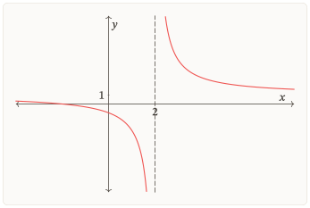
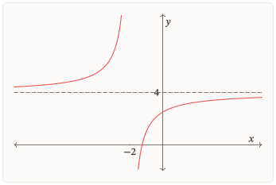
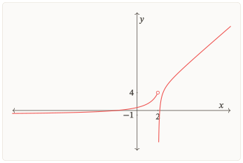
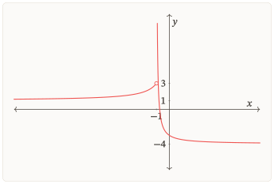

# Đường tiệm cận của đồ thị hàm số

**R1-G03 · Bản thảo nội dung 0.2 · 16/10/2026**

_Bản để đọc và góp ý; chưa phải học liệu đã nghiệm thu hoặc phát hành._

## Bắt đầu

Một điểm bị loại khỏi tập xác định có luôn tạo ra tiệm cận đứng không? Một đồ thị đã cắt đường thẳng còn có thể tiến sát đường thẳng ấy ở rất xa không? Hai đầu của cùng một đồ thị có thể tiến sát hai đường khác nhau không?

Gói này giúp em trả lời bằng giới hạn, đồng thời nhìn được ý nghĩa hình học của kết quả. Sau khi học và tự làm, em cần có thể:

- Giữ đúng tập xác định; phân biệt giá trị của hàm tại một điểm với giới hạn khi tiến gần điểm ấy.
- Tìm tiệm cận ngang và nói rõ đầu vô cực nào cho kết quả đó.
- Tìm tiệm cận đứng bằng giới hạn một phía phù hợp.
- Tìm tiệm cận xiên trong trường hợp đơn giản và kiểm phần chênh lệch tiến về $0$.
- Nối công thức, giới hạn và hình đồ thị; giải thích được vì sao đồ thị có thể cắt tiệm cận.
- Diễn giải kết quả trong một mô hình được cho, đúng miền và đơn vị.

**Chọn nơi bắt đầu.** Nếu cần học hoặc nhớ lại khái niệm, vào [Bài học](#bai-hoc). Nếu đã hiểu và muốn tự làm, vào [Luyện tập](#luyen-tap). Nếu đã chuẩn bị kĩ hoặc đủ tự tin, em có thể vào [Kiểm tra](#kiem-tra), kể cả chưa làm các phần trước. Khi đến lịch ôn, chọn lượt ở [Ôn lại](#on-lai). Việc bỏ qua một phần không tự chứng nhận em đã đạt mục tiêu của phần ấy.

Em có thể gọi [Ôn nền](#on-nen), [Sửa lỗi](#sua-loi), [Nhật kí](#nhat-ki) và [Lời giải](#loi-giai) khi cần. Hãy nhớ nhiệm vụ đang làm để trở lại sau hỗ trợ. Riêng trong một lượt Kiểm tra, em cần tự lực hoàn toàn; nếu muốn mở trợ giúp, hãy kết thúc lượt ấy trước và giữ nguyên bài làm ban đầu.

Để học phần chính, em cần đọc được phân thức, xét dấu đơn giản và hiểu kí hiệu giới hạn. Phần nền trong gói sẽ giúp ôn đúng thao tác đang vướng. Đạo hàm không phải công cụ bắt buộc để tìm tiệm cận trong các bài chính. Hai nhánh Phối hợp và Chuyển giao cuối Luyện tập là lựa chọn thêm, có điều kiện nền riêng.

**Tự ghi nhận kết quả.** Giữ bài tự làm trước khi xem lời giải. Khi đối chiếu, xét cả kết luận lẫn lí do. Nếu đã nhận trợ giúp, ghi riêng phần làm được sau trợ giúp. Một câu làm đúng chỉ xác nhận những mục tiêu mà câu ấy thực sự kiểm tra.

## Bài học

### Khởi động

#### Gợi mở 01 — Điều gì đang tiến gần?

Đọc ba dữ kiện sau và thử diễn tả bằng lời. Nếu chưa biết tên đường tiệm cận, em vẫn có thể trả lời điều gì đang xảy ra.

| Tình huống | Dữ kiện                                                             |
| ---------- | ------------------------------------------------------------------- |
| A          | Khi $x$ tăng không bị chặn, $f(x)$ tiến tới $4$                     |
| B          | Khi $x$ tiến tới $2$ từ phía lớn hơn $2$, $g(x)$ tăng không bị chặn |
| C          | Khi $x$ tăng không bị chặn, hiệu $h(x)-(x-1)$ tiến tới $0$          |

Trong A và C, em đang so tung độ của điểm trên đồ thị với tung độ của đường thẳng nào? Trong B, hoành độ tiến gần mốc nào và tung độ có tiến tới một số hữu hạn không?

Đối chiếu sau khi đã thử

A so $f(x)$ với $4$, tức so đồ thị với đường $y=4$. C so $h(x)$ với $x-1$, tức so đồ thị với đường $y=x-1$. Trong B, hoành độ tiến tới $2$ từ phải, còn tung độ tăng không bị chặn. Dữ kiện B không nói $g(2)$ bằng vô cực: vô cực không phải một giá trị thực để gán cho hàm số.

Nếu chưa đọc được hướng tiến gần, xem [Giới hạn một phía](#N-GH-02); nếu vướng khi $x$ ra vô cực, xem [Giới hạn ở vô cực](#N-GH-03). Sau đó trở lại câu hỏi này và tiếp tục mục 1. Đây là câu gợi mở, không phải phép xác nhận em đã biết toàn gói.

### 1. Giới hạn mô tả hành vi của hàm số

Ba câu hỏi sau khác nhau:

- **Giá trị tại điểm:** $f(a)$ có được xác định không, và nếu có thì bằng bao nhiêu?
- **Giới hạn tại điểm:** khi $x$ tiến gần $a$ theo một phía được phép, $f(x)$ tiến tới đâu?
- **Giới hạn ở vô cực:** khi $x$ tăng hoặc giảm không bị chặn trong tập xác định, $f(x)$ có hành vi thế nào?

Giới hạn xét các giá trị ở gần mốc, không tự bổ sung một điểm vào tập xác định. Khi $x\to+\infty$ hoặc $x\to-\infty$, ta cũng không thay “vô cực” vào công thức như thay một số.

#### Ví dụ 01 — Cùng loại một điểm, hành vi khác nhau

Xét

$$u(x)=\frac{x^2-4}{x-2},\qquad v(x)=\frac{x+2}{x-2}.$$

Cả hai hàm đều có tập xác định $\mathbb R\setminus\{2\}$. Với $x\ne 2$,

$$u(x)=x+2.$$

Do đó $\lim_{x\to2}u(x)=4$, nhưng $u(2)$ vẫn không được xác định. Đồ thị $u$ là đường $y=x+2$ bỏ điểm $(2;4)$.

Với $v$, ta viết

$$v(x)=1+\frac{4}{x-2}.$$

Khi $x\to 2^{-}$, mẫu âm và tiến tới $0$ nên $v(x)\to -\infty$. Khi $x\to 2^{+}$, mẫu dương và tiến tới $0$ nên $v(x)\to +\infty$. Việc cùng loại $x=2$ không khiến hai hàm có cùng hành vi gần $2$.

_Hình $1$. Giá trị tiến tới là $4$, nhưng điểm $(2;4)$ bị loại._

_Hình $2$. Cũng loại $x=2$, nhưng tung độ không tiến tới một số hữu hạn._

#### Tự kiểm tra 01 — Rút gọn có thêm được một điểm không?

Cho $r(x)=\frac{x^2-1}{x-1}$ với tập xác định tự nhiên. Một bạn viết: “$r(x)=x+1$ nên $r(1)=2$.” Hãy chỉ rõ phần đúng, phần sai; tìm giới hạn của $r(x)$ khi $x\to 1$.

[Đối chiếu Tự kiểm tra 01](#lg-T01). Nếu vướng điều kiện sau rút gọn, xem [Biến đổi phân thức](#N-DS-01), rồi trở lại câu này. Nếu đã hiểu, tiếp tục mục 2.

### 2. Tiệm cận ngang: xét riêng hai đầu vô cực

Đường thẳng **$y=L$** là một tiệm cận ngang của đồ thị $y=f(x)$ nếu ít nhất một trong hai điều kiện sau đúng:

$$\lim_{x\to+\infty}f(x)=L\qquad\text{hoặc}\qquad\lim_{x\to-\infty}f(x)=L,$$

trong đó $L$ là số thực và hướng đang xét có nghĩa trên tập xác định. Đây là định nghĩa tiệm cận ngang trong SGK, viết với kí hiệu $L$ thay cho $y_0$.[^sgk-ngang]

Chẳng hạn, khi $f(x)\to L$ ở đầu phải, độ chênh tung độ $|f(x)-L|$ tiến về $0$ khi $x\to+\infty$. Đường ngang mô tả hành vi ở xa, không buộc đồ thị phải nằm về một phía của đường ở mọi điểm.

#### Ví dụ 02 — Hai đầu cho cùng một đường

Cho $f(x)=4-\frac{3}{x+2}$, $x\ne-2$. Vì $\frac{3}{x+2}\to0$ khi $x\to+\infty$ và khi $x\to-\infty$, ta có

$$\lim_{x\to+\infty}f(x)=4,\qquad \lim_{x\to-\infty}f(x)=4.$$

Đồ thị có tiệm cận ngang $y=4$. Hai giới hạn cùng bằng $4$ xác định **một đường thẳng**, không phải hai tiệm cận khác nhau.

_Hình $3$. Đồ thị của $f$ trong Ví dụ 02; nét đứt ngang biểu diễn $y=4$._

#### Ví dụ 03 — Hai đầu có thể khác nhau

Biết $\lim_{x\to+\infty}g(x)=2$ và $\lim_{x\to-\infty}g(x)=-3$. Đồ thị có hai tiệm cận ngang: $y=2$ ở đầu phải và $y=-3$ ở đầu trái. Không được lấy kết quả của đầu phải áp cho đầu trái nếu chưa có căn cứ.

_Hình $4$. Một đồ thị phù hợp với hai giới hạn đã cho. Dữ kiện giới hạn xác định kết luận; hình giúp hình dung._

**Chọn cách tính phù hợp.** Với phân thức, có thể chia cả tử và mẫu cho lũy thừa thích hợp của $x$. Đó là cách tính giới hạn cho dạng đang xét, không phải định nghĩa tiệm cận ngang. Nếu miền chỉ có đầu $+\infty$, chỉ xét đầu ấy; không tạo thêm một đầu $-\infty$ không thuộc miền.

#### Tự kiểm tra 02 — Ghi cả đường và hướng

Biết $\lim_{x\to+\infty}p(x)=-1$ và $\lim_{x\to-\infty}p(x)=3$. Hãy viết các tiệm cận ngang cùng hướng tương ứng. Một bạn chỉ ghi $y=-1$ đã đủ chưa?

[Đối chiếu Tự kiểm tra 02](#lg-T02). Nếu nhầm hướng, trở lại định nghĩa ở đầu mục này. Nếu chưa biết tính giới hạn ở vô cực, xem [Ôn nền](#N-GH-03), rồi trở lại nhiệm vụ đang làm.

### 3. Tiệm cận đứng: một phía vô cực đã đủ

Đường thẳng **$x=a$** là tiệm cận đứng của đồ thị $y=f(x)$ nếu ít nhất một trong bốn điều kiện sau được thỏa mãn:[^sgk-dung]

$$\lim_{x\to a^+}f(x)=+\infty;\qquad \lim_{x\to a^-}f(x)=+\infty;$$

$$\lim_{x\to a^+}f(x)=-\infty;\qquad \lim_{x\to a^-}f(x)=-\infty.$$

Chỉ xét phía có điểm của tập xác định tiến sát $a$. Không cần cả hai phía tồn tại; nếu cả hai có nghĩa, chúng cũng không phải cùng dấu. Phương trình đường đứng là $x=a$, không phải $y=a$.

Ở Ví dụ 01, $v$ có tiệm cận đứng $x=2$ vì giới hạn trái là $-\infty$ và giới hạn phải là $+\infty$. Với $u$, hai giới hạn tại $2$ bằng $4$, nên $x=2$ không là tiệm cận đứng. **Điểm bị loại chỉ là mốc cần xem xét, chưa phải kết luận.**

#### Ví dụ 04 — Hai phía cùng đi lên

Cho $g(x)=\frac{2}{(x+3)^2}$, $x\ne -3$. Khi $x$ tiến tới $-3$ từ bất cứ phía nào, $(x+3)^2$ dương và tiến về $0$. Vì vậy

$$\lim_{x\to-3^-}g(x)=+\infty,\qquad \lim_{x\to-3^+}g(x)=+\infty.$$

Đồ thị có tiệm cận đứng $x=-3$. Dấu bình phương giải thích vì sao cả hai phía cùng $+\infty$; không áp mẫu “trái âm, phải dương” cho mọi phân thức.

**Nếu hàm được gán riêng giá trị tại $a$?** Giá trị ấy không tự xóa một giới hạn vô cực ở lân cận. Để kiểm đường đứng, vẫn đọc đúng hành vi khi $x$ tiến tới $a$. Ngược lại, chỉ biết $f(a)$ không tồn tại cũng chưa đủ để kết luận có tiệm cận đứng.

#### Tự kiểm tra 03 — Chỉ một phía có nghĩa

Hàm $w$ có tập xác định $(-\infty;5)$, liên tục trên khoảng này và $\lim_{x\to5^-}w(x)=-\infty$. Có thể kết luận $x=5$ là tiệm cận đứng không? Có cần thêm giới hạn phải tại $5$ không?

[Đối chiếu Tự kiểm tra 03](#lg-T03). Nếu vướng kí hiệu hoặc dấu vô cực, dùng [Giới hạn một phía](#N-GH-02), rồi quay lại câu này.

### 4. Tiệm cận xiên: kiểm phần chênh lệch

Theo định nghĩa trong SGK, đường thẳng **$y=ax+b$**, với $a\ne0$, là tiệm cận xiên của đồ thị $y=f(x)$ nếu[^sgk-xien]

$$\lim_{x\to+\infty}[f(x)-(ax+b)]=0$$

hoặc

$$\lim_{x\to-\infty}[f(x)-(ax+b)]=0.$$

Ở cùng một hoành độ $x$, hiệu $f(x)-(ax+b)$ là chênh lệch tung độ giữa đồ thị và đường thẳng. Khi hiệu tiến về $0$, khoảng cách từ điểm trên đồ thị đến đường thẳng ấy cũng tiến về $0$. Nếu $a=0$, đường là đường ngang và ta dùng tên tiệm cận ngang.

#### Ví dụ 05 — Tách phần tuyến tính và phần còn lại

Cho $h(x)=\frac{x^2+x+4}{x-1}$, $x\ne 1$. Chia đa thức, ta được

$$h(x)=x+2+\frac{6}{x-1}.$$

Có thể kiểm ngay bằng $(x-1)(x+2)+6=x^2+x+4$. Suy ra

$$h(x)-(x+2)=\frac{6}{x-1}\longrightarrow0\quad\text{khi }x\to\pm\infty.$$

Vì thế $y=x+2$ là tiệm cận xiên ở cả hai đầu. Muốn tìm thêm tiệm cận đứng, xét riêng giới hạn tại điểm loại $x=1$; phần $\frac{6}{x-1}$ cho giới hạn trái $-\infty$ và phải $+\infty$, nên $x=1$ là tiệm cận đứng.

_Hình $5$. Đường xiên mô tả phần tuyến tính ở xa; giới hạn tại $x=1$ trả lời câu hỏi khác._

**Tìm đủ hai hệ số của đường tiệm cận xiên.** Theo phần “Chú ý” của SGK, có thể tìm lần lượt hệ số góc và hệ số tự do bằng giới hạn.[^sgk-he-so] Ta phải chọn một hướng tiến ra vô cực và giữ nguyên hướng ấy trong cả hai phép tính.

- **Khi xét phía $x\to+\infty$**, tính

  $$a=\lim_{x\to+\infty}\frac{f(x)}{x},\qquad b=\lim_{x\to+\infty}[f(x)-ax].$$

  Nếu hai giới hạn trên tồn tại và hữu hạn, đồng thời $a\ne0$, thì đường thẳng $y=ax+b$ là tiệm cận xiên của đồ thị khi $x\to+\infty$.

- **Khi xét phía $x\to-\infty$**, tính riêng

  $$a=\lim_{x\to-\infty}\frac{f(x)}{x},\qquad b=\lim_{x\to-\infty}[f(x)-ax].$$

  Nếu hai giới hạn này tồn tại và hữu hạn, đồng thời $a\ne0$, thì đường thẳng $y=ax+b$ là tiệm cận xiên của đồ thị khi $x\to-\infty$.

Các giá trị $a$, $b$ tìm được ở hai hướng có thể khác nhau. Không lấy $a$ ở hướng này rồi ghép với $b$ ở hướng kia. Nếu chỉ tính $\lim_{x\to+\infty}\frac{f(x)}{x}=a$, em mới tìm được hệ số góc ở phía $x\to+\infty$, chưa biết hệ số tự do $b$ để viết phương trình đường thẳng. Trường hợp phía $x\to-\infty$ cũng cần đủ hai bước như vậy.

Với hàm $h$ trong Ví dụ 05, khi xét phía $x\to+\infty$, ta có

$$\lim_{x\to+\infty}\frac{h(x)}{x}=\lim_{x\to+\infty}\left[1+\frac{2}{x}+\frac{6}{x(x-1)}\right]=1,$$

nên $a=1$. Tiếp theo,

$$b=\lim_{x\to+\infty}[h(x)-x]=\lim_{x\to+\infty}\left[2+\frac{6}{x-1}\right]=2.$$

Vậy đường tiệm cận xiên ở phía này là $y=x+2$. Cách tách thương và phần dư ở trên cũng cho kết quả ấy, đồng thời giúp kiểm trực tiếp giới hạn của hiệu. Khi giải phân thức đơn giản, em có thể dùng cách tách này; SGK minh họa ở phần “Nhận xét” sau Ví dụ 6, trang 24.

#### Tự kiểm tra 04 — Thiếu một hằng số

Cho $q(x)=2x-5+\frac{1}{x+6}$, $x\ne -6$. Một bạn chỉ nhìn hệ số của $x$ và chọn $y=2x$. Hãy tìm đường xiên đúng và dùng giới hạn của hiệu để bác đường đã chọn.

[Đối chiếu Tự kiểm tra 04](#lg-T04). Nếu chưa tách được một phân thức thành thương và dư, xem [Biến đổi phân thức](#N-DS-01). Sau đó quay về bài đang vướng; làm đúng phép chia vẫn cần bước kiểm giới hạn phần dư.

### 5. Đọc kết quả trong đúng miền và đúng bối cảnh

Khi gặp một bài tiệm cận, hãy tự hỏi: biến đang tiến tới một mốc hữu hạn hay ra vô cực? Miền cho phép tiếp cận theo phía nào? Ta cần xét $f(x)$, hay xét hiệu giữa $f(x)$ và một biểu thức tuyến tính?

| Muốn kiểm | Dữ kiện quyết định                                                | Dạng phương trình |
| --------- | ----------------------------------------------------------------- | ----------------- |
| Ngang     | $f(x)$ tiến tới số hữu hạn $L$ ở một đầu vô cực                   | $y=L$             |
| Đứng      | $f(x)$ tiến tới $+\infty$ hoặc $-\infty$ ở ít nhất một phía của $a$ | $x=a$             |
| Xiên      | $f(x)-(ax+b)$ tiến về $0$ ở một đầu vô cực, $a\ne 0$              | $y=ax+b$          |

Hình vẽ giúp nhìn hướng và vị trí. Một cửa sổ hình hữu hạn không tự chứng minh hành vi ở vô cực; khi cần kết luận chính xác, dùng công thức, giới hạn được cho hoặc kí hiệu dữ kiện trên hình. Đặc biệt, nhìn đồ thị “rất gần” một đường chưa chứng minh được đó là tiệm cận.

#### Ví dụ 06 — Tiến tới một mức không có nghĩa đạt mức ấy

Trong một mô hình giả định, nồng độ sau $t$ giờ được cho bởi

$$c(t)=5+\frac{12}{t+1}\quad(t\ge0),$$

với $c$ tính bằng $\mathrm{mg}\,\mathrm{L}^{-1}$. Khi $t\to +\infty$, phần $\frac{12}{t+1}$ tiến về $0$, nên $c(t)\to 5$. Đồ thị trên miền mô hình có tiệm cận ngang $c=5$: mô hình dự báo nồng độ tiến gần $5$ $\mathrm{mg}\,\mathrm{L}^{-1}$ khi thời gian tăng.

Tại mọi $t\ge 0$ hữu hạn, $\frac{12}{t+1}>0$, nên $c(t)>5$. Mô hình không cho một thời điểm hữu hạn tại đó nồng độ bằng $5$ $\mathrm{mg}\,\mathrm{L}^{-1}$. Mốc $t=-1$ nằm ngoài miền $t\ge 0$ và không thể được tiến sát bằng các thời điểm hợp lệ; không gọi $t=-1$ là tiệm cận đứng của **đồ thị trên miền mô hình** này.

Kết luận trên thuộc mô hình đã cho, không là khẳng định thực nghiệm về mọi quá trình thay đổi nồng độ.

#### Tự kiểm tra 05 — Không mở rộng miền theo ý mình

Một chỉ số được mô hình hóa bởi $z(t)=10+\frac{8}{t+2}$, $t\ge 0$ tính bằng giờ, $z$ tính bằng điểm. Hãy nêu ý nghĩa giới hạn khi $t\to +\infty$; chỉ số có bằng $10$ tại thời điểm hữu hạn không? Có nên dùng $t=-2$ làm tiệm cận đứng của đồ thị trên miền này không?

[Đối chiếu Tự kiểm tra 05](#lg-T05). Nếu nhầm giới hạn với một giá trị được đạt, đọc lại Ví dụ 06; nếu nhầm miền, xem [Biến đổi phân thức](#N-DS-01). Quay lại câu này sau khi đối chiếu.

### Khép lại bài học

Giới hạn vừa giúp xác định đường tiệm cận, vừa giúp giải thích điều đồ thị đang biểu diễn. Với điểm hữu hạn, hãy tách giá trị tại điểm khỏi hành vi ở lân cận. Ở vô cực, hãy xét riêng từng hướng. Với đường xiên, đừng dừng ở hệ số góc: phần chênh lệch phải tiến về $0$.

Khi kết hợp với đơn điệu, cực trị và giá trị trên miền xét đã học ở các gói trước, em có thêm những dữ kiện để khảo sát và đọc đồ thị. Em có thể chuyển sang [Luyện tập](#luyen-tap), chọn [Kiểm tra](#kiem-tra) nếu đã chuẩn bị, hoặc ghi nơi cần tiếp tục trong [Nhật kí](#nhat-ki).

## Luyện tập

Hãy tự làm trước khi mở lời giải. Khi vướng, xác định em chưa hiểu khái niệm hay chưa làm được thao tác nền, rồi chọn đúng đích hỗ trợ. Việc xem lại không bắt em phải học lại từ đầu. Giữ bài ban đầu để thấy phần nào đã tự làm được.

### Chặng 1 — Miền, hướng và các đường ngang/đứng

Mục tiêu: giữ điểm loại sau rút gọn; xét đúng phía và từng đầu vô cực; giải thích được điều kiện tiệm cận đứng. Làm các nhiệm vụ 01–05 rồi đối chiếu tại Điểm dừng 01.

#### Nhiệm vụ 01 — Từ giới hạn đến đường thẳng

Cho hàm $f$ xác định trên $\mathbb R\setminus\{1\}$, liên tục trên từng khoảng của tập xác định, có

$$
\lim_{x\to-\infty}f(x)=\lim_{x\to+\infty}f(x)=2,\quad
\lim_{x\to1^-}f(x)=-\infty,\quad \lim_{x\to1^+}f(x)=+\infty.
$$

Viết các tiệm cận ngang và đứng của đồ thị. Mỗi kết luận cần kèm dữ kiện quyết định. Hai giới hạn ở vô cực cho một hay hai đường ngang?

[Đối chiếu sau khi tự làm](#lg-L01). Nếu cần, [xem lại đúng phần đang vướng](#bh-02), rồi trở lại nhiệm vụ này.

#### Nhiệm vụ 02 — Giữ miền trước khi tính

Tìm các tiệm cận ngang, đứng của $f(x)=\frac{5x+2}{x-3}$. Ghi tập xác định và tính giới hạn một phía tại điểm bị loại.

[Đối chiếu sau khi tự làm](#lg-L02). Nếu cần, [xem lại đúng phần đang vướng](#bh-03), rồi trở lại nhiệm vụ này.

#### Nhiệm vụ 03 — Một điểm hở

Cho $u(x)=\frac{x^2-9}{x-3}$ với tập xác định tự nhiên. Kiểm nhận định “$x=3$ là tiệm cận đứng”. Nếu rút gọn được $u(x)=x+3$, em có được viết $u(3)=6$ không? Bài này chỉ yêu cầu xét mốc $x=3$.

[Đối chiếu sau khi tự làm](#lg-L03). Nếu cần, [xem lại đúng phần đang vướng](#bh-01), rồi trở lại nhiệm vụ này.

#### Nhiệm vụ 04 — Chỉ có một phía để tiến gần

Cho $f(x)=\frac{1}{\sqrt{x-4}}$ trên $D=(4;+\infty)$. Tìm tiệm cận ngang, đứng của đồ thị. Giải thích vì sao không phải xét $x\to 4^{-}$.

[Đối chiếu sau khi tự làm](#lg-L04). Nếu cần, [xem lại đúng phần đang vướng](#N-GH-02), rồi trở lại nhiệm vụ này.

#### Nhiệm vụ 05 — Không bỏ sót đầu trái

Cho $\lim_{x\to+\infty}f(x)=7$ và $\lim_{x\to-\infty}f(x)=-2$. Viết các đường tiệm cận ngang và ghi đường nào ứng với đầu trái, đầu phải. Có thể chỉ từ hai dữ kiện này kết luận rằng đồ thị không có tiệm cận đứng không?

[Đối chiếu sau khi tự làm](#lg-L05). Nếu cần, [xem lại đúng phần đang vướng](#bh-02), rồi trở lại nhiệm vụ này.

### Điểm dừng 01

Đối chiếu [lời giải Luyện tập](#lg-luyen). Kiểm ba điều: em giữ miền ở nhiệm vụ 03–04; ghi đúng đường/hướng ở nhiệm vụ 01–02 và $05$; hiểu vì sao một phía đủ trong nhiệm vụ 04.

- Nếu cả kết luận và lí do đều đúng, em có thể sang chặng 2 hoặc chọn hoạt động phù hợp khác.
- Nếu nhầm điểm loại, gọi [Sửa lỗi sau Luyện tập 01](#S-L01).
- Nếu nhầm dấu/phía, xem [nền giới hạn một phía](#N-GH-02), rồi dùng [Sửa lỗi sau Luyện tập 02](#S-L02) nếu câu còn mới.
- Nếu bỏ sót đầu trái, xem lại mục 2 và dùng [Sửa lỗi sau Luyện tập 03(a)](#S-L03).

Sau hỗ trợ, trở lại Điểm dừng này và kiểm đúng tiêu chí còn thiếu. Bài đã xem lời giải vẫn dùng để học, nhưng không tính là bằng chứng độc lập mới. Không cần vào tất cả nhánh khi đã đạt.

### Chặng 2 — Phần dư, hình đồ thị và mô hình

Mục tiêu: tìm đủ đường xiên; kiểm kết luận bằng giới hạn; nối dữ kiện với hình; diễn giải trong đúng miền. Số nhiệm vụ tiếp tục từ chặng trước.

#### Nhiệm vụ 06 — Thương và phần dư

Tìm các tiệm cận đứng, xiên của $f(x)=\frac{x^2+3x+7}{x+2}$. Kiểm phép chia bằng nhân ngược; sau đó kiểm giới hạn của hiệu với đường xiên.

[Đối chiếu sau khi tự làm](#lg-L06). Nếu cần, [xem lại đúng phần đang vướng](#bh-04), rồi trở lại nhiệm vụ này.

#### Nhiệm vụ 07 — Đừng bỏ mất hệ số tự do

Một bạn nói đồ thị $g(x)=\frac{2x^2-x+4}{x-2}$ có tiệm cận xiên $y=2x$ vì “tỉ số hệ số cao nhất bằng $2$”. Hãy kiểm nhận định này, tìm đường xiên đúng và chỉ rõ giới hạn nào bác đường $y=2x$.

[Đối chiếu sau khi tự làm](#lg-L07). Nếu cần, [xem lại đúng phần đang vướng](#bh-04), rồi trở lại nhiệm vụ này.

#### Nhiệm vụ 08 — Cắt mà vẫn tiến sát

Cho $f(x)=3+\frac{x-1}{x^2+1}$. Chứng minh $y=3$ là tiệm cận ngang, rồi tìm giao điểm của đồ thị với $y=3$. Kết quả có mâu thuẫn với định nghĩa không?

[Đối chiếu sau khi tự làm](#lg-L08). Nếu cần, [xem lại đúng phần đang vướng](#bh-05), rồi trở lại nhiệm vụ này.

#### Nhiệm vụ 09 — Một hình, ba hành vi

Hình sau biểu diễn một hàm xác định trên $\mathbb R\setminus\{2\}$ và liên tục trên từng khoảng của miền. Hình đi kèm các dữ kiện chính xác:

$$
\lim_{x\to-\infty}f(x)=-1,\quad \lim_{x\to2^-}f(x)=4,\quad
\lim_{x\to2^+}f(x)=-\infty,\quad
\lim_{x\to+\infty}[f(x)-(2x+1)]=0.
$$

a) Nêu các tiệm cận suy ra từ dữ kiện và chỉ vị trí/hướng tương ứng trên hình.

b) Một bạn bác $x=2$ là tiệm cận đứng vì giới hạn trái bằng $4$. Bạn ấy sai ở đâu?

c) Giải thích vì sao không dùng một đoạn đồ thị nhìn “gần thẳng” trong ảnh để thay phép kiểm giới hạn.

[Đối chiếu sau khi tự làm](#lg-L09). Nếu cần, [xem lại đúng phần đang vướng](#bh-05), rồi trở lại nhiệm vụ này.

#### Nhiệm vụ 10 — Nhiệt độ trong mô hình

Một mô hình giả định cho nhiệt độ sau $t$ giờ là $h(t)=6+\frac{18}{t+2}$ ( ${}^{\circ}\mathrm{C}$), $t\ge 0$.

a) Nêu tiệm cận ngang và ý nghĩa trong mô hình.

b) Có thời điểm hữu hạn nào nhiệt độ đúng bằng $6$ ${}^{\circ}\mathrm{C}$ không?

c) Một bạn dùng mẫu $t+2$ để gọi $t=-2$ là tiệm cận đứng của đồ thị mô hình. Hãy kiểm cách kết luận ấy.

[Đối chiếu sau khi tự làm](#lg-L10). Nếu cần, [xem lại đúng phần đang vướng](#bh-05), rồi trở lại nhiệm vụ này.

### Điểm dừng 02

Đối chiếu nhiệm vụ 06–10. Em cần kiểm phần dư ở $06$–$07$, hiểu giao điểm trong $08$, nối đúng cả ba hành vi ở $09$ và giữ miền/đơn vị trong $10$.

- Thiếu phần dư hoặc hệ số tự do: [Biến đổi phân thức](#N-DS-01), rồi [Sửa lỗi sau Luyện tập 04(a)](#S-L04).
- Cho rằng đồ thị không được cắt tiệm cận: xem lại định nghĩa, rồi [Sửa lỗi sau Luyện tập 03(b)](#S-L03).
- Diễn giải vượt miền hoặc nhầm mức đạt được: mục 5, rồi [Sửa lỗi sau Luyện tập 04(b)](#S-L04).
- Nếu chỉ nhầm cách đọc hình ở nhiệm vụ 09, trở lại các dữ kiện giới hạn, chỉ từng nhánh rồi tự giải thích; nếu đã xem lời giải, kết quả làm lại không trở thành bài mới. Phần đọc hình ở Kiểm tra sẽ cho dữ kiện khác.

Khi đủ tiêu chí, em có thể làm Kiểm tra hoặc chọn nhánh tự chọn dưới đây. Không bắt làm hai nhánh thêm để được vào Kiểm tra.

### Phối hợp — lựa chọn thêm

#### Nhiệm vụ 01 — Phối hợp — tiệm cận và giá trị không đạt

Chọn bài này nếu em đã học giá trị lớn nhất/nhỏ nhất ở G02 hoặc có nền tương ứng. Với $C(x)=2+\frac{6}{x+1}$ trên $x\ge 0$, hãy tìm GTLN, GTNN nếu có và giải thích quan hệ với tiệm cận ngang.

[Đối chiếu sau khi tự làm](#lg-P01). Nếu cần, [xem lại đúng phần đang vướng](#bh-05), rồi trở lại nhiệm vụ này.

### Chuyển giao — lựa chọn thêm

#### Nhiệm vụ 01 — Chuyển giao — hai đường xiên khác nhau

Chọn bài này nếu em đọc được giới hạn căn và $\sqrt{x^2}=|x|$ ở phần nền. Với $f(x)=\sqrt{x^2+9}$, hãy kiểm $y=x$ ở $+\infty$ và $y=-x$ ở $-\infty$ bằng cách nhân liên hợp. Có được lấy một đường làm đáp án cho cả hai đầu không?

[Đối chiếu sau khi tự làm](#lg-P02). Nếu cần, [xem lại đúng phần đang vướng](#N-GH-03), rồi trở lại nhiệm vụ này.

## Kiểm tra

Em có thể bắt đầu nếu đã chuẩn bị kĩ hoặc đủ tự tin. Trong lượt này, tự làm cả năm nhiệm vụ, không mở Bài học, Ôn nền, Sửa lỗi hoặc Lời giải để trợ giúp. **Một lượt không chia thành nhiều đợt/buổi rồi ghép thành cùng một kết quả độc lập.** Nếu cần nhận trợ giúp, hãy kết thúc lượt, giữ bài làm ban đầu; phần làm sau hỗ trợ được ghi riêng.

Ghi miền, hướng giới hạn và lí do, không chỉ đáp án. Để khảo sát khả năng của mình, ghi thời gian thực đã dùng; bản thảo này chưa quy định một thời lượng chuẩn. Đây là kiểm tra mục tiêu của gói, không phải đề mô phỏng thi quốc gia.

#### Nhiệm vụ 01 — Hai hàm ở cùng một mốc

Cho $p(x)=\frac{x^2-16}{x-4}$ và $q(x)=\frac{3}{(x-4)^2}$, mỗi hàm lấy tập xác định tự nhiên.

a) Viết miền của từng hàm.

b) Tính các giới hạn một phía tại $4$.

c) Với mỗi đồ thị, $x=4$ có là tiệm cận đứng không? Giải thích và cho biết có được gán $p(4)=8$ sau rút gọn không.

#### Nhiệm vụ 02 — Đọc hai đầu và một mốc hữu hạn

Một hàm $f$ xác định trên $\mathbb R\setminus\{-1\}$, liên tục trên từng khoảng của miền, có hình dưới đây. Các dữ kiện đi kèm là

$$
\lim_{x\to-\infty}f(x)=1,\quad \lim_{x\to+\infty}f(x)=-4,\quad
\lim_{x\to-1^-}f(x)=3,\quad \lim_{x\to-1^+}f(x)=+\infty.
$$

a) Viết các tiệm cận ngang, đứng và ghi hướng cho từng kết luận.

b) Chỉ trên hình nhánh nào phù hợp với mỗi giới hạn.

c) Giới hạn trái hữu hạn tại $-1$ có làm mất tiệm cận đứng ở mốc ấy không?

#### Nhiệm vụ 03 — Đường xiên cần đủ hai hệ số

Tìm tiệm cận đứng và xiên của $f(x)=\frac{2x^2+3x+8}{x+1}$. Một lời giải khác chọn $y=2x$. Hãy dùng giới hạn để kiểm lời giải ấy.

#### Nhiệm vụ 04 — Một phản ví dụ cần hai điều

Với $g(x)=-2+\frac{x+3}{x^2+4}$, hãy kiểm nhận định “Nếu đồ thị cắt $y=-2$ thì $y=-2$ không thể là tiệm cận ngang”. Câu trả lời cần chứng minh cả hành vi ở vô cực và giao điểm.

#### Nhiệm vụ 05 — Giới hạn của mô hình

Một mô hình giả định mô tả nồng độ sau $t$ phút: $A(t)=9+\frac{20}{t+4}$ ($\mathrm{mg}\,\mathrm{L}^{-1}$), $t\ge 0$. Hãy nêu đường tiệm cận ngang và ý nghĩa; kiểm xem mức $9$ $\mathrm{mg}\,\mathrm{L}^{-1}$ có được đạt ở thời điểm hữu hạn không; kiểm việc gọi $t=-4$ là tiệm cận đứng của đồ thị mô hình.

### Sau khi kết thúc lượt Kiểm tra

Giữ bài ban đầu rồi mới mở [Lời giải Kiểm tra](#lg-kiem-tra). Đối chiếu theo từng khả năng:

| Khả năng cần xác nhận                         | Nơi đọc bằng chứng |
| --------------------------------------------- | ------------------ |
| Giữ miền, phân biệt giới hạn và giá trị       | Nhiệm vụ 01        |
| Xét ngang theo từng đầu                       | Nhiệm vụ 02        |
| Dùng đúng điều kiện đứng và dấu/phía          | Nhiệm vụ 01–03     |
| Tìm đủ đường xiên và kiểm hiệu                | Nhiệm vụ 03        |
| Nối hình/dữ kiện; phản biện việc cắt tiệm cận | Nhiệm vụ 02 và $04$  |
| Diễn giải mô hình đúng miền, đơn vị           | Nhiệm vụ 05        |

Ghi “tự làm đúng”, “còn thiếu lí do”, “sai/chưa làm được” hoặc “đã nhận hỗ trợ” theo bài thực. Nếu sai, dùng bảng [Chọn bài sửa lỗi](#chon-sua-loi), giữ riêng kết quả ban đầu và kết quả sau sửa. Không lấy tổng số câu đúng che một mục tiêu thiết yếu còn vướng.

Hoàn tất lượt chính khi các mục tiêu thiết yếu đều có bằng chứng độc lập phù hợp và lỗi chặn đã được xác nhận lại bằng câu còn mới. Nếu riêng việc đọc hình chưa đủ bằng chứng và hình K02 đã lộ, ghi phần đó chưa xác nhận; không xem câu chỉ tính công thức là thay thế đầy đủ. Khi chưa có hình mới phù hợp, xem hướng xử lí [hết bài mới](#het-bai-moi).

Khi hoàn tất lượt chính, hẹn Ôn lại. Em có thể tiếp tục học phần khác phù hợp tiên quyết trong lúc chờ ngày ôn; không bắt chờ xong tất cả lượt ôn mới được học tiếp.

## Ôn lại

Gợi ý lịch tính từ ngày hoàn tất lượt chính: lượt 1 sau $2$–$3$ ngày; lượt 2 khoảng $7$ ngày; lượt 3 khoảng $3$–$4$ tuần. Ghi ngày thực. Nếu một mục tiêu vừa phải sửa, hẹn kiểm gần hơn cho riêng mục tiêu ấy và giữ lịch sử cũ. Khi sát kì thi, chỉ kết luận về khoảng trễ đã thực sự quan sát.

Tự làm trước, giữ kết quả rồi đối chiếu. Nếu cần trợ giúp, ghi riêng phần sau hỗ trợ. Mỗi lượt chỉ lấy mẫu những khả năng nêu bên dưới; đủ ba lượt không tự chứng nhận mọi tình huống của chủ đề.

### Lượt 1

#### Nhiệm vụ 01 — Nhớ lại miền và giới hạn

a) Xét riêng mốc $5$ đối với $u(x)=\frac{x^2-25}{x-5}$ và $v(x)=\frac{2}{x-5}$ trên các miền tự nhiên. Viết giới hạn tại mốc, kết luận về tiệm cận đứng và giữ đúng giá trị có/không xác định.

b) Tìm tiệm cận ngang của $w(x)=\frac{7x-4}{2x+1}$. Ghi hướng đã kiểm.

[Đối chiếu sau khi tự làm](#lg-O01).

Lượt này lấy mẫu miền, ngang và đứng. Nếu vướng, chọn đúng ý ở [Sửa lỗi sau Ôn lại 01](#S-O01), rồi trở lại lượt 1.

### Lượt 2

#### Nhiệm vụ 02 — Phần dư và giao điểm

a) Tìm tiệm cận đứng, xiên của $f(x)=\frac{x^2-3x+8}{x-2}$; viết bước kiểm phần dư.

b) Cho $g(x)=1+\frac{x-2}{x^2+9}$. Xác định tiệm cận ngang và giao điểm với đường ấy. Dùng kết quả để trả lời: cắt một tiệm cận có trái định nghĩa không?

[Đối chiếu sau khi tự làm](#lg-O02).

Lượt này lấy mẫu đứng, xiên và phản ví dụ về giao điểm. Nếu vướng phần xiên hoặc giao điểm, dùng đúng ý ở [Sửa lỗi sau Ôn lại 02](#S-O02); sai dấu/phía dùng [nhiệm vụ 01(b)](#S-O01), rồi trở lại lượt 2.

### Lượt 3

#### Nhiệm vụ 03 — Chọn điều cần kiểm

a) Với $u(x)=\frac{x^2-36}{x-6}$ trên miền tự nhiên, xét nhận định $x=6$ là tiệm cận đứng.

b) Một đồ thị có giới hạn $3$ ở $+\infty$ và $-5$ ở $-\infty$. Viết các đường ngang, gắn với đúng đầu và phác vị trí của chúng trên hệ trục. Phần phác chỉ cần đường thẳng và nhãn, chưa cần dựng cả đồ thị.

c) Tìm tiệm cận xiên của $v(x)=\frac{3x^2+x+5}{x+1}$ bằng cách tách phần dư.

d) Trong mô hình giả định $B(t)=4+\frac{15}{t+3}$ ($\mathrm{mg}\,\mathrm{L}^{-1}$), $t\ge 0$ giờ, nêu mức tiến tới, việc đạt mức ấy và vai trò của mốc $-3$.

[Đối chiếu sau khi tự làm](#lg-O03).

Lượt này lấy mẫu miền, hai đầu, đường xiên và mô hình. Nó chưa thay phép kiểm giới hạn vô cực tại điểm nếu kĩ năng ấy còn vướng. Chọn đúng ý ở [Sửa lỗi sau Ôn lại](#sua-sau-on), rồi trở lại lượt 3.

## Ôn nền

Chọn đúng thao tác đang vướng. Mỗi phần có một ví dụ để học và một câu tự làm khác ví dụ. Hãy nhớ câu đang gọi hỗ trợ; sau đối chiếu, trở về đúng câu ấy. Làm được câu nền chỉ xác nhận thao tác nền, không tự xác nhận toàn bộ mục tiêu của bài gốc.

| Em đang vướng                               | Phần nên đọc                   |
| ------------------------------------------- | ------------------------------ |
| Không rõ $x\to a^{-}$, $x\to a^{+}$; nhầm dấu vô cực        | [Giới hạn một phía](#N-GH-02)  |
| Không biết xử lí $x\to \pm \infty$ hoặc bỏ sót một đầu   | [Giới hạn ở vô cực](#N-GH-03)  |
| Rút gọn làm mất điểm loại; chia đa thức sai | [Biến đổi phân thức](#N-DS-01) |

Nếu cần ôn rộng hơn, có thể đọc tài nguyên chung [Tập xác định và điều kiện áp dụng](../../../_dung_chung/nen/N-TXĐ-01.qmd), [Xét dấu biểu thức có nhân tử](../../../_dung_chung/nen/N-DẤU-01.qmd) và [Cận và giá trị được đạt](../../../_dung_chung/nen/N-GH-01.qmd). Câu đã gặp ở gói trước không trở thành câu xác nhận mới chỉ vì được dẫn lại ở đây.

### Giới hạn một phía: nhìn hướng và dấu

**Dùng khi:** em biết mốc cần xét nhưng chưa hiểu phải tiến từ phía nào, hoặc chưa giải thích được dấu $+\infty$/$-\infty$.

$x\to a^{-}$ nghĩa là $x$ nhận các giá trị nhỏ hơn $a$ và tiến gần $a$; $x\to a^{+}$ là nhận các giá trị lớn hơn $a$ và tiến gần $a$. Chỉ xét phía có điểm thuộc miền tiến sát mốc.

Nếu một tử số tiến tới số dương khác $0$ còn mẫu tiến tới $0^+$ thì thương tiến tới $+\infty$; nếu mẫu tiến tới $0^-$ thì thương tiến tới $-\infty$. Tử âm làm đổi dấu kết luận. Các câu này nói về sự tăng/giảm không bị chặn, không phải phép chia cho số $0$.

**Ví dụ.** Với $v(x)=\frac{1}{x-5}$, khi $x\to 5^{-}$, $x-5$ âm và tiến về $0$ nên $v(x)\to -\infty$. Khi $x\to 5^{+}$, $x-5$ dương và tiến về $0$ nên $v(x)\to +\infty$. Một vài giá trị số giúp hình dung, nhưng dấu và giới hạn mới là căn cứ cho kết luận.

Nếu mẫu là $(x-a)^2$, nó dương ở cả hai phía của $a$. Vì thế không được lấy kết quả dấu trái/phải của $\frac{1}{x-a}$ áp nguyên sang mẫu bình phương.

**Tự kiểm tra.** Tính hai giới hạn một phía của $u(x)=-\frac{2}{x+4}$ khi $x$ tiến tới $-4$. Trước mỗi kết luận, ghi dấu tử và dấu mẫu.

Đáp án và tiêu chí

Khi $x\to -4^{-}$, $x+4$ âm và tiến tới $0$, tử $-2$ âm; thương dương và tăng không bị chặn, nên giới hạn là $+\infty$. Khi $x\to -4^{+}$, mẫu dương và tiến tới $0$, tử âm nên giới hạn là $-\infty$.

Đạt thao tác nền khi em ghi đúng cả hướng, dấu và kết luận. Nếu mục tiêu ở bài gốc là xác định đường tiệm cận, em còn phải dùng định nghĩa và viết phương trình đường thẳng cho bài đó.

Trở về nhiệm vụ đang gọi. Nếu mở thẻ trực tiếp, có thể quay lại [mục tiệm cận đứng](#bh-03) hoặc chọn [Luyện tập](#luyen-tap). Nếu đã xem đáp án trước khi tự làm, đừng dùng lại câu này làm bằng chứng mới.

### Giới hạn ở vô cực: hai hướng cần được kiểm

**Dùng khi:** em đang thay “vô cực” vào biểu thức, không biết chia theo bậc, hoặc cho rằng kết quả tại $+\infty$ tự dùng được cho $-\infty$.

Khi $x\to+\infty$ hoặc $x\to-\infty$, ta có $\frac{1}{x}\to0$ và $\frac{1}{x^2}\to0$. Tuy vậy, dấu của $x$ khác nhau ở hai hướng, đặc biệt quan trọng khi có căn hoặc trị tuyệt đối.

**Ví dụ phân thức.** Với $p(x)=\frac{3x+4}{x-2}$, chia tử và mẫu cho $x$ trong vùng $x\ne 0$:

$$p(x)=\frac{3+\frac{4}{x}}{1-\frac{2}{x}}.$$

Ở mỗi đầu vô cực, tử tiến tới $3$, mẫu tiến tới $1$ khác $0$ nên $p(x)\to 3$. Cách chia này chỉ dùng để tính ở xa; tập xác định ban đầu vẫn loại $2$.

**Tự kiểm tra phần phân thức.** Tính giới hạn của $q(x)=\frac{5x-1}{2x+3}$ khi $x\to+\infty$ và $x\to-\infty$. Viết phép biến đổi làm rõ kết quả.

Đáp án và tiêu chí

Chia tử và mẫu cho $x$: $q(x)=\frac{5-\frac{1}{x}}{2+\frac{3}{x}}$. Ở cả hai đầu, tử tiến tới $5$, mẫu tiến tới $2$ khác $0$; cả hai giới hạn bằng $\frac{5}{2}$. Đạt khi em nêu được phép biến đổi và kiểm cả hai hướng, không chỉ đoán từ một giá trị $x$ lớn.

**Nhánh căn — chỉ cần khi chọn Chuyển giao.** Với $x$ thực, $\sqrt{x^2}=|x|$. Nếu $x>0$ thì $|x|=x$; nếu $x<0$ thì $|x|=-x$. Chẳng hạn, $\frac{\sqrt{x^2}}{x}$ bằng $1$ khi $x>0$ và $-1$ khi $x<0$. Đây là lý do một giới hạn chứa căn có thể cho hai kết quả khác nhau ở hai đầu.

**Tự kiểm tra phần căn.** Tính hai giới hạn ở vô cực của $r(x)=\frac{\sqrt{x^2+4}}{x}$. Hãy tách $\frac{|x|}{x}$ để giải thích dấu.

Đáp án và tiêu chí

Với $x\ne 0$,

$$r(x)=\frac{|x|}{x}\sqrt{1+\frac{4}{x^2}}.$$

Căn sau tiến tới $1$. Ở $+\infty$, $\frac{|x|}{x}=1$ nên $r(x)\to 1$; ở $-\infty$, $\frac{|x|}{x}=-1$ nên $r(x)\to -1$. Đạt phần nền căn khi giải thích được dấu bằng trị tuyệt đối. Làm đúng câu phân thức phía trên chưa thay thế tiêu chí này.

Trở về nhiệm vụ đang gọi; nếu vào trực tiếp, chọn [mục tiệm cận ngang](#bh-02) hoặc [Chuyển giao](#P02) khi đã đủ nền. Các câu đã xem đáp án chỉ dùng để học lại.

### Biến đổi phân thức: giữ điều kiện, kiểm thương và dư

**Dùng khi:** em rút gọn rồi thêm điểm vào miền, hoặc phép chia dẫn đến sai đường xiên.

Với phân thức, mẫu phải khác $0$. Hai biểu thức rút gọn bằng nhau trên miền cho phép không có nghĩa hai hàm tự nhiên luôn có cùng miền. Khi bỏ một nhân tử chung, giữ điều kiện ban đầu.

Chia đa thức có thể viết dưới dạng

$$\text{tử}=\text{mẫu}\times\text{thương}+\text{dư}.$$

Chia lại cho mẫu ở nơi mẫu khác $0$ cho ta thương cộng phần dư trên mẫu. Nhân ngược là một cách kiểm nhanh phép chia, chưa phải phép kiểm tiệm cận.

**Ví dụ.** Vì $(x+1)(x+1)+4=x^2+2x+5$, nên

$$\frac{x^2+2x+5}{x+1}=x+1+\frac{4}{x+1}\quad(x\ne-1).$$

Nếu đang tìm tiệm cận xiên, còn phải kiểm phần $\frac{4}{x+1}$ tiến về $0$ ở hướng vô cực đang xét. Không bỏ qua bước này chỉ vì đã thấy một biểu thức bậc nhất.

**Tự kiểm tra.** Viết $\frac{x^2-2x+5}{x-1}$ thành một biểu thức bậc nhất cộng phần dư trên mẫu. Ghi điều kiện và nhân ngược để kiểm.

Đáp án và tiêu chí

Với $x\ne 1$,

$$\frac{x^2-2x+5}{x-1}=x-1+\frac{4}{x-1},$$

vì $(x-1)^2+4=x^2-2x+5$. Đạt thao tác nền khi thương, dư, điều kiện và phép kiểm đều đúng. Nếu bài gốc yêu cầu tiệm cận, quay về bài đó và tính đúng giới hạn phần còn lại.

Nếu mở trực tiếp, trở lại [mục 1](#bh-01) khi vướng miền hoặc [mục 4](#bh-04) khi vướng phép chia. Nếu câu nền đã lộ, không ghi lần làm lại là xác nhận độc lập mới.

## Sửa lỗi

Giữ bài ban đầu và chỉ ra bước chưa đúng trước khi chọn câu. Đọc lại một định nghĩa hoặc ví dụ là để học từ lỗi; câu xác nhận bên dưới cần được tự làm khi chưa xem đáp án. Nếu một nhiệm vụ có nhiều ý, làm đúng ý nào chỉ xác nhận mục tiêu tương ứng với ý đó.

### Chọn bài theo dấu hiệu

| Dấu hiệu cần sửa                        | Sau Luyện tập            | Sau Kiểm tra             | Sau Ôn lại               |
| --------------------------------------- | ------------------------ | ------------------------ | ------------------------ |
| Điểm bị loại hoặc giá trị bị nhầm       | [Nhiệm vụ 01](#S-L01)    | [Nhiệm vụ 01(a)](#S-K01) | [Nhiệm vụ 01(a)](#S-O01) |
| Dấu hoặc phía giới hạn bị nhầm          | [Nhiệm vụ 02](#S-L02)    | [Nhiệm vụ 01(b)](#S-K01) | [Nhiệm vụ 01(b)](#S-O01) |
| Bỏ sót một đầu vô cực                   | [Nhiệm vụ 03(a)](#S-L03) | [Nhiệm vụ 02(a)](#S-K02) | [Nhiệm vụ 01(c)](#S-O01) |
| Phần tuyến tính/phần dư chưa đúng       | [Nhiệm vụ 04(a)](#S-L04) | [Nhiệm vụ 03(a)](#S-K03) | [Nhiệm vụ 02(a)](#S-O02) |
| Cho rằng đồ thị không được cắt tiệm cận | [Nhiệm vụ 03(b)](#S-L03) | [Nhiệm vụ 02(b)](#S-K02) | [Nhiệm vụ 02(b)](#S-O02) |
| Nhầm mức tiến tới hoặc bỏ miền mô hình  | [Nhiệm vụ 04(b)](#S-L04) | [Nhiệm vụ 03(b)](#S-K03) | [Nhiệm vụ 02(c)](#S-O02) |

### Đọc lỗi để biết cần xem lại gì

- **Điểm loại chưa phải tiệm cận.** Xem [Ví dụ 01](#bh-01); rút gọn không thêm điểm vào miền. Sau đó tự làm câu về điểm bị loại trong bảng.
- **Dấu vô cực đến từ dấu biểu thức.** Xem [nền một phía](#N-GH-02), kiểm tử và mẫu trước khi kết luận. Mẫu bình phương có thể làm hai phía cùng dấu.
- **Hai đầu là hai câu hỏi.** Xem [mục 2](#bh-02); ghi tách $+\infty$ và $-\infty$. Chỉ xét hướng miền cho phép; trùng kết quả thì chỉ có một đường ngang.
- **Thương chưa đủ nếu chia sai hoặc bỏ hằng số.** Nhân ngược ở [nền biến đổi](#N-DS-01), rồi kiểm hiệu với cả $ax+b$ theo [mục 4](#bh-04).
- **Giao điểm hữu hạn không bác giới hạn ở xa.** Xem lại định nghĩa ngang; phải kiểm giới hạn và giải phương trình giao điểm, không chỉ nhìn hình.
- **Mô hình có miền riêng.** Xem [Ví dụ 06](#bh-05); chỉ xét mốc tiếp cận được trong miền, kiểm dấu phần dư trước khi nói một mức được đạt.

Nếu lỗi được phát hiện ngay trong Bài học, em cũng có thể dùng câu sửa phù hợp còn mới ở nhóm Sau Luyện tập và trở về câu Bài học đang vướng; không cần chờ làm Kiểm tra mới được sửa.

### Sau Luyện tập

#### Nhiệm vụ 01 — Giữ điểm bị loại

Với $u(x)=\frac{x^2-49}{x-7}$, ghi miền, tính giới hạn tại $7$ và kiểm $x=7$ có là tiệm cận đứng không. Có thể gán $u(7)=14$ sau rút gọn không?

[Đối chiếu sau khi tự làm](#lg-S-L01).

#### Nhiệm vụ 02 — Dấu ở hai phía

Tính hai giới hạn một phía của $v(x)=-\frac{4}{x-6}$ tại $6$. Nêu tiệm cận đứng và giải thích dấu.

[Đối chiếu sau khi tự làm](#lg-S-L02).

#### Nhiệm vụ 03 — Hai đầu và một giao điểm

a) Biết giới hạn của $f$ bằng $-6$ ở $+\infty$ và $4$ ở $-\infty$. Ghi hai tiệm cận ngang theo hướng.

b) Với $g(x)=2+\frac{x+1}{x^2+2}$, chứng minh một tiệm cận ngang và tìm giao điểm của đồ thị với nó.

[Đối chiếu sau khi tự làm](#lg-S-L03).

#### Nhiệm vụ 04 — Giữ hằng số và giữ miền mô hình

a) Tìm tiệm cận xiên của $f(x)=\frac{x^2+4x+9}{x+1}$, kiểm bằng giới hạn hiệu.

b) Mô hình giả định $a(t)=8+\frac{10}{t+5}$ ( ${}^{\circ}\mathrm{C}$), $t\ge 0$ giờ: nêu mức tiến tới, việc đạt mức ấy và kiểm mốc $t=-5$.

[Đối chiếu sau khi tự làm](#lg-S-L04).

### Sau Kiểm tra

#### Nhiệm vụ 01 — Phân biệt hữu hạn và vô cực

a) Xét riêng mốc $8$ cho $p(x)=\frac{x^2-64}{x-8}$ trên miền tự nhiên; kết luận về giá trị tại điểm và đường đứng.

b) Tính hai giới hạn của $q(x)=-\frac{3}{(x+2)^2}$ tại $-2$, rồi kết luận đường đứng.

[Đối chiếu sau khi tự làm](#lg-S-K01).

#### Nhiệm vụ 02 — Không nhầm giới hạn với giao điểm

a) Biết giới hạn của $f$ bằng $6$ ở $+\infty$ và $-7$ ở $-\infty$. Ghi các đường ngang.

b) Với $g(x)=-3+\frac{x-4}{x^2+5}$, kiểm $y=-3$ là tiệm cận ngang và tìm giao điểm của đồ thị với nó; giải thích vì sao hai kết quả cùng đúng.

[Đối chiếu sau khi tự làm](#lg-S-K02).

#### Nhiệm vụ 03 — Xác nhận đường xiên và ý nghĩa mô hình

a) Tìm tiệm cận xiên của $f(x)=\frac{2x^2-3x+6}{x-1}$, nêu phép kiểm hiệu.

b) Mô hình giả định $b(t)=7+\frac{14}{t+6}$ ($\mathrm{mg}\,\mathrm{L}^{-1}$), $t\ge 0$ phút: nêu mức tiến tới, có đạt không và có dùng được mốc $-6$ làm tiệm cận đứng không.

[Đối chiếu sau khi tự làm](#lg-S-K03).

### Sau Ôn lại

#### Nhiệm vụ 01 — Ôn lại miền, phía và hai đầu

a) Xét mốc $9$ của $u(x)=\frac{x^2-81}{x-9}$: miền, giới hạn, giá trị tại điểm và đường đứng.

b) Tính hai giới hạn của $v(x)=\frac{5}{x+4}$ tại $-4$, kết luận đường đứng.

c) Một hàm có giới hạn $8$ ở $+\infty$ và $-9$ ở $-\infty$. Ghi đường ngang theo hướng.

[Đối chiếu sau khi tự làm](#lg-S-O01).

#### Nhiệm vụ 02 — Ôn lại phần dư và cách diễn giải

a) Tìm tiệm cận xiên của $f(x)=\frac{3x^2-2x+7}{x-1}$.

b) Với $g(x)=4+\frac{x+2}{x^2+7}$, chứng minh tiệm cận ngang và tìm giao điểm với nó.

c) Mô hình giả định $c(t)=3+\frac{16}{t+7}$ ($\mathrm{mg}\,\mathrm{L}^{-1}$), $t\ge 0$ giờ: nêu mức tiến tới, có đạt không và vai trò của mốc $-7$.

[Đối chiếu sau khi tự làm](#lg-S-O02).

### Sau câu xác nhận và khi hết bài mới

Nếu tự làm đúng và giải thích được, ghi “đã xác nhận mục tiêu này trong lượt”, rồi trở về nhiệm vụ hoặc điểm dừng đã gọi hỗ trợ. Kết quả ấy không đổi điểm Kiểm tra ban đầu và chưa chứng nhận khả năng sau nhiều ngày.

Nếu đã xem đáp án, câu trở thành tài nguyên học. Có thể chọn một câu/ý khác cùng mục tiêu trong bảng mà em chưa gặp; giữ đúng nơi quay về, không coi việc đổi nhóm hay đổi mã là làm bài mới. Một câu chỉ tính tiệm cận không tự xác nhận cả khả năng đọc hình.

Nếu các câu phù hợp đều đã lộ hoặc em vẫn chưa làm được, ghi rõ **chưa có đủ bằng chứng mới để xác nhận mục tiêu này**. Trở lại đoạn học hoặc nền đúng nguyên nhân; lưu yêu cầu bổ sung câu phù hợp khi trao đổi về bài học. Em có thể tiếp tục mục tiêu độc lập đã đủ nền. Không tự đánh dấu hoàn tất, không phải tự tìm một câu chưa được kiểm rồi coi là đã đạt.

Nếu vào thẳng một thẻ hỗ trợ mà chưa có bài đang làm, hãy chọn [Bài học](#bai-hoc), [Luyện tập](#luyen-tap) hoặc lượt [Ôn lại](#on-lai) phù hợp. Các liên kết [Điểm dừng 01](#CP01), [Điểm dừng 02](#CP02) và [Sau Kiểm tra](#CPK) giúp em về đúng điểm đã chọn; không có một điểm quay về cố định cho tất cả người học.

## Nhật kí

Ghi khi cần lưu một quyết định hoặc kết thúc buổi học. Em không phải ghi sau mọi thao tác và không phải điền đủ mọi trường khi chưa có dữ liệu. Dùng [mẫu Nhật kí chung của chương trình](../../../_dung_chung/nhat_ki_hoc_tap.qmd); mẫu giữ $14$ trường, gồm bài làm ban đầu, mức hỗ trợ, phần sau sửa, lịch ôn và nơi tiếp tục.

Mẫu trống dưới đây trích từ nguồn chung để em dùng ngay:

| Trường                 | Em ghi |
| ---------------------- | ------ |
| Ngày–giờ               | …      |
| Gói / mục tiêu         | …      |
| Nguồn phát hiện        | …      |
| Bài làm ban đầu        | …      |
| Mức hỗ trợ ban đầu     | …      |
| Bằng chứng quan sát    | …      |
| Phân loại              | …      |
| Mã lỗi hoặc mã Nền     | …      |
| Hành động              | …      |
| Bài khắc phục mới      | …      |
| Trạng thái sau sửa     | …      |
| Hẹn Ôn lại             | …      |
| Kết quả sau khoảng trễ | …      |
| Quyết định tiếp theo   | …      |

Với gói này, hãy ghi rõ câu/ý đang vướng và mức đã xác nhận. Chẳng hạn, sau khi sửa phần miền, có thể ghi “đã phân biệt điểm loại với giới hạn hữu hạn trong câu mới; phần đọc hình chưa kiểm”. Đó là cách mô tả phạm vi kết quả, không phải kết quả được điền sẵn cho em.

Giữ riêng ngày hẹn và kết quả thực của lượt ôn. Nếu chưa tự làm sau khoảng trễ, trường kết quả sau khoảng trễ vẫn là “chưa kiểm”.

## Lời giải

Phần này để đối chiếu sau khi tự làm. Các ví dụ trong Bài học và đáp án nền nằm ngay tại nơi giải thích; dưới đây là lời giải cho các nhiệm vụ tách vị trí. Muốn xem trong khi đang Kiểm tra, cần kết thúc lượt trước và giữ bài ban đầu.

### Tự kiểm tra trong Bài học

#### Tự kiểm tra 01

Điều đúng là $r(x)=x+1$ với $x\ne 1$. Miền tự nhiên vẫn loại $1$ nên $r(1)$ không xác định. Giới hạn tại $1$ bằng $2$ vì giới hạn của $x+1$ là $2$. Tiêu chí: giữ điều kiện và tách giá trị khỏi giới hạn. Nếu còn nhầm, dùng nền biến đổi phân thức và một câu sửa về điểm bị loại còn mới.

[Trở lại nhiệm vụ](#T01).

#### Tự kiểm tra 02

Tiệm cận ngang $y=-1$ ở $+\infty$ và $y=3$ ở $-\infty$. Chỉ ghi $y=-1$ bỏ sót đầu trái. Tiêu chí: hai phương trình đúng dạng, đúng hướng; không ghi $x=-1$ hoặc $x=3$.

[Trở lại nhiệm vụ](#T02).

#### Tự kiểm tra 03

Có: giới hạn trái tại $5$ bằng $-\infty$ đã đủ chứng minh $x=5$ là tiệm cận đứng. Miền không có điểm lớn hơn $5$ nên không yêu cầu giới hạn phải. Không được viết $w(5)=-\infty$.

[Trở lại nhiệm vụ](#T03).

#### Tự kiểm tra 04

Hiệu $q(x)-(2x-5)=\frac{1}{x+6}$ tiến về $0$ ở hai đầu, nên tiệm cận xiên là $y=2x-5$. Hiệu $q(x)-2x$ tiến về $-5$, không bằng $0$; do đó $y=2x$ sai. Tiêu chí: tìm đủ hệ số tự do và bác bằng đúng giới hạn hiệu.

[Trở lại nhiệm vụ](#T04).

#### Tự kiểm tra 05

Khi $t\to +\infty$, $z(t)\to 10$ điểm nên đường ngang $z=10$ mô tả mức tiến tới của mô hình. Với $t\ge 0$ hữu hạn, $\frac{8}{t+2}>0$ nên $z(t)>10$; không đạt $10$. Miền không tiến sát được $-2$ nên mốc ấy không là tiệm cận đứng của đồ thị mô hình. Tiêu chí: nêu đủ giới hạn, dấu phần dư và miền.

[Trở lại nhiệm vụ](#T05).

### Luyện tập

#### Nhiệm vụ 01 — Từ giới hạn đến đường thẳng

Hai giới hạn ở vô cực đều bằng $2$, nên cùng xác định một tiệm cận ngang $y=2$. Giới hạn trái tại $1$ bằng $-\infty$ (hoặc giới hạn phải bằng $+\infty$) chứng minh $x=1$ là tiệm cận đứng. Hàm liên tục tại mọi điểm khác $1$, nên không có tiệm cận đứng nào khác. Đạt khi ghi đúng phương trình, hướng và không đếm đôi $y=2$.

[Trở lại đề](#L01).

#### Nhiệm vụ 02 — Giữ miền trước khi tính

Miền là $\mathbb R\setminus\{3\}$. Ta có $f(x)=5+\frac{17}{x-3}$. Ở hai đầu vô cực, phần phân thức tiến về $0$, nên $y=5$ là tiệm cận ngang. Tại $3$, giới hạn trái là $-\infty$ và phải là $+\infty$, nên $x=3$ là tiệm cận đứng. Ngoài $3$, hàm liên tục. Đạt khi kết luận dựa giới hạn, không chỉ dựa nghiệm mẫu.

[Trở lại đề](#L02).

#### Nhiệm vụ 03 — Một điểm hở

Miền vẫn loại $3$. Với $x\ne 3$, $u(x)=x+3$, nên hai giới hạn tại $3$ đều bằng $6$, là số hữu hạn. Vì thế $x=3$ không là tiệm cận đứng. Không được viết $u(3)=6$: công thức rút gọn chỉ bằng hàm ban đầu trên miền đã có. Đạt khi tách được giới hạn bằng $6$ khỏi giá trị không xác định.

[Trở lại đề](#L03).

#### Nhiệm vụ 04 — Chỉ có một phía để tiến gần

Khi $x\to 4^{+}$ thì $\sqrt{x-4}\to0^+$, do đó $f(x)\to +\infty$ và $x=4$ là tiệm cận đứng. Không có điểm của $D$ ở phía trái $4$, nên không xét giới hạn trái theo miền này. Khi $x\to+\infty$, mẫu tăng không bị chặn nên $f(x)\to 0$: tiệm cận ngang $y=0$. Không có đầu $-\infty$ trong $D$. Đạt khi giữ đúng miền và nhận một phía đủ cho tiệm cận đứng.

[Trở lại đề](#L04).

#### Nhiệm vụ 05 — Không bỏ sót đầu trái

Đầu phải cho $y=7$, đầu trái cho $y=-2$. Chưa có dữ kiện về hành vi gần các mốc hữu hạn nên không thể kết luận không có tiệm cận đứng. Đạt khi ghi đủ hai đường và không suy quá dữ kiện.

[Trở lại đề](#L05).

#### Nhiệm vụ 06 — Thương và phần dư

Miền loại $-2$. Vì $(x+2)(x+1)+5=x^2+3x+7$, ta có $f(x)=x+1+\frac{5}{x+2}$. Hiệu với $x+1$ tiến về $0$ ở cả hai đầu vô cực, nên tiệm cận xiên là $y=x+1$. Tại $-2$, trái $-\infty$ và phải $+\infty$, nên $x=-2$ là tiệm cận đứng. Đạt khi có cả bước chia và kiểm phần dư.

[Trở lại đề](#L06).

#### Nhiệm vụ 07 — Đừng bỏ mất hệ số tự do

Ta có $g(x)=2x+3+\frac{10}{x-2}$. Do đó $g(x)-(2x+3)\to0$ ở hai đầu: đường xiên là $y=2x+3$. Trong khi đó $g(x)-2x\to3\ne0$, nên $y=2x$ không phải đường xiên. Hệ số góc $2$ chưa đủ xác định hệ số tự do. Đạt khi dùng giới hạn của hiệu để bác kết luận sai.

[Trở lại đề](#L07).

#### Nhiệm vụ 08 — Cắt mà vẫn tiến sát

Mẫu $x^2+1>0$ với mọi $x$. Chia tử và mẫu của phần phân thức cho $x^2$, ta thấy phần ấy tiến về $0$ ở cả hai đầu vô cực. Vì thế $y=3$ là tiệm cận ngang. Phương trình $f(x)=3$ tương đương $x-1=0$, cho giao điểm $(1;3)$. Không mâu thuẫn: định nghĩa nói về giới hạn ở vô cực, không cấm giao điểm tại một hoành độ hữu hạn. Đạt khi chứng minh cả giới hạn và giao điểm.

[Trở lại đề](#L08).

#### Nhiệm vụ 09 — Một hình, ba hành vi

Đầu trái cho tiệm cận ngang $y=-1$. Phía phải tại $2$ cho tiệm cận đứng $x=2$ vì $f(x)\to -\infty$; giới hạn trái hữu hạn không xóa điều kiện đã đúng ở phía phải. Đầu phải có hiệu với $2x+1$ tiến về $0$ nên cho tiệm cận xiên $y=2x+1$. Hình hỗ trợ nhận hướng nhưng chỉ có cửa sổ hữu hạn; những giới hạn được cho mới bảo đảm kết luận về vô cực. Đạt khi nối đúng cả ba dữ kiện với hình và không yêu cầu hai phía cùng vô cực.

[Trở lại đề](#L09).

#### Nhiệm vụ 10 — Nhiệt độ trong mô hình

Ở $+\infty$, phần $\frac{18}{t+2}$ tiến về $0$ nên đồ thị có tiệm cận ngang $h=6$: mô hình cho nhiệt độ tiến gần $6$ ${}^{\circ}\mathrm{C}$ theo thời gian. Với mọi $t\ge 0$, phần dư dương nên $h(t)>6$; không đạt $6$ ${}^{\circ}\mathrm{C}$ ở thời điểm hữu hạn. Các thời điểm hợp lệ không thể tiến sát $-2$, vì vậy $t=-2$ không là tiệm cận đứng của đồ thị trên miền mô hình này. Đạt khi nêu đủ giới hạn, sự không đạt và miền.

[Trở lại đề](#L10).

### Phối hợp và Chuyển giao

#### Nhiệm vụ 01 — Phối hợp — tiệm cận và giá trị không đạt

Với $x\ge 0$, $0<\frac{6}{x+1}\le6$, nên $2<C(x)\le8$; dấu bằng ở trên xảy ra tại $x=0$. GTLN là $8$ tại $0$. Hàm không có GTNN: với bất cứ $x\ge 0$, chọn $x+1$ thì $C(x+1)<C(x)$, nên không điểm nào cho giá trị nhỏ nhất. Giới hạn tại $+\infty$ bằng $2$ nên tiệm cận ngang $y=2$; mức tiến tới không được đạt. Không chỉ nói “$2$ không đạt” mà bỏ bước loại mọi ứng viên GTNN.

[Trở lại đề](#P01).

#### Nhiệm vụ 02 — Chuyển giao — hai đường xiên khác nhau

Khi $x\to+\infty$, $\sqrt{x^2+9}-x=\frac{9}{\sqrt{x^2+9}+x}\to0$, nên $y=x$ là tiệm cận xiên ở đầu phải. Khi $x\to-\infty$, $\sqrt{x^2+9}+x=\frac{9}{\sqrt{x^2+9}-x}\to0$ vì mẫu dương và tăng không bị chặn; $y=-x$ là tiệm cận xiên ở đầu trái. Hai đường có hệ số góc khác nhau; phải ghi đúng hướng. Việc dùng $\sqrt{x^2}=x$ cho $x$ âm sẽ làm sai kết luận.

[Trở lại đề](#P02).

### Kiểm tra

#### Nhiệm vụ 01 — Hai hàm ở cùng một mốc

Cả hai miền đều là $\mathbb R\setminus\{4\}$. Với $x\ne 4$, $p(x)=x+4$ nên hai giới hạn tại $4$ bằng $8$; $x=4$ không là tiệm cận đứng của $p$ và $p(4)$ vẫn không xác định. Với $q$, mẫu bình phương tiến về $0^+$ từ cả hai phía, nên hai giới hạn đều $+\infty$; $x=4$ là tiệm cận đứng của $q$. Tiêu chí: miền/không tự gán giá trị; giới hạn hữu hạn của $p$; giới hạn vô cực của $q$; kết luận đứng dựa đúng định nghĩa. Một ý đúng không thay ý còn thiếu.

[Trở lại đề](#K01).

#### Nhiệm vụ 02 — Đọc hai đầu và một mốc hữu hạn

Đầu trái cho $y=1$, đầu phải cho $y=-4$: hai tiệm cận ngang khác nhau. Phía phải tại $-1$ có giới hạn $+\infty$ nên $x=-1$ là tiệm cận đứng. Nhánh trái đi đến điểm hở $(-1;3)$; điều đó chỉ mô tả phía trái, không bác điều kiện vô cực phía phải. Hàm liên tục ngoài mốc $-1$ nên không có tiệm cận đứng nào khác. Tiêu chí: đủ hai đầu; phương trình đúng dạng; đối chiếu đúng nhánh; hiểu “ít nhất một phía”.

[Trở lại đề](#K02).

#### Nhiệm vụ 03 — Đường xiên cần đủ hai hệ số

Miền loại $-1$. Ta có $f(x)=2x+1+\frac{7}{x+1}$ do $(x+1)(2x+1)+7=2x^2+3x+8$. Hiệu với $2x+1$ tiến về $0$ ở hai đầu, nên tiệm cận xiên $y=2x+1$. Tại $-1$, trái $-\infty$ và phải $+\infty$ nên tiệm cận đứng $x=-1$. Hiệu với $2x$ tiến về $1$, không bằng $0$; do đó $y=2x$ sai. Tiêu chí: giữ miền; chia đúng; chứng minh bằng giới hạn hiệu; kiểm mốc đứng riêng.

[Trở lại đề](#K03).

#### Nhiệm vụ 04 — Một phản ví dụ cần hai điều

Vì $x^2+4>0$ với mọi $x$ và $\frac{x+3}{x^2+4}\to0$ khi $x\to \pm \infty$, đường $y=-2$ là tiệm cận ngang. Giải $g(x)=-2$ được $x=-3$; giao điểm là $(-3;-2)$. Đây là phản ví dụ cho nhận định. Tiêu chí: có giới hạn, có giao điểm hợp lệ và giải thích định nghĩa không cấm cắt ở hữu hạn.

[Trở lại đề](#K04).

#### Nhiệm vụ 05 — Giới hạn của mô hình

Khi $t\to +\infty$, $\frac{20}{t+4}\to0$ nên $A\to 9$. Tiệm cận ngang là $A=9$, biểu thị nồng độ tiến gần $9$ $\mathrm{mg}\,\mathrm{L}^{-1}$ trong mô hình. Vì phần dư dương với mọi $t\ge 0$ hữu hạn, mức ấy không được đạt. Miền $t\ge 0$ không tiến sát được $-4$, nên không lấy $t=-4$ làm tiệm cận đứng của đồ thị mô hình. Tiêu chí: giới hạn, dấu phần dư và miền đều được nêu; không biến dự báo mô hình thành kết luận thực nghiệm.

[Trở lại đề](#K05).

### Ôn lại

#### Nhiệm vụ 01 — Nhớ lại miền và giới hạn

a) Hai miền đều loại $5$. Với $x\ne 5$, $u=x+5$ nên giới hạn bằng $10$; $x=5$ không là tiệm cận đứng và $u(5)$ không xác định. Với $v$, trái tại $5$ là $-\infty$, phải $+\infty$, nên $x=5$ là tiệm cận đứng. b) Chia tử/mẫu cho $x$: giới hạn $w$ bằng $\frac{7}{2}$ ở cả hai đầu, nên $y=\frac{7}{2}$ là tiệm cận ngang. Lượt này kiểm miền, ngang và đứng; không xác nhận kĩ năng xiên hoặc diễn giải mô hình.

[Trở lại đề](#O01).

#### Nhiệm vụ 02 — Phần dư và giao điểm

a) $f(x)=x-1+\frac{6}{x-2}$, $x\ne 2$. Hiệu với $x-1$ tiến về $0$ ở hai đầu nên tiệm cận xiên $y=x-1$. Tại $2$: trái $-\infty$, phải $+\infty$ nên tiệm cận đứng $x=2$. b) Phần phân thức của $g$ tiến về $0$ ở cả hai đầu vì bậc tử nhỏ hơn bậc mẫu; tiệm cận ngang $y=1$. Giải $g=1$ được $x=2$, giao điểm $(2;1)$. Định nghĩa ở vô cực không cấm giao điểm hữu hạn. Lượt này lấy mẫu đứng, xiên và phản ví dụ, không thay phép đo diễn giải mô hình.

[Trở lại đề](#O02).

#### Nhiệm vụ 03 — Chọn điều cần kiểm

a) Miền loại $6$, $u=x+6$ trên miền nên giới hạn tại $6$ bằng $12$; không có tiệm cận đứng tại $6$ và không tự gán $u(6)$. b) $y=3$ ứng với đầu phải, $y=-5$ ứng với đầu trái; hai đường ngang phải đặt đúng trên/dưới trục hoành. c) $v(x)=3x-2+\frac{7}{x+1}$, nên hiệu với $3x-2$ tiến về $0$ và đường xiên là $y=3x-2$. d) $B\to 4$ $\mathrm{mg}\,\mathrm{L}^{-1}$ khi $t\to +\infty$, luôn $B>4$ tại $t$ hữu hạn; $-3$ không thể tiếp cận trong miền $t\ge 0$ nên không là tiệm cận đứng của đồ thị mô hình. Lượt này không thay phép xác nhận giới hạn vô cực tại điểm hữu hạn nếu kĩ năng ấy còn vướng.

[Trở lại đề](#O03).

### Sửa lỗi sau Luyện tập

#### Nhiệm vụ 01 — Giữ điểm bị loại

Miền loại $7$. Trên miền, $u=x+7$ nên hai giới hạn tại $7$ bằng $14$. Không có tiệm cận đứng tại $7$ và $u(7)$ không xác định. Cần nêu cả miền lẫn giới hạn, không chỉ trả lời “không”.

[Trở lại đề](#S-L01).

#### Nhiệm vụ 02 — Dấu ở hai phía

Khi $x\to 6^{-}$, mẫu âm tiến tới $0$, tử âm nên $v\to +\infty$. Khi $x\to 6^{+}$, mẫu dương tiến tới $0$ nên $v\to -\infty$. Đường đứng là $x=6$; chỉ cần một phía vô cực đã đủ, còn hai dấu cho biết hành vi từng nhánh.

[Trở lại đề](#S-L02).

#### Nhiệm vụ 03 — Hai đầu và một giao điểm

a) $y=-6$ ở đầu phải; $y=4$ ở đầu trái. b) Mẫu luôn dương, phần phân thức tiến về $0$ ở hai đầu; tiệm cận ngang $y=2$. Giải $g=2$ được $x=-1$ nên giao điểm $(-1;2)$. Hai ý kiểm hai việc khác nhau; làm đúng $(a)$ chưa thay chứng minh ở $(b)$.

[Trở lại đề](#S-L03).

#### Nhiệm vụ 04 — Giữ hằng số và giữ miền mô hình

a) $f=x+3+\frac{6}{x+1}$; nhân ngược trả đúng tử. Hiệu với $x+3$ tiến về $0$ ở hai đầu, nên tiệm cận xiên $y=x+3$. b) $a\to 8$ ${}^{\circ}\mathrm{C}$ khi $t\to +\infty$, nhưng $a>8$ ở mọi $t$ hữu hạn. Miền không tiến sát $-5$, nên mốc ấy không là tiệm cận đứng của đồ thị mô hình. Kết quả mỗi ý xác nhận đúng mục tiêu của ý ấy.

[Trở lại đề](#S-L04).

### Sửa lỗi sau Kiểm tra

#### Nhiệm vụ 01 — Phân biệt hữu hạn và vô cực

a) Miền loại $8$; $p=x+8$ trên miền nên giới hạn $16$, không có tiệm cận đứng tại $8$ và $p(8)$ không xác định. b) Mẫu bình phương tiến về $0^+$, tử âm nên cả hai giới hạn bằng $-\infty$; tiệm cận đứng $x=-2$. Không dùng mẫu dấu trái/phải của $\frac{1}{x-a}$ cho mẫu bình phương.

[Trở lại đề](#S-K01).

#### Nhiệm vụ 02 — Không nhầm giới hạn với giao điểm

a) $y=6$ ở đầu phải; $y=-7$ ở đầu trái. b) Phần phân thức tiến về $0$ ở hai đầu vì chia cả tử và mẫu cho $x^2$ cho tử tiến về $0$, mẫu về $1$. Ngang $y=-3$. Giải $g=-3$ được $x=4$, giao điểm $(4;-3)$. Giới hạn ở vô cực không cấm cắt tại hoành độ hữu hạn.

[Trở lại đề](#S-K02).

#### Nhiệm vụ 03 — Xác nhận đường xiên và ý nghĩa mô hình

a) $f=2x-1+\frac{5}{x-1}$, $x\ne 1$. Hiệu với $2x-1$ tiến về $0$, nên tiệm cận xiên $y=2x-1$. b) $b\to 7$ $\mathrm{mg}\,\mathrm{L}^{-1}$ ở $+\infty$, luôn $b>7$ tại $t$ hữu hạn; miền $t\ge 0$ không tiếp cận $-6$ nên không có tiệm cận đứng tại mốc ấy trên miền mô hình. Phải giữ riêng kết luận sau sửa với bài Kiểm tra ban đầu.

[Trở lại đề](#S-K03).

### Sửa lỗi sau Ôn lại

#### Nhiệm vụ 01 — Ôn lại miền, phía và hai đầu

a) Miền loại $9$; $u=x+9$ trên miền, giới hạn $18$; $u(9)$ không xác định và $x=9$ không là tiệm cận đứng. b) Trái tại $-4$ cho $-\infty$, phải cho $+\infty$; tiệm cận đứng $x=-4$. c) $y=8$ ở đầu phải, $y=-9$ ở đầu trái. Chỉ ghi đã xác nhận những ý thực sự tự làm đúng; không dùng một ý đúng để nhận cả ba.

[Trở lại đề](#S-O01).

#### Nhiệm vụ 02 — Ôn lại phần dư và cách diễn giải

a) $f=3x+1+\frac{8}{x-1}$, nên hiệu với $3x+1$ tiến về $0$; tiệm cận xiên $y=3x+1$. b) Mẫu luôn dương, phần phân thức về $0$ ở hai đầu; tiệm cận ngang $y=4$, cắt tại $(-2;4)$. c) $c\to 3$ $\mathrm{mg}\,\mathrm{L}^{-1}$ ở $+\infty$ nhưng $c>3$ ở hữu hạn; $-7$ không thể tiếp cận trong miền nên không lấy làm tiệm cận đứng của đồ thị mô hình. Ba ý lần lượt xác nhận phần dư, phản ví dụ và miền/diễn giải.

[Trở lại đề](#S-O02).

## Nguồn

- Chương trình giáo dục phổ thông môn Toán 2018, trang 106: yêu cầu về hình ảnh tiệm cận ngang, đứng, xiên và quan hệ với khảo sát đồ thị.
- Toán 12, tập một, Kết nối tri thức với cuộc sống, Bài 3, trang 20–25: đối chiếu định nghĩa và phương pháp cơ bản. Bản PDF tham khảo tương ứng trang 22–27.
- Các gói [Đơn điệu và cực trị](../../../r1_g01/index.qmd) và [Giá trị lớn nhất và giá trị nhỏ nhất](../../../r1_g02/index.qmd) của ZO Math: mạch miền, biểu diễn và sự đạt được. Nhật kí và tài nguyên nền chung được dẫn tại nơi sử dụng.

Các nhiệm vụ, dữ kiện số và mô hình giả định trong bản thảo được biên soạn cho gói này. Hình được dựng từ công thức của từng hình; hình trong câu đọc đồ thị đi cùng dữ kiện giới hạn để có căn cứ kết luận chính xác. Gói không khẳng định tần suất xuất hiện của tiệm cận trong đề thi 2027.

[^sgk-ngang]: Toán 12, tập một, Kết nối tri thức với cuộc sống, Bài 3, định nghĩa đường tiệm cận ngang, trang in 20 (trang PDF 22 trong bản ở Nguồn dự án).
[^sgk-dung]: Cùng SGK, Bài 3, định nghĩa đường tiệm cận đứng, trang in 21 (trang PDF 23). Bản thảo dùng kí hiệu $a$ thay cho $x_0$ và giữ điều kiện “ít nhất một”.
[^sgk-xien]: Cùng SGK, Bài 3, định nghĩa đường tiệm cận xiên, trang in 23 (trang PDF 25).
[^sgk-he-so]: Cùng SGK, Bài 3, phần “Chú ý” và “Nhận xét”, trang in 24 (trang PDF 26). Bản thảo tách hai hướng lấy giới hạn để làm rõ cách dùng; không trộn kết quả của hai hướng.
