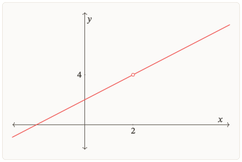
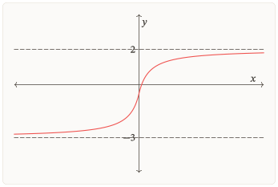
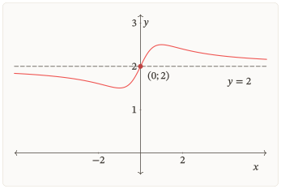
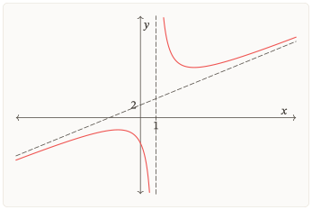
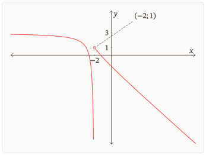
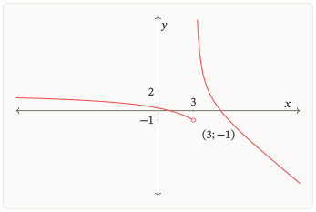
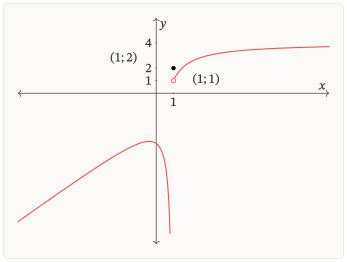

::: {.zo-on-thi-package data-r1-title="Đường tiệm cận" data-r1-code="R1-G03" data-r1-support-context="semantic" data-r1-lesson-count="8"}

## Bắt đầu {#bat-dau}

Học liệu “Đường tiệm cận” giúp em dùng giới hạn để xác định đường thẳng mà đồ thị tiến gần, đọc đúng các nhánh và giải thích kết quả trong miền đang xét. Các nhiệm vụ giúp nhận ra lỗi về miền, hướng giới hạn và cách suy luận. Bài Kiểm tra đánh giá mục tiêu của học liệu, không mô phỏng cấu trúc đề thi tốt nghiệp.

Một điểm bị loại khỏi tập xác định có luôn tạo ra tiệm cận đứng không? Đồ thị đã cắt một đường thẳng còn có thể tiến sát đường ấy ở rất xa không? Hai đầu của cùng một đồ thị có thể tiến sát hai đường khác nhau không?

### Mục tiêu

Sau khi học và tự làm, em cần có thể:

- Giữ đúng tập xác định; phân biệt giá trị tại một điểm với giới hạn khi tiến gần điểm ấy.
- Tìm tiệm cận ngang và nói rõ hướng tiến ra vô cực tương ứng.
- Tìm tiệm cận đứng bằng giới hạn một phía phù hợp.
- Tìm tiệm cận xiên trong trường hợp đơn giản và kiểm phần chênh lệch tiến về $0$.
- Nối công thức, dữ kiện giới hạn và hình đồ thị; giải thích vì sao đồ thị có thể cắt đường tiệm cận.
- Diễn giải kết quả trong một mô hình được cho, đúng miền và đơn vị.

### Tiên quyết

Em cần biến đổi được phân thức, xét dấu đơn giản và đọc kí hiệu giới hạn. Các nhiệm vụ [Khởi động](#KD01) giúp em tự kiểm bốn thao tác nền này trước khi vào phần học. Nếu thiếu thao tác nào, dùng đúng phần [Ôn nền](#on-nen) được dẫn trong bài. Đạo hàm không bắt buộc trong các nhiệm vụ chính.

Nhánh [Phối hợp](#P01) cần kiến thức về giá trị lớn nhất, nhỏ nhất trên tập đang xét. Nhánh [Chuyển giao](#P02) cần đọc được giới hạn chứa căn và trị tuyệt đối. Hai nhánh là lựa chọn thêm.

### Cách học

Chuẩn bị giấy để giữ bài tự làm và ghi lí do cho từng kết luận. Tự trả lời trước khi mở phần đối chiếu. Em có thể chia Bài học và Luyện tập thành nhiều buổi; riêng một lượt Kiểm tra phải thực hiện liên tục theo hướng dẫn của phần ấy. Khởi động chỉ khảo sát một số thao tác nền, không kiểm hết tiên quyết hoặc chứng nhận đạt cả gói.

### Chọn nơi bắt đầu

- Cần học hoặc nhớ lại khái niệm: vào [Bài học](#bai-hoc).
- Đã hiểu và muốn tự làm: vào [Luyện tập](#luyen-tap).
- Đã chuẩn bị kĩ hoặc đủ tự tin: có thể vào [Kiểm tra](#kiem-tra), kể cả chưa làm các phần trước.
- Đến ngày hẹn: chọn lượt ở [Ôn lại](#on-lai).

Đó là các điểm vào theo nhu cầu. Việc bỏ qua một phần không tự cho biết em đã làm chủ phần ấy.

### Bản đồ học

[Bài học](#bai-hoc) → [Luyện tập](#luyen-tap) → [Kiểm tra](#kiem-tra) → [Ôn lại](#on-lai)

Đây là tiến trình được khuyến nghị và thứ tự tra đọc. Em được chọn điểm vào, đi tới hoặc quay lại theo nhu cầu; không phải hoàn tất lần lượt mọi phần mới được vào phần tiếp theo. Phần bỏ qua không tự được xem là đã đạt. Ôn lại thực hiện theo ngày hẹn.

Ôn nền, Lời giải, Sửa lỗi và Nhật kí là các hỗ trợ được gọi khi cần, theo bảng dưới. Sau hỗ trợ, trở về đúng nhiệm vụ hoặc Điểm dừng đang vướng.

### Khi cần hỗ trợ

:::: {#g03-table-01 .r1-table}

| Em đang cần                             | Nơi nên mở                                             | Sau đó                                                  |
| --------------------------------------- | ------------------------------------------------------ | ------------------------------------------------------- |
| Nhớ lại một khái niệm của gói           | Đúng mục trong [Bài học](#bai-hoc)                     | Trở về câu đang vướng                                   |
| Bổ sung cách đọc giới hạn hoặc biến đổi | Đúng phần [Ôn nền](#on-nen)                            | Tự làm câu nền rồi trở về bài gốc                       |
| Đối chiếu hoặc sửa bài đã làm           | [Lời giải](#loi-giai), rồi [Sửa lỗi](#sua-loi) nếu cần | Kiểm đúng phần còn sai bằng câu phù hợp chưa xem đáp án |
| Lưu quyết định hoặc nơi tiếp tục        | [Nhật kí](#nhat-ki)                                    | Ghi dữ kiện đã có, không cần ghi sau mọi thao tác       |

::::

Giữ bài tự làm trước khi mở trợ giúp; khi đối chiếu, xem cả lí do và kết luận. Nếu đã nhận trợ giúp, ghi riêng phần làm được sau đó. Câu đã xem đáp án dùng để học lại, không tính là lần tự làm mới.

Riêng trong một lượt Kiểm tra, em phải tự lực hoàn toàn. Nếu cần mở Bài học, Ôn nền, Sửa lỗi hoặc Lời giải để trợ giúp, hãy kết thúc lượt và giữ bài ban đầu trước. Nếu vào thẳng một phần hỗ trợ, chọn câu hoặc hoạt động em muốn trở về.

### Khi nào hoàn tất lượt chính?

Hoàn tất lượt chính khi bài làm tự lực cho thấy em đáp ứng các mục tiêu thiết yếu và những lỗi cản trở việc học tiếp đã được kiểm lại bằng câu phù hợp còn mới. Dùng bảng sau [Kiểm tra](#CPK) để xem từng mục tiêu, không chỉ đếm đáp số đúng. Nếu chưa có câu mới phù hợp hoặc còn sai sau hỗ trợ, ghi rõ phần chưa xác nhận và tiếp tục phần độc lập đủ nền.

Khi hoàn tất, ghi ngày gốc và hẹn Ôn lại sau khoảng $2$–$3$ ngày, $7$ ngày và $3$–$4$ tuần. Em có thể học tiếp nội dung phù hợp trong khi chờ lịch ôn; kết quả làm được ngay sau học chưa cho biết em còn nhớ sau nhiều ngày.

## Bài học {#bai-hoc}

Định hướng bài học

**Câu hỏi dẫn đường:** từ công thức hoặc dữ kiện giới hạn, ta biết đồ thị tiến gần đường nào, ở phía nào, và còn điều gì chưa biết?

Trước mỗi kết luận, hãy xác định miền đang xét, hướng biến tiến tới và biểu thức cần lấy giới hạn. Sau đó nối kết quả với phương trình đường thẳng và đúng nhánh trên hình.

:::: {#g03-table-02 .r1-table}

| Phần học                      | Việc em tập làm                                            |
| ----------------------------- | ---------------------------------------------------------- |
| [Giới hạn và giá trị](#bh-01) | Phân biệt giá trị tại điểm với hành vi ở gần điểm          |
| [Tiệm cận ngang](#bh-02)      | Xét riêng hai đầu vô cực, không đếm trùng đường            |
| [Tiệm cận đứng](#bh-03)       | Dùng ít nhất một giới hạn một phía vô cực hợp lệ           |
| [Tiệm cận xiên](#bh-04)       | Tìm đủ đường thẳng, kiểm giới hạn của hiệu và nối với hình |
| [Miền và bối cảnh](#bh-05)    | Chọn kết luận vừa đủ dữ kiện và diễn giải mô hình          |
| [Sửa một lập luận](#bh-06)    | Giữ phần đúng, sửa đúng lí do và tự làm câu xác nhận       |

::::

Bắt đầu bằng [Khởi động](#KD01), rồi vào [mục Giới hạn mô tả hành vi của hàm số](#bh-01). Mỗi mục kiến thức mở đầu bằng một nhiệm vụ Gợi mở, đánh số liên tục từ 01 đến 06. Hãy thử trả lời trước khi đọc phần giải thích; các câu này dẫn vào nội dung sắp học, không thay câu Tự kiểm tra cuối mục. Cuối mỗi mục có câu Tự kiểm tra và lời giải riêng. Học liệu chưa thực hiện toàn bộ quy trình khảo sát hàm số; không yêu cầu biện luận tham số hoặc tính đạo hàm trong các nhiệm vụ chính. Hai nhánh Phối hợp và Chuyển giao là lựa chọn thêm.

### Khởi động {#khởi-động}

Cách thực hiện

Tự làm bốn nhiệm vụ trên giấy trước khi mở lời giải. Chúng giúp em nhận ra thao tác nền còn vướng; không cần tính điểm và không cần biết trước tên các đường tiệm cận.

#### Nhiệm vụ 01 — Giữ miền khi rút gọn {#KD01 .zo-learning-task data-zo-type="task" data-zo-function="function.warmup" data-zo-task="G03-KD01" data-zo-number="1"}

Cho $r(x)=\frac{x^2-100}{x-10}$ với tập xác định tự nhiên. Ghi tập xác định, rút gọn biểu thức trên miền ấy. Sau rút gọn, em có được thêm $10$ vào tập xác định hoặc viết giá trị $r(10)$ không?

[Xem lời giải](#lg-KD01).

#### Nhiệm vụ 02 — Đọc hướng và xét dấu {#KD02 .zo-learning-task data-zo-type="task" data-zo-function="function.warmup" data-zo-task="G03-KD02" data-zo-number="2"}

Với $p(x)=-\frac{3}{x-1}$, hãy diễn tả $x\to1^-$ và $x\to1^+$ bằng lời. Ở mỗi phía, xác định dấu của mẫu rồi tính giới hạn tương ứng. Bài này chưa yêu cầu gọi tên đường tiệm cận.

[Xem lời giải](#lg-KD02).

#### Nhiệm vụ 03 — Xét riêng hai đầu vô cực {#KD03 .zo-learning-task data-zo-type="task" data-zo-function="function.warmup" data-zo-task="G03-KD03" data-zo-number="3"}

Tính $\lim_{x\to+\infty}q(x)$ và $\lim_{x\to-\infty}q(x)$ với $q(x)=\frac{4x+1}{x+2}$. Viết phép chia cả tử và mẫu cho $x$ để làm rõ kết quả; không thay “vô cực” vào công thức như một số.

[Xem lời giải](#lg-KD03).

#### Nhiệm vụ 04 — Kiểm thương và phần dư {#KD04 .zo-learning-task data-zo-type="task" data-zo-function="function.warmup" data-zo-task="G03-KD04" data-zo-number="4"}

Viết $A(x)=\frac{2x^2+x+5}{x+1}$ thành một biểu thức bậc nhất cộng phần dư trên mẫu. Ghi điều kiện của $x$ và nhân ngược để kiểm lại. Bài này chỉ kiểm phép biến đổi, chưa yêu cầu kết luận về tiệm cận.

[Xem lời giải](#lg-KD04).

#### Sau khi làm xong {#CP-KD data-zo-type="checkpoint" data-r1-return-label="Khởi động"}

Giữ bài làm rồi đối chiếu từng câu. Câu còn vướng chỉ ra đúng phần nền nên xem lại trong bảng dưới; không cần học lại mọi tài nguyên. Nếu đã rõ cả bốn thao tác, chuyển sang [mục Giới hạn mô tả hành vi của hàm số](#bh-01). Làm đúng Khởi động chưa có nghĩa đã đạt các mục tiêu của gói.

#### Chọn đúng phần cần ôn

:::: {#g03-table-03 .r1-table}

| Câu còn vướng | Kiến thức cần ôn                      | Đi đến                         | Sau đó                                                  |
| ------------- | ------------------------------------- | ------------------------------ | ------------------------------------------------------- |
| Nhiệm vụ 01   | Mẫu khác $0$ và điều kiện khi rút gọn | [Biến đổi phân thức](#N-DS-01) | Trở về [Nhiệm vụ 01](#KD01), sửa điều kiện rồi tiếp tục |
| Nhiệm vụ 02   | Hướng tiến gần và dấu của phân thức   | [Giới hạn một phía](#N-GH-02)  | Trở về [Nhiệm vụ 02](#KD02), giải thích lại từng phía   |
| Nhiệm vụ 03   | Chia theo bậc và giới hạn ở hai đầu   | [Giới hạn ở vô cực](#N-GH-03)  | Trở về [Nhiệm vụ 03](#KD03), kiểm hai hướng             |
| Nhiệm vụ 04   | Thương, phần dư và phép nhân kiểm lại | [Biến đổi phân thức](#N-DS-01) | Trở về [Nhiệm vụ 04](#KD04), kiểm đúng phép biến đổi    |

::::

Sau khi xem nền, tự làm câu của tài nguyên nếu còn mới rồi trở lại câu đang vướng. Lần sửa câu Khởi động đã xem lời giải giúp em học lại, không được tính là một câu xác nhận độc lập mới. Nếu một thao tác vẫn chưa rõ, ghi phần còn thiếu và đọc đúng phần giải thích; không tự đánh dấu đã đủ nền.

### 1. Giới hạn mô tả hành vi của hàm số {#bh-01}

Cách thực hiện

thử trả lời câu hỏi dưới; đọc Ví dụ 01 và chỉ trên hai hình điều khác nhau tại điểm bị loại; cuối mục tự làm Tự kiểm tra 01.

#### Gợi mở 01 — Giá trị tại điểm và hành vi lân cận {#GM01 .zo-learning-task data-zo-type="task" data-zo-function="function.guided_thinking" data-zo-task="G03-GM01" data-zo-number="1"}

Thử trả lời trước khi đọc tiếp.

Hai công thức cùng không xác định tại một hoành độ có buộc đồ thị có cùng hành vi ở gần đó không? Giá trị tại điểm và giới hạn khi tiến gần điểm ấy đang trả lời cùng một câu hỏi hay hai câu hỏi khác nhau?

Việc không xác định tại một điểm chưa cho biết hàm tiến tới đâu ở lân cận. Giá trị tại điểm và giới hạn cần được xét riêng. Hãy kiểm lại nhận xét này bằng hai hàm trong Ví dụ 01.

#### 1.1. Giá trị, giới hạn tại điểm và giới hạn ở vô cực {#giá-trị-giới-hạn-tại-điểm-và-giới-hạn-ở-vô-cực data-zo-type="explanation" data-zo-unit="G03-U01"}

Ba câu hỏi sau khác nhau:

- **Giá trị tại điểm:** $f(a)$ có được xác định không, và nếu có thì bằng bao nhiêu?
- **Giới hạn tại điểm:** khi $x$ tiến gần $a$ theo một phía được phép, $f(x)$ tiến tới đâu?
- **Giới hạn ở vô cực:** khi $x$ tăng hoặc giảm không bị chặn trong tập xác định, $f(x)$ có hành vi thế nào?

Giới hạn xét các giá trị ở gần mốc, không tự bổ sung một điểm vào tập xác định. Khi $x\to+\infty$ hoặc $x\to-\infty$, ta cũng không thay “vô cực” vào công thức như thay một số.

#### 1.2. Ví dụ 01 — Cùng loại một điểm, hành vi khác nhau {#H01 .zo-learning-task data-zo-type="example" data-zo-task="G03-H01" data-zo-number="1"}

Xét

$$u(x)=\frac{x^2-4}{x-2},\qquad v(x)=\frac{x+2}{x-2}.$$

Cả hai hàm đều có tập xác định $\mathbb R\setminus\{2\}$. Với $x\ne 2$,

$$u(x)=x+2.$$

Do đó $\lim_{x\to2}u(x)=4$, nhưng $u(2)$ vẫn không được xác định. Đồ thị $u$ là đường $y=x+2$ bỏ điểm $(2;4)$.

Với $v$, ta viết

$$v(x)=1+\frac{4}{x-2}.$$

Khi $x\to 2^{-}$, mẫu âm và tiến tới $0$ nên $v(x)\to -\infty$. Khi $x\to 2^{+}$, mẫu dương và tiến tới $0$ nên $v(x)\to +\infty$. Việc cùng loại $x=2$ không khiến hai hàm có cùng hành vi gần $2$.

<figure class="zo-graph-asset">

{fig-alt="Đường thẳng có một điểm bị loại, được đánh dấu bằng vòng tròn rỗng."}

<figcaption>

Hình $1$. Giá trị tiến tới là $4$, nhưng điểm $(2;4)$ bị loại.

</figcaption>

</figure>

<figure class="zo-graph-asset">

{fig-alt="Hai nhánh đồ thị đi xuống và đi lên không bị chặn ở hai phía của một mốc."}

<figcaption>

Hình $2$. Cũng loại $x=2$, nhưng tung độ không tiến tới một số hữu hạn.

</figcaption>

</figure>

#### 1.3. Tự kiểm tra 01 — Rút gọn có thêm được một điểm không? {#T01 .zo-learning-task data-zo-type="task" data-zo-function="function.self_check" data-zo-task="G03-T01" data-zo-number="1"}

Cho $r(x)=\frac{x^2-1}{x-1}$ với tập xác định tự nhiên. Một bạn viết: “$r(x)=x+1$ nên $r(1)=2$.” Hãy chỉ rõ phần đúng, phần sai; tìm giới hạn của $r(x)$ khi $x\to 1$.

[Xem lời giải](#lg-T01). Nếu vướng điều kiện sau rút gọn, xem [Biến đổi phân thức](#N-DS-01), rồi trở lại câu này. Nếu đã hiểu, tiếp tục mục 2.

### 2. Tiệm cận ngang: xét riêng hai đầu vô cực {#bh-02}

Cách thực hiện

đọc định nghĩa và ghi hướng giới hạn trong từng ví dụ; so sánh trường hợp hai đầu trùng nhau, khác nhau và đồ thị cắt đường ngang; cuối mục tự làm Tự kiểm tra 02.

#### Gợi mở 02 — Hai đầu của đồ thị {#GM02 .zo-learning-task data-zo-type="task" data-zo-function="function.guided_thinking" data-zo-task="G03-GM02" data-zo-number="2"}

Thử trả lời trước khi đọc tiếp.

Khi $x\to+\infty$, $f(x)\to4$. Tung độ của điểm trên đồ thị đang tiến gần tung độ của đường thẳng nào? Dữ kiện này đã cho biết hành vi ở đầu trái chưa?

Ta đang so $f(x)$ với $4$, tức so tung độ của điểm trên đồ thị với tung độ của đường $y=4$. Dữ kiện chỉ nói về đầu phải. Định nghĩa dưới đây giúp gọi tên đường ấy và xét riêng từng đầu vô cực. Một điểm giao hữu hạn có mâu thuẫn với hành vi ở rất xa không? Hãy giữ câu hỏi này khi đọc các ví dụ.

#### 2.1. Định nghĩa và ý nghĩa {#định-nghĩa-và-ý-nghĩa data-zo-type="definition" data-zo-unit="G03-U02"}

::: {.zo-block .zo-block-red}

Đường thẳng **$y=L$** là một tiệm cận ngang của đồ thị $y=f(x)$ nếu ít nhất một trong hai điều kiện sau đúng:

$$\lim_{x\to+\infty}f(x)=L\qquad\text{hoặc}\qquad\lim_{x\to-\infty}f(x)=L,$$

trong đó $L$ là số thực và hướng đang xét có nghĩa trên tập xác định.[]{#fnref1}

Chẳng hạn, khi $f(x)\to L$ ở đầu phải, độ chênh tung độ $|f(x)-L|$ tiến về $0$ khi $x\to+\infty$. Đường ngang mô tả hành vi ở xa, không buộc đồ thị phải nằm về một phía của đường ở mọi điểm.

:::

[Nguồn đối chiếu: Sách giáo khoa Toán 12, tập một, bộ Kết nối tri thức với cuộc sống, bài 3, trang 20 (trang 22 của tệp PDF), định nghĩa đường tiệm cận ngang.]{#fn1 .zo-source-note}

#### 2.2. Ví dụ 02 — Hai đầu cho cùng một đường {#H02 .zo-learning-task data-zo-type="example" data-zo-task="G03-H02" data-zo-number="2"}

Cho $f(x)=4-\frac{3}{x+2}$, $x\ne-2$. Vì $\frac{3}{x+2}\to0$ khi $x\to+\infty$ và khi $x\to-\infty$, ta có

$$\lim_{x\to+\infty}f(x)=4,\qquad \lim_{x\to-\infty}f(x)=4.$$

Đồ thị có tiệm cận ngang $y=4$. Hai giới hạn cùng bằng $4$ xác định **một đường thẳng**, không phải hai tiệm cận khác nhau.

<figure class="zo-graph-asset">

{fig-alt="Hai nhánh đồ thị tiến gần cùng một đường thẳng ngang ở hai đầu."}

<figcaption>

Hình $3$. Đồ thị của $f$ trong Ví dụ 02; nét đứt ngang biểu diễn $y=4$.

</figcaption>

</figure>

#### 2.3. Ví dụ 03 — Hai đầu có thể khác nhau {#H03 .zo-learning-task data-zo-type="example" data-zo-task="G03-H03" data-zo-number="3"}

Biết $\lim_{x\to+\infty}g(x)=2$ và $\lim_{x\to-\infty}g(x)=-3$. Đồ thị có hai tiệm cận ngang: $y=2$ ở đầu phải và $y=-3$ ở đầu trái. Không được lấy kết quả của đầu phải áp cho đầu trái nếu chưa có căn cứ.

<figure class="zo-graph-asset">

{fig-alt="Hai đầu của một đồ thị tiến gần hai đường thẳng ngang khác nhau."}

<figcaption>

Hình $4$. Một đồ thị phù hợp với hai giới hạn đã cho. Dữ kiện giới hạn xác định kết luận; hình giúp hình dung.

</figcaption>

</figure>

**Chọn cách tính phù hợp.** Với phân thức, có thể chia cả tử và mẫu cho lũy thừa thích hợp của $x$. Đó là cách tính giới hạn cho dạng đang xét, không phải định nghĩa tiệm cận ngang. Nếu miền chỉ có đầu $+\infty$, chỉ xét đầu ấy; không tạo thêm một đầu $-\infty$ không thuộc miền.

#### 2.4. Ví dụ 04 — Cắt tiệm cận ngang tại một điểm {#H07 .zo-learning-task data-zo-type="example" data-zo-task="G03-H07" data-zo-number="4"}

Xét $F(x)=2+\frac{x}{x^2+1}$ trên $\mathbb R$. Khi $x\ne0$, ta có

$$\frac{x}{x^2+1}=\frac{\frac{1}{x}}{1+\frac{1}{x^2}}\longrightarrow0\quad\text{khi }x\to\pm\infty.$$

Vì vậy $\lim_{x\to+\infty}F(x)=\lim_{x\to-\infty}F(x)=2$, nên $y=2$ là tiệm cận ngang. Nhưng phương trình $F(x)=2$ tương đương $x=0$: đồ thị cắt đường ấy tại $(0;2)$.

<figure class="zo-graph-asset">

{fig-alt="Đường cong cắt một đường ngang rồi tiến gần đường ấy ở cả hai đầu."}

<figcaption>

Hình $5$. Điểm giao hữu hạn và giới hạn ở vô cực là hai thông tin cùng đúng.

</figcaption>

</figure>

Không có mâu thuẫn: định nghĩa tiệm cận ngang yêu cầu độ chênh tiến về $0$ khi biến ra vô cực, không cấm độ chênh bằng $0$ tại một hoành độ hữu hạn.

#### 2.5. Tự kiểm tra 02 — Ghi cả đường và hướng {#T02 .zo-learning-task data-zo-type="task" data-zo-function="function.self_check" data-zo-task="G03-T02" data-zo-number="2"}

Biết $\lim_{x\to+\infty}p(x)=-1$ và $\lim_{x\to-\infty}p(x)=3$. Hãy viết các tiệm cận ngang cùng hướng tương ứng. Một bạn chỉ ghi $y=-1$ đã đủ chưa?

[Xem lời giải](#lg-T02). Nếu nhầm hướng, trở lại định nghĩa ở đầu mục này. Nếu chưa biết tính giới hạn ở vô cực, xem [Ôn nền](#N-GH-03), rồi trở lại nhiệm vụ đang làm.

### 3. Tiệm cận đứng: một phía vô cực đã đủ {#bh-03}

Cách thực hiện

đọc từ “ít nhất một” trong định nghĩa; trở lại hai hàm ở Ví dụ 01; kiểm dấu hai phía trong Ví dụ 05 rồi làm Tự kiểm tra 03.

#### Gợi mở 03 — Một phía tiến tới vô cực {#GM03 .zo-learning-task data-zo-type="task" data-zo-function="function.guided_thinking" data-zo-task="G03-GM03" data-zo-number="3"}

Thử trả lời trước khi đọc tiếp.

Khi $x\to2^+$, $g(x)\to+\infty$. Hoành độ đang tiến gần mốc nào, từ phía nào? Tung độ có tiến tới một số hữu hạn không?

Hoành độ tiến tới $2$ từ phải, còn tung độ tăng không bị chặn. Dữ kiện không gán $g(2)$ bằng vô cực: vô cực không phải một giá trị thực của hàm số. Nếu giới hạn trái hữu hạn, hành vi phía phải này có đủ để xác định một đường tiệm cận đứng không? Hãy đối chiếu với điều kiện trong định nghĩa dưới đây.

#### 3.1. Định nghĩa và các phía được phép xét {#định-nghĩa-và-các-phía-được-phép-xét data-zo-type="definition" data-zo-unit="G03-U03"}

::: {.zo-block .zo-block-red}

Đường thẳng **$x=a$** là tiệm cận đứng của đồ thị $y=f(x)$ nếu ít nhất một trong bốn điều kiện sau được thỏa mãn:[]{#fnref2}

$$\lim_{x\to a^+}f(x)=+\infty;\qquad \lim_{x\to a^-}f(x)=+\infty;$$

$$\lim_{x\to a^+}f(x)=-\infty;\qquad \lim_{x\to a^-}f(x)=-\infty.$$

Chỉ xét phía có điểm của tập xác định tiến sát $a$. Không cần cả hai phía tồn tại; nếu cả hai có nghĩa, chúng cũng không phải cùng dấu. Phương trình đường đứng là $x=a$, không phải $y=a$.

Ở Ví dụ 01, $v$ có tiệm cận đứng $x=2$ vì giới hạn trái là $-\infty$ và giới hạn phải là $+\infty$. Với $u$, hai giới hạn tại $2$ bằng $4$, nên $x=2$ không là tiệm cận đứng. **Điểm bị loại chỉ là mốc cần xem xét, chưa phải kết luận.**

:::

[Nguồn đối chiếu: Sách giáo khoa Toán 12, tập một, bộ Kết nối tri thức với cuộc sống, bài 3, trang 21 (trang 23 của tệp PDF), định nghĩa đường tiệm cận đứng.]{#fn2 .zo-source-note}

#### 3.2. Ví dụ 05 — Hai phía cùng đi lên {#H04 .zo-learning-task data-zo-type="example" data-zo-task="G03-H04" data-zo-number="5"}

Cho $g(x)=\frac{2}{(x+3)^2}$, $x\ne -3$. Khi $x$ tiến tới $-3$ từ bất cứ phía nào, $(x+3)^2$ dương và tiến về $0$. Vì vậy

$$\lim_{x\to-3^-}g(x)=+\infty,\qquad \lim_{x\to-3^+}g(x)=+\infty.$$

Đồ thị có tiệm cận đứng $x=-3$. Dấu bình phương giải thích vì sao cả hai phía cùng $+\infty$; không áp mẫu “trái âm, phải dương” cho mọi phân thức.

**Nếu hàm được gán riêng giá trị tại $a$?** Giá trị ấy không tự xóa một giới hạn vô cực ở lân cận. Để kiểm đường đứng, vẫn đọc đúng hành vi khi $x$ tiến tới $a$. Ngược lại, chỉ biết $f(a)$ không tồn tại cũng chưa đủ để kết luận có tiệm cận đứng.

#### 3.3. Tự kiểm tra 03 — Chỉ một phía có nghĩa {#T03 .zo-learning-task data-zo-type="task" data-zo-function="function.self_check" data-zo-task="G03-T03" data-zo-number="3"}

Hàm $w$ có tập xác định $(-\infty;5)$, liên tục trên khoảng này và $\lim_{x\to5^-}w(x)=-\infty$. Có thể kết luận $x=5$ là tiệm cận đứng không? Có cần thêm giới hạn phải tại $5$ không?

[Xem lời giải](#lg-T03). Nếu vướng kí hiệu hoặc dấu vô cực, dùng [Giới hạn một phía](#N-GH-02), rồi quay lại câu này.

### 4. Tiệm cận xiên: kiểm phần chênh lệch {#bh-04}

Cách thực hiện

tự chia phân thức ở Ví dụ 06 trước khi đối chiếu; nhân ngược, kiểm giới hạn hiệu, rồi đọc từng nhánh trên hình. Sau đó so với cách tìm hai hệ số và làm Tự kiểm tra 04.

#### Gợi mở 04 — Đường thẳng và phần chênh lệch {#GM04 .zo-learning-task data-zo-type="task" data-zo-function="function.guided_thinking" data-zo-task="G03-GM04" data-zo-number="4"}

Thử trả lời trước khi đọc tiếp.

Khi $x\to+\infty$, hiệu $h(x)-(x-1)$ tiến tới $0$. Em đang so tung độ của điểm trên đồ thị với tung độ của đường thẳng nào? Hiệu tiến về $0$ cho biết điều gì?

Ta đang so $h(x)$ với $x-1$, tức so tung độ của điểm trên đồ thị với tung độ của đường $y=x-1$ có cùng hoành độ. Phần chênh lệch ấy tiến về $0$ ở đầu phải. Định nghĩa dưới đây dùng chính giới hạn của hiệu để nhận biết tiệm cận xiên. Hai đường thẳng có cùng hệ số góc đã là cùng một đường chưa? Hãy lưu ý cả hệ số tự do khi kiểm giới hạn.

#### 4.1. Định nghĩa bằng giới hạn của hiệu {#định-nghĩa-bằng-giới-hạn-của-hiệu data-zo-type="definition" data-zo-unit="G03-U04"}

::: {.zo-block .zo-block-red}

Đường thẳng **$y=ax+b$**, với $a\ne0$, là tiệm cận xiên của đồ thị $y=f(x)$ nếu[]{#fnref3}

$$\lim_{x\to+\infty}[f(x)-(ax+b)]=0$$

hoặc

$$\lim_{x\to-\infty}[f(x)-(ax+b)]=0.$$

Ở cùng một hoành độ $x$, hiệu $f(x)-(ax+b)$ là chênh lệch tung độ giữa đồ thị và đường thẳng. Khi hiệu tiến về $0$, khoảng cách từ điểm trên đồ thị đến đường thẳng ấy cũng tiến về $0$. Nếu $a=0$, đường là đường ngang và ta dùng tên tiệm cận ngang.

:::

[Nguồn đối chiếu: Sách giáo khoa Toán 12, tập một, bộ Kết nối tri thức với cuộc sống, bài 3, trang 23 (trang 25 của tệp PDF), định nghĩa đường tiệm cận xiên.]{#fn3 .zo-source-note}

#### 4.2. Ví dụ 06 — Tách phần tuyến tính và phần còn lại {#H05 .zo-learning-task data-zo-type="example" data-zo-task="G03-H05" data-zo-number="6"}

Cho $h(x)=\frac{x^2+x+4}{x-1}$, $x\ne 1$. Chia đa thức, ta được

$$h(x)=x+2+\frac{6}{x-1}.$$

Có thể kiểm ngay bằng $(x-1)(x+2)+6=x^2+x+4$. Suy ra

$$h(x)-(x+2)=\frac{6}{x-1}\longrightarrow0\quad\text{khi }x\to\pm\infty.$$

Vì thế $y=x+2$ là tiệm cận xiên ở cả hai đầu. Muốn tìm thêm tiệm cận đứng, xét riêng giới hạn tại điểm loại $x=1$; phần $\frac{6}{x-1}$ cho giới hạn trái $-\infty$ và phải $+\infty$, nên $x=1$ là tiệm cận đứng.

<figure class="zo-graph-asset">

{fig-alt="Hai nhánh đồ thị tiến gần một đường xiên ở xa và một đường đứng gần điểm bị loại."}

<figcaption>

Hình $6$. Đường xiên mô tả phần tuyến tính ở xa; giới hạn tại $x=1$ trả lời câu hỏi khác.

</figcaption>

</figure>

**Từ công thức đến thông tin trên hình.** Với cùng hàm $h$ trong Ví dụ 06, ta đi lần lượt:

:::: {#g03-table-04 .r1-table}

| Bước                 | Dữ kiện đã kiểm                                            | Điều cần chỉ trên Hình $6$                                                    |
| -------------------- | ---------------------------------------------------------- | ----------------------------------------------------------------------------- |
| Giữ miền             | $x\ne1$                                                    | Hai phần đồ thị nằm hai phía của mốc $1$                                      |
| Xét gần mốc          | $\lim_{x\to1^-}h(x)=-\infty$, $\lim_{x\to1^+}h(x)=+\infty$ | Nhánh trái đi xuống, nhánh phải đi lên không bị chặn khi tiến gần đường $x=1$ |
| Xét ở xa             | $\lim_{x\to\pm\infty}[h(x)-(x+2)]=0$                       | Mỗi đầu tiến gần đường $y=x+2$ ở hướng tương ứng                              |
| Đọc vị trí tương đối | $h(x)-(x+2)=\frac{6}{x-1}$                                 | Nhánh bên trái nằm dưới đường xiên, nhánh bên phải nằm trên đường xiên        |

::::

Khi phác riêng các thông tin tiệm cận, trước hết đặt đường đứng $x=1$ và đường xiên $y=x+2$; sau đó ghi hướng của các nhánh gần mốc và ở xa. Các giới hạn không tự cho mọi khoảng tăng giảm, điểm cực trị hoặc một hình dạng duy nhất ở giữa. Hình $6$ được dựng từ công thức đầy đủ; không được lấy nét cong của hình làm kết luận đã chứng minh chỉ bằng tiệm cận.

#### 4.3. Tìm đủ hai hệ số của đường tiệm cận xiên {#tìm-đủ-hai-hệ-số-của-đường-tiệm-cận-xiên data-zo-type="method" data-zo-unit="G03-U05"}

Có thể tìm lần lượt hệ số góc và hệ số tự do bằng giới hạn.[]{#fnref4} Ta phải chọn một hướng tiến ra vô cực và giữ nguyên hướng ấy trong cả hai phép tính.

- **Khi xét phía $x\to+\infty$**, tính

  $$a=\lim_{x\to+\infty}\frac{f(x)}{x},\qquad b=\lim_{x\to+\infty}[f(x)-ax].$$

  Nếu hai giới hạn trên tồn tại và hữu hạn, đồng thời $a\ne0$, thì đường thẳng $y=ax+b$ là tiệm cận xiên của đồ thị khi $x\to+\infty$.

- **Khi xét phía $x\to-\infty$**, tính riêng

  $$a=\lim_{x\to-\infty}\frac{f(x)}{x},\qquad b=\lim_{x\to-\infty}[f(x)-ax].$$

  Nếu hai giới hạn này tồn tại và hữu hạn, đồng thời $a\ne0$, thì đường thẳng $y=ax+b$ là tiệm cận xiên của đồ thị khi $x\to-\infty$.

Các giá trị $a$, $b$ tìm được ở hai hướng có thể khác nhau. Không lấy $a$ ở hướng này rồi ghép với $b$ ở hướng kia. Nếu chỉ tính $\lim_{x\to+\infty}\frac{f(x)}{x}=a$, em mới tìm được hệ số góc ở phía $x\to+\infty$, chưa biết hệ số tự do $b$ để viết phương trình đường thẳng. Trường hợp phía $x\to-\infty$ cũng cần đủ hai bước như vậy.

Với hàm $h$ trong Ví dụ 06, khi xét phía $x\to+\infty$, ta có

$$\lim_{x\to+\infty}\frac{h(x)}{x}=\lim_{x\to+\infty}\left[1+\frac{2}{x}+\frac{6}{x(x-1)}\right]=1,$$

nên $a=1$. Tiếp theo,

$$b=\lim_{x\to+\infty}[h(x)-x]=\lim_{x\to+\infty}\left[2+\frac{6}{x-1}\right]=2.$$

Vậy đường tiệm cận xiên ở phía này là $y=x+2$. Cách tách thương và phần dư ở trên cũng cho kết quả ấy, đồng thời giúp kiểm trực tiếp giới hạn của hiệu. Khi giải phân thức đơn giản, em có thể dùng cách tách này.

[Nguồn đối chiếu: Sách giáo khoa Toán 12, tập một, bộ Kết nối tri thức với cuộc sống, bài 3, trang 24 (trang 26 của tệp PDF), phần Chú ý và Nhận xét.]{#fn4 .zo-source-note}

#### 4.4. Tự kiểm tra 04 — Thiếu một hằng số {#T04 .zo-learning-task data-zo-type="task" data-zo-function="function.self_check" data-zo-task="G03-T04" data-zo-number="4"}

Cho $q(x)=2x-5+\frac{1}{x+6}$, $x\ne -6$. Một bạn chỉ nhìn hệ số của $x$ và chọn $y=2x$. Hãy tìm đường xiên đúng và dùng giới hạn của hiệu để bác đường đã chọn.

[Xem lời giải](#lg-T04). Nếu chưa tách được một phân thức thành thương và dư, xem [Biến đổi phân thức](#N-DS-01). Sau đó quay về bài đang vướng; làm đúng phép chia vẫn cần bước kiểm giới hạn phần dư.

### 5. Đọc kết quả trong đúng miền và đúng bối cảnh {#bh-05}

Cách thực hiện

chọn loại giới hạn theo câu hỏi; dùng bảng giới hạn suy luận trước khi đọc hình; đọc miền và đơn vị trong Ví dụ 07 rồi làm Tự kiểm tra 05.

#### Gợi mở 05 — Giới hạn trong miền mô hình {#GM05 .zo-learning-task data-zo-type="task" data-zo-function="function.guided_thinking" data-zo-task="G03-GM05" data-zo-number="5"}

Thử trả lời trước khi đọc tiếp.

Một công thức tính được tại thời gian âm có cho phép dùng thời gian ấy trong mọi mô hình không? Một giới hạn hữu hạn có luôn là giá trị được đạt không?

Công thức phải đi cùng miền của mô hình. Giới hạn mô tả mức tiến tới; muốn biết mức ấy có được đạt hay không, còn phải kiểm các giá trị của hàm trong miền. Mục này giúp em giữ hai ranh giới đó khi diễn giải kết quả.

#### 5.1. Chọn giới hạn theo câu hỏi và theo miền {#chọn-giới-hạn-theo-câu-hỏi-và-theo-miền data-zo-type="method" data-zo-unit="G03-U06"}

Khi gặp một bài tiệm cận, hãy tự hỏi: biến đang tiến tới một mốc hữu hạn hay ra vô cực? Miền cho phép tiếp cận theo phía nào? Ta cần xét $f(x)$, hay xét hiệu giữa $f(x)$ và một biểu thức tuyến tính?

:::: {#g03-table-05 .r1-table}

| Muốn kiểm | Dữ kiện quyết định                                                  | Dạng phương trình |
| --------- | ------------------------------------------------------------------- | ----------------- |
| Ngang     | $f(x)$ tiến tới số hữu hạn $L$ ở một đầu vô cực                     | $y=L$             |
| Đứng      | $f(x)$ tiến tới $+\infty$ hoặc $-\infty$ ở ít nhất một phía của $a$ | $x=a$             |
| Xiên      | $f(x)-(ax+b)$ tiến về $0$ ở một đầu vô cực, $a\ne 0$                | $y=ax+b$          |

::::

Hình vẽ giúp nhìn hướng và vị trí. Một cửa sổ hình hữu hạn không tự chứng minh hành vi ở vô cực; khi cần kết luận chính xác, dùng công thức, giới hạn được cho hoặc kí hiệu dữ kiện trên hình. Đặc biệt, nhìn đồ thị “rất gần” một đường chưa chứng minh được đó là tiệm cận.

**Giới hạn của suy luận từ dữ kiện**

:::: {#g03-table-06 .r1-table}

| Dữ kiện đang có                           | Điều có căn cứ                                               | Điều chưa được tự thêm                                        |
| ----------------------------------------- | ------------------------------------------------------------ | ------------------------------------------------------------- |
| Công thức và miền                         | Tính giới hạn theo các hướng thuộc miền, rồi dùng định nghĩa | Gọi nghiệm mẫu là tiệm cận đứng trước khi xét giới hạn        |
| Một giới hạn hữu hạn ở đầu phải           | Tiệm cận ngang ở đầu phải                                    | Kết quả ở đầu trái hoặc kết luận không có đường đứng          |
| Một phía tiến tới vô cực tại mốc          | Tiệm cận đứng tại mốc ấy                                     | Dấu hoặc giá trị giới hạn ở phía còn lại                      |
| Giới hạn hiệu với một đường xiên bằng $0$ | Tiệm cận xiên ở hướng đã xét                                 | Vị trí trên/dưới ở mọi điểm, hoặc cấm giao điểm               |
| Hình trong một cửa sổ hữu hạn             | Vị trí, nhãn và quan hệ được đề xác định rõ                  | Hành vi ở vô cực chỉ vì nét vẽ trông gần một đường            |
| Công thức của mô hình trên miền đã cho    | Kết luận trong miền, với đơn vị và giả thiết của mô hình     | Mở rộng thời gian hoặc khẳng định thực nghiệm ngoài giả thiết |

::::

#### 5.2. Ví dụ 07 — Tiến tới một mức không có nghĩa đạt mức ấy {#H06 .zo-learning-task data-zo-type="example" data-zo-task="G03-H06" data-zo-number="7"}

Trong một mô hình giả định, nồng độ sau $t$ giờ được cho bởi

$$c(t)=5+\frac{12}{t+1}\quad(t\ge0),$$

với $c$ tính bằng $\mathrm{mg}\,\mathrm{L}^{-1}$. Khi $t\to +\infty$, phần $\frac{12}{t+1}$ tiến về $0$, nên $c(t)\to 5$. Đồ thị trên miền mô hình có tiệm cận ngang $c=5$: mô hình dự báo nồng độ tiến gần $5$ $\mathrm{mg}\,\mathrm{L}^{-1}$ khi thời gian tăng.

Tại mọi $t\ge 0$ hữu hạn, $\frac{12}{t+1}>0$, nên $c(t)>5$. Mô hình không cho một thời điểm hữu hạn tại đó nồng độ bằng $5$ $\mathrm{mg}\,\mathrm{L}^{-1}$. Mốc $t=-1$ nằm ngoài miền $t\ge 0$ và không thể được tiến sát bằng các thời điểm hợp lệ; không gọi $t=-1$ là tiệm cận đứng của **đồ thị trên miền mô hình** này.

Kết luận trên thuộc mô hình đã cho, không là khẳng định thực nghiệm về mọi quá trình thay đổi nồng độ.

#### 5.3. Tự kiểm tra 05 — Không mở rộng miền theo ý mình {#T05 .zo-learning-task data-zo-type="task" data-zo-function="function.self_check" data-zo-task="G03-T05" data-zo-number="5"}

Một chỉ số được mô hình hóa bởi $z(t)=10+\frac{8}{t+2}$, $t\ge 0$ tính bằng giờ, $z$ tính bằng điểm. Hãy nêu ý nghĩa giới hạn khi $t\to +\infty$; chỉ số có bằng $10$ tại thời điểm hữu hạn không? Có nên dùng $t=-2$ làm tiệm cận đứng của đồ thị trên miền này không?

[Xem lời giải](#lg-T05). Nếu nhầm giới hạn với một giá trị được đạt, đọc lại Ví dụ 07; nếu nhầm miền, xem [Biến đổi phân thức](#N-DS-01). Quay lại câu này sau khi đối chiếu.

### 6. Sửa một lập luận và tự kiểm lại {#bh-06}

Cách thực hiện

tự chỉ ra vế đúng và bước sai trong ví dụ; đọc cách chữa; sau đó làm câu Tự kiểm tra mới trước khi mở lời giải. Đọc hiểu lời chữa chưa chứng minh em tự xử lí được tình huống khác.

#### Gợi mở 06 — Đọc lời chữa và tự kiểm lại {#GM06 .zo-learning-task data-zo-type="task" data-zo-function="function.guided_thinking" data-zo-task="G03-GM06" data-zo-number="6"}

Thử trả lời trước khi đọc tiếp.

Em đọc lời chữa và thấy hợp lí. Điều đó đã đủ để biết em sẽ tự phát hiện và sửa được lỗi khi dữ kiện đổi từ công thức sang giới hạn cho sẵn chưa? Khi một lập luận có cả phần đúng và phần sai, em cần giữ lại điều gì?

Đọc hiểu lời chữa chưa cho biết em có tự làm được tình huống khác hay không. Hãy giữ phần đúng, tìm đúng bước suy luận sai, sửa căn cứ rồi tự làm câu phù hợp còn mới. Ví dụ và câu Tự kiểm tra dưới đây giúp phân biệt các việc ấy.

#### 6.1. Ví dụ 08 — Giữ phần đúng khi sửa {#H08 .zo-learning-task data-zo-type="example" data-zo-task="G03-H08" data-zo-number="8"}

Cho $u(x)=\frac{x^2-121}{x-11}$ trên miền tự nhiên. Một bạn viết: “Hàm không xác định tại $11$, nên $x=11$ là tiệm cận đứng; rút gọn được $u(x)=x+11$, nên $u(11)=22$.”

- **Phần đúng:** miền loại $11$; phép rút gọn đúng với $x\ne11$.
- **Bước sai:** dùng việc không xác định để kết luận giới hạn vô cực; sau đó dùng biểu thức rút gọn để thêm giá trị ngoài miền.
- **Kiểm lại căn cứ:** $\lim_{x\to11^-}u(x)=\lim_{x\to11^+}u(x)=22$, là giới hạn hữu hạn.
- **Viết lại:** “Hàm có miền $\mathbb R\setminus\{11\}$. Trên miền này, $u(x)=x+11$. Hai giới hạn tại $11$ bằng $22$, nên $x=11$ không là tiệm cận đứng; $u(11)$ vẫn không được xác định.”

Ví dụ đã cho lời chữa, vì vậy không dùng việc chép lại lời chữa làm bằng chứng mới. Nhiệm vụ dưới đổi sang dữ kiện giới hạn có sẵn và giữ một giá trị riêng tại mốc.

#### 6.2. Tự kiểm tra 06 — Có giá trị tại mốc vẫn cần xét lân cận {#T06 .zo-learning-task data-zo-type="task" data-zo-function="function.self_check" data-zo-task="G03-T06" data-zo-number="6"}

Một hàm $g$ xác định trên $\mathbb R$, có $g(2)=5$ và $\lim_{x\to2^+}g(x)=+\infty$. Một bạn nói: “Điểm $(2;5)$ thuộc đồ thị, nên $x=2$ không thể là tiệm cận đứng.”

Hãy giữ phần đúng, chỉ bước suy luận sai, viết lại toàn bộ câu và nêu điều chưa biết về giới hạn trái tại $2$.

**Tiêu chí tự kiểm:** phân biệt giá trị tại mốc với giới hạn phải; dùng đúng điều kiện đủ của đường đứng; giữ dữ kiện đúng và không tự gán giới hạn trái.

[Xem lời giải](#lg-T06). Nếu còn nhầm, xem lại [định nghĩa tiệm cận đứng](#bh-03); nếu thiếu cách đọc hướng, xem [Giới hạn một phía](#N-GH-02). Khi cần xác nhận sau sửa, tự làm ý b còn mới của [Nhiệm vụ 01 trong Sửa lỗi sau Luyện tập](#S-L01), rồi trở về đây. Ý a chỉ kiểm điểm bị loại sau rút gọn, không thay việc kiểm một giá trị được gán riêng tại mốc. Nếu ý b đã lộ hoặc còn sai sau hỗ trợ, [ghi mục tiêu chưa xác nhận](#het-bai-moi).

#### 6.3. Ghi lại điều đã sửa {#ghi-lại-điều-đã-sửa data-zo-type="guidance" data-zo-unit="G03-U07"}

Một dòng ghi lỗi có ích nêu: bước sai, điều kiện đã bỏ, cách sửa, câu mới đã tự làm và kết quả thực. Chẳng hạn với nhiệm vụ vừa làm, cần ghi rõ em có tách giá trị tại mốc khỏi giới hạn phải hay không; không chép sẵn “đã đạt”. Nếu chỉ làm đúng sau trợ giúp, giữ riêng kết quả ấy với bài ban đầu.

Dùng [danh sách dấu hiệu và câu hỏi tự sửa](#doc-loi) để chọn đúng phần xem lại. Một câu mới làm đúng chỉ xác nhận mục tiêu mà câu ấy thực sự kiểm. Hẹn Ôn lại toàn gói khi hoàn tất lượt chính; nếu cần kiểm sớm riêng lỗi vừa sửa, ghi lịch riêng.

### Khép lại bài học

Giới hạn vừa giúp xác định đường tiệm cận, vừa giúp giải thích điều đồ thị đang biểu diễn. Với điểm hữu hạn, hãy tách giá trị tại điểm khỏi hành vi ở lân cận. Ở vô cực, hãy xét riêng từng hướng. Với đường xiên, đừng dừng ở hệ số góc: phần chênh lệch phải tiến về $0$.

Trước khi chuyển hoạt động, hãy tự nói lại:

- Miền cho phép xét những hướng nào, và giới hạn khác giá trị tại điểm ra sao?
- Vì sao một phía vô cực đủ cho đường đứng, còn một điểm bị loại thì chưa đủ?
- Hai đầu cho mấy đường ngang khác nhau? Đường xiên được kiểm bằng hiệu nào?
- Điều gì trong hình là dữ kiện, điều gì chỉ giúp hình dung?
- Một giới hạn trong mô hình nói gì về mức tiến tới và việc đạt mức ấy?
- Em đã sửa lí do và tự làm câu phù hợp còn mới, hay mới đọc hiểu đáp án?

Ý nào chưa giải thích được thì trở lại đúng mục tương ứng. Các câu Tự kiểm tra giúp kiểm ngay sau học, chưa chứng nhận mọi mục tiêu hoặc khả năng nhớ sau nhiều ngày.

Khi kết hợp với đơn điệu, cực trị và giá trị trên miền xét đã học ở các gói trước, em có thêm những dữ kiện để khảo sát và đọc đồ thị. Em có thể chuyển sang [Luyện tập](#luyen-tap), chọn [Kiểm tra](#kiem-tra) nếu đã chuẩn bị, hoặc ghi nơi cần tiếp tục trong [Nhật kí](#nhat-ki).

## Luyện tập {#phieu-luyen}

Hãy tự làm trước khi mở lời giải. Khi vướng, xác định em chưa hiểu khái niệm hay chưa làm được thao tác nền, rồi chọn đúng đích hỗ trợ. Việc xem lại không bắt em phải học lại từ đầu. Giữ bài ban đầu để thấy phần nào đã tự làm được.

:::: {#g03-table-07 .r1-table}

| Chặng                     | Việc cần làm được                                               | Nhiệm vụ và nơi đối chiếu             |
| ------------------------- | --------------------------------------------------------------- | ------------------------------------- |
| Miền, hướng và ngang/đứng | Giữ miền; xét đúng phía; phân biệt đường ngang với đường đứng   | Nhiệm vụ 01–05; [Điểm dừng 01](#CP01) |
| Phần dư, hình và mô hình  | Kiểm đường xiên; đọc đúng nhánh; giữ miền và đơn vị của mô hình | Nhiệm vụ 06–10; [Điểm dừng 02](#CP02) |

::::

Nếu chưa làm được thao tác nền, mở đúng thẻ Ôn nền và tự làm câu của thẻ trước khi trở về. Nếu biết kiến thức nhưng sai lập luận, giữ bài ban đầu, tìm bước sai rồi dùng câu Sửa lỗi được chỉ định khi còn mới. Một câu xác nhận phù hợp làm đúng với lí do đã đủ cho đúng lỗi ấy trong lượt; không mặc định phải tìm thêm bài thứ ba. Trên bản in có lời giải, tra đúng tên nhóm và số nhiệm vụ; trên màn hình dùng liên kết của câu đang làm.

### Chặng 1 — Miền, hướng và các đường ngang/đứng {#chặng-1-miền-hướng-và-các-đường-ngangđứng data-zo-context="stage:1"}

Mục tiêu: giữ điểm loại sau rút gọn; xét đúng phía và từng đầu vô cực; giải thích được điều kiện tiệm cận đứng. Làm các nhiệm vụ 01–05 rồi đối chiếu tại Điểm dừng 01.

#### Nhiệm vụ 01 — Từ giới hạn đến đường thẳng {#L01 .zo-learning-task data-zo-type="task" data-zo-function="function.practice" data-zo-task="G03-L01" data-zo-number="1"}

Cho hàm $f$ xác định trên $\mathbb R\setminus\{1\}$, liên tục trên từng khoảng của tập xác định, có

$$
\lim_{x\to-\infty}f(x)=\lim_{x\to+\infty}f(x)=2,\quad
\lim_{x\to1^-}f(x)=-\infty,\quad \lim_{x\to1^+}f(x)=+\infty.
$$

Viết các tiệm cận ngang và đứng của đồ thị. Mỗi kết luận cần kèm dữ kiện quyết định. Hai giới hạn ở vô cực cho một hay hai đường ngang?

[Xem lời giải](#lg-L01). Nếu cần, [xem lại đúng phần đang vướng](#bh-02), rồi trở lại nhiệm vụ này.

#### Nhiệm vụ 02 — Giữ miền trước khi tính {#L02 .zo-learning-task data-zo-type="task" data-zo-function="function.practice" data-zo-task="G03-L02" data-zo-number="2"}

Tìm các tiệm cận ngang, đứng của $f(x)=\frac{5x+2}{x-3}$. Ghi tập xác định và tính giới hạn một phía tại điểm bị loại.

[Xem lời giải](#lg-L02). Nếu cần, [xem lại đúng phần đang vướng](#bh-03), rồi trở lại nhiệm vụ này.

#### Nhiệm vụ 03 — Một điểm hở {#L03 .zo-learning-task data-zo-type="task" data-zo-function="function.practice" data-zo-task="G03-L03" data-zo-number="3"}

Cho $u(x)=\frac{x^2-9}{x-3}$ với tập xác định tự nhiên. Kiểm nhận định “$x=3$ là tiệm cận đứng”. Nếu rút gọn được $u(x)=x+3$, em có được viết $u(3)=6$ không? Bài này chỉ yêu cầu xét mốc $x=3$.

[Xem lời giải](#lg-L03). Nếu cần, [xem lại đúng phần đang vướng](#bh-01), rồi trở lại nhiệm vụ này.

#### Nhiệm vụ 04 — Chỉ có một phía để tiến gần {#L04 .zo-learning-task data-zo-type="task" data-zo-function="function.practice" data-zo-task="G03-L04" data-zo-number="4"}

Cho $f(x)=\frac{1}{\sqrt{x-4}}$ trên $D=(4;+\infty)$. Tìm tiệm cận ngang, đứng của đồ thị. Giải thích vì sao không phải xét $x\to 4^{-}$.

[Xem lời giải](#lg-L04). Nếu cần, [xem lại đúng phần đang vướng](#N-GH-02), rồi trở lại nhiệm vụ này.

#### Nhiệm vụ 05 — Không bỏ sót đầu trái {#L05 .zo-learning-task data-zo-type="task" data-zo-function="function.practice" data-zo-task="G03-L05" data-zo-number="5"}

Cho $\lim_{x\to+\infty}f(x)=7$ và $\lim_{x\to-\infty}f(x)=-2$. Viết các đường tiệm cận ngang và ghi đường nào ứng với đầu trái, đầu phải. Có thể chỉ từ hai dữ kiện này kết luận rằng đồ thị không có tiệm cận đứng không?

[Xem lời giải](#lg-L05). Nếu cần, [xem lại đúng phần đang vướng](#bh-02), rồi trở lại nhiệm vụ này.

### Điểm dừng 01 {#CP01 data-zo-type="checkpoint" data-r1-return-label="Điểm dừng sau chặng 1"}

[Xem lời giải](#lg-luyen) rồi đối chiếu bài làm. Kiểm ba điều: em giữ miền ở nhiệm vụ 03–04; ghi đúng đường/hướng ở nhiệm vụ 01–02 và 05; hiểu vì sao một phía đủ trong nhiệm vụ 04.

- Nếu cả kết luận và lí do đều đúng, em có thể sang chặng 2 hoặc chọn hoạt động phù hợp khác.
- Nếu nhầm điểm loại, gọi [Nhiệm vụ 01 của Sửa lỗi sau Luyện tập](#S-L01).
- Nếu nhầm dấu/phía, xem [nền giới hạn một phía](#N-GH-02), rồi dùng [Nhiệm vụ 02 của Sửa lỗi sau Luyện tập](#S-L02) nếu câu còn mới.
- Nếu bỏ sót đầu trái, xem lại mục 2 và dùng [Nhiệm vụ 03(a) của Sửa lỗi sau Luyện tập](#S-L03).

Sau hỗ trợ, trở lại Điểm dừng này và kiểm đúng tiêu chí còn thiếu. Bài đã xem lời giải vẫn dùng để học, nhưng không tính là bằng chứng độc lập mới. Không cần vào tất cả nhánh khi đã đạt.

Nếu còn vướng miền hoặc giới hạn một phía, chưa ghi đã đạt phần ấy. Em vẫn có thể làm phần độc lập mà mình đủ nền; phần cần thao tác đang thiếu phải được học lại trước khi kết luận đã làm chủ. Khi câu xác nhận phù hợp đã lộ hoặc còn sai, dùng [quy tắc khi hết câu mới](#het-bai-moi); không lấy đề Kiểm tra hoặc Ôn lại để luyện trước.

### Chặng 2 — Phần dư, hình đồ thị và mô hình {#chặng-2-phần-dư-hình-đồ-thị-và-mô-hình data-zo-context="stage:2"}

Mục tiêu: tìm đủ đường xiên; kiểm kết luận bằng giới hạn; nối dữ kiện với hình; diễn giải trong đúng miền. Số nhiệm vụ tiếp tục từ chặng trước.

#### Nhiệm vụ 06 — Thương và phần dư {#L06 .zo-learning-task data-zo-type="task" data-zo-function="function.practice" data-zo-task="G03-L06" data-zo-number="6"}

Tìm các tiệm cận đứng, xiên của $f(x)=\frac{x^2+3x+7}{x+2}$. Kiểm phép chia bằng nhân ngược; sau đó kiểm giới hạn của hiệu với đường xiên.

[Xem lời giải](#lg-L06). Nếu cần, [xem lại đúng phần đang vướng](#bh-04), rồi trở lại nhiệm vụ này.

#### Nhiệm vụ 07 — Đừng bỏ mất hệ số tự do {#L07 .zo-learning-task data-zo-type="task" data-zo-function="function.practice" data-zo-task="G03-L07" data-zo-number="7"}

Một bạn nói đồ thị $g(x)=\frac{2x^2-x+4}{x-2}$ có tiệm cận xiên $y=2x$ vì “tỉ số hệ số cao nhất bằng $2$”. Hãy kiểm nhận định này, tìm đường xiên đúng và chỉ rõ giới hạn nào bác đường $y=2x$.

[Xem lời giải](#lg-L07). Nếu cần, [xem lại đúng phần đang vướng](#bh-04), rồi trở lại nhiệm vụ này.

#### Nhiệm vụ 08 — Cắt mà vẫn tiến sát {#L08 .zo-learning-task data-zo-type="task" data-zo-function="function.practice" data-zo-task="G03-L08" data-zo-number="8"}

Cho $f(x)=3+\frac{x-1}{x^2+1}$. Chứng minh $y=3$ là tiệm cận ngang, rồi tìm giao điểm của đồ thị với $y=3$. Kết quả có mâu thuẫn với định nghĩa không?

[Xem lời giải](#lg-L08). Nếu cần, [xem lại đúng phần đang vướng](#bh-05), rồi trở lại nhiệm vụ này.

#### Nhiệm vụ 09 — Một hình, ba hành vi {#L09 .zo-learning-task data-zo-type="task" data-zo-function="function.practice" data-zo-task="G03-L09" data-zo-number="9"}

Hình sau biểu diễn một hàm xác định trên $\mathbb R\setminus\{2\}$ và liên tục trên từng khoảng của miền. Hình đi kèm các dữ kiện chính xác:

$$
\lim_{x\to-\infty}f(x)=-1,\quad \lim_{x\to2^-}f(x)=4,\quad
\lim_{x\to2^+}f(x)=-\infty,\quad
\lim_{x\to+\infty}[f(x)-(2x+1)]=0.
$$

{fig-alt="Nhánh trái kết thúc bằng điểm hở; nhánh phải đi xuống gần mốc rồi đi lên ở xa." data-zo-caption="omitted" data-zo-caption-reason="Một đồ thị dữ kiện duy nhất trong nhiệm vụ; câu dẫn xác định vai trò, không cần lặp thêm tên hình."}

a) Nêu các tiệm cận suy ra từ dữ kiện và chỉ vị trí/hướng tương ứng trên hình.

b) Một bạn bác $x=2$ là tiệm cận đứng vì giới hạn trái bằng $4$. Bạn ấy sai ở đâu?

c) Giải thích vì sao không dùng một đoạn đồ thị nhìn “gần thẳng” trong ảnh để thay phép kiểm giới hạn.

[Xem lời giải](#lg-L09). Nếu cần, [xem lại đúng phần đang vướng](#bh-05), rồi trở lại nhiệm vụ này.

#### Nhiệm vụ 10 — Nhiệt độ trong mô hình {#L10 .zo-learning-task data-zo-type="task" data-zo-function="function.practice" data-zo-task="G03-L10" data-zo-number="10"}

Một mô hình giả định cho nhiệt độ sau $t$ giờ là $h(t)=6+\frac{18}{t+2}$ ( ${}^{\circ}\mathrm{C}$), $t\ge 0$.

a) Nêu tiệm cận ngang và ý nghĩa trong mô hình.

b) Có thời điểm hữu hạn nào nhiệt độ đúng bằng $6$ ${}^{\circ}\mathrm{C}$ không?

c) Một bạn dùng mẫu $t+2$ để gọi $t=-2$ là tiệm cận đứng của đồ thị mô hình. Hãy kiểm cách kết luận ấy.

[Xem lời giải](#lg-L10). Nếu cần, [xem lại đúng phần đang vướng](#bh-05), rồi trở lại nhiệm vụ này.

### Điểm dừng 02 {#CP02 data-zo-type="checkpoint" data-r1-return-label="Điểm dừng sau chặng 2"}

Đối chiếu nhiệm vụ 06–10. Em cần kiểm phần dư ở 06–07, hiểu giao điểm trong $08$, nối đúng cả ba hành vi ở $09$ và giữ miền/đơn vị trong $10$.

- Thiếu phần dư hoặc hệ số tự do: [Biến đổi phân thức](#N-DS-01), rồi [Nhiệm vụ 04(a) của Sửa lỗi sau Luyện tập](#S-L04).
- Cho rằng đồ thị không được cắt tiệm cận: xem lại định nghĩa, rồi [Nhiệm vụ 03(b) của Sửa lỗi sau Luyện tập](#S-L03).
- Diễn giải vượt miền hoặc nhầm mức đạt được: mục 5, rồi [Nhiệm vụ 04(b) của Sửa lỗi sau Luyện tập](#S-L04).
- Nếu nhầm cách đọc hình ở nhiệm vụ 09, xem lại cách nối dữ kiện với từng nhánh ở mục 5. Khi cần tự kiểm lại bằng hình khác, dùng [Nhiệm vụ 05 của Sửa lỗi sau Luyện tập](#S-L05) nếu còn mới, rồi trở về Điểm dừng này. Không dùng một câu ở nhiều nơi như thể đó là nhiều lần xác nhận khác nhau.

Khi đã chuẩn bị kĩ hoặc đủ tự tin, em có thể làm Kiểm tra hoặc chọn nhánh tự chọn dưới đây. Quyền bắt đầu không có nghĩa các mục tiêu còn vướng đã đạt. Nếu chưa có câu mới phù hợp hoặc còn sai, ghi rõ mục tiêu chưa xác nhận và xem lại đúng phần; chỉ dùng kết quả của phần đã tự làm được. Không bắt làm hai nhánh thêm để được vào Kiểm tra.

### Phối hợp — lựa chọn thêm {#phối-hợp-lựa-chọn-thêm}

#### Nhiệm vụ 01 — Tiệm cận và giá trị không đạt {#P01 .zo-learning-task data-zo-type="task" data-zo-function="function.integration" data-zo-task="G03-P01" data-zo-number="1"}

Chọn bài này nếu em đã học giá trị lớn nhất và nhỏ nhất hoặc có nền tương ứng. Với $C(x)=2+\frac{6}{x+1}$ trên $x\ge 0$, hãy tìm GTLN, GTNN nếu có và giải thích quan hệ với tiệm cận ngang.

[Xem lời giải](#lg-P01). Nếu cần, [xem lại đúng phần đang vướng](#bh-05), rồi trở lại nhiệm vụ này.

### Chuyển giao — lựa chọn thêm {#chuyển-giao-lựa-chọn-thêm}

#### Nhiệm vụ 01 — Hai đường xiên khác nhau {#P02 .zo-learning-task data-zo-type="task" data-zo-function="function.transfer" data-zo-task="G03-P02" data-zo-number="1"}

Chọn bài này nếu em đọc được giới hạn căn và $\sqrt{x^2}=|x|$ ở phần nền. Với $f(x)=\sqrt{x^2+9}$, hãy kiểm $y=x$ ở $+\infty$ và $y=-x$ ở $-\infty$ bằng cách nhân liên hợp. Có được lấy một đường làm đáp án cho cả hai đầu không?

[Xem lời giải](#lg-P02). Nếu cần, [xem lại đúng phần đang vướng](#N-GH-03), rồi trở lại nhiệm vụ này.

## Kiểm tra {#tu-kiem-tra}

**Thời gian đề xuất: $40$ phút. Tổng điểm: $20$.** Thời gian là gợi ý cho lượt đầu và cần điều chỉnh sau sử dụng; thang điểm giúp phân tích bài làm, không mô phỏng thang điểm thi tốt nghiệp.

Em có thể bắt đầu nếu đã chuẩn bị kĩ hoặc đủ tự tin. Trong lượt này, tự làm cả năm nhiệm vụ, không mở Bài học, Ôn nền, Sửa lỗi hoặc Lời giải để trợ giúp. **Một lượt không chia thành nhiều đợt/buổi rồi ghép thành cùng một kết quả độc lập.** Nếu cần nhận trợ giúp, hãy kết thúc lượt, giữ bài làm ban đầu; phần làm sau hỗ trợ được ghi riêng.

Ghi miền, hướng giới hạn và lí do, không chỉ đáp án. Chuẩn bị giấy và đồng hồ; ghi thời điểm bắt đầu, kết thúc và phần chưa làm được. Nếu dùng thời gian khác đề xuất, ghi đúng thời gian thực. Chỉ mở hướng dẫn chấm sau khi kết thúc lượt; giữ bài ban đầu trước khi sửa. Đây là kiểm tra mục tiêu của gói, không phải đề mô phỏng thi quốc gia.

#### Nhiệm vụ 01 — Hai hàm ở cùng một mốc {#K01 .zo-learning-task data-zo-type="task" data-zo-function="function.test" data-zo-task="G03-K01" data-zo-number="1"}

**$4$ điểm.**

Cho $p(x)=\frac{x^2-16}{x-4}$ và $q(x)=\frac{3}{(x-4)^2}$, mỗi hàm lấy tập xác định tự nhiên.

a) Viết miền của từng hàm.

b) Tính các giới hạn một phía tại $4$.

c) Với mỗi đồ thị, $x=4$ có là tiệm cận đứng không? Giải thích và cho biết có được gán $p(4)=8$ sau rút gọn không.

#### Nhiệm vụ 02 — Đọc hai đầu và một mốc hữu hạn {#K02 .zo-learning-task data-zo-type="task" data-zo-function="function.test" data-zo-task="G03-K02" data-zo-number="2"}

**$4$ điểm.**

Một hàm $f$ xác định trên $\mathbb R\setminus\{-1\}$, liên tục trên từng khoảng của miền, có hình dưới đây. Các dữ kiện đi kèm là

$$
\lim_{x\to-\infty}f(x)=1,\quad \lim_{x\to+\infty}f(x)=-4,\quad
\lim_{x\to-1^-}f(x)=3,\quad \lim_{x\to-1^+}f(x)=+\infty.
$$

{fig-alt="Nhánh trái kết thúc bằng điểm hở; nhánh phải đi lên gần mốc rồi dần hạ xuống." data-zo-caption="omitted" data-zo-caption-reason="Một đồ thị dữ kiện duy nhất trong nhiệm vụ; câu dẫn xác định vai trò, không cần lặp thêm tên hình."}

a) Viết các tiệm cận ngang, đứng và ghi hướng cho từng kết luận.

b) Chỉ trên hình nhánh nào phù hợp với mỗi giới hạn.

c) Giới hạn trái hữu hạn tại $-1$ có làm mất tiệm cận đứng ở mốc ấy không?

#### Nhiệm vụ 03 — Đường xiên cần đủ hai hệ số {#K03 .zo-learning-task data-zo-type="task" data-zo-function="function.test" data-zo-task="G03-K03" data-zo-number="3"}

**$5$ điểm.**

Cho $f(x)=\frac{2x^2+3x+8}{x+1}$ trên miền tự nhiên.

a) Ghi miền và tách phân thức thành phần bậc nhất cộng phần dư trên mẫu.

b) Tìm tiệm cận xiên, kiểm giới hạn hiệu ở hai đầu.

c) Một bạn chọn $y=2x$. Dùng giới hạn để kiểm đường ấy.

d) Tìm tiệm cận đứng bằng giới hạn một phía.

#### Nhiệm vụ 04 — Một phản ví dụ cần hai điều {#K04 .zo-learning-task data-zo-type="task" data-zo-function="function.test" data-zo-task="G03-K04" data-zo-number="4"}

**$3$ điểm.**

Với $g(x)=-2+\frac{x+3}{x^2+4}$, xét nhận định “Nếu đồ thị cắt $y=-2$ thì $y=-2$ không thể là tiệm cận ngang”.

a) Tính giới hạn ở hai đầu và kết luận tiệm cận ngang.

b) Tìm giao điểm của đồ thị với đường ấy, kiểm điểm thuộc miền.

c) Đánh giá nhận định và giải thích quan hệ giữa hai kết quả.

#### Nhiệm vụ 05 — Giới hạn của mô hình {#K05 .zo-learning-task data-zo-type="task" data-zo-function="function.test" data-zo-task="G03-K05" data-zo-number="5"}

**$4$ điểm.**

Một mô hình giả định mô tả nồng độ sau $t$ phút: $A(t)=9+\frac{20}{t+4}$ ($\mathrm{mg}\,\mathrm{L}^{-1}$), $t\ge0$.

a) Nêu đường tiệm cận ngang và diễn giải giới hạn với đúng đơn vị.

b) Kiểm xem mức $9\,\mathrm{mg}\,\mathrm{L}^{-1}$ có được đạt ở thời điểm hữu hạn không.

c) Kiểm việc gọi $t=-4$ là tiệm cận đứng của đồ thị trên miền mô hình.

### Sau khi kết thúc lượt Kiểm tra {#CPK data-zo-type="checkpoint" data-r1-return-label="Điểm dừng sau Kiểm tra"}

Giữ bài ban đầu rồi mới [Xem lời giải](#lg-kiem-tra). Đối chiếu theo từng khả năng:

:::: {#g03-table-08 .r1-table}

| Khả năng cần xác nhận                   | Bằng chứng cần xem                  | Biểu hiện cần có                                                                            |
| --------------------------------------- | ----------------------------------- | ------------------------------------------------------------------------------------------- |
| Giữ miền; phân biệt giới hạn và giá trị | Nhiệm vụ 01(a), 01(c), 03(a), 05(c) | Giữ điểm loại sau rút gọn; không gán giới hạn làm giá trị; không mở rộng miền mô hình       |
| Xét ngang theo từng đầu                 | Nhiệm vụ 02(a), 04(a)               | Ghi đúng phương trình và hướng; phân biệt hai đường khác nhau với một đường ở hai đầu       |
| Điều kiện đứng, dấu và phía             | Nhiệm vụ 01(b–c), 02(c), 03(d)      | Có ít nhất một giới hạn vô cực hợp lệ; giữ đúng dấu và không đòi cả hai phía                |
| Tìm đường xiên và kiểm hiệu             | Nhiệm vụ 03(a–c)                    | Phần bậc nhất có đủ hai hệ số; hiệu tiến về $0$ ở hướng đã ghi; bác đường sai bằng giới hạn |
| Nối dữ kiện với hình                    | Nhiệm vụ 02(b), đọc cùng 02(a–c)    | Chỉ đúng từng nhánh, mốc và hướng; chỉ ghi đúng phương trình chưa đủ                        |
| Phản biện việc cắt tiệm cận             | Nhiệm vụ 04(a–c)                    | Có giới hạn, giao điểm hợp lệ và lời giải thích vì sao cùng đúng                            |
| Diễn giải mô hình                       | Nhiệm vụ 05(a–c)                    | Đúng mức, đơn vị, sự đạt được và miền; không dùng mốc ngoài miền                            |

::::

Ghi “tự làm đúng”, “còn thiếu lí do”, “sai/chưa làm được” hoặc “đã nhận hỗ trợ” theo bài thực. Nếu sai, dùng bảng [Chọn bài sửa lỗi](#chon-sua-loi), giữ riêng kết quả ban đầu và kết quả sau sửa. Không lấy tổng số câu đúng che một mục tiêu thiết yếu còn vướng.

Hoàn tất lượt chính khi em tự làm được theo các mục tiêu thiết yếu và các lỗi cản trở việc học tiếp đã được kiểm lại bằng câu còn mới. Nếu còn nhầm cách đọc hình ở Nhiệm vụ 02 của Kiểm tra, dùng [Nhiệm vụ 09 của Sửa lỗi sau Kiểm tra](#S-K04) khi chưa xem đáp án; chỉ đúng nhánh và giải thích từng giới hạn rồi trở về điểm này. Nếu câu ấy đã lộ, làm theo hướng dẫn [khi hết bài mới](#het-bai-moi). Câu chỉ tính từ công thức không thay cho phần đọc hình.

Khi hoàn tất lượt chính, hẹn Ôn lại. Em có thể tiếp tục học phần khác phù hợp tiên quyết trong lúc chờ ngày ôn; không bắt chờ xong tất cả lượt ôn mới được học tiếp.

## Ôn lại {#on-lai}

Gợi ý lịch tính từ ngày hoàn tất lượt chính: lượt 1 sau $2$–$3$ ngày; lượt 2 khoảng $7$ ngày; lượt 3 khoảng $3$–$4$ tuần. Ghi ngày thực. Nếu vừa sửa lại một mục tiêu, hẹn kiểm gần hơn cho riêng mục tiêu ấy và giữ lịch sử cũ. Khi sát kì thi, chỉ kết luận về khoảng trễ đã thực sự quan sát.

Tự làm trước, giữ kết quả rồi đối chiếu. Nếu cần trợ giúp, ghi riêng phần sau hỗ trợ. Mỗi lượt chỉ ôn và kiểm lại những khả năng nêu bên dưới; đủ ba lượt không tự chứng nhận mọi tình huống của chủ đề.

:::: {#g03-table-09 .r1-table}

| Ngày hẹn tính từ ngày hoàn tất lượt chính | Nhiệm vụ cần tự làm              | Điểm dừng         |
| ----------------------------------------- | -------------------------------- | ----------------- |
| Sau khoảng $2$–$3$ ngày                   | [Nhớ lại miền và giới hạn](#O01) | [Lượt 1](#CP-O01) |
| Sau khoảng $7$ ngày                       | [Phần dư và giao điểm](#O02)     | [Lượt 2](#CP-O02) |
| Sau khoảng $3$–$4$ tuần                   | [Chọn điều cần kiểm](#O03)       | [Lượt 3](#CP-O03) |

::::

Ghi ngày gốc và các ngày hẹn vào Nhật kí. Đóng phần Bài học và Lời giải khi tự nhớ và làm; chỉ mở trợ giúp sau khi giữ bài ban đầu. Không làm trước nhiệm vụ của lượt sau để lấp chỗ thiếu ở lượt hiện tại. Lần kiểm riêng một lỗi không thay ngày gốc hoặc toàn bộ lượt Ôn lại.

### Lượt 1 {#lượt-1 data-zo-context="round:1"}

#### Nhiệm vụ 01 — Nhớ lại miền và giới hạn {#O01 .zo-learning-task data-zo-type="task" data-zo-function="function.review" data-zo-task="G03-O01" data-zo-number="1"}

**Thời điểm:** sau khoảng $2$–$3$ ngày. **Mục tiêu:** phân biệt miền, giới hạn tại mốc và đường ngang ở hai đầu. **Lỗi cần quan sát:** gọi điểm loại là đường đứng; bỏ dấu/phía; chỉ xét một đầu. Sau bài, về [Điểm dừng lượt 1](#CP-O01).

a) Xét riêng mốc $5$ đối với $u(x)=\frac{x^2-25}{x-5}$ và $v(x)=\frac{2}{x-5}$ trên các miền tự nhiên. Viết giới hạn tại mốc, kết luận về tiệm cận đứng và giữ đúng giá trị có/không xác định.

b) Tìm tiệm cận ngang của $w(x)=\frac{7x-4}{2x+1}$. Ghi hướng đã kiểm.

[Xem lời giải](#lg-O01).

#### Điểm dừng {#CP-O01 data-zo-type="checkpoint" data-r1-return-label="Điểm dừng Ôn lại lượt 1"}

Kiểm lại hai việc: em phân biệt giới hạn hữu hạn với vô cực tại cùng mốc; em viết đúng đường ngang theo hai hướng. Nếu sai ý về miền hoặc dấu, chọn đúng ý ở [Nhiệm vụ 10 của Sửa lỗi sau Ôn lại](#S-O01); nếu sai giới hạn phân thức ở vô cực, xem [Giới hạn ở vô cực](#N-GH-03) rồi dùng một câu hai đầu còn mới trong [bảng chọn sửa lỗi](#chon-sua-loi).

Sau hỗ trợ, trở về điểm này và ghi phần tự làm trước trợ giúp riêng với phần đã sửa. Nếu đã giải thích đúng, giữ lịch lượt tiếp theo; lượt này chưa kiểm đường xiên, đọc hình hoặc mô hình.

### Lượt 2 {#lượt-2 data-zo-context="round:2"}

#### Nhiệm vụ 02 — Phần dư và giao điểm {#O02 .zo-learning-task data-zo-type="task" data-zo-function="function.review" data-zo-task="G03-O02" data-zo-number="2"}

**Thời điểm:** sau khoảng $7$ ngày. **Mục tiêu:** kiểm đường đứng, đường xiên và lập luận về giao điểm. **Lỗi cần quan sát:** chia sai, thiếu hằng số; không kiểm hiệu; coi giao điểm là mâu thuẫn. Sau bài, về [Điểm dừng lượt 2](#CP-O02).

a) Tìm tiệm cận đứng, xiên của $f(x)=\frac{x^2-3x+8}{x-2}$; viết bước kiểm phần dư.

b) Cho $g(x)=1+\frac{x-2}{x^2+9}$. Xác định tiệm cận ngang và giao điểm với đường ấy. Dùng kết quả để trả lời: cắt một tiệm cận có trái định nghĩa không?

[Xem lời giải](#lg-O02).

#### Điểm dừng {#CP-O02 data-zo-type="checkpoint" data-r1-return-label="Điểm dừng Ôn lại lượt 2"}

Em cần có phần dư đúng, giới hạn hiệu bằng $0$, dấu hai phía tại điểm loại và lập luận về giao điểm. Sai phần xiên hoặc giao điểm thì chọn đúng ý ở [Nhiệm vụ 11 của Sửa lỗi sau Ôn lại](#S-O02); sai dấu/phía thì dùng [Nhiệm vụ 10(b) của Sửa lỗi sau Ôn lại](#S-O01), nếu các ý còn mới.

Quay về điểm này sau khi đối chiếu, ghi kết quả đúng phần đã tự làm được rồi giữ lịch lượt sau. Lượt này chưa kiểm cách diễn giải mô hình.

### Lượt 3 {#lượt-3 data-zo-context="round:3"}

#### Nhiệm vụ 03 — Chọn điều cần kiểm {#O03 .zo-learning-task data-zo-type="task" data-zo-function="function.review" data-zo-task="G03-O03" data-zo-number="3"}

**Thời điểm:** sau khoảng $3$–$4$ tuần. **Mục tiêu:** phối hợp miền, hướng, đường ngang/xiên và mô hình theo các ý dưới. **Lỗi cần quan sát:** đoán từ mẫu; bỏ một đầu; bỏ miền hoặc đơn vị. Sau bài, về [Điểm dừng lượt 3](#CP-O03).

a) Với $u(x)=\frac{x^2-36}{x-6}$ trên miền tự nhiên, xét nhận định $x=6$ là tiệm cận đứng.

b) Một đồ thị có giới hạn $3$ ở $+\infty$ và $-5$ ở $-\infty$. Viết các đường ngang, gắn với đúng đầu và phác vị trí của chúng trên hệ trục. Phần phác chỉ cần đường thẳng và nhãn, chưa cần dựng cả đồ thị.

c) Tìm tiệm cận xiên của $v(x)=\frac{3x^2+x+5}{x+1}$ bằng cách tách phần dư.

d) Trong mô hình giả định $B(t)=4+\frac{15}{t+3}$ ($\mathrm{mg}\,\mathrm{L}^{-1}$), $t\ge 0$ giờ, nêu mức tiến tới, việc đạt mức ấy và vai trò của mốc $-3$.

[Xem lời giải](#lg-O03).

#### Điểm dừng {#CP-O03 data-zo-type="checkpoint" data-r1-return-label="Điểm dừng Ôn lại lượt 3"}

Đối chiếu riêng bốn ý: miền và giới hạn tại điểm loại; đường ngang gắn đúng đầu; phần dư của đường xiên; miền và đơn vị trong mô hình. Chọn đúng ý còn mới ở [Sửa lỗi sau Ôn lại](#sua-sau-on) nếu cần, rồi trở về điểm này.

Ghi ngày thực và phần làm được sau khoảng trễ. Việc nhớ được bốn ý này chưa thay một lần tự đọc hình mới hoặc kiểm giới hạn vô cực tại mốc hữu hạn. Nếu còn vướng các phần ấy, hẹn kiểm riêng bằng câu phù hợp; không nhận cả chủ đề chỉ vì đã làm đủ ba lượt.

## Ôn nền {#on-nen}

Chọn đúng thao tác đang vướng. Mỗi phần có một ví dụ để học và một câu tự làm khác ví dụ. Hãy nhớ câu đang gọi hỗ trợ; sau đối chiếu, trở về đúng câu ấy. Làm được câu nền chỉ xác nhận thao tác nền, không tự xác nhận toàn bộ mục tiêu của bài gốc.

:::: {#g03-table-10 .r1-table}

| Em đang vướng                                          | Phần nên đọc                   |
| ------------------------------------------------------ | ------------------------------ |
| Không rõ $x\to a^{-}$, $x\to a^{+}$; nhầm dấu vô cực   | [Giới hạn một phía](#N-GH-02)  |
| Không biết xử lí $x\to \pm \infty$ hoặc bỏ sót một đầu | [Giới hạn ở vô cực](#N-GH-03)  |
| Rút gọn làm mất điểm loại; chia đa thức sai            | [Biến đổi phân thức](#N-DS-01) |

::::

Nếu cần ôn rộng hơn, có thể đọc tài nguyên chung [Tập xác định và điều kiện áp dụng](../r1_g01/index.qmd?r1-view=on-nen&r1-return-page=r1_g03&r1-return=on-nen&r1-return-view=on-nen&r1-return-label=%C3%94n+n%E1%BB%81n#nen-n-txd-01), [Xét dấu biểu thức có nhân tử](../r1_g01/index.qmd?r1-view=on-nen&r1-return-page=r1_g03&r1-return=on-nen&r1-return-view=on-nen&r1-return-label=%C3%94n+n%E1%BB%81n#nen-n-dau-01) và [Cận và giá trị được đạt](../r1_g02/index.qmd?r1-view=on-nen&r1-return-page=r1_g03&r1-return=on-nen&r1-return-view=on-nen&r1-return-label=%C3%94n+n%E1%BB%81n#nen-n-gh-01). Câu đã gặp ở gói trước không trở thành câu xác nhận mới chỉ vì được dẫn lại ở đây.

Giới hạn một phía: nhìn hướng và dấu

**Dùng khi:** em biết mốc cần xét nhưng chưa hiểu phải tiến từ phía nào, hoặc chưa giải thích được dấu $+\infty$/$-\infty$.

$x\to a^{-}$ nghĩa là $x$ nhận các giá trị nhỏ hơn $a$ và tiến gần $a$; $x\to a^{+}$ là nhận các giá trị lớn hơn $a$ và tiến gần $a$. Chỉ xét phía có điểm thuộc miền tiến sát mốc.

Nếu một tử số tiến tới số dương khác $0$ còn mẫu tiến tới $0^+$ thì thương tiến tới $+\infty$; nếu mẫu tiến tới $0^-$ thì thương tiến tới $-\infty$. Tử âm làm đổi dấu kết luận. Các câu này nói về sự tăng/giảm không bị chặn, không phải phép chia cho số $0$.

**Ví dụ.** Với $v(x)=\frac{1}{x-5}$, khi $x\to 5^{-}$, $x-5$ âm và tiến về $0$ nên $v(x)\to -\infty$. Khi $x\to 5^{+}$, $x-5$ dương và tiến về $0$ nên $v(x)\to +\infty$. Một vài giá trị số giúp hình dung, nhưng dấu và giới hạn mới là căn cứ cho kết luận.

Nếu mẫu là $(x-a)^2$, nó dương ở cả hai phía của $a$. Vì thế không được lấy kết quả dấu trái/phải của $\frac{1}{x-a}$ áp nguyên sang mẫu bình phương.

:::: {#N02-Q .r1-foundation-confirmation data-zo-type="task" data-zo-function="function.foundation_confirmation" data-zo-task="G03-N02-Q" data-zo-number="1"}
**Nhiệm vụ 01 — Giới hạn một phía**

 Tính hai giới hạn một phía của $u(x)=-\frac{2}{x+4}$ khi $x$ tiến tới $-4$. Trước mỗi kết luận, ghi dấu tử và dấu mẫu.

Đáp án và tiêu chí

Khi $x\to -4^{-}$, $x+4$ âm và tiến tới $0$, tử $-2$ âm; thương dương và tăng không bị chặn, nên giới hạn là $+\infty$. Khi $x\to -4^{+}$, mẫu dương và tiến tới $0$, tử âm nên giới hạn là $-\infty$.

Đạt thao tác nền khi em ghi đúng cả hướng, dấu và kết luận. Nếu mục tiêu ở bài gốc là xác định đường tiệm cận, em còn phải dùng định nghĩa và viết phương trình đường thẳng cho bài đó.

::::

Trở về nhiệm vụ đang gọi. Nếu mở thẻ trực tiếp, có thể quay lại [mục tiệm cận đứng](#bh-03) hoặc chọn [Luyện tập](#luyen-tap). Nếu đã xem đáp án trước khi tự làm, đừng dùng lại câu này làm bằng chứng mới.

Giới hạn ở vô cực: hai hướng cần được kiểm

**Dùng khi:** em đang thay “vô cực” vào biểu thức, không biết chia theo bậc, hoặc cho rằng kết quả tại $+\infty$ tự dùng được cho $-\infty$.

Khi $x\to+\infty$ hoặc $x\to-\infty$, ta có $\frac{1}{x}\to0$ và $\frac{1}{x^2}\to0$. Tuy vậy, dấu của $x$ khác nhau ở hai hướng, đặc biệt quan trọng khi có căn hoặc trị tuyệt đối.

**Ví dụ phân thức.** Với $p(x)=\frac{3x+4}{x-2}$, chia tử và mẫu cho $x$ trong vùng $x\ne 0$:

$$p(x)=\frac{3+\frac{4}{x}}{1-\frac{2}{x}}.$$

Ở mỗi đầu vô cực, tử tiến tới $3$, mẫu tiến tới $1$ khác $0$ nên $p(x)\to 3$. Cách chia này chỉ dùng để tính ở xa; tập xác định ban đầu vẫn loại $2$.

:::: {#N03-Q1 .r1-foundation-confirmation data-zo-type="task" data-zo-function="function.foundation_confirmation" data-zo-task="G03-N03-Q1" data-zo-number="2"}
**Nhiệm vụ 02 — Giới hạn phân thức ở vô cực**

 Tính giới hạn của $q(x)=\frac{5x-1}{2x+3}$ khi $x\to+\infty$ và $x\to-\infty$. Viết phép biến đổi làm rõ kết quả.

Đáp án và tiêu chí

Chia tử và mẫu cho $x$: $q(x)=\frac{5-\frac{1}{x}}{2+\frac{3}{x}}$. Ở cả hai đầu, tử tiến tới $5$, mẫu tiến tới $2$ khác $0$; cả hai giới hạn bằng $\frac{5}{2}$. Đạt khi em nêu được phép biến đổi và kiểm cả hai hướng, không chỉ đoán từ một giá trị $x$ lớn.

::::

**Nhánh căn — chỉ cần khi chọn Chuyển giao.** Với $x$ thực, $\sqrt{x^2}=|x|$. Nếu $x>0$ thì $|x|=x$; nếu $x<0$ thì $|x|=-x$. Chẳng hạn, $\frac{\sqrt{x^2}}{x}$ bằng $1$ khi $x>0$ và $-1$ khi $x<0$. Đây là lý do một giới hạn chứa căn có thể cho hai kết quả khác nhau ở hai đầu.

:::: {#N03-Q2 .r1-foundation-confirmation data-zo-type="task" data-zo-function="function.foundation_confirmation" data-zo-task="G03-N03-Q2" data-zo-number="3"}
**Nhiệm vụ 03 — Giới hạn chứa căn ở hai đầu**

 Tính hai giới hạn ở vô cực của $r(x)=\frac{\sqrt{x^2+4}}{x}$. Hãy tách $\frac{|x|}{x}$ để giải thích dấu.

Đáp án và tiêu chí

Với $x\ne 0$,

$$r(x)=\frac{|x|}{x}\sqrt{1+\frac{4}{x^2}}.$$

Căn sau tiến tới $1$. Ở $+\infty$, $\frac{|x|}{x}=1$ nên $r(x)\to 1$; ở $-\infty$, $\frac{|x|}{x}=-1$ nên $r(x)\to -1$. Đạt phần nền căn khi giải thích được dấu bằng trị tuyệt đối. Làm đúng câu phân thức phía trên chưa thay thế tiêu chí này.

::::

Trở về nhiệm vụ đang gọi; nếu vào trực tiếp, chọn [mục tiệm cận ngang](#bh-02) hoặc [Chuyển giao](#P02) khi đã đủ nền. Các câu đã xem đáp án chỉ dùng để học lại.

Biến đổi phân thức: giữ điều kiện, kiểm thương và dư

**Dùng khi:** em rút gọn rồi thêm điểm vào miền, hoặc phép chia dẫn đến sai đường xiên.

Với phân thức, mẫu phải khác $0$. Hai biểu thức rút gọn bằng nhau trên miền cho phép không có nghĩa hai hàm tự nhiên luôn có cùng miền. Khi bỏ một nhân tử chung, giữ điều kiện ban đầu.

Chia đa thức có thể viết dưới dạng

$$\text{tử}=\text{mẫu}\times\text{thương}+\text{dư}.$$

Chia lại cho mẫu ở nơi mẫu khác $0$ cho ta thương cộng phần dư trên mẫu. Nhân ngược là một cách kiểm nhanh phép chia, chưa phải phép kiểm tiệm cận.

**Ví dụ.** Vì $(x+1)(x+1)+4=x^2+2x+5$, nên

$$\frac{x^2+2x+5}{x+1}=x+1+\frac{4}{x+1}\quad(x\ne-1).$$

Nếu đang tìm tiệm cận xiên, còn phải kiểm phần $\frac{4}{x+1}$ tiến về $0$ ở hướng vô cực đang xét. Không bỏ qua bước này chỉ vì đã thấy một biểu thức bậc nhất.

:::: {#NDS-Q .r1-foundation-confirmation data-zo-type="task" data-zo-function="function.foundation_confirmation" data-zo-task="G03-NDS-Q" data-zo-number="4"}
**Nhiệm vụ 04 — Điều kiện, thương và phần dư**

 Viết $\frac{x^2-2x+5}{x-1}$ thành một biểu thức bậc nhất cộng phần dư trên mẫu. Ghi điều kiện và nhân ngược để kiểm.

Đáp án và tiêu chí

Với $x\ne 1$,

$$\frac{x^2-2x+5}{x-1}=x-1+\frac{4}{x-1},$$

vì $(x-1)^2+4=x^2-2x+5$. Đạt thao tác nền khi thương, dư, điều kiện và phép kiểm đều đúng. Nếu bài gốc yêu cầu tiệm cận, quay về bài đó và tính đúng giới hạn phần còn lại.

::::

Nếu mở trực tiếp, trở lại [mục 1](#bh-01) khi vướng miền hoặc [mục 4](#bh-04) khi vướng phép chia. Nếu câu nền đã lộ, không ghi lần làm lại là xác nhận độc lập mới.

## Sửa lỗi {#sua-loi}

Giữ bài ban đầu và chỉ ra bước chưa đúng trước khi chọn câu. Đọc lại một định nghĩa hoặc ví dụ là để học từ lỗi; câu xác nhận bên dưới cần được tự làm khi chưa xem đáp án. Nếu một nhiệm vụ có nhiều ý, làm đúng ý nào chỉ xác nhận mục tiêu tương ứng với ý đó.

### Chọn bài theo dấu hiệu {#chon-sua-loi}

:::: {#g03-table-11 .r1-table}

| Dấu hiệu cần sửa                                     | Sau Luyện tập                                                 | Sau Kiểm tra                                                         | Sau Ôn lại                                                     |
| ---------------------------------------------------- | ------------------------------------------------------------- | -------------------------------------------------------------------- | -------------------------------------------------------------- |
| Điểm bị loại hoặc giá trị bị nhầm                    | [Nhiệm vụ 01 – Giá trị tại mốc và hành vi lân cận](#S-L01)    | [Nhiệm vụ 06 – Phân biệt hữu hạn và vô cực (ý a)](#S-K01)            | [Nhiệm vụ 10 – Ôn lại miền, phía và hai đầu (ý a)](#S-O01)     |
| Dấu hoặc phía giới hạn bị nhầm                       | [Nhiệm vụ 02 – Dấu ở hai phía](#S-L02)                        | [Nhiệm vụ 06 – Phân biệt hữu hạn và vô cực (ý b)](#S-K01)            | [Nhiệm vụ 10 – Ôn lại miền, phía và hai đầu (ý b)](#S-O01)     |
| Bỏ sót một đầu vô cực                                | [Nhiệm vụ 03 – Hai đầu và một giao điểm (ý a)](#S-L03)        | [Nhiệm vụ 07 – Không nhầm giới hạn với giao điểm (ý a)](#S-K02)      | [Nhiệm vụ 10 – Ôn lại miền, phía và hai đầu (ý c)](#S-O01)     |
| Phần tuyến tính/phần dư chưa đúng                    | [Nhiệm vụ 04 – Giữ hằng số và giữ miền mô hình (ý a)](#S-L04) | [Nhiệm vụ 08 – Xác nhận đường xiên và ý nghĩa mô hình (ý a)](#S-K03) | [Nhiệm vụ 11 – Ôn lại phần dư và cách diễn giải (ý a)](#S-O02) |
| Cho rằng đồ thị không được cắt tiệm cận              | [Nhiệm vụ 03 – Hai đầu và một giao điểm (ý b)](#S-L03)        | [Nhiệm vụ 07 – Không nhầm giới hạn với giao điểm (ý b)](#S-K02)      | [Nhiệm vụ 11 – Ôn lại phần dư và cách diễn giải (ý b)](#S-O02) |
| Nhầm mức tiến tới hoặc bỏ miền mô hình               | [Nhiệm vụ 04 – Giữ hằng số và giữ miền mô hình (ý b)](#S-L04) | [Nhiệm vụ 08 – Xác nhận đường xiên và ý nghĩa mô hình (ý b)](#S-K03) | [Nhiệm vụ 11 – Ôn lại phần dư và cách diễn giải (ý c)](#S-O02) |
| Đọc nhầm nhánh, điểm hở/kín hoặc phía tạo đường đứng | [Nhiệm vụ 05 – Đường đứng và đường xiên từ hai nhánh](#S-L05) | [Nhiệm vụ 09 – Điểm hở và nhánh bên kia](#S-K04)                     | [Nhiệm vụ 12 – Điểm kín và hai nhánh khác nhau](#S-O03)        |

::::

Riêng lỗi dùng một giá trị được gán tại mốc để bác tiệm cận đứng, trong Bài học hoặc Luyện tập hãy tự làm ý b còn mới của [Nhiệm vụ 01 – Giá trị tại mốc và hành vi lân cận](#S-L01). Nếu lỗi được phát hiện sau Kiểm tra, vẫn có thể dùng ý ấy khi thực sự chưa lộ vì nó thuộc nhóm trước; nếu đã lộ thì ghi chưa xác nhận. Sau Ôn lại, dùng ý b còn mới của [Nhiệm vụ 12 – Điểm kín và hai nhánh khác nhau](#S-O03). Không lấy việc làm đúng câu về điểm bị loại thay cho tình huống giá trị đã được gán riêng.

Các câu đọc hình của ba nhóm là ba nhiệm vụ riêng. Dùng đúng nhóm theo nơi phát hiện; không dùng sớm bài Kiểm tra, Ôn lại hoặc Sửa lỗi của giai đoạn sau để lấp chỗ thiếu. Một câu đã gặp không trở thành câu mới sau nhiều ngày. Nếu câu của nhóm phù hợp đã lộ hoặc còn sai, dùng [hướng dẫn khi hết câu mới](#het-bai-moi).

### Đọc lỗi để biết cần xem lại gì {#doc-loi}

- **Điểm loại chưa phải tiệm cận.** Xem [Ví dụ 01](#bh-01); rút gọn không thêm điểm vào miền. Sau đó tự làm câu về điểm bị loại trong bảng.
- **Dấu vô cực đến từ dấu biểu thức.** Xem [nền một phía](#N-GH-02), kiểm tử và mẫu trước khi kết luận. Mẫu bình phương có thể làm hai phía cùng dấu.
- **Hai đầu là hai câu hỏi.** Xem [mục 2](#bh-02); ghi tách $+\infty$ và $-\infty$. Chỉ xét hướng miền cho phép; trùng kết quả thì chỉ có một đường ngang.
- **Thương chưa đủ nếu chia sai hoặc bỏ hằng số.** Nhân ngược ở [nền biến đổi](#N-DS-01), rồi kiểm hiệu với cả $ax+b$ theo [mục 4](#bh-04).
- **Giao điểm hữu hạn không bác giới hạn ở xa.** Xem lại định nghĩa ngang; phải kiểm giới hạn và giải phương trình giao điểm, không chỉ nhìn hình.
- **Mô hình có miền riêng.** Xem [Ví dụ 07](#bh-05); chỉ xét mốc tiếp cận được trong miền, kiểm dấu phần dư trước khi nói một mức được đạt.

Sau mỗi lỗi, tự hỏi: “Miền có cho phép hướng này không?”, “Giới hạn nào quyết định kết luận?”, “Mình đang giữ phần đúng nào?”, “Câu mới vừa làm thực sự xác nhận điều gì?”. Những câu hỏi ấy giúp dùng đúng giải thích phía trên.

Nếu lỗi được phát hiện ngay trong Bài học, em cũng có thể dùng câu sửa phù hợp còn mới ở nhóm Sau Luyện tập và trở về câu Bài học đang vướng; không cần chờ làm Kiểm tra mới được sửa.

### Sau Luyện tập {#sua-sau-luyen data-zo-context="after:area.practice"}

#### Nhiệm vụ 01 — Giá trị tại mốc và hành vi lân cận {#S-L01 .zo-learning-task data-zo-type="task" data-zo-function="function.remediation" data-zo-task="G03-S-L01" data-zo-number="1"}

**Dùng khi:** rút gọn làm mất điểm bị loại (ý a), hoặc dùng giá trị tại mốc để bác tiệm cận đứng (ý b).

a) Với $u(x)=\frac{x^2-49}{x-7}$, ghi miền, tính giới hạn tại $7$ và kiểm $x=7$ có là tiệm cận đứng không. Có thể gán $u(7)=14$ sau rút gọn không?

b) Hàm $v$ xác định trên $\mathbb R$, có $v(-1)=4$ và $\lim_{x\to-1^-}v(x)=-\infty$. Một bạn nói: “Điểm $(-1;4)$ thuộc đồ thị, nên $x=-1$ không thể là tiệm cận đứng.” Hãy giữ phần đúng, chỉ bước sai và viết lại kết luận có căn cứ. Dữ kiện có quyết định giới hạn phải tại $-1$ không?

**Tiêu chí xác nhận:** ý a giữ miền và phân biệt giới hạn hữu hạn với giá trị tại điểm bị loại; ý b giữ điểm trên đồ thị, dùng giới hạn trái vô cực và không suy thêm về phía phải. Mỗi ý chỉ xác nhận tình huống mà ý ấy kiểm.

**Sau đối chiếu:** nếu tự làm đúng với lí do, trở về [Điểm dừng 01](#CP01), [Điểm dừng 02](#CP02) hoặc câu Bài học đã gọi và chỉ ghi phần đã xác nhận. Nếu sai ý a, xem [Giới hạn và giá trị](#bh-01) hoặc [Biến đổi phân thức](#N-DS-01) tùy nguyên nhân; nếu sai ý b, xem [Tiệm cận đứng](#bh-03) hoặc [Giới hạn một phía](#N-GH-02); nếu câu phù hợp đã lộ hoặc còn sai sau hỗ trợ, [ghi phần chưa xác nhận](#het-bai-moi), rồi trở về nơi gọi.

[Xem lời giải](#lg-S-L01).

#### Nhiệm vụ 02 — Dấu ở hai phía {#S-L02 .zo-learning-task data-zo-type="task" data-zo-function="function.remediation" data-zo-task="G03-S-L02" data-zo-number="2"}

**Dùng khi:** nhầm dấu hoặc phía.

Tính hai giới hạn một phía của $v(x)=-\frac{4}{x-6}$ tại $6$. Nêu tiệm cận đứng và giải thích dấu.

**Tiêu chí xác nhận:** giải thích dấu tử/mẫu ở từng phía và dùng đúng định nghĩa đường đứng.

**Sau đối chiếu:** nếu tự làm đúng với lí do, trở về [Điểm dừng 01](#CP01), [Điểm dừng 02](#CP02) hoặc câu Bài học đã gọi và chỉ ghi phần đã xác nhận. Nếu còn sai, [xem lại phần liên quan](#N-GH-02); nếu câu phù hợp đã lộ hoặc còn sai sau hỗ trợ, [ghi phần chưa xác nhận](#het-bai-moi), rồi trở về nơi gọi.

[Xem lời giải](#lg-S-L02).

#### Nhiệm vụ 03 — Hai đầu và một giao điểm {#S-L03 .zo-learning-task data-zo-type="task" data-zo-function="function.remediation" data-zo-task="G03-S-L03" data-zo-number="3"}

**Dùng khi:** bỏ một đầu hoặc cho rằng đồ thị không thể cắt tiệm cận.

a) Biết giới hạn của $f$ bằng $-6$ ở $+\infty$ và $4$ ở $-\infty$. Ghi hai tiệm cận ngang theo hướng.

b) Với $g(x)=2+\frac{x+1}{x^2+2}$, chứng minh một tiệm cận ngang và tìm giao điểm của đồ thị với nó.

**Tiêu chí xác nhận:** ý a ghi đường theo từng đầu; ý b có giới hạn, giao điểm và lí do không mâu thuẫn.

**Sau đối chiếu:** nếu tự làm đúng với lí do, trở về [Điểm dừng 01](#CP01), [Điểm dừng 02](#CP02) hoặc câu Bài học đã gọi và chỉ ghi phần đã xác nhận. Nếu còn sai, [xem lại phần liên quan](#bh-02); nếu câu phù hợp đã lộ hoặc còn sai sau hỗ trợ, [ghi phần chưa xác nhận](#het-bai-moi), rồi trở về nơi gọi.

[Xem lời giải](#lg-S-L03).

#### Nhiệm vụ 04 — Giữ hằng số và giữ miền mô hình {#S-L04 .zo-learning-task data-zo-type="task" data-zo-function="function.remediation" data-zo-task="G03-S-L04" data-zo-number="4"}

**Dùng khi:** thiếu hệ số tự do hoặc bỏ miền mô hình.

a) Tìm tiệm cận xiên của $f(x)=\frac{x^2+4x+9}{x+1}$, kiểm bằng giới hạn hiệu.

b) Mô hình giả định $a(t)=8+\frac{10}{t+5}$ ( ${}^{\circ}\mathrm{C}$), $t\ge 0$ giờ: nêu mức tiến tới, việc đạt mức ấy và kiểm mốc $t=-5$.

**Tiêu chí xác nhận:** ý a kiểm phép chia và giới hạn hiệu; ý b giữ miền, đơn vị và xét sự đạt được.

**Sau đối chiếu:** nếu tự làm đúng với lí do, trở về [Điểm dừng 01](#CP01), [Điểm dừng 02](#CP02) hoặc câu Bài học đã gọi và chỉ ghi phần đã xác nhận. Nếu sai ý a, xem [Biến đổi phân thức](#N-DS-01) để kiểm phép chia và [Tiệm cận xiên](#bh-04) để kiểm hiệu; nếu sai ý b, xem [Miền và bối cảnh](#bh-05); nếu câu phù hợp đã lộ hoặc còn sai sau hỗ trợ, [ghi phần chưa xác nhận](#het-bai-moi), rồi trở về nơi gọi.

[Xem lời giải](#lg-S-L04).

#### Nhiệm vụ 05 — Đường đứng và đường xiên từ hai nhánh {#S-L05 .zo-learning-task data-zo-type="task" data-zo-function="function.remediation" data-zo-task="G03-S-L05" data-zo-number="5"}

**Dùng khi:** đọc nhầm nhánh, hướng đường xiên hoặc dùng điểm hở để bác đường đứng.

Hàm $f$ xác định trên $\mathbb R\setminus\{-2\}$, liên tục trên từng khoảng của miền. Hình đi kèm dữ kiện chính xác:

$$\lim_{x\to-\infty}f(x)=3,\qquad\lim_{x\to-2^-}f(x)=-\infty,$$

$$\lim_{x\to-2^+}f(x)=1,\qquad\lim_{x\to+\infty}[f(x)-(-x-2)]=0.$$

{fig-alt="Nhánh trái đi xuống không bị chặn gần mốc; nhánh phải bắt đầu bằng điểm hở rồi đi xuống ở xa." data-zo-caption="omitted" data-zo-caption-reason="Một đồ thị dữ kiện duy nhất trong nhiệm vụ; câu dẫn xác định vai trò, không cần lặp thêm tên hình."}

a) Viết các tiệm cận suy ra từ dữ kiện; chỉ đúng nhánh và hướng trên hình. Ở đầu phải, nhánh tiến gần đường xiên đi lên hay đi xuống? Nêu giới hạn hiệu làm căn cứ.

b) Một bạn dùng điểm hở $(-2;1)$ để bác tiệm cận đứng tại mốc. Chỉ ra bước sai; giới hạn phải hữu hạn có quyết định giới hạn trái không?

**Tiêu chí xác nhận:** chỉ đúng đường ngang ở đầu trái, đường đứng từ phía trái và đường xiên đi xuống ở đầu phải; giữ giới hạn từng phía, kiểm giới hạn hiệu và không gán giá trị ở điểm hở. Nếu chỉ đọc đúng ngang/đứng, chưa xác nhận phần đọc hình xiên.

**Sau đối chiếu:** nếu tự làm đúng với lí do, trở về [Điểm dừng 01](#CP01), [Điểm dừng 02](#CP02) hoặc câu Bài học đã gọi và chỉ ghi phần đã xác nhận. Nếu nhầm nhánh hoặc phía tạo đường đứng, xem [Tiệm cận đứng](#bh-03) và [Giới hạn một phía](#N-GH-02); nếu nhầm đường xiên, xem [Tiệm cận xiên](#bh-04); nếu câu phù hợp đã lộ hoặc còn sai sau hỗ trợ, [ghi phần chưa xác nhận](#het-bai-moi), rồi trở về nơi gọi.

[Xem lời giải](#lg-S-L05).

### Sau Kiểm tra {#sua-sau-kiem data-zo-context="after:area.test"}

#### Nhiệm vụ 06 — Phân biệt hữu hạn và vô cực {#S-K01 .zo-learning-task data-zo-type="task" data-zo-function="function.remediation" data-zo-task="G03-S-K01" data-zo-number="6"}

**Dùng khi:** lẫn điểm bị loại, giới hạn hữu hạn và vô cực.

a) Xét riêng mốc $8$ cho $p(x)=\frac{x^2-64}{x-8}$ trên miền tự nhiên; kết luận về giá trị tại điểm và đường đứng.

b) Tính hai giới hạn của $q(x)=-\frac{3}{(x+2)^2}$ tại $-2$, rồi kết luận đường đứng.

**Tiêu chí xác nhận:** xử lí riêng từng hàm; ý a giữ miền, ý b giải thích dấu mẫu bình phương.

**Sau đối chiếu:** nếu tự làm đúng với lí do, trở về [Điểm dừng sau Kiểm tra](#CPK) và chỉ ghi phần đã xác nhận. Nếu sai ý a, xem [Giới hạn và giá trị](#bh-01); nếu sai ý b, xem [Giới hạn một phía](#N-GH-02) và [Tiệm cận đứng](#bh-03); nếu câu phù hợp đã lộ hoặc còn sai sau hỗ trợ, [ghi phần chưa xác nhận](#het-bai-moi), rồi trở về nơi gọi.

[Xem lời giải](#lg-S-K01).

#### Nhiệm vụ 07 — Không nhầm giới hạn với giao điểm {#S-K02 .zo-learning-task data-zo-type="task" data-zo-function="function.remediation" data-zo-task="G03-S-K02" data-zo-number="7"}

**Dùng khi:** bỏ một đầu hoặc nhầm giao điểm với giới hạn ở xa.

a) Biết giới hạn của $f$ bằng $6$ ở $+\infty$ và $-7$ ở $-\infty$. Ghi các đường ngang.

b) Với $g(x)=-3+\frac{x-4}{x^2+5}$, kiểm $y=-3$ là tiệm cận ngang và tìm giao điểm của đồ thị với nó; giải thích vì sao hai kết quả cùng đúng.

**Tiêu chí xác nhận:** xét đủ hai đầu ở ý a; có giới hạn và giao điểm hợp lệ ở ý b.

**Sau đối chiếu:** nếu tự làm đúng với lí do, trở về [Điểm dừng sau Kiểm tra](#CPK) và chỉ ghi phần đã xác nhận. Nếu còn sai, [xem lại phần liên quan](#bh-02); nếu câu phù hợp đã lộ hoặc còn sai sau hỗ trợ, [ghi phần chưa xác nhận](#het-bai-moi), rồi trở về nơi gọi.

[Xem lời giải](#lg-S-K02).

#### Nhiệm vụ 08 — Xác nhận đường xiên và ý nghĩa mô hình {#S-K03 .zo-learning-task data-zo-type="task" data-zo-function="function.remediation" data-zo-task="G03-S-K03" data-zo-number="8"}

**Dùng khi:** chọn sai phần tuyến tính hoặc ngoại suy vượt miền.

a) Tìm tiệm cận xiên của $f(x)=\frac{2x^2-3x+6}{x-1}$; kiểm bằng giới hạn của hiệu.

b) Một mô hình giả định $b(t)=7+\frac{14}{t+6}$, với $b$ tính bằng $\mathrm{mg}\,\mathrm L^{-1}$, chỉ được cho trong $30$ phút đầu: $0\le t\le30$. Một bạn kết luận “đồ thị mô hình có tiệm cận ngang $b=7$ khi $t\to+\infty$”. Kết luận ấy có theo được từ miền đã cho không? Nếu bổ sung giả thiết dùng cùng công thức cho mọi $t\ge0$, hãy nêu mức tiến tới và kiểm việc đạt mức ấy trong mô hình mở rộng.

**Tiêu chí xác nhận:** ý a kiểm hiệu; ý b phân biệt miền hữu hạn với giả thiết mở rộng được bổ sung.

**Sau đối chiếu:** nếu tự làm đúng với lí do, trở về [Điểm dừng sau Kiểm tra](#CPK) và chỉ ghi phần đã xác nhận. Nếu sai ý a, xem [Biến đổi phân thức](#N-DS-01) và [Tiệm cận xiên](#bh-04); nếu sai ý b, xem [Miền và bối cảnh](#bh-05); nếu câu phù hợp đã lộ hoặc còn sai sau hỗ trợ, [ghi phần chưa xác nhận](#het-bai-moi), rồi trở về nơi gọi.

[Xem lời giải](#lg-S-K03).

#### Nhiệm vụ 09 — Điểm hở và nhánh bên kia {#S-K04 .zo-learning-task data-zo-type="task" data-zo-function="function.remediation" data-zo-task="G03-S-K04" data-zo-number="9"}

**Dùng khi:** nhầm nhánh, hướng đường xiên hoặc vai trò điểm hở.

Hình sau thuộc một hàm xác định trên $\mathbb R\setminus\{3\}$, liên tục trên từng khoảng của miền. Các dữ kiện chính xác đi kèm là

$$\lim_{x\to-\infty}f(x)=2,\qquad\lim_{x\to3^-}f(x)=-1,\qquad\lim_{x\to3^+}f(x)=+\infty,$$

$$\lim_{x\to+\infty}[f(x)-(-x+4)]=0.$$

{fig-alt="Nhánh trái kết thúc bằng điểm hở; nhánh phải đi lên gần mốc rồi đi xuống ở xa." data-zo-caption="omitted" data-zo-caption-reason="Một đồ thị dữ kiện duy nhất trong nhiệm vụ; câu dẫn xác định vai trò, không cần lặp thêm tên hình."}

a) Viết các tiệm cận suy ra từ dữ kiện. Trên hình, chỉ nhánh và hướng tương ứng với từng đường; với đầu phải, chỉ rõ nhánh đang tiến gần một đường xiên đi lên hay đi xuống.

b) Giải thích điểm hở trên nhánh trái nói gì về giới hạn trái và giá trị tại mốc. Thông tin ấy có bác được tiệm cận đứng từ phía phải không?

c) Kiểm nhận định “Có điểm hở nên không thể có tiệm cận đứng ở cùng hoành độ”.

**Tiêu chí xác nhận:** nối đúng mỗi giới hạn với phần hình tương ứng, giải thích vì sao một phía đủ.

**Sau đối chiếu:** nếu tự làm đúng với lí do, trở về [Điểm dừng sau Kiểm tra](#CPK) và chỉ ghi phần đã xác nhận. Nếu còn sai, [xem lại phần liên quan](#bh-05); nếu câu phù hợp đã lộ hoặc còn sai sau hỗ trợ, [ghi phần chưa xác nhận](#het-bai-moi), rồi trở về nơi gọi.

[Xem lời giải](#lg-S-K04).

### Sau Ôn lại {#sua-sau-on data-zo-context="after:area.review"}

#### Nhiệm vụ 10 — Ôn lại miền, phía và hai đầu {#S-O01 .zo-learning-task data-zo-type="task" data-zo-function="function.remediation" data-zo-task="G03-S-O01" data-zo-number="10"}

**Dùng khi:** tái diễn lỗi miền, dấu hoặc bỏ đầu vô cực.

a) Xét mốc $9$ của $u(x)=\frac{x^2-81}{x-9}$: miền, giới hạn, giá trị tại điểm và đường đứng.

b) Tính hai giới hạn của $v(x)=\frac{5}{x+4}$ tại $-4$, kết luận đường đứng.

c) Một hàm có giới hạn $8$ ở $+\infty$ và $-9$ ở $-\infty$. Ghi đường ngang theo hướng.

**Tiêu chí xác nhận:** đối chiếu từng ý; không lấy đúng một ý làm xác nhận các ý còn lại.

**Sau đối chiếu:** nếu tự làm đúng với lí do, trở về [Điểm dừng lượt 1](#CP-O01), [lượt 2](#CP-O02) hoặc [lượt 3](#CP-O03) đã gọi và chỉ ghi phần đã xác nhận. Nếu sai ý a, xem [Giới hạn và giá trị](#bh-01); nếu sai ý b, xem [Giới hạn một phía](#N-GH-02) và [Tiệm cận đứng](#bh-03); nếu sai ý c, xem [Giới hạn ở vô cực](#N-GH-03) và [Tiệm cận ngang](#bh-02); nếu câu phù hợp đã lộ hoặc còn sai sau hỗ trợ, [ghi phần chưa xác nhận](#het-bai-moi), rồi trở về nơi gọi.

[Xem lời giải](#lg-S-O01).

#### Nhiệm vụ 11 — Ôn lại phần dư và cách diễn giải {#S-O02 .zo-learning-task data-zo-type="task" data-zo-function="function.remediation" data-zo-task="G03-S-O02" data-zo-number="11"}

**Dùng khi:** quên kiểm phần dư, giao điểm hoặc dấu phần dư trong mô hình.

a) Tìm tiệm cận xiên của $f(x)=\frac{3x^2-2x+7}{x-1}$, kiểm bằng giới hạn của hiệu.

b) Với $g(x)=4+\frac{x+2}{x^2+7}$, tìm tiệm cận ngang và giao điểm của đồ thị với đường ấy.

c) Trong mô hình giả định $c(t)=3-\frac{16}{t+7}$, với $c$ tính bằng $\mathrm{mg}\,\mathrm L^{-1}$ và $t\ge0$ tính bằng giờ, nêu mức tiến tới và việc đạt mức ấy. Có thể từ giới hạn bằng $3$ mà kết luận $c(t)>3$ không? Kiểm vai trò của mốc $-7$.

**Tiêu chí xác nhận:** phân biệt ba mục tiêu; diễn giải đúng việc tiến gần từ phía nào và việc đạt mức.

**Sau đối chiếu:** nếu tự làm đúng với lí do, trở về [Điểm dừng lượt 1](#CP-O01), [lượt 2](#CP-O02) hoặc [lượt 3](#CP-O03) đã gọi và chỉ ghi phần đã xác nhận. Nếu sai ý a, xem [Biến đổi phân thức](#N-DS-01) và [Tiệm cận xiên](#bh-04); nếu sai ý b, xem [Tiệm cận ngang](#bh-02), đặc biệt Ví dụ 04; nếu sai ý c, xem [Miền và bối cảnh](#bh-05); nếu câu phù hợp đã lộ hoặc còn sai sau hỗ trợ, [ghi phần chưa xác nhận](#het-bai-moi), rồi trở về nơi gọi.

[Xem lời giải](#lg-S-O02).

#### Nhiệm vụ 12 — Điểm kín và hai nhánh khác nhau {#S-O03 .zo-learning-task data-zo-type="task" data-zo-function="function.remediation" data-zo-task="G03-S-O03" data-zo-number="12"}

**Dùng khi:** nhầm điểm kín với giới hạn hoặc áp một đầu cho cả hai đầu.

Hàm $g$ xác định trên $\mathbb R$, liên tục trên mỗi khoảng $(-\infty;1)$ và $(1;+\infty)$, có $g(1)=2$. Dữ kiện chính xác kèm hình là

$$\lim_{x\to-\infty}[g(x)-(x-2)]=0,\qquad\lim_{x\to1^-}g(x)=-\infty,$$

$$\lim_{x\to1^+}g(x)=1,\qquad\lim_{x\to+\infty}g(x)=4.$$

{fig-alt="Nhánh trái tiến gần đường xiên ở xa và đi xuống gần mốc; nhánh phải có điểm hở, cùng hoành độ còn có một điểm kín riêng." data-zo-caption="omitted" data-zo-caption-reason="Một đồ thị dữ kiện duy nhất trong nhiệm vụ; câu dẫn xác định vai trò, không cần lặp thêm tên hình."}

a) Nêu các tiệm cận, chỉ nhánh và hướng tương ứng. Không áp kết quả của đầu trái cho đầu phải.

b) Phân biệt điểm kín $(1;2)$, điểm hở $(1;1)$ và giới hạn trái. Việc $g(1)$ được xác định có bác được tiệm cận đứng không?

c) Chỉ từ dữ kiện tiệm cận, có xác định duy nhất toàn bộ đồ thị không? Nêu giới hạn của kết luận.

**Tiêu chí xác nhận:** đọc đúng cả hai nhánh, tách giá trị tại mốc khỏi giới hạn và không suy duy nhất đồ thị.

**Sau đối chiếu:** nếu tự làm đúng với lí do, trở về [Điểm dừng lượt 1](#CP-O01), [lượt 2](#CP-O02) hoặc [lượt 3](#CP-O03) đã gọi và chỉ ghi phần đã xác nhận. Nếu còn sai, [xem lại phần liên quan](#bh-03); nếu câu phù hợp đã lộ hoặc còn sai sau hỗ trợ, [ghi phần chưa xác nhận](#het-bai-moi), rồi trở về nơi gọi.

[Xem lời giải](#lg-S-O03).

### Sau câu xác nhận và khi hết bài mới {#het-bai-moi}

Nếu tự làm đúng và giải thích được, ghi “đã xác nhận mục tiêu này trong lượt”, rồi trở về nhiệm vụ hoặc điểm dừng đã gọi hỗ trợ. Kết quả ấy không đổi điểm Kiểm tra ban đầu và chưa chứng nhận khả năng sau nhiều ngày.

Nếu đã xem đáp án, câu trở thành tài nguyên học. Chỉ chọn câu/ý khác cùng mục tiêu còn mới trong nhóm của giai đoạn đang học hoặc nhóm trước nếu phù hợp; giữ đúng nơi quay về. Không lấy câu của giai đoạn sau để dùng sớm, không coi đổi số bài là làm bài mới. Một câu chỉ tính tiệm cận không thay cho việc chỉ và giải thích đúng các nhánh trên hình.

Nếu các câu phù hợp đều đã lộ hoặc em vẫn chưa làm được, ghi rõ **chưa có đủ bằng chứng mới để xác nhận mục tiêu này**. Trở lại đoạn học hoặc nền đúng nguyên nhân; lưu yêu cầu bổ sung câu phù hợp khi trao đổi về bài học. Em có thể tiếp tục mục tiêu độc lập đã đủ nền. Không tự đánh dấu hoàn tất, không phải tự tìm một câu chưa được kiểm rồi coi là đã đạt.

Nếu vào thẳng một thẻ hỗ trợ mà chưa có bài đang làm, hãy chọn [Bài học](#bai-hoc), [Luyện tập](#luyen-tap) hoặc lượt [Ôn lại](#on-lai) phù hợp. Các liên kết [Điểm dừng 01](#CP01), [Điểm dừng 02](#CP02) và [Sau Kiểm tra](#CPK) giúp em về đúng điểm đã chọn; không có một điểm quay về cố định cho tất cả người học.

## Nhật kí {#nhat-ky}

Ghi khi cần lưu một quyết định hoặc kết thúc buổi học. Em không phải ghi sau mọi thao tác và không phải điền đủ mọi trường khi chưa có dữ liệu. Dùng [mẫu Nhật kí chung của chương trình](#g03-table-12); mẫu giữ $14$ trường, gồm bài làm ban đầu, mức hỗ trợ, phần sau sửa, lịch ôn và nơi tiếp tục.

Mẫu trống dưới đây trích từ nguồn chung để em dùng ngay:

:::: {#g03-table-12 .r1-table}

| Trường                 | Em ghi |
| ---------------------- | ------ |
| Ngày–giờ               | …      |
| Gói / mục tiêu         | …      |
| Nguồn phát hiện        | …      |
| Bài làm ban đầu        | …      |
| Mức hỗ trợ ban đầu     | …      |
| Bằng chứng quan sát    | …      |
| Phân loại              | …      |
| Mã lỗi hoặc mã Nền     | …      |
| Hành động              | …      |
| Bài khắc phục mới      | …      |
| Trạng thái sau sửa     | …      |
| Hẹn Ôn lại             | …      |
| Kết quả sau khoảng trễ | …      |
| Quyết định tiếp theo   | …      |

::::

**Ví dụ giả lập — không phải kết quả thật của một học sinh.** Ví dụ minh họa cách ghi cho lỗi ở bài đã có lời giải trong Bài học; không cung cấp đáp án của một câu Sửa lỗi chưa dùng.

:::: {#g03-table-13 .r1-table}

| Trường                 | Ví dụ ghi                                                                                                                                         |
| ---------------------- | ------------------------------------------------------------------------------------------------------------------------------------------------- |
| Ngày–giờ               | Ngày $16$ tháng $10$ năm $2026$, lúc $19$ giờ $40$ phút                                                                                           |
| Gói / mục tiêu         | Đường tiệm cận / phân biệt giá trị tại mốc với giới hạn một phía                                                                                  |
| Nguồn phát hiện        | Tự kiểm tra 06 trong Bài học                                                                                                                      |
| Bài làm ban đầu        | Viết rằng có giá trị $g(2)=5$ nên không thể có tiệm cận đứng tại $2$                                                                              |
| Mức hỗ trợ ban đầu     | Tự làm, chưa mở lời giải                                                                                                                          |
| Bằng chứng quan sát    | Đã ghi đúng điểm $(2;5)$ nhưng bỏ dữ kiện giới hạn phải vô cực                                                                                    |
| Phân loại              | Lỗi về điều kiện tiệm cận đứng                                                                                                                    |
| Mã lỗi hoặc mã Nền     | Nhầm giá trị tại điểm với hành vi ở lân cận                                                                                                       |
| Hành động              | Đọc lại định nghĩa; giữ điểm trên đồ thị, sửa lí do về đường đứng                                                                                 |
| Bài khắc phục mới      | Chưa thực hiện câu mới phù hợp còn chưa lộ                                                                                                        |
| Trạng thái sau sửa     | Đã hiểu lời chữa; chưa có bằng chứng độc lập mới để xác nhận                                                                                      |
| Hẹn Ôn lại             | Chưa hẹn toàn gói vì chưa hoàn tất lượt chính; ghi việc cần kiểm riêng ở buổi tiếp                                                                |
| Kết quả sau khoảng trễ | Chưa kiểm                                                                                                                                         |
| Quyết định tiếp theo   | Tự làm ý b còn mới của Nhiệm vụ 01 trong Sửa lỗi sau Luyện tập, rồi trở về Tự kiểm tra 06; giữ mục tiêu chưa xác nhận cho đến khi có kết quả thực |

::::

Ví dụ không điền “đã đạt” chỉ vì đã đọc lời chữa. Khi có câu mới tự làm thật, thay các ô tương ứng bằng tên câu, mức hỗ trợ và kết quả quan sát; giữ lịch Ôn lại toàn gói riêng với lịch kiểm một lỗi.

Với gói này, hãy ghi rõ câu/ý đang vướng và mức đã xác nhận. Chẳng hạn, sau khi sửa phần miền, có thể ghi “đã phân biệt điểm loại với giới hạn hữu hạn trong câu mới; phần đọc hình chưa kiểm”. Đó là cách mô tả phạm vi kết quả, không phải kết quả được điền sẵn cho em.

Giữ riêng ngày hẹn và kết quả thực của lượt ôn. Nếu chưa tự làm sau khoảng trễ, trường kết quả sau khoảng trễ vẫn là “chưa kiểm”.

## Lời giải {#loi-giai}

Tự làm rồi mới mở lời giải của đúng câu. Đối chiếu điều kiện, cách làm và kết luận; phần tiêu chí giúp em nhận ra bước còn thiếu. Nếu đang làm Kiểm tra, hãy kết thúc lượt và giữ bài ban đầu trước khi mở trợ giúp.

Các ví dụ làm mẫu và đáp án nền ở ngay nơi giải thích; không chép lại ở đây.

### Bài học {#lg-bai-hoc}

#### Khởi động {#lg-khoi-dong}

##### Nhiệm vụ 01 — Giữ miền khi rút gọn {#lg-KD01}

Lời giải và tiêu chí đối chiếu

Mẫu phải khác $0$, nên $D=\mathbb R\setminus\{10\}$. Với $x\ne10$,

$$r(x)=\frac{(x-10)(x+10)}{x-10}=x+10.$$

Hai biểu thức bằng nhau trên $D$. Phép rút gọn không mở rộng miền, nên không được thêm $10$ hoặc gán giá trị $r(10)$.

**Tiêu chí đối chiếu:** giữ điều kiện bên cạnh công thức rút gọn. Nếu còn nhầm, xem [Biến đổi phân thức](#N-DS-01), rồi [Xem đề bài](#KD01).

[Xem đề bài](#KD01).

##### Nhiệm vụ 02 — Đọc hướng và xét dấu {#lg-KD02}

Lời giải và tiêu chí đối chiếu

Khi $x\to1^-$, các giá trị $x<1$ tiến gần $1$; mẫu $x-1$ âm và tiến về $0$. Tử $-3$ âm, nên thương dương và tăng không bị chặn:

$$\lim_{x\to1^-}p(x)=+\infty.$$

Khi $x\to1^+$, các giá trị $x>1$ tiến gần $1$; mẫu dương và tiến về $0$. Tử vẫn âm, nên

$$\lim_{x\to1^+}p(x)=-\infty.$$

**Tiêu chí đối chiếu:** đọc đúng hướng và giải thích dấu ở từng phía. Nếu vướng, dùng [Giới hạn một phía](#N-GH-02), rồi [Xem đề bài](#KD02).

[Xem đề bài](#KD02).

##### Nhiệm vụ 03 — Xét riêng hai đầu vô cực {#lg-KD03}

Lời giải và tiêu chí đối chiếu

Khi xét ở xa, $x\ne0$ và

$$q(x)=\frac{4+\frac{1}{x}}{1+\frac{2}{x}}.$$

Ở mỗi hướng $x\to+\infty$ và $x\to-\infty$, tử tiến về $4$, mẫu tiến về $1$ khác $0$. Vì vậy

$$\lim_{x\to+\infty}q(x)=\lim_{x\to-\infty}q(x)=4.$$

Phép chia cho $x$ phục vụ việc tính ở vô cực; miền ban đầu của $q$ vẫn loại $-2$.

**Tiêu chí đối chiếu:** có biến đổi hợp lệ và kiểm riêng hai hướng. Nếu vướng, dùng [Giới hạn ở vô cực](#N-GH-03), rồi [Xem đề bài](#KD03).

[Xem đề bài](#KD03).

##### Nhiệm vụ 04 — Kiểm thương và phần dư {#lg-KD04}

Lời giải và tiêu chí đối chiếu

Điều kiện là $x\ne-1$. Ta có

$$(x+1)(2x-1)+6=2x^2+x+5,$$

nên

$$A(x)=2x-1+\frac{6}{x+1}\quad(x\ne-1).$$

Nhân ngược cho đúng tử ban đầu là cách kiểm phép chia. Việc dùng kết quả này để tìm tiệm cận còn cần bước giới hạn, sẽ được học ở phần chính.

**Tiêu chí đối chiếu:** đúng thương, dư, điều kiện và phép nhân kiểm lại. Nếu thiếu thao tác, dùng [Biến đổi phân thức](#N-DS-01), rồi [Xem đề bài](#KD04).

[Xem đề bài](#KD04).

#### Tự kiểm tra {#lg-tu-kiem}

##### Tự kiểm tra 01 — Rút gọn có thêm được một điểm không? {#lg-T01}

Lời giải và tiêu chí đối chiếu

Tập xác định tự nhiên là $D=\mathbb R\setminus\{1\}$. Với $x\in D$, ta có

$$r(x)=\frac{(x-1)(x+1)}{x-1}=x+1.$$

Vì vậy $\lim_{x\to1}r(x)=2$. Phép rút gọn chỉ đúng trên $D$; nó không thêm $1$ vào miền nên $r(1)$ vẫn không xác định. Nhận xét của bạn đúng ở phép biến đổi khi $x\ne1$, sai ở việc gán giá trị tại điểm bị loại.

**Tiêu chí đối chiếu:** ghi điều kiện rút gọn; phân biệt giới hạn với giá trị của hàm.

[Xem đề bài](#T01).

##### Tự kiểm tra 02 — Ghi cả đường và hướng {#lg-T02}

Lời giải và tiêu chí đối chiếu

Theo định nghĩa, giới hạn khi $x\to+\infty$ cho tiệm cận ngang $y=-1$, còn giới hạn khi $x\to-\infty$ cho tiệm cận ngang $y=3$.

Chỉ ghi $y=-1$ là bỏ sót đầu trái. Hai kết quả khác nhau nên có hai đường tiệm cận ngang; phương trình của chúng có dạng $y=L$, không phải $x=L$.

**Tiêu chí đối chiếu:** viết đủ hai đường và gắn đúng hướng tiến ra vô cực.

[Xem đề bài](#T02).

##### Tự kiểm tra 03 — Chỉ một phía có nghĩa {#lg-T03}

Lời giải và tiêu chí đối chiếu

Có thể kết luận $x=5$ là tiệm cận đứng vì

$$\lim_{x\to5^-}w(x)=-\infty.$$

Chỉ một giới hạn một phía vô cực đã đủ. Miền $(-\infty;5)$ không có điểm nào lớn hơn $5$ nên không yêu cầu thêm giới hạn phải. Kết quả không có nghĩa $w(5)=-\infty$: hàm không được xác định tại $5$.

**Tiêu chí đối chiếu:** viện dẫn đúng điều kiện một phía và giữ đúng tập xác định.

[Xem đề bài](#T03).

##### Tự kiểm tra 04 — Thiếu một hằng số {#lg-T04}

Lời giải và tiêu chí đối chiếu

Với $x\ne-6$, ta có

$$q(x)-(2x-5)=\frac{1}{x+6}.$$

Ở cả hai hướng $x\to+\infty$ và $x\to-\infty$, phần phân thức tiến về $0$. Vì thế đường tiệm cận xiên là $y=2x-5$.

Trong khi đó,

$$\lim_{x\to+\infty}[q(x)-2x]=\lim_{x\to-\infty}[q(x)-2x]=-5\ne0.$$

Do đó $y=2x$ không phải tiệm cận xiên. Chỉ hệ số góc chưa xác định đủ đường thẳng.

**Tiêu chí đối chiếu:** tìm đủ hệ số tự do và bác đường sai bằng giới hạn của hiệu.

[Xem đề bài](#T04).

##### Tự kiểm tra 05 — Không mở rộng miền theo ý mình {#lg-T05}

Lời giải và tiêu chí đối chiếu

Trên miền $t\ge0$, mẫu $t+2$ dương. Ta có

$$\lim_{t\to+\infty}z(t)=10.$$

Đường ngang $z=10$ biểu diễn mức mà chỉ số tiến gần khi thời gian tăng trong mô hình. Với mọi $t\ge0$ hữu hạn, $\frac{8}{t+2}>0$, nên $z(t)>10$; chỉ số không bằng $10$ tại thời điểm hữu hạn.

Miền thời gian không có điểm nào tiến sát $-2$, nên không lấy $t=-2$ làm tiệm cận đứng của đồ thị trên miền mô hình.

**Tiêu chí đối chiếu:** nêu giới hạn, kiểm sự đạt được bằng dấu phần dư và giữ đúng miền.

[Xem đề bài](#T05).

##### Tự kiểm tra 06 — Có giá trị tại mốc vẫn cần xét lân cận {#lg-T06}

Lời giải và tiêu chí đối chiếu

Điểm $(2;5)$ thuộc đồ thị là phần đúng vì $g(2)=5$. Tuy nhiên, $\lim_{x\to2^+}g(x)=+\infty$ đã đủ để $x=2$ là tiệm cận đứng. Giá trị tại đúng mốc không thay đổi hành vi ở các điểm lân cận phía phải.

Câu sửa: “Đồ thị có điểm $(2;5)$ và có tiệm cận đứng $x=2$, vì giới hạn phải tại $2$ bằng $+\infty$.” Dữ kiện chưa quyết định giới hạn trái; không được gán nó bằng $5$ hoặc $+\infty$.

Đạt khi giữ đúng điểm trên đồ thị, viện dẫn đúng giới hạn phải và không suy thêm về phía trái. Nếu còn dùng giá trị tại mốc để bác tiệm cận, đọc lại đoạn “Nếu hàm được gán riêng giá trị tại mốc?” ở [mục tiệm cận đứng](#bh-03).

[Xem đề bài](#T06).

### Luyện tập {#lg-luyen}

#### Nhiệm vụ 01 — Từ giới hạn đến đường thẳng {#lg-L01}

Lời giải và tiêu chí đối chiếu

Hai giới hạn ở vô cực cùng bằng $2$ nên xác định một tiệm cận ngang $y=2$, ở cả đầu trái và đầu phải. Không đếm một đường hai lần.

Giới hạn $\lim_{x\to1^-}f(x)=-\infty$ đã đủ chứng minh $x=1$ là tiệm cận đứng; giới hạn phải $+\infty$ cho thêm hành vi của nhánh bên kia. Hàm liên tục tại mọi điểm khác $1$, nên không có tiệm cận đứng nào khác.

**Tiêu chí đối chiếu:** ghi đúng dạng phương trình, viện dẫn đúng giới hạn và không đếm đôi đường ngang.

**Nếu còn sai:** nhầm phía hoặc điều kiện đường đứng thì xem [Giới hạn một phía](#N-GH-02) và làm [Nhiệm vụ 02 trong Sửa lỗi](#S-L02); nhầm phương trình đường ngang hoặc hai đầu thì xem [Tiệm cận ngang](#bh-02) và làm ý a của [Nhiệm vụ 03 trong Sửa lỗi](#S-L03). Chọn đúng ý còn mới, không làm lại câu đã lộ để xác nhận. Sau hỗ trợ, [Xem đề bài](#L01) rồi trở về Điểm dừng đã gọi.

[Xem đề bài](#L01).

#### Nhiệm vụ 02 — Giữ miền trước khi tính {#lg-L02}

Lời giải và tiêu chí đối chiếu

Tập xác định là $D=\mathbb R\setminus\{3\}$. Trên miền này,

$$f(x)=5+\frac{17}{x-3}.$$

Vì phần phân thức tiến về $0$ ở cả hai đầu vô cực,

$$\lim_{x\to+\infty}f(x)=\lim_{x\to-\infty}f(x)=5.$$

Tiệm cận ngang là $y=5$. Khi $x\to3^-$, mẫu âm và tiến về $0$; khi $x\to3^+$, mẫu dương và tiến về $0$. Tử của phần phân thức là $17>0$, nên

$$\lim_{x\to3^-}f(x)=-\infty,\qquad\lim_{x\to3^+}f(x)=+\infty.$$

Tiệm cận đứng là $x=3$. Ngoài điểm này hàm liên tục, nên không còn tiệm cận đứng khác.

**Tiêu chí đối chiếu:** miền đúng; giới hạn ở vô cực và giới hạn một phía đúng; kết luận dựa vào giới hạn.

**Nếu còn sai:** sai biến đổi thì xem [Biến đổi phân thức](#N-DS-01) và tự kiểm thao tác trước; sai giới hạn ở vô cực thì xem [Giới hạn ở vô cực](#N-GH-03), chọn đúng ý còn mới ở [bảng chọn câu sửa](#chon-sua-loi); sai dấu hoặc phía tại mốc thì xem [Giới hạn một phía](#N-GH-02) và làm [Nhiệm vụ 02 trong Sửa lỗi](#S-L02). Câu chỉ tính giới hạn tại mốc không xác nhận phần ở vô cực. Sau hỗ trợ, [Xem đề bài](#L02) rồi trở về Điểm dừng đã gọi.

[Xem đề bài](#L02).

#### Nhiệm vụ 03 — Một điểm hở {#lg-L03}

Lời giải và tiêu chí đối chiếu

Miền tự nhiên là $D=\mathbb R\setminus\{3\}$. Với $x\ne3$,

$$u(x)=\frac{(x-3)(x+3)}{x-3}=x+3.$$

Do đó $\lim_{x\to3^-}u(x)=\lim_{x\to3^+}u(x)=6$. Cả hai giới hạn đều hữu hạn, nên $x=3$ không là tiệm cận đứng. Nhận định đã cho sai.

Giới hạn bằng $6$ không làm $u(3)$ được xác định. Đồ thị có điểm hở ở $(3;6)$.

**Tiêu chí đối chiếu:** giữ điểm loại sau rút gọn và không đồng nhất giới hạn với giá trị tại điểm.

**Nếu còn sai ở mục tiêu đang đối chiếu:** [xem lại kiến thức/thao tác liên quan](#N-DS-01), rồi chọn đúng ý còn mới của [Nhiệm vụ 01 trong Sửa lỗi](#S-L01). Chỉ làm phần khớp lỗi thực tế; câu đã lộ dùng để học, không xác nhận lại. Sau hỗ trợ, [Xem đề bài](#L03) rồi trở về Điểm dừng đã gọi.

[Xem đề bài](#L03).

#### Nhiệm vụ 04 — Chỉ có một phía để tiến gần {#lg-L04}

Lời giải và tiêu chí đối chiếu

Miền đã cho là $D=(4;+\infty)$. Khi $x\to4^+$, ta có $\sqrt{x-4}\to0^+$, nên

$$\lim_{x\to4^+}\frac{1}{\sqrt{x-4}}=+\infty.$$

Vậy $x=4$ là tiệm cận đứng. Không xét phía trái vì không có điểm thuộc $D$ ở phía ấy.

Khi $x\to+\infty$, mẫu tăng không bị chặn nên $\lim_{x\to+\infty}f(x)=0$. Tiệm cận ngang là $y=0$. Miền không có đầu $-\infty$.

**Tiêu chí đối chiếu:** xét đúng các hướng miền cho phép và hiểu một phía vô cực đã đủ.

**Nếu còn sai ở mục tiêu đang đối chiếu:** [xem lại kiến thức/thao tác liên quan](#N-GH-02), rồi chọn đúng ý còn mới của [Nhiệm vụ 02 trong Sửa lỗi](#S-L02). Chỉ làm phần khớp lỗi thực tế; câu đã lộ dùng để học, không xác nhận lại. Sau hỗ trợ, [Xem đề bài](#L04) rồi trở về Điểm dừng đã gọi.

[Xem đề bài](#L04).

#### Nhiệm vụ 05 — Không bỏ sót đầu trái {#lg-L05}

Lời giải và tiêu chí đối chiếu

Giới hạn ở đầu phải cho đường $y=7$; giới hạn ở đầu trái cho đường $y=-2$. Đó là hai tiệm cận ngang khác nhau.

Hai dữ kiện chỉ mô tả hành vi ở vô cực, chưa cho biết hàm số tiến tới đâu gần các mốc hữu hạn. Vì vậy không thể từ đó kết luận đồ thị không có tiệm cận đứng.

**Tiêu chí đối chiếu:** ghi đủ hai hướng và phân biệt điều suy ra được với điều chưa đủ dữ kiện.

**Nếu còn sai ở mục tiêu đang đối chiếu:** [xem lại kiến thức/thao tác liên quan](#bh-02), rồi chọn đúng ý còn mới của [Nhiệm vụ 03 trong Sửa lỗi](#S-L03). Chỉ làm phần khớp lỗi thực tế; câu đã lộ dùng để học, không xác nhận lại. Sau hỗ trợ, [Xem đề bài](#L05) rồi trở về Điểm dừng đã gọi.

[Xem đề bài](#L05).

#### Nhiệm vụ 06 — Thương và phần dư {#lg-L06}

Lời giải và tiêu chí đối chiếu

Tập xác định là $D=\mathbb R\setminus\{-2\}$. Kiểm phép chia bằng

$$(x+2)(x+1)+5=x^2+3x+7.$$

Với $x\ne-2$, suy ra $f(x)=x+1+\frac{5}{x+2}$. Vì thế

$$\lim_{x\to+\infty}[f(x)-(x+1)]=\lim_{x\to-\infty}[f(x)-(x+1)]=0.$$

Đường tiệm cận xiên là $y=x+1$. Phần dư có tử dương, nên

$$\lim_{x\to-2^-}f(x)=-\infty,\qquad\lim_{x\to-2^+}f(x)=+\infty.$$

Tiệm cận đứng là $x=-2$. Hàm liên tục ở các điểm còn lại.

**Tiêu chí đối chiếu:** phép chia, phép nhân kiểm lại, giới hạn của hiệu và giới hạn tại điểm loại đều đúng.

**Nếu chia sai hoặc thiếu hệ số tự do:** [xem lại kiến thức/thao tác liên quan](#N-DS-01), rồi chọn đúng ý còn mới của [Nhiệm vụ 04 trong Sửa lỗi](#S-L04). Chỉ làm phần khớp lỗi thực tế; câu đã lộ dùng để học, không xác nhận lại. Sau hỗ trợ, [Xem đề bài](#L06) rồi trở về Điểm dừng đã gọi.

[Xem đề bài](#L06).

#### Nhiệm vụ 07 — Đừng bỏ mất hệ số tự do {#lg-L07}

Lời giải và tiêu chí đối chiếu

Trên miền $x\ne2$, chia đa thức được

$$g(x)=2x+3+\frac{10}{x-2}.$$

Kiểm lại bằng $(x-2)(2x+3)+10=2x^2-x+4$. Phần dư tiến về $0$ ở cả hai đầu, nên

$$\lim_{x\to\pm\infty}[g(x)-(2x+3)]=0.$$

Vậy tiệm cận xiên là $y=2x+3$. Mặt khác,

$$\lim_{x\to+\infty}[g(x)-2x]=\lim_{x\to-\infty}[g(x)-2x]=3\ne0.$$

Đường $y=2x$ bị bác bỏ. Tỉ số hệ số cao nhất chỉ giúp nhận hệ số góc trong phép chia này, chưa cho hệ số tự do.

**Tiêu chí đối chiếu:** tìm đủ đường thẳng và dùng đúng giới hạn hiệu để kiểm nhận định.

**Nếu chia sai hoặc thiếu hệ số tự do:** [xem lại kiến thức/thao tác liên quan](#bh-04), rồi chọn đúng ý còn mới của [Nhiệm vụ 04 trong Sửa lỗi](#S-L04). Chỉ làm phần khớp lỗi thực tế; câu đã lộ dùng để học, không xác nhận lại. Sau hỗ trợ, [Xem đề bài](#L07) rồi trở về Điểm dừng đã gọi.

[Xem đề bài](#L07).

#### Nhiệm vụ 08 — Cắt mà vẫn tiến sát {#lg-L08}

Lời giải và tiêu chí đối chiếu

Vì $x^2+1>0$ với mọi $x$, hàm có miền $\mathbb R$. Khi $x\ne0$, ta viết

$$\frac{x-1}{x^2+1}=\frac{\frac{1}{x}-\frac{1}{x^2}}{1+\frac{1}{x^2}}.$$

Tử tiến về $0$, mẫu tiến về $1$ khi $x\to+\infty$ hoặc $x\to-\infty$. Vì vậy $\lim_{x\to\pm\infty}f(x)=3$ và tiệm cận ngang là $y=3$.

Phương trình $f(x)=3$ tương đương $x-1=0$, nên giao điểm là $(1;3)$. Không có mâu thuẫn: định nghĩa tiệm cận ngang mô tả hành vi ở vô cực, còn giao điểm có hoành độ hữu hạn.

**Tiêu chí đối chiếu:** chứng minh cả giới hạn và giao điểm, rồi giải thích vì sao chúng cùng đúng.

**Nếu coi giao điểm là mâu thuẫn với tiệm cận:** [xem lại kiến thức/thao tác liên quan](#bh-02), rồi chọn đúng ý còn mới của [Nhiệm vụ 03 trong Sửa lỗi](#S-L03). Chỉ làm phần khớp lỗi thực tế; câu đã lộ dùng để học, không xác nhận lại. Sau hỗ trợ, [Xem đề bài](#L08) rồi trở về Điểm dừng đã gọi.

[Xem đề bài](#L08).

#### Nhiệm vụ 09 — Một hình, ba hành vi {#lg-L09}

Lời giải và tiêu chí đối chiếu

**a)** Ở nhánh bên trái, dữ kiện $\lim_{x\to-\infty}f(x)=-1$ cho tiệm cận ngang $y=-1$. Trên hình, đó là mức nhánh trái tiến gần khi đi xa về bên trái.

Ở phía phải của mốc $2$, nhánh đi xuống không bị chặn: $\lim_{x\to2^+}f(x)=-\infty$. Do đó $x=2$ là tiệm cận đứng. Khi đi xa về bên phải, hiệu với $2x+1$ tiến về $0$, nên $y=2x+1$ là tiệm cận xiên ở đầu phải.

**b)** Giới hạn trái bằng $4$ chỉ mô tả nhánh trái tại mốc $2$. Điều kiện tiệm cận đứng cần ít nhất một phía vô cực; giới hạn phải đã thỏa điều kiện, nên giới hạn trái hữu hạn không bác kết luận.

**c)** Một ảnh chỉ thể hiện cửa sổ hữu hạn. Các giới hạn được cho bảo đảm kết luận về hành vi ở xa; không thay chúng bằng việc ước lượng một đoạn trông gần thẳng.

**Tiêu chí đối chiếu:** chỉ đúng ba hành vi trên hình và viện dẫn đúng dữ kiện tương ứng.

**Nếu không nối được dữ kiện với đúng nhánh:** [xem lại kiến thức/thao tác liên quan](#bh-05), rồi chọn đúng ý còn mới của [Nhiệm vụ 05 trong Sửa lỗi](#S-L05). Chỉ làm phần khớp lỗi thực tế; câu đã lộ dùng để học, không xác nhận lại. Sau hỗ trợ, [Xem đề bài](#L09) rồi trở về Điểm dừng đã gọi.

[Xem đề bài](#L09).

#### Nhiệm vụ 10 — Nhiệt độ trong mô hình {#lg-L10}

Lời giải và tiêu chí đối chiếu

**a)** Trên miền $t\ge0$, ta có

$$\lim_{t\to+\infty}h(t)=6.$$

Đồ thị có tiệm cận ngang $h=6$: trong mô hình, nhiệt độ tiến gần $6\,{}^{\circ}\mathrm C$ khi thời gian tăng.

**b)** Với mọi $t\ge0$ hữu hạn, $\frac{18}{t+2}>0$, nên $h(t)>6$. Không có thời điểm hữu hạn tại đó nhiệt độ bằng đúng mức này.

**c)** Miền $t\ge0$ không cho thời điểm tiến sát $-2$. Vì vậy $t=-2$ không là tiệm cận đứng của đồ thị trên miền mô hình, dù mẫu của công thức bằng $0$ ở đó.

**Tiêu chí đối chiếu:** giữ đủ giới hạn, đơn vị, điều kiện không đạt và miền thời gian.

**Nếu bỏ miền hoặc nhầm mức tiến tới với mức đạt được:** [xem lại kiến thức/thao tác liên quan](#bh-05), rồi chọn đúng ý còn mới của [Nhiệm vụ 04 trong Sửa lỗi](#S-L04). Chỉ làm phần khớp lỗi thực tế; câu đã lộ dùng để học, không xác nhận lại. Sau hỗ trợ, [Xem đề bài](#L10) rồi trở về Điểm dừng đã gọi.

[Xem đề bài](#L10).

### Phối hợp {#lg-nhanh}

#### Nhiệm vụ 01 — Tiệm cận và giá trị không đạt {#lg-P01}

Lời giải và tiêu chí đối chiếu

Với $x\ge0$, ta có $x+1\ge1$, nên

$$0<\frac{6}{x+1}\le6,\qquad 2<C(x)\le8.$$

Dấu bằng $C(x)=8$ xảy ra tại $x=0$, nên giá trị lớn nhất là $8$ và đạt tại $0$.

Để loại mọi ứng viên cho giá trị nhỏ nhất, lấy bất kì $x\ge0$ và xét điểm $x+1$ cũng thuộc miền. Vì $x+2>x+1>0$,

$$C(x+1)=2+\frac{6}{x+2}<2+\frac{6}{x+1}=C(x).$$

Mỗi giá trị đều có một giá trị nhỏ hơn, nên hàm không có giá trị nhỏ nhất. Đồng thời $\lim_{x\to+\infty}C(x)=2$ cho tiệm cận ngang $y=2$; mức tiến tới ấy không được đạt.

**Tiêu chí đối chiếu:** nêu điểm đạt giá trị lớn nhất; chứng minh không có giá trị nhỏ nhất, không chỉ nói mức $2$ không đạt.

[Xem đề bài](#P01).

### Chuyển giao {#lg-chuyen-giao}

#### Nhiệm vụ 01 — Hai đường xiên khác nhau {#lg-P02}

Lời giải và tiêu chí đối chiếu

Hàm xác định trên $\mathbb R$. Khi $x\to+\infty$, nhân liên hợp được

$$\sqrt{x^2+9}-x=\frac{9}{\sqrt{x^2+9}+x}\longrightarrow0.$$

Mẫu dương và tăng không bị chặn ở hướng này, nên $y=x$ là tiệm cận xiên ở đầu phải.

Khi $x\to-\infty$, xét đường khác:

$$\sqrt{x^2+9}+x=\frac{9}{\sqrt{x^2+9}-x}\longrightarrow0.$$

Ở hướng này, $-x\to+\infty$ và mẫu cũng tăng không bị chặn, nên $y=-x$ là tiệm cận xiên ở đầu trái. Không lấy một đường làm kết luận cho cả hai đầu.

**Tiêu chí đối chiếu:** chọn đúng hiệu ở mỗi hướng; giải thích mẫu tiến ra vô cực; không dùng $\sqrt{x^2}=x$ khi $x<0$.

[Xem đề bài](#P02).

### Kiểm tra {#lg-kiem-tra}

#### Nhiệm vụ 01 — Hai hàm ở cùng một mốc {#lg-K01}

Lời giải và tiêu chí đối chiếu

:::: {#g03-table-14 .r1-table}

| Ý   | Căn cứ để cho điểm                                                                  | Điểm |
| --- | ----------------------------------------------------------------------------------- | ---- |
| a   | Đúng miền của cả hai hàm; mỗi miền $0{,}5$                                          | $1$  |
| b   | Đúng giới hạn và căn cứ của từng hàm; mỗi hàm $1$                                   | $2$  |
| c   | Phân loại đúng hai đường đứng có lí do: $0{,}5$; giữ $p(4)$ không xác định: $0{,}5$ | $1$  |

::::

Chấp nhận cách giải khác có căn cứ tương đương. Cho điểm theo phần thực sự làm được; không cộng phần lí do khi chỉ có đáp số.

**a)** Hai tập xác định tự nhiên đều là $\mathbb R\setminus\{4\}$.

**b)** Với $x\ne4$, ta có $p(x)=x+4$. Do đó

$$\lim_{x\to4^-}p(x)=\lim_{x\to4^+}p(x)=8.$$

Với $q$, mẫu $(x-4)^2$ dương và tiến về $0$ từ cả hai phía, còn tử bằng $3>0$. Vì vậy

$$\lim_{x\to4^-}q(x)=\lim_{x\to4^+}q(x)=+\infty.$$

**c)** Đường $x=4$ không là tiệm cận đứng của đồ thị $p$, nhưng là tiệm cận đứng của đồ thị $q$. Phép rút gọn không làm $p(4)$ được xác định, nên không được gán $p(4)=8$.

**Tiêu chí đối chiếu:** xem riêng miền, hai giới hạn của mỗi hàm, kết luận tiệm cận và giá trị tại điểm.

**Nếu còn sai ở mục tiêu đang đối chiếu:** [xem lại kiến thức/thao tác liên quan](#bh-01), rồi chọn đúng ý còn mới của [Nhiệm vụ 06 trong Sửa lỗi](#S-K01). Chỉ làm phần khớp lỗi thực tế; câu đã lộ dùng để học, không xác nhận lại. Sau hỗ trợ, [Xem đề bài](#K01) rồi trở về Điểm dừng đã gọi.

[Xem đề bài](#K01).

#### Nhiệm vụ 02 — Đọc hai đầu và một mốc hữu hạn {#lg-K02}

Lời giải và tiêu chí đối chiếu

:::: {#g03-table-15 .r1-table}

| Ý   | Căn cứ để cho điểm                                                                                     | Điểm    |
| --- | ------------------------------------------------------------------------------------------------------ | ------- |
| a   | Hai đường ngang kèm hướng: $1$; đường đứng kèm phía: $0{,}5$                                           | $1{,}5$ |
| b   | Chỉ đúng hành vi ở hai đầu xa: $0{,}5$; phía trái tại mốc: $0{,}5$; phía phải tại mốc: $0{,}5$         | $1{,}5$ |
| c   | Nêu một phía vô cực là đủ: $0{,}5$; giải thích giới hạn trái hữu hạn không bác điều kiện phải: $0{,}5$ | $1$     |

::::

Chấp nhận cách giải khác có căn cứ tương đương. Cho điểm theo phần thực sự làm được; không cộng phần lí do khi chỉ có đáp số.

**a)** Giới hạn ở đầu trái bằng $1$ cho tiệm cận ngang $y=1$ khi $x\to-\infty$. Giới hạn ở đầu phải bằng $-4$ cho tiệm cận ngang $y=-4$ khi $x\to+\infty$.

Vì $\lim_{x\to-1^+}f(x)=+\infty$, đường $x=-1$ là tiệm cận đứng. Hàm liên tục tại các điểm còn lại của miền nên không có tiệm cận đứng khác.

**b)** Nhánh trái tiến gần mức $1$ khi đi xa về bên trái, rồi kết thúc bằng điểm hở $(-1;3)$. Nhánh phải đi lên không bị chặn khi tiến gần mốc $-1$ từ phải, rồi tiến gần mức $-4$ khi đi xa về bên phải. Cần chỉ từng phần trên hình, không chỉ đọc lại ba phương trình.

**c)** Giới hạn trái hữu hạn không xóa điều kiện vô cực đã đúng ở phía phải. Một phía vô cực đủ để kết luận tiệm cận đứng.

**Tiêu chí đối chiếu:** đủ hai đầu, đúng dạng phương trình và đúng nhánh; giải thích được vai trò của từng giới hạn một phía.

**Nếu không nối được dữ kiện với đúng nhánh:** [xem lại kiến thức/thao tác liên quan](#bh-03), rồi chọn đúng ý còn mới của [Nhiệm vụ 09 trong Sửa lỗi](#S-K04). Chỉ làm phần khớp lỗi thực tế; câu đã lộ dùng để học, không xác nhận lại. Sau hỗ trợ, [Xem đề bài](#K02) rồi trở về Điểm dừng đã gọi.

[Xem đề bài](#K02).

#### Nhiệm vụ 03 — Đường xiên cần đủ hai hệ số {#lg-K03}

Lời giải và tiêu chí đối chiếu

:::: {#g03-table-16 .r1-table}

| Ý   | Căn cứ để cho điểm                                                                  | Điểm    |
| --- | ----------------------------------------------------------------------------------- | ------- |
| a   | Miền: $0{,}5$; thương và dư đúng: $0{,}5$                                           | $1$     |
| b   | Đường xiên đúng: $0{,}5$; kiểm hiệu ở hai đầu: $1$                                  | $1{,}5$ |
| c   | Tính giới hạn hiệu với đường đề nghị: $0{,}5$; so với điều kiện định nghĩa: $0{,}5$ | $1$     |
| d   | Hai giới hạn một phía và lí do về dấu: $1$; phương trình đường đứng: $0{,}5$        | $1{,}5$ |

::::

Chấp nhận cách giải khác có căn cứ tương đương. Cho điểm theo phần thực sự làm được; không cộng phần lí do khi chỉ có đáp số.

Tập xác định là $D=\mathbb R\setminus\{-1\}$. Với $x\ne-1$,

$$f(x)=2x+1+\frac{7}{x+1},$$

vì $(x+1)(2x+1)+7=2x^2+3x+8$. Suy ra

$$\lim_{x\to+\infty}[f(x)-(2x+1)]=\lim_{x\to-\infty}[f(x)-(2x+1)]=0.$$

Tiệm cận xiên là $y=2x+1$. Trong khi đó, $\lim_{x\to\pm\infty}[f(x)-2x]=1\ne0$, nên đường $y=2x$ được đề nghị không đúng.

Tại điểm loại, phần dư có tử dương và mẫu đổi dấu qua $-1$:

$$\lim_{x\to-1^-}f(x)=-\infty,\qquad\lim_{x\to-1^+}f(x)=+\infty.$$

Tiệm cận đứng là $x=-1$.

**Tiêu chí đối chiếu:** giữ miền; chia và kiểm hiệu đúng; xét đường đứng bằng giới hạn riêng tại điểm loại.

**Nếu chia sai hoặc thiếu hệ số tự do:** xem [Biến đổi phân thức](#N-DS-01), rồi dùng ý a của [Nhiệm vụ 08 trong Sửa lỗi sau Kiểm tra](#S-K03). Nếu sai dấu hoặc điều kiện đường đứng ở ý d, xem [Giới hạn một phía](#N-GH-02), rồi chọn ý b của [Nhiệm vụ 06 trong Sửa lỗi sau Kiểm tra](#S-K01). Chỉ làm phần khớp lỗi thực tế; câu đã lộ dùng để học, không xác nhận lại. Sau hỗ trợ, [Xem đề bài](#K03) rồi trở về Điểm dừng đã gọi.

[Xem đề bài](#K03).

#### Nhiệm vụ 04 — Một phản ví dụ cần hai điều {#lg-K04}

Lời giải và tiêu chí đối chiếu

:::: {#g03-table-17 .r1-table}

| Ý   | Căn cứ để cho điểm                                                               | Điểm |
| --- | -------------------------------------------------------------------------------- | ---- |
| a   | Biến đổi và giới hạn ở hai đầu: $0{,}5$; đường ngang: $0{,}5$                    | $1$  |
| b   | Giao điểm: $0{,}5$; kiểm miền: $0{,}5$                                           | $1$  |
| c   | Bác nhận định: $0{,}5$; giải thích bằng định nghĩa và giao điểm hữu hạn: $0{,}5$ | $1$  |

::::

Chấp nhận cách giải khác có căn cứ tương đương. Cho điểm theo phần thực sự làm được; không cộng phần lí do khi chỉ có đáp số.

Mẫu $x^2+4$ dương với mọi $x$. Khi $x\ne0$,

$$\frac{x+3}{x^2+4}=\frac{\frac{1}{x}+\frac{3}{x^2}}{1+\frac{4}{x^2}}\longrightarrow0\quad\text{khi }x\to\pm\infty.$$

Do đó $\lim_{x\to\pm\infty}g(x)=-2$, nên $y=-2$ là tiệm cận ngang.

Mặt khác, $g(x)=-2$ tương đương $x+3=0$. Giao điểm là $(-3;-2)$, thuộc đồ thị vì mẫu tại đó khác $0$.

Hàm này vừa có tiệm cận ngang vừa cắt đường ấy, nên nhận định đã cho sai. Giao điểm hữu hạn không trái điều kiện giới hạn ở vô cực.

**Tiêu chí đối chiếu:** có phép tính giới hạn, có giao điểm hợp lệ và có lời giải thích nối hai kết quả.

**Nếu coi giao điểm là mâu thuẫn với tiệm cận:** [xem lại kiến thức/thao tác liên quan](#bh-02), rồi chọn đúng ý còn mới của [Nhiệm vụ 07 trong Sửa lỗi](#S-K02). Chỉ làm phần khớp lỗi thực tế; câu đã lộ dùng để học, không xác nhận lại. Sau hỗ trợ, [Xem đề bài](#K04) rồi trở về Điểm dừng đã gọi.

[Xem đề bài](#K04).

#### Nhiệm vụ 05 — Giới hạn của mô hình {#lg-K05}

Lời giải và tiêu chí đối chiếu

:::: {#g03-table-18 .r1-table}

| Ý   | Căn cứ để cho điểm                                                                      | Điểm    |
| --- | --------------------------------------------------------------------------------------- | ------- |
| a   | Giới hạn và đường ngang: $1$; ý nghĩa cùng đơn vị: $0{,}5$                              | $1{,}5$ |
| b   | Kết luận sự đạt được: $0{,}5$; căn cứ dấu phần dư trên miền: $1$                        | $1{,}5$ |
| c   | Bác đường đứng đề nghị: $0{,}5$; chỉ rõ không có thời điểm hợp lệ tiến sát mốc: $0{,}5$ | $1$     |

::::

Chấp nhận cách giải khác có căn cứ tương đương. Cho điểm theo phần thực sự làm được; không cộng phần lí do khi chỉ có đáp số.

Khi $t\to+\infty$ trong miền $t\ge0$,

$$\lim_{t\to+\infty}A(t)=9.$$

Tiệm cận ngang là $A=9$. Trong mô hình, nồng độ tiến gần $9\,\mathrm{mg}\,\mathrm L^{-1}$ khi thời gian tăng.

Với mọi thời điểm hữu hạn hợp lệ, $t+4>0$ nên $\frac{20}{t+4}>0$ và $A(t)>9$. Do đó nồng độ không bằng đúng mức ấy tại một thời điểm hữu hạn.

Miền $t\ge0$ không có điểm nào tiến sát $-4$, nên không lấy $t=-4$ làm tiệm cận đứng của đồ thị mô hình. Công thức đại số và miền thời gian phải được xét cùng nhau.

**Tiêu chí đối chiếu:** giới hạn và đơn vị đúng; kiểm sự đạt được bằng dấu phần dư; không mở rộng miền.

**Nếu bỏ miền hoặc nhầm mức tiến tới với mức đạt được:** [xem lại kiến thức/thao tác liên quan](#bh-05), rồi chọn đúng ý còn mới của [Nhiệm vụ 08 trong Sửa lỗi](#S-K03). Chỉ làm phần khớp lỗi thực tế; câu đã lộ dùng để học, không xác nhận lại. Sau hỗ trợ, [Xem đề bài](#K05) rồi trở về Điểm dừng đã gọi.

[Xem đề bài](#K05).

### Ôn lại {#lg-on-lai}

#### Nhiệm vụ 01 — Nhớ lại miền và giới hạn {#lg-O01}

Lời giải và tiêu chí đối chiếu

**a)** Hai hàm có miền tự nhiên $\mathbb R\setminus\{5\}$. Với $x\ne5$, $u(x)=x+5$, nên

$$\lim_{x\to5^-}u(x)=\lim_{x\to5^+}u(x)=10.$$

Đường $x=5$ không là tiệm cận đứng của đồ thị $u$ và $u(5)$ vẫn không xác định. Với $v$, tử dương còn mẫu tiến về $0$ theo dấu từng phía, nên

$$\lim_{x\to5^-}v(x)=-\infty,\qquad\lim_{x\to5^+}v(x)=+\infty.$$

Vậy $x=5$ là tiệm cận đứng của đồ thị $v$; $v(5)$ cũng không xác định.

**b)** Chia tử và mẫu của $w$ cho $x$ khi xét ở xa:

$$w(x)=\frac{7-\frac{4}{x}}{2+\frac{1}{x}}.$$

Ở cả hai đầu, tử tiến về $7$, mẫu tiến về $2$ khác $0$. Tiệm cận ngang là $y=\frac{7}{2}$ khi $x\to+\infty$ và khi $x\to-\infty$.

**Tiêu chí đối chiếu:** phân biệt hai hành vi tại điểm loại và tính đúng giới hạn ở cả hai đầu.

[Xem đề bài](#O01).

#### Nhiệm vụ 02 — Phần dư và giao điểm {#lg-O02}

Lời giải và tiêu chí đối chiếu

**a)** Miền của $f$ là $\mathbb R\setminus\{2\}$. Vì $(x-2)(x-1)+6=x^2-3x+8$,

$$f(x)=x-1+\frac{6}{x-2}\quad(x\ne2).$$

Hiệu với $x-1$ tiến về $0$ khi $x\to+\infty$ và khi $x\to-\infty$, nên tiệm cận xiên là $y=x-1$. Tại $2$, giới hạn trái là $-\infty$, giới hạn phải là $+\infty$; tiệm cận đứng là $x=2$.

**b)** Mẫu $x^2+9>0$ với mọi $x$. Phần phân thức có thể viết thành

$$\frac{x-2}{x^2+9}=\frac{\frac{1}{x}-\frac{2}{x^2}}{1+\frac{9}{x^2}}\quad(x\ne0).$$

Biểu thức tiến về $0$ ở cả hai đầu nên tiệm cận ngang của $g$ là $y=1$. Giải $g(x)=1$ được $x=2$; giao điểm $(2;1)$ hợp lệ. Việc cắt tại điểm hữu hạn không trái định nghĩa.

**Tiêu chí đối chiếu:** chia đúng và kiểm phần dư; chứng minh cả giới hạn và giao điểm ở ý thứ hai.

[Xem đề bài](#O02).

#### Nhiệm vụ 03 — Chọn điều cần kiểm {#lg-O03}

Lời giải và tiêu chí đối chiếu

**a)** Tập xác định của $u$ loại $6$. Với $x\ne6$, $u(x)=x+6$, nên $\lim_{x\to6}u(x)=12$. Vì giới hạn hữu hạn, $x=6$ không là tiệm cận đứng; $u(6)$ vẫn không xác định.

**b)** Tiệm cận ngang $y=3$ ứng với đầu phải; $y=-5$ ứng với đầu trái. Khi phác, đặt đường thứ nhất phía trên trục hoành, đường thứ hai phía dưới và ghi rõ hướng tương ứng. Hai dữ kiện không xác định toàn bộ dáng điệu đồ thị ở giữa.

**c)** Trên miền $x\ne-1$,

$$v(x)=3x-2+\frac{7}{x+1},$$

vì $(x+1)(3x-2)+7=3x^2+x+5$. Phần dư tiến về $0$ ở cả hai đầu, nên $\lim_{x\to\pm\infty}[v(x)-(3x-2)]=0$. Tiệm cận xiên là $y=3x-2$.

**d)** Trong miền $t\ge0$, $\lim_{t\to+\infty}B(t)=4$. Mức tiến tới là $4\,\mathrm{mg}\,\mathrm L^{-1}$. Vì $\frac{15}{t+3}>0$ tại mọi thời điểm hữu hạn hợp lệ, $B(t)>4$ và không đạt mức ấy. Miền không tiếp cận được $-3$ nên không lấy $t=-3$ làm tiệm cận đứng của đồ thị mô hình.

**Tiêu chí đối chiếu:** xem riêng từng ý; ghi phần chưa giải thích được thay vì nhận cả lượt chỉ từ vài đáp số đúng.

[Xem đề bài](#O03).

### Sửa lỗi {#lg-sua-loi}

#### Sau Luyện tập {#lg-sl}

##### Nhiệm vụ 01 — Giá trị tại mốc và hành vi lân cận {#lg-S-L01}

Lời giải và tiêu chí đối chiếu

**a)** Tập xác định là $D=\mathbb R\setminus\{7\}$. Với $x\ne7$,

$$u(x)=\frac{(x-7)(x+7)}{x-7}=x+7.$$

Do đó $\lim_{x\to7^-}u(x)=\lim_{x\to7^+}u(x)=14$. Hai giới hạn hữu hạn nên $x=7$ không là tiệm cận đứng. Phép rút gọn không thêm $7$ vào miền, vì thế $u(7)$ không xác định.

**b)** Điểm $(-1;4)$ thuộc đồ thị là phần đúng vì $v(-1)=4$. Tuy nhiên, $\lim_{x\to-1^-}v(x)=-\infty$ đã đủ để $x=-1$ là tiệm cận đứng; giá trị tại đúng mốc không xóa hành vi ở lân cận phía trái.

Câu sửa: “Đồ thị có điểm $(-1;4)$ và có tiệm cận đứng $x=-1$, vì giới hạn trái tại $-1$ bằng $-\infty$.” Dữ kiện chưa quyết định giới hạn phải; không được tự gán nó bằng $4$ hoặc $-\infty$.

**Tiêu chí đối chiếu:** ở ý a, giữ điều kiện rút gọn và giải thích vì sao giới hạn bằng $14$ không tạo giá trị tại điểm. Ở ý b, giữ dữ kiện giá trị tại mốc, viện dẫn đúng giới hạn trái và phân biệt điều đã biết với điều chưa biết về phía phải. Làm đúng ý a không tự xác nhận ý b. Sau đối chiếu, trở về đúng câu hoặc Điểm dừng đã gọi; nếu từ Tự kiểm tra 06 thì [trở về câu ấy](#T06). Câu đã xem lời giải dùng để học, không tính là xác nhận độc lập mới.

[Xem đề bài](#S-L01).

##### Nhiệm vụ 02 — Dấu ở hai phía {#lg-S-L02}

Lời giải và tiêu chí đối chiếu

Hàm có miền $\mathbb R\setminus\{6\}$. Khi $x\to6^-$, tử $-4$ âm và mẫu $x-6$ âm, tiến về $0$. Thương dương và tăng không bị chặn:

$$\lim_{x\to6^-}v(x)=+\infty.$$

Khi $x\to6^+$, mẫu dương và tiến về $0$, còn tử âm, nên

$$\lim_{x\to6^+}v(x)=-\infty.$$

Tiệm cận đứng là $x=6$. Một trong hai giới hạn vô cực đã đủ kết luận, còn việc tính cả hai giúp mô tả đúng từng nhánh.

**Tiêu chí đối chiếu:** giải thích được dấu từ tử và mẫu; không đoán theo một mẫu nhớ sẵn.

[Xem đề bài](#S-L02).

##### Nhiệm vụ 03 — Hai đầu và một giao điểm {#lg-S-L03}

Lời giải và tiêu chí đối chiếu

**a)** Giới hạn ở đầu phải cho tiệm cận ngang $y=-6$ khi $x\to+\infty$; giới hạn ở đầu trái cho $y=4$ khi $x\to-\infty$.

**b)** Hàm $g$ xác định trên $\mathbb R$ vì $x^2+2>0$. Khi $x\ne0$,

$$\frac{x+1}{x^2+2}=\frac{\frac{1}{x}+\frac{1}{x^2}}{1+\frac{2}{x^2}}\longrightarrow0\quad\text{khi }x\to\pm\infty.$$

Vậy tiệm cận ngang là $y=2$. Phương trình $g(x)=2$ tương đương $x+1=0$ và cho giao điểm $(-1;2)$.

**Tiêu chí đối chiếu:** ý đầu kiểm hai hướng; ý sau cần cả giới hạn lẫn giao điểm. Làm đúng một ý không thay phần còn thiếu.

[Xem đề bài](#S-L03).

##### Nhiệm vụ 04 — Giữ hằng số và giữ miền mô hình {#lg-S-L04}

Lời giải và tiêu chí đối chiếu

**a)** Miền là $\mathbb R\setminus\{-1\}$. Trên miền này,

$$f(x)=x+3+\frac{6}{x+1},$$

vì $(x+1)(x+3)+6=x^2+4x+9$. Hiệu với $x+3$ tiến về $0$ khi $x\to+\infty$ và khi $x\to-\infty$. Tiệm cận xiên là $y=x+3$.

**b)** Trong miền $t\ge0$, ta có $\lim_{t\to+\infty}a(t)=8$. Mức tiến tới là $8\,{}^{\circ}\mathrm C$. Phần $\frac{10}{t+5}>0$ ở mọi thời điểm hữu hạn hợp lệ, nên $a(t)>8$ và không đạt mức ấy.

Miền không cho $t$ tiến sát $-5$, nên mốc đó không tạo tiệm cận đứng của đồ thị mô hình.

**Tiêu chí đối chiếu:** kiểm đủ hệ số tự do và phần dư ở ý đầu; giữ giới hạn, sự đạt được và miền ở ý sau.

[Xem đề bài](#S-L04).

##### Nhiệm vụ 05 — Đường đứng và đường xiên từ hai nhánh {#lg-S-L05}

Lời giải và tiêu chí đối chiếu

Ở đầu trái, $\lim_{x\to-\infty}f(x)=3$ cho tiệm cận ngang $y=3$. Đường $x=-2$ là tiệm cận đứng do giới hạn trái tại mốc bằng $-\infty$. Ở đầu phải, $\lim_{x\to+\infty}[f(x)-(-x-2)]=0$ cho tiệm cận xiên $y=-x-2$.

Nhánh trái tiến gần mức $3$ khi đi xa về trái và đi xuống không bị chặn khi tới $-2$ từ trái. Nhánh phải tiến tới điểm hở $(-2;1)$ khi tới mốc từ phải; khi đi xa về phải, nó tiến gần đường xiên $y=-x-2$ đi xuống. Hiệu tiến về $0$ ở đầu phải mới là căn cứ nhận đường xiên; không chỉ dựa vào nét cong trông gần thẳng.

Điểm hở không phải giá trị của hàm tại $-2$; nó biểu thị giới hạn phải hữu hạn trong hình này. Giới hạn phải không thay thế giới hạn trái. Vì thế dùng điểm hở để bác đường đứng là sai.

Đạt khi chỉ đúng từng nhánh, hướng và đường tương ứng, kể cả đường xiên ở đầu phải, đồng thời giải thích được căn cứ; không chỉ chép ba phương trình. Nếu còn nhầm phía, xem [Giới hạn một phía](#N-GH-02); nếu đòi hai phía cùng vô cực, xem [mục tiệm cận đứng](#bh-03). Nếu nhầm nhánh xiên, xem [Tiệm cận xiên](#bh-04). Trở về [Điểm dừng 02](#CP02) nếu bài được gọi từ đó, hoặc nhiệm vụ đã gọi.

[Xem đề bài](#S-L05).

#### Sau Kiểm tra {#lg-sk}

##### Nhiệm vụ 06 — Phân biệt hữu hạn và vô cực {#lg-S-K01}

Lời giải và tiêu chí đối chiếu

**a)** Miền của $p$ loại $8$. Với $x\ne8$, $p(x)=x+8$, nên

$$\lim_{x\to8^-}p(x)=\lim_{x\to8^+}p(x)=16.$$

Do đó $x=8$ không là tiệm cận đứng, còn $p(8)$ không xác định. Giới hạn hữu hạn không bổ sung giá trị tại điểm.

**b)** Với $q$, miền loại $-2$. Mẫu $(x+2)^2$ dương và tiến về $0$ ở cả hai phía, tử bằng $-3<0$, nên

$$\lim_{x\to-2^-}q(x)=\lim_{x\to-2^+}q(x)=-\infty.$$

Vậy $x=-2$ là tiệm cận đứng. Mẫu bình phương khiến dấu hai phía giống nhau trong bài này.

**Tiêu chí đối chiếu:** phân biệt giới hạn hữu hạn/vô cực và giải thích dấu khi mẫu là bình phương.

[Xem đề bài](#S-K01).

##### Nhiệm vụ 07 — Không nhầm giới hạn với giao điểm {#lg-S-K02}

Lời giải và tiêu chí đối chiếu

**a)** Đầu phải cho tiệm cận ngang $y=6$ khi $x\to+\infty$; đầu trái cho $y=-7$ khi $x\to-\infty$.

**b)** Vì $x^2+5>0$, hàm $g$ có miền $\mathbb R$. Chia tử và mẫu của phần phân thức cho $x^2$ khi xét ở xa:

$$\frac{x-4}{x^2+5}=\frac{\frac{1}{x}-\frac{4}{x^2}}{1+\frac{5}{x^2}}\longrightarrow0\quad\text{khi }x\to\pm\infty.$$

Vậy $y=-3$ là tiệm cận ngang. Giải $g(x)=-3$ được $x=4$, nên đồ thị cắt đường ấy tại $(4;-3)$. Giao điểm hữu hạn không bác giới hạn ở vô cực.

**Tiêu chí đối chiếu:** đúng đường và hướng ở ý đầu; có cả phép kiểm giới hạn lẫn giao điểm ở ý sau.

[Xem đề bài](#S-K02).

##### Nhiệm vụ 08 — Xác nhận đường xiên và ý nghĩa mô hình {#lg-S-K03}

Lời giải và tiêu chí đối chiếu

**a)** Với $x\ne1$, ta có

$$f(x)=2x-1+\frac{5}{x-1},$$

vì $(x-1)(2x-1)+5=2x^2-3x+6$. Suy ra

$$\lim_{x\to+\infty}[f(x)-(2x-1)]=\lim_{x\to-\infty}[f(x)-(2x-1)]=0.$$

Tiệm cận xiên là $y=2x-1$.

**b)** Mô hình chỉ được cho trên đoạn $[0;30]$. Trong miền này không có hướng $t\to+\infty$, nên chưa thể dùng giới hạn ở vô cực để kết luận đồ thị mô hình có tiệm cận ngang. Nhận định của bạn đã vượt miền được cho.

Nếu bổ sung giả thiết mở rộng cùng công thức cho mọi $t\ge0$, ta đang xét một mô hình mở rộng. Khi đó

$$\lim_{t\to+\infty}\left[7+\frac{14}{t+6}\right]=7,$$

nên mô hình mở rộng có đường ngang $b=7$ và $b(t)>7$ ở mọi thời điểm hữu hạn hợp lệ; mức $7\,\mathrm{mg}\,\mathrm L^{-1}$ không được đạt. Kết luận có điều kiện này không tự đúng cho miền ban đầu.

**Tiêu chí đối chiếu:** ý đầu kiểm đủ đường xiên; ý sau phân biệt mô hình đã cho với mô hình được mở rộng thêm.

[Xem đề bài](#S-K03).

##### Nhiệm vụ 09 — Điểm hở và nhánh bên kia {#lg-S-K04}

Lời giải và tiêu chí đối chiếu

**a)** Nhánh trái tiến gần mức $2$ khi $x\to-\infty$, nên có tiệm cận ngang $y=2$ ở đầu trái. Nhánh phải đi lên không bị chặn khi $x\to3^+$, nên $x=3$ là tiệm cận đứng.

Ở đầu phải, dữ kiện $\lim_{x\to+\infty}[f(x)-(-x+4)]=0$ cho tiệm cận xiên $y=-x+4$. Trên hình cần chỉ đúng nhánh đi xuống ở xa về bên phải và hướng tiến gần đường xiên ấy.

**b)** Điểm hở $(3;-1)$ cho biết giới hạn trái tại $3$ bằng $-1$, đồng thời điểm này không thuộc đồ thị. Nó không mô tả giới hạn phải. Vì giới hạn phải bằng $+\infty$, điều kiện tiệm cận đứng vẫn được thỏa mãn.

**c)** Nhận định “có điểm hở nên không có tiệm cận đứng ở cùng hoành độ” sai. Phải xét hành vi ở từng phía, không lấy một dấu hiệu ở nhánh trái thay cho việc kiểm cả mốc.

**Tiêu chí đối chiếu:** chỉ đúng nhánh/hướng của ba đường, giải thích điểm hở và điều kiện một phía. Câu chỉ tính từ công thức không thay phần chỉ trên hình.

[Xem đề bài](#S-K04).

#### Sau Ôn lại {#lg-so}

##### Nhiệm vụ 10 — Ôn lại miền, phía và hai đầu {#lg-S-O01}

Lời giải và tiêu chí đối chiếu

**a)** Miền của $u$ là $\mathbb R\setminus\{9\}$. Với $x\ne9$, $u(x)=x+9$, nên $\lim_{x\to9}u(x)=18$. Vì giới hạn hữu hạn, $x=9$ không là tiệm cận đứng, còn $u(9)$ vẫn không xác định.

**b)** Với $v(x)=\frac{5}{x+4}$, tử dương và mẫu đổi dấu qua $-4$. Do đó

$$\lim_{x\to-4^-}v(x)=-\infty,\qquad\lim_{x\to-4^+}v(x)=+\infty.$$

Tiệm cận đứng là $x=-4$.

**c)** Tiệm cận ngang ở đầu phải là $y=8$ khi $x\to+\infty$; ở đầu trái là $y=-9$ khi $x\to-\infty$.

**Tiêu chí đối chiếu:** xem riêng miền và giới hạn hữu hạn, dấu hai phía, hai đầu vô cực; không dùng một ý đúng để nhận cả ba.

[Xem đề bài](#S-O01).

##### Nhiệm vụ 11 — Ôn lại phần dư và cách diễn giải {#lg-S-O02}

Lời giải và tiêu chí đối chiếu

**a)** Trên miền $x\ne1$,

$$f(x)=3x+1+\frac{8}{x-1},$$

vì $(x-1)(3x+1)+8=3x^2-2x+7$. Hiệu với $3x+1$ tiến về $0$ ở cả hai đầu, nên $\lim_{x\to\pm\infty}[f(x)-(3x+1)]=0$ và tiệm cận xiên là $y=3x+1$.

**b)** Mẫu $x^2+7>0$ với mọi $x$. Phần phân thức của $g$ tiến về $0$ khi $x\to+\infty$ và khi $x\to-\infty$, vì sau khi chia tử/mẫu cho $x^2$ ta được tử tiến về $0$, mẫu tiến về $1$. Tiệm cận ngang là $y=4$.

Giải $g(x)=4$ được $x=-2$, nên giao điểm là $(-2;4)$. Việc cắt tại điểm hữu hạn phù hợp với định nghĩa.

**c)** Với $t\ge0$, $t+7>0$ nên

$$c(t)=3-\frac{16}{t+7}<3,\qquad\lim_{t\to+\infty}c(t)=3.$$

Nồng độ tiến gần $3\,\mathrm{mg}\,\mathrm L^{-1}$ từ phía dưới và không đạt mức ấy tại thời điểm hữu hạn. Giới hạn bằng $3$ không cho phép kết luận $c(t)>3$: phải xét dấu phần chênh lệch. Mốc $-7$ không thể tiếp cận trong miền mô hình nên không là tiệm cận đứng của đồ thị này.

**Tiêu chí đối chiếu:** kiểm phần dư, giao điểm và dấu tiến gần; giữ đúng miền, đơn vị trong mô hình.

[Xem đề bài](#S-O02).

##### Nhiệm vụ 12 — Điểm kín và hai nhánh khác nhau {#lg-S-O03}

Lời giải và tiêu chí đối chiếu

Ở đầu trái, $y=x-2$ là tiệm cận xiên vì giới hạn hiệu đã cho bằng $0$. Ở đầu phải, $y=4$ là tiệm cận ngang. Đường đứng $x=1$ được xác định bởi giới hạn trái $-\infty$.

Nhánh trái tiến gần đường xiên khi đi xa về trái và đi xuống không bị chặn khi tới $1$ từ trái. Nhánh phải tiến tới điểm hở $(1;1)$ khi tới mốc từ phải và tiến gần mức $4$ khi đi xa về phải. Điểm kín $(1;2)$ cho $g(1)=2$; nó không thay đổi hai giới hạn một phía. Hàm vẫn có tiệm cận đứng dù có giá trị tại mốc.

Các giới hạn ràng buộc hành vi gần mốc và ở xa, không xác định mọi giá trị bên trong các khoảng hoặc một công thức duy nhất. Đạt khi tách đúng điểm kín, điểm hở, hai phía và hai đầu. Nếu còn dùng giá trị tại mốc để bác đường đứng, xem lại [mục tiệm cận đứng](#bh-03), rồi quay về đúng Điểm dừng Ôn lại đã gọi; câu đã xem không trở thành xác nhận mới.

[Xem đề bài](#S-O03).

## Nguồn {#nguon}

[]{#footnotes}

- Chương trình giáo dục phổ thông môn Toán 2018, trang 106: yêu cầu về hình ảnh tiệm cận ngang, đứng, xiên và quan hệ với khảo sát đồ thị.
- Toán 12, tập một, Kết nối tri thức với cuộc sống, Bài 3, trang 20–25: đối chiếu định nghĩa và phương pháp cơ bản. Bản PDF tham khảo tương ứng trang 22–27.
- Các gói [Đơn điệu và cực trị](../r1_g01/index.qmd) và [Giá trị lớn nhất và giá trị nhỏ nhất](../r1_g02/index.qmd) của ZO Math: mạch miền, biểu diễn và sự đạt được. Nhật kí và tài nguyên nền chung được dẫn tại nơi sử dụng.

Các nhiệm vụ, dữ kiện số và mô hình giả định trong học liệu được biên soạn cho gói này. Hình được dựng từ công thức của từng hình; hình trong câu đọc đồ thị đi cùng dữ kiện giới hạn để có căn cứ kết luận chính xác. Gói không khẳng định tần suất xuất hiện của tiệm cận trong đề thi 2027.

## Tải tài liệu {#tai-tai-lieu}

Chọn bản phù hợp để đọc hoặc in. Số trang được đọc trực tiếp từ từng tệp PDF.

:::
