# Khảo sát sự biến thiên và vẽ đồ thị của hàm số

**Bản thảo nội dung 0.2 · 17/10/2026**

_Bản để đọc và góp ý; chưa phải học liệu đã nghiệm thu hoặc phát hành._

## Bắt đầu

Một bảng biến thiên đúng chưa bảo đảm hình vẽ đã đúng. Nếu quên một điểm bị loại, đặt sai giao điểm hoặc nối hai nhánh qua tiệm cận đứng, em có thể vẽ một đồ thị trái với chính phép tính của mình. Học liệu này giúp em tổ chức kết quả khảo sát và dùng các biểu diễn để kiểm tra lẫn nhau.

### Mục tiêu

Sau khi học và tự làm, em cần có thể:

- Lập một bản khảo sát có đủ miền xác định, đạo hàm, biến thiên, cực trị, giới hạn và tiệm cận khi có.
- Vẽ đồ thị hàm bậc ba; phân biệt có cực trị với có điểm đạo hàm bằng $0$ nhưng không có cực trị.
- Khảo sát hai họ phân thức, giữ đúng khoảng xác định và hướng của từng nhánh.
- Nhận biết tâm đối xứng; với hai họ phân thức đang xét, nhận biết các trục đối xứng theo hai đường phân giác của các tiệm cận.
- Kiểm sự phù hợp giữa công thức, bảng biến thiên và đồ thị; giải thích kết quả trong miền và đơn vị của mô hình.

Ba họ hàm của phần khảo sát đầy đủ là
$$
y=ax^3+bx^2+cx+d,\qquad a\ne0;
$$
$$
y=\frac{ax+b}{cx+d},\qquad c\ne0,\quad ad-bc\ne0;
$$
$$
y=\frac{ax^2+bx+c}{mx+n},\qquad a\ne0,\quad m\ne0,
$$
với đa thức tử không chia hết cho đa thức mẫu ở họ cuối. Điều kiện của từng mẫu số vẫn phải được xét.

Đối chiếu Chương trình giáo dục phổ thông môn Toán, phần lớp 12, trang 106.

### Tiên quyết

Em cần biết tìm tập xác định, tính đạo hàm, xét dấu, xác định cực trị từ dấu đạo hàm, đọc giới hạn và tìm tiệm cận trong trường hợp đơn giản. Các kiến thức đã học trong “Đơn điệu và cực trị”, “Giá trị lớn nhất và giá trị nhỏ nhất”, “Đường tiệm cận” được nối lại ở đây; không cần làm lại toàn bộ những học liệu ấy nếu đã có nền phù hợp.

[Khởi động](#khoi-dong) giúp tự kiểm một số thao tác thiết yếu. Thiếu phần nào thì mở đúng thẻ [Ôn nền](#on-nen), không coi làm đúng Khởi động là đã đạt cả học liệu.

### Cách học và chọn nơi bắt đầu

Chuẩn bị giấy để lưu bài tự làm, bảng và hình. Đọc Gợi mở rồi thử trả lời trước phần giải thích. Khi vẽ, ghi dữ kiện đã tính trước, sau đó mới nối dáng điệu đường cong.

- Cần học hoặc nhớ lại: mở [Bài học](#bai-hoc).
- Đã nắm phần học, muốn tự thực hiện: mở [Luyện tập](#luyen-tap).
- Đã chuẩn bị kĩ hoặc đủ tự tin: có thể vào thẳng [Kiểm tra](#kiem-tra), kể cả chưa làm những phần trước.
- Đến ngày hẹn: mở đúng lượt [Ôn lại](#on-lai).

### Bản đồ học và hỗ trợ

[Bài học](#bai-hoc) → [Luyện tập](#luyen-tap) → [Kiểm tra](#kiem-tra) → [Ôn lại](#on-lai)

Đây là tiến trình khuyến nghị và thứ tự tra đọc, không phải điều kiện bắt buộc hoàn tất tuần tự. Phần bỏ qua không tự được coi là đã đạt.

| Nhu cầu | Đích hỗ trợ | Sau đó |
|---|---|---|
| Quên cách tổ chức bản khảo sát | [Sơ đồ khảo sát](#bh-01) | Trở lại nhiệm vụ đang làm |
| Vướng cách xử lí một họ hàm | [Bậc ba](#bh-02), [phân thức bậc nhất](#bh-03), [phân thức bậc hai](#bh-04) | Sửa đúng bước còn vướng |
| Thiếu thao tác nền | [Ôn nền](#on-nen) | Tự làm câu nền phù hợp rồi trở về bài gốc |
| Đã tự làm và muốn đối chiếu | [Lời giải](#loi-giai), [Sửa lỗi](#sua-loi) khi cần | Giữ kết quả gốc, xác nhận riêng phần sau hỗ trợ |
| Cần lưu quyết định hoặc nơi tiếp tục | [Nhật kí](#nhat-ki) | Ghi dữ kiện đã có; không bắt ghi sau từng câu |

Em có thể chia Bài học và Luyện tập thành nhiều buổi. Riêng **một lượt Kiểm tra không chia thành nhiều đợt** và phải tự lực hoàn toàn. Nếu cần trợ giúp, kết thúc lượt và giữ bài ban đầu trước; phần làm sau trợ giúp không tính ngược vào kết quả độc lập.

### Khi nào hoàn tất lượt chính?

Dùng [bảng đối chiếu sau Kiểm tra](#CPK) để xem từng mục tiêu. Hoàn tất lượt chính khi có bài làm tự lực phù hợp, những lỗi thiết yếu đã được kiểm lại và các giới hạn còn lại được ghi rõ. Kết quả đúng ở một mục tiêu không thay bằng chứng của mục tiêu còn sai.

Sau khi hoàn tất, ghi ngày gốc và hẹn ôn sau khoảng $2$–$3$ ngày, $7$ ngày, $3$–$4$ tuần. Có thể học tiếp nội dung đủ tiên quyết trong khi chờ ôn. Nếu chưa có câu phù hợp còn mới để xác nhận, ghi “chưa đủ bằng chứng”; không tự coi bài đã đọc lời giải là bài mới.

## Bài học

### Định hướng bài học

Câu hỏi dẫn đường: **mỗi nét trên đồ thị được bảo đảm bởi dữ kiện nào?**

| Mục học | Việc cần làm được |
|---|---|
| [Từ dữ kiện đến sơ đồ khảo sát](#bh-01) | Biết thông tin nào còn thiếu, kiểm các biểu diễn với nhau |
| [Hàm số bậc ba](#bh-02) | Đọc dấu đạo hàm, cực trị và hai đầu đồ thị |
| [Phân thức bậc nhất trên bậc nhất](#bh-03) | Giữ hai khoảng xác định, tìm tiệm cận và hướng nhánh |
| [Phân thức bậc hai trên bậc nhất](#bh-04) | Nối phép chia, tiệm cận xiên và biến thiên |
| [Kết quả khảo sát trong đúng miền](#bh-05) | Dùng kết quả toán vừa đủ cho mô hình |

Trước hết, thử các thao tác ngắn trong Khởi động. Ở mỗi mục học, hãy nghĩ về câu Gợi mở trước khi đọc giải thích, rồi tự làm câu kiểm tra cuối mục.

### Khởi động

Tự làm trước khi tra lời giải. Ghi cả điều kiện và lí do, không chỉ đáp số.

#### Nhiệm vụ 01 — Miền trước và sau rút gọn

Cho $r(x)=\frac{x^2-9}{x-3}$. Tìm tập xác định, rút gọn trên miền ấy và giải thích vì sao sau rút gọn không được tự thêm điểm có hoành độ $3$ vào đồ thị.

[Xem lời giải](#lg-KD01).

#### Nhiệm vụ 02 — Đạo hàm và dấu

Với $p(x)=x^3-12x$, tính $p^\prime(x)$, xét dấu trên các khoảng và xác định hoành độ cực trị. Một nghiệm của đạo hàm phải được kiểm thêm điều gì trước khi kết luận cực trị?

[Xem lời giải](#lg-KD02).

#### Nhiệm vụ 03 — Giới hạn có hướng

Cho $q(x)=1+\frac{2}{x+2}$. Tính giới hạn khi $x\to-2^-$, $x\to-2^+$, $x\to-\infty$ và $x\to+\infty$. Ghi các đường tiệm cận tương ứng.

[Xem lời giải](#lg-KD03).

#### Nhiệm vụ 04 — Thương và phần dư

Viết $\frac{x^2+2x+5}{x+1}$ thành một đa thức bậc nhất cộng một phân thức có tử là hằng số. Ghi điều kiện và nhân ngược để kiểm lại.

[Xem lời giải](#lg-KD04).

#### Sau khi làm xong

| Còn vướng | Đúng phần cần ôn | Nơi trở về |
|---|---|---|
| Miền/rút gọn | [Tập xác định](#nen-mien) | [Nhiệm vụ 01 của Khởi động](#KD01) |
| Đạo hàm hoặc xét dấu | [Đạo hàm và dấu](#nen-dao-ham) | [Nhiệm vụ 02 của Khởi động](#KD02) |
| Hướng giới hạn | [Giới hạn và tiệm cận](#nen-gioi-han) | [Nhiệm vụ 03 của Khởi động](#KD03) |
| Phép chia đa thức | [Thương và phần dư](#nen-chia) | [Nhiệm vụ 04 của Khởi động](#KD04) |

Nếu thao tác đã vững, vào [mục đầu Bài học](#bh-01) hoặc chọn hoạt động phù hợp; không phải đi qua mọi thẻ nền.

### 1. Từ dữ kiện đến sơ đồ khảo sát

**Cách thực hiện:** đọc một kết quả khảo sát như một lập luận: dữ kiện nào cho phép kết luận gì, còn thiếu gì trước khi vẽ.

#### Gợi mở 01

Thử trả lời trước khi đọc tiếp.

Hai hàm số $u(x)=x^3+x$ và $v(x)=x^3+x+2$ có cùng đạo hàm. Nếu biết dấu đạo hàm của chúng, em đã có thể vẽ chúng thành cùng một đồ thị chưa? Hãy so sánh tại $x=0$.

Ta có $u(0)=0$ và $v(0)=2$. Dấu đạo hàm cho cùng chiều biến thiên nhưng chưa xác định vị trí đồ thị. Cần ghép thêm giá trị, giới hạn và các dữ kiện đặc trưng.

#### 1.1. Phương pháp — Sơ đồ khảo sát

Một bản khảo sát gồm ba việc chính:

- **Tìm tập xác định.** Ghi rõ những điểm bị loại; những khoảng bị tách không được nối qua nhau.
- **Khảo sát sự biến thiên.** Tính đạo hàm; tìm các điểm đạo hàm bằng $0$ hoặc không tồn tại thuộc miền đang xét; xét dấu và kết luận đơn điệu, cực trị. Tính các giới hạn cần thiết, tìm tiệm cận nếu có, rồi lập bảng biến thiên.
- **Vẽ đồ thị dựa trên bảng biến thiên.** Bổ sung giao điểm với các trục hoặc điểm đặc trưng dễ tính; lưu ý tính đối xứng.

Đối chiếu Sách giáo khoa Toán 12, tập một, bộ Kết nối tri thức với cuộc sống, Bài 4, trang 26–27.

Ở ba họ hàm của học liệu, đạo hàm tồn tại tại mọi điểm thuộc tập xác định. Điểm làm mẫu số bằng $0$ bị loại khỏi miền, không phải một điểm cực trị cần xét của hàm.

Bảng biến thiên phải phân biệt **giá trị tại điểm** với **giới hạn ở phía điểm bị loại**. Khi miền bị tách, giữ riêng từng khoảng. Một cửa sổ hình vẽ chỉ cho thấy một phần đồ thị; chiều đi tới vô cực do giới hạn xác định, không do mép ảnh.

#### 1.2. Ví dụ 01 — Cùng dấu đạo hàm, khác vị trí

Với hai hàm ở Gợi mở, $u^\prime(x)=v^\prime(x)=3x^2+1>0$ trên $\mathbb R$. Cả hai đồng biến trên $\mathbb R$, không có cực trị; cùng tiến tới $-\infty$ khi $x\to-\infty$ và $+\infty$ khi $x\to+\infty$.

Nhưng $v(x)-u(x)=2$ với mọi $x$: đồ thị thứ hai cao hơn đồ thị thứ nhất một khoảng theo phương thẳng đứng bằng $2$ tại cùng hoành độ. Chỉ một bảng ghi dấu và chiều đi chưa quyết định được tung độ từng điểm.

**Tự kiểm một hình vừa vẽ:** điểm đã đánh dấu có thỏa công thức không; chiều đường cong có khớp dấu đạo hàm không; hướng gần tiệm cận có đúng giới hạn một phía không; có vô tình thêm một điểm bị loại không?

#### 1.3. Tự kiểm tra 01 — Tìm mâu thuẫn trước khi nối nét

Một bản khảo sát của $h(x)=x^3+x-1$ ghi: tập xác định $\mathbb R$; đạo hàm $3x^2+1>0$; đồng biến trên $\mathbb R$; đồ thị đi qua $O(0;0)$. Chỉ ra phần sai, sửa lại và bổ sung hai giới hạn ở vô cực. Bản sửa đã cho phép kết luận có cực trị chưa?

[Xem lời giải](#lg-T01). Nếu vướng cách dùng công thức kiểm điểm, xem lại [Ví dụ 01](#VD01); cần xác nhận sau hỗ trợ dùng ý phù hợp của [Nhiệm vụ 01 của Sửa lỗi](#S01) nếu còn mới, rồi trở lại câu này.

### 2. Khảo sát và vẽ đồ thị hàm số bậc ba

**Cách thực hiện:** dự đoán từ dấu đạo hàm, sau đó tính giá trị tại các mốc và kiểm hình; không mặc định mọi hàm bậc ba có hai cực trị.

#### Gợi mở 02

Thử trả lời trước khi đọc tiếp.

Nếu đạo hàm lần lượt mang dấu dương, âm, dương trên ba khoảng liên tiếp, đồ thị đổi chiều thế nào? Nếu đạo hàm chỉ bằng $0$ tại một điểm nhưng dương ở cả hai phía, điều gì trong dự đoán ấy phải thay đổi?

Trường hợp đầu gợi hai lần đổi chiều; trường hợp sau không có sự đổi chiều tại mốc ấy. Để kết luận cực trị phải xét điểm thuộc miền và dấu hai phía, không chỉ giải phương trình đạo hàm.

#### 2.1. Những thông tin cần giữ

Với $f(x)=ax^3+bx^2+cx+d$, $a\ne0$, tập xác định là $\mathbb R$ và
$$
f^\prime(x)=3ax^2+2bx+c.
$$
Dấu của tam thức này quyết định chiều biến thiên. Khi có hai nghiệm phân biệt, xét đủ các khoảng; khi có nghiệm kép, kiểm việc đạo hàm không đổi dấu; khi không có nghiệm thực, dấu không đổi trên $\mathbb R$.

Đồ thị hàm bậc ba không có tiệm cận và có tâm đối xứng là điểm trên đồ thị có hoành độ $x_0=-\frac{b}{3a}$. Vì vậy phải lấy cả tung độ $f(x_0)$, không nhầm $x_0$ với một điểm. Quy tắc dấu và cực trị xem [Đơn điệu và cực trị](https://zomath.vn/content/thpt/on_thi_toan_thpt/hoc_lieu/r1_g01/).

Đối chiếu Sách giáo khoa Toán 12, tập một, bộ Kết nối tri thức với cuộc sống, Bài 4, trang 27.

#### 2.2. Ví dụ 02 — Hai cực trị và một nghiệm kép của hàm

Khảo sát $f(x)=x^3-3x+2$.

Miền xác định là $\mathbb R$. Ta có
$$
f^\prime(x)=3(x-1)(x+1),
$$
nên hàm đồng biến trên $(-\infty;-1)$, $(1;+\infty)$ và nghịch biến trên $(-1;1)$. Hàm đạt cực đại tại $x=-1$ với giá trị $4$, cực tiểu tại $x=1$ với giá trị $0$.
$$
\lim_{x\to-\infty}f(x)=-\infty,\qquad
\lim_{x\to+\infty}f(x)=+\infty.
$$

| $x$ | $-\infty$ | $(-\infty;-1)$ | $-1$ | $(-1;1)$ | $1$ | $(1;+\infty)$ | $+\infty$ |
|---|---|---|---|---|---|---|---|
| $f^\prime(x)$ | | $+$ | $0$ | $-$ | $0$ | $+$ | |
| $f(x)$ | $-\infty$ | $\nearrow$ | $4$ | $\searrow$ | $0$ | $\nearrow$ | $+\infty$ |

Vì $f(x)=(x-1)^2(x+2)$, giao với trục hoành là $(-2;0)$ và $(1;0)$; giao với trục tung là $(0;2)$. Tâm đối xứng là $I(0;2)$. Đồ thị không có tiệm cận. Tại $(1;0)$, đường cong chạm trục hoành rồi đi lên; tại $(-2;0)$, nó đi qua trục hoành.

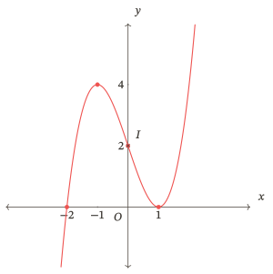

Hai giao điểm với trục hoành không phải hai điểm cực trị: phải đọc riêng nghiệm của hàm và nghiệm của đạo hàm.

#### 2.3. Ví dụ 03 — Đạo hàm bằng không mà không có cực trị

Với $g(x)=x^3+1$, miền là $\mathbb R$,
$$
g^\prime(x)=3x^2,\qquad g^\prime(0)=0.
$$
Đạo hàm dương ở cả hai phía của $0$. Hàm đồng biến trên $\mathbb R$, không có cực trị tại $0$ hoặc nơi nào khác.
$$
\lim_{x\to-\infty}g(x)=-\infty,\qquad
\lim_{x\to+\infty}g(x)=+\infty.
$$

| $x$ | $-\infty$ | $(-\infty;0)$ | $0$ | $(0;+\infty)$ | $+\infty$ |
|---|---|---|---|---|---|
| $g^\prime(x)$ | | $+$ | $0$ | $+$ | |
| $g(x)$ | $-\infty$ | $\nearrow$ | $1$ | $\nearrow$ | $+\infty$ |

Giao trục là $(-1;0)$ và $(0;1)$; tâm đối xứng $I(0;1)$; không có tiệm cận. Điểm có tiếp tuyến ngang vẫn nằm trên một đường cong tiếp tục đi lên qua điểm ấy.

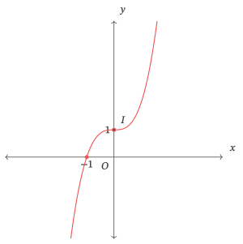

Hàm $u(x)=x^3+x$ ở Ví dụ 01 cũng không có cực trị, nhưng đạo hàm của nó không bằng $0$ ở đâu. Hai trường hợp cùng không có cực trị cần được phân biệt.

#### 2.4. Tự kiểm tra 02 — Một điểm dừng không đổi chiều

Với $p(x)=-(x-1)^3+2$, tìm đạo hàm, lập bảng biến thiên, kết luận cực trị và xác định tâm đối xứng. Phác đồ thị bằng tâm và các điểm có hoành độ $0$, $2$; không cần viết chính xác giao điểm với trục hoành.

[Xem lời giải](#lg-T02). Nếu đã xem lời giải, dùng [Nhiệm vụ 01 của Sửa lỗi, ý a](#S01) còn mới để kiểm cả việc không đổi dấu và hình vẽ; ý b của nhiệm vụ ấy kiểm trường hợp có hai cực trị.

### 3. Khảo sát hàm phân thức bậc nhất trên bậc nhất

**Cách thực hiện:** xác định hai khoảng của miền, tính giới hạn một phía và dấu đạo hàm; giữ riêng từng nhánh trên bảng và hình.

#### Gợi mở 03

Thử trả lời trước khi đọc tiếp.

Hai đồ thị cùng có tiệm cận $x=1$, $y=2$ có nhất thiết cùng nằm về một phía của đường $y=2$ khi $x>1$ không? So sánh dấu của $\frac{3}{x-1}$ và $-\frac{3}{x-1}$ trên khoảng ấy.

Một phần dư dương cho nhánh bên phải nằm trên đường ngang; phần dư âm cho nhánh bên phải nằm dưới. Hai đường tiệm cận chưa cho biết toàn bộ vị trí và chiều đi của các nhánh.

#### 3.1. Từ công thức đến hai nhánh

Với $f(x)=\frac{ax+b}{cx+d}$, điều kiện $c\ne0$, $ad-bc\ne0$ bảo đảm đây không phải hàm hằng sau rút gọn. Ta xét mẫu khác $0$, tính đạo hàm và các giới hạn. Không kết luận đơn điệu trên “toàn miền” chỉ từ một dấu đạo hàm nếu miền gồm hai khoảng rời.

Đồ thị nhận giao điểm hai tiệm cận làm tâm đối xứng; hai đường phân giác của các góc tạo bởi hai tiệm cận là các trục đối xứng. Khi dùng hình để nhận đối xứng, hai trục tọa độ phải có cùng tỉ lệ độ dài.

Đối chiếu Sách giáo khoa Toán 12, tập một, bộ Kết nối tri thức với cuộc sống, Bài 4, trang 28–29.

#### 3.2. Ví dụ 04 — Ghép biến thiên với tiệm cận ngang

Khảo sát
$$
f(x)=\frac{2x+1}{x-1}=2+\frac{3}{x-1}.
$$
Miền $D=\mathbb R\setminus\{1\}$. Đạo hàm
$$
f^\prime(x)=-\frac{3}{(x-1)^2}<0\quad(x\ne1).
$$
Hàm nghịch biến trên từng khoảng $(-\infty;1)$ và $(1;+\infty)$, không có cực trị.
$$
\lim_{x\to1^-}f(x)=-\infty,\qquad \lim_{x\to1^+}f(x)=+\infty;
$$
$$
\lim_{x\to-\infty}f(x)=2,\qquad \lim_{x\to+\infty}f(x)=2.
$$
Hai tiệm cận là $x=1$, $y=2$.

| Khoảng của $x$ | $(-\infty;1)$ | $(1;+\infty)$ |
|---|---|---|
| Dấu $f^\prime(x)$ | $-$ | $-$ |
| Biến thiên $f(x)$ từ trái sang phải | $2\ \searrow\ -\infty$ | $+\infty\ \searrow\ 2$ |

Các số ở hai đầu mỗi ô là giới hạn; không có giá trị $f(1)$. Đồ thị đi qua $\left(-\frac{1}{2};0\right)$, $(0;-1)$; có tâm $I(1;2)$ và hai trục đối xứng $y-2=x-1$, $y-2=-(x-1)$. Với $x<1$, đồ thị nằm dưới $y=2$; với $x>1$, nằm trên $y=2$.

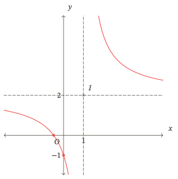

Không đặt một điểm đặc ở giao hai tiệm cận: tâm đối xứng không thuộc đồ thị này.

#### 3.3. Tự kiểm tra 03 — Hai nhánh đồng biến

Khảo sát và vẽ đồ thị $g(x)=\frac{x}{x+2}=1-\frac{2}{x+2}$. Ghi miền, đạo hàm, khoảng đơn điệu, cực trị, bốn giới hạn cần thiết, tiệm cận, giao trục và tâm đối xứng. Vì sao không nối đường cong qua $x=-2$?

[Xem lời giải](#lg-T03). Nếu cần hỗ trợ, xem [Ví dụ 04](#VD04); sau hỗ trợ dùng [Nhiệm vụ 02 của Sửa lỗi, ý a](#S02) nếu còn mới, rồi trở lại đây.

### 4. Khảo sát hàm phân thức bậc hai trên bậc nhất

**Cách thực hiện:** chia đa thức và kiểm ngược trước; dùng cùng một biểu thức để tính đạo hàm, giới hạn và vị trí so với tiệm cận xiên.

#### Gợi mở 04

Thử trả lời trước khi đọc tiếp.

So sánh hai hàm
$$
u(x)=x+1+\frac{1}{x-1},\qquad v(x)=x+1-\frac{1}{x-1}.
$$
Chúng cùng tiến gần đường thẳng nào khi $x\to+\infty$? Ở phía $x>1$, hàm nào nằm trên đường ấy? Có thể từ đó kết luận chúng có cùng cực trị không?

Phần chênh lệch của cả hai với $x+1$ tiến về $0$, nhưng mang dấu trái nhau. Muốn biết cực trị phải tính đạo hàm; cùng tiệm cận không đủ.

#### 4.1. Phần thương, phần dư và đối xứng

Sau phép chia, phân thức trong phạm vi bài có dạng “đa thức bậc nhất cộng phần dư trên mẫu bậc nhất”. Phần dư khác $0$ là điều cần giữ theo điều kiện của họ hàm. Tìm tiệm cận xiên bằng giới hạn của **hiệu** giữa hàm số và đa thức thương, với biến tiến tới từng đầu vô cực.

Đồ thị nhận giao điểm tiệm cận đứng và tiệm cận xiên làm tâm đối xứng, nhận hai đường phân giác của các góc tạo bởi các tiệm cận làm các trục đối xứng. Không mặc định đường ngang hoặc đường thẳng vuông góc tiệm cận xiên là trục đối xứng.

Đối chiếu Sách giáo khoa Toán 12, tập một, bộ Kết nối tri thức với cuộc sống, Bài 4, trang 30–32.

#### 4.2. Ví dụ 05 — Tiệm cận xiên và hai cực trị

Khảo sát
$$
u(x)=\frac{x^2}{x-1}=x+1+\frac{1}{x-1},\qquad D=\mathbb R\setminus\{1\}.
$$
Ta có
$$
u^\prime(x)=1-\frac{1}{(x-1)^2}=\frac{x(x-2)}{(x-1)^2}.
$$
Đạo hàm bằng $0$ tại $0$, $2$. Hàm đồng biến trên $(-\infty;0)$, $(2;+\infty)$; nghịch biến trên $(0;1)$, $(1;2)$. Cực đại tại $x=0$, giá trị $0$; cực tiểu tại $x=2$, giá trị $4$.
$$
\lim_{x\to1^-}u(x)=-\infty,\qquad \lim_{x\to1^+}u(x)=+\infty,
$$
$$
\lim_{x\to-\infty}u(x)=-\infty,\qquad \lim_{x\to+\infty}u(x)=+\infty.
$$
Đường $x=1$ là tiệm cận đứng. Vì
$$
\lim_{x\to-\infty}[u(x)-(x+1)]=0,\qquad
\lim_{x\to+\infty}[u(x)-(x+1)]=0,
$$
đường $y=x+1$ là tiệm cận xiên.

| Khoảng xét | $(-\infty;0]$ | $[0;1)$ | $(1;2]$ | $[2;+\infty)$ |
|---|---|---|---|---|
| Dấu đạo hàm ở bên trong khoảng | $+$ | $-$ | $-$ | $+$ |
| Biến thiên | $-\infty\nearrow0$ | $0\searrow-\infty$ | $+\infty\searrow4$ | $4\nearrow+\infty$ |

Hai cột có đầu mút $1$ không chứa điểm ấy. Đạo hàm bằng $0$ tại các mốc $0$, $2$ đã ghi ở trên.

Đồ thị giao cả hai trục tại $O(0;0)$, tâm đối xứng $I(1;2)$. Nhánh bên trái ở dưới đường xiên; nhánh bên phải ở trên. Hai trục đối xứng là hai đường phân giác của $x=1$ và $y=x+1$, không phải chính hai tiệm cận.

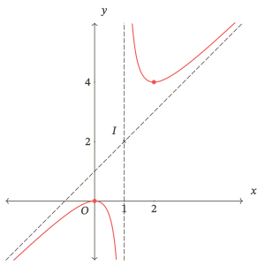

Giá trị cực đại $0$ nhỏ hơn giá trị cực tiểu $4$ không mâu thuẫn: chúng là các so sánh trong lân cận thuộc hai nhánh khác nhau.

#### 4.3. Ví dụ 06 — Cùng tiệm cận, không có cực trị

Với
$$
v(x)=\frac{x^2-2}{x-1}=x+1-\frac{1}{x-1},
$$
miền vẫn là $\mathbb R\setminus\{1\}$, nhưng
$$
v^\prime(x)=1+\frac{1}{(x-1)^2}>0.
$$
Hàm đồng biến trên từng khoảng $(-\infty;1)$ và $(1;+\infty)$, không có cực trị.
$$
\lim_{x\to1^-}v(x)=+\infty,\qquad \lim_{x\to1^+}v(x)=-\infty;
$$
$$
\lim_{x\to-\infty}v(x)=-\infty,\qquad \lim_{x\to+\infty}v(x)=+\infty;
$$
$$
\lim_{x\to-\infty}[v(x)-(x+1)]=0,\qquad
\lim_{x\to+\infty}[v(x)-(x+1)]=0.
$$

| Khoảng của $x$ | $(-\infty;1)$ | $(1;+\infty)$ |
|---|---|---|
| Dấu $v^\prime(x)$ | $+$ | $+$ |
| Biến thiên | $-\infty\nearrow+\infty$ | $-\infty\nearrow+\infty$ |

Tiệm cận và tâm vẫn là $x=1$, $y=x+1$, $I(1;2)$. Giao trục hoành tại $\left(-\sqrt{2};0\right)$, $\left(\sqrt{2};0\right)$, giao trục tung tại $(0;2)$. Nhánh trái nằm trên đường xiên, nhánh phải nằm dưới.

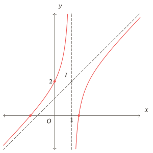

#### 4.4. Tự kiểm tra 04 — Kiểm lại dấu của phần dư

Cho $h(x)=x-1-\frac{4}{x-2}$. Tìm miền, đạo hàm, biến thiên, cực trị, tiệm cận và tâm đối xứng. Lập bảng biến thiên và phác hai nhánh; dùng điểm có hoành độ $0$ để kiểm vị trí. Không cần giải chính xác giao với trục hoành.

[Xem lời giải](#lg-T04). Xem lại [hai ví dụ phân thức bậc hai](#VD05) nếu nhầm dấu; xác nhận riêng trường hợp có cực trị bằng [Nhiệm vụ 02 của Sửa lỗi, ý b](#S02), trường hợp không có cực trị bằng ý c, nếu các ý ấy còn mới.

### 5. Đọc và sử dụng kết quả khảo sát đúng miền

**Cách thực hiện:** ghi biến, đơn vị và miền mô hình trước khi lấy kết luận từ đồ thị. Phân biệt giới hạn với giá trị được đạt.

#### Gợi mở 05

Thử trả lời trước khi đọc tiếp.

Một công thức chi phí trung bình có dạng $A(x)=2+\frac{12}{x}$, trong đó $x$ là khối lượng sản phẩm, tính bằng tấn. Công thức có nghĩa toán học khi $x<0$, nhưng phần đồ thị đó có mô tả sản lượng không? Nếu chỉ xét $1\le x\le6$, đường ngang $y=2$ có cho biết giá trị nhỏ nhất trên đoạn này không?

Khối lượng không âm; bài toán còn giới hạn khối lượng được xét. Trên đoạn ấy, giá trị nhỏ nhất phải được tìm trong đoạn, không lấy một giới hạn ở vô cực.

#### 5.1. Ba câu hỏi trước khi diễn giải

Đang xét tập nào? Giá trị nào được đạt trong tập đó? Kết luận đang nói về mô hình được cho hay về thực tế chưa được kiểm chứng?

Các bài dưới đây dùng mô hình chi phí giả định. Biến và đơn vị phải được giữ rõ trong mỗi kết luận; công thức chỉ được dùng trên miền đã cho.

#### 5.2. Ví dụ 07 — Chi phí trung bình có cận nhưng không có giá trị nhỏ nhất

Giả sử tổng chi phí để sản xuất $x$ tấn hàng là $C(x)=2x+12$ triệu đồng, mô hình áp dụng với $x\ge1$. Chi phí trung bình mỗi tấn:
$$
A(x)=\frac{C(x)}{x}=2+\frac{12}{x}
$$
tính bằng triệu đồng mỗi tấn.

Ta có $A^\prime(x)=-\frac{12}{x^2}<0$, nên $A$ giảm trên $[1;+\infty)$. Tại đầu miền, $A(1)=14$.
$$
\lim_{x\to+\infty}A(x)=2,\qquad A(x)>2\quad(x\ge1).
$$
Giá trị lớn nhất là $14$, đạt tại $x=1$. Không có giá trị nhỏ nhất: với mỗi $x\ge1$, chọn khối lượng lớn hơn thì chi phí trung bình nhỏ hơn; không khối lượng hữu hạn nào làm phần $\frac{12}{x}$ bằng $0$.

| $x$ | $1$ | $(1;+\infty)$ | $+\infty$ |
|---|---|---|---|
| $A(x)$ | $14$ | $\searrow$ | $2$ |

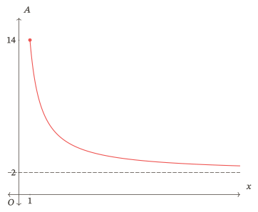

Đường $y=2$ mô tả xu hướng khi $x\to+\infty$ trong mô hình; không có nhánh âm hoặc tiệm cận đứng tại $0$ của **đồ thị bị giới hạn ở $x\ge1$**. Nếu chỉ xét $[1;6]$, giá trị nhỏ nhất là $A(6)=4$, đạt tại $6$; miền mới làm kết luận về sự đạt được thay đổi.

#### 5.3. Tự kiểm tra 05 — Giữ miền khi đọc chi phí

Một mô hình cho $B(x)=4+\frac{18}{x}$ triệu đồng mỗi tấn, với $x\ge2$. Tìm chiều biến thiên, giá trị lớn nhất và giải thích có hay không giá trị nhỏ nhất. Nếu chỉ xét $[2;6]$, kết luận về giá trị nhỏ nhất thay đổi thế nào? Không dùng riêng hình vẽ để thay lập luận.

[Xem lời giải](#lg-T05). Nếu nhầm cận với giá trị đạt, xem lại [Ví dụ 07](#VD07); dùng [Nhiệm vụ 02 của Sửa lỗi, ý d](#S02) còn mới để xác nhận việc phân biệt miền không bị chặn với đoạn hữu hạn.

### Khép lại bài học

Không nhìn lời giải, em hãy giải thích vì sao cần biết miền trước khi xét biến thiên; vì sao đạo hàm bằng $0$ chưa đủ kết luận cực trị; và vì sao cùng tiệm cận chưa quyết định cùng đồ thị. Chọn một hình của bài học, chỉ ra dữ kiện bảo đảm mỗi giao điểm, mốc cực trị và hướng nhánh.

Nếu còn vướng, xem đúng mục đó. Nếu đã nắm cách làm, vào [Luyện tập](#luyen-tap) hoặc chọn hoạt động phù hợp; làm được câu ngay sau ví dụ chưa xác nhận việc nhớ sau khoảng trễ.

## Luyện tập

**Cách thực hiện:** tự làm từng nhiệm vụ rồi đối chiếu; giữ bài trước khi sửa. Có thể chia nhiều buổi. Với câu đã từng xem lời giải, ghi rõ mức hỗ trợ; không tính việc nhớ lại đáp án là bằng chứng mới. Khi vướng, dùng đúng đường hỗ trợ ở Điểm dừng.

### Chặng 1 — Bậc ba và phân thức bậc nhất

Mục tiêu: tự tổ chức bản khảo sát, kiểm cực trị qua dấu và vẽ đúng nhánh. Làm các nhiệm vụ dưới đây theo nhu cầu đã xác định; phần chưa làm chưa có bằng chứng.

#### Nhiệm vụ 01 — Khảo sát một hàm bậc ba

Khảo sát và vẽ đồ thị $f(x)=x^3-3x^2+4$. Ghi đủ miền, đạo hàm/dấu, cực trị, giới hạn, bảng biến thiên, giao trục và tâm đối xứng. Kiểm việc đường cong đi qua hay chạm trục hoành tại các giao điểm.

[Xem lời giải](#lg-L01).

#### Nhiệm vụ 02 — Không có cực trị theo hai cách

So sánh $p(x)=x^3+3x^2+3x$ với $q(x)=x^3+3x$. Tìm dấu đạo hàm và cực trị của mỗi hàm. Với $p$, tính tâm đối xứng và giải thích ý nghĩa của điểm có đạo hàm bằng $0$. Không yêu cầu khảo sát đầy đủ hai đồ thị.

[Xem lời giải](#lg-L02).

#### Nhiệm vụ 03 — Khảo sát phân thức với hai nhánh tăng

Khảo sát và vẽ đồ thị $f(x)=\frac{3x-8}{x-2}$. Nêu miền, chiều biến thiên, cực trị, các giới hạn, tiệm cận, giao trục, tâm và các trục đối xứng.

[Xem lời giải](#lg-L03).

### Điểm dừng 01 — Đối chiếu chặng đầu

| Việc cần xác nhận | Bằng chứng | Nếu chưa đúng |
|---|---|---|
| Bản khảo sát và hình bậc ba thống nhất | Nhiệm vụ 01 | Xem [sơ đồ](#bh-01), [bậc ba](#bh-02); [Nhiệm vụ 01 của Sửa lỗi, ý b](#S01) |
| Đạo hàm bằng $0$ nhưng không đổi dấu | Nhiệm vụ 02 | Xem [bậc ba không có cực trị](#VD03); [Nhiệm vụ 01 của Sửa lỗi, ý a](#S01) |
| Hai khoảng, các giới hạn và hình phân thức bậc nhất | Nhiệm vụ 03 | Xem [phân thức bậc nhất](#bh-03); [Nhiệm vụ 02 của Sửa lỗi, ý a](#S02) |

Chỉ dùng ý sửa còn mới và đúng lỗi. Nếu đúng, giải thích được và hình khớp dữ kiện, ghi bằng chứng rồi chọn chặng tiếp hoặc hoạt động phù hợp. Nếu sai thao tác, mở [Ôn nền](#on-nen); nếu hết câu mới, [ghi phần chưa xác nhận](#het-bai-moi). Sau hỗ trợ trở về Điểm dừng này; không phải làm lại mọi câu của chặng.

### Chặng 2 — Tiệm cận xiên và miền mô hình

Mục tiêu: phân biệt hai khả năng biến thiên của phân thức bậc hai, rồi giới hạn kết luận theo miền thực sự được xét.

#### Nhiệm vụ 04 — Khảo sát phân thức có tiệm cận xiên

Khảo sát và vẽ đồ thị $h(x)=\frac{x^2+2x+4}{x}$. Giải thích vì sao có thể có giá trị cực đại nhỏ hơn giá trị cực tiểu. Xác định tâm và mô tả hai trục đối xứng, không bắt buộc tìm phương trình các đường phân giác.

[Xem lời giải](#lg-L04).

#### Nhiệm vụ 05 — Dấu trừ làm thay đổi hai nhánh

Khảo sát và vẽ đồ thị $v(x)=\frac{x^2-x-3}{x+1}$. Kiểm lại dấu đạo hàm bằng cách viết dưới dạng thương và phần dư; xác định giao trục và tâm đối xứng.

[Xem lời giải](#lg-L05).

#### Nhiệm vụ 06 — Đồ thị chỉ trên miền sản xuất

Một mô hình chi phí trung bình cho $A(x)=3+\frac{24}{x}$ triệu đồng mỗi tấn, với khối lượng $x\in[2;8]$ tấn. Lập bảng biến thiên, vẽ phần đồ thị đúng miền, tìm giá trị lớn nhất/nhỏ nhất và nơi đạt. Nhận xét câu “đường $y=3$ là tiệm cận ngang nên chi phí nhỏ nhất bằng $3$”.

[Xem lời giải](#lg-L06).

### Điểm dừng 02 — Đối chiếu khảo sát và diễn giải

| Việc cần xác nhận | Bằng chứng | Nếu chưa đúng |
|---|---|---|
| Tiệm cận xiên, hai cực trị, bảng và hình | Nhiệm vụ 04 | [Ví dụ có hai cực trị](#VD05); [Nhiệm vụ 02 của Sửa lỗi, ý b](#S02) |
| Phân thức bậc hai không có cực trị; bảng và hình | Nhiệm vụ 05 | [Ví dụ không cực trị](#VD06); [Nhiệm vụ 02 của Sửa lỗi, ý c](#S02) |
| Đọc giá trị được đạt trên miền hữu hạn, có đơn vị | Nhiệm vụ 06 | [Miền mô hình](#bh-05); [Nhiệm vụ 02 của Sửa lỗi, ý d](#S02) |

Nếu sai riêng hình vẽ của trường hợp không cực trị, dùng ý c còn mới và kiểm cả hình, không chỉ đạo hàm. Với lỗi cơ bản đã khép và bằng chứng phù hợp, em có thể chọn Kiểm tra khi chuẩn bị kĩ hoặc đủ tự tin. Có thể quay lại đúng mục học khi cần; không dùng tổng số câu đúng bù cho một mục tiêu còn thiếu.

## Kiểm tra

Chọn khi đã chuẩn bị kĩ hoặc đủ tự tin. **Một lượt tự lực hoàn toàn**, không chia thành các đợt, không xem Bài học, gợi ý hoặc lời giải trong lượt. Thời lượng đề xuất cho bản này là $75$ phút; đây là bài kiểm theo mục tiêu học liệu, không mô phỏng một đề thi tốt nghiệp.

Ghi thời điểm bắt đầu; làm trên giấy, ghi cả bảng và hình. Nếu cần hỗ trợ hoặc phải dừng, kết thúc lượt, ghi phần đã làm và thời lượng thực tế rồi mới mở hỗ trợ. Không nối phần làm sau hỗ trợ vào kết quả độc lập. Chưa dùng thang điểm cộng dồn; đối chiếu từng mục tiêu ở cuối lượt.

#### Nhiệm vụ 01 — Khảo sát hàm bậc ba

Khảo sát và vẽ đồ thị $f(x)=-x^3+3x^2$. Trình bày miền, đạo hàm và dấu, cực trị, giới hạn, bảng biến thiên, giao trục, tâm đối xứng. Giải thích việc đồ thị đi qua hay chạm trục hoành.

#### Nhiệm vụ 02 — Khảo sát phân thức bậc nhất

Khảo sát và vẽ đồ thị $f(x)=\frac{x+3}{x+1}$. Nêu miền, đạo hàm, các giới hạn ở hai phía điểm loại và hai đầu vô cực, tiệm cận, bảng biến thiên, giao trục và tâm đối xứng.

#### Nhiệm vụ 03 — Khảo sát phân thức bậc hai

Khảo sát và vẽ đồ thị $h(x)=\frac{x^2+3x}{x-1}$. Nêu đầy đủ các dữ kiện của sơ đồ khảo sát; xác định tâm đối xứng và mô tả cách xác định các trục đối xứng, không cần tìm phương trình các trục ấy.

#### Nhiệm vụ 04 — Kết luận trong miền của mô hình

Một mô hình chi phí trung bình là $B(x)=5+\frac{18}{x}$ triệu đồng mỗi tấn, áp dụng với $3\le x\le9$ tấn. Tìm chiều biến thiên, giá trị lớn nhất và nhỏ nhất trên miền này. Nhận xét lời giải “đường tiệm cận ngang là $y=5$ nên chi phí trung bình nhỏ nhất là $5$ triệu đồng mỗi tấn”. Có thể dùng bài toán này để kết luận chi phí ở sản lượng $20$ tấn không?

### Kết thúc lượt và đối chiếu kết quả

Lưu bài ban đầu, đánh dấu chỗ chưa làm; sau đó mới mở [lời giải Kiểm tra](#lg-kiem-tra).

| Mục tiêu | Bằng chứng cần xem | Hỗ trợ sau khi đã kết thúc lượt |
|---|---|---|
| Tổ chức và kiểm các biểu diễn | Các nhiệm vụ khảo sát: điều kiện, bảng, hình nhất quán | [Sơ đồ khảo sát](#bh-01), rồi ý khảo sát đúng họ hàm ở Sửa lỗi |
| Khảo sát bậc ba | Nhiệm vụ 01 | [Nhiệm vụ 03 của Sửa lỗi, ý b](#S03); ý a chỉ dùng nếu lỗi liên quan điểm đạo hàm bằng $0$ |
| Phân thức bậc nhất | Nhiệm vụ 02 | [Nhiệm vụ 04 của Sửa lỗi, ý a](#S04) |
| Phân thức bậc hai và đối xứng | Nhiệm vụ 03 | [Nhiệm vụ 04 của Sửa lỗi, ý b](#S04) |
| Miền mô hình, giá trị đạt và đơn vị | Nhiệm vụ 04 | [Nhiệm vụ 04 của Sửa lỗi, ý d](#S04) |

Với mỗi mục tiêu ghi: tự làm đúng; còn lỗi cụ thể; chưa có bằng chứng; hoặc đã có hỗ trợ. Kiểm tra này không lấy mẫu riêng trường hợp bậc ba không cực trị và phân thức bậc hai không cực trị: xem thêm bằng chứng tự làm phù hợp của Tự kiểm tra/Luyện tập; không suy rằng đúng ba hình ở đây là đúng mọi trường hợp.

Nếu lỗi thiết yếu đã được xác nhận đúng bằng câu phù hợp còn mới, ghi phần sửa riêng. Nếu chưa có bằng chứng phù hợp, giữ mục tiêu chưa xác nhận. Khi đủ điều kiện hoàn tất lượt chính, ghi ngày gốc và hẹn [Ôn lại](#on-lai); không bắt chờ hết các lượt ôn mới được học nội dung tiếp theo đủ tiên quyết.

## Ôn lại

Ghi ngày hẹn cụ thể tính từ ngày hoàn tất lượt chính. Các mốc dưới đây là lịch đề xuất; ghi khoảng trễ thực tế nếu đổi lịch. Trước mỗi lượt, chưa đọc lại Bài học và chưa xem đề của lượt sau. Sau khi tự làm mới đối chiếu. Câu đã xem hoặc đã dùng để sửa trước đó không còn đo được khả năng nhớ độc lập như dự định.

### Lượt 1 — Sau khoảng $2$–$3$ ngày

Lấy mẫu quy trình và đồ thị bậc ba.

#### Nhiệm vụ 01 — Nhớ lại khảo sát bậc ba

Không xem Bài học, lập bảng biến thiên và phác đồ thị $f(x)=x^3-6x^2+9x$. Ghi miền, đạo hàm/dấu, cực trị, giới hạn, giao trục và tâm đối xứng. Dùng bảng kiểm khảo sát do em tự nhớ trước khi mở lời giải.

[Xem lời giải](#lg-O01).

#### Điểm dừng lượt 1

Tự nhớ đủ quy trình, tính đúng và hình khớp thì ghi bằng chứng bậc ba sau khoảng trễ này. Nếu lỗi, xem [mục bậc ba](#bh-02), chọn [Nhiệm vụ 05 của Sửa lỗi, ý b](#S05) còn mới. Ý a xác nhận riêng trường hợp không có cực trị. Sau sửa quay về đây; không ghi đạt hai họ phân thức từ lượt này.

### Lượt 2 — Sau khoảng $7$ ngày

Lấy mẫu phân thức bậc nhất và đọc giá trị trên miền hữu hạn; ghi kết quả từng ý riêng.

#### Nhiệm vụ 02 — Nhớ lại phân thức và miền mô hình

a) Khảo sát và phác đồ thị $f(x)=2-\frac{4}{x+1}$; trình bày miền, đạo hàm, biến thiên, giới hạn, tiệm cận, giao trục và tâm.

b) Mô hình $A(x)=2+\frac{30}{x}$ triệu đồng mỗi tấn áp dụng trên $3\le x\le15$ tấn. Tìm giá trị lớn nhất, nhỏ nhất và giải thích vì sao không lấy $2$ làm giá trị nhỏ nhất.

[Xem lời giải](#lg-O02).

#### Điểm dừng lượt 2

Nếu ý a sai, xem [phân thức bậc nhất](#bh-03), chọn [Nhiệm vụ 06 của Sửa lỗi, ý a](#S06) còn mới. Nếu ý b sai, xem [miền mô hình](#bh-05), chọn ý d của nhiệm vụ ấy. Sau hỗ trợ quay về đây, ghi đúng ý được xác nhận; không coi sửa ngay là bằng chứng nhớ lâu.

### Lượt 3 — Sau khoảng $3$–$4$ tuần

Lấy mẫu khảo sát phân thức bậc hai và sự phù hợp giữa cực trị, tiệm cận, đối xứng và hình.

#### Nhiệm vụ 03 — Nhớ lại tiệm cận xiên và cực trị

Khảo sát và phác đồ thị $h(x)=x+2+\frac{1}{x}$. Ghi miền, đạo hàm/dấu, cực trị, các giới hạn cần thiết, tiệm cận, bảng biến thiên, giao trục và tâm. Mô tả cách xác định trục đối xứng; không cần viết phương trình các trục.

[Xem lời giải](#lg-O03).

#### Điểm dừng lượt 3

Nếu còn lỗi, xem [phân thức bậc hai](#bh-04), chọn [Nhiệm vụ 06 của Sửa lỗi, ý b](#S06) còn mới. Ý c xác nhận trường hợp không cực trị, không thay bằng chứng trường hợp có cực trị ở ý b. Sau sửa quay về đây. Các lượt ôn chỉ chứng nhận mục tiêu đã lấy mẫu ở khoảng trễ thực tế; mục tiêu chưa được lấy mẫu hoặc câu đã lộ phải ghi rõ.

## Ôn nền

Chọn đúng thao tác đang vướng và ghi nhớ nhiệm vụ đã gọi. Các liên kết dưới mở phần nền đã có trong học liệu liên quan; không cần học lại cả học liệu. Làm câu tự kiểm ở đó chỉ khi còn mới; câu từng gặp không trở thành mới do được dẫn lại.

### Tập xác định và điểm bị loại

Mở [Tập xác định và khoảng xét](https://zomath.vn/content/thpt/on_thi_toan_thpt/hoc_lieu/r1_g01/?r1-view=on-nen#nen-n-txd-01). Giữ điều kiện của hàm gốc khi rút gọn. Sau tự kiểm, quay về [Khởi động — Miền trước và sau rút gọn](#KD01), hoặc đúng bước miền của bài đã gọi; kết quả câu nền không thay kết quả khảo sát.

### Đạo hàm và xét dấu

Mở [Đạo hàm đa thức](https://zomath.vn/content/thpt/on_thi_toan_thpt/hoc_lieu/r1_g01/?r1-view=on-nen#nen-n-dh-01) khi sai đạo hàm đa thức; mở [Xét dấu biểu thức có nhân tử](https://zomath.vn/content/thpt/on_thi_toan_thpt/hoc_lieu/r1_g01/?r1-view=on-nen#nen-n-dau-01) khi sai dấu. Hai thẻ này không dạy đầy đủ đạo hàm phân thức: với lỗi đó xem phép tính ở [Ví dụ 04](#VD04), [Ví dụ 05](#VD05), rồi tự làm đúng ý phân thức trong nhóm Sửa lỗi thuộc nơi phát hiện.

Trở về [Khởi động — Đạo hàm và dấu](#KD02) hoặc bước đạo hàm của bài gốc. Xét đúng dấu chưa tự xác nhận việc gọi tên cực trị, tiệm cận hoặc vẽ hình.

### Giới hạn và giá trị được đạt

Mở [Giới hạn một phía](https://zomath.vn/content/thpt/on_thi_toan_thpt/hoc_lieu/r1_g03/?r1-view=on-nen#N-GH-02) khi nhầm hướng/dấu; [Giới hạn ở vô cực](https://zomath.vn/content/thpt/on_thi_toan_thpt/hoc_lieu/r1_g03/?r1-view=on-nen#N-GH-03) khi bỏ một đầu hoặc thay vô cực như một số; [Cận và giá trị được đạt](https://zomath.vn/content/thpt/on_thi_toan_thpt/hoc_lieu/r1_g02/?r1-view=on-nen#nen-n-gh-01) khi nhầm cận với giá trị nhỏ nhất.

Chỉ dùng phần phù hợp với phân thức đang học, không cần làm nhánh căn của thẻ giới hạn ở vô cực. Trở về [Khởi động — Giới hạn có hướng](#KD03) hoặc bài đang gọi; nếu vướng mô hình, trở về [mục đọc đúng miền](#bh-05).

### Biến đổi phân thức

Mở [Biến đổi phân thức: giữ điều kiện, kiểm thương và dư](https://zomath.vn/content/thpt/on_thi_toan_thpt/hoc_lieu/r1_g03/?r1-view=on-nen#N-DS-01). Ví dụ của thẻ cũng xuất hiện trong Khởi động để nối nền đã học; nếu đã xem, dùng nó để nhớ thao tác, không nhận là bằng chứng tự lực mới. Sau tự kiểm nền còn mới, quay về [Khởi động — Thương và phần dư](#KD04) hoặc bước chia của bài gốc. Cần kiểm giới hạn phần dư khi kết luận tiệm cận.

Khi mở thẻ ở học liệu khác, đường “quay về” của thẻ thuộc học liệu ấy. Hãy trở lại trang này bằng lịch sử trình duyệt hoặc tab đang đọc, rồi về đúng nhiệm vụ đã gọi ở trên.

## Sửa lỗi

Dùng sau khi đã tự làm và biết điều cần sửa; riêng Kiểm tra phải kết thúc lượt trước. Không cần làm tất cả các câu ở đây. Chọn theo **nơi phát hiện và mục tiêu thực sự sai**, xem lại đúng phần rồi tự làm ý phù hợp còn mới. Giữ bài ban đầu và ghi mức hỗ trợ.

### Chọn đúng ý và nơi quay về

| Nơi phát hiện | Lỗi cần kiểm lại | Nhiệm vụ xác nhận | Xem lại trước khi làm |
|---|---|---|---|
| Tự kiểm tra/Luyện tập | Điểm đạo hàm bằng $0$ không là cực trị | [Nhiệm vụ 01 — Sau luyện tập — Bậc ba, ý a](#S01) | [Bậc ba không cực trị](#VD03) |
| Tự kiểm tra/Luyện tập | Sơ đồ, bảng hoặc hình bậc ba | [Nhiệm vụ 01 — Sau luyện tập — Bậc ba, ý b](#S01) | [Sơ đồ](#bh-01), [bậc ba](#bh-02) |
| Tự kiểm tra/Luyện tập | Phân thức bậc nhất | [Nhiệm vụ 02 — Sau luyện tập — Phân thức và miền, ý a](#S02) | [Mục phân thức bậc nhất](#bh-03) |
| Tự kiểm tra/Luyện tập | Phân thức bậc hai có cực trị / không cực trị | [Nhiệm vụ 02 — Sau luyện tập — Phân thức và miền, ý b / c](#S02) | [Mục phân thức bậc hai](#bh-04) |
| Tự kiểm tra/Luyện tập | Miền mô hình, cận và giá trị đạt | [Nhiệm vụ 02 — Sau luyện tập — Phân thức và miền, ý d](#S02) | [Miền mô hình](#bh-05) |
| Sau Kiểm tra | Bậc ba: không cực trị / có cực trị | [Nhiệm vụ 03 — Sau kiểm tra — Bậc ba, ý a / b](#S03) | [Mục bậc ba](#bh-02) |
| Sau Kiểm tra | Phân thức bậc nhất / bậc hai có cực trị / bậc hai không cực trị / miền mô hình | [Nhiệm vụ 04 — Sau kiểm tra — Phân thức và miền, ý a / b / c / d](#S04) | [Phân thức bậc nhất](#bh-03), [phân thức bậc hai](#bh-04), [miền mô hình](#bh-05) theo ý |
| Sau Ôn lại | Bậc ba: điểm dừng / khảo sát đầy đủ | [Nhiệm vụ 05 — Sau ôn lại — Bậc ba, ý a / b](#S05) | [Mục bậc ba](#bh-02) |
| Sau Ôn lại | Phân thức bậc nhất / bậc hai có cực trị / bậc hai không cực trị / miền mô hình | [Nhiệm vụ 06 — Sau ôn lại — Phân thức và miền, ý a / b / c / d](#S06) | [Phân thức bậc nhất](#bh-03), [phân thức bậc hai](#bh-04), [miền mô hình](#bh-05) theo ý |

Các ý a, b, c của nhóm phân thức kiểm các trường hợp khác nhau; mỗi ý có bảng và hình để đối chiếu. Đúng một ý không tự xác nhận ý còn lại. Chỉ chọn ý khớp lỗi và còn mới.

### Khi câu phù hợp đã lộ hoặc vẫn chưa đúng

Câu đã xem đề/lời giải hoặc làm với hỗ trợ được dùng để học lại, không nhận là xác nhận độc lập mới. Không lấy trước câu Kiểm tra, câu của lượt Ôn lại sau hoặc bài dành cho nơi phát hiện khác. Nếu hết câu phù hợp còn mới, ghi mục tiêu chưa xác nhận và đề nghị người hướng dẫn cung cấp câu tương đương; không tự ghi “đã đạt”. Nếu vẫn sai, trở lại đúng mục học/thao tác nền, ghi điểm còn vướng và nơi cần tiếp tục.

### Sau Luyện tập hoặc Tự kiểm tra

#### Nhiệm vụ 01 — Sau luyện tập — Bậc ba

a) Khảo sát và phác đồ thị $p(x)=-(x+2)^3+5$ theo đủ sơ đồ. Đặc biệt giải thích vì sao điểm có đạo hàm bằng $0$ không là cực trị. So sánh thêm với $q(x)=x^3+2x$: vì sao $q$ cũng không có cực trị nhưng không có điểm đạo hàm bằng $0$? Không cần khảo sát đầy đủ $q$.

b) Khảo sát và phác đồ thị $f(x)=x^3+3x^2-4$: miền, đạo hàm/dấu, cực trị, giới hạn, bảng biến thiên, giao trục và tâm.

[Xem lời giải](#lg-S01).

#### Nhiệm vụ 02 — Sau luyện tập — Phân thức và miền

a) Khảo sát và vẽ $f(x)=2-\frac{4}{x+2}$ theo đủ sơ đồ: miền, đạo hàm, giới hạn, biến thiên, tiệm cận, giao trục, tâm và các trục đối xứng.

b) Khảo sát và vẽ $h(x)=x+3+\frac{1}{x+1}$ theo đủ sơ đồ; mô tả các trục đối xứng.

c) Khảo sát và vẽ $v(x)=x+3-\frac{1}{x+1}$ theo đủ sơ đồ; mô tả các trục đối xứng.

d) Mô hình $A(x)=1+\frac{20}{x}$ triệu đồng mỗi tấn áp dụng với $x\ge2$ tấn. Tìm giá trị lớn nhất, giải thích có hay không giá trị nhỏ nhất. Xét lại nếu miền là $[2;10]$.

[Xem lời giải](#lg-S02).

**Sau đối chiếu:** ghi đúng ý đã xác nhận, trở về [Tự kiểm tra 01](#T01), [02](#T02), [03](#T03), [04](#T04), [05](#T05), hoặc [Điểm dừng 01](#CP01), [Điểm dừng 02](#CP02) đã gọi. Không tự chọn một nơi khác để bỏ qua tiêu chí còn thiếu.

### Sau Kiểm tra

#### Nhiệm vụ 03 — Sau kiểm tra — Bậc ba

a) Khảo sát và phác đồ thị $p(x)=-(x-2)^3+3$ theo đủ sơ đồ. Đặc biệt giải thích vì sao điểm có đạo hàm bằng $0$ không là cực trị.

b) Khảo sát và phác đồ thị $f(x)=-x^3-3x^2+4$ theo đủ sơ đồ. Dùng ý b để xác nhận lỗi ở bài khảo sát bậc ba; ý a kiểm riêng trường hợp không có cực trị.

[Xem lời giải](#lg-S03).

#### Nhiệm vụ 04 — Sau kiểm tra — Phân thức và miền

a) Khảo sát và vẽ $f(x)=3+\frac{3}{x-1}$ theo đủ sơ đồ: miền, đạo hàm, giới hạn, biến thiên, tiệm cận, giao trục, tâm và các trục đối xứng.

b) Khảo sát và vẽ $h(x)=x+2+\frac{4}{x+2}$ theo đủ sơ đồ; mô tả các trục đối xứng.

c) Khảo sát và vẽ $v(x)=x+2-\frac{4}{x+2}$ theo đủ sơ đồ; mô tả các trục đối xứng.

d) Mô hình $A(x)=4+\frac{24}{x}$ triệu đồng mỗi tấn áp dụng với $x\ge3$ tấn. Xét giá trị lớn nhất, có hay không giá trị nhỏ nhất; rồi xét lại trên $[3;12]$.

[Xem lời giải](#lg-S04).

**Sau đối chiếu:** trở về [kết quả Kiểm tra](#CPK), giữ bài gốc và ghi bằng chứng sửa tách biệt. Chỉ ý phù hợp được xác nhận, không đổi cả kết quả lượt thành “tự lực”.

### Sau Ôn lại

#### Nhiệm vụ 05 — Sau ôn lại — Bậc ba

a) Khảo sát và phác đồ thị $p(x)=(x-1)^3-2$ theo đủ sơ đồ. Đặc biệt giải thích vì sao điểm có đạo hàm bằng $0$ không là cực trị.

b) Khảo sát và phác đồ thị $f(x)=x^3+6x^2+9x$ theo đủ sơ đồ. Dùng đúng ý còn mới theo trường hợp cần xác nhận sau khoảng trễ.

[Xem lời giải](#lg-S05).

#### Nhiệm vụ 06 — Sau ôn lại — Phân thức và miền

a) Khảo sát và vẽ $f(x)=1-\frac{3}{x+2}$ theo đủ sơ đồ: miền, đạo hàm, giới hạn, biến thiên, tiệm cận, giao trục, tâm và các trục đối xứng.

b) Khảo sát và vẽ $h(x)=x-1+\frac{1}{x-2}$ theo đủ sơ đồ; mô tả các trục đối xứng.

c) Khảo sát và vẽ $v(x)=x-1-\frac{1}{x-2}$ theo đủ sơ đồ; mô tả các trục đối xứng.

d) Mô hình $A(x)=2+\frac{36}{x}$ triệu đồng mỗi tấn áp dụng với $x\ge3$ tấn. Xét giá trị lớn nhất, có hay không giá trị nhỏ nhất; rồi xét lại trên $[3;9]$.

[Xem lời giải](#lg-S06).

**Sau đối chiếu:** trở về [Điểm dừng lượt 1](#CP-O01), [lượt 2](#CP-O02) hoặc [lượt 3](#CP-O03) đã gọi. Ghi khoảng trễ thực tế và phần hỗ trợ; nếu tái lỗi, hẹn kiểm riêng lỗi ấy ở buổi sau, không ghi nhớ bền chỉ vì vừa sửa đúng.

## Nhật kí

Dùng khi cần lưu kết quả, lỗi, mức hỗ trợ, lịch hẹn hoặc điểm tiếp tục; không bắt ghi sau từng câu. Mẫu dưới giữ đúng các trường của [Nhật kí học tập dùng chung](https://zomath.vn/content/thpt/on_thi_toan_thpt/hoc_lieu/r1_g03/?r1-view=nhat-ki#nhat-ki). Sao chép ra giấy hoặc công cụ ghi chú và tự điền; không có trạng thái đạt điền sẵn.

| Trường | Em ghi |
|---|---|
| Ngày–giờ | … |
| Gói / mục tiêu | … |
| Nguồn phát hiện | … |
| Bài làm ban đầu | … |
| Mức hỗ trợ ban đầu | … |
| Bằng chứng quan sát | … |
| Phân loại | … |
| Mã lỗi hoặc mã Nền | … |
| Hành động | … |
| Bài khắc phục mới | … |
| Trạng thái sau sửa | … |
| Hẹn Ôn lại | … |
| Kết quả sau khoảng trễ | … |
| Quyết định tiếp theo | … |

Ghi tên nội dung và lỗi bằng lời có nghĩa; chỉ ghi mã lỗi/Nền khi hệ đang dùng có mã phù hợp. “Đã xác nhận lỗi này trong lượt” khác với “nhớ sau khoảng trễ”. Nếu câu đã lộ hoặc chưa có câu xác nhận phù hợp, ghi rõ; đừng đổi thành đạt chỉ vì đã sửa bài gốc.

## Lời giải

Mở sau khi đã tự làm. Mỗi lời giải có đường trở về đúng đề; phần quyết định tiếp tục nằm ở Điểm dừng tương ứng. Chỉ mở lời giải của nhiệm vụ cần đối chiếu; giữ lại bài tự làm để nhận ra bước đúng và bước cần sửa.

### Khởi động

#### Nhiệm vụ 01 — Miền trước và sau rút gọn

Lời giải và tiêu chí đối chiếu

$D=\mathbb R\setminus\{3\}$. Trên miền ấy, $r(x)=x+3$. Điểm $(3;6)$ không thuộc đồ thị vì công thức ban đầu không xác định tại $3$. Tiêu chí: giữ điều kiện trong cả phép biến đổi và hình; không coi rút gọn là quyền mở rộng miền.

[Trở về đề — Miền trước và sau rút gọn](#KD01).

#### Nhiệm vụ 02 — Đạo hàm và dấu

Lời giải và tiêu chí đối chiếu

$p^\prime(x)=3x^2-12=3(x-2)(x+2)$. Dấu lần lượt là $+$, $-$, $+$ trên $(-\infty;-2)$, $(-2;2)$, $(2;+\infty)$. Cực đại tại $x=-2$, cực tiểu tại $x=2$. Trước kết luận, kiểm điểm thuộc miền và đạo hàm đổi dấu qua điểm ấy. Nếu chỉ tìm được hai nghiệm đạo hàm mà chưa xét dấu, kết luận chưa đủ căn cứ.

[Trở về đề — Đạo hàm và dấu](#KD02).

#### Nhiệm vụ 03 — Giới hạn có hướng

Lời giải và tiêu chí đối chiếu

Khi $x\to-2^-$, mẫu âm và tiến tới $0$, nên $q(x)\to-\infty$. Khi $x\to-2^+$, mẫu dương và tiến tới $0$, nên $q(x)\to+\infty$.
$$
\lim_{x\to-\infty}q(x)=1,\qquad \lim_{x\to+\infty}q(x)=1.
$$
Hai đường tiệm cận là $x=-2$, $y=1$. Tiêu chí: đủ bốn hướng, phân biệt phương trình đường thẳng với giá trị giới hạn.

[Trở về đề — Giới hạn có hướng](#KD03).

#### Nhiệm vụ 04 — Thương và phần dư

Lời giải và tiêu chí đối chiếu

Với $x\ne-1$,
$$
\frac{x^2+2x+5}{x+1}=x+1+\frac{4}{x+1},
$$
vì $(x+1)(x+1)+4=x^2+2x+5$. Tiêu chí: phần dư là $4$, giữ mẫu và điều kiện; nhân ngược khớp tử ban đầu.

[Trở về đề — Thương và phần dư](#KD04).

### Tự kiểm tra

#### Tự kiểm tra 01 — Tìm mâu thuẫn trước khi nối nét

Lời giải và tiêu chí đối chiếu

$h(0)=-1$, nên đồ thị đi qua $(0;-1)$, không qua $O$. Các kết quả về miền, đạo hàm và đồng biến đã đúng.
$$
\lim_{x\to-\infty}h(x)=-\infty,\qquad\lim_{x\to+\infty}h(x)=+\infty.
$$
Hàm không có cực trị vì đạo hàm dương trên $\mathbb R$. Tiêu chí: chỉ sửa phần sai, giữ phần đúng và nêu lí do không có cực trị.

[Trở về đề — Tìm mâu thuẫn trước khi nối nét](#T01).

#### Tự kiểm tra 02 — Một điểm dừng không đổi chiều

Lời giải và tiêu chí đối chiếu

Miền $\mathbb R$; $p^\prime(x)=-3(x-1)^2$. Đạo hàm âm hai phía của $1$, bằng $0$ tại $1$; hàm nghịch biến trên $\mathbb R$, không có cực trị.
$$
\lim_{x\to-\infty}p(x)=+\infty,\qquad\lim_{x\to+\infty}p(x)=-\infty.
$$

| $x$ | $-\infty$ | $(-\infty;1)$ | $1$ | $(1;+\infty)$ | $+\infty$ |
|---|---|---|---|---|---|
| $p^\prime(x)$ | | $-$ | $0$ | $-$ | |
| $p(x)$ | $+\infty$ | $\searrow$ | $2$ | $\searrow$ | $-\infty$ |

Tâm $I(1;2)$; các điểm kiểm $(0;3)$, $(2;1)$. Không có tiệm cận. Hình tiếp tục đi xuống qua tâm, không quay đầu.

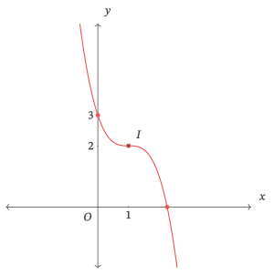

Đúng bảng và điểm chưa đủ nếu hình lại quay đầu tại $x=1$; phải kiểm cả chiều đường cong.

[Trở về đề — Một điểm dừng không đổi chiều](#T02).

#### Tự kiểm tra 03 — Hai nhánh đồng biến

Lời giải và tiêu chí đối chiếu

$D=\mathbb R\setminus\{-2\}$, $g^\prime(x)=\frac{2}{(x+2)^2}>0$. Hàm đồng biến trên từng khoảng $(-\infty;-2)$ và $(-2;+\infty)$, không có cực trị.
$$
\lim_{x\to-2^-}g(x)=+\infty,\quad \lim_{x\to-2^+}g(x)=-\infty,
$$
$$
\lim_{x\to-\infty}g(x)=1,\quad\lim_{x\to+\infty}g(x)=1.
$$

| Khoảng | $(-\infty;-2)$ | $(-2;+\infty)$ |
|---|---|---|
| Dấu đạo hàm | $+$ | $+$ |
| Biến thiên | $1\nearrow+\infty$ | $-\infty\nearrow1$ |

Tiệm cận $x=-2$, $y=1$, tâm $I(-2;1)$. Giao cả hai trục tại $O$. Hai đường phân giác $y-1=\pm(x+2)$ là trục đối xứng. Không nối qua $-2$ vì điểm này không thuộc miền; các giới hạn còn cho thấy hai nhánh đi về hai phía vô cực.

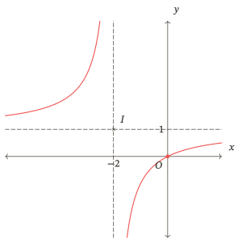

[Trở về đề — Hai nhánh đồng biến](#T03).

#### Tự kiểm tra 04 — Kiểm lại dấu của phần dư

Lời giải và tiêu chí đối chiếu

$D=\mathbb R\setminus\{2\}$,
$$
h^\prime(x)=1+\frac{4}{(x-2)^2}>0.
$$
Hàm đồng biến trên từng khoảng $(-\infty;2)$, $(2;+\infty)$; không có cực trị.
$$
\lim_{x\to2^-}h(x)=+\infty,\qquad\lim_{x\to2^+}h(x)=-\infty,
$$
$$
\lim_{x\to-\infty}h(x)=-\infty,\qquad\lim_{x\to+\infty}h(x)=+\infty,
$$
$$
\lim_{x\to-\infty}[h(x)-(x-1)]=0,\qquad
\lim_{x\to+\infty}[h(x)-(x-1)]=0.
$$
Tiệm cận $x=2$, $y=x-1$; tâm $I(2;1)$; $h(0)=1$.

| Khoảng | $(-\infty;2)$ | $(2;+\infty)$ |
|---|---|---|
| Dấu đạo hàm | $+$ | $+$ |
| Biến thiên | $-\infty\nearrow+\infty$ | $-\infty\nearrow+\infty$ |

Nhánh trái nằm trên đường xiên, nhánh phải nằm dưới. Tiêu chí: dấu cộng trong đạo hàm, đúng hướng ở điểm bị loại và hình đi qua $(0;1)$.

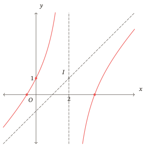

[Trở về đề — Kiểm lại dấu của phần dư](#T04).

#### Tự kiểm tra 05 — Giữ miền khi đọc chi phí

Lời giải và tiêu chí đối chiếu

$B^\prime(x)=-\frac{18}{x^2}<0$ trên miền $x\ge2$. Giá trị lớn nhất $B(2)=13$, đơn vị triệu đồng mỗi tấn.
$$
\lim_{x\to+\infty}B(x)=4,\qquad B(x)>4.
$$
Không có giá trị nhỏ nhất trên $[2;+\infty)$: với mỗi $x$, chọn khối lượng lớn hơn thì $B$ nhỏ hơn. Trên $[2;6]$, giá trị nhỏ nhất là $B(6)=7$, đạt tại $6$. Tiêu chí: hai miền cho hai kết luận khác nhau, không gọi $4$ là giá trị nhỏ nhất.

[Trở về đề — Giữ miền khi đọc chi phí](#T05).

### Luyện tập

#### Nhiệm vụ 01 — Khảo sát một hàm bậc ba

Lời giải và tiêu chí đối chiếu

Miền $\mathbb R$; $f^\prime(x)=3x(x-2)$. Dấu $+$, $-$, $+$; cực đại $(0;4)$, cực tiểu $(2;0)$.
$$
\lim_{x\to-\infty}f(x)=-\infty,\qquad\lim_{x\to+\infty}f(x)=+\infty.
$$

| $x$ | $-\infty$ | $0$ | $2$ | $+\infty$ |
|---|---|---|---|---|
| Biến thiên | $-\infty\nearrow$ | $4\searrow$ | $0\nearrow$ | $+\infty$ |

Dấu đạo hàm bằng $0$ tại $0$, $2$; dấu trên các khoảng là dấu đã ghi ở trên. $f(x)=(x+1)(x-2)^2$, nên giao trục hoành tại $(-1;0)$, $(2;0)$; giao trục tung tại $(0;4)$. Tâm $I(1;2)$; không có tiệm cận. Đồ thị đi qua trục hoành tại $-1$, chạm rồi đổi chiều tại $2$.

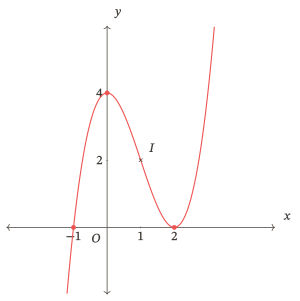

Tiêu chí: không nhầm hai nghiệm của hàm với hai hoành độ cực trị; hình phải phù hợp cả bảng và giao điểm.

[Trở về đề — Khảo sát một hàm bậc ba](#L01).

#### Nhiệm vụ 02 — Không có cực trị theo hai cách

Lời giải và tiêu chí đối chiếu

$p^\prime(x)=3(x+1)^2$, dương hai phía $-1$ và bằng $0$ tại $-1$; $p$ đồng biến trên $\mathbb R$, không có cực trị. Tâm của đồ thị $p$ là $I(-1;-1)$.
$q^\prime(x)=3x^2+3>0$ trên $\mathbb R$, nên $q$ cũng đồng biến, không có cực trị nhưng không có điểm đạo hàm bằng $0$. Tiêu chí: nêu được sự khác nhau của hai đạo hàm và vì sao cả hai đều không có cực trị.

[Trở về đề — Không có cực trị theo hai cách](#L02).

#### Nhiệm vụ 03 — Khảo sát phân thức với hai nhánh tăng

Lời giải và tiêu chí đối chiếu

$f(x)=3-\frac{2}{x-2}$, $D=\mathbb R\setminus\{2\}$, $f^\prime(x)=\frac{2}{(x-2)^2}>0$. Đồng biến trên từng khoảng $(-\infty;2)$ và $(2;+\infty)$; không cực trị.
$$
\lim_{x\to2^-}f(x)=+\infty,\quad\lim_{x\to2^+}f(x)=-\infty,\quad
\lim_{x\to-\infty}f(x)=3,\quad\lim_{x\to+\infty}f(x)=3.
$$

| Khoảng | $(-\infty;2)$ | $(2;+\infty)$ |
|---|---|---|
| Dấu đạo hàm | $+$ | $+$ |
| Biến thiên | $3\nearrow+\infty$ | $-\infty\nearrow3$ |

Tiệm cận $x=2$, $y=3$; tâm $I(2;3)$; các trục đối xứng $y-3=\pm(x-2)$. Giao trục hoành $\left(\frac{8}{3};0\right)$, trục tung $(0;4)$.

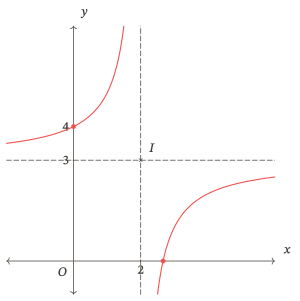

[Trở về đề — Khảo sát phân thức với hai nhánh tăng](#L03).

#### Nhiệm vụ 04 — Khảo sát phân thức có tiệm cận xiên

Lời giải và tiêu chí đối chiếu

$h(x)=x+2+\frac{4}{x}$, $D=\mathbb R\setminus\{0\}$,
$$
h^\prime(x)=1-\frac{4}{x^2}=\frac{(x-2)(x+2)}{x^2}.
$$
Đồng biến trên $(-\infty;-2)$, $(2;+\infty)$; nghịch biến trên $(-2;0)$, $(0;2)$. Cực đại tại $-2$, giá trị $-2$; cực tiểu tại $2$, giá trị $6$.
$$
\lim_{x\to0^-}h(x)=-\infty,\qquad\lim_{x\to0^+}h(x)=+\infty;
$$
$$
\lim_{x\to-\infty}h(x)=-\infty,\qquad\lim_{x\to+\infty}h(x)=+\infty;
$$
$$
\lim_{x\to-\infty}[h(x)-(x+2)]=0,\qquad
\lim_{x\to+\infty}[h(x)-(x+2)]=0.
$$

| Khoảng xét | $(-\infty;-2]$ | $[-2;0)$ | $(0;2]$ | $[2;+\infty)$ |
|---|---|---|---|---|
| Dấu đạo hàm bên trong | $+$ | $-$ | $-$ | $+$ |
| Biến thiên | $-\infty\nearrow-2$ | $-2\searrow-\infty$ | $+\infty\searrow6$ | $6\nearrow+\infty$ |

Đạo hàm bằng $0$ tại $-2$, $2$. Tiệm cận $x=0$, $y=x+2$; tâm $I(0;2)$. Tử $(x+1)^2+3>0$, nên không giao trục hoành; không có điểm trên trục tung vì $0$ bị loại. Hai trục đối xứng là hai phân giác của hai tiệm cận.

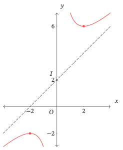

Cực trị là so sánh trong lân cận; hai cực trị thuộc hai nhánh khác nhau. Không lấy quan hệ giữa hai giá trị ấy để bác bỏ kết quả.

[Trở về đề — Khảo sát phân thức có tiệm cận xiên](#L04).

#### Nhiệm vụ 05 — Dấu trừ làm thay đổi hai nhánh

Lời giải và tiêu chí đối chiếu

$v(x)=x-2-\frac{1}{x+1}$, $D=\mathbb R\setminus\{-1\}$, $v^\prime(x)=1+\frac{1}{(x+1)^2}>0$. Đồng biến trên từng khoảng xác định, không cực trị.
$$
\lim_{x\to-1^-}v(x)=+\infty,\qquad\lim_{x\to-1^+}v(x)=-\infty;
$$
$$
\lim_{x\to-\infty}v(x)=-\infty,\qquad\lim_{x\to+\infty}v(x)=+\infty;
$$
$$
\lim_{x\to-\infty}[v(x)-(x-2)]=0,\qquad
\lim_{x\to+\infty}[v(x)-(x-2)]=0.
$$

| Khoảng | $(-\infty;-1)$ | $(-1;+\infty)$ |
|---|---|---|
| Dấu đạo hàm | $+$ | $+$ |
| Biến thiên | $-\infty\nearrow+\infty$ | $-\infty\nearrow+\infty$ |

Tiệm cận $x=-1$, $y=x-2$; tâm $I(-1;-3)$. Giao trục tung $(0;-3)$; giao trục hoành $\left(\frac{1-\sqrt{13}}{2};0\right)$, $\left(\frac{1+\sqrt{13}}{2};0\right)$. Hai phân giác của tiệm cận là các trục đối xứng. Nhánh trái nằm trên đường xiên, nhánh phải nằm dưới.

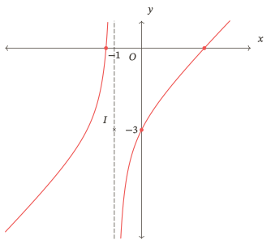

[Trở về đề — Dấu trừ làm thay đổi hai nhánh](#L05).

#### Nhiệm vụ 06 — Đồ thị chỉ trên miền sản xuất

Lời giải và tiêu chí đối chiếu

$A^\prime(x)=-\frac{24}{x^2}<0$ trên $[2;8]$; $A(2)=15$, $A(8)=6$.

| $x$ | $2$ | $(2;8)$ | $8$ |
|---|---|---|---|
| $A(x)$ | $15$ | $\searrow$ | $6$ |

Giá trị lớn nhất $15$, đạt tại $2$ tấn; nhỏ nhất $6$, đạt tại $8$ tấn. Đơn vị của giá trị là triệu đồng mỗi tấn.

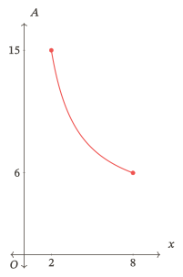

Miền $[2;8]$ không cho $x\to+\infty$, nên không dùng tiệm cận ngang của một hàm mở rộng để kết luận cho đồ thị bị giới hạn này. Câu đã nêu sai cả cách lấy miền lẫn sự đạt được.

[Trở về đề — Đồ thị chỉ trên miền sản xuất](#L06).

### Kiểm tra

#### Nhiệm vụ 01 — Khảo sát hàm bậc ba

Lời giải và tiêu chí đối chiếu

Miền $\mathbb R$; $f^\prime(x)=-3x(x-2)$. Dấu đạo hàm trên ba khoảng chia bởi $0$, $2$ lần lượt là $-$, $+$, $-$; bằng $0$ tại hai mốc. Cực tiểu $(0;0)$, cực đại $(2;4)$.
$$
\lim_{x\to-\infty}f(x)=+\infty,\qquad \lim_{x\to+\infty}f(x)=-\infty.
$$

| Khoảng | $(-\infty;0]$ | $[0;2]$ | $[2;+\infty)$ |
|---|---|---|---|
| Biến thiên | $+\infty\searrow0$ | $0\nearrow4$ | $4\searrow-\infty$ |

Vì $f(x)=x^2(3-x)$, giao trục hoành tại $(0;0)$, $(3;0)$; giao trục tung tại $(0;0)$. Tâm $I(1;2)$; không có tiệm cận. Đồ thị chạm trục hoành tại $0$, đi qua tại $3$.

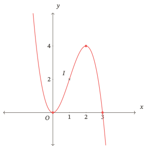

Tiêu chí đối chiếu: đủ dữ kiện khảo sát, đúng chiều ở cả ba khoảng, đúng hai loại cực trị và đúng sự tiếp xúc/giao cắt. Hình không khớp bảng thì chưa xác nhận kĩ năng vẽ.

[Trở về đề — Khảo sát hàm bậc ba](#K01).

#### Nhiệm vụ 02 — Khảo sát phân thức bậc nhất

Lời giải và tiêu chí đối chiếu

Ta có $f(x)=1+\frac{2}{x+1}$, miền $\mathbb R\setminus\{-1\}$ và $f^\prime(x)=-\frac{2}{(x+1)^2}<0$. Hàm nghịch biến trên từng khoảng $(-\infty;-1)$, $(-1;+\infty)$, không có cực trị.
$$
\lim_{x\to-1^-}f(x)=-\infty,\qquad \lim_{x\to-1^+}f(x)=+\infty,\qquad
\lim_{x\to-\infty}f(x)=\lim_{x\to+\infty}f(x)=1.
$$

| Khoảng | $(-\infty;-1)$ | $(-1;+\infty)$ |
|---|---|---|
| Biến thiên | $1\searrow-\infty$ | $+\infty\searrow1$ |

Tiệm cận $x=-1$, $y=1$; tâm $I(-1;1)$; giao trục tại $(-3;0)$ và $(0;3)$. Nhánh trái dưới tiệm cận ngang, nhánh phải trên tiệm cận ngang.

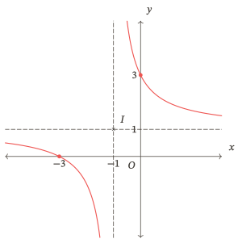

Tiêu chí: không ghép hai khoảng thành một khoảng nghịch biến, không vẽ nối qua điểm bị loại; giới hạn, giao điểm, tâm và hình thống nhất.

[Trở về đề — Khảo sát phân thức bậc nhất](#K02).

#### Nhiệm vụ 03 — Khảo sát phân thức bậc hai

Lời giải và tiêu chí đối chiếu

Ta có
$$
h(x)=x+4+\frac{4}{x-1},\qquad D=\mathbb R\setminus\{1\},\qquad
h^\prime(x)=1-\frac{4}{(x-1)^2}=\frac{(x+1)(x-3)}{(x-1)^2}.
$$
Đạo hàm bằng $0$ tại $-1$, $3$. Cực đại $(-1;1)$; cực tiểu $(3;9)$.
$$
\lim_{x\to1^-}h(x)=-\infty,\qquad \lim_{x\to1^+}h(x)=+\infty;
$$
$$
\lim_{x\to-\infty}h(x)=-\infty,\qquad \lim_{x\to+\infty}h(x)=+\infty;
$$
$$
\lim_{x\to-\infty}[h(x)-(x+4)]=0,\qquad
\lim_{x\to+\infty}[h(x)-(x+4)]=0.
$$

| Khoảng | $(-\infty;-1]$ | $[-1;1)$ | $(1;3]$ | $[3;+\infty)$ |
|---|---|---|---|---|
| Dấu đạo hàm bên trong | $+$ | $-$ | $-$ | $+$ |
| Biến thiên | $-\infty\nearrow1$ | $1\searrow-\infty$ | $+\infty\searrow9$ | $9\nearrow+\infty$ |

Tiệm cận đứng $x=1$, tiệm cận xiên $y=x+4$, tâm $I(1;5)$. Hai trục đối xứng là hai đường phân giác của các góc tạo bởi hai tiệm cận, không phải chính các tiệm cận. Giao trục hoành tại $(-3;0)$, $(0;0)$; giao trục tung tại $(0;0)$. Nhánh trái dưới, nhánh phải trên đường xiên.

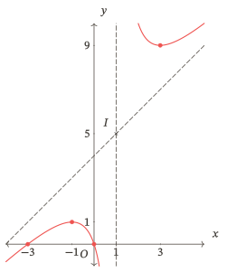

Tiêu chí: phép chia, dấu đạo hàm, bốn khoảng, giới hạn hai phía, hai tiệm cận và hình cùng đúng; hiểu tâm và trục đối xứng theo hai vai trò khác nhau.

[Trở về đề — Khảo sát phân thức bậc hai](#K03).

#### Nhiệm vụ 04 — Kết luận trong miền của mô hình

Lời giải và tiêu chí đối chiếu

Miền mô hình $[3;9]$. Vì $B^\prime(x)=-\frac{18}{x^2}<0$ trên $(3;9)$, hàm giảm trên đoạn; $B(3)=11$, $B(9)=7$. Giá trị lớn nhất là $11$ triệu đồng mỗi tấn tại $3$ tấn, nhỏ nhất là $7$ triệu đồng mỗi tấn tại $9$ tấn.

Đường $y=5$ gắn với giới hạn khi $x\to+\infty$ của công thức mở rộng, không phải giá trị nhỏ nhất trên đoạn đã cho. Đồ thị bị giới hạn ở đoạn không có nhánh tiến ra vô cực. Không kết luận cho $20$ tấn từ mô hình chỉ được giả thiết áp dụng trên $[3;9]$.

Tiêu chí: giữ đúng miền, xét đầu mút, ghi đủ đơn vị và không suy rộng hiệu lực mô hình.

[Trở về đề — Kết luận trong miền của mô hình](#K04).

### Ôn lại

#### Nhiệm vụ 01 — Nhớ lại khảo sát bậc ba

Lời giải và tiêu chí đối chiếu

Miền $\mathbb R$; $f^\prime(x)=3(x-1)(x-3)$. Dấu $+$, $-$, $+$ trên ba khoảng, bằng $0$ tại $1$, $3$. Cực đại $(1;4)$, cực tiểu $(3;0)$.
$$
\lim_{x\to-\infty}f(x)=-\infty,\qquad \lim_{x\to+\infty}f(x)=+\infty.
$$

| Khoảng | $(-\infty;1]$ | $[1;3]$ | $[3;+\infty)$ |
|---|---|---|---|
| Biến thiên | $-\infty\nearrow4$ | $4\searrow0$ | $0\nearrow+\infty$ |

$f(x)=x(x-3)^2$; giao trục hoành tại $(0;0)$, $(3;0)$ và trục tung tại $(0;0)$. Tâm $I(2;2)$; không tiệm cận. Đồ thị đi qua trục hoành tại $0$ và chạm tại $3$.

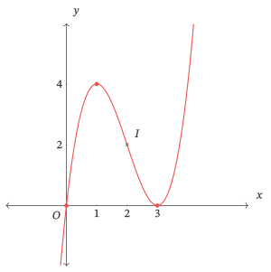

Tiêu chí: tự khôi phục quy trình và hình đúng; đây là mẫu kiểm bậc ba, không thay kiểm hai họ phân thức.

[Trở về đề — Nhớ lại khảo sát bậc ba](#O01).

#### Nhiệm vụ 02 — Nhớ lại phân thức và miền mô hình

Lời giải và tiêu chí đối chiếu

a) Miền $\mathbb R\setminus\{-1\}$; $f^\prime(x)=\frac{4}{(x+1)^2}>0$, đồng biến trên từng khoảng miền, không cực trị.
$$
\lim_{x\to-1^-}f(x)=+\infty,\qquad \lim_{x\to-1^+}f(x)=-\infty,\qquad
\lim_{x\to-\infty}f(x)=\lim_{x\to+\infty}f(x)=2.
$$

| Khoảng | $(-\infty;-1)$ | $(-1;+\infty)$ |
|---|---|---|
| Biến thiên | $2\nearrow+\infty$ | $-\infty\nearrow2$ |

Tiệm cận $x=-1$, $y=2$; tâm $I(-1;2)$; giao trục tại $(1;0)$, $(0;-2)$. Nhánh trái trên, nhánh phải dưới tiệm cận ngang.

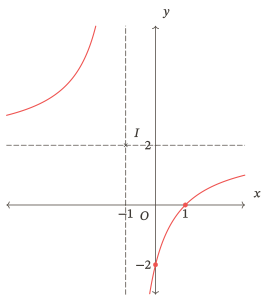

b) $A^\prime(x)=-\frac{30}{x^2}<0$; hàm giảm trên $[3;15]$. Giá trị lớn nhất $A(3)=12$, nhỏ nhất $A(15)=4$, đều tính bằng triệu đồng mỗi tấn. Cận $2$ của công thức mở rộng không được đạt trên đoạn; đoạn kết thúc ở $15$.

Tiêu chí: ghi riêng bằng chứng của mỗi ý; làm được ý a không chứng nhận đọc miền ở ý b.

[Trở về đề — Nhớ lại phân thức và miền mô hình](#O02).

#### Nhiệm vụ 03 — Nhớ lại tiệm cận xiên và cực trị

Lời giải và tiêu chí đối chiếu

Miền $\mathbb R\setminus\{0\}$; $h^\prime(x)=1-\frac{1}{x^2}=\frac{(x-1)(x+1)}{x^2}$. Đạo hàm bằng $0$ tại $-1$, $1$; cực đại $(-1;0)$, cực tiểu $(1;4)$.
$$
\lim_{x\to0^-}h(x)=-\infty,\qquad \lim_{x\to0^+}h(x)=+\infty;
$$
$$
\lim_{x\to-\infty}h(x)=-\infty,\qquad \lim_{x\to+\infty}h(x)=+\infty;
$$
$$
\lim_{x\to-\infty}[h(x)-(x+2)]=0,\qquad \lim_{x\to+\infty}[h(x)-(x+2)]=0.
$$

| Khoảng | $(-\infty;-1]$ | $[-1;0)$ | $(0;1]$ | $[1;+\infty)$ |
|---|---|---|---|---|
| Dấu đạo hàm bên trong | $+$ | $-$ | $-$ | $+$ |
| Biến thiên | $-\infty\nearrow0$ | $0\searrow-\infty$ | $+\infty\searrow4$ | $4\nearrow+\infty$ |

Tiệm cận $x=0$, $y=x+2$; tâm $I(0;2)$. Trục đối xứng là hai đường phân giác của các góc tạo bởi hai tiệm cận. Vì $h(x)=\frac{(x+1)^2}{x}$, giao trục hoành tại $(-1;0)$, không giao trục tung. Nhánh trái dưới, nhánh phải trên đường xiên.

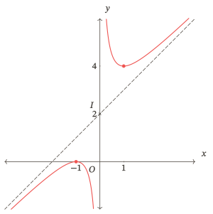

Tiêu chí: không đặt giá trị hàm tại điểm loại, không gọi điểm ấy là cực trị; hình phải thể hiện đúng hai cực trị và hai nhánh.

[Trở về đề — Nhớ lại tiệm cận xiên và cực trị](#O03).

### Sửa lỗi

#### Nhiệm vụ 01 — Sau luyện tập — Bậc ba

Lời giải và tiêu chí đối chiếu

a) Miền $\mathbb R$; $p^\prime(x)=-3(x+2)^2$, dấu âm ở cả hai phía của $-2$, bằng $0$ chỉ tại mốc này. Hàm nghịch biến trên $\mathbb R$, không cực trị.
$$
\lim_{x\to-\infty}p(x)=+\infty,\qquad \lim_{x\to+\infty}p(x)=-\infty.
$$

| Khoảng | $(-\infty;-2]$ | $[-2;+\infty)$ |
|---|---|---|
| Biến thiên | $+\infty\searrow5$ | $5\searrow-\infty$ |

Tâm $I(-2;5)$; không tiệm cận. Giao trục hoành tại $\left(\sqrt[3]{5}-2;0\right)$, giao trục tung tại $(0;-3)$. Hoành độ giao trục hoành được tìm từ phương trình $p(x)=0$, không phải từ phương trình đạo hàm.

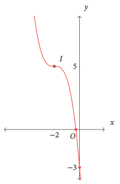

Với hàm so sánh, $q^\prime(x)=3x^2+2>0$ với mọi $x\in\mathbb R$. Hàm đồng biến, không cực trị và không có nghiệm đạo hàm; đây là khả năng khác với $p^\prime$ có một nghiệm nhưng không đổi dấu. Muốn xác nhận đủ hai khả năng, phải giải thích cả phần so sánh này.

b) Miền $\mathbb R$; $f^\prime(x)=3x(x+2)$; dấu $+$, $-$, $+$ trên ba khoảng chia bởi $-2$, $0$. Cực đại $(-2;0)$, cực tiểu $(0;-4)$.
$$
\lim_{x\to-\infty}f(x)=-\infty,\qquad\lim_{x\to+\infty}f(x)=+\infty.
$$

| Khoảng | $(-\infty;-2]$ | $[-2;0]$ | $[0;+\infty)$ |
|---|---|---|---|
| Biến thiên | $-\infty\nearrow0$ | $0\searrow-4$ | $-4\nearrow+\infty$ |

$f(x)=(x-1)(x+2)^2$; giao trục hoành tại $(-2;0)$, $(1;0)$; giao trục tung $(0;-4)$. Tâm $I(-1;-2)$; không tiệm cận.

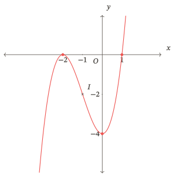

Tiêu chí ý b: toàn bộ chuỗi dữ kiện và hình thống nhất; làm được ý a không thay được ý b.

[Trở về đề — Sau luyện tập — Bậc ba](#S01).

#### Nhiệm vụ 02 — Sau luyện tập — Phân thức và miền

Lời giải và tiêu chí đối chiếu

a) Miền $\mathbb R\setminus\{-2\}$; $f(x)=2-\frac{4}{x+2}$; $f^\prime(x)=\frac{4}{(x+2)^2}>0$. Hàm đồng biến trên từng khoảng $(-\infty;-2)$, $(-2;+\infty)$, không cực trị.
$$
\lim_{x\to -2^-}f(x)=+\infty,\qquad
\lim_{x\to -2^+}f(x)=-\infty,\qquad
\lim_{x\to-\infty}f(x)=\lim_{x\to+\infty}f(x)=2.
$$

| Khoảng | $(-\infty;-2)$ | $(-2;+\infty)$ |
|---|---|---|
| Biến thiên | $2\nearrow+\infty$ | $-\infty\nearrow2$ |

Tiệm cận $x=-2$, $y=2$; tâm $I(-2;2)$; giao trục hoành tại $(0;0)$, giao trục tung tại $(0;0)$. Hai trục đối xứng là $y-2=\pm(x+2)$. Nhánh trái ở trên, nhánh phải ở dưới tiệm cận ngang.

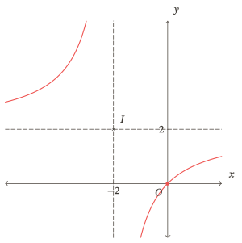

b) Miền $\mathbb R\setminus\{-1\}$; $h(x)=x+3+\frac{1}{x+1}$,
$$
h^\prime(x)=1-\frac{1}{(x+1)^2}.
$$
Đạo hàm bằng $0$ tại $-2$, $0$. Cực đại $(-2;0)$, cực tiểu $(0;4)$.
$$
\lim_{x\to -1^-}h(x)=-\infty,\qquad\lim_{x\to -1^+}h(x)=+\infty;
$$
$$
\lim_{x\to-\infty}h(x)=-\infty,\qquad\lim_{x\to+\infty}h(x)=+\infty;
$$
$$
\lim_{x\to-\infty}[h(x)-(x+3)]=0,\qquad
\lim_{x\to+\infty}[h(x)-(x+3)]=0.
$$

| Khoảng | $(-\infty;-2]$ | $[-2;-1)$ | $(-1;0]$ | $[0;+\infty)$ |
|---|---|---|---|---|
| Dấu đạo hàm bên trong | $+$ | $-$ | $-$ | $+$ |
| Biến thiên | $-\infty\nearrow 0$ | $0\searrow-\infty$ | $+\infty\searrow 4$ | $4\nearrow+\infty$ |

Tiệm cận $x=-1$, $y=x+3$; tâm $I(-1;2)$. Giao trục hoành tại $(-2;0)$ vì $h(x)=\frac{(x+2)^2}{x+1}$; giao trục tung $(0;4)$. Nhánh trái dưới, nhánh phải trên đường xiên. Hai trục đối xứng là hai đường phân giác của các góc tạo bởi hai tiệm cận.

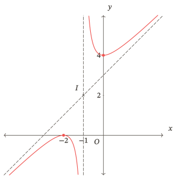

c) Với $v(x)=x+3-\frac{1}{x+1}$, miền $\mathbb R\setminus\{-1\}$, $v^\prime(x)=1+\frac{1}{(x+1)^2}>0$: đồng biến trên từng khoảng $(-\infty;-1)$, $(-1;+\infty)$, không cực trị.
$$
\lim_{x\to -1^-}v(x)=+\infty,\qquad \lim_{x\to -1^+}v(x)=-\infty;
$$
$$
\lim_{x\to-\infty}v(x)=-\infty,\qquad\lim_{x\to+\infty}v(x)=+\infty;
$$
$$
\lim_{x\to-\infty}[v(x)-(x+3)]=0,\qquad\lim_{x\to+\infty}[v(x)-(x+3)]=0.
$$
Tiệm cận $x=-1$, $y=x+3$; tâm $I(-1;2)$. Nhánh trái trên, nhánh phải dưới đường xiên. 
 
| Khoảng | $(-\infty;-1)$ | $(-1;+\infty)$ |
|---|---|---|
| Biến thiên | $-\infty\nearrow+\infty$ | $-\infty\nearrow+\infty$ |

Giao trục hoành tại $\left(-2-\sqrt{2};0\right)$, $\left(-2+\sqrt{2};0\right)$; giao trục tung $(0;2)$. Các trục đối xứng là hai đường phân giác của các góc tạo bởi $x=-1$ và $y=x+3$.

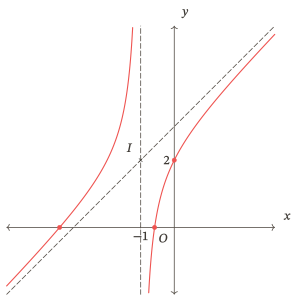

Ý này xác nhận khảo sát trường hợp không cực trị khi cả lập luận, bảng và hình đều đúng.

d) $A^\prime(x)=-\frac{20}{x^2}<0$. Trên $[2;+\infty)$, lớn nhất $A(2)=11$; không có giá trị nhỏ nhất vì hàm tiếp tục giảm, $A(x)>1$ và $\lim_{x\to+\infty}A(x)=1$. Trên $[2;10]$, lớn nhất vẫn $11$, nhỏ nhất $A(10)=3$, đều tính bằng triệu đồng mỗi tấn. Phải nêu sự khác nhau giữa cận không đạt ở miền đầu và giá trị đạt tại đầu mút ở miền sau.

Tiêu chí: đánh dấu riêng ý đã tự làm; ý a không xác nhận phân thức bậc hai, ý b không xác nhận trường hợp không cực trị, ý c xác nhận riêng trường hợp không cực trị, ý d không xác nhận khảo sát phân thức.

[Trở về đề — Sau luyện tập — Phân thức và miền](#S02).

#### Nhiệm vụ 03 — Sau kiểm tra — Bậc ba

Lời giải và tiêu chí đối chiếu

a) Miền $\mathbb R$; $p^\prime(x)=-3(x-2)^2$, dấu âm ở cả hai phía của $2$, bằng $0$ chỉ tại mốc này. Hàm nghịch biến trên $\mathbb R$, không cực trị.
$$
\lim_{x\to-\infty}p(x)=+\infty,\qquad \lim_{x\to+\infty}p(x)=-\infty.
$$

| Khoảng | $(-\infty;2]$ | $[2;+\infty)$ |
|---|---|---|
| Biến thiên | $+\infty\searrow3$ | $3\searrow-\infty$ |

Tâm $I(2;3)$; không tiệm cận. Giao trục hoành tại $\left(2+\sqrt[3]{3};0\right)$, giao trục tung tại $(0;11)$. Hoành độ giao trục hoành được tìm từ phương trình $p(x)=0$, không phải từ phương trình đạo hàm.

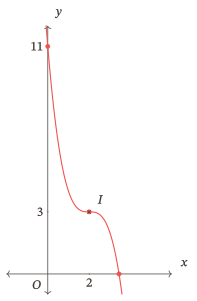

b) Miền $\mathbb R$; $f^\prime(x)=-3x(x+2)$, dấu $-$, $+$, $-$ trên ba khoảng chia bởi $-2$, $0$; bằng $0$ tại hai mốc. Cực tiểu $(-2;0)$, cực đại $(0;4)$.
$$
\lim_{x\to-\infty}f(x)=+\infty,\qquad\lim_{x\to+\infty}f(x)=-\infty.
$$

| Khoảng | $(-\infty;-2]$ | $[-2;0]$ | $[0;+\infty)$ |
|---|---|---|---|
| Biến thiên | $+\infty\searrow0$ | $0\nearrow4$ | $4\searrow-\infty$ |

$f(x)=-(x-1)(x+2)^2$; giao trục hoành $(-2;0)$, $(1;0)$; giao trục tung $(0;4)$; tâm $I(-1;2)$; không tiệm cận.

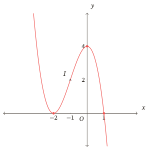

Tiêu chí: dữ kiện đúng và hình đúng; giữ nguyên kết quả bài kiểm tra cũ, ghi bằng chứng sửa riêng.

[Trở về đề — Sau kiểm tra — Bậc ba](#S03).

#### Nhiệm vụ 04 — Sau kiểm tra — Phân thức và miền

Lời giải và tiêu chí đối chiếu

a) Miền $\mathbb R\setminus\{1\}$; $f(x)=3+\frac{3}{x-1}$; $f^\prime(x)=-\frac{3}{(x-1)^2}<0$. Hàm nghịch biến trên từng khoảng $(-\infty;1)$, $(1;+\infty)$, không cực trị.
$$
\lim_{x\to 1^-}f(x)=-\infty,\qquad
\lim_{x\to 1^+}f(x)=+\infty,\qquad
\lim_{x\to-\infty}f(x)=\lim_{x\to+\infty}f(x)=3.
$$

| Khoảng | $(-\infty;1)$ | $(1;+\infty)$ |
|---|---|---|
| Biến thiên | $3\searrow-\infty$ | $+\infty\searrow3$ |

Tiệm cận $x=1$, $y=3$; tâm $I(1;3)$; giao trục hoành tại $(0;0)$, giao trục tung tại $(0;0)$. Hai trục đối xứng là $y-3=\pm(x-1)$. Nhánh trái ở dưới, nhánh phải ở trên tiệm cận ngang.

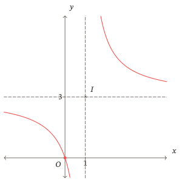

b) Miền $\mathbb R\setminus\{-2\}$; $h(x)=x+2+\frac{4}{x+2}$,
$$
h^\prime(x)=1-\frac{4}{(x+2)^2}.
$$
Đạo hàm bằng $0$ tại $-4$, $0$. Cực đại $(-4;-4)$, cực tiểu $(0;4)$.
$$
\lim_{x\to -2^-}h(x)=-\infty,\qquad\lim_{x\to -2^+}h(x)=+\infty;
$$
$$
\lim_{x\to-\infty}h(x)=-\infty,\qquad\lim_{x\to+\infty}h(x)=+\infty;
$$
$$
\lim_{x\to-\infty}[h(x)-(x+2)]=0,\qquad
\lim_{x\to+\infty}[h(x)-(x+2)]=0.
$$

| Khoảng | $(-\infty;-4]$ | $[-4;-2)$ | $(-2;0]$ | $[0;+\infty)$ |
|---|---|---|---|---|
| Dấu đạo hàm bên trong | $+$ | $-$ | $-$ | $+$ |
| Biến thiên | $-\infty\nearrow -4$ | $-4\searrow-\infty$ | $+\infty\searrow 4$ | $4\nearrow+\infty$ |

Tiệm cận $x=-2$, $y=x+2$; tâm $I(-2;0)$. Không giao trục hoành vì tử $(x+2)^2+4>0$; giao trục tung tại $(0;4)$. Nhánh trái dưới, nhánh phải trên đường xiên. Hai trục đối xứng là hai đường phân giác của các góc tạo bởi hai tiệm cận.

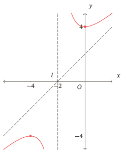

c) Với $v(x)=x+2-\frac{4}{x+2}$, miền $\mathbb R\setminus\{-2\}$, $v^\prime(x)=1+\frac{4}{(x+2)^2}>0$: đồng biến trên từng khoảng $(-\infty;-2)$, $(-2;+\infty)$, không cực trị.
$$
\lim_{x\to -2^-}v(x)=+\infty,\qquad \lim_{x\to -2^+}v(x)=-\infty;
$$
$$
\lim_{x\to-\infty}v(x)=-\infty,\qquad\lim_{x\to+\infty}v(x)=+\infty;
$$
$$
\lim_{x\to-\infty}[v(x)-(x+2)]=0,\qquad\lim_{x\to+\infty}[v(x)-(x+2)]=0.
$$
Tiệm cận $x=-2$, $y=x+2$; tâm $I(-2;0)$. Nhánh trái trên, nhánh phải dưới đường xiên. 
 
| Khoảng | $(-\infty;-2)$ | $(-2;+\infty)$ |
|---|---|---|
| Biến thiên | $-\infty\nearrow+\infty$ | $-\infty\nearrow+\infty$ |

Giao trục hoành tại $(-4;0)$, $(0;0)$; giao trục tung $(0;0)$. Các trục đối xứng là hai đường phân giác của các góc tạo bởi $x=-2$ và $y=x+2$.

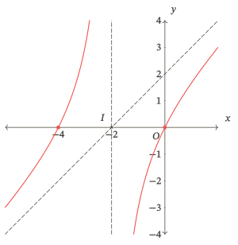

Ý này xác nhận khảo sát trường hợp không cực trị khi cả lập luận, bảng và hình đều đúng.

d) $A^\prime(x)=-\frac{24}{x^2}<0$. Trên $[3;+\infty)$, lớn nhất $A(3)=12$, không có giá trị nhỏ nhất; $A(x)>4$ và $\lim_{x\to+\infty}A(x)=4$. Trên $[3;12]$, lớn nhất $12$, nhỏ nhất $A(12)=6$, đơn vị triệu đồng mỗi tấn. Ghi rõ đầu mút đạt được.

Tiêu chí và giới hạn từng ý như tên kĩ năng trong đề; kết quả sửa được ghi riêng, không thay bài kiểm tra gốc.

[Trở về đề — Sau kiểm tra — Phân thức và miền](#S04).

#### Nhiệm vụ 05 — Sau ôn lại — Bậc ba

Lời giải và tiêu chí đối chiếu

a) Miền $\mathbb R$; $p^\prime(x)=3(x-1)^2$, dấu dương ở cả hai phía của $1$, bằng $0$ chỉ tại mốc này. Hàm đồng biến trên $\mathbb R$, không cực trị.
$$
\lim_{x\to-\infty}p(x)=-\infty,\qquad \lim_{x\to+\infty}p(x)=+\infty.
$$

| Khoảng | $(-\infty;1]$ | $[1;+\infty)$ |
|---|---|---|
| Biến thiên | $-\infty\nearrow-2$ | $-2\nearrow+\infty$ |

Tâm $I(1;-2)$; không tiệm cận. Giao trục hoành tại $\left(1+\sqrt[3]{2};0\right)$, giao trục tung tại $(0;-3)$. Hoành độ giao trục hoành được tìm từ phương trình $p(x)=0$, không phải từ phương trình đạo hàm.

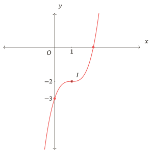

b) Miền $\mathbb R$; $f^\prime(x)=3(x+3)(x+1)$, dấu $+$, $-$, $+$ trên ba khoảng chia bởi $-3$, $-1$; bằng $0$ tại hai mốc. Cực đại $(-3;0)$, cực tiểu $(-1;-4)$.
$$
\lim_{x\to-\infty}f(x)=-\infty,\qquad\lim_{x\to+\infty}f(x)=+\infty.
$$

| Khoảng | $(-\infty;-3]$ | $[-3;-1]$ | $[-1;+\infty)$ |
|---|---|---|---|
| Biến thiên | $-\infty\nearrow0$ | $0\searrow-4$ | $-4\nearrow+\infty$ |

$f(x)=x(x+3)^2$; giao trục hoành $(-3;0)$, $(0;0)$; giao trục tung $(0;0)$; tâm $I(-2;-2)$; không tiệm cận.

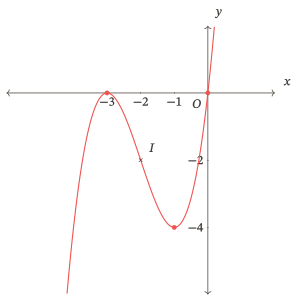

Tiêu chí: tự khôi phục đủ quy trình; ghi khoảng trễ thực tế và phần đã phải xem hỗ trợ.

[Trở về đề — Sau ôn lại — Bậc ba](#S05).

#### Nhiệm vụ 06 — Sau ôn lại — Phân thức và miền

Lời giải và tiêu chí đối chiếu

a) Miền $\mathbb R\setminus\{-2\}$; $f(x)=1-\frac{3}{x+2}$; $f^\prime(x)=\frac{3}{(x+2)^2}>0$. Hàm đồng biến trên từng khoảng $(-\infty;-2)$, $(-2;+\infty)$, không cực trị.
$$
\lim_{x\to -2^-}f(x)=+\infty,\qquad
\lim_{x\to -2^+}f(x)=-\infty,\qquad
\lim_{x\to-\infty}f(x)=\lim_{x\to+\infty}f(x)=1.
$$

| Khoảng | $(-\infty;-2)$ | $(-2;+\infty)$ |
|---|---|---|
| Biến thiên | $1\nearrow+\infty$ | $-\infty\nearrow1$ |

Tiệm cận $x=-2$, $y=1$; tâm $I(-2;1)$; giao trục hoành tại $(1;0)$, giao trục tung tại $\left(0;-\frac{1}{2}\right)$. Hai trục đối xứng là $y-1=\pm(x+2)$. Nhánh trái ở trên, nhánh phải ở dưới tiệm cận ngang.

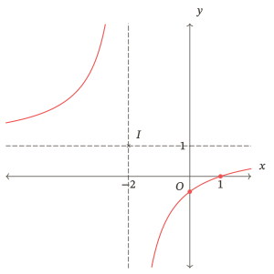

b) Miền $\mathbb R\setminus\{2\}$; $h(x)=x-1+\frac{1}{x-2}$,
$$
h^\prime(x)=1-\frac{1}{(x-2)^2}.
$$
Đạo hàm bằng $0$ tại $1$, $3$. Cực đại $(1;-1)$, cực tiểu $(3;3)$.
$$
\lim_{x\to 2^-}h(x)=-\infty,\qquad\lim_{x\to 2^+}h(x)=+\infty;
$$
$$
\lim_{x\to-\infty}h(x)=-\infty,\qquad\lim_{x\to+\infty}h(x)=+\infty;
$$
$$
\lim_{x\to-\infty}[h(x)-(x-1)]=0,\qquad
\lim_{x\to+\infty}[h(x)-(x-1)]=0.
$$

| Khoảng | $(-\infty;1]$ | $[1;2)$ | $(2;3]$ | $[3;+\infty)$ |
|---|---|---|---|---|
| Dấu đạo hàm bên trong | $+$ | $-$ | $-$ | $+$ |
| Biến thiên | $-\infty\nearrow -1$ | $-1\searrow-\infty$ | $+\infty\searrow 3$ | $3\nearrow+\infty$ |

Tiệm cận $x=2$, $y=x-1$; tâm $I(2;1)$. Không giao trục hoành vì $x^2-3x+3=\left(x-\frac{3}{2}\right)^2+\frac{3}{4}>0$; giao trục tung $\left(0;-\frac{3}{2}\right)$. Nhánh trái dưới, nhánh phải trên đường xiên. Hai trục đối xứng là hai đường phân giác của các góc tạo bởi hai tiệm cận.

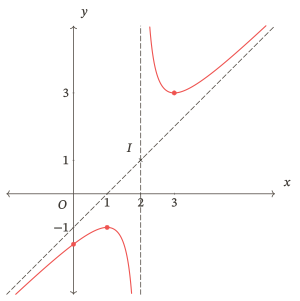

c) Với $v(x)=x-1-\frac{1}{x-2}$, miền $\mathbb R\setminus\{2\}$, $v^\prime(x)=1+\frac{1}{(x-2)^2}>0$: đồng biến trên từng khoảng $(-\infty;2)$, $(2;+\infty)$, không cực trị.
$$
\lim_{x\to 2^-}v(x)=+\infty,\qquad \lim_{x\to 2^+}v(x)=-\infty;
$$
$$
\lim_{x\to-\infty}v(x)=-\infty,\qquad\lim_{x\to+\infty}v(x)=+\infty;
$$
$$
\lim_{x\to-\infty}[v(x)-(x-1)]=0,\qquad\lim_{x\to+\infty}[v(x)-(x-1)]=0.
$$
Tiệm cận $x=2$, $y=x-1$; tâm $I(2;1)$. Nhánh trái trên, nhánh phải dưới đường xiên. 
 
| Khoảng | $(-\infty;2)$ | $(2;+\infty)$ |
|---|---|---|
| Biến thiên | $-\infty\nearrow+\infty$ | $-\infty\nearrow+\infty$ |

Giao trục hoành tại $\left(\frac{3-\sqrt{5}}{2};0\right)$, $\left(\frac{3+\sqrt{5}}{2};0\right)$; giao trục tung $\left(0;-\frac{1}{2}\right)$. Các trục đối xứng là hai đường phân giác của các góc tạo bởi $x=2$ và $y=x-1$.

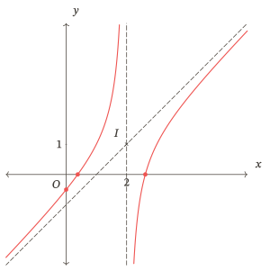

Ý này xác nhận khảo sát trường hợp không cực trị khi cả lập luận, bảng và hình đều đúng.

d) $A^\prime(x)=-\frac{36}{x^2}<0$. Trên $[3;+\infty)$, lớn nhất $A(3)=14$, không có giá trị nhỏ nhất; $A(x)>2$ và $\lim_{x\to+\infty}A(x)=2$. Trên $[3;9]$, lớn nhất $14$, nhỏ nhất $A(9)=6$, đơn vị triệu đồng mỗi tấn.

Tiêu chí: tách kết quả các ý; bài làm ngay sau hỗ trợ chưa chứng minh nhớ lâu. Lên lịch xác nhận tiếp nếu còn tái lỗi; không lấy trước câu của lượt ôn khác.

[Trở về đề — Sau ôn lại — Phân thức và miền](#S06).

## Nguồn

- Bộ Giáo dục và Đào tạo. *Chương trình giáo dục phổ thông môn Toán*, ban hành kèm Thông tư 32/2018/TT-BGDĐT. Phần lớp 12, trang 106–107.
- *Sách giáo khoa Toán 12, tập một*, bộ Kết nối tri thức với cuộc sống. Bài 4, trang 26–32: sơ đồ khảo sát, hàm bậc ba, hai họ phân thức và tính đối xứng.
