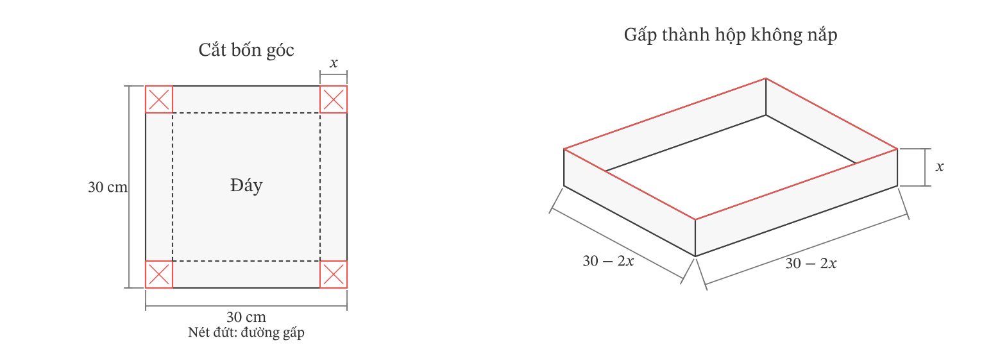
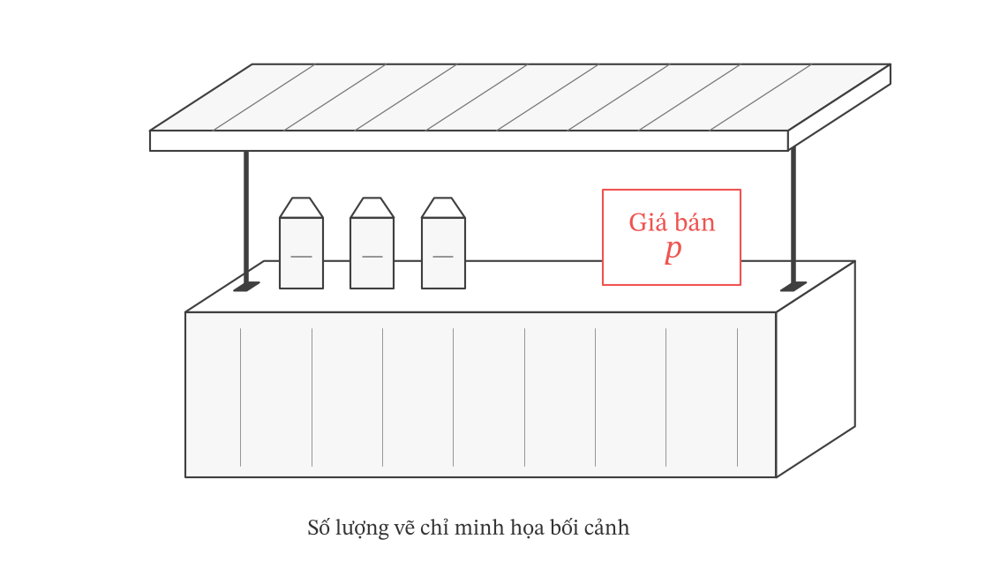
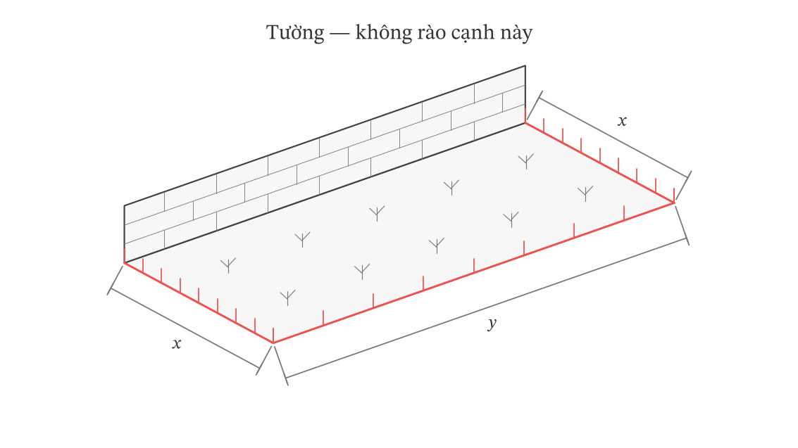
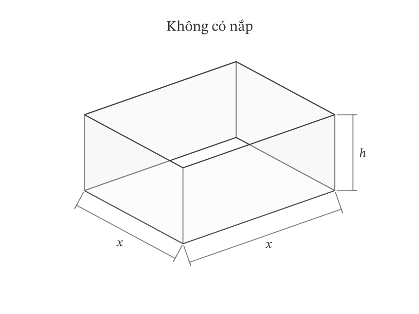
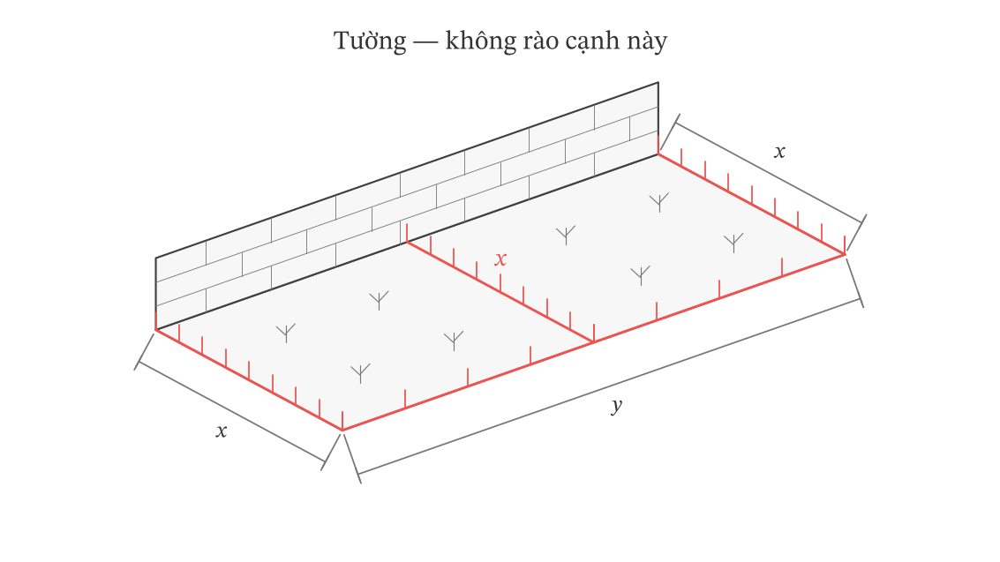

# Ứng dụng đạo hàm trong thực tiễn

**Bản thảo 0.1 · 20/10/2026 · Chờ chủ trì duyệt**

## Bắt đầu

Một phép tính đạo hàm đúng chưa chắc trả lời đúng câu hỏi thực tế. Em còn cần biết mình đang tính đại lượng nào, những giá trị nào được phép chọn và vì sao phương án cuối cùng tốt hơn các phương án còn lại.

Gói này giúp em đi từ lời văn và hình minh họa đến mô hình một biến, giải bài toán rồi kiểm tra kết luận trong bối cảnh. Các số liệu dưới đây là **tình huống giả định phục vụ học toán**, không phải dữ liệu khảo sát thực tế. Hình phối cảnh giúp hình dung; dữ kiện chính xác nằm trong đề và nhãn kích thước, không suy số đo bằng mắt.

### Học xong, em cần làm được gì?

| Mục tiêu | Việc em cần làm được |
|---|---|
| Xác định đại lượng | Nói rõ biến, đơn vị, đại lượng cần tìm; phân biệt doanh thu, tổng chi phí, chi phí trung bình và lợi nhuận. |
| Hiểu ý nghĩa đạo hàm | Phân biệt tốc độ thay đổi trung bình và tức thời; diễn giải vận tốc, gia tốc, đơn vị; phân biệt chi phí biên với mức tăng chính xác. |
| Lập mô hình một biến | Từ dữ kiện, lập quan hệ, chọn biến, viết hàm mục tiêu và xác định các giá trị được phép của biến. |
| Chứng minh tối ưu | Dùng biến thiên hoặc so sánh đủ ứng viên phù hợp; kiểm biên và sự đạt được. |
| Chọn phương án rời rạc | Xử lí điều kiện nguyên hoặc bước lựa chọn cho phép; so giá trị thực, không làm tròn máy móc. |
| Kiểm tra kết luận | Trả lời đúng đại lượng, đơn vị và phạm vi; nhận ra khi đổi giả thiết phải xét lại mô hình. |

### Tiên quyết và cách chọn điểm vào

Em cần biến đổi biểu thức đơn giản, tính đạo hàm và đọc dấu đạo hàm. Công thức hình học cần thiết được nhắc tại chỗ. Phương pháp xét giá trị lớn nhất, nhỏ nhất có trong [gói đã học](../../../r1_g02/index.qmd#bai-hoc).

Có thể vào [Bài học](#bai-hoc), [Luyện tập](#luyen-tap), [Kiểm tra](#kiem-tra) hoặc [Ôn lại](#on-lai) theo nhu cầu. Thứ tự này gợi ý cách tra đọc, không buộc em hoàn thành từng khu vực mới được sang khu vực khác. Nếu đã chuẩn bị hoặc đủ tự tin, em được bắt đầu Kiểm tra; sự tự tin chưa phải bằng chứng đã hiểu.

Giữ bài ban đầu trước khi tra. Ngoài lượt Kiểm tra, em có thể gọi hỗ trợ khi cần rồi trở lại chỗ đang làm. Trong lượt Kiểm tra, làm độc lập đến khi kết thúc; sau đó mới xem lời giải hoặc nhận trợ giúp.

| Nhu cầu | Đích cụ thể | Nơi quay về |
|---|---|---|
| Vướng đạo hàm, dấu hoặc miền | [Ôn nền](#on-nen) | Nhiệm vụ vừa dừng |
| Chưa rõ sai ở đâu | [Sửa lỗi](#sua-loi) | Điểm dừng đã gọi hỗ trợ |
| Giữ bằng chứng, hẹn kiểm lại | [Nhật kí](#nhat-ki) | Mục đang học |
| Đã tự làm và cần đối chiếu | [Lời giải](#loi-giai) | Đề tương ứng |

### Khi nào hoàn tất lượt chính?

Đối chiếu sáu mục tiêu với [bảng bằng chứng sau Kiểm tra](#cp-05). Mục tiêu có lỗi thiết yếu hoặc thiếu giải thích vẫn ghi chưa xác nhận, dù nhiều đáp số khác đúng. Bài làm có trợ giúp giúp em học; muốn xác nhận tự làm cần một nhiệm vụ phù hợp còn mới. Khi đủ bằng chứng cho lượt chính, ghi ngày hoàn tất và hẹn ba lượt Ôn lại. Chỉ ghi khả năng duy trì khi có kết quả thực sau khoảng trễ.

## Bài học

Câu hỏi dẫn đường

Làm thế nào chuyển một tình huống thành hàm số trên đúng tập được phép, dùng đạo hàm để trả lời câu hỏi đặt ra, rồi kiểm tra kết luận trong bối cảnh?

Hãy thử nói bằng lời: điều gì được thay đổi, điều gì phải giữ và đại lượng nào cần tốt nhất. Mô hình chỉ dùng được trong những điều kiện nhất định.

### Khởi động

Tự làm ba nhiệm vụ ngắn để chọn phần cần học. Chưa cần giải bài tối ưu hoàn chỉnh.

#### Nhiệm vụ 01 — Cần tối đa đại lượng nào?

Bán $x$ sản phẩm, doanh thu $R(x)$ và tổng chi phí $C(x)$ cùng tính bằng nghìn đồng. Muốn lợi nhuận lớn nhất thì cần tối ưu biểu thức nào? Nếu $G(x)$ là chi phí trung bình một sản phẩm, quan hệ giữa $G(x)$ và $C(x)$ là gì khi $x>0$?

[Xem lời giải](#lg-01)

#### Nhiệm vụ 02 — Tính được nhưng có làm được không?

Cắt bốn hình vuông cạnh $x$ cm ở bốn góc tấm bìa vuông cạnh $24$ cm rồi gấp thành hộp không nắp. Một bạn nhận cả $x=0$ và $x=12$ vì biểu thức $x(24-2x)^2$ vẫn tính được. Em có đồng ý không? Viết điều kiện để có hộp với ba kích thước dương.

[Xem lời giải](#lg-02)

#### Nhiệm vụ 03 — Một phương trình đã đủ chưa?

Một bạn giải $F'(x)=0$ được $x=5$ rồi kết luận “chọn $x=5$ là tốt nhất”. Em cần biết thêm những gì? Nêu điều kiện của biến, đại lượng cần tối ưu và căn cứ so sánh với các phương án khác.

[Xem lời giải](#lg-03)

#### Điểm dừng 01 — Chọn chỗ cần làm rõ

Vướng Nhiệm vụ 01: đọc [mục 1.1](#bh-11), làm Nhiệm vụ 05. Vướng Nhiệm vụ 02: đọc [mục 2.1](#bh-21), làm Nhiệm vụ 06. Vướng Nhiệm vụ 03: đọc [mục 3](#bh-03), làm Nhiệm vụ 08. Đúng Khởi động chỉ xác nhận thao tác mở đầu. Nếu câu được chỉ định đã xem rồi, dùng để học tiếp nhưng không ghi là bằng chứng mới.

### 1. Đại lượng đang xét và tốc độ thay đổi

#### 1.1. Đọc tên và đơn vị trước khi chọn công thức

**Gợi mở 01 — Bán nhiều hơn có chắc lãi nhiều hơn?**

Thử trả lời trước khi đọc tiếp. Một phương án có doanh thu lớn hơn nhưng tổng chi phí cũng lớn hơn. Hai nhận xét ấy đã đủ chọn phương án có lợi nhuận lớn hơn chưa?

Chưa đủ. Cần so sánh phần doanh thu còn lại sau khi trừ tổng chi phí:

$$P(x)=R(x)-C(x).$$

Nếu $G(x)$ là chi phí trung bình một sản phẩm và $x>0$, thì

$$G(x)=\frac{C(x)}{x},\qquad C(x)=xG(x).$$

Nếu $x$ đo bằng nghìn sản phẩm thì $x=2$ nghĩa là $2\,000$ sản phẩm. Không thay số sản phẩm thực vào công thức trước khi kiểm đơn vị của biến.

[Quan hệ doanh thu, chi phí, lợi nhuận: SGK Toán 12 KNTT, tập Một, Bài 5, tr.38–40. Chi phí trung bình dẫn lại G02, mục 5.1.]{.zo-source-note}

#### 1.2. Thay đổi trên một khoảng và tại một thời điểm

**Gợi mở 02 — Cùng nói về chuyển động nhưng khác câu hỏi**

“Trong một giây vừa qua, độ cao tăng trung bình bao nhiêu mét mỗi giây?” và “Đúng lúc này, vật đang đi lên nhanh bao nhiêu?” có phải luôn cho cùng một số không?

Câu thứ nhất xét một khoảng, câu thứ hai xét một thời điểm. Với $a<b$, tốc độ thay đổi trung bình của $f$ trên $[a;b]$ là

$$\frac{f(b)-f(a)}{b-a}.$$

Nếu $f$ có đạo hàm tại $a$, tốc độ thay đổi tức thời là

$$f'(a)=\lim_{h\to0}\frac{f(a+h)-f(a)}{h}.$$

Đơn vị đạo hàm là đơn vị đại lượng chia cho đơn vị biến. Nếu $s(t)$ là tọa độ theo mét, $t$ theo giây, thì vận tốc $v(t)=s'(t)$ có đơn vị m/s; gia tốc $a(t)=v'(t)=s''(t)$ có đơn vị m/s$^2$. Vận tốc có dấu theo chiều chọn; tốc độ chuyển động là $|v(t)|$, không có “tốc độ âm”.

[CTGDPT Toán 2018, tr.95–96; SGK Toán 12 KNTT, tập Một, Bài 5, tr.33–34.]{.zo-source-note}

**Ví dụ 01 — Cao nhất và đi lên nhanh nhất**

Cho $h(t)=20t-5t^2$ mét với $0\le t\le4$ giây. Tốc độ thay đổi trung bình trên $[0;1]$ là $\frac{h(1)-h(0)}{1-0}=15$ m/s. Vận tốc $v(t)=20-10t$, nên $v(1)=10$ m/s. Hai số khác nhau vì trả lời hai câu hỏi khác nhau.

Vận tốc dương trước $t=2$, bằng $0$ tại $t=2$, âm sau $t=2$ trong miền xét. Độ cao tăng rồi giảm, đạt lớn nhất $h(2)=20$ m. Vận tốc lớn nhất lại là $v(0)=20$ m/s; tại điểm cao nhất, vận tốc bằng $0$. Gia tốc không đổi bằng $-10$ m/s$^2$.

#### Nhiệm vụ 04 — Đại lượng và thời điểm

Cho tọa độ $s(t)=t^2+2t$ mét, $0\le t\le3$ giây. Tính vận tốc trung bình trên $[0;2]$, vận tốc và gia tốc tại $t=2$. Vì sao không thể lấy $s(2)$ làm vận tốc tại thời điểm đó?

[Xem lời giải](#lg-04)

#### 1.3. Chi phí biên và mức tăng chính xác

**Gợi mở 03 — Thêm một sản phẩm**

Biết $C'(50)$ đã đủ biết chính xác $C(51)-C(50)$ chưa?

Đạo hàm mô tả tốc độ thay đổi tức thời của mô hình liên tục. Chi phí biên tại mức sản lượng $x$ là $C'(x)$. Khi dùng để ước lượng chi phí thêm một sản phẩm, thường viết

$$C(x+1)-C(x)\approx C'(x).$$

Đây không phải đẳng thức đúng với mọi hàm. Nếu cần mức tăng chính xác, tính hiệu hai giá trị. Độ chính xác của xấp xỉ cần được kiểm khi tình huống đòi hỏi.

[SGK Toán 12 KNTT, tập Một, Bài 5, tr.34–35, bài 1.27 tr.41.]{.zo-source-note}

**Ví dụ 02 — Gần nhau nhưng không bằng nhau**

Cho $C(x)=0{,}02x^2+4x+100$ nghìn đồng, $x$ là số sản phẩm; dùng mô hình biến thực để tính đạo hàm. Ta có $C'(x)=0{,}04x+4$, nên $C'(50)=6$ nghìn đồng/sản phẩm. Mặt khác,

$$C(51)-C(50)=0{,}02(51^2-50^2)+4=6{,}02$$

nghìn đồng. Xấp xỉ thấp hơn mức tăng chính xác $0{,}02$ nghìn đồng.

#### Nhiệm vụ 05 — Đơn vị quyết định cách thay số

Tổng chi phí $C(x)=2x^2+30x+100$ triệu đồng, trong đó $x$ đo bằng nghìn sản phẩm. Viết chi phí trung bình theo triệu đồng trên một nghìn sản phẩm; tính chi phí trung bình một sản phẩm khi sản xuất $2\,000$ sản phẩm. Vì sao không thay $x=2\,000$?

[Xem lời giải](#lg-05)

### 2. Từ tình huống đến hàm một biến

#### 2.1. Chọn biến, dùng ràng buộc và giữ đúng miền

**Gợi mở 04 — Một thay đổi kéo theo những thay đổi nào?**

Nhìn hình dưới. Khi tăng cạnh phần cắt, chiều cao hộp tăng. Hai kích thước đáy có giữ nguyên không? Chỉ tối đa chiều cao có làm thể tích lớn nhất không?

*Hình 01 — Cùng một biến quyết định phần cắt, chiều cao và hai kích thước đáy. Phối cảnh không dùng để đo độ dài.*

Tăng phần cắt làm hộp cao hơn nhưng đáy nhỏ đi. Với tấm bìa vuông cạnh $30$ cm, chọn $x$ cm là cạnh hình vuông cắt ở mỗi góc. Chiều cao hộp là $x$, cạnh đáy là $30-2x$. Điều kiện vật lí là $x>0$ và $30-2x>0$, tức $0<x<15$.

$$V(x)=x(30-2x)^2,\qquad 0<x<15.$$

Đa thức tính được với mọi số thực, nhưng mô hình hộp chỉ nhận $(0;15)$. Hai đầu mút cho hình suy biến, không phải hộp có ba kích thước dương.

**Ví dụ 03 — Đổi biến nhưng giữ cùng tình huống**

Có thể chọn $a$ cm là cạnh đáy. Cạnh cắt bằng $\frac{30-a}{2}$, miền $0
#### Nhiệm vụ 06 — Tấm bìa không còn vuông

Tấm bìa chữ nhật có kích thước $24$ cm và $18$ cm. Cắt mỗi góc một hình vuông cạnh $x$ cm rồi gấp thành hộp không nắp. Lập hàm thể tích và miền của $x$, chưa cần tối ưu. Vì sao phải xét điều kiện từ cả hai kích thước tấm bìa?

[Xem lời giải](#lg-06)

#### 2.2. Từ giá bán và số lượng đến lợi nhuận

**Gợi mở 05 — Dữ kiện hay giả thiết thêm?**

Chỉ biết một lần giảm giá làm số người mua tăng, em có được kết luận mọi lần giảm sau đều tăng cùng một số người mua không?

Không. Quan hệ ấy chỉ dùng được khi đề cung cấp hoặc chấp nhận mô hình như vậy trong một khoảng xác định. Cần nói rõ quan hệ giá–lượng nào đang được giả định.

*Hình 02 — Giá bán, số lượng dự kiến và chi phí là các đại lượng khác nhau; hình không cung cấp dữ liệu doanh số.*

**Ví dụ 04 — Tự lập hàm lợi nhuận**

Một quầy dự kiến bán $100$ sản phẩm/ngày ở giá $50$ nghìn đồng/sản phẩm. Trong phạm vi giảm giá không quá $20$ nghìn đồng, mô hình giả định mỗi lần giảm $1$ nghìn đồng sẽ bán thêm $5$ sản phẩm/ngày. Chi phí mỗi sản phẩm là $10$ nghìn đồng; chi phí cố định $400$ nghìn đồng/ngày. Giá chỉ được giảm theo các mức nguyên nghìn đồng.

Chọn $k$ là số lần giảm $1$ nghìn đồng. Khi đó

$$k\in\{0;1;\ldots;20\},\quad p(k)=50-k,\quad q(k)=100+5k.$$

Doanh thu và tổng chi phí theo nghìn đồng/ngày là

$$R(k)=(50-k)(100+5k),\qquad C(k)=10(100+5k)+400.$$

Do đó

$$P(k)=(40-k)(100+5k)-400=3600+100k-5k^2.$$

Xét hàm cùng công thức với biến thực trên $[0;20]$: $P'(k)=100-10k$. Hàm tăng đến $k=10$, rồi giảm. Vì $10$ cũng là một lựa chọn nguyên được phép, lợi nhuận lớn nhất là $4100$ nghìn đồng/ngày, tại giá $40$ nghìn đồng/sản phẩm và số lượng dự kiến $150$ sản phẩm/ngày.

Không chỉ báo “$k=10$”: người thực hiện cần giá bán và lợi nhuận. Kết luận phụ thuộc quan hệ giá–lượng đã giả định, không chứng minh khách hàng thật mua đúng số lượng ấy.

[SGK Toán 12 KNTT, tập Một, Bài 5, tr.38–40. Số liệu và giới hạn lựa chọn do ZO Math biên soạn.]{.zo-source-note}

#### Nhiệm vụ 07 — Công suất thêm một ràng buộc

Giữ mô hình Ví dụ 04 nhưng quầy chỉ cung ứng tối đa $130$ sản phẩm/ngày. Xác định lại miền của $k$ và giá bán cho lợi nhuận lớn nhất. Có thể giữ ngay $k=10$ không?

[Xem lời giải](#lg-07)

### 3. Chứng minh phương án tốt nhất

**Gợi mở 06 — Tìm ứng viên khác với xét đủ**

Hai bài có cùng công thức nhưng miền khác nhau có nhất thiết cho cùng phương án tối ưu không? Nếu một hàm tiến gần một mức mà không bao giờ nhận mức ấy, có thể gọi đó là giá trị nhỏ nhất không?

Miền là một phần của bài toán. Đạo hàm giúp xét biến thiên; kết luận còn phải kiểm biên và sự đạt được. Với hàm liên tục trên đoạn đóng và chỉ có hữu hạn điểm bên trong mà đạo hàm bằng $0$ hoặc không tồn tại, ta so sánh giá trị hàm tại hai đầu mút và tất cả các điểm bên trong ấy. Với miền mở hoặc không bị chặn, không tự dùng cách “thế hai đầu mút” như với đoạn đóng.

Xem [phương pháp giá trị lớn nhất, nhỏ nhất](../../../r1_g02/index.qmd#bai-hoc) khi cần. Hãy tự hỏi: miền nào được phép, vì sao đã xét đủ, có phương án nào đạt giá trị kết luận không?

[SGK Toán 12 KNTT, tập Một, Bài 2, tr.15–19; quy trình vận dụng tr.36–37.]{.zo-source-note}

**Ví dụ 05 — Hoàn tất bài toán chiếc hộp**

Với $V(x)=x(30-2x)^2$ trên $(0;15)$:

$$V'(x)=900-240x+12x^2=12(x-5)(x-15).$$

Đạo hàm dương trên $(0;5)$, âm trên $(5;15)$. Vì thể tích tăng rồi giảm trên toàn miền được phép, nó đạt lớn nhất tại $x=5$. Hộp cao $5$ cm, đáy vuông cạnh $20$ cm, thể tích $2000$ cm$^3$. Không cần nhận các đầu mút suy biến làm phương án.

**Ví dụ 06 — Có mức tiến tới nhưng không có phương án đạt**

Cho chi phí trung bình $A(x)=2+\frac{12}{x}$, $x\ge1$. Ta có $A'(x)=-\frac{12}{x^2}<0$, $A(x)>2$ với mọi $x\ge1$, và

$$\lim_{x\to+\infty}A(x)=2.$$

Không có sản lượng hữu hạn được phép nào cho $A(x)=2$, nên không có chi phí trung bình nhỏ nhất trên $[1;+\infty)$. Nếu thêm công suất $x\le6$, miền là $[1;6]$ và chi phí trung bình nhỏ nhất là $A(6)=4$. Hai miền tạo hai bài toán khác nhau. Đối chiếu [diễn giải mô hình trong bài Khảo sát](../../../r1_g04/index.qmd#bh-05) khi cần.

#### Nhiệm vụ 08 — Giới hạn của một kết luận

Cho $B(x)=3+\frac{18}{x}$, $x\ge2$. Một bạn viết “chi phí nhỏ nhất là $3$”. Sửa kết luận. Nếu thêm $x\le9$, kết quả thay đổi thế nào?

[Xem lời giải](#lg-08)

### 4. Khi chỉ được chọn những giá trị rời rạc

**Gợi mở 07 — Gần nhất theo biến có chắc tốt nhất?**

Nghiệm tối ưu liên tục nằm giữa hai số nguyên. Khoảng cách tới nghiệm có phải đại lượng đang cần tối ưu không?

Không. Cần so giá trị hàm mục tiêu tại phương án được phép. Nếu đã chứng minh hàm giảm rồi tăng và điểm đổi chiều nằm giữa hai số nguyên liên tiếp đều khả thi, hai số đó là ứng viên cho giá trị nhỏ nhất trên miền nguyên liên tiếp đang xét. Nếu thiếu điều kiện này hoặc có ràng buộc loại ứng viên, phải xác định lại tập so sánh. Không dùng quy tắc hai số kề cho mọi bài toán nguyên.

**Ví dụ 07 — Làm tròn cho phương án kém hơn**

Chọn số lô $n\in\{1;2;\ldots;6\}$, tổng chi phí $10n^2+61$ triệu đồng. Chi phí trung bình một lô là

$$F(n)=10n+\frac{61}{n}.$$

Hàm cùng công thức với biến thực $x>0$ có $F'(x)=10-\frac{61}{x^2}$, giảm đến $\sqrt{\frac{61}{10}}\approx2{,}47$ rồi tăng. So hai ứng viên $2$ và $3$:

$$F(2)=\frac{101}{2},\quad F(3)=\frac{151}{3},\quad \frac{101}{2}-\frac{151}{3}=\frac{1}{6}>0.$$

Chọn $3$ lô dù $2$ gần nghiệm liên tục hơn. Biến thiên chứng minh các số nguyên còn lại không tốt hơn hai ứng viên này.

[Nguyên tắc giữ miền nguyên dẫn lại G02, mục 5.1; bối cảnh số lượng, giá thuê đối chiếu SGK Toán 12 KNTT, tập Một, tr.38–41. Hàm biến thực là công cụ phụ, không biến số sản phẩm nguyên thành đại lượng liên tục.]{.zo-source-note}

#### Nhiệm vụ 09 — Một ứng viên bị loại

Trong Ví dụ 07, nếu chỉ được chọn số lô chẵn thì tập được phép là gì? Phương án tối ưu có còn là $3$ không? So sánh đủ hoặc dùng biến thiên để giải thích việc loại bớt.

[Xem lời giải](#lg-09)

### 5. Trả kết quả về tình huống

**Gợi mở 08 — Đáp số nào người hỏi cần?**

Trong bài hộp, “đáp số $5$” và “thể tích lớn nhất $2000$ cm$^3$, khi cắt cạnh $5$ cm, tạo đáy cạnh $20$ cm và chiều cao $5$ cm” khác nhau ở điều gì?

Câu sau cho phép thực hiện và kiểm phương án. Kết luận cần đại lượng được hỏi, phương án, đơn vị và điều kiện áp dụng. Thế lại vào ràng buộc ban đầu. Nếu mô hình bỏ qua một yếu tố, nói rõ phạm vi thay vì biến kết quả toán thành cam kết thực tế.

**Ví dụ 08 — Đổi giả thiết phải xét lại mô hình**

Kết quả chiếc hộp bỏ qua độ dày và mép dán. Nếu thiết kế cần mép dán, không giữ ngay công thức $x(30-2x)^2$ khi kích thước đáy đã đổi. Phải xác định lại thiết kế và ràng buộc rồi mới tối ưu. Kết quả cũ đúng cho mô hình cũ nhưng chưa chứng minh phương án mới.

#### Nhiệm vụ 10 — Trả về đúng kích thước

Một khu đất chữ nhật tựa tường, chỉ rào ba cạnh bằng $30$ m hàng rào. Chọn $x$ là cạnh vuông góc tường; một lời giải đã chứng minh $x=7{,}5$ cho diện tích lớn nhất $112{,}5$ m$^2$. Viết kết luận đầy đủ và kiểm cạnh còn lại. Nếu rào cả cạnh sát tường, có giữ ngay kết luận cũ không?

[Xem lời giải](#lg-10)

### Khép lại bài học

Tự giải thích vì sao chọn hàm này, miền này và các ứng viên này; kết luận có nghĩa gì trong tình huống. Làm đúng ngay sau ví dụ chưa chứng minh em tự chọn được phương pháp trong bối cảnh mới. Dùng Luyện tập hoặc bắt đầu Kiểm tra khi thấy phù hợp.

## Luyện tập

Tự làm trước khi xem lời giải. Có thể dùng hỗ trợ theo nhu cầu; ghi phần được giúp để không lẫn với phần tự làm. Không lấy đáp số đúng thay giải thích miền và sự tối ưu.

| Chặng | Mục tiêu được luyện | Nhiệm vụ và Điểm dừng |
|---|---|---|
| Lập mô hình | Biến, ràng buộc, hàm mục tiêu | Nhiệm vụ 11–12; Điểm dừng 02 |
| Đại lượng và đạo hàm | Chi phí trung bình; vận tốc, gia tốc | Nhiệm vụ 13–14; Điểm dừng 03 |
| Kiểm phương án | Miền nguyên, sự đạt được, giới hạn | Nhiệm vụ 15–16; Điểm dừng 04 |

### Chặng 1 — Lập mô hình từ tình huống

#### Nhiệm vụ 11 — Khu trồng cây sát tường

Dùng $48$ m hàng rào cho ba cạnh khu đất hình chữ nhật; cạnh thứ tư dựa vào tường đủ dài, không cần rào. Bỏ qua bề dày hàng rào. Chọn kích thước để diện tích lớn nhất. Tự chọn biến, lập miền, hàm mục tiêu, chứng minh rồi kiểm tổng chiều dài hàng rào.

*Hình 03 — Cạnh sát tường không dùng hàng rào. Phối cảnh không thể hiện tỉ lệ của phương án tối ưu.*

[Xem lời giải](#lg-11)

#### Nhiệm vụ 12 — Giá bán thay đổi theo nấc

Ở giá $40$ nghìn đồng/sản phẩm, dự kiến bán $80$ sản phẩm/ngày. Mỗi lần giảm $2$ nghìn đồng, số bán dự kiến tăng $10$ sản phẩm/ngày. Mô hình áp dụng tối đa $8$ lần giảm. Chi phí biến đổi $12$ nghìn đồng/sản phẩm; chi phí cố định $240$ nghìn đồng/ngày. Số lần giảm nguyên. Tìm giá bán cho lợi nhuận lớn nhất, nêu số lượng và lợi nhuận tương ứng.

[Xem lời giải](#lg-12)

### Điểm dừng 02 — Kiểm mô hình trước đáp số

Nhiệm vụ 11: kiểm quan hệ ba cạnh, miền dương, biến thiên và kích thước trả về. Nhiệm vụ 12: kiểm bước giá, lượng, tổng chi phí, miền nguyên và đơn vị. Sai quan hệ hoặc miền: xem [mục 2](#bh-02), dùng phần mô hình của [Nhiệm vụ 24](#nv-24) nếu còn mới. Sai phương pháp tối ưu: [mục 3](#bh-03). Sai nguyên: [Nhiệm vụ 25](#nv-25). Câu hình học không xác nhận riêng lỗi lập quan hệ giá–lượng; nếu thiếu câu phù hợp còn mới, ghi chưa xác nhận. Sau hỗ trợ trở về đây, kiểm các tiêu chí còn thiếu.

### Chặng 2 — Đại lượng và đạo hàm

#### Nhiệm vụ 13 — Tổng chi phí và chi phí trung bình

Sản lượng thực $x\in[10;40]$ tấn/ngày có tổng chi phí $C(x)=\frac{1}{2}x^2+8x+200$ triệu đồng/ngày. Tìm sản lượng cho chi phí trung bình một tấn nhỏ nhất. Nêu đơn vị của hàm đang tối ưu và vì sao không tối thiểu hóa ngay $C(x)$.

[Xem lời giải](#lg-13)

#### Nhiệm vụ 14 — Tọa độ, vận tốc, gia tốc

Cho $s(t)=t^3-3t^2+4t$ mét trên $0\le t\le3$ giây. Tính vận tốc trung bình trên $[1;2]$, vận tốc và gia tốc tại $t=2$. Tọa độ có giảm trong khoảng đang xét không? Giải thích bằng đạo hàm, không chỉ thử vài thời điểm.

[Xem lời giải](#lg-14)

### Điểm dừng 03 — Giải thích ý nghĩa

Nhiệm vụ 13 cần đúng đại lượng, đơn vị; Nhiệm vụ 14 cần phân biệt trung bình/tức thời và giải thích dấu trên cả miền. Sai đại lượng: trở lại [mục 1.1](#bh-11). Sai ý nghĩa đạo hàm: [mục 1.2](#bh-12), rồi phần đạo hàm của [Nhiệm vụ 24](#nv-24) nếu còn mới. Câu chi phí không xác nhận đầy đủ riêng chuyển động; giữ ghi chú đó và xin câu mới đúng nội dung khi cần. Không làm trước câu Ôn lại để lấp phần thiếu.

### Chặng 3 — Phương án và giới hạn

#### Nhiệm vụ 15 — Chi phí trên một lô

Chọn $n\in\{1;2;\ldots;8\}$ lô, tổng chi phí $8n^2+50$ triệu đồng. Tìm số lô cho chi phí trung bình một lô nhỏ nhất. Giải thích đã xét đủ ứng viên, trả lời bằng số lô và chi phí trung bình.

[Xem lời giải](#lg-15)

#### Nhiệm vụ 16 — Thêm công suất thì kết luận đổi

Chi phí trung bình $A(x)=4+\frac{24}{x}$ triệu đồng/tấn, $x\ge2$ tấn/ngày. Báo cáo viết “tăng mãi sản lượng để đạt chi phí thấp nhất $4$ triệu đồng/tấn”. Chỉ ra phần sai. Khi công suất là $8$ tấn/ngày, tìm phương án tối ưu và giới hạn của kết luận.

[Xem lời giải](#lg-16)

### Điểm dừng 04 — Xét đủ và có điểm đạt

Nhiệm vụ 15 sai: xem [mục 4](#bh-04), dùng ý nguyên của [Nhiệm vụ 25](#nv-25). Nhiệm vụ 16 sai: xem [mục 3](#bh-03), dùng ý sự đạt được của Nhiệm vụ 25. Chỉ dùng ý còn mới và đúng lỗi. Đọc cả lời giải khiến các ý đó không còn mới. Hết câu phù hợp: ghi chưa xác nhận, nhờ giáo viên giao câu khác; không đổi tên câu cũ thành bài mới.

## Kiểm tra

Được bắt đầu khi đã chuẩn bị hoặc đủ tự tin, kể cả chưa có bài Luyện tập. Dành khoảng **75 phút cho một lượt liên tục**, tự lực, không chia đợt. Đây là thời lượng đề xuất của gói, không phải cấu hình đề thi quốc gia. Có thể dùng máy tính để tính toán; vẫn trình bày quan hệ, miền và căn cứ tối ưu. Kết thúc lượt, giữ bài ban đầu trước khi tra hoặc nhận trợ giúp. Dùng tiêu chí theo mục tiêu, không dùng tổng điểm che phần thiếu.

#### Nhiệm vụ 17 — Hộp từ tấm bìa chữ nhật

Tấm bìa $32$ cm và $20$ cm. Cắt mỗi góc hình vuông cạnh $x$ cm, gấp thành hộp không nắp, bỏ qua độ dày và mép dán. Tìm cách cắt cho thể tích lớn nhất. Lập mô hình, chứng minh và nêu đủ ba kích thước hộp.

#### Nhiệm vụ 18 — Đọc báo cáo chi phí

Tổng chi phí $C(x)=\frac{1}{10}x^2+5x+80$ nghìn đồng, $x$ là số sản phẩm; mô hình biến thực dùng để tính đạo hàm.

1. Tính chi phí trung bình một sản phẩm tại $x=20$ và chi phí biên tại mức ấy, ghi đơn vị.
2. Tính chính xác chi phí tăng khi sản lượng từ $20$ lên $21$, so với chi phí biên.
3. Sửa câu “$C'(20)$ là tổng chi phí khi làm $20$ sản phẩm”.

#### Nhiệm vụ 19 — Giá bán và giới hạn cung ứng

Ở giá $60$ nghìn đồng/sản phẩm, dự kiến bán $60$ sản phẩm/ngày. Trong phạm vi không quá $12$ lần giảm, mỗi lần giảm $2$ nghìn đồng làm số lượng dự kiến tăng $5$ sản phẩm/ngày. Chi phí mỗi sản phẩm $20$ nghìn đồng, chi phí cố định $300$ nghìn đồng/ngày. Số lần giảm nguyên; cửa hàng chỉ đáp ứng tối đa $75$ sản phẩm/ngày. Chọn giá bán, số lượng và lợi nhuận tối ưu theo mô hình. Giải thích tác động của giới hạn cung ứng.

#### Nhiệm vụ 20 — Hai cách hiểu nhỏ nhất

1. Chọn $n\in\{1;2;\ldots;7\}$ lô; chi phí trung bình $F(n)=6n+\frac{40}{n}$ triệu đồng/lô. Tìm lựa chọn tối ưu, chứng minh xét đủ.
2. Mô hình khác: $B(x)=3+\frac{12}{x}$ triệu đồng/tấn, $x\ge1$ tấn/ngày, chưa giới hạn công suất. Có chi phí trung bình nhỏ nhất không? Nêu điều chưa thể kết luận về thực tế từ mô hình này.

### Điểm dừng 05 — Sau khi kết thúc lượt Kiểm tra

Ghi ngày, mức hỗ trợ, giữ bài gốc rồi đối chiếu từng bài: [Xem lời giải](#lg-17) của Nhiệm vụ 17; [Xem lời giải](#lg-18) của Nhiệm vụ 18; [Xem lời giải](#lg-19) của Nhiệm vụ 19; [Xem lời giải](#lg-20) của Nhiệm vụ 20.

| Mục tiêu | Bằng chứng | Tiêu chí trong lượt | Nếu còn vướng |
|---|---|---|---|
| Đại lượng, đơn vị | Nhiệm vụ 18,19 | Không lẫn tổng/trung bình/biên/lợi nhuận; đơn vị đúng | Mục 1; Nhiệm vụ 27.1 hoặc 26 theo lỗi |
| Ý nghĩa đạo hàm | Nhiệm vụ 18.2–3 | Phân biệt xấp xỉ với mức tăng chính xác | Mục 1.2–1.3; Nhiệm vụ 27.1 |
| Lập mô hình, miền | Nhiệm vụ 17,19 | Quan hệ, miền, bước giá và công suất đúng | Mục 2; Nhiệm vụ 26; lỗi riêng giá–lượng cần câu mới phù hợp |
| Chứng minh tối ưu | Nhiệm vụ 17,19,20.2 | Xét đủ, đúng biên và sự đạt được | Mục 3; Nhiệm vụ 26; không đạt được cần câu riêng phù hợp |
| Lựa chọn rời rạc | Nhiệm vụ 19,20.1 | Miền nguyên đúng, đủ ứng viên và so giá trị | Mục 4; Nhiệm vụ 27.2 |
| Kết luận | Nhiệm vụ 17,19,20.2 | Đúng đối tượng, đơn vị, ràng buộc, giới hạn | Mục 5; Nhiệm vụ 26–27 theo ý |

Lượt này **không trực tiếp kiểm vận tốc và gia tốc**. Cần bằng chứng tự làm Nhiệm vụ 14 khi chưa có trợ giúp; nếu đã lộ, ghi phần chuyển động chưa xác nhận và xin câu mới. Nhiệm vụ 23 dành cho Ôn lại, không kéo lên làm trước. Bài sửa chỉ xác nhận phần đã kiểm, không thay một lượt Kiểm tra độc lập mới. Đủ bằng chứng lượt chính thì ghi ngày và hẹn các lượt sau.

## Ôn lại

Hẹn từ ngày hoàn tất lượt chính: sau khoảng **2–3 ngày**, **7 ngày**, **3–4 tuần**. Ghi ngày hẹn và ngày thực làm, khoảng trễ thực nếu đổi lịch. Đây là cách tổ chức của khóa, không phải cam kết hiệu quả cho mọi người. Không đọc trước đề lượt sau để làm đủ bài lượt trước.

### Lượt 1 — Giữ thể tích, giảm vật liệu

#### Nhiệm vụ 21 — Bể đáy vuông không nắp

Bể không nắp, đáy vuông, thể tích $32$ dm$^3$. Bỏ qua độ dày, hao hụt; đáy và thành cùng giá vật liệu trên đơn vị diện tích. Tìm kích thước dùng ít vật liệu nhất. Nếu đáy đắt hơn thành thì có giữ ngay hàm mục tiêu cũ không?

*Hình 04 — Vật liệu gồm một đáy và bốn thành.*

[Xem lời giải](#lg-21)

#### Điểm dừng 06 — Sau khoảng trễ thứ nhất

Kiểm quan hệ thể tích, diện tích, miền, tối ưu và giả thiết giá vật liệu. Sai: xem mục 2–3–5 theo bước; dùng [Nhiệm vụ 28](#nv-28) nếu đúng phần cần xác nhận và còn mới. Bài này không đo riêng công thức diện tích bể; lỗi ở phần ấy cần câu hình học khác. Đúng một bài không xác nhận mọi mục tiêu.

### Lượt 2 — Tối ưu có thể ở biên

#### Nhiệm vụ 22 — Giá thuê chỗ bán hàng

Có $12$ chỗ cho thuê; giá $100$ nghìn đồng/chỗ/ngày thì thuê hết. Mỗi lần tăng $5$ nghìn đồng làm giảm đúng một chỗ được thuê theo mô hình. Cho phép $k\in\{0;1;\ldots;11\}$ lần tăng. Mỗi chỗ được thuê có chi phí $20$ nghìn đồng/ngày; chi phí cố định $100$ nghìn đồng/ngày. Tìm lợi nhuận lớn nhất, giải thích vì sao không cần nghiệm đạo hàm bằng $0$ trong miền.

[Xem lời giải](#lg-22)

#### Điểm dừng 07 — Không ép dùng thao tác quen

Kiểm miền, hàm lợi nhuận, dấu đạo hàm, giá thuê và số chỗ trả về. Sai mô hình/biên: xem mục 2–3, dùng [Nhiệm vụ 28](#nv-28) nếu chưa dùng. Đã lộ thì ghi cần câu mới. Lượt này không kiểm tốc độ thay đổi hay mọi dạng miền mở.

### Lượt 3 — Đại lượng và tốc độ thay đổi

#### Nhiệm vụ 23 — Lên cao và đi lên nhanh

Cho $h(t)=12t-t^2$ mét, $0\le t\le12$ giây. Tính tốc độ thay đổi trung bình trên $[2;4]$, vận tốc và gia tốc tại $t=4$, thời điểm độ cao lớn nhất. Có thể nói vật đi lên nhanh nhất ở thời điểm cao nhất không? Hiểu đi lên nhanh bằng vận tốc theo chiều đi lên.

[Xem lời giải](#lg-23)

#### Điểm dừng 08 — Ghi đúng điều đã duy trì

Tách trung bình, vận tốc tức thời, gia tốc và độ cao lớn nhất. Nếu còn lẫn, xem mục 1.2, dùng [Nhiệm vụ 29.1](#nv-29) nếu còn mới. Lượt này chỉ lấy mẫu ý nghĩa đạo hàm, không tự chứng nhận độ bền của toàn gói. Ghi bằng chứng thực, phần chưa kiểm và quyết định tiếp theo.

## Ôn nền

Chọn đúng thao tác đang vướng; không cần học tất cả trước khi trở lại bài. Nguồn chung dưới đây có giải thích và câu tự kiểm. Hoàn thành một câu nền chưa xác nhận được cả mục tiêu lập mô hình của gói này.

| Khi em vướng | Nguồn cần xem | Tự kiểm sau đó | Trở lại |
|---|---|---|---|
| Điều kiện của biểu thức | [Tập xác định](../../../_dung_chung/nen/N-TXĐ-01.qmd) | Nhiệm vụ 06 nếu còn mới | Mục 2 hoặc bài đã dừng |
| Tính đạo hàm | [Đạo hàm cơ bản](../../../_dung_chung/nen/N-ĐH-01.qmd) | Nhiệm vụ 04 nếu còn mới | Mục 1 hoặc bài đang làm |
| Đọc dấu để kết luận biến thiên | [Dấu](../../../_dung_chung/nen/N-DẤU-01.qmd) và [bảng biến thiên](../../../_dung_chung/nen/N-BBT-01.qmd) | Giải thích dấu trong Nhiệm vụ 13 | Mục 3 |
| Đại lượng, tổng và trung bình | [Mô hình và đơn vị](../../../_dung_chung/nen/N-MH-01.qmd) | Nhiệm vụ 05 nếu còn mới | Mục 1.1 hoặc 2.2 |
| Chọn giá trị nguyên | [Ràng buộc nguyên](../../../_dung_chung/nen/N-NGUYÊN-01.qmd) | Nhiệm vụ 09 nếu còn mới | Mục 4 |
| Giới hạn và sự đạt được | [Đường tiệm cận — Bài học](../../../r1_g03/index.qmd#bai-hoc) và [Giá trị lớn nhất và giá trị nhỏ nhất — Bài học](../../../r1_g02/index.qmd#bai-hoc) | Nhiệm vụ 08 nếu còn mới | Mục 3 |

Các đích này là nguồn đã có; phần nhiệm vụ ở gói này kiểm việc vận dụng sau khi đọc. Nếu đã xem câu hoặc lời giải, ghi rõ và dùng tuyến Sửa lỗi thích hợp; không giả một câu cũ thành câu mới.

## Sửa lỗi

Giữ bài ban đầu. Chỉ ra bước đầu tiên chưa có căn cứ; giữ phần đúng, giải thích và sửa bước ấy. Sau đó tự làm nhiệm vụ phù hợp **chưa xem đề hoặc lời giải trước đó**. Nếu giáo viên đã dùng câu này trên lớp, nó không còn là câu xác nhận mới của em. Hết câu phù hợp thì ghi “chưa xác nhận” và xin câu khác; không lấy câu Ôn lại của lượt sau để lấp thiếu.

### Nút thắt nhận thức và cách tháo gỡ

Các biểu hiện sau giúp em tự nhận ra chỗ cần làm rõ, không dùng để gán nhãn năng lực hay đánh đố.

| Nút thắt nhận thức | Biểu hiện dễ nhầm | Câu hỏi và cách tháo gỡ | Tự kiểm tra |
|---|---|---|---|
| Chọn đại lượng | Lấy doanh thu thay lợi nhuận; tổng thay trung bình | “Đề hỏi gì, đơn vị gì?” Viết tên trước công thức; xem [1.1](#bh-11) | Sau Luyện: Nhiệm vụ 24.2; sau Kiểm: Nhiệm vụ 27.1; sau Ôn: Nhiệm vụ 28.1 về lợi nhuận. Không thay các ý cho nhau nếu khác lỗi. |
| Đơn vị của biến | Thay số sản phẩm vào biến nghìn sản phẩm | “Một đơn vị biến là bao nhiêu?” Đổi đơn vị trước khi thế; xem [1.1](#bh-11) | Nhiệm vụ 05 kiểm trực tiếp quy mô nghìn sản phẩm. Nếu đã lộ, các bài sửa không đủ thay thế riêng lỗi quy mô: cần câu mới. |
| Trung bình/tức thời | Dùng đạo hàm cho mức tăng chính xác trên khoảng | “Trên khoảng hay tại thời điểm?” Xem [1.2](#bh-12) | Sau Luyện: Nhiệm vụ 24.2; sau Kiểm: Nhiệm vụ 27.1; sau Ôn: Nhiệm vụ 29.1. |
| Đại lượng và tốc độ | Lấy độ cao làm vận tốc; lẫn vận tốc/gia tốc | “Đang đọc giá trị hay tốc độ thay đổi?” Xem [1.2](#bh-12) | Nhiệm vụ 14 nếu chưa gặp; sau Ôn Nhiệm vụ 29.1. Câu chi phí không xác nhận trọn phần chuyển động. |
| Chi phí biên | Viết đạo hàm bằng hiệu hữu hạn | “Chính xác hay xấp xỉ?” Tính cả hai để đối chiếu; xem [1.3](#bh-13) | Sau Luyện Nhiệm vụ 24.2; sau Kiểm Nhiệm vụ 27.1. Sau Ôn nếu đã lộ hết, cần câu mới đúng chi phí. |
| Đại lượng phụ thuộc | Tăng chiều cao nhưng giữ nguyên đáy | “Điều gì buộc đổi theo?” Dùng ràng buộc; xem [2.1](#bh-21) | Sau Luyện Nhiệm vụ 24.1; sau Kiểm Nhiệm vụ 26; lỗi riêng cắt hộp cần câu cắt hộp mới nếu Nhiệm vụ 06 đã lộ. |
| Miền công thức và miền thực hiện | Nhận kích thước không dương hoặc vượt công suất | “Tính được nhưng làm được không?” Xem [2.1](#bh-21), [2.2](#bh-22) | Sau Luyện Nhiệm vụ 24.1; sau Kiểm Nhiệm vụ 26; sau Ôn Nhiệm vụ 28.1. |
| Quan hệ chưa có căn cứ | Tự giả định giá–lượng luôn tuyến tính | “Dữ kiện nào cho phép viết?” Chỉ dùng quan hệ được cho; xem [2.2](#bh-22) | Sau Ôn Nhiệm vụ 28.1, gồm câu về giới hạn. Sau Luyện/Kiểm cần câu mới riêng nếu lỗi này chưa được đo. |
| Ứng viên và tối ưu toàn miền | Giải đạo hàm bằng không rồi dừng | “Đã loại mọi phương án khác chưa?” Xem [3](#bh-03) | Sau Luyện Nhiệm vụ 24.1; sau Kiểm Nhiệm vụ 26; sau Ôn Nhiệm vụ 28.1. |
| Mức tiến tới và mức đạt | Gọi giới hạn là giá trị nhỏ nhất | “Có điểm được phép nào đạt đúng mức đó?” Xem [3](#bh-03) | Sau Luyện Nhiệm vụ 25.2; sau Ôn Nhiệm vụ 28.2. Sau Kiểm cần câu chưa lộ phù hợp, không dùng trước Nhiệm vụ 28. |
| Nghiệm liên tục và chọn nguyên | Làm tròn thay so giá trị | “Đang tối ưu khoảng cách hay hàm mục tiêu?” Xem [4](#bh-04) | Sau Luyện Nhiệm vụ 25.1; sau Kiểm Nhiệm vụ 27.2; sau Ôn Nhiệm vụ 29.2. |
| Đáp số và kết luận | Báo biến phụ, quên đơn vị, ngoại suy | “Người hỏi cần thực hiện gì?” Thế lại ràng buộc; xem [5](#bh-05) | Các bài Nhiệm vụ 24–29 theo ngữ cảnh; phải đọc phần kết luận, không chỉ đáp số. |

Chọn bài theo nơi phát hiện dưới đây; mỗi ý chỉ xác nhận phân biệt mà nó thực sự yêu cầu.

### Sau Luyện tập

#### Nhiệm vụ 24 — Quan hệ và mức thay đổi

1. Dùng $36$ m rào ba cạnh một hình chữ nhật tựa tường. Lập mô hình diện tích, miền và tìm kích thước tốt nhất. Nêu giả thiết của hình.
2. Cho tổng chi phí $C(x)=\frac{1}{20}x^2+2x+60$ nghìn đồng. Tại $10$ sản phẩm, tính tổng chi phí, chi phí trung bình, chi phí biên và mức tăng chính xác khi làm thêm một sản phẩm; phân biệt đơn vị và nghĩa.

[Xem lời giải](#lg-24)

#### Nhiệm vụ 25 — Nguyên và sự đạt được

1. Chi phí trung bình $F(n)=5n+\frac{31}{n}$ triệu đồng/lô, $n\in\{1;2;\ldots;6\}$. Tìm tối ưu và kiểm xem làm tròn nghiệm liên tục có cho đúng không.
2. Cho $A(x)=7+\frac{8}{x}$, $x\ge2$. Có giá trị nhỏ nhất không? Nếu giới hạn thêm $x\le8$ thì sao?

[Xem lời giải](#lg-25)

Sau khi tự làm và đối chiếu, quay về [Điểm dừng 02](#cp-02), [03](#cp-03) hoặc [04](#cp-04) đã gọi hỗ trợ. Chỉ ghi xác nhận cho ý đúng và tự lực, không chứng nhận cả chặng.

### Sau Kiểm tra

#### Nhiệm vụ 26 — Thêm một vách ngăn

Một khu đất chữ nhật dựa vào tường được chia thành hai ô bằng một hàng rào bên trong vuông góc tường. Tổng hàng rào cho ba cạnh ngoài và một vách ngăn là $60$ m; không rào cạnh sát tường. Tìm kích thước ngoài cho tổng diện tích lớn nhất. Vì sao không dùng ngay quan hệ rào ba cạnh của bài không có vách ngăn?

*Hình 05 — Vách ngăn làm thay đổi ràng buộc, dù hình ngoài vẫn là chữ nhật.*

[Xem lời giải](#lg-26)

#### Nhiệm vụ 27 — Chi phí biên và lựa chọn nguyên

1. Cho $C(x)=\frac{1}{4}x^2+6x+40$ nghìn đồng. Tính chi phí biên tại $x=8$, mức tăng chính xác từ $8$ lên $9$, tổng và trung bình tại $8$; diễn giải.
2. Cho $F(n)=3n+\frac{19}{n}$ triệu đồng/lô, $n\in\{1;2;\ldots;6\}$. Tìm chi phí trung bình nhỏ nhất; chứng minh đã xét đủ ứng viên.

[Xem lời giải](#lg-27)

Quay về [Điểm dừng 05](#cp-05), giữ kết quả lượt Kiểm tra gốc riêng kết quả sau sửa. Chưa có câu mới đo đúng lỗi thì ghi chưa xác nhận; không sửa kết quả gốc thành đạt.

### Sau Ôn lại

#### Nhiệm vụ 28 — Công suất và giới hạn mô hình

1. Ở giá $30$ nghìn đồng/sản phẩm, dự kiến bán $40$ sản phẩm/ngày. Mỗi lần giảm $1$ nghìn đồng làm tăng $4$ sản phẩm/ngày theo mô hình, tối đa $10$ lần giảm nguyên. Chi phí mỗi sản phẩm $10$ nghìn đồng, chi phí cố định $80$ nghìn đồng/ngày; công suất $56$ sản phẩm/ngày. Chọn giá, lượng và lợi nhuận tối ưu. Nếu quan hệ giá–lượng thực khác giả thiết thì kết luận nào cần xem lại?
2. Cho $A(x)=2+\frac{10}{x}$, $x\ge1$. Sửa kết luận “nhỏ nhất bằng $2$” và chỉ ra điều thiếu nếu muốn khuyến nghị một sản lượng cụ thể.

[Xem lời giải](#lg-28)

#### Nhiệm vụ 29 — Tự phân biệt và tự chọn

1. Cho $s(t)=2t^2+t$ mét, $0\le t\le3$ giây. Tính vận tốc trung bình trên $[1;2]$, vận tốc và gia tốc tại $t=2$, giải thích sự khác nhau.
2. Chi phí trung bình $F(n)=n+\frac{13}{n}$ triệu đồng/lô, $n\in\{1;2;\ldots;8\}$. Tìm lựa chọn tối ưu và giải thích.

[Xem lời giải](#lg-29)

Quay về Điểm dừng [06](#cp-06), [07](#cp-07) hoặc [08](#cp-08) đã gọi. Ghi ngày, khoảng trễ và câu đã gặp. Câu sửa đúng ngay sau xem lại chưa chứng minh sự duy trì sau một khoảng trễ mới.

## Nhật kí

Dùng [mẫu Nhật kí học tập chung đủ 14 trường](../../../_dung_chung/nhat_ki_hoc_tap.qmd). Sao mẫu trống ra giấy hoặc công cụ ghi chú. Không cần ghi một bản Nhật kí cho mỗi câu hoặc mỗi Điểm dừng; dùng khi cần giữ lỗi, bằng chứng, mức hỗ trợ và hẹn kiểm lại. Ví dụ trong nguồn chung được ghi rõ là giả lập, không phải dữ liệu học sinh của gói này.

Ghi bài ban đầu và phần sau sửa riêng nhau. Nếu chưa có câu phù hợp còn mới, ghi chưa xác nhận. Chỉ ghi kết quả sau khoảng trễ khi đã thực sự tự làm. Không tự điền trước đã đạt.

## Lời giải

Chỉ đối chiếu sau khi tự làm; riêng Kiểm tra, kết thúc toàn lượt trước khi đọc. Mỗi lời giải dưới đây nêu kết quả và phần giải thích cần có. Cách giải khác đúng điều kiện và chứng minh đủ vẫn được chấp nhận.

### Bài học — Khởi động

#### Nhiệm vụ 01 — Cần tối đa đại lượng nào?

Tối đa $P(x)=R(x)-C(x)$. Với $x>0$, $G(x)=\frac{C(x)}{x}$ nên $C(x)=xG(x)$. $R,C,P$ có đơn vị nghìn đồng, $G$ nghìn đồng/sản phẩm nếu $x$ là số sản phẩm. Đúng công thức nhưng không phân biệt tổng và trung bình thì chưa đủ giải thích.

[Xem đề bài](#nv-01)

#### Nhiệm vụ 02 — Tính được nhưng có làm được không?

Cần $x>0$ và $24-2x>0$, do đó $0<x<12$. Với $x=0$ không có chiều cao; với $x=12$ đáy có cạnh bằng $0$. Cả hai đều không tạo hộp có ba kích thước dương dù đa thức vẫn tính được.

[Xem đề bài](#nv-02)

#### Nhiệm vụ 03 — Một phương trình đã đủ chưa?

Cần biết $x$ được phép nhận giá trị nào, có phải nguyên không, $F$ biểu thị gì, đang tìm lớn nhất hay nhỏ nhất. Phải kiểm $5$ khả thi và chứng minh tính tốt nhất bằng biến thiên hoặc xét đủ ứng viên phù hợp, kể cả biên. Phương trình đạo hàm chỉ cho ứng viên, không tự chứng minh tối ưu.

[Xem đề bài](#nv-03)

### Bài học — Nhiệm vụ tự làm

#### Nhiệm vụ 04 — Đại lượng và thời điểm

$s(0)=0$, $s(2)=8$, vận tốc trung bình $\frac{8-0}{2-0}=4$ m/s. $v(t)=2t+2$, $v(2)=6$ m/s; $a(t)=2$, nên gia tốc $2$ m/s$^2$. $s(2)=8$ m là tọa độ, khác cả nghĩa và đơn vị với vận tốc.

[Xem đề bài](#nv-04)

#### Nhiệm vụ 05 — Đơn vị quyết định cách thay số

$G(x)=\frac{C(x)}{x}=2x+30+\frac{100}{x}$ triệu đồng/nghìn sản phẩm, $x>0$. Sản xuất $2\,000$ sản phẩm tương ứng $x=2$. $C(2)=168$ triệu đồng, $G(2)=84$ triệu đồng/nghìn sản phẩm, tức $84\,000$ đồng/sản phẩm. Thay $x=2\,000$ sẽ mô tả $2\,000\,000$ sản phẩm, sai quy mô.

[Xem đề bài](#nv-05)

#### Nhiệm vụ 06 — Tấm bìa không còn vuông

$V(x)=x(24-2x)(18-2x)$ cm$^3$. Điều kiện $x>0$, $24-2x>0$, $18-2x>0$ cho $0<x<9$. Cạnh ngắn tạo giới hạn chặt hơn; chỉ xét cạnh dài sẽ nhận những phương án không có đáy dương.

[Xem đề bài](#nv-06)

#### Nhiệm vụ 07 — Công suất thêm một ràng buộc

$100+5k\le130$ cho $k\le6$; kết hợp điều kiện ban đầu, $k\in\{0;1;\ldots;6\}$. $P'(k)=100-10k>0$ trên $[0;6]$, nên chọn $k=6$. Giá $44$ nghìn đồng/sản phẩm, số lượng $130$, lợi nhuận $P(6)=4020$ nghìn đồng/ngày. $k=10$ không khả thi.

[Xem đề bài](#nv-07)

#### Nhiệm vụ 08 — Giới hạn của một kết luận

$B'(x)=-\frac{18}{x^2}<0$, $B(x)>3$ và $\lim_{x\to+\infty}B(x)=3$. Không có giá trị nhỏ nhất trên $[2;+\infty)$. Trên $[2;9]$, hàm giảm nên nhỏ nhất $B(9)=5$, đạt tại $x=9$. Không gọi mức giới hạn $3$ là giá trị đạt được.

[Xem đề bài](#nv-08)

#### Nhiệm vụ 09 — Một ứng viên bị loại

Tập là $\{2;4;6\}$. Ta có $F(2)=\frac{101}{2}$, $F(4)=\frac{221}{4}$, $F(6)=\frac{421}{6}$, nên chọn $2$ lô. Cũng có thể dùng hàm tăng với $x>\sqrt{\frac{61}{10}}$ để loại $6$ sau khi so $2,4$. $3$ bị loại bởi điều kiện chẵn, không phải do tính sai giá trị.

[Xem đề bài](#nv-09)

#### Nhiệm vụ 10 — Trả về đúng kích thước

Cạnh dọc tường dài $30-2\cdot7{,}5=15$ m. Chọn hai cạnh vuông góc tường dài $7{,}5$ m và cạnh còn lại dài $15$ m, diện tích $112{,}5$ m$^2$; tổng rào $2\cdot7{,}5+15=30$ m. Nếu rào bốn cạnh, quan hệ thành $2x+2y=30$, nên không dùng ngay kết luận của mô hình ba cạnh.

[Xem đề bài](#nv-10)

### Luyện tập

#### Nhiệm vụ 11 — Khu trồng cây sát tường

Gọi $x$ m là cạnh vuông góc tường, $y$ m là cạnh đối diện tường. $2x+y=48$, $x,y>0$, nên $y=48-2x$, $0<x<24$. Diện tích $A(x)=48x-2x^2$, $A'(x)=48-4x$, dương khi $x<12$, âm khi $x>12$. Vì vậy chọn $x=12$, $y=24$, diện tích lớn nhất $288$ m$^2$. Kiểm $2\cdot12+24=48$. Kết quả dùng giả thiết tường đủ dài, không hao chiều dài ở góc và không cần thêm cổng/vách.

[Xem đề bài](#nv-11)

#### Nhiệm vụ 12 — Giá bán thay đổi theo nấc

Chọn $k\in\{0;1;\ldots;8\}$ lần giảm; giá $40-2k$, lượng $80+10k$. Lợi nhuận theo nghìn đồng/ngày:

$$P(k)=(28-2k)(80+10k)-240=2000+120k-20k^2.$$

Hàm biến thực có $P'(k)=120-40k$, tăng đến $3$ rồi giảm. $3$ nguyên và khả thi, nên giá $34$ nghìn đồng/sản phẩm, lượng $110$ sản phẩm/ngày, lợi nhuận $2180$ nghìn đồng/ngày. Phải trừ cả chi phí biến đổi và cố định; kết luận có điều kiện theo mô hình nhu cầu.

[Xem đề bài](#nv-12)

#### Nhiệm vụ 13 — Tổng chi phí và chi phí trung bình

Hàm cần tối ưu là $G(x)=\frac{C(x)}{x}=\frac{1}{2}x+8+\frac{200}{x}$ triệu đồng/tấn, $x\in[10;40]$. Đạo hàm $G'(x)=\frac{1}{2}-\frac{200}{x^2}$ âm khi $10\le x<20$, bằng $0$ tại $20$, dương sau đó. Chọn $20$ tấn/ngày; nhỏ nhất $G(20)=28$ triệu đồng/tấn. Tổng chi phí tăng với $x$ trên miền này nên tối thiểu hóa nó sẽ cho mục tiêu khác, không trả lời đề.

[Xem đề bài](#nv-13)

#### Nhiệm vụ 14 — Tọa độ, vận tốc, gia tốc

$s(1)=2$, $s(2)=4$, vận tốc trung bình là $2$ m/s. $v(t)=3t^2-6t+4=3(t-1)^2+1$, nên $v(2)=4$ m/s; $a(t)=6t-6$, $a(2)=6$ m/s$^2$. Vì $v(t)>0$ trên $[0;3]$, tọa độ tăng suốt khoảng xét. Vận tốc dương không đồng nghĩa gia tốc luôn dương: $a(t)<0$ khi $0\le t<1$.

[Xem đề bài](#nv-14)

#### Nhiệm vụ 15 — Chi phí trên một lô

$F(n)=8n+\frac{50}{n}$. Hàm biến thực có $F'(x)=8-\frac{50}{x^2}$, giảm đến $x=\frac{5}{2}$ rồi tăng. Trong miền nguyên liên tiếp, chỉ cần so $2,3$: $F(2)=41$, $F(3)=\frac{122}{3}<41$. Chọn $3$ lô; chi phí trung bình nhỏ nhất $\frac{122}{3}$ triệu đồng/lô. Các số nguyên nhỏ hơn $2$ hoặc lớn hơn $3$ bị loại bằng biến thiên, không chỉ vì xa nghiệm.

[Xem đề bài](#nv-15)

#### Nhiệm vụ 16 — Thêm công suất thì kết luận đổi

$A'(x)=-\frac{24}{x^2}<0$, $A(x)>4$ và $\lim_{x\to+\infty}A(x)=4$. Không đạt $4$ ở sản lượng hữu hạn nên không có giá trị nhỏ nhất trên $[2;+\infty)$. Trên $[2;8]$, chọn $x=8$, nhỏ nhất $A(8)=7$ triệu đồng/tấn. Không khuyến nghị tăng vô hạn ngoài khả năng nhà máy; kết luận chỉ đúng khi công thức và miền công suất còn phù hợp.

[Xem đề bài](#nv-16)

### Kiểm tra

#### Nhiệm vụ 17 — Hộp từ tấm bìa chữ nhật

Chiều cao $x$, cạnh đáy $32-2x$ và $20-2x$, điều kiện $0<x<10$. Thể tích

$$V(x)=x(32-2x)(20-2x)=640x-104x^2+4x^3.$$

$$V'(x)=640-208x+12x^2=4(3x-40)(x-4).$$

Trên $(0;4)$ hai thừa số sau cùng đều âm nên đạo hàm dương; trên $(4;10)$ đạo hàm âm. Chọn $x=4$ cm, đáy $24$ cm và $12$ cm, cao $4$ cm, thể tích lớn nhất $1152$ cm$^3$. Nghiệm $\frac{40}{3}$ của đạo hàm không thuộc miền. Cần đủ lập mô hình, miền, dấu và kích thước; chỉ ghi $4$ chưa đủ.

[Xem đề bài](#nv-17)

#### Nhiệm vụ 18 — Đọc báo cáo chi phí

$C(20)=220$ nghìn đồng; chi phí trung bình $\frac{220}{20}=11$ nghìn đồng/sản phẩm. $C'(x)=\frac{x}{5}+5$, nên chi phí biên $C'(20)=9$ nghìn đồng/sản phẩm.

$$C(21)-C(20)=\frac{1}{10}(21^2-20^2)+5=9{,}1$$

nghìn đồng. $9$ là xấp xỉ cho chi phí thêm một sản phẩm, không bằng mức tăng chính xác $9{,}1$. Câu sửa: “$C'(20)$ là tốc độ thay đổi tức thời của tổng chi phí theo sản lượng tại mức $20$ sản phẩm trong mô hình liên tục; tổng chi phí tại mức ấy là $C(20)$.”

[Xem đề bài](#nv-18)

#### Nhiệm vụ 19 — Giá bán và giới hạn cung ứng

Gọi $k$ là số lần giảm: $p=60-2k$, $q=60+5k$. Điều kiện công suất $60+5k\le75$ cho $k\le3$, nên miền thật là $\{0;1;2;3\}$. Lợi nhuận:

$$P(k)=(40-2k)(60+5k)-300=2100+80k-10k^2.$$

$P'(k)=80-20k>0$ trên $[0;3]$, chọn $k=3$. Giá $54$ nghìn đồng/sản phẩm, lượng $75$, lợi nhuận $2250$ nghìn đồng/ngày. Không có giới hạn công suất thì ứng viên $k=4$ cho $80$ sản phẩm, nhưng phương án ấy không được phép trong bài này. Quan hệ giá–lượng vẫn là giả thiết.

[Xem đề bài](#nv-19)

#### Nhiệm vụ 20 — Hai cách hiểu nhỏ nhất

1. Hàm biến thực $F(x)=6x+\frac{40}{x}$ có đạo hàm $6-\frac{40}{x^2}$, giảm đến $\sqrt{\frac{20}{3}}\approx2{,}58$ rồi tăng. So $F(2)=32$ và $F(3)=\frac{94}{3}<32$. Chọn $3$ lô, nhỏ nhất $\frac{94}{3}$ triệu đồng/lô. Biến thiên chứng minh xét đủ.
2. $B'(x)=-\frac{12}{x^2}<0$, $B(x)>3$, $\lim_{x\to+\infty}B(x)=3$. Không có giá trị nhỏ nhất trên miền đã cho. Mô hình chưa cho giới hạn công suất và chưa bảo đảm công thức đúng với sản lượng tùy lớn; không suy một nhà máy thật có thể tăng vô hạn hoặc đạt đúng mức $3$.

[Xem đề bài](#nv-20)

### Ôn lại

#### Nhiệm vụ 21 — Bể đáy vuông không nắp

Chọn cạnh đáy $x>0$ dm, chiều cao $h>0$ dm. $x^2h=32$, nên $h=\frac{32}{x^2}$. Diện tích vật liệu

$$S(x)=x^2+4xh=x^2+\frac{128}{x},\qquad x>0.$$

$$S'(x)=2x-\frac{128}{x^2}=\frac{2(x^3-64)}{x^2}.$$

Dấu âm trên $(0;4)$, dương trên $(4;+\infty)$. Bể có cạnh đáy $4$ dm, cao $2$ dm, diện tích nhỏ nhất $48$ dm$^2$; thể tích kiểm lại $4^2\cdot2=32$ dm$^3$. Nếu đáy đắt hơn thành, tối thiểu diện tích không còn đồng nghĩa tối thiểu chi phí; phải đưa đơn giá khác nhau vào hàm mục tiêu.

[Xem đề bài](#nv-21)

#### Nhiệm vụ 22 — Giá thuê chỗ bán hàng

Giá $100+5k$, số chỗ thuê $12-k$. Lợi nhuận theo nghìn đồng/ngày:

$$P(k)=(80+5k)(12-k)-100=860-20k-5k^2.$$

Với biến thực trên $[0;11]$, $P'(k)=-20-10k<0$. Hàm giảm nên tối ưu tại biên $k=0$, cũng là số nguyên được phép. Giá $100$ nghìn đồng/chỗ/ngày, thuê hết $12$ chỗ, lợi nhuận $860$ nghìn đồng/ngày. Nghiệm đạo hàm $k=-2$ nằm ngoài miền và không cần để đạt tối ưu.

[Xem đề bài](#nv-22)

#### Nhiệm vụ 23 — Lên cao và đi lên nhanh

$h(2)=20$, $h(4)=32$; trung bình trên $[2;4]$ là $\frac{32-20}{4-2}=6$ m/s. $v(t)=12-2t$, nên $v(4)=4$ m/s; gia tốc $-2$ m/s$^2$. Độ cao tăng đến $t=6$ rồi giảm, lớn nhất $h(6)=36$ m. Vận tốc theo chiều lên lớn nhất tại $t=0$, bằng $12$ m/s, trong khi $v(6)=0$. Cao nhất không phải đi lên nhanh nhất.

[Xem đề bài](#nv-23)

### Sửa lỗi — Sau Luyện tập

#### Nhiệm vụ 24 — Quan hệ và mức thay đổi

1. Chọn $x$ là cạnh vuông góc tường. $y=36-2x$, $0<x<18$, $A(x)=36x-2x^2$. $A'(x)=36-4x$ đổi từ dương sang âm tại $9$. Chọn $x=9$ m, $y=18$ m, diện tích $162$ m$^2$. Giả thiết tường đủ dài và chỉ ba cạnh cần rào; kiểm $2\cdot9+18=36$.
2. $C(10)=85$ nghìn đồng; trung bình $8{,}5$ nghìn đồng/sản phẩm. $C'(x)=\frac{x}{10}+2$, nên chi phí biên $3$ nghìn đồng/sản phẩm. Mức tăng chính xác $C(11)-C(10)=\frac{21}{20}+2=3{,}05$ nghìn đồng. Phân biệt tổng, trung bình, tốc độ và mức tăng; không dùng dấu bằng giữa $3$ và $3{,}05$.

[Xem đề bài](#nv-24)

#### Nhiệm vụ 25 — Nguyên và sự đạt được

1. $F'(x)=5-\frac{31}{x^2}$, giảm đến $\sqrt{\frac{31}{5}}\approx2{,}49$ rồi tăng. So $F(2)=\frac{51}{2}$ và $F(3)=\frac{76}{3}$; hiệu bằng $\frac{1}{6}>0$. Chọn $3$ lô; làm tròn về $2$ sẽ sai. Cần nêu lí do hai ứng viên đã đủ.
2. $A'(x)=-\frac{8}{x^2}<0$, $A(x)>7$ và $\lim_{x\to+\infty}A(x)=7$, nên không có nhỏ nhất trên $[2;+\infty)$. Trên $[2;8]$, nhỏ nhất $A(8)=8$.

[Xem đề bài](#nv-25)

### Sửa lỗi — Sau Kiểm tra

#### Nhiệm vụ 26 — Thêm một vách ngăn

Chọn $x$ là chiều vuông góc tường và $y$ là chiều dọc tường. Có ba đoạn chiều $x$ cần rào, nên $3x+y=60$, $0<x<20$. Diện tích $A(x)=x(60-3x)$, đạo hàm $60-6x$, dương trước $10$, âm sau $10$. Chọn $x=10$ m, $y=30$ m, diện tích $300$ m$^2$; kiểm $3\cdot10+30=60$. Quan hệ $2x+y=60$ bỏ quên vách ngăn. Vị trí vách ở giữa giúp chia đều hai ô nhưng không đổi tổng diện tích hoặc chiều dài vách.

[Xem đề bài](#nv-26)

#### Nhiệm vụ 27 — Chi phí biên và lựa chọn nguyên

1. $C'(x)=\frac{x}{2}+6$, $C'(8)=10$ nghìn đồng/sản phẩm. Mức tăng chính xác $C(9)-C(8)=\frac{17}{4}+6=10{,}25$ nghìn đồng. Tổng $C(8)=104$ nghìn đồng; trung bình $13$ nghìn đồng/sản phẩm. Đạo hàm là tốc độ của mô hình, dùng xấp xỉ cho mức tăng thêm một sản phẩm.
2. $F'(x)=3-\frac{19}{x^2}$, giảm đến $\sqrt{\frac{19}{3}}\approx2{,}52$ rồi tăng. $F(2)=\frac{31}{2}$, $F(3)=\frac{46}{3}$, hiệu $\frac{1}{6}>0$. Chọn $3$ lô, nhỏ nhất $\frac{46}{3}$ triệu đồng/lô. Biến thiên loại các số nguyên khác.

[Xem đề bài](#nv-27)

### Sửa lỗi — Sau Ôn lại

#### Nhiệm vụ 28 — Công suất và giới hạn mô hình

1. Chọn số lần giảm $k$: giá $30-k$, lượng $40+4k$. Công suất cho $k\le4$, nên $k\in\{0;1;2;3;4\}$. Lợi nhuận $P(k)=(20-k)(40+4k)-80=720+40k-4k^2$. Đạo hàm $40-8k>0$ trên $[0;4]$, chọn $k=4$. Giá $26$ nghìn đồng/sản phẩm, lượng $56$, lợi nhuận $816$ nghìn đồng/ngày. Nếu quan hệ nhu cầu thực khác giả thiết, cần lập lại lượng theo giá, hàm lợi nhuận và kiểm phương án; kết quả cũ không tự chứng minh tối ưu thực tế.
2. $A(x)>2$, $A'(x)=-\frac{10}{x^2}<0$, $\lim_{x\to+\infty}A(x)=2$. Không có nhỏ nhất trên miền đã cho. Muốn khuyến nghị sản lượng thực cần giới hạn khả thi và phạm vi công thức còn phù hợp.

[Xem đề bài](#nv-28)

#### Nhiệm vụ 29 — Tự phân biệt và tự chọn

1. $s(1)=3$, $s(2)=10$, trung bình $7$ m/s. $v(t)=4t+1$, $v(2)=9$ m/s, gia tốc $4$ m/s$^2$. Từng kết quả trả lời câu hỏi khác nhau; tọa độ $10$ m không phải vận tốc.
2. $F'(x)=1-\frac{13}{x^2}$, giảm đến $\sqrt{13}\approx3{,}61$ rồi tăng. So $F(3)=\frac{22}{3}$ và $F(4)=\frac{29}{4}$, hiệu $\frac{1}{12}>0$. Chọn $4$ lô, nhỏ nhất $\frac{29}{4}$ triệu đồng/lô.

[Xem đề bài](#nv-29)

## Nguồn và phạm vi đối chiếu

- **Chương trình giáo dục phổ thông môn Toán 2018**, Bộ Giáo dục và Đào tạo: tr.95–96 về đạo hàm, vận tốc, gia tốc; tr.106–107 về ứng dụng đạo hàm, giá trị trên miền và thực tiễn.
- **Toán 12 — Tập Một, Kết nối tri thức với cuộc sống**, bản mẫu tháng 1-2024 đã đăng ký của dự án: Bài 2 tr.15–19; Bài 5 tr.33–41. Định nghĩa và quy trình được đối chiếu ở các chú thích tại chỗ; số liệu, lời văn bài tập ở đây do ZO Math biên soạn, không chép bài nguyên văn.
- Các gói [Đơn điệu và cực trị](../../../r1_g01/index.qmd), [Giá trị lớn nhất và giá trị nhỏ nhất](../../../r1_g02/index.qmd), [Đường tiệm cận](../../../r1_g03/index.qmd), [Khảo sát sự biến thiên và vẽ đồ thị](../../../r1_g04/index.qmd) là nguồn dẫn lại trong khóa.
- Hình minh họa trong bản thảo có dữ liệu và mã sinh riêng; nhãn hình không thay dữ kiện đề. Hình quầy hàng chỉ là bối cảnh. Chưa có bằng chứng quan sát học sinh để khẳng định tần suất các hiểu sai hoặc hiệu quả của cách tháo gỡ.
