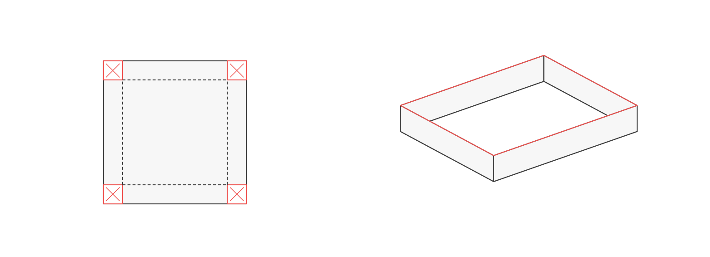

# Hướng bìa R1-G05 — hướng nội dung đã được duyệt

**Đề xuất ưu tiên: từ tấm vật liệu đến một phương án thực hiện được.**

Bên trái cho thấy một vật ban đầu và phần được phép cắt; bên phải là vật thể sau biến đổi. Đường nhấn đỏ nối sự lựa chọn với hình được tạo ra. Hướng này bám trọng tâm tự lập mô hình và kiểm ràng buộc, không dùng ảnh bìa của gói khác.

Đây là phác hướng nội dung, chưa phải bản dàn bìa cuối: chưa gắn tiêu đề, logo, các tỉ lệ dùng trên trang/danh mục/PDF hoặc manifest bìa chính thức. Không thêm đường cong trang trí giả đồ thị; nếu chủ trì muốn nhấn phương án tối ưu trên bìa cuối, phải thêm đồ thị đúng mô hình bằng bộ đồ thị hiện hành trong lượt được giao.

Nguồn: cảnh `huong_bia` trong dữ liệu và bộ dựng của bản thảo. Có SVG nền ngoài trong suốt, PNG để xem. Khác hình 01 trong bài: không dùng nhãn kích thước hoặc đường đo. Chủ trì duyệt hướng bìa hiện hành ngày 20/10/2026, theo [biên nhận duyệt](duyet_ban_thao_va_huong_bia_20261020.json). Chưa tạo manifest bìa production; bố cục thành phẩm sẽ được kiểm và trình riêng.
