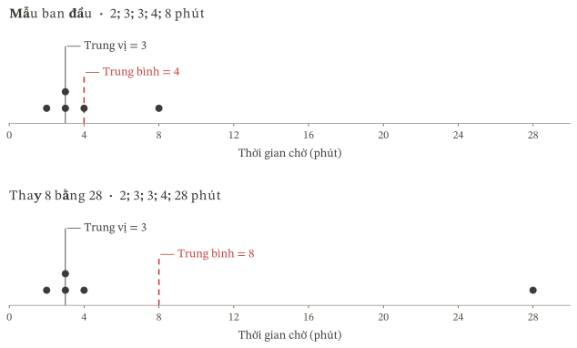
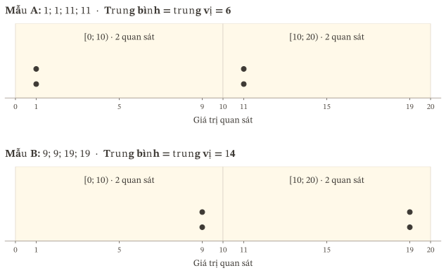
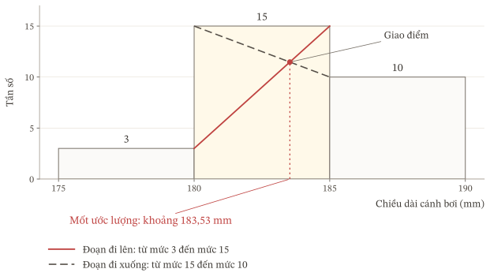
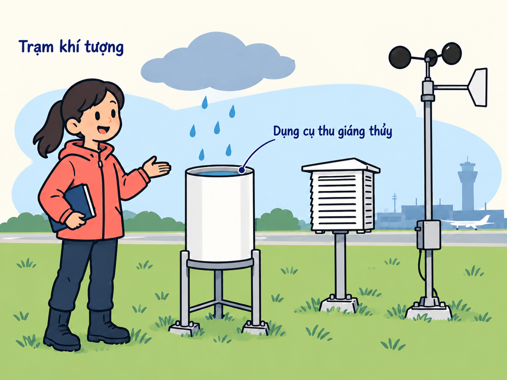

:::::::::::: {.zo-on-thi-package data-r1-title="Đọc dữ liệu và đo xu thế trung tâm" data-r1-code="R2-G01" data-r1-support-context="semantic" data-r1-lesson-count="5" data-r1-page-navigation="true"}

## Bắt đầu {#bat-dau}

Khi xem thời gian chờ của một nhóm người, ta có thể đặt hai câu hỏi: tổng thời gian chờ chia đều cho mỗi người là bao nhiêu, và phần lớn mọi người phải chờ khoảng bao lâu? Hai câu hỏi này không phải lúc nào cũng được trả lời tốt bằng cùng một con số. Chẳng hạn, một người chờ rất lâu có thể làm số trung bình tăng nhiều, dù những người còn lại chỉ chờ ít phút.

Ta sẽ tìm hiểu số trung bình, trung vị, tứ phân vị và mốt để biết mỗi số trả lời được câu hỏi nào. Các mẫu giả định nhỏ giúp theo dõi từng phép tính và lập luận. Các số liệu thực tế về chim cánh cụt, xe đạp dùng chung và giáng thủy giúp vận dụng những kiến thức ấy. Mẫu giả định được ghi rõ; số liệu quan trắc giữ nguyên giá trị, đơn vị và nguồn.

[**Học xong, em cần làm được gì?**]{#muc-tieu .r1-orientation-label}

::: {#r2g01-table-01 .table-scroll}
| Mục tiêu | Việc em cần làm được |
|---|---|
| Đọc đúng dữ liệu | Nêu đối tượng, đại lượng, đơn vị và thời gian được ghi nhận; phân biệt số dòng với số giá trị dùng được; nhận ra ô thiếu. |
| Tính trên mẫu gốc | Tính trung bình, trung vị, tứ phân vị và mốt; giải thích vì sao một giá trị rất lớn có thể kéo trung bình lên, cách tìm các giá trị giữa sau sắp xếp và cách xác định giá trị xuất hiện nhiều nhất. |
| Ghép nhóm | Xếp mỗi giá trị vào đúng khoảng; lập tần số, trung điểm và tần số tích lũy; chỉ ra thông tin bị mất khi ghép nhóm. |
| Tính từ bảng nhóm | Giải thích số liệu nào đã được thay bằng trung điểm; nêu giả thiết dùng để ước lượng trung vị và tứ phân vị; tính đúng và phân biệt kết quả ước lượng với kết quả từ mẫu gốc. |
| Chọn số đại diện | Dựa vào câu hỏi và đặc điểm dữ liệu để chọn trung bình, trung vị hoặc mốt; giải thích lựa chọn và nhận ra lúc cần mô tả riêng từng nhóm. |
| Giữ đúng giới hạn kết luận | Dùng đúng đơn vị, hiểu số 0 và ký hiệu đi kèm; không suy rộng kết luận vượt quá dữ liệu. |
:::

**Kiến thức cần có.** Biết sắp thứ tự các số, tính trung bình cộng và tỉ lệ, đọc khoảng. Nếu còn vướng thao tác nào, xem phần [Ôn nền](#on-nen) rồi trở lại bài đang làm.

**Nội dung học.** Số trung bình, trung vị, mốt và tứ phân vị giúp tóm tắt dữ liệu theo những cách khác nhau. Khoảng biến thiên, khoảng tứ phân vị, phương sai và độ lệch chuẩn sẽ được học riêng. Khi diễn giải số liệu thực tế, cần giữ đúng đối tượng, địa điểm và thời gian quan sát. Một bảng cho thấy hai nhóm khác nhau chưa đủ chứng minh yếu tố nào đã gây ra sự khác nhau ấy.

### Chọn nơi bắt đầu

- Cần học hoặc học lại kiến thức: vào [Bài học](#bai-hoc).
- Đã hiểu kiến thức và muốn vận dụng: vào [Luyện tập](#luyen-tap).
- Muốn xác định mình đã làm được gì: vào [Kiểm tra](#kiem-tra).
- Đã hoàn tất lượt học chính và đến ngày hẹn: vào [Ôn lại](#on-lai).

Tiến trình khuyến nghị là [Bài học](#bai-hoc) → [Luyện tập](#luyen-tap) → [Kiểm tra](#kiem-tra) → [Ôn lại](#on-lai). Em có thể bắt đầu ở phần phù hợp, nhưng việc bỏ qua một phần chưa cho biết em đã nắm được kiến thức của phần đó.

::: {#r2g01-table-02 .table-scroll}
| Cần gì? | Ở đâu? | Làm gì? |
|---|---|---|
| Hiểu một khái niệm | [Bài học](#bai-hoc) | Đọc giải thích và ví dụ, rồi trở lại bài đang làm. |
| Ôn thao tác tính hoặc đọc khoảng | [Ôn nền](#on-nen) | Xem hướng dẫn, tự làm bài ngắn rồi trở lại bài đang làm. |
| Đối chiếu bài làm | [Lời giải](#loi-giai) | So sánh cách làm và kết quả; đánh dấu chỗ chưa đúng. |
| Khắc phục lỗi trong bài làm | [Sửa lỗi](#sua-loi) | Tìm nguyên nhân, sửa bài rồi tự làm câu kiểm tra tương ứng. |
| Ghi kết quả và chỗ cần học tiếp | [Nhật kí](#nhat-ki) | Ghi ngày học, kết quả và việc cần làm tiếp. |
:::

Khi làm Kiểm tra, em tự làm trong một lượt trước khi mở tài liệu hoặc lời giải. Nếu cần trợ giúp, đánh dấu chỗ đã dừng; giữ phần tự làm để phân biệt với phần làm sau khi được hỗ trợ.

### Thời gian và điều kiện hoàn tất

Lượt học chính dự kiến khoảng 5 giờ 05 phút: Khởi động 10 phút, Bài học 140 phút, Luyện tập 85 phút, Kiểm tra 50 phút, đối chiếu và ghi nhận 20 phút. Có thể chia việc học thành nhiều buổi; riêng một lượt Kiểm tra cần làm liền mạch. Thời gian trên giúp em lập kế hoạch; em có thể cần thêm thời gian ở những phần chưa hiểu.

Em hoàn tất lượt học chính khi đã học và luyện những phần cần thiết, làm bài Kiểm tra, đối chiếu và sửa những lỗi cản trở việc hiểu nội dung cốt lõi. Một đáp số đúng chưa đủ nếu em chưa giải thích được cách làm. Đối chiếu bài làm với các tiêu chí ở [Điểm dừng 04](#dung04). Nếu còn chưa hiểu cách chọn mẫu, tìm vị trí, chọn nhóm hoặc giải thích kết quả, hãy học và tự kiểm tra lại phần đó trước khi ghi hoàn tất lượt chính. Nếu chỉ sai một phép tính, sửa phép tính rồi kiểm xem kết luận có thay đổi không.

Mỗi lượt Ôn lại dự kiến 30–35 phút. Nếu cần sửa lỗi, dành thêm khoảng 5–10 phút cho mỗi nhánh tự kiểm tra tương ứng. Đây là thời gian để lập kế hoạch học, không phải hạn chót. Thời gian thực tế phụ thuộc những phần em cần học và những chỗ cần sửa. Nếu cần đọc lại lời giải, sửa lỗi hoặc làm thêm câu tự kiểm tra, buổi học có thể dài hơn dự kiến.

### Ghi lịch ôn {#lich-on}

Ngày hoàn tất lượt học chính: … / … / …

::: {#r2g01-table-29 .table-scroll}
| Lượt ôn | Cách tính | Ngày em hẹn |
|---|---|---|
| [Ôn lần 1](#luot1) | Sau 2 ngày kể từ ngày hoàn tất lượt học chính | … / … / … |
| [Ôn lần 2](#luot2) | Sau 7 ngày kể từ ngày hoàn tất lượt học chính | … / … / … |
| [Ôn lần 3](#luot3) | Sau 28 ngày kể từ ngày hoàn tất lượt học chính | … / … / … |
:::

**Cả ba mốc đều tính từ cùng ngày hoàn tất lượt học chính, không tính nối tiếp từ lượt ôn trước.**

Nếu lỡ hẹn, thực hiện lượt ôn khi có thể và ghi ngày thực tế. Không làm dồn cả ba lượt trong cùng một ngày để bù lịch. Nếu phát hiện một chỗ chưa hiểu, sửa và tự kiểm tra lại sớm; không chờ đến lượt ôn kế tiếp. Em có thể học gói tiếp theo phù hợp với kiến thức đang có trong thời gian chờ ôn.

## Bài học {#bai-hoc}

::: {#dinh-huong .zo-lesson-intro}

Chọn số nào để mô tả một mẫu số liệu, và có thể kết luận gì từ số ấy?

Mỗi số đặc trưng cho biết một khía cạnh của dữ liệu. Hiểu ý nghĩa và giới hạn của từng số giúp ta lựa chọn phù hợp, kể cả khi chỉ còn bảng ghép nhóm.

:::

### Khởi động {#khoi-dong}

:::: {#nv01 .zo-learning-task data-zo-type="task" data-zo-task="R2G01-NV01" data-zo-function="function.warmup" data-zo-number="1" .zo-lesson-activity}

[]{#nhiệm-vụ-01-ba-thao-tác-nền}**[Nhiệm vụ 01]{.zo-activity-kind} — Ba thao tác nền**

Chim cánh cụt dùng hai cánh có dạng mái chèo để bơi; trong bài này, ta gọi bộ phận ấy là **cánh bơi**. Adélie là tên một loài chim cánh cụt. Bộ dữ liệu **Palmer Penguins** tập hợp các số đo cơ thể chim cánh cụt được nghiên cứu ở khu vực quần đảo Palmer, Nam Cực.

<figure id="r2g01-illustration-adelie" class="zo-context-illustration" data-zo-role="context-illustration" data-insert-before="Ba số đo chiều dài cánh bơi dưới đây" style="width: min(100%, 480px); margin: 1.5rem auto;">

<figcaption style="text-align: center; font-size: 0.875em; margin-top: 0.5rem;">Minh họa chim cánh cụt Adélie và cánh bơi.</figcaption>
</figure>

Ba số đo chiều dài cánh bơi dưới đây được ghi cho ba cá thể Adélie trong năm 2007: $181$, $186$, $195$ mm. Mỗi số ứng với một cá thể; mm là viết tắt của milimét. Em sẽ dùng các số đo để ôn cách tính trung bình và đọc khoảng; ý b là một tình huống giả định riêng để ôn cách tính tỉ lệ.

a) Sắp chúng theo thứ tự không giảm và tính trung bình cộng, làm tròn đến một chữ số thập phân.

b) Giả sử một nhóm có $12$ cá thể chim, trong đó $3$ cá thể có chiều dài cánh bơi từ $190$ mm trở lên. Ba cá thể ấy chiếm bao nhiêu phần trăm của nhóm?

c) Với các khoảng $[180;185)$, $[185;190)$, $[190;195)$, số đo chiều dài cánh bơi $190$ mm thuộc khoảng nào? Viết bất đẳng thức giải thích.

[Xem lời giải](#giai01).

::::

Sau khi đối chiếu lời giải, nếu còn câu chưa làm được hoặc chưa hiểu cách làm, em chọn phần ôn tương ứng dưới đây. Ôn xong, hãy tự làm lại câu đó. Nếu đã làm đúng và hiểu cả ba ý, em học tiếp.

::: {#r2g01-table-03 .table-scroll}
| Em còn vướng ở đâu? | Mở phần ôn nào? | Ôn xong, làm lại |
|---|---|---|
| Tính trung bình cộng hoặc tỉ lệ phần trăm | [Tính với đủ số quan sát](#nen-tinh) | Ý a hoặc b của [Nhiệm vụ 01](#nv01) |
| Xác định một số thuộc khoảng nào | [Đọc khoảng và giữ thứ tự](#nen-khoang) | Ý c của [Nhiệm vụ 01](#nv01) |
:::

Làm đúng Khởi động cho thấy em đã làm được những thao tác mở đầu này. Các kiến thức còn lại sẽ được học và tự kiểm tra ở những phần sau.

### 1. Mỗi dòng dữ liệu đang nói về điều gì? {#hoc-doc data-zo-lesson="true"}

:::: {#gm01 .zo-learning-task data-zo-type="task" data-zo-task="R2G01-GM01" data-zo-function="function.guided_thinking" data-zo-number="1" .zo-lesson-activity}

[]{#gợi-mở-01-chỗ-trống-có-phải-là-số-0}**[Gợi mở 01]{.zo-activity-kind} — Chỗ trống có phải là số 0?**

Đây là năm dòng đầu của bảng số đo chim cánh cụt Adélie năm 2007 trong bộ Palmer Penguins vừa dùng ở Khởi động. Mỗi dòng ghi thông tin của một cá thể; cột cuối ghi chiều dài cánh bơi của cá thể ấy. Một ô chưa có số đo được ghi là “Thiếu”:

::: {#r2g01-table-04 .table-scroll}
| Dòng trong bảng gốc | Loài | Năm | Chiều dài cánh bơi, mm |
|---:|---|---:|---:|
| 1 | Adélie | 2007 | $181$ |
| 2 | Adélie | 2007 | $186$ |
| 3 | Adélie | 2007 | $195$ |
| 4 | Adélie | 2007 | Thiếu |
| 5 | Adélie | 2007 | $193$ |
:::

Một bạn muốn thay ô “Thiếu” ở dòng 4 bằng $0$ để tính trung bình. Khi ấy, bảng sẽ nói gì về chiều dài cánh bơi của cá thể ở dòng 4? Điều đó có giống với “chưa có số đo” không?

::::

Số $0$ sẽ nói rằng chiều dài được ghi là $0$ mm. Trong khi đó, ô thiếu cho biết chưa có số đo chiều dài ở dòng ấy. Hai điều này khác nhau. Khi tính trung bình chiều dài, ta vẫn ghi nhận có một ô thiếu, nhưng chỉ cộng các số đo có sẵn và chia cho số giá trị đã cộng.

Mỗi dòng trong bảng này ghi thông tin của một cá thể chim. Cá thể ấy là **đơn vị quan sát**. Đại lượng được ghi là chiều dài cánh bơi; trong thống kê, đại lượng này gọi là **biến**, có đơn vị đo là mm. Số thứ tự dòng giúp tìm lại thông tin trong bảng gốc; nó không phải số đo hoặc mã nhận diện cá thể do nhà nghiên cứu cấp.

Phần dữ liệu về loài Adélie được ghi nhận năm 2007 có $50$ dòng, trong đó có $49$ số đo chiều dài dùng được. Số giá trị được đưa vào phép tính gọi là **cỡ mẫu**; ở đây $n=49$. Nếu một dòng có số đo chiều dài nhưng thiếu thông tin giới tính, số đo chiều dài ấy vẫn được dùng. Trong bài này, **mẫu gốc** là danh sách các giá trị trước khi ghép nhóm.

Dữ liệu được thu thập ở khu vực quần đảo Palmer, Nam Cực. Việc quan sát một số cá thể trong một địa điểm và giai đoạn xác định không tự cho phép kết luận về mọi cá thể của loài.

::: {.zo-source-note}
Nguồn dữ liệu: Allison Horst, Alison Hill và Kristen Gorman, Palmer Penguins, cột flipper_length_mm ghi chiều dài cánh bơi theo mm; dữ liệu gốc do Kristen Gorman và chương trình nghiên cứu sinh thái dài hạn tại trạm Palmer cung cấp. Phần trích trong mục này là Adélie năm 2007; truy cập ngày 22/10/2026.
:::

:::: {#nv02 .zo-learning-task data-zo-type="task" data-zo-task="R2G01-NV02" data-zo-function="function.self_check" data-zo-number="2" .zo-lesson-activity}

[]{#nhiệm-vụ-02-đếm-đúng-mẫu-dùng-để-tính}**[Nhiệm vụ 02]{.zo-activity-kind} — Đếm đúng mẫu dùng để tính**

Một bạn muốn tính chiều dài cánh bơi trung bình từ $17$ dòng đầu của bảng Adélie năm 2007. Trong đó, dòng 4 thiếu số đo chiều dài; $16$ dòng còn lại có số đo. Bạn cộng các số đo có sẵn được $3021$ mm rồi chia cho $17$. Hãy kiểm tra xem cách tính ấy có mô tả đúng những số đo đang có không.

a) Nêu đơn vị quan sát, biến và đơn vị đo.

b) Mẫu số cần dùng là bao nhiêu? Vì sao?

c) Sửa câu: “Cá thể ở dòng 4 có chiều dài cánh bơi bằng $0$.”

[Xem lời giải](#giai02).

::::

### 2. Những cách khác nhau để nói về vị trí trung tâm {#hoc-goc data-zo-lesson="true"}

Một số được tính đúng vẫn có thể khiến người đọc hình dung sai về mẫu. Để thấy rõ điều này, ta tạm dùng một tình huống nhỏ, trong đó chỉ một giá trị thay đổi.

:::::: {#số-trung-bình-và-trung-vị .zo-knowledge-section}

#### 2.1. Số trung bình và trung vị {#số-trung-bình-và-trung-vị-tieu-de}

:::: {#gm02 .zo-learning-task data-zo-type="task" data-zo-task="R2G01-GM02" data-zo-function="function.guided_thinking" data-zo-number="2" .zo-lesson-activity}

[]{#gợi-mở-02-ở-giữa-và-chia-đều-có-cùng-nghĩa-không}**[Gợi mở 02]{.zo-activity-kind} — “Ở giữa” và “chia đều” có cùng nghĩa không?**

**Tình huống giả định.** Thời gian chờ của năm người, tính bằng phút, lần lượt là

$$2;\ 3;\ 3;\ 4;\ 8.$$

Nếu dùng cùng một thời gian để thay cho thời gian chờ của cả năm người mà tổng vẫn như cũ, thời gian ấy phải bằng bao nhiêu? Đây là cách tìm một con số tóm tắt, không phải thay đổi thời gian mà từng người thực sự đã chờ. Sau khi xếp năm thời gian từ nhỏ đến lớn, giá trị đứng giữa bằng bao nhiêu?

Bây giờ thay thời gian $8$ phút bằng $28$ phút, giữ nguyên bốn giá trị còn lại. Hãy dự đoán hai câu trả lời trên thay đổi thế nào. Nếu thông báo “thời gian chờ đại diện là $8$ phút”, người đọc có hình dung đúng trải nghiệm của phần lớn năm người ấy không?

::::

[]{#y-nghia-trung-binh}

**Số trung bình cho biết tổng chia đều cho mỗi quan sát là bao nhiêu.** Năm người có thời gian chờ $2;3;3;4;8$ phút. Tổng thời gian chờ là $20$ phút. Nếu tổng ấy được chia đều cho năm người thì mỗi người ứng với $\frac{20}{5}=4$ phút. Đó là **thời gian chờ trung bình**.

Có thể kiểm lại bằng cách thay năm thời gian bằng $4;4;4;4;4$: tổng vẫn là $20$ phút. Phép thay này giúp hiểu ý nghĩa của số trung bình; thời gian chờ thực tế vẫn là $2;3;3;4;8$ phút, không phải ai cũng đã chờ $4$ phút.

Với một mẫu gồm $n$ giá trị, $n\geq1$, gọi các giá trị là $x_1,x_2,\ldots,x_n$ và số trung bình là $\overline{x}$. Nếu thay mỗi giá trị bằng $\overline{x}$ thì tổng mới là $n\overline{x}$. Muốn tổng mới bằng tổng ban đầu, ta cần

$$n\overline{x}=x_1+x_2+\cdots+x_n.$$

Chia hai vế cho $n$, ta được

$$\overline{x}=\frac{x_1+x_2+\cdots+x_n}{n}.$$

**Vì sao có thể xem trung bình là một mức cân bằng?** So với $4$ phút, thời gian $2$ phút thấp hơn $2$ phút; mỗi thời gian $3$ phút thấp hơn $1$ phút. Ba phần thiếu cộng lại là $2+1+1=4$ phút. Thời gian $8$ phút vượt mức $4$ phút đúng $4$ phút; thời gian $4$ phút không thiếu cũng không vượt. Phần thiếu và phần vượt bằng nhau.

Gọi $x_i-\overline{x}$ là độ lệch của giá trị thứ $i$ so với trung bình. Độ lệch âm biểu thị thấp hơn, độ lệch dương biểu thị cao hơn. Kí hiệu $\sum_{i=1}^{n}$ có nghĩa là cộng biểu thức phía sau với $i$ lần lượt từ $1$ đến $n$. Cộng các độ lệch tức là lấy tổng ban đầu trừ đi $n$ lần số trung bình:

$$\sum_{i=1}^{n}(x_i-\overline{x})=(x_1+\cdots+x_n)-n\overline{x}=0.$$

**Một giá trị thay đổi làm trung bình thay đổi thế nào?** Nếu chỉ thay thời gian $8$ phút bằng $28$ phút, tổng tăng từ $20$ lên $40$ phút, còn số người vẫn là $5$. Trung bình tăng từ $\frac{20}{5}=4$ lên $\frac{40}{5}=8$ phút. Bốn người còn lại không đổi thời gian chờ, nhưng trung bình vẫn tăng vì tổng đã tăng.

Tổng quát, khi chỉ một giá trị tăng thêm $\Delta$ và số giá trị vẫn là $n$, tổng tăng thêm $\Delta$, nên trung bình tăng thêm $\frac{\Delta}{n}$. Nếu $\Delta<0$, giá trị đó giảm và trung bình giảm tương ứng. Kết luận này xét việc thay một giá trị, không phải thêm một quan sát mới.

[]{#y-nghia-trung-vi}

**Trung vị trả lời câu hỏi: sau khi sắp từ nhỏ đến lớn, giá trị ở giữa bằng bao nhiêu?** Dãy $2;3;3;4;8$ đã được sắp. Quan sát thứ ba đứng ở giữa: có hai quan sát đứng trước và hai quan sát đứng sau. Giá trị tại đó là $3$ phút, gọi là **trung vị**, kí hiệu $M_e$. “Thứ ba” chỉ vị trí trong danh sách; $3$ phút mới là thời gian chờ.

Khi thay $8$ bằng $28$, dãy mới là $2;3;3;4;28$. Giá trị cuối vẫn đứng cuối, giá trị thứ ba vẫn bằng $3$. Vì vậy trung vị không đổi, trong khi trung bình tăng lên $8$ phút.

Để tìm trung vị, trước hết sắp tất cả các giá trị theo thứ tự không giảm, giữ đủ cả các giá trị trùng nhau. Nếu số quan sát lẻ, lấy giá trị ở vị trí chính giữa. Nếu số quan sát chẵn, không có một quan sát duy nhất đứng giữa; theo định nghĩa, trung vị được lấy bằng trung bình cộng của hai giá trị giữa. Chẳng hạn, mẫu $2;3;7;10$ có hai giá trị giữa là $3$ và $7$, nên trung vị bằng $\frac{3+7}{2}=5$, dù mẫu không có giá trị $5$.

Trong mẫu $2;3;3;4;8$, ta có thể thực hiện hai phép đếm riêng:

- Các quan sát có giá trị không lớn hơn trung vị $3$ là $2;3;3$: có ba quan sát.
- Các quan sát có giá trị không nhỏ hơn $3$ là $3;3;4;8$: có bốn quan sát.

Hai quan sát bằng $3$ thỏa cả hai điều kiện so sánh, nên xuất hiện trong cả hai phép đếm. Ta đang kiểm tra hai điều kiện, không chia mẫu thành hai nhóm tách biệt. Vì vậy, hai số đếm có thể cùng lớn hơn một nửa cỡ mẫu.

Tổng quát, có **ít nhất một nửa** số quan sát không lớn hơn trung vị và ít nhất một nửa không nhỏ hơn trung vị. Điều này không có nghĩa đúng một nửa nhỏ hơn và đúng một nửa lớn hơn trung vị.

<figure id="r2g01-draft-trung-binh-trung-vi" class="zo-statistical-figure" data-zo-role="context-illustration">

<figcaption>Khi thay thời gian chờ 8 phút bằng 28 phút, trung bình tăng từ 4 lên 8 phút, còn trung vị vẫn bằng 3 phút.</figcaption></figure>

Trong hình, mỗi chấm là một người với thời gian chờ tương ứng; các chấm trùng thời gian được xếp cao lên để vẫn nhìn thấy đủ. Hai hàng dùng cùng một trục thời gian. Đường nét đứt đỏ chỉ trung bình: từ $4$ chuyển sang $8$ phút. Đường liền xám chỉ trung vị: vẫn ở $3$ phút. Nhãn bên cạnh mỗi đường ghi rõ số đặc trưng tương ứng.

[]{#khi-trung-binh-khong-dien-hinh}

**Vì sao có lúc trung bình chưa mô tả tốt thời gian chờ của phần lớn nhóm?** Trong mẫu thứ hai, bốn trong năm người chỉ chờ từ $2$ đến $4$ phút. Nếu chỉ thông báo “thời gian chờ đại diện là $8$ phút”, người đọc có thể tưởng thời gian chờ của phần lớn nhóm gần $8$ phút. Số trung bình cao hơn khoảng thời gian của bốn người ấy vì thời gian $28$ phút chiếm phần lớn tổng $40$ phút.

Nếu muốn mô tả người ở giữa khi xếp theo thời gian chờ, trung vị $3$ phút phù hợp hơn. Một báo cáo rõ hơn có thể viết: “Trung vị thời gian chờ là $3$ phút; bốn trong năm người chờ từ $2$ đến $4$ phút, còn một người chờ $28$ phút.” Người chờ lâu vẫn được ghi nhận. Nếu quan tâm tổng thời gian chờ, trung bình $8$ phút vẫn hữu ích vì $5\cdot8=40$ phút.

Trung vị không phải lúc nào cũng giữ nguyên. Nếu thay $2$ bằng $30$ trong mẫu $2;3;3;4;28$, ta phải sắp lại thành $3;3;4;28;30$; giá trị giữa lúc này bằng $4$. Khi một giá trị thay đổi, cần xem nó có làm thay đổi giá trị ở giữa sau sắp xếp hay không.

Vì thế, không có quy tắc “hễ có một giá trị rất lớn thì bỏ trung bình”. Cần xác định câu hỏi: muốn biết tổng chia đều cho mỗi người, thời gian của người ở giữa, hay muốn mô tả cả những người chờ lâu khác biệt?

[]{#trung-binh-co-trong-so}

**Vì sao phải tính đủ số lần xuất hiện của mỗi giá trị?** Trong mẫu $2;3;3;4;8$, giá trị $3$ xuất hiện hai lần nên phải được cộng hai lần. Do đó

$$\overline{x}=\frac{2+2\cdot3+4+8}{1+2+1+1}=4.$$

Số lần xuất hiện của một giá trị gọi là **tần số**. Mẫu trên có bốn giá trị khác nhau $2,3,4,8$, với tần số tương ứng $1,2,1,1$; tổng tần số là $5$, chính là số quan sát. Khi có $k$ giá trị khác nhau $a_1,\ldots,a_k$ với tần số tương ứng $f_1,\ldots,f_k$, ta viết gọn

$$\overline{x}=\frac{\sum_{i=1}^{k}f_i a_i}{\sum_{i=1}^{k}f_i}.$$

Ở tử số, mỗi giá trị được nhân với số lần nó xuất hiện. Ở mẫu số, ta cộng các tần số để đếm đủ mọi quan sát. Tần số được gọi là **trọng số** vì nó cho biết mỗi giá trị được tính bao nhiêu lần trong phép lấy trung bình.

**Gộp hai nhóm có số quan sát khác nhau.** Giả sử nhóm thứ nhất có $2$ quan sát, trung bình $10$; nhóm thứ hai có $8$ quan sát, trung bình $20$. Ta khôi phục tổng của từng nhóm: $2\cdot10=20$ và $8\cdot20=160$. Cả hai nhóm có tổng $180$ và có $10$ quan sát, nên trung bình chung là $\frac{180}{10}=18$.

Phép tính $\frac{10+20}{2}=15$ tính hai nhóm ngang nhau: mỗi trung bình nhóm được tính một lần, dù nhóm thứ hai có số quan sát gấp bốn lần nhóm thứ nhất. Trong mẫu gộp, hai nhóm thực sự chiếm $\frac{2}{10}$ và $\frac{8}{10}$ số quan sát. Vì vậy, để mỗi quan sát được tính một lần, ta nhân từng trung bình nhóm với số quan sát tương ứng, cộng các tích rồi chia cho tổng số quan sát. Nếu cỡ hai nhóm bằng nhau thì công thức này rút gọn thành trung bình cộng của hai trung bình; nếu hai trung bình bằng nhau thì hai cách cũng cho cùng kết quả.

**Khi đổi từ phút sang giây, trung bình và trung vị đổi thế nào?** Năm thời gian $2;3;3;4;8$ phút được viết thành $120;180;180;240;480$ giây. Mỗi giá trị nhân với $60$, nên tổng cũng nhân với $60$: tổng $20$ phút tương ứng $1200$ giây. Số người vẫn là $5$, do đó trung bình là $\frac{1200}{5}=240$ giây, đúng bằng $4$ phút.

Nhân mọi giá trị với cùng số dương $60$ không làm đổi thứ tự. Giá trị giữa là $180$ giây, đúng bằng trung vị $3$ phút. Với mẫu chẵn, cả hai giá trị giữa đều nhân với $60$ nên trung bình cộng của chúng cũng nhân với $60$. Đổi đơn vị làm đổi con số viết ra nhưng vẫn nói về cùng một thời gian; $4$ phút không thể được ghi thành $4$ giây.

**Một việc khác: mọi thời gian đều tăng thêm như nhau.** Nếu mỗi người phải chờ thêm $2$ phút thì thời gian thực tế đã thay đổi. Tổng tăng thêm $5\cdot2=10$ phút, nên trung bình tăng $\frac{10}{5}=2$ phút. Thứ tự không đổi và giá trị giữa cũng tăng $2$ phút; với mẫu chẵn, trung bình của hai giá trị giữa tăng $2$ phút. Tổng quát, khi cộng cùng một số $c$ vào cả $n$ giá trị, tổng tăng thêm $nc$, còn trung bình và trung vị đều tăng thêm $c$.

::: {.zo-source-note}
Căn cứ toán học: Toán 10, Tập một, Kết nối tri thức với cuộc sống, Nhà xuất bản Giáo dục Việt Nam, Bài 13, trang 78–79.
:::

::::: {#vd01 .zo-learning-example data-zo-type="example" data-zo-unit="R2G01-VD01" .zo-lesson-activity}

**[Ví dụ 01]{.zo-activity-kind} — Một mẫu có 16 giá trị**

Trở lại $17$ dòng đầu của bảng Adélie năm 2007 ở Nhiệm vụ 02. Sau khi ghi nhận một ô thiếu, ta dùng $16$ số đo cánh bơi còn lại để tìm số trung bình và trung vị. Mỗi số dưới đây là chiều dài cánh bơi của một cá thể, đơn vị mm:

$$
\begin{array}{l}
181;\ 186;\ 195;\ 193;\ 190;\ 181; \\
195;\ 193;\ 190;\ 186;\ 180;\ 182; \\
191;\ 198;\ 185;\ 195.
\end{array}
$$

Sau khi sắp thứ tự:

::: {#r2g01-table-05 .table-scroll}
| Vị trí | 1 | 2 | 3 | 4 | 5 | 6 | 7 | 8 |
|---|---:|---:|---:|---:|---:|---:|---:|---:|
| Giá trị, mm | $180$ | $181$ | $181$ | $182$ | $185$ | $186$ | $186$ | $190$ |
:::

::: {#r2g01-table-06 .table-scroll}
| Vị trí | 9 | 10 | 11 | 12 | 13 | 14 | 15 | 16 |
|---|---:|---:|---:|---:|---:|---:|---:|---:|
| Giá trị, mm | $190$ | $191$ | $193$ | $193$ | $195$ | $195$ | $195$ | $198$ |
:::

Tổng là $3021$ mm nên

$$
\overline{x}=\frac{3021}{16}=188{,}8125\ \text{mm}.
$$

Hai vị trí ở giữa là $8$ và $9$, cùng mang giá trị $190$ mm. Do đó

$$
M_e=\frac{190+190}{2}=190\ \text{mm}.
$$

Con số $188{,}8125$ là mức chia đều tổng chiều dài $3021$ mm cho $16$ số đo. Trung vị $190$ mm là trung bình cộng của hai số đo ở vị trí thứ $8$ và thứ $9$ trong dãy đã sắp. Hai số tương đối gần nhau trong mẫu này; sự gần nhau ấy không phải định lí đúng với mọi mẫu. Ta vừa thấy một đối chứng ở Gợi mở 02.

Các số đo trong danh sách được ghi bằng số nguyên mm, nhưng phép chia $\frac{3021}{16}$ cho kết quả $188{,}8125$. Bốn chữ số sau dấu phẩy phát sinh từ phép chia; chúng không cho biết dụng cụ đã đo từng cá thể chính xác đến một phần mười nghìn mm. Muốn biết độ chính xác của phép đo, ta cần thông tin về dụng cụ và cách đo. Vì vậy, không thể suy độ chính xác ấy chỉ từ số chữ số thập phân của trung bình.

:::::

::::::

:::::: {#tứ-phân-vị-chia-theo-thứ-tự .zo-knowledge-section}

#### 2.2. Tứ phân vị: chia theo thứ tự {#tứ-phân-vị-chia-theo-thứ-tự-tieu-de}

[]{#vi-sao-can-tu-phan-vi}

Biết trung vị rồi, ta đã hình dung được vị trí của những giá trị còn lại chưa? Xét hai mẫu giả định đã sắp:

$$\begin{aligned}
A &: 1;\ 2;\ 3;\ 4;\ 5;\ 6;\ 7;\ 8,\\
B &: 1;\ 4;\ 4;\ 4;\ 5;\ 5;\ 5;\ 8.
\end{aligned}$$

Cả hai mẫu cùng có tổng $36$, trung bình $4{,}5$ và trung vị $4{,}5$. Chỉ biết hai số ấy, ta chưa thấy mẫu B có sáu trong tám giá trị tập trung tại $4$ và $5$, còn mẫu A có đủ các giá trị nguyên từ $1$ đến $8$.

Ta xét thêm từng nửa của dãy đã sắp. Nửa dưới của A là $1;2;3;4$, có trung vị $\frac{2+3}{2}=2{,}5$. Nửa dưới của B là $1;4;4;4$, có trung vị $\frac{4+4}{2}=4$. Hai kết quả ấy là **tứ phân vị thứ nhất**, kí hiệu $Q_1$, của từng mẫu.

Nửa trên của A là $5;6;7;8$, có trung vị $\frac{6+7}{2}=6{,}5$. Nửa trên của B là $5;5;5;8$, có trung vị $5$. Đây là **tứ phân vị thứ ba**, kí hiệu $Q_3$. Cùng với trung vị của toàn mẫu, gọi là **tứ phân vị thứ hai** $Q_2$, ta có ba mốc $Q_1,Q_2,Q_3$.

Như vậy, $Q_1$ và $Q_3$ bổ sung thông tin về các giá trị ở nửa dưới và nửa trên của mẫu. Chúng giúp thấy một sự khác nhau mà trung vị chung $4{,}5$ chưa cho thấy. Ta xác định các tứ phân vị bằng cách xét các quan sát trong dãy đã sắp, rồi tìm trung vị của toàn dãy và của từng nửa. Ta không chia đoạn từ giá trị nhỏ nhất đến lớn nhất thành bốn đoạn dài bằng nhau. Hai mẫu đều có hai đầu là $1$ và $8$ nhưng có $Q_1,Q_3$ khác nhau.

**Cách xác định tứ phân vị bằng trung vị của hai nửa**, theo Toán 10, Tập một, bộ Kết nối tri thức với cuộc sống, trang 80–81, được thực hiện như sau:

1. Sắp các giá trị theo thứ tự không giảm, giữ đủ những giá trị trùng nhau.
2. Tìm trung vị $Q_2$. Nếu cỡ mẫu chẵn, chia dãy thành hai nửa có số giá trị bằng nhau. Nếu cỡ mẫu lẻ, nửa dưới gồm các quan sát đứng trước vị trí chính giữa; nửa trên gồm các quan sát đứng sau vị trí ấy.
3. Tìm trung vị của nửa dưới để được $Q_1$ và trung vị của nửa trên để được $Q_3$.

Chẳng hạn, với năm giá trị đã sắp $1;2;3;4;5$, quan sát thứ ba xác định $Q_2=3$; hai nửa dùng tiếp là $1;2$ và $4;5$. Ta chỉ không đưa **quan sát ở vị trí chính giữa** vào hai nửa ấy, không xóa tất cả các giá trị bằng trung vị. Quan sát đó vẫn thuộc mẫu ban đầu.

Trong mẫu B, $Q_1=4$. Tuy nhiên, chỉ có một trong tám quan sát nhỏ hơn $4$, còn có bốn trong tám quan sát không lớn hơn $4$. Hai tỉ lệ lần lượt là $\frac{1}{8}$ và $\frac{4}{8}$; không tỉ lệ nào bằng $25\%$.

Nguyên nhân là ba quan sát cùng mang giá trị $4$: nếu đếm các giá trị nhỏ hơn $4$ thì không tính cả ba; nếu đếm các giá trị không lớn hơn $4$ thì tính cả ba. Vì thế, không thể hiểu ba tứ phân vị là những mốc luôn chia các giá trị của mẫu thành bốn nhóm, mỗi nhóm có đúng $25\%$ số quan sát. Khi tìm $Q_1,Q_2,Q_3$, ta cần thực hiện cách xác định bằng trung vị của hai nửa đã nêu; đổi dấu “nhỏ hơn” thành “không lớn hơn” không khắc phục được sự khác nhau về số đếm này.

Trong Ví dụ 01, nửa dưới gồm các vị trí từ $1$ đến $8$, nửa trên từ $9$ đến $16$. Vì thế

$$
\begin{aligned}
Q_1&=\frac{182+185}{2}=183{,}5; \\
Q_2&=\frac{190+190}{2}=190; \\
Q_3&=\frac{193+195}{2}=194.
\end{aligned}
$$

Cả ba tứ phân vị đều có đơn vị mm. Số $183{,}5$ mm là trung vị của tám số đo ở nửa dưới; số $194$ mm là trung vị của tám số đo ở nửa trên; $190$ mm là trung vị của toàn bộ 16 số đo.

::: {.zo-source-note}
Căn cứ toán học: Toán 10, Tập một, Kết nối tri thức với cuộc sống, Bài 13, trang 80–81. Khi dùng phần mềm hoặc đọc một kết quả phân vị khác, cần kiểm tra phương pháp tính: phần mềm có thể cung cấp quy ước khác với cách lấy trung vị của hai nửa.
:::

::::: {#vd02 .zo-learning-example data-zo-type="example" data-zo-unit="R2G01-VD02" .zo-lesson-activity}

**[Ví dụ 02]{.zo-activity-kind} — Khi cỡ mẫu lẻ**

Năm số đo cánh bơi có sẵn đầu tiên của các cá thể Adélie năm 2007 là $181;\ 186;\ 195;\ 193;\ 190$ mm. Sau khi sắp, ta được

$$
181;\ 186;\ 190;\ 193;\ 195.
$$

Trung vị là $190$. Nửa dưới gồm $181;186$, nửa trên gồm $193;195$. Do đó $Q_1=183{,}5$ mm và $Q_3=194$ mm. Số đo $190$ mm ở vị trí thứ ba xác định $Q_2$; khi tìm $Q_1$ và $Q_3$, ta chỉ xét hai số đứng trước và hai số đứng sau vị trí ấy. Không xóa số đo này khỏi mẫu ban đầu.

Ví dụ này dùng lại một phần dữ liệu vừa học để giải thích quy tắc khi số giá trị là số lẻ. Đọc hiểu lời giải giúp em nắm cách làm; để biết có tự làm được hay không, em cần thử một bài khác chưa xem lời giải.

:::::

::::::

:::: {#nv03 .zo-learning-task data-zo-type="task" data-zo-task="R2G01-NV03" data-zo-function="function.self_check" data-zo-number="3" .zo-lesson-activity}

[]{#nhiệm-vụ-03-vị-trí-và-giá-trị}**[Nhiệm vụ 03]{.zo-activity-kind} — Vị trí và giá trị**

Nhiệm vụ này củng cố hai phần vừa học: số trung bình và trung vị ở mục 2.1, tứ phân vị ở mục 2.2. Dùng bảng $16$ số đo cánh bơi của chim Adélie năm 2007 đã sắp trong [Ví dụ 01](#vd01). Em sẽ phân biệt vị trí trong danh sách với chiều dài được ghi, rồi xem trung bình và trung vị thay đổi thế nào khi một giá trị thay đổi.

a) Một bạn viết “$Q_1=4{,}5$ vì trung vị của tám vị trí đầu nằm giữa vị trí 4 và 5”. Chỉ ra sự nhầm lẫn và sửa kết quả.

b) Trong Ví dụ 02, nếu đưa quan sát $190$ vào cả hai nửa, em có còn đang dùng cách xác định tứ phân vị bằng trung vị của hai nửa không? Giải thích.

c) Một mẫu thời gian chờ **giả định mới** gồm $1;2;2;3;7$ phút. Thay riêng giá trị $7$ bằng $27$. Tính trung bình, trung vị trước và sau thay đổi. Giải thích vì sao chúng phản ứng khác nhau, rồi chọn số phù hợp nếu muốn mô tả người ở giữa theo thời gian chờ.

[Xem lời giải](#giai03).

::::

:::::: {#mốt-giá-trị-xuất-hiện-nhiều-nhất .zo-knowledge-section}

#### 2.3. Mốt: giá trị xuất hiện nhiều nhất {#mốt-giá-trị-xuất-hiện-nhiều-nhất-tieu-de}

[]{#y-nghia-mot}

Một cửa hàng muốn biết cỡ giày nào được hỏi mua nhiều nhất. Trong danh sách giả định $36;36;36;37;37;38;38;39;40$, cỡ $36$ xuất hiện ba lần, nhiều hơn từng cỡ còn lại. Đây là câu hỏi về **tần số**, khác với chia đều tổng hoặc tìm vị trí giữa. Trung vị của danh sách là $37$; nó không trả lời cỡ nào xuất hiện nhiều nhất.

Cỡ $36$ chỉ chiếm $\frac{3}{9}$ số lượt hỏi. Vì vậy, “nhiều nhất” không đồng nghĩa “quá một nửa”. Nếu cần dự kiến nhiều cỡ hàng, cửa hàng phải xem cả bảng tần số; chỉ giữ một cỡ nổi trội sẽ bỏ qua sáu lượt hỏi còn lại. Tình huống này minh họa ý nghĩa của mốt, chưa phải một dự báo nhu cầu bán hàng.

**Tần số của một giá trị** là số lần giá trị ấy xuất hiện trong mẫu. **Mốt** là giá trị có tần số lớn nhất. Theo quy ước của Toán 10, Tập một, bộ Kết nối tri thức với cuộc sống, trang 81, khi các giá trị khác nhau có tần số bằng nhau thì mẫu không có mốt. Với mẫu có ít nhất hai giá trị khác nhau, ta phân biệt ba trường hợp:

- **Không có mốt:** tất cả các giá trị khác nhau đều xuất hiện cùng một số lần. Ta dùng quy ước mẫu không có mốt, vì không có giá trị nào nổi trội về tần số.
- **Một mốt:** có đúng một giá trị xuất hiện nhiều lần hơn mỗi giá trị còn lại. Giá trị ấy là mốt.
- **Nhiều mốt:** có từ hai giá trị trở lên cùng đạt tần số lớn nhất, đồng thời vẫn có giá trị khác mang tần số nhỏ hơn. Tất cả các giá trị đạt tần số lớn nhất ấy đều là mốt.

Vì vậy, khi các tần số không đồng loạt bằng nhau, tìm mốt là tìm đủ các giá trị có tần số lớn nhất. Không chỉ đếm xem một giá trị có lặp lại hay không; cần so sánh số lần xuất hiện của nó với các giá trị khác.

Ví dụ, mẫu $1;1;2;2;3;3$ không có giá trị nào xuất hiện nhiều hơn giá trị khác: các tần số đều bằng $2$, nên không có mốt theo quy ước trên. Còn mẫu $1;1;2;2;3$ có hai mốt là $1$ và $2$: chúng cùng có tần số lớn nhất $2$, lớn hơn tần số $1$ của giá trị $3$. Mốt là các giá trị $1$ và $2$, không phải số lần xuất hiện $2$.

Ở mẫu 16 giá trị, $195$ xuất hiện ba lần, nhiều hơn các giá trị khác, nên mốt là $195$ mm. Khi mở rộng đến toàn bộ 49 giá trị Adélie 2007, các số $180$, $190$, $195$ đều xuất hiện năm lần và cùng đạt tần số lớn nhất. Mẫu lớn này có ba mốt.

Nếu muốn biết chiều dài nào được ghi nhận nhiều lần nhất trong nhóm chim này, mốt trả lời câu hỏi ấy. Nó không khẳng định phần lớn cá thể đều có chiều dài đó.

Không thể mang mốt của một phần trích sang mẫu lớn hơn mà không đếm lại.

::: {.zo-source-note}
Căn cứ toán học: Toán 10, Tập một, Kết nối tri thức với cuộc sống, Bài 13, trang 81, gồm định nghĩa và hai nhận xét về nhiều mốt, không có mốt; đối chiếu thêm Sách giáo viên Toán 10, trang 144–145. Xem [lưu ý về định nghĩa và quy ước mốt](#chu-thich-mot) khi mẫu chỉ có một giá trị khác nhau. Các tần số Penguins ở trên được tính từ dữ liệu Adélie 2007.
:::

::::::

### 3. Từ từng giá trị đến các khoảng {#hoc-ghep data-zo-lesson="true"}

:::: {#gm03 .zo-learning-task data-zo-type="task" data-zo-task="R2G01-GM03" data-zo-function="function.guided_thinking" data-zo-number="3" .zo-lesson-activity}

[]{#gợi-mở-03-biết-khoảng-có-đủ-để-khôi-phục-giá-trị-không}**[Gợi mở 03]{.zo-activity-kind} — Biết khoảng có đủ để khôi phục giá trị không?**

Một bản tóm tắt chỉ ghi rằng chiều dài cánh bơi của một cá thể thuộc khoảng $[190;195)$ mm. Em còn biết được những giới hạn nào của số đo? Em có thể tìm lại chính xác chiều dài của cá thể ấy không?

::::

Thông tin trên cho biết số đo không nhỏ hơn $190$ mm và nhỏ hơn $195$ mm, nhưng chưa cho biết giá trị cụ thể. **Ghép nhóm** là xếp các số đo vào từng khoảng rồi đếm số quan sát trong mỗi khoảng. Cách này giúp nhìn sự phân bố của nhiều số đo, nhưng không giữ lại từng giá trị ban đầu.

[]{#hai-mau-cung-bang-nhom}

Xét hai mẫu **giả định**, cùng đơn vị: A gồm $1;1;11;11$, còn B gồm $9;9;19;19$. Cả hai được ghép theo hai khoảng $[0;10)$ và $[10;20)$:

::: {#r2g01-table-36 .table-scroll}
| Mẫu gốc | Số giá trị trong $[0;10)$ | Số giá trị trong $[10;20)$ | Trung bình | Trung vị |
|---|---:|---:|---:|---:|
| A: $1;1;11;11$ | $2$ | $2$ | $6$ | $6$ |
| B: $9;9;19;19$ | $2$ | $2$ | $14$ | $14$ |
:::

Với A, trung bình là $\frac{1+1+11+11}{4}=6$ và trung vị là $\frac{1+11}{2}=6$. Với B, hai phép tính tương ứng cho $14$. Người chỉ giữ bảng tần số $2;2$ không phân biệt được mình đã bắt đầu từ A hay B. Vì vậy, một phép tính chỉ dùng bảng ấy sẽ cho cùng một kết quả, trong khi hai mẫu gốc có kết quả khác nhau. Điều này chứng tỏ không thể luôn khôi phục chính xác trung bình hoặc trung vị của mẫu gốc từ bảng ghép nhóm.

<figure id="r2g01-draft-cung-bang-khac-mau" class="zo-statistical-figure" data-zo-role="context-illustration">

<figcaption>Cùng có hai quan sát trong mỗi nhóm, nhưng mẫu A có trung bình và trung vị bằng 6, còn mẫu B có cả hai số bằng 14.</figcaption></figure>

Mỗi chấm trong hình biểu thị một giá trị gốc; hai hàng dùng cùng một trục số. Các giá trị của A nằm gần đầu trái các nhóm, còn các giá trị của B nằm gần đầu phải. Bảng chỉ ghi mỗi nhóm có hai giá trị nên không lưu được sự khác nhau đó.

Bảng nhóm vẫn giữ những điều có ích: cỡ mẫu, số quan sát trong từng khoảng và số quan sát nhỏ hơn một biên nhóm. Cần phân biệt thông tin đọc được chắc chắn từ bảng với những giá trị chỉ có thể ước lượng.

Ta chia trục thành các khoảng không chồng lấn và bao phủ mọi giá trị của mẫu. Ta dùng các khoảng lấy đầu mút trái và không lấy đầu mút phải (gọi là đóng trái–mở phải). Vì thế $190$ thuộc $[190;195)$, không thuộc $[185;190)$.

Để đọc bảng, cần phân biệt số quan sát trong một nhóm với số quan sát cộng dồn từ nhóm đầu. Trung điểm của nhóm được dùng làm số thay thế khi ước lượng; nó không phải một số đo đã biết.

::::: {#vd03 .zo-learning-example data-zo-type="example" data-zo-unit="R2G01-VD03" .zo-lesson-activity}

**[Ví dụ 03]{.zo-activity-kind} — Ghép nhóm mẫu nhỏ**

Để tóm tắt $16$ số đo cánh bơi Adélie ở [Ví dụ 01](#vd01), ta xếp chúng vào bốn khoảng. Bảng cho biết mỗi khoảng có bao nhiêu cá thể và số cá thể cộng dồn đến khoảng ấy:

::: {#r2g01-table-07 .table-scroll}
| Khoảng, mm | Tần số | Giá trị đại diện, mm | Tần số tích lũy |
|---|---:|---:|---:|
| $[180;185)$ | $4$ | $182{,}5$ | $4$ |
| $[185;190)$ | $3$ | $187{,}5$ | $7$ |
| $[190;195)$ | $5$ | $192{,}5$ | $12$ |
| $[195;200)$ | $4$ | $197{,}5$ | $16$ |
:::

Xét hàng $[190;195)$: **tần số** $5$ cho biết có năm số đo thuộc khoảng này. Hai nhóm trước có tổng tần số $4+3=7$, nên có bảy số đo nhỏ hơn $190$ mm. Tính đến hết nhóm đang xét, có $7+5=12$ số đo nhỏ hơn $195$ mm; đó là **tần số tích lũy** ở hàng này. Tần số tích lũy trước nhóm là $7$, còn đến hết nhóm là $12$: hai số này có vai trò khác nhau.

**Giá trị đại diện** của nhóm là trung điểm $\frac{190+195}{2}=192{,}5$ mm. Khi ước lượng trung bình từ bảng, ta dùng số ấy thay tạm cho từng số đo chưa biết trong nhóm. Điều này không khẳng định cả năm cá thể, hay một cá thể nào, có đúng chiều dài $192{,}5$ mm. Mục tiếp theo giải thích vì sao chọn trung điểm.

Tổng tần số $4+3+5+4=16$, bằng cỡ mẫu. Chiều dài là đại lượng đo liên tục, dù các số liệu đang dùng được ghi bằng số nguyên mm. Các khoảng đã được chọn trực tiếp trên trục độ dài; không tự đổi biên khi chuyển từ bảng sang công thức.

::: {.zo-source-note}
Căn cứ toán học: Toán 11, Tập một, Kết nối tri thức với cuộc sống, Bài 8, trang 58–59, và Bài 9, trang 62. Trường hợp nhóm rời rạc được ghi bằng hai giá trị nguyên bao gồm cả hai đầu cần đọc quy tắc hiệu chỉnh riêng ở trang 63; các khoảng độ dài đang xét đã được cho trực tiếp dưới dạng đóng trái–mở phải.
:::

:::::

:::: {#nv04 .zo-learning-task data-zo-type="task" data-zo-task="R2G01-NV04" data-zo-function="function.self_check" data-zo-number="4" .zo-lesson-activity}

[]{#nhiệm-vụ-04-thông-tin-còn-lại-sau-ghép-nhóm}**[Nhiệm vụ 04]{.zo-activity-kind} — Thông tin còn lại sau ghép nhóm**

Dùng bảng ghép nhóm $16$ số đo cánh bơi trong [Ví dụ 03](#vd03). Em cần xác định điều còn đọc được từ bảng và điều không thể suy ra khi không có danh sách từng số đo.

a) Có bao nhiêu chiều dài nhỏ hơn $195$ mm?

b) Có thể khẳng định cả năm cá thể ở nhóm $[190;195)$ đều có chiều dài $192{,}5$ mm không?

c) Nếu đếm $195$ vào cả hai nhóm kề nhau, phép kiểm nào giúp em phát hiện sai sót?

[Xem lời giải](#giai04).

::::

### 4. Ước lượng các số đặc trưng từ bảng nhóm {#hoc-uoc-luong data-zo-lesson="true"}

:::: {#gm04 .zo-learning-task data-zo-type="task" data-zo-task="R2G01-GM04" data-zo-function="function.guided_thinking" data-zo-number="4" .zo-lesson-activity}

[]{#gợi-mở-04-làm-thế-nào-khi-không-còn-từng-giá-trị}**[Gợi mở 04]{.zo-activity-kind} — Làm thế nào khi không còn từng giá trị?**

Giả sử báo cáo chỉ còn bảng số cá thể theo từng khoảng chiều dài cánh bơi, không còn danh sách các số đo. Em có tính lại chính xác số trung bình và trung vị của mẫu gốc không? Nếu chỉ cần một kết quả gần đúng, em có thể dùng thông tin nào trong bảng?

::::

Hai mẫu A và B ở mục trước có cùng bảng nhóm nhưng trung bình và trung vị khác nhau. Khi không còn từng giá trị, muốn đưa ra một kết quả gần đúng, ta phải nói rõ mình đã thay thế hoặc giả sử điều gì.

Để ước lượng **trung bình**, ta dùng trung điểm thay cho mỗi giá trị chưa biết trong nhóm. Để ước lượng **trung vị và tứ phân vị**, ta giả sử tần số được phân bố đều theo độ rộng của nhóm. Các ví dụ dưới đây sẽ giải thích từng cách ước lượng và chỉ rõ những thông tin về dữ liệu gốc mà bảng nhóm chưa cho biết.

Bảng sau mở rộng từ mẫu nhỏ $16$ số đo sang **toàn bộ $49$ số đo cánh bơi có sẵn của loài Adélie năm 2007** trong phần dữ liệu đang học. Các số đo đều có đơn vị mm:

::: {#r2g01-table-08 .table-scroll}
| Khoảng, mm | Tần số $f_i$ | Trung điểm $c_i$, mm | Tần số tích lũy |
|---|---:|---:|---:|
| $[170;175)$ | $2$ | $172{,}5$ | $2$ |
| $[175;180)$ | $3$ | $177{,}5$ | $5$ |
| $[180;185)$ | $15$ | $182{,}5$ | $20$ |
| $[185;190)$ | $10$ | $187{,}5$ | $30$ |
| $[190;195)$ | $10$ | $192{,}5$ | $40$ |
| $[195;200)$ | $9$ | $197{,}5$ | $49$ |
| $[200;205)$ | $0$ | $202{,}5$ | $49$ |
| $[205;210)$ | $0$ | $207{,}5$ | $49$ |
| $[210;215)$ | $0$ | $212{,}5$ | $49$ |
:::

Các khoảng cuối có tần số $0$ vẫn cho thấy trục chia đều. Chúng không thêm quan sát vào mẫu.

:::::: {#số-trung-bình-của-mẫu-ghép-nhóm .zo-knowledge-section}

#### 4.1. Số trung bình của mẫu ghép nhóm {#số-trung-bình-của-mẫu-ghép-nhóm-tieu-de}

[]{#vi-sao-trung-diem}

Giả sử bảng chỉ cho biết một giá trị thuộc $[0;10)$. Ta biết giá trị đó từ $0$ đến dưới $10$, nhưng chưa biết chính xác là bao nhiêu. Muốn tính gần đúng trung bình từ bảng nhóm, ta cần chọn một số để thay tạm cho các giá trị chưa biết trong khoảng này.

Quy tắc tính trung bình ghép nhóm chọn **trung điểm $5$**. Số $5$ cách mỗi đầu mút một khoảng bằng $5$. Nếu chọn $2$ thì gần đầu $0$ hơn, nhưng cách đầu $10$ đến $8$; một giá trị gần $10$ có thể khác số thay thế $2$ khá nhiều. Chọn trung điểm bảo đảm khoảng cách từ bất kì giá trị nào trong $[0;10)$ tới số thay thế không vượt quá $5$.

Điều này **không cho biết trung bình thật của nhóm bằng $5$**. Nếu hai giá trị thật là $1;1$ thì trung bình là $1$; nếu là $9;9$ thì trung bình là $9$. Cả hai trường hợp đều được ghi thành “hai giá trị thuộc $[0;10)$”. Bảng không cho biết trường hợp nào đã xảy ra. Trung điểm là số thay thế theo quy tắc, không phải giá trị được xác nhận xuất hiện nhiều nhất hoặc có khả năng xảy ra lớn nhất.

Với khoảng $[a;b)$, $a<b$, trung điểm là $c=\frac{a+b}{2}$. Giả sử nhóm thứ $i$ có $f_i$ quan sát và trung điểm $c_i$. Thay mỗi quan sát của nhóm bằng $c_i$ nghĩa là thay tổng của nhóm bằng $f_i c_i$. Cộng các tổng thay thế rồi chia cho tổng số quan sát, ta được **số trung bình của mẫu ghép nhóm**:

$$
\overline{x}_{\text{nhóm}}=\frac{\sum_i f_i c_i}{n},
\qquad n=\sum_i f_i.
$$

Tần số $f_i$ giữ vai trò trọng số: nhóm có bao nhiêu quan sát thì trung điểm được tính bấy nhiêu lần. Nếu chỉ cộng các trung điểm rồi chia cho số nhóm, ta đã tính mỗi nhóm một lần, dù số quan sát của các nhóm khác nhau.

Với hai mẫu A và B, bảng nhóm cho cùng kết quả $\frac{2\cdot5+2\cdot15}{4}=10$. Kết quả này khác trung bình gốc của A là $6$ và của B là $14$, ngay cả khi không làm tròn. Sự khác nhau phát sinh từ việc thay các giá trị thật bằng trung điểm.

**Sai khác giữa hai số trung bình có thể lớn đến đâu?** Xét một nhóm rộng $5$ mm, chẳng hạn $[180;185)$, có trung điểm $182{,}5$ mm. Mọi số đo trong nhóm đều cách trung điểm không quá $2{,}5$ mm. Vì vậy, khi thay một số đo bằng trung điểm, số đó có thể tăng hoặc giảm, nhưng lượng thay đổi không vượt quá $2{,}5$ mm.

Nếu cả $n$ số đo đều thuộc các nhóm rộng $5$ mm, tổng mới có thể lệch tổng cũ không quá $n\cdot2{,}5$ mm. Hai số trung bình đều được tính bằng cách chia tổng tương ứng cho cùng số $n$, nên chúng chênh nhau không quá $\frac{n\cdot2{,}5}{n}=2{,}5$ mm.

Với độ rộng chung $h$, lập luận tương tự cho giới hạn $\frac{h}{2}$: mỗi giá trị thay đổi không quá $\frac{h}{2}$; tổng thay đổi không quá $n\cdot\frac{h}{2}$; chia cho $n$ thì hai trung bình chênh nhau không quá $\frac{h}{2}$.

Đây là **mức sai khác không thể vượt quá**, không phải sai khác thực tế của mọi mẫu. Chẳng hạn, hai số đo $181$ mm và $184$ mm cùng thuộc $[180;185)$. Thay cả hai bằng $182{,}5$ mm làm số thứ nhất tăng $1{,}5$ mm và số thứ hai giảm $1{,}5$ mm. Tổng không đổi, nên trung bình cũng không đổi.

Nhóm hẹp hơn làm giới hạn $\frac{h}{2}$ nhỏ hơn. Nhưng sai khác thực tế còn tùy những lượng tăng và giảm có bù lại cho nhau hay không; vì vậy, nó không nhất thiết giảm sau mỗi lần chia nhóm hẹp hơn. [Nhiệm vụ 11](#nv11) giúp đối chiếu hai điều này bằng dữ liệu thật.

::::: {#vd04 .zo-learning-example data-zo-type="example" data-zo-unit="R2G01-VD04" .zo-lesson-activity}

**[Ví dụ 04]{.zo-activity-kind} — Trung điểm giúp tính, nhưng không khôi phục dữ liệu gốc**

Ta cần ước lượng chiều dài cánh bơi trung bình của $49$ cá thể Adélie năm 2007 từ bảng ghép nhóm trên:

$$
\begin{aligned}
\overline{x}_{\text{nhóm}}&=\frac{\begin{gathered}2\cdot172{,}5+3\cdot177{,}5\\{}+15\cdot182{,}5+10\cdot187{,}5\\{}+10\cdot192{,}5+9\cdot197{,}5\end{gathered}}{49} \\
&=\frac{9192{,}5}{49} \\
&\approx187{,}60\ \text{mm}.
\end{aligned}
$$

Tính trực tiếp từ 49 giá trị gốc cho

$$
\overline{x}=\frac{9143}{49}\approx186{,}59\ \text{mm}.
$$

Hai kết quả khác nhau vì phép tính từ bảng đã thay từng giá trị bằng trung điểm của nhóm. Chênh lệch không chỉ do làm tròn.

::: {.zo-source-note}
Căn cứ công thức: Toán 11, Tập một, Kết nối tri thức với cuộc sống, Bài 9, trang 62–63. Các tổng và kết quả ở Ví dụ 04 do ZO Math tính từ phần Adélie 2007.
:::

:::::

::::::

:::::: {#trung-vị-và-tứ-phân-vị-của-mẫu-ghép-nhóm .zo-knowledge-section}

#### 4.2. Trung vị và tứ phân vị của mẫu ghép nhóm {#trung-vị-và-tứ-phân-vị-của-mẫu-ghép-nhóm-tieu-de}

[]{#vi-sao-noi-suy}

Ta có một mẫu **giả định** gồm $26$ giá trị và muốn ước lượng trung vị khi chỉ còn bảng ghép nhóm. Cách ước lượng sau đây tìm một mốc sao cho số giá trị ở phía dưới mốc ấy được tính gần đúng bằng một nửa mẫu, tức là $13$ giá trị.

Bảng nhóm cho biết:

- Có $8$ giá trị nhỏ hơn $20$.
- Có $10$ giá trị thuộc khoảng $[20;30)$.

Nếu lấy mốc $20$, phía dưới mốc mới có $8$ giá trị, chưa đủ $13$. Nếu lấy mốc $30$, phía dưới mốc đã có $8+10=18$ giá trị, vượt quá $13$. Vì vậy, ta tìm mốc ước lượng bên trong nhóm $[20;30)$.

Bảng chưa cho biết mười giá trị trong nhóm tập trung gần $20$, gần $30$, hay phân bố theo cách nào khác. Nếu còn danh sách đã sắp xếp, ta sẽ lấy trung bình cộng của giá trị thứ $13$ và thứ $14$ để tính trung vị. Nhưng bảng nhóm chỉ cho biết cả hai giá trị ấy thuộc $[20;30)$, chưa cho biết chúng bằng bao nhiêu.

**Để tính một giá trị ước lượng, ta giả sử tần số được phân bố đều theo độ rộng của nhóm.** Theo cách tính gần đúng này:

- Nửa khoảng đầu $[20;25)$, từ $20$ đến dưới $25$, được tính là chứa một nửa tần số của nhóm, tức $5$.
- Nửa khoảng sau $[25;30)$, từ $25$ đến dưới $30$, được tính là chứa tần số $5$ còn lại.

Hai phần không chồng lấn: giá trị bằng $25$ thuộc phần sau.

Khi đó, tần số phía dưới mốc $25$ được ước tính là $8+5=13$: $8$ ở các nhóm trước và $5$ trong nửa đầu nhóm đang xét. Vì vậy, theo cách ước lượng này, ta chọn $25$.

Có thể viết lại cách tính ấy thành công thức. Sau $8$ giá trị ở các nhóm trước, ta còn cần thêm $13-8=5$. Phần cần thêm chiếm

$$
\frac{13-8}{10}=\frac{1}{2}
$$

tần số của nhóm. **Theo giả thiết phân bố đều**, ta đi thêm cùng tỉ lệ ấy trên độ rộng $30-20$. Bắt đầu từ đầu trái $20$, ta được

$$
\begin{aligned}
M_{e,\text{nhóm}}
&=20+\frac{13-8}{10}\cdot(30-20)\\
&=20+5\\
&=25.
\end{aligned}
$$

Trong công thức, số $10$ dưới mẫu là **tần số của nhóm**; còn $30-20=10$ là **độ rộng của nhóm**. Tỉ số cho biết cần lấy bao nhiêu phần tần số; nhân với độ rộng cho biết cần đi thêm bao xa từ đầu trái.

**Kết quả $25$ là trung vị ước lượng từ bảng nhóm.** Trung vị chính xác của mẫu gốc vẫn là

$$
M_e=\frac{x_{13}+x_{14}}{2},
$$

nhưng hai giá trị $x_{13}$ và $x_{14}$ chưa được biết. Mức $13$ trong phép ước lượng biểu thị một nửa tổng tần số; ta không lấy riêng giá trị thứ $13$ làm trung vị.

Bước chuyển từ **tỉ lệ tần số** sang **tỉ lệ độ rộng** dựa vào giả thiết phân bố đều. Bảng không tự bảo đảm giả thiết ấy đúng, cũng không bảo đảm có đúng năm giá trị thật nhỏ hơn $25$ trong nhóm đang xét. Vì thế, kết quả tính từ bảng có thể khác trung vị tính trực tiếp từ dữ liệu gốc.

Cách ước lượng vừa dùng được gọi là **nội suy tuyến tính**: biết tần số tích lũy tại hai biên nhóm, ta tạm coi tần số ấy tăng đều giữa hai biên để tìm mốc cần đạt. Với trung vị, mốc cần đạt là $50\%$ tổng tần số; với tứ phân vị thứ nhất và thứ ba, các mốc tương ứng là $25\%$ và $75\%$. Ta sẽ viết công thức chung cho cách tính này rồi áp dụng vào bảng số đo cánh bơi.

Gọi:

- $a$ là đầu trái của nhóm và $h>0$ là độ rộng nhóm;
- $F$ là tần số tích lũy trước nhóm, còn $f>0$ là tần số của nhóm;
- $r$ là mức tần số tích lũy cần đạt;
- $q$ là giá trị cần ước lượng, có cùng đơn vị với dữ liệu.

Trước nhóm đã tích lũy được $F$, nên phần còn thiếu là $r-F$. Phần ấy chiếm tỉ lệ $\frac{r-F}{f}$ của tần số nhóm. Theo giả thiết tăng đều, ta lấy cùng tỉ lệ ấy của độ rộng $h$, rồi cộng vào đầu trái $a$. Do đó

$$q=a+\frac{r-F}{f}\,h.$$

Cũng có thể diễn đạt bằng phương trình: tại giá trị $q$, phần độ rộng đã xét là $q-a$, chiếm tỉ lệ $\frac{q-a}{h}$ của cả nhóm. Tần số tích lũy ước lượng tại đó là $F+f\frac{q-a}{h}$. Yêu cầu đạt mức $r$ cho

$$F+f\frac{q-a}{h}=r
\quad\Longrightarrow\quad q-a=\frac{r-F}{f}\,h
\quad\Longrightarrow\quad q=a+\frac{r-F}{f}\,h.$$

**Chọn mức tích lũy và chọn nhóm.** Với mẫu gồm $n$ giá trị, các mức tần số tích lũy cần đạt là $r=\frac{n}{2}$ cho trung vị, $r=\frac{n}{4}$ cho $Q_1$ và $r=\frac{3n}{4}$ cho $Q_3$. Từ bảng cộng dồn, chọn nhóm có mức trước nhóm $F$ và mức đến hết nhóm $F+f$ thỏa $F\leq r\leq F+f$, với $f>0$. Nếu $F<r<F+f$, kết quả nằm bên trong nhóm.

Nếu mức cần đạt $r$ đúng bằng tần số tích lũy ở biên chung của hai nhóm kề nhau có tần số dương, ta có thể tính từ nhóm đứng trước hoặc nhóm đứng sau. Hai phép tính cùng cho giá trị ở biên ấy.

Chẳng hạn, bảng ở [Nhiệm vụ 25](#nv25) có nhóm $[215;220)$ với $F=10$, $f=7$ và nhóm $[220;225)$ với $F=17$, $f=11$. Khi cần đạt $r=17$:

- Tính từ nhóm $[215;220)$, ta cần thêm đủ $17-10=7$ quan sát, bằng toàn bộ tần số của nhóm. Vì vậy, ta đi hết độ rộng nhóm và được $215+\frac{17-10}{7}\cdot5=220$ mm.
- Tính từ nhóm $[220;225)$, tần số tích lũy trước nhóm đã bằng $17$. Ta không cần đi thêm vào nhóm, nên được $220+\frac{17-17}{11}\cdot5=220$ mm.

Đây là hai cách tìm cùng một giá trị biên. Quy tắc xếp số đo vào nhóm vẫn giữ nguyên: một số đo bằng $220$ thuộc $[220;225)$, không thuộc $[215;220)$.

**Nếu có nhóm tần số bằng $0$.** Nhóm ấy không chứa quan sát nào, nên không được chọn để thay vào công thức có mẫu số $f$. Cần phân biệt trường hợp này với hai nhóm có tần số dương ở ngay cạnh nhau. Nếu giữa chúng có một hoặc nhiều nhóm không chứa quan sát, tần số tích lũy giữ nguyên trên cả khoảng trống ấy. Khi mức cần đạt đúng bằng mức đang giữ nguyên, điều kiện về tần số tích lũy chưa chọn được một giá trị duy nhất trong khoảng trống. Vì vậy, không áp dụng kết luận “hai cách tính cho cùng một biên” qua khoảng trống này; muốn chọn một giá trị cụ thể cần thêm quy tắc cho tình huống đó.

**Vì sao mẫu lẻ dùng vị trí giữa, còn bảng nhóm dùng $\frac{n}{2}$?** Với danh sách $49$ số đo gốc đã sắp, ta có thể tìm chính xác giá trị ở vị trí thứ $25$. Khi chỉ còn bảng nhóm, ta không biết giá trị ấy. Phép ước lượng tìm giá trị tại đó tần số tích lũy tăng đều đạt $\frac{49}{2}=24{,}5$, tức $50\%$ tổng tần số. Mức $24{,}5$ thuộc cách mô tả liên tục này; nó không phải số thứ tự của một cá thể hay “nửa cá thể” thật. Hai cách trả lời hai việc khác nhau — tìm giá trị từ danh sách đã biết và ước lượng từ bảng — nên có thể cho kết quả khác nhau.

::::: {#vd05 .zo-learning-example data-zo-type="example" data-zo-unit="R2G01-VD05" .zo-lesson-activity}

**[Ví dụ 05]{.zo-activity-kind} — Xác định nhóm trước khi thay số**

Trở lại bảng $49$ số đo cánh bơi Adélie năm 2007, mức tần số tích lũy cần đạt để ước lượng trung vị là $r=\frac{49}{2}=24{,}5$. Tần số tích lũy đến nhóm $[180;185)$ là $20$, đến nhóm $[185;190)$ là $30$. Vì vậy dùng nhóm $[185;190)$, với $a=185$, $F=20$, $f=10$, $h=5$:

$$
\begin{aligned}
M_{e,\text{nhóm}}&=185+\frac{24{,}5-20}{10}\cdot5 \\
&=187{,}25\ \text{mm}.
\end{aligned}
$$

Trước nhóm đã có 20 quan sát; nhóm này có 10 quan sát. Theo giả thiết tần số được phân bố đều theo độ rộng của nhóm, ta đi thêm $\frac{24{,}5-20}{10}=0{,}45$ độ rộng nhóm, tính từ đầu mút trái. Nhóm rộng 5 mm nên kết quả là $185+0{,}45\cdot5=187{,}25$ mm.

Với $Q_1$, mức cần đạt là $25\%$ tổng tần số: $r=\frac{49}{4}=12{,}25$. Mức này nằm giữa hai tần số tích lũy $5$ và $20$, vì vậy ta dùng nhóm chiều dài $[180;185)$ mm. Trước nhóm có $5$ quan sát, trong nhóm có $15$ quan sát, nên

$$
\begin{aligned}
Q_{1,\text{nhóm}}&=180+\frac{12{,}25-5}{15}\cdot5 \\
&\approx182{,}42\ \text{mm}.
\end{aligned}
$$

Nếu nhầm $F$ thành tần số tích lũy đến hết nhóm đang xét, phần đi thêm sẽ âm. Việc hiểu $F$ giúp kiểm phép tính trước khi bấm máy.

::: {.zo-source-note}
Căn cứ toán học: Toán 11, Tập một, Kết nối tri thức với cuộc sống, Bài 9, trung vị ở trang 64 và tứ phân vị ở trang 64–65.
:::

:::::

:::: {#nv05 .zo-learning-task data-zo-type="task" data-zo-task="R2G01-NV05" data-zo-function="function.self_check" data-zo-number="5" .zo-lesson-activity}

[]{#nhiệm-vụ-05-tự-nội-suy-và-giải-thích-kết-quả}**[Nhiệm vụ 05]{.zo-activity-kind} — Tự nội suy và giải thích kết quả**

Dùng bảng ghép nhóm $49$ số đo cánh bơi Adélie năm 2007 ở đầu mục 4. Em sẽ ước lượng $Q_3$ và kiểm tra một lời khẳng định về trung vị, để phân biệt kết quả từ bảng nhóm với kết quả tính từ từng số đo.

a) Tìm nhóm dùng để tính $Q_3$. Ghi $r,a,F,f,h$, rồi tính $Q_{3,\text{nhóm}}$.

b) Một bạn nói: “Trung vị thật của 49 giá trị phải bằng $187{,}25$ mm vì em đã tính đúng công thức.” Em đồng ý đến đâu? Biết trung vị tính trực tiếp từ dữ liệu gốc là $186$ mm.

[Xem lời giải](#giai05).

::::

::::::

:::::: {#mốt-của-mẫu-ghép-nhóm .zo-knowledge-section}

#### 4.3. Mốt của mẫu ghép nhóm {#mốt-của-mẫu-ghép-nhóm-tieu-de}

[]{#vi-sao-cong-thuc-mot}

Khi còn danh sách từng số đo, ta tìm mốt bằng cách đếm xem giá trị nào xuất hiện nhiều nhất. Nhưng khi các số đo đã được ghép thành từng khoảng, bảng chỉ cho biết **mỗi khoảng chứa bao nhiêu giá trị**, không còn cho biết **mỗi giá trị xuất hiện bao nhiêu lần**.

Trở lại bảng $49$ số đo chiều dài cánh bơi của chim Adélie năm 2007. Nhóm $[180;185)$ mm có tần số lớn nhất là $15$. Hai nhóm liền trước và liền sau có tần số như sau:

::: {#r2g01-table-37 .table-scroll}
| Khoảng chiều dài cánh bơi, mm | Tần số |
|---|---:|
| $[175;180)$ | $3$ |
| $[180;185)$ | $15$ |
| $[185;190)$ | $10$ |
:::

Bảng cho biết có $15$ cá thể mang số đo từ $180$ mm đến dưới $185$ mm. Tuy nhiên, ta chưa biết các số đo ấy là bao nhiêu và số đo nào lặp lại nhiều nhất. Vì vậy, **biết nhóm đông nhất chưa đủ để tìm lại mốt của mẫu gốc**.

Để tính mốt của mẫu ghép nhóm, trước hết ta chọn nhóm có tần số lớn nhất. Nhóm này được gọi là **nhóm chứa mốt**. Sau đó, ta dùng một quy tắc ước lượng để chọn một giá trị từ nhóm ấy, có xét thêm tần số của hai nhóm liền kề.

**Từ ba cột tần số đến một giá trị ước lượng.** Ba nhóm đang xét đều rộng $5$ mm. Ta biểu diễn chúng bằng ba hình chữ nhật có cùng chiều rộng và có chiều cao lần lượt là $3$, $15$, $10$.

Chỉ riêng cột cao nhất chưa giúp ta chọn một điểm cụ thể từ $180$ đến $185$: toàn bộ cạnh trên của cột đều cao như nhau. Cách dựng dưới đây sử dụng thêm chiều cao của hai cột bên cạnh:

- Vẽ đoạn thẳng đi lên, từ mức $3$ ở cạnh trái của cột giữa đến mức $15$ ở cạnh phải.
- Vẽ đoạn thẳng đi xuống, từ mức $15$ ở cạnh trái của cột giữa đến mức $10$ ở cạnh phải.

Trong hình, đoạn đi lên được vẽ bằng nét liền đỏ; đoạn đi xuống bằng nét đứt xám. Hai đoạn cắt nhau bên trong cột giữa được tô vàng nhạt. Từ giao điểm, kẻ đường vuông góc xuống trục chiều dài cánh bơi. Giá trị đọc được trên trục là mốt ước lượng theo cách dựng này.

<figure id="r2g01-noi-suy-mot" class="zo-statistical-figure" data-zo-role="context-illustration">

<figcaption>Chiếu giao điểm của hai đoạn thẳng xuống trục chiều dài để đọc mốt ước lượng. Đây là kết quả của phép dựng, không phải một số đo được xác định từ dữ liệu gốc.</figcaption></figure>

Đây là **một quy tắc ước lượng từ bảng nhóm**. Bảng không cho biết cách phân bố cụ thể của các số đo bên trong mỗi nhóm, nên không thể tự nó xác nhận vị trí nào là mốt của mẫu gốc. Phép dựng hai đoạn thẳng giúp xác định giá trị mà công thức mốt ghép nhóm sẽ cho.

**Tính vị trí giao điểm.** Gọi $t$ là khoảng cách theo phương ngang từ đầu trái $180$ đến vị trí cần tìm, tính bằng mm. Cả nhóm rộng $5$ mm, nên phần độ rộng đã đi qua là

$$
\frac{t}{5}.
$$

Đoạn thẳng đi lên bắt đầu ở mức $3$ và kết thúc ở mức $15$, tức tăng tổng cộng

$$
15-3=12.
$$

Vì đây là đoạn thẳng, đi qua bao nhiêu phần chiều rộng thì độ cao tăng thêm bấy nhiêu phần của $12$. Do đó, tại vị trí cách đầu trái $t$ mm, độ cao của đoạn này là

$$
3+12\cdot\frac{t}{5}.
$$

Tương tự, đoạn thẳng đi xuống bắt đầu ở mức $15$ và kết thúc ở mức $10$, tức giảm tổng cộng

$$
15-10=5.
$$

Tại cùng vị trí ấy, độ cao của đoạn này là

$$
15-5\cdot\frac{t}{5}.
$$

Tại giao điểm, hai đoạn thẳng có cùng độ cao. Vì vậy,

$$
3+12\cdot\frac{t}{5}
=
15-5\cdot\frac{t}{5}.
$$

Chuyển các số hạng và thu gọn, ta được

$$
(12+5)\cdot\frac{t}{5}=12,
$$

suy ra

$$
\frac{t}{5}=\frac{12}{12+5},
\qquad
t=\frac{12}{17}\cdot5.
$$

Như vậy, từ đầu trái $180$, ta đi thêm $\frac{12}{17}$ độ rộng nhóm. Mốt ước lượng là

$$
\begin{aligned}
M_{o,\text{nhóm}}
&=180+\frac{12}{17}\cdot5\\
&\approx183{,}53\ \text{mm}.
\end{aligned}
$$

Hai số $12$ và $5$ trong tỉ số có nguồn gốc cụ thể: $12=15-3$ là mức tăng của đoạn đi lên; $5=15-10$ là mức giảm của đoạn đi xuống. Chúng xuất hiện trong công thức khi ta tìm vị trí mà hai đoạn có cùng độ cao.

**Công thức tổng quát.** Xét bảng có ít nhất hai nhóm liên tiếp cùng độ rộng và có đúng một nhóm đạt tần số lớn nhất. Gọi:

- $a$ là đầu trái của nhóm có tần số lớn nhất;
- $h>0$ là độ rộng nhóm;
- $f$ là tần số của nhóm ấy;
- $f_-$ và $f_+$ lần lượt là tần số của nhóm liền trước và nhóm liền sau.

Trong cách dựng vừa xét, đoạn đi lên tăng $f-f_-$, còn đoạn đi xuống giảm $f-f_+$. Vì vậy, phần độ rộng cần lấy từ đầu trái là

$$
\frac{f-f_-}{(f-f_-)+(f-f_+)}.
$$

Nhân tỉ số ấy với độ rộng $h$, rồi cộng vào đầu trái $a$, ta được

$$
M_{o,\text{nhóm}}
=
a+
\frac{f-f_-}{(f-f_-)+(f-f_+)}\,h.
$$

Nếu nhóm có tần số lớn nhất đứng đầu bảng, ta dùng quy ước $f_-=0$; nếu đứng cuối bảng, ta dùng $f_+=0$.

Khi chỉ có một nhóm đạt tần số lớn nhất, cả hai độ chênh $f-f_-$ và $f-f_+$ đều dương. Tỉ số trong công thức vì thế nằm giữa $0$ và $1$, nên giá trị tính được nằm bên trong nhóm đã chọn.

Công thức cũng cho thấy vai trò của hai nhóm liền kề:

- Nếu hai nhóm ấy có cùng tần số, hai độ chênh bằng nhau. Tỉ số bằng $\frac{1}{2}$, nên kết quả là trung điểm của nhóm chứa mốt.
- Nếu nhóm bên phải có tần số lớn hơn nhóm bên trái, độ chênh về phía phải nhỏ hơn. Tỉ số lớn hơn $\frac{1}{2}$, nên kết quả nằm về bên phải trung điểm.

Trong ví dụ trên, nhóm bên phải có tần số $10$, lớn hơn tần số $3$ của nhóm bên trái. Kết quả $183{,}53$ mm vì thế lớn hơn trung điểm $182{,}5$ mm, đúng với vị trí giao điểm trên hình.

**Điều kiện cần kiểm trước khi tính.** Công thức trên dùng cho các nhóm cùng độ rộng. Nếu một nhóm rộng hơn nhóm khác, nhóm ấy có thể chứa nhiều quan sát hơn chỉ vì khoảng của nó rộng hơn. Khi đó, so sánh riêng tần số chưa đủ để xác định nơi dữ liệu tập trung nhiều hơn; không thay trực tiếp vào công thức này. [Ví dụ 09](#vd09) sẽ minh họa trường hợp các nhóm khác độ rộng.

Nếu tất cả các nhóm có cùng tần số, quy ước đang dùng là mẫu ghép nhóm không có mốt.

**Nếu có nhiều nhóm cùng đạt tần số lớn nhất.** Trước hết, xác định những nhóm ấy và xem chúng có kề nhau không. Số nhóm có tần số lớn nhất chưa cho biết sẽ có bao nhiêu giá trị mốt khác nhau khi tính bằng công thức.

Chẳng hạn, bốn nhóm $[0;10)$, $[10;20)$, $[20;30)$, $[30;40)$ có tần số lần lượt là $3;8;8;2$. Hai nhóm ở giữa cùng có tần số lớn nhất. Nếu xét nhóm $[10;20)$, hai độ chênh là $8-3=5$ và $8-8=0$, nên công thức cho $10+\frac{5}{5+0}\cdot10=20$. Nếu xét nhóm $[20;30)$, hai độ chênh là $8-8=0$ và $8-2=6$, nên công thức cho $20+\frac{0}{0+6}\cdot10=20$. Hai nhóm được xét nhưng chỉ có một giá trị tính được: biên chung $20$.

Nếu một nhóm và cả hai nhóm liền kề đều cùng đạt tần số lớn nhất, cả hai độ chênh đều bằng $0$. Công thức khi ấy có mẫu số bằng $0$, nên không tính được giá trị mốt từ nhóm đang xét. Trong bài làm, cần chỉ ra các nhóm cùng đạt tần số lớn nhất và nói rõ công thức không xác định ở nhóm nào. Nếu đề chưa cho quy tắc xử lí thêm, ta dừng ở kết luận đó, không tự chọn một trung điểm làm mốt. Trường hợp này khác với quy ước không có mốt khi **tất cả** các nhóm có cùng tần số.

::::: {#vd06 .zo-learning-example data-zo-type="example" data-zo-unit="R2G01-VD06" .zo-lesson-activity}

**[Ví dụ 06]{.zo-activity-kind} — Mốt của bảng nhóm và mốt của mẫu gốc**

Với bảng ghép nhóm của $49$ số đo chiều dài cánh bơi Adélie năm 2007, ta vừa tính được

$$
M_{o,\text{nhóm}}\approx183{,}53\ \text{mm}.
$$

Kết quả này được tính từ tần số của ba nhóm liền nhau và cách ước lượng đã giải thích. Nó không cho biết số đo $183{,}53$ mm đã xuất hiện bao nhiêu lần trong danh sách ban đầu, cũng không chứng minh đây là số đo xuất hiện nhiều nhất.

Khi đếm trực tiếp trong dữ liệu gốc, ta có kết quả khác: các số đo $180$, $190$, $195$ mm đều xuất hiện $5$ lần, cùng đạt tần số lớn nhất. Vì vậy, mẫu gốc có ba mốt là

$$
180\ \text{mm},\qquad190\ \text{mm},\qquad195\ \text{mm}.
$$

Hai kết quả được xác định từ hai dạng thông tin khác nhau. Với mẫu gốc, ta đếm số lần xuất hiện của từng số đo. Với mẫu ghép nhóm, ta chỉ biết số quan sát trong từng khoảng và dùng công thức để ước lượng. Do đó, mốt tính từ bảng nhóm có thể khác các mốt tìm được từ danh sách ban đầu.

::: {.zo-source-note}
Căn cứ công thức: Toán 11, Tập một, Kết nối tri thức với cuộc sống, Bài 9, trang 66; Bài tập Toán 11, Tập một, trang 48, bài 3.15 ở trang 51 và đáp án trang 129. Cách dựng giao điểm hai đoạn thẳng được đối chiếu với [SCERT Kerala, Statistics, Class XI (2016), mục 5.3.1, trang 129](https://samagra.kite.kerala.gov.in/files/samagra-resource/uploads/tbookscmq/Class_XI/Statistics/Statistics.pdf#page=137). Hình và phép biến đổi trên được ZO Math dựng lại cho bảng Adélie. Xem thêm [lưu ý về định nghĩa và quy ước](#chu-thich-mot).
:::

:::::

::::::

### 5. Chọn số đại diện theo câu hỏi {#hoc-chon data-zo-lesson="true"}

Các phần trước đã giải thích cách tính và ý nghĩa của trung bình, trung vị, tứ phân vị và mốt. Bây giờ, ta dùng những hiểu biết ấy để quyết định nên báo cáo số nào trước một câu hỏi cụ thể.

:::: {#gm05 .zo-learning-task data-zo-type="task" data-zo-task="R2G01-GM05" data-zo-function="function.guided_thinking" data-zo-number="5" .zo-lesson-activity}

[]{#gợi-mở-05-đại-diện-cho-dữ-liệu-nào-và-trả-lời-câu-hỏi-gì}**[Gợi mở 05]{.zo-activity-kind} — Đại diện cho dữ liệu nào và trả lời câu hỏi gì?**

Một mẫu **giả định** gồm tám giá trị:

$$
2;\ 2;\ 3;\ 3;\ 14;\ 14;\ 15;\ 15.
$$

Hãy tính trung bình và trung vị của mẫu. Nếu chỉ được biết hai kết quả ấy, người đọc có nhận ra rằng các giá trị tập trung thành hai cụm tách biệt không?

Tiếp theo, một báo cáo muốn so sánh chiều dài cánh bơi của hai loài chim cánh cụt, nhưng chỉ đưa ra số trung bình tính chung cho cả hai loài. Con số ấy đã đủ để thực hiện việc so sánh chưa? Em cần thêm thông tin gì?

::::

[]{#mot-so-chua-du}

Với mẫu giả định trên, ta tính được

$$
\overline{x}
=\frac{2+2+3+3+14+14+15+15}{8}
=8{,}5.
$$

Dãy đã được sắp theo thứ tự tăng dần. Hai giá trị ở giữa là $3$ và $14$, nên

$$
M_e=\frac{3+14}{2}=8{,}5.
$$

Hai phép tính đều đúng. Tuy nhiên, số $8{,}5$ chưa cho thấy một đặc điểm đáng chú ý: bốn giá trị nằm ở $2$ hoặc $3$, còn bốn giá trị nằm ở $14$ hoặc $15$. Không có giá trị nào nằm trong khoảng giữa $3$ và $14$.

Trung bình và trung vị không bắt buộc phải trùng với một giá trị của mẫu. Điều cần xét ở đây là **ta muốn người đọc biết gì về dữ liệu**. Nếu muốn mô tả hai cụm giá trị, chỉ báo cáo $8{,}5$ là chưa đủ. Đổi từ trung bình sang trung vị cũng không giúp người đọc nhận ra hai cụm, vì hai kết quả bằng nhau. Ta cần giữ thêm danh sách, bảng, hình biểu diễn hoặc một câu mô tả rõ hai cụm ấy.

Vì vậy, trước khi chọn số đại diện, cần xác định câu hỏi đang đặt ra.

Nếu hỏi “Tổng số lượt thuê xe trong tháng chia đều cho mỗi ngày là bao nhiêu?”, ta dùng **trung bình**. Trung bình được tính bằng tổng chia cho số ngày; nhân kết quả chưa làm tròn với số ngày sẽ thu lại tổng.

Nếu hỏi “Khi xếp các ngày từ ít đến nhiều lượt thuê, mức ở giữa là bao nhiêu?”, ta dùng **trung vị**. Cách tính này dựa vào vị trí trong dãy đã sắp. Nó không dùng tổng số lượt thuê, nên không thể lấy trung vị thay cho trung bình khi cần tính lại tổng.

Những câu hỏi khác có thể cần thông tin khác. Muốn biết giá trị nào xuất hiện nhiều nhất, ta xét **mốt và bảng tần số**. Muốn biết thêm các mốc ở nửa dưới và nửa trên của dãy đã sắp, ta xét **tứ phân vị**. Muốn so sánh hai loài chim, ta cần các kết quả tính riêng theo loài. Muốn biết ngày nào đông khách nhất, ta phải tìm ngày có số lượt thuê lớn nhất.

Như vậy, chọn số đại diện gồm hai việc gắn liền với nhau: **chọn số trả lời đúng câu hỏi và bổ sung thông tin mà con số ấy chưa thể hiện**.

::::: {#vd07 .zo-learning-example data-zo-type="example" data-zo-unit="R2G01-VD07" .zo-lesson-activity}

**[Ví dụ 07]{.zo-activity-kind} — Hai loài và một số trung bình chung**

Adélie và Gentoo là hai loài chim cánh cụt có trong bộ dữ liệu Palmer Penguins. Xét các số đo chiều dài cánh bơi năm 2007 được trích từ bộ dữ liệu này.

Bảng dưới đây tóm tắt $49$ số đo hợp lệ của loài Adélie và $34$ số đo hợp lệ của loài Gentoo. “Tổng chiều dài” là tổng các số đo đã ghi; chiều dài được đo bằng mm.

::: {#r2g01-table-09 .table-scroll}
| Loài | Số giá trị hợp lệ | Tổng chiều dài, mm | Trung bình, mm | Trung vị, mm |
|---|---:|---:|---:|---:|
| Adélie | $49$ | $9143$ | $186{,}59$ | $186$ |
| Gentoo | $34$ | $7314$ | $215{,}12$ | $215$ |
:::

Nếu câu hỏi là “Chiều dài cánh bơi trung bình của tất cả các cá thể trong hai phần dữ liệu này là bao nhiêu?”, ta gộp tổng chiều dài và số cá thể:

$$
\overline{x}
=\frac{9143+7314}{49+34}
=\frac{16457}{83}
\approx198{,}28\ \text{mm}.
$$

Đây là trung bình của $83$ số đo, trong đó mỗi số đo được tính một lần. Ta không cộng hai trung bình riêng rồi chia cho $2$, vì cách ấy cho hai nhóm mức đóng góp như nhau, trong khi một nhóm có $49$ số đo và nhóm kia chỉ có $34$ số đo.

Nhưng nếu câu hỏi là “Chiều dài cánh bơi của hai loài khác nhau như thế nào trong những số liệu đã thu thập?”, số $198{,}28$ mm chưa trả lời được. Nó không cho biết trung bình của loài nào lớn hơn, cũng không cho biết hai trung bình cách nhau bao nhiêu.

Lúc này, cần đọc kết quả theo từng loài. Trung bình của Adélie khoảng $186{,}59$ mm, còn của Gentoo khoảng $215{,}12$ mm. Các trung vị tương ứng là $186$ mm và $215$ mm. Những kết quả riêng ấy thể hiện sự khác biệt mà số trung bình chung đã không thể hiện.

Bảng cho phép so sánh các số trung bình và trung vị của hai phần dữ liệu. Bảng chưa cho biết nguyên nhân sinh học của sự khác biệt, cũng không chứng minh rằng mọi cá thể Gentoo đều có cánh bơi dài hơn mọi cá thể Adélie.

:::::

::::: {#vd08 .zo-learning-example data-zo-type="example" data-zo-unit="R2G01-VD08" .zo-lesson-activity}

**[Ví dụ 08]{.zo-activity-kind} — Cùng một tháng, hai cách mô tả số lượt thuê**

**Capital Bikeshare** là một hệ thống xe đạp dùng chung ở Hoa Kỳ. Bộ dữ liệu **Bike Sharing** ghi số lượt thuê xe của hệ thống theo ngày. Một lượt thuê là một lần sử dụng dịch vụ; cùng một người có thể thuê nhiều lượt.

<figure id="r2g01-illustration-xe-dap" class="zo-context-illustration" data-zo-role="context-illustration" data-insert-before="Trong tháng 01/2012, bảng có" style="width: min(100%, 640px); margin: 1.5rem auto;">

<figcaption style="text-align: center; font-size: 0.875em; margin-top: 0.5rem;">Minh họa hoạt động xe đạp dùng chung.</figcaption>
</figure>

Trong tháng 01/2012, bảng có $31$ giá trị, mỗi giá trị là số lượt thuê của một ngày. Tổng số lượt thuê trong tháng là $96744$.

**Câu hỏi thứ nhất: Nếu chia đều tổng số lượt thuê cho $31$ ngày, mỗi ngày được bao nhiêu lượt?**

Ta lấy tổng chia cho số ngày:

$$
\overline{x}
=\frac{96744}{31}
\approx3120{,}77\ \text{lượt mỗi ngày}.
$$

Kết quả này mô tả mức trung bình tính từ tổng của cả tháng. Nó không khẳng định ngày nào cũng có số lượt thuê bằng mức ấy. Khi nhân trung bình **chưa làm tròn** với $31$, ta thu lại tổng $96744$ lượt.

**Câu hỏi thứ hai: Khi xếp $31$ ngày từ ít đến nhiều lượt thuê, ngày ở giữa có bao nhiêu lượt?**

Với $31$ giá trị đã sắp, giá trị ở giữa nằm tại vị trí thứ $16$: có $15$ giá trị đứng trước và $15$ giá trị đứng sau. Giá trị tại vị trí này là $3243$, nên trung vị bằng $3243$ lượt.

Trung vị được xác định bằng vị trí trong dãy đã sắp, không phải bằng cách chia tổng cho số ngày. Vì vậy, lấy $3243$ nhân với $31$ không cho lại tổng số lượt thuê của tháng.

Hai kết quả khoảng $3120{,}77$ và $3243$ khá gần nhau, nhưng điều đó chưa cho biết các ngày còn lại có bao nhiêu lượt thuê. Chẳng hạn, ta chưa biết ngày ít khách nhất và ngày đông khách nhất cách nhau bao nhiêu. Cũng không thể chỉ dựa vào sự gần nhau của trung bình và trung vị để kết luận dữ liệu đối xứng hoặc không có ngày khác biệt rõ rệt. Những câu hỏi ấy cần được xem xét bằng danh sách số liệu hoặc hình biểu diễn.

Mốt lại trả lời một câu hỏi khác: **Có số lượt thuê nào được ghi nhận nhiều lần hơn các số còn lại không?** Trong $31$ ngày đang xét, các số lượt thuê đều khác nhau, mỗi giá trị xuất hiện một lần. Theo quy ước đã nêu đối với mẫu số liệu gốc, mẫu này không có mốt.

Nếu ghép các số lượt thuê vào bốn nhóm

$$
[1000;2000),\quad [2000;3000),\quad
[3000;4000),\quad [4000;5000),
$$

thì tần số lần lượt là $3;\ 10;\ 10;\ 8$. Bảng nhóm cho biết hai khoảng ở giữa cùng có nhiều ngày nhất. Điều đó không có nghĩa là có một số lượt thuê cụ thể xuất hiện nhiều lần: nhiều giá trị khác nhau vẫn có thể cùng thuộc một khoảng.

Khi viết báo cáo, cần giữ đúng đối tượng được đếm là **lượt thuê**. Trung bình khoảng $3121$ lượt mỗi ngày không có nghĩa là trung bình khoảng $3121$ người khác nhau thuê xe mỗi ngày. Các kết quả cũng chỉ mô tả tháng đang xét; chúng chưa đủ để dự báo chính xác số lượt thuê của một ngày trong tương lai.

::: {.zo-source-note}
Nguồn: Hadi Fanaee-T và João Gama, Bike Sharing, UCI Machine Learning Repository, tệp day.csv, cột ngày (dteday) và cột số lượt thuê (cnt), phần trích tháng 01/2012. Dữ liệu CC BY 4.0; ZO Math chọn phần trích và tính bảng tóm tắt, không thay giá trị gốc.
:::

:::::

::::: {#vd09 .zo-learning-example data-zo-type="example" data-zo-unit="R2G01-VD09" .zo-lesson-activity}

**[Ví dụ 09]{.zo-activity-kind} — Đọc số 0 cùng ký hiệu quan trắc**

Chọn đúng số đại diện còn đòi hỏi hiểu đúng những giá trị dùng để tính số ấy. Ví dụ sau cho thấy vì sao đôi khi cần đọc cả ký hiệu đi kèm số đo.

Một trạm khí tượng tại sân bay Seattle–Tacoma, bang Washington, Hoa Kỳ, ghi lượng giáng thủy theo ngày. **Giáng thủy** là nước từ mưa, tuyết… rơi xuống. Để hiểu đơn vị mm, hãy hình dung lượng nước ấy được giữ lại và phủ đều trên một mặt phẳng nằm ngang: độ sâu của lớp nước là lượng giáng thủy được báo cáo. Tuyết được quy đổi thành lượng nước sau khi tan. Vì vậy, số mm ở đây chỉ độ sâu lớp nước tương đương, không phải độ sâu lớp tuyết.

Bảy ngày đầu tháng 01/2023 được ghi như sau:

::: {#r2g01-table-10 .table-scroll}
| Ngày | Lượng giáng thủy được ghi, mm | Ký hiệu vết giáng thủy |
|---|---:|---|
| 01/01/2023 | $0{,}3$ | Không có ký hiệu T |
| 02/01/2023 | $0{,}0$ | Không có ký hiệu T |
| 03/01/2023 | $0{,}0$ | T |
| 04/01/2023 | $0{,}5$ | Không có ký hiệu T |
| 05/01/2023 | $0{,}0$ | T |
| 06/01/2023 | $3{,}0$ | Không có ký hiệu T |
| 07/01/2023 | $7{,}1$ | Không có ký hiệu T |
:::

Ngày 03 và ngày 05 đều có giá trị số là $0{,}0$, nhưng còn kèm ký hiệu **T**. Ký hiệu này chỉ **vết giáng thủy**: đã ghi nhận một lượng giáng thủy rất nhỏ. Do đó, đọc riêng số $0{,}0$ rồi kết luận hai ngày ấy hoàn toàn không có giáng thủy sẽ bỏ qua thông tin của ký hiệu đi kèm.

Xét toàn bộ $31$ ngày trong tháng 01/2023 tại cùng trạm, tổng các lượng giáng thủy được ghi là $78{,}5$ mm. Trung bình được tính bằng

$$
\overline{x}
=\frac{78{,}5}{31}
\approx2{,}53\ \text{mm mỗi ngày}.
$$

Con số này trả lời câu hỏi: “Nếu chia đều tổng lượng giáng thủy được ghi trong tháng cho $31$ ngày, mỗi ngày được bao nhiêu?”

Nếu xếp $31$ giá trị từ nhỏ đến lớn, giá trị ở vị trí thứ $16$ là $0{,}8$ mm. Vì vậy, trung vị bằng $0{,}8$ mm. Con số này cho biết mức ở giữa dãy đã sắp.

Để hiểu vì sao trung bình lớn hơn trung vị, ta xem thêm bảng tần số:

::: {#r2g01-table-11 .table-scroll}
| Lượng giáng thủy được ghi, mm | Số ngày |
|---|---:|
| $\{0\}$ | $13$, trong đó $6$ ngày có ký hiệu T |
| $(0;1)$ | $4$ |
| $[1;5)$ | $8$ |
| $[5;10)$ | $3$ |
| $[10;20)$ | $3$ |
| $[20;40)$ | $0$ |
:::

Có $17$ ngày ghi lượng giáng thủy dưới $1$ mm, nhưng cũng có $6$ ngày ghi từ $5$ mm trở lên. Những ngày có lượng giáng thủy lớn đóng góp nhiều vào tổng của tháng, từ đó làm tăng trung bình. Trung vị được xác định bằng vị trí thứ $16$, nên vẫn nằm trong các giá trị dưới $1$ mm.

Hai kết quả mô tả hai khía cạnh khác nhau. Trung bình gắn với tổng lượng được ghi trong tháng; trung vị cho biết mức ở giữa khi xếp các ngày theo lượng giáng thủy. Muốn thấy được cả những ngày ghi ít và những ngày ghi nhiều, cần đọc thêm bảng tần số.

Ký hiệu T vẫn cần được giữ khi diễn giải kết quả. Trong $13$ ngày có giá trị số bằng $0$, có $6$ ngày được ghi nhận vết giáng thủy. Vì vậy, “có $13$ ngày được ghi bằng $0$” và “có $13$ ngày hoàn toàn không có giáng thủy” là hai phát biểu khác nhau. Tổng $78{,}5$ mm và trung bình khoảng $2{,}53$ mm mỗi ngày đều được tính từ các giá trị số đã ghi; ta không tự gán thêm một lượng nước cho những ngày có ký hiệu T.

Cũng cần chú ý cách lập bảng: hàng $\{0\}$ chỉ chứa đúng giá trị $0$, còn những hàng khác là các khoảng có độ rộng khác nhau. Các nhóm không thỏa mãn điều kiện rộng bằng nhau của công thức mốt ghép nhóm vừa học, nên không áp dụng công thức ấy cho bảng này. Nếu cần trung vị hoặc tứ phân vị, ta có thể tính trực tiếp từ $31$ giá trị gốc còn được lưu giữ.

::: {.zo-source-note}
Nguồn: NOAA (Cơ quan Quản lý Khí quyển và Đại dương Quốc gia Hoa Kỳ), qua NCEI (Trung tâm Thông tin Môi trường Quốc gia), bộ dữ liệu khí tượng theo ngày GHCN-Daily. Trạm Seattle–Tacoma có mã USW00024233; PRCP là mã cột lượng giáng thủy. Phần trích gồm tháng 01/2023 và các ký hiệu ghi kèm số đo. Phần dữ liệu được lấy từ NCEI theo hệ mét; PRCP trong phần trích này đã có đơn vị mm. Ý nghĩa ký hiệu T được nêu trong [hướng dẫn dữ liệu GHCN-Daily của NOAA](https://www.ncei.noaa.gov/pub/data/ghcn/daily/readme.txt). Cách hiểu lượng giáng thủy theo độ sâu lớp nước tương đương được trình bày trong [hướng dẫn đo của WMO, Chương 6](https://www.weather.gov/media/epz/mesonet/CWOP-WMO8.pdf#page=135).
:::

:::::

:::: {#nv06 .zo-learning-task data-zo-type="task" data-zo-task="R2G01-NV06" data-zo-function="function.self_check" data-zo-number="6" .zo-lesson-activity}

[]{#nhiệm-vụ-06-sửa-câu-kết-luận}**[Nhiệm vụ 06]{.zo-activity-kind} — Sửa câu kết luận**

Một người viết bản tin từ hai ví dụ vừa học: số lượt thuê xe của Capital Bikeshare trong tháng 01/2012 và lượng giáng thủy tại trạm Seattle–Tacoma trong tháng 01/2023.

Hãy kiểm tra các phát biểu dưới đây. Khi sửa, cần nói rõ dữ liệu ghi điều gì, thuộc hệ thống hoặc địa điểm nào và trong thời gian nào.

a) Sửa câu: “Tháng 01/2012, trung bình có khoảng $3121$ người khác nhau thuê xe mỗi ngày.”

b) Sửa câu: “Tháng 01/2023 có $13$ ngày chắc chắn hoàn toàn không có giáng thủy tại Seattle–Tacoma.”

c) Từ dữ liệu của một tháng tại một trạm, có thể kết luận khí hậu của cả thành phố đã thay đổi dài hạn không? Giải thích và nêu những thông tin còn cần thu thập.

[Xem lời giải](#giai06).

::::

### Khép lại Bài học

Qua các ví dụ vừa học, ta thấy một phép tính đúng chỉ trở thành lời mô tả có ích khi kết quả được gắn với đúng câu hỏi và đúng dữ liệu. Trước khi báo cáo, hãy nói rõ các quan sát ghi điều gì, thuộc những đối tượng nào và kết quả có đơn vị gì. Sau đó giải thích vì sao số đã chọn trả lời được câu hỏi, đồng thời nêu thêm thông tin cần thiết mà số ấy chưa thể hiện.

Nếu vẫn nhầm vị trí với giá trị, dữ liệu thiếu với số $0$, hoặc ước lượng từ bảng với kết quả từ mẫu gốc, hãy trở lại đúng mục ấy.

Trước khi sang Luyện tập, thử trả lời các câu hỏi sau bằng lập luận của mình:

- Vì sao chỉ một thời gian chờ tăng mà trung bình của cả nhóm tăng?
- Xét lại mẫu thời gian chờ $2;3;3;4;8$ phút. Nếu chỉ thay $8$ bằng $28$, vì sao trung vị không đổi? Trở lại mẫu ban đầu, nếu chỉ thay $2$ bằng $30$, trung vị thay đổi thế nào và vì sao?
- Vì sao hai mẫu cùng trung bình và trung vị vẫn có thể có tứ phân vị khác nhau?
- Vì sao hai mẫu cùng cho một bảng ghép nhóm mà có thể có trung bình khác nhau?

Khi trả lời, nêu bước nối giữa dữ kiện và kết luận. Các nhiệm vụ ở phần Luyện tập sẽ yêu cầu em vận dụng những lập luận ấy vào các mẫu mới.

## Luyện tập {#phieu-luyen}

[]{#luyen-tap}

Ba chặng dưới đây giúp em tính toán, thử các ý tưởng đã học và viết kết luận đúng với dữ liệu. Những số đo về chim cánh cụt, xe đạp dùng chung và giáng thủy được giữ trong các nhiệm vụ vận dụng. Một số ý dùng tình huống giả định riêng để em chủ động thay đổi một điều kiện rồi giải thích điều gì còn giữ được.

Tự làm từng chặng trước khi mở lời giải, rồi dùng Điểm dừng cuối chặng để chọn chỗ cần xem lại. Các số liệu được trích từ những cá thể hoặc những ngày khác với Bài học; một vài giá trị vẫn có thể trùng nhau. Khi đề yêu cầu dùng lại mẫu ở nhiệm vụ trước, em đang xem cùng dữ liệu dưới một cách trình bày khác, không phải làm với một mẫu mới.

Giữ nguyên số liệu đề cho. Nếu cần kết quả gần đúng, chỉ làm tròn ở bước cuối đến hai chữ số thập phân. Với câu hỏi giải thích, nói rõ kết quả mô tả những cá thể hoặc những ngày nào, thay vì chỉ ghi đáp số.

::: {#r2g01-table-12 .table-scroll}
| Chặng | Trọng tâm luyện tập | Nhiệm vụ và Điểm dừng |
|---|---|---|
| Chặng 1 — Đọc và tính trên mẫu gốc | Cỡ mẫu, thứ tự, các số đặc trưng | [Nhiệm vụ 07–08](#nv07); [Điểm dừng 01](#dung01) |
| Chặng 2 — Từ danh sách số sang bảng nhóm | Đếm số giá trị, cộng dồn tần số, tính gần đúng và thay độ rộng nhóm | [Nhiệm vụ 09–11](#nv09); [Điểm dừng 02](#dung02) |
| Chặng 3 — Chọn và giải thích | Chọn số theo câu hỏi, tính trung bình các nhóm và nêu giới hạn kết luận | [Nhiệm vụ 12–14](#nv12); [Điểm dừng 03](#dung03) |
:::

### Chặng 1 — Đọc và tính trên mẫu gốc {#chang1 data-zo-context="stage:1"}

:::: {#nv07 .zo-learning-task data-zo-type="task" data-zo-task="R2G01-NV07" data-zo-function="function.practice" data-zo-number="7"}

#### Nhiệm vụ 07 — Mẫu Adélie năm 2008

Adélie là tên một loài chim cánh cụt. Cánh của chúng có dạng mái chèo để bơi; trong bài này, ta gọi là **cánh bơi**. Bộ dữ liệu **Palmer Penguins** tập hợp các số đo cơ thể chim cánh cụt được nghiên cứu ở khu vực quần đảo Palmer, Nam Cực.

Dưới đây là $12$ số đo chiều dài cánh bơi đầu tiên của phần dữ liệu Adélie được ghi nhận năm 2008. Mỗi số ứng với một cá thể; đơn vị là milimét, viết tắt là mm. Em cần mô tả kích thước cánh bơi của nhóm chim này:

$$
\begin{array}{l}
186;\ 188;\ 190;\ 200;\ 187;\ 191; \\
186;\ 193;\ 181;\ 194;\ 185;\ 195.
\end{array}
$$

a) Xác định đơn vị quan sát, biến, đơn vị đo và cỡ mẫu.

b) Sắp mẫu, tính số trung bình, trung vị và mốt. Nêu ý nghĩa của trung vị trong mẫu này.

c) Cá thể tiếp theo trong phần dữ liệu có chiều dài cánh bơi $185$ mm. Nếu bổ sung số đo của cá thể này, mốt của mẫu $13$ số đo thay đổi thế nào? Không cần tính lại các số đặc trưng khác.

*Nguồn dữ liệu: Palmer Penguins; phần trích số đo loài Adélie năm 2008.*

[Xem lời giải](#giai07).

::::

:::: {#nv08 .zo-learning-task data-zo-type="task" data-zo-task="R2G01-NV08" data-zo-function="function.practice" data-zo-number="8"}

#### Nhiệm vụ 08 — Tứ phân vị khi số quan sát thay đổi

Một người mô tả nhóm chim ở [Nhiệm vụ 07](#nv07) bằng các tứ phân vị. Em hãy so sánh kết quả khi dùng đủ $12$ số đo cánh bơi ban đầu và khi chỉ dùng $11$ số đo đầu. Không dùng mẫu $13$ số đo đã bổ sung ở ý c của nhiệm vụ ấy.

a) Tìm $Q_1,Q_2,Q_3$ của mẫu 12 giá trị ở Nhiệm vụ 07. Chỉ rõ các vị trí đã dùng.

b) Xét riêng 11 giá trị đầu trong danh sách ban đầu, tức chưa đưa giá trị cuối $195$ vào mẫu. Tìm lại ba tứ phân vị theo quy ước đã học.

c) Nếu bản mô tả nói về đủ $12$ cá thể ban đầu, vì sao không được lấy kết quả ở ý b thay cho kết quả ở ý a?

d) Xét hai mẫu **giả định riêng**, đã sắp: $A:2;4;6;8;10;12;14;16$ và $B:2;8;8;8;10;10;10;16$. Chứng minh chúng có cùng trung bình và trung vị, rồi tính $Q_1,Q_3$ của từng mẫu. So sánh các giá trị ở nửa dưới và nửa trên của A với B. Các tứ phân vị cho thấy sự khác nhau nào mà trung bình và trung vị chưa cho thấy?

[Xem lời giải](#giai08).

::::

#### Điểm dừng 01 — Đã phân biệt được vị trí và giá trị chưa? {#dung01 .r1-checkpoint data-zo-type="checkpoint"}

::: {#r2g01-table-13 .table-scroll}
| Việc cần xác nhận | Bài làm cần đối chiếu | Nếu chưa đúng |
|---|---|---|
| Dùng đúng cỡ mẫu và giữ đủ số quan sát | [Nhiệm vụ 07a–b](#nv07) | Xem [đọc dữ liệu](#hoc-doc); tự kiểm tra thêm bằng Nhiệm vụ 24a hoặc 26a nếu chưa làm và chưa xem lời giải |
| Sắp trước khi tìm trung vị, chọn đúng hai vị trí ở giữa | [Nhiệm vụ 07b](#nv07) | Xem [mẫu gốc](#hoc-goc), rồi tự làm Nhiệm vụ 24b nếu chưa làm và chưa xem lời giải |
| Chia hai nửa đúng khi cỡ mẫu chẵn và lẻ | [Nhiệm vụ 08a–b](#nv08) | Xem [Ví dụ 01–02](#vd01), rồi tự làm [Nhiệm vụ 24b–c](#nv24) nếu chưa làm và chưa xem lời giải |
| Giải thích thông tin tứ phân vị bổ sung | [Nhiệm vụ 08d](#nv08) | Xem [vì sao cần thêm mốc](#vi-sao-can-tu-phan-vi), rồi tự làm [Nhiệm vụ 24d](#nv24) nếu chưa gặp |
| Nêu đúng một mốt hoặc nhiều mốt và phạm vi mẫu | [Nhiệm vụ 07b–c](#nv07) | Đếm lại tần số; tự làm [Nhiệm vụ 24b](#nv24) về một mốt hoặc [25a](#nv25) về nhiều mốt nếu chưa làm và chưa xem lời giải |
:::

Nếu đã giải thích được các bước, tiếp tục chặng 2. Không cần làm tất cả bài Sửa lỗi.

### Chặng 2 — Từ danh sách số sang bảng nhóm {#chang2 data-zo-context="stage:2"}

:::: {#nv09 .zo-learning-task data-zo-type="task" data-zo-task="R2G01-NV09" data-zo-function="function.practice" data-zo-number="9"}

#### Nhiệm vụ 09 — Tự lập bảng

Để trình bày gọn $12$ số đo cánh bơi Adélie năm 2008 ở [Nhiệm vụ 07](#nv07), em lập bảng cho biết có bao nhiêu cá thể trong mỗi khoảng chiều dài. Dùng đúng mẫu ban đầu, chưa thêm số đo thứ $13$, và ghép nhóm theo các khoảng $[180;185)$, $[185;190)$, $[190;195)$, $[195;200)$, $[200;205)$.

a) Lập bảng tần số, trung điểm và tần số tích lũy.

b) Chỉ ra nhóm chứa $190$ và nhóm chứa $200$. Kiểm tổng tần số.

c) Nếu người đọc chỉ có bảng này, họ có thể coi trung điểm của một khoảng là chiều dài cánh bơi đã đo của mọi cá thể trong khoảng ấy không? Giải thích điều bảng cho biết và điều bảng chưa cho biết.

d) Với bảng **giả định riêng** có tần số $2;2$ trên hai khoảng $[0;4)$ và $[4;8)$, hãy tự tạo hai mẫu gốc có trung bình khác nhau nhưng cùng cho bảng ấy. Tính số trung bình ghép nhóm và giải thích vì sao cùng một kết quả tính từ bảng không thể đồng thời bằng hai trung bình gốc khác nhau. Nêu thông tin còn biết và thông tin đã mất khi chỉ giữ bảng.

[Xem lời giải](#giai09).

::::

:::: {#nv10 .zo-learning-task data-zo-type="task" data-zo-task="R2G01-NV10" data-zo-function="function.practice" data-zo-number="10"}

#### Nhiệm vụ 10 — Ước lượng trên mẫu lớn hơn

Bây giờ xét toàn bộ $50$ số đo cánh bơi có sẵn của loài chim cánh cụt Adélie năm 2008 trong phần dữ liệu Palmer Penguins dùng cho Luyện tập. Mẫu này gồm cả $12$ số đo ban đầu ở Nhiệm vụ 07.

Một báo cáo tóm tắt các số đo thành bảng dưới đây; tần số là số cá thể có chiều dài cánh bơi thuộc khoảng tương ứng. Đơn vị chiều dài là mm. Em cần mô tả mẫu lớn hơn từ bảng và nhận biết giới hạn của các kết quả ước lượng:

::: {#r2g01-table-14 .table-scroll}
| Khoảng, mm | Tần số |
|---|---:|
| $[170;175)$ | $0$ |
| $[175;180)$ | $1$ |
| $[180;185)$ | $3$ |
| $[185;190)$ | $15$ |
| $[190;195)$ | $18$ |
| $[195;200)$ | $9$ |
| $[200;205)$ | $2$ |
| $[205;210)$ | $2$ |
| $[210;215)$ | $0$ |
:::

a) Lập tần số tích lũy và tính số trung bình của mẫu ghép nhóm.

b) Tìm trung vị, $Q_1,Q_3$ của mẫu ghép nhóm. Với mỗi kết quả, ghi khoảng được chọn và số quan sát thuộc các khoảng đứng trước khoảng ấy.

c) Tính mốt của mẫu ghép nhóm, nêu điều kiện cho phép dùng công thức.

d) Tính trực tiếp trên mẫu gốc cho trung bình $191{,}04$ mm và trung vị $190$ mm. Giải thích vì sao kết quả ở ý a–b có thể khác.

[Xem lời giải](#giai10).

::::

:::: {#nv11 .zo-learning-task data-zo-type="task" data-zo-task="R2G01-NV11" data-zo-function="function.practice" data-zo-number="11"}

#### Nhiệm vụ 11 — Độ rộng nhóm có quyết định mọi sai khác không?

Một người muốn biết việc chọn khoảng rộng hơn có làm kết quả ước lượng kém gần số trung bình gốc hơn hay không. Họ lấy đúng $50$ số đo cánh bơi Adélie năm 2008 ở [Nhiệm vụ 10](#nv10), nhưng đổi từ các khoảng rộng $5$ mm sang các khoảng rộng $10$ mm. Các cá thể và số đo vẫn giữ nguyên:

::: {#r2g01-table-15 .table-scroll}
| Khoảng, mm | Tần số |
|---|---:|
| $[170;180)$ | $1$ |
| $[180;190)$ | $18$ |
| $[190;200)$ | $27$ |
| $[200;210)$ | $4$ |
:::

a) Tính số trung bình của mẫu ghép nhóm mới.

b) So với trung bình gốc $191{,}04$ mm, kết quả của bảng rộng $5$ mm hay $10$ mm gần hơn trong trường hợp này?

c) Đánh giá phát biểu: “Cứ chia nhóm nhỏ hơn thì mọi số đặc trưng tính từ bảng chắc chắn gần số gốc hơn.” Hãy dùng kết quả vừa tính để lập luận. Với một phát biểu nói “mọi”, chỉ cần tìm một trường hợp không đúng là đủ bác bỏ; không cần kiểm tất cả các số đặc trưng.

[Xem lời giải](#giai11).

::::

#### Điểm dừng 02 — Kiểm lại cách lập bảng và tính gần đúng {#dung02 .r1-checkpoint data-zo-type="checkpoint"}

::: {#r2g01-table-16 .table-scroll}
| Việc cần xác nhận | Bài làm cần đối chiếu | Nếu chưa đúng |
|---|---|---|
| Không bỏ sót hoặc đếm hai lần ở biên | [Nhiệm vụ 09a–b](#nv09) | Xem [ghép nhóm](#hoc-ghep); tự làm Nhiệm vụ 25a nếu chưa làm và chưa xem lời giải |
| Nhân từng trung điểm với tần số rồi chia tổng các tích cho tổng tần số | [Nhiệm vụ 10a](#nv10) | Xem [Ví dụ 04](#vd04); tự làm [Nhiệm vụ 25c](#nv25) nếu chưa làm và chưa xem lời giải |
| Chọn đúng nhóm, đúng $F$, đúng $f$ | [Nhiệm vụ 10b](#nv10) | Xem [Ví dụ 05](#vd05); tự làm [Nhiệm vụ 25c](#nv25) nếu chưa làm và chưa xem lời giải |
| Dùng mốt trong điều kiện nhóm rộng bằng nhau | [Nhiệm vụ 10c](#nv10) | Xem [Ví dụ 06](#vd06); tự làm [Nhiệm vụ 25d](#nv25) nếu chưa làm và chưa xem lời giải |
| Phân biệt phép ước lượng với dữ liệu gốc | [Nhiệm vụ 10d](#nv10), [11b–c](#nv11) | Xem mục 4; đối chiếu lại lý do, không chỉ đáp số |
:::

Nếu còn một phép tính sai, sửa đúng phép tính đó và kiểm xem nó có làm đổi kết luận không. Nếu đã xem lời giải, bài làm sau đó giúp em luyện lại cách giải, nhưng chưa cho biết em có tự giải được khi không có hướng dẫn hay không.

### Chặng 3 — Chọn và giải thích {#chang3 data-zo-context="stage:3"}

:::: {#nv12 .zo-learning-task data-zo-type="task" data-zo-task="R2G01-NV12" data-zo-function="function.practice" data-zo-number="12"}

#### Nhiệm vụ 12 — Chọn số cho bản tóm tắt lượt thuê

**Capital Bikeshare** là một hệ thống xe đạp dùng chung ở Hoa Kỳ. Bộ dữ liệu **Bike Sharing** ghi số lượt thuê xe của hệ thống theo ngày. Một lượt thuê là một lần sử dụng dịch vụ; một người có thể thuê nhiều lượt.

Trong tháng 02/2012, bảng có $29$ giá trị, mỗi giá trị là số lượt thuê của một ngày. Tổng cả tháng là $103137$ lượt thuê, trung vị là $3777$ lượt/ngày. Các giá trị theo ngày đều khác nhau. Em cần chọn thông tin phù hợp để viết bản tóm tắt hoạt động của hệ thống trong tháng ấy.

a) Tính số trung bình. Nếu báo cáo cần cho biết tổng lượt thuê trong tháng chia đều cho mỗi ngày là bao nhiêu, em chọn số nào?

b) Báo cáo cần cho biết: sau khi xếp số lượt thuê của 29 ngày từ nhỏ đến lớn, số lượt thuê ở vị trí chính giữa bằng bao nhiêu? Em chọn số đặc trưng nào để trả lời và báo cáo kết quả ra sao?

c) Có mốt của mẫu gốc không? Giải thích. Có thể gọi các lượt thuê là số người khác nhau không?

d) Xét một tình huống **giả định riêng**, không phải số liệu Bike Sharing: số lượt dùng một dịch vụ trong năm ngày là $10;12;12;14;52$. Người viết bản tin muốn mô tả ngày ở giữa theo mức sử dụng; người phụ trách vận hành muốn biết tổng lượt và mức chia đều mỗi ngày. Tính và chọn thông tin cho từng người. Nếu bản tin chỉ nêu trung vị, người đọc chưa biết điều gì về ngày có nhiều lượt nhất và tổng lượt của cả năm ngày?

*Nguồn dữ liệu: Bike Sharing, kho dữ liệu học máy UCI; số lượt thuê xe của Capital Bikeshare theo ngày trong tháng 02/2012.*

[Xem lời giải](#giai12).

::::

:::: {#nv13 .zo-learning-task data-zo-type="task" data-zo-task="R2G01-NV13" data-zo-function="function.practice" data-zo-number="13"}

#### Nhiệm vụ 13 — Trung bình của các nhóm không phải lúc nào cũng lấy trung bình cộng

Số lượt thuê xe của Capital Bikeshare trong cùng tháng 02/2012 ở [Nhiệm vụ 12](#nv12) được tổng hợp thành hai nhóm ngày dưới đây. “Ngày làm việc” theo nguồn là ngày không thuộc cuối tuần hoặc ngày nghỉ lễ; “những ngày còn lại” gồm cuối tuần và ngày nghỉ lễ.

Em cần kiểm tra cách gộp hai bản tổng hợp để tính trung bình cả tháng, rồi xem bảng cho phép kết luận gì về sự khác nhau giữa hai nhóm:

::: {#r2g01-table-17 .table-scroll}
| Nhóm ngày | Số ngày | Tổng lượt thuê |
|---|---:|---:|
| Ngày làm việc, không phải cuối tuần hoặc ngày nghỉ lễ theo dữ liệu nguồn | $20$ | $77403$ |
| Những ngày còn lại | $9$ | $25734$ |
:::

a) Tính trung bình của mỗi nhóm.

b) Từ các nhóm, tính lại trung bình của cả tháng. Vì sao không lấy trung bình cộng đơn giản của hai số trung bình nhóm?

c) Bảng này có chứng minh việc là ngày làm việc gây ra mức thuê cao hơn không? Viết một kết luận vừa đủ với dữ kiện.

[Xem lời giải](#giai13).

::::

:::: {#nv14 .zo-learning-task data-zo-type="task" data-zo-task="R2G01-NV14" data-zo-function="function.practice" data-zo-number="14"}

#### Nhiệm vụ 14 — Trung vị bằng 0 có nghĩa là không có giáng thủy?

Một trạm khí tượng tại sân bay Seattle–Tacoma, bang Washington, Hoa Kỳ, ghi lượng giáng thủy theo ngày. **Giáng thủy** là nước từ mưa, tuyết… rơi xuống; lượng ghi ở đây được quy đổi thành lượng nước tương đương, đo bằng mm.

<figure id="r2g01-illustration-tram-khi-tuong" class="zo-context-illustration" data-zo-role="context-illustration" data-insert-before="Trong tháng 07/2023, trạm có đủ" style="width: min(100%, 480px); margin: 1.5rem auto;">

<figcaption style="text-align: center; font-size: 0.875em; margin-top: 0.5rem;">Minh họa một trạm khí tượng; không mô tả cụ thể trạm Seattle–Tacoma.</figcaption>
</figure>

Trong tháng 07/2023, trạm có đủ $31$ giá trị: $30$ ngày ghi $0$ mm, riêng ngày 24/07 ghi $2{,}3$ mm. Không ngày nào trong phần dữ liệu này có ký hiệu T. Ký hiệu ấy, khi xuất hiện, cho biết có một lượng giáng thủy rất nhỏ, gọi là vết giáng thủy.

Em cần viết nhận xét về tháng này sao cho vừa cho biết phần lớn các ngày được ghi thế nào, vừa không bỏ qua ngày có số đo khác $0$.

a) Tính trung bình và trung vị của các giá trị đã ghi.

b) Sửa câu: “Trung vị bằng $0$ nên tổng lượng giáng thủy ghi nhận trong tháng bằng $0$.”

c) Em sẽ giữ lại những thông tin nào nếu phải viết một câu mô tả ngắn mà không che mất ngày có giáng thủy?

*Nguồn dữ liệu: NOAA, Cơ quan Quản lý Khí quyển và Đại dương Quốc gia Hoa Kỳ; lượng giáng thủy theo ngày của trạm Seattle–Tacoma trong tháng 07/2023. Trong nguồn, trạm có mã USW00024233 và cột lượng giáng thủy có mã PRCP.*

[Xem lời giải](#giai14).

::::

#### Điểm dừng 03 — Một số đúng đã trả lời đúng câu hỏi chưa? {#dung03 .r1-checkpoint data-zo-type="checkpoint"}

Đối chiếu Nhiệm vụ 12a–b và 12d: lý do chọn số phải gắn với việc chia đều tổng lượt thuê hoặc tìm số lượt thuê ở giữa dãy đã sắp, không chỉ nói “số này tốt hơn”. Ở ý d, cần giữ thông tin về ngày khác biệt khi nó có ý nghĩa với câu hỏi. Ở Nhiệm vụ 13, cần tính trung bình theo đúng số ngày của mỗi nhóm. Số liệu cho thấy hai nhóm khác nhau, nhưng chưa giải thích được nguyên nhân của sự khác nhau ấy. Ở Nhiệm vụ 14, cần phân biệt trung vị, tổng và tần số của số $0$.

Nếu còn vướng, xem [chọn số đại diện](#hoc-chon). Nhiệm vụ 26 giúp em tự kiểm tra cách tính trung bình khi gộp hai nhóm và cách kết luận đúng với phần dữ liệu đã xét; Nhiệm vụ 27 giúp kiểm cách đọc số $0$ và ký hiệu T. Chọn ý đúng với điều cần sửa, chưa làm và chưa xem lời giải. Khi đã sẵn sàng, em có thể thực hiện Kiểm tra.

## Kiểm tra {#tu-kiem-tra}

[]{#kiem-tra}

**Thời gian dự kiến: 50 phút, trong một lượt.** Có thể bắt đầu khi đã chuẩn bị kĩ lưỡng hoặc đủ tự tin. Không chia một lượt thành nhiều buổi.

Được dùng máy tính cho phép tính số học; cần ghi các vị trí, nhóm và lập luận được yêu cầu. Không dùng chức năng thống kê tự động thay cho việc xác định tứ phân vị bằng trung vị của hai nửa. Trong lượt, không mở Bài học, Ôn nền, Lời giải hoặc Sửa lỗi. Nếu cần trợ giúp, kết thúc lượt trước và giữ bài làm ban đầu.

Làm tròn các số gần đúng đến hai chữ số thập phân; giữ đủ chữ số ở bước trung gian. Bốn nhiệm vụ dưới đây dùng những phần trích chưa xuất hiện trong Bài học và Luyện tập.

:::: {#nv15 .zo-learning-task data-zo-type="task" data-zo-task="R2G01-NV15" data-zo-function="function.test" data-zo-number="15"}

#### Nhiệm vụ 15 — Đọc, tính và ghép nhóm một mẫu mới

Adélie là tên một loài chim cánh cụt. Cánh của chúng có dạng mái chèo để bơi; trong bài này, ta gọi là **cánh bơi**. Bộ dữ liệu **Palmer Penguins** tập hợp các số đo cơ thể chim cánh cụt được nghiên cứu ở khu vực quần đảo Palmer, Nam Cực.

Dưới đây là mười hai số đo chiều dài cánh bơi đầu tiên trong phần dữ liệu Adélie năm 2009 dùng cho Kiểm tra. Mỗi số ứng với một cá thể; đơn vị là milimét, viết tắt là mm. Em cần mô tả kích thước cánh bơi của nhóm chim này bằng các số đặc trưng và một bảng ghép nhóm:

$$
\begin{array}{l}
192;\ 203;\ 183;\ 190;\ 193;\ 184; \\
199;\ 190;\ 181;\ 197;\ 198;\ 191.
\end{array}
$$

a) Nêu đơn vị quan sát, biến, đơn vị đo và cỡ mẫu.

b) Sắp mẫu; tính trung bình, trung vị, $Q_1,Q_3$ và mốt. Chỉ rõ các vị trí dùng để tìm tứ phân vị.

c) Lập tần số theo các khoảng rộng $5$ mm từ $[180;185)$ đến $[200;205)$. Giữ cả khoảng có tần số $0$.

*Nguồn dữ liệu: Palmer Penguins; phần trích số đo loài Adélie năm 2009.*

[Xem lời giải](#giai15).

::::

:::: {#nv16 .zo-learning-task data-zo-type="task" data-zo-task="R2G01-NV16" data-zo-function="function.test" data-zo-number="16"}

#### Nhiệm vụ 16 — Bảng ghép nhóm Adélie 2009

Một báo cáo tổng hợp toàn bộ $52$ số đo chiều dài cánh bơi của loài chim cánh cụt Adélie năm 2009 trong phần dữ liệu Palmer Penguins dùng cho Kiểm tra. Mẫu này gồm cả mười hai số đo ở [Nhiệm vụ 15](#nv15).

Bảng dưới đây ghi số cá thể có chiều dài cánh bơi thuộc từng khoảng; đơn vị chiều dài là mm. Em cần tính các số đặc trưng từ bảng và kiểm tra hai nhận định về cách đọc bảng:

::: {#r2g01-table-18 .table-scroll}
| Khoảng, mm | Tần số |
|---|---:|
| $[170;175)$ | $0$ |
| $[175;180)$ | $1$ |
| $[180;185)$ | $4$ |
| $[185;190)$ | $11$ |
| $[190;195)$ | $19$ |
| $[195;200)$ | $12$ |
| $[200;205)$ | $4$ |
| $[205;210)$ | $0$ |
| $[210;215)$ | $1$ |
:::

a) Lập tần số tích lũy; tính trung bình của mẫu ghép nhóm.

b) Tính trung vị, $Q_1,Q_3$ của mẫu ghép nhóm; nêu khoảng được chọn và các đại lượng dùng trong mỗi lần nội suy.

c) Tính mốt của mẫu ghép nhóm. Nêu điều kiện về độ rộng các nhóm.

d) Một bạn cho rằng giá trị $210$ phải thuộc $[205;210)$ và trung vị tính ở ý b là trung vị chính xác của mẫu gốc. Sửa hai nhận định đó.

[Xem lời giải](#giai16).

::::

:::: {#nv17 .zo-learning-task data-zo-type="task" data-zo-task="R2G01-NV17" data-zo-function="function.test" data-zo-number="17"}

#### Nhiệm vụ 17 — Số nào phù hợp với báo cáo?

**Capital Bikeshare** là một hệ thống xe đạp dùng chung ở Hoa Kỳ. Bộ dữ liệu **Bike Sharing** ghi số lượt thuê xe của hệ thống theo ngày. Một lượt thuê là một lần sử dụng dịch vụ.

Trong tháng 03/2012, bảng có $31$ giá trị, mỗi giá trị là số lượt thuê của một ngày. Tổng cả tháng là $164875$ lượt thuê, trung vị là $5382$ lượt/ngày. Các giá trị theo ngày đều khác nhau. Em cần chọn thông tin phù hợp để viết báo cáo về hoạt động của hệ thống trong tháng ấy.

a) Tính trung bình và chọn số cho biết tổng lượt thuê trong tháng chia đều cho mỗi ngày là bao nhiêu.

b) Sau khi xếp số lượt thuê của 31 ngày từ nhỏ đến lớn, số lượt thuê ở vị trí chính giữa bằng bao nhiêu? Chọn số đặc trưng để trả lời và giải thích câu trả lời này khác ý a ở điểm nào.

c) Cho biết mẫu có mốt hay không và nêu một kết luận mà dữ liệu này chưa cho phép về người sử dụng hoặc tương lai.

d) Xét thêm một mẫu thời gian chờ **giả định riêng**: $3;4;4;5;9;10$ phút. Thay riêng $10$ bằng $40$. Không cần cộng lại toàn bộ dãy, hãy tính mức thay đổi của trung bình; tìm trung vị trước và sau. Giải thích vì sao trung bình thay đổi còn trung vị giữ nguyên trong phép thay này. Nếu cần mô tả tổng thời gian chờ, việc trung vị không đổi có cho phép bỏ qua thay đổi ấy không?

*Nguồn dữ liệu: Bike Sharing, kho dữ liệu học máy UCI; số lượt thuê xe của Capital Bikeshare theo ngày trong tháng 03/2012.*

[Xem lời giải](#giai17).

::::

:::: {#nv18 .zo-learning-task data-zo-type="task" data-zo-task="R2G01-NV18" data-zo-function="function.test" data-zo-number="18"}

#### Nhiệm vụ 18 — Đọc một tháng quan trắc

Một trạm khí tượng tại sân bay Seattle–Tacoma, bang Washington, Hoa Kỳ, ghi lượng giáng thủy theo ngày. **Giáng thủy** là nước từ mưa, tuyết… rơi xuống; lượng ghi ở đây được quy đổi thành lượng nước tương đương, đo bằng mm. Ký hiệu **T** trong nguồn chỉ một lượng giáng thủy rất nhỏ, gọi là vết giáng thủy, không thể hiện bằng một số đo dương ở độ chính xác đang dùng.

Tháng 11/2023 có đủ $30$ giá trị theo ngày; tổng các giá trị số được ghi là $147$ mm. Có $15$ giá trị bằng $0$; trong số đó, ngày 07/11 có ký hiệu T. Giá trị dương nhỏ nhất là $1{,}3$ mm.

Em cần tóm tắt lượng giáng thủy của tháng này và kiểm tra xem các kết luận có phù hợp với số liệu cùng ký hiệu đi kèm hay không.

a) Tính trung bình và trung vị của mẫu. Giải thích hai giá trị ở giữa đã dùng.

b) Sửa câu: “Có đúng $15$ ngày chắc chắn hoàn toàn không có giáng thủy.”

c) Vì sao không thể dùng riêng tháng này để kết luận một xu thế khí hậu dài hạn?

*Nguồn dữ liệu: NOAA, Cơ quan Quản lý Khí quyển và Đại dương Quốc gia Hoa Kỳ; lượng giáng thủy theo ngày của trạm Seattle–Tacoma tháng 11/2023. Trong nguồn, trạm có mã USW00024233 và cột lượng giáng thủy có mã PRCP.*

[Xem lời giải](#giai18).

::::

### Điểm dừng 04 — Đọc kết quả theo mục tiêu {#dung04 .r1-checkpoint data-zo-type="checkpoint"}

Chỉ mở lời giải sau khi đã kết thúc lượt. Giữ riêng bài làm ban đầu; ghi kết quả sau hỗ trợ ở phần khác.

::: {#r2g01-table-19 .table-scroll}
| Mục tiêu cần kiểm | Bài làm cần đối chiếu | Biểu hiện cần có |
|---|---|---|
| Đọc đúng mẫu | [Nhiệm vụ 15a](#nv15), [16a](#nv16), [18](#nv18) | Nêu đúng đối tượng, đại lượng và đơn vị đo; đếm đúng số giá trị dùng để tính |
| Tính trên mẫu gốc | [Nhiệm vụ 15b](#nv15), [17c](#nv17), [18a](#nv18) | Sắp đúng; dùng đúng vị trí; các số đặc trưng và lý do đúng; không ép mẫu phải có mốt |
| Ghép nhóm | [Nhiệm vụ 15c](#nv15), [16a](#nv16) và [16d](#nv16) | Xếp mỗi giá trị vào đúng một nhóm; đếm đủ, giữ nhóm có tần số bằng không và cộng dồn đúng |
| Ước lượng từ bảng | [Nhiệm vụ 16a–c](#nv16) | Nhân trung điểm với tần số; chọn đúng nhóm, $F,f,h$; dùng công thức mốt đúng điều kiện |
| Chọn số đại diện | [Nhiệm vụ 17a–b](#nv17) | Phân biệt câu hỏi về tổng lượt thuê chia đều cho mỗi ngày với câu hỏi về số lượt thuê ở giữa dãy đã sắp |
| Giải thích một giá trị thay đổi | [Nhiệm vụ 17d](#nv17) | Dùng mức tăng của tổng và vị trí giữa; không suy trung vị luôn bất biến hoặc cho phép bỏ qua giá trị lớn |
| Giữ đúng giới hạn kết luận | [Nhiệm vụ 16d](#nv16), [17c](#nv17), [18b–c](#nv18) | Không gọi ước lượng là số gốc; giữ ý nghĩa lượt thuê, ký hiệu T và phạm vi thời gian |
:::

Bài Kiểm tra này hỏi tứ phân vị khi mẫu gốc có số giá trị chẵn, chưa hỏi lại trường hợp lẻ. Em đã gặp trường hợp lẻ ở Nhiệm vụ 08b, nhiều mốt ở Nhiệm vụ 07c và sẽ gặp lại khi Ôn lại; dữ liệu thiếu đã được học ở Nhiệm vụ 02. Khi ghi kết quả của những bài ấy, hãy nói rõ em đã tự làm hay cần xem hướng dẫn. Kết quả của chúng được giữ riêng với bài Kiểm tra này.

Nếu cần sửa, dùng [bảng Sửa lỗi](#sua-loi) để chọn đúng ý. Nhiệm vụ 24–27 giúp em tự kiểm tra từng chỗ còn vướng; làm đúng một ý chưa có nghĩa là đã làm được toàn bộ bài Kiểm tra. Nếu ý phù hợp đã được làm hoặc xem lời giải, ghi lại chỗ còn cần tự kiểm tra bằng bài khác. Giữ các bài Ôn lại cho đúng ngày đã hẹn.

## Ôn lại {#on-lai}

Sau một thời gian, em còn tự đọc, xử lí và giải thích được những bảng số đã học đến đâu? Ba lượt ôn dưới đây giúp em kiểm tra điều đó qua các tình huống mới.

Thực hiện **Ôn lần 1 sau 2 ngày, Ôn lần 2 sau 7 ngày và Ôn lần 3 sau 28 ngày**, cùng tính từ ngày hoàn tất lượt học chính. Mỗi lượt dự kiến 30–35 phút cho phần tự làm; đối chiếu và sửa lỗi có thể cần thêm thời gian.

Chuẩn bị giấy, bút và máy tính. Tự làm trước khi mở Bài học hoặc Lời giải. Nếu gặp chỗ chưa làm được, ghi lại điều đang vướng rồi tiếp tục phần có thể làm. Khi đối chiếu, giữ bài ban đầu để phân biệt điều em đã tự làm được với điều làm được sau khi xem hướng dẫn.

Mỗi lượt đã có đủ dữ liệu và thông tin cần để hiểu đề. Tên bộ dữ liệu, cơ quan cung cấp và mã trạm được ghi để em có thể tra nguồn; em không cần học thuộc những tên và mã này.

Nếu kết quả cần làm tròn, làm tròn ở bước cuối đến hai chữ số thập phân. Với câu hỏi yêu cầu giải thích, hãy viết thành câu và nói rõ kết luận của em áp dụng cho những số liệu nào.

::: {#r2g01-table-20 .table-scroll}
| Lượt ôn | Thời điểm | Trọng tâm |
|---|---|---|
| [Ôn lần 1](#luot1) | Sau 2 ngày | Đọc số đo, mô tả một mẫu và phân biệt số 0 với ô mất dữ liệu; [Điểm dừng 05](#dung05) |
| [Ôn lần 2](#luot2) | Sau 7 ngày | Làm việc với bảng nhóm và dữ liệu được tổng hợp từ các nhóm khác nhau; [Điểm dừng 06](#dung06) |
| [Ôn lần 3](#luot3) | Sau 28 ngày | Chọn số đại diện và xem xét một kết luận có phù hợp với dữ liệu hay không; [Điểm dừng 07](#dung07) |
:::

Sau khi đối chiếu, chọn câu tự kiểm tra phù hợp với chỗ vừa sai. Nếu không có lỗi, chọn một câu để kiểm tra thêm. Các câu tự kiểm tra dùng **dữ liệu giả định**, được tạo để luyện tập.

:::::::: {#luot1 data-zo-context="round:1"}

### Ôn lần 1 — Sau 2 ngày

Ngày hẹn: … / … / …
Ngày thực hiện: … / … / …

:::: {#nv19 .zo-learning-task data-zo-type="task" data-zo-task="R2G01-NV19" data-zo-function="function.review" data-zo-number="19"}

**Nhiệm vụ 19 — Những con số đang mô tả điều gì?**

**Câu 1 — Mô tả kích thước cánh bơi của một nhóm chim**

Chim cánh cụt dùng hai cánh có dạng mái chèo để bơi. Trong bài này, ta gọi bộ phận ấy là **cánh bơi**.

Chinstrap là tên một loài chim cánh cụt có dải lông đen mảnh dưới cằm. Bộ dữ liệu **Palmer Penguins** tập hợp các số đo cơ thể chim cánh cụt được nghiên cứu ở khu vực quần đảo Palmer, Nam Cực.

<figure id="r2g01-illustration-chinstrap" class="zo-context-illustration" data-zo-role="context-illustration" data-insert-before="Dưới đây là 12 số đo chiều dài cánh bơi" style="width: min(100%, 400px); margin: 1.5rem auto;">

<figcaption style="text-align: center; font-size: 0.875em; margin-top: 0.5rem;">Minh họa chim cánh cụt Chinstrap với dải đen dưới cằm.</figcaption>
</figure>

Dưới đây là 12 số đo chiều dài cánh bơi của các cá thể Chinstrap được ghi nhận trong năm 2007. Mỗi số ứng với một cá thể; đơn vị là milimét, viết tắt là mm.

$$
\begin{array}{l}
192;\ 196;\ 193;\ 188;\ 197;\ 198;\\
178;\ 197;\ 195;\ 198;\ 193;\ 194.
\end{array}
$$

Em cần viết một mô tả ngắn về kích thước cánh bơi của nhóm chim này.

a) Mẫu gồm bao nhiêu số đo? Sắp các số đo theo thứ tự không giảm.

b) Tính số trung bình, trung vị, $Q_1$ và $Q_3$.

c) Tìm tất cả các mốt. Nếu bản mô tả chỉ ghi một trong những mốt ấy, thông tin nào sẽ bị bỏ sót?

d) Dùng kết quả trung vị để viết một câu cho biết hai số đo ở giữa dãy đã sắp có trung bình cộng bằng bao nhiêu. Câu viết cần cho người đọc biết em đang nói về nhóm chim nào.

*Nguồn dữ liệu: Palmer Penguins; phần trích các quan sát Chinstrap năm 2007.*

**Câu 2 — Khi danh sách số đo được rút gọn thành bảng**

Để trình bày gọn hơn, người viết báo cáo xếp chính 12 số đo ở Câu 1 vào các khoảng sau:

::: {#r2g01-table-30 .table-scroll}
| Chiều dài cánh bơi, mm | Số cá thể |
|---|---:|
| $[175;180)$ | 1 |
| $[180;185)$ | 0 |
| $[185;190)$ | 1 |
| $[190;195)$ | 4 |
| $[195;200)$ | 6 |
:::

Đây là cách trình bày khác của cùng một mẫu, không phải số đo của một nhóm chim mới.

a) Số đo 195 mm thuộc khoảng nào? Trung điểm của khoảng $[190;195)$ bằng bao nhiêu?

b) Có bao nhiêu cá thể có số đo thuộc các khoảng đứng trước khoảng $[190;195)$?

c) Tính số trung bình của mẫu ghép nhóm. So sánh với số trung bình tính từ 12 số đo ở Câu 1. Nếu hai kết quả khác nhau, sự khác nhau ấy có đủ để kết luận bảng đã được lập sai không? Giải thích.

d) Nếu chỉ giữ bảng này và bỏ danh sách ban đầu, người đọc còn biết chính xác chiều dài cánh bơi của từng cá thể không? Nêu một ví dụ về thông tin không thể đọc lại chính xác từ bảng.

**Câu 3 — Một ngày được ghi 0 và một ngày bị mất số liệu**

Một trạm khí tượng tại sân bay Seattle–Tacoma, bang Washington, Hoa Kỳ, ghi lượng giáng thủy theo ngày. **Giáng thủy** là nước từ mưa, tuyết… rơi xuống; lượng ghi ở đây được quy đổi thành lượng nước tương đương, đo bằng mm.

Ba ngày được trích từ bảng ghi của trạm như sau:

::: {#r2g01-table-31 .table-scroll}
| Ngày | Lượng giáng thủy được ghi, mm |
|---|---:|
| 09/03/2023 | 0,0 |
| 10/03/2023 | 4,1 |
| 11/03/2023 | 0,8 |
:::

a) Tính lượng giáng thủy trung bình mỗi ngày theo ba giá trị được ghi. Viết kết quả thành một câu, nêu rõ địa điểm và khoảng thời gian đang xét.

b) Giả sử khi chép bảng, người chép làm mất giá trị ngày 10/03. Tính trung bình của hai giá trị còn biết. Kết quả này mô tả hai ngày nào? Có thể gọi đó là trung bình của cả ba ngày không?

c) Người chép định điền 0 vào ô mất để bảng đủ ba số. Em có đồng ý không? Giải thích sự khác nhau giữa “ngày được ghi 0 mm” và “ngày không còn biết số liệu”.

Tình huống mất số liệu ở câu b là giả định; bảng nguồn vẫn có giá trị ngày 10/03.

*Nguồn dữ liệu: NOAA, Cơ quan Quản lý Khí quyển và Đại dương Quốc gia Hoa Kỳ. Trong nguồn, cột lượng giáng thủy có mã PRCP; trạm Seattle–Tacoma có mã USW00024233.*

**Câu 4 — Đổi đơn vị có làm đổi cách hiểu?**

Mẫu thời gian chờ **giả định riêng** là $3;5;5;7;10$ phút. Tính trung bình và trung vị. Nếu đổi cả mẫu sang giây, hãy dự đoán hai số ấy rồi giải thích mà không tính lại từ đầu. Viết rõ đơn vị trong kết quả.

**Sau khi tự làm**

[Xem lời giải](#giai19). Đối chiếu cả phép tính và câu giải thích, rồi chọn câu tự kiểm tra phù hợp dưới đây.

- **Nếu nhầm vị trí hoặc tần số:** Với mẫu giả định $2;4;4;7;8;9$, tìm số trung bình, trung vị, $Q_1,Q_3$ và tất cả các mốt.
- **Nếu nhầm khi đọc hoặc tính từ bảng nhóm:** Ba khoảng $[0;10)$, $[10;20)$, $[20;30)$ có tần số lần lượt là 2, 3, 1. Giá trị 20 thuộc khoảng nào? Có bao nhiêu giá trị thuộc các khoảng đứng trước khoảng ấy? Tính trung bình của mẫu ghép nhóm.
- **Nếu nhầm ô thiếu với số 0:** Một bảng giả định có ba ô ghi 0, “thiếu”, 6. Có bao nhiêu giá trị dùng được? Trung bình của các giá trị đó bằng bao nhiêu? Giải thích cách em xử lí ô thiếu.

Chỉ mở [đáp án tự kiểm tra](#tu-kiem-on1) sau khi đã làm.

::::

#### Điểm dừng 05 {#dung05 .r1-checkpoint data-zo-type="checkpoint"}

Ghi vào [Nhật kí](#nhat-ki) việc đã tự làm được và chỗ còn vướng. Nếu cần, xem đúng mục trong [Bài học](#bai-hoc) hoặc [Ôn nền](#on-nen), rồi trở lại câu đang sửa. Giữ ngày hẹn Ôn lần 2.

::::::::

:::::::: {#luot2 data-zo-context="round:2"}

### Ôn lần 2 — Sau 7 ngày

Ngày hẹn: … / … / …
Ngày thực hiện: … / … / …

:::: {#nv20 .zo-learning-task data-zo-type="task" data-zo-task="R2G01-NV20" data-zo-function="function.review" data-zo-number="20"}

**Nhiệm vụ 20 — Đọc dữ liệu khi cách trình bày thay đổi**

**Câu 1 — Những số đo bằng nhau có cùng vị trí trong mẫu không?**

Chim cánh cụt dùng hai cánh có dạng mái chèo để bơi. Trong bài này, ta gọi bộ phận ấy là **cánh bơi**.

Chinstrap là tên một loài chim cánh cụt có dải lông đen mảnh dưới cằm. Bộ dữ liệu **Palmer Penguins** tập hợp các số đo cơ thể chim cánh cụt được nghiên cứu ở khu vực quần đảo Palmer, Nam Cực.

Dưới đây là chiều dài cánh bơi của bảy cá thể Chinstrap được ghi nhận năm 2008. Mỗi số ứng với một cá thể; đơn vị là milimét, viết tắt là mm.

$$
\begin{array}{l}
200;\ 200;\ 191;\ 205;\\
187;\ 201;\ 187.
\end{array}
$$

Em cần tìm chiều dài ở giữa dãy số đo đã sắp và những chiều dài xuất hiện nhiều nhất trong nhóm này.

a) Sắp các số đo theo thứ tự không giảm. Tìm trung vị, $Q_1$, $Q_3$ và tất cả các mốt. Ghi rõ các quan sát em dùng để tìm $Q_1$ và $Q_3$.

b) Trong dãy đã sắp, hai số đo 200 mm đứng ở những vị trí nào? Khi chia hai nửa để tìm $Q_1,Q_3$, em xử lí từng quan sát ấy thế nào? Giải thích.

c) Viết một câu mô tả trung vị của nhóm chim này. Một người chỉ đọc câu ấy có thể biết chiều dài cánh bơi của cả bảy cá thể không?

**Câu 2 — Một báo cáo không còn danh sách từng số đo**

Phần dữ liệu Chinstrap năm 2008 dành cho lượt ôn này có tổng cộng 18 số đo, gồm cả bảy số ở Câu 1.

Người viết báo cáo không trình bày từng số đo mà dùng bảng sau:

::: {#r2g01-table-21 .table-scroll}
| Chiều dài cánh bơi, mm | Số cá thể |
|---|---:|
| $[175;180)$ | 0 |
| $[180;185)$ | 0 |
| $[185;190)$ | 3 |
| $[190;195)$ | 2 |
| $[195;200)$ | 5 |
| $[200;205)$ | 4 |
| $[205;210)$ | 2 |
| $[210;215)$ | 2 |
:::

Em cần dùng bảng để mô tả kích thước cánh bơi của nhóm chim, đồng thời nói rõ điều bảng chưa cho biết.

a) Lập tần số tích lũy và tính số trung bình của mẫu ghép nhóm.

b) Tính $Q_1$, trung vị và $Q_3$ của mẫu ghép nhóm. Với mỗi kết quả, ghi rõ khoảng đã chọn và giải thích các số em dùng trong phép tính.

c) Tính mốt của mẫu ghép nhóm. Khoảng nào có nhiều cá thể nhất?

d) Một người dùng kết quả câu c để viết: “Trong nhóm chim này, có một cá thể được đo đúng bằng chiều dài vừa tính.” Chỉ từ bảng, có thể khẳng định như vậy không? Hãy giải thích sự khác nhau giữa kết quả tính từ bảng nhóm và số đo của một cá thể.

*Nguồn dữ liệu của Câu 1–2: Palmer Penguins; phần trích các quan sát Chinstrap năm 2008.*

**Câu 3 — Hai bản tổng hợp có thể gộp bằng cách nào?**

Capital Bikeshare là một hệ thống xe đạp dùng chung ở Hoa Kỳ. Bộ dữ liệu **Bike Sharing** ghi số lượt thuê xe của hệ thống theo ngày.

Bảng sau tổng hợp bảy ngày đầu tháng 4/2012 thành hai nhóm:

::: {#r2g01-table-32 .table-scroll}
| Nhóm ngày | Số ngày | Tổng lượt thuê |
|---|---:|---:|
| 01–02/04/2012 | 2 | 11977 |
| 03–07/04/2012 | 5 | 32982 |
:::

Người viết bản tin muốn cho biết trong bảy ngày ấy, trung bình mỗi ngày hệ thống ghi nhận bao nhiêu lượt thuê.

a) Tính con số cần đưa vào bản tin.

b) Một bạn tính trung bình mỗi ngày của từng nhóm, rồi lấy trung bình cộng của hai kết quả. Hãy tính theo cách này và so sánh với câu a. Vì sao cách làm ấy không trả lời đúng câu hỏi của bản tin?

c) Bản tin còn có câu: “Trong bảy ngày này, có 44959 người khác nhau thuê xe.” Một người có thể thuê xe nhiều lần trong tuần. Với thông tin đó, em có đồng ý với câu viết không? Hãy sửa câu để nói đúng điều bảng cho biết.

*Nguồn dữ liệu: Bike Sharing, kho dữ liệu học máy UCI; bảng được tổng hợp từ số lượt thuê theo ngày.*

**Câu 4 — Giải thích phép ước lượng trung vị**

Một bảng **giả định riêng** có $24$ quan sát. Trước nhóm $[12;24)$ có $8$ quan sát, riêng nhóm này có $8$. Ước lượng trung vị từ bảng. Giải thích vì sao từ tần số của nhóm có thể tính được phần độ rộng dùng trong phép ước lượng, và giả thiết nào đã được dùng. Kết quả có cho biết chính xác bao nhiêu quan sát gốc trong nhóm nhỏ hơn giá trị vừa tìm không?

**Sau khi tự làm**

[Xem lời giải](#giai20). Đối chiếu phép tính và lời giải thích, rồi chọn câu tự kiểm tra phù hợp với chỗ vừa sai. Các dữ liệu dưới đây là giả định.

- **Nếu nhầm vị trí khi tìm tứ phân vị:** Với mẫu $3;5;5;8;9;12;15$, tìm trung vị, $Q_1,Q_3$. Ghi rõ các quan sát dùng để tìm từng giá trị.
- **Nếu nhầm khi tính từ bảng nhóm:** Ba khoảng $[0;10)$, $[10;20)$, $[20;30)$ có tần số lần lượt là 2, 6, 2. Tìm $Q_1$, trung vị, $Q_3$ và mốt của mẫu ghép nhóm. Giải thích cách chọn khoảng và các số em dùng trong phép tính.
- **Nếu nhầm khi gộp dữ liệu:** Nhóm thứ nhất có 2 giá trị, tổng 20; nhóm thứ hai có 3 giá trị, tổng 45. Tính trung bình của cả năm giá trị. So sánh với trung bình cộng của hai số trung bình nhóm và giải thích sự khác nhau.

Chỉ mở [đáp án tự kiểm tra](#tu-kiem-on2) sau khi đã làm.

::::

#### Điểm dừng 06 {#dung06 .r1-checkpoint data-zo-type="checkpoint"}

Kiểm lại cách chọn nhóm và cách gộp dữ liệu, không chỉ đáp số. Ghi vào [Nhật kí](#nhat-ki) điều đã tự làm được và chỗ còn cần hướng dẫn.

Giữ ngày hẹn Ôn lần 3, tính từ ngày hoàn tất lượt học chính.

::::::::

:::::::: {#luot3 data-zo-context="round:3"}

### Ôn lần 3 — Sau 28 ngày

Ngày hẹn: … / … / …
Ngày thực hiện: … / … / …

:::: {#nv21 .zo-learning-task data-zo-type="task" data-zo-task="R2G01-NV21" data-zo-function="function.review" data-zo-number="21"}

**Nhiệm vụ 21 — Một kết luận có nói đúng điều dữ liệu cho biết không?**

**Câu 1 — Chọn thông tin để viết nhận xét**

Chinstrap là một loài chim cánh cụt có dải lông đen mảnh dưới cằm. Cánh của chúng có dạng mái chèo để bơi; trong bài này, ta gọi là **cánh bơi**.

Bộ dữ liệu **Palmer Penguins** tập hợp các số đo cơ thể chim cánh cụt ở khu vực quần đảo Palmer, Nam Cực. Dưới đây là chiều dài cánh bơi của 24 cá thể Chinstrap được ghi nhận năm 2009, đã sắp theo thứ tự không giảm. Mỗi số ứng với một cá thể; đơn vị là mm.

$$
\begin{array}{l}
187;\ 187;\ 189;\ 190;\ 191;\ 193;\\
193;\ 194;\ 195;\ 196;\ 197;\ 198;\\
198;\ 199;\ 201;\ 201;\ 202;\ 202;\\
203;\ 203;\ 206;\ 207;\ 210;\ 212.
\end{array}
$$

Tổng các số đo là 4754 mm.

Người viết báo cáo muốn mô tả nhóm chim bằng vài con số, nhưng không muốn làm người đọc hiểu sai.

a) Tính số trung bình, trung vị và tìm tất cả các mốt.

b) Em được viết tối đa hai câu để giới thiệu kích thước cánh bơi của nhóm 24 cá thể này cho một người chưa xem danh sách. Hãy viết bản giới thiệu ấy. Sau đó, giải thích vì sao em chọn những thông tin đó và nêu một điều bản giới thiệu chưa cho biết.

c) Người viết muốn kiểm lại tổng bằng cách lấy một số đặc trưng nhân với 24. Nên dùng số nào? Có nên làm tròn số đó trước khi nhân không?

d) Bản báo cáo có câu: “Mọi chim Chinstrap trên thế giới đều có cánh bơi dài khoảng 198 mm.” Hãy chỉ ra điều vượt quá thông tin của mẫu và viết lại một câu mà dữ liệu này thực sự hỗ trợ.

*Nguồn dữ liệu: Palmer Penguins; phần trích các quan sát Chinstrap năm 2009.*

**Câu 2 — Bản rút gọn giữ được những gì?**

Để báo cáo ngắn hơn, người viết thay danh sách 24 số đo ở Câu 1 bằng bảng sau:

::: {#r2g01-table-33 .table-scroll}
| Chiều dài cánh bơi, mm | Số cá thể |
|---|---:|
| $[185;190)$ | 3 |
| $[190;195)$ | 5 |
| $[195;200)$ | 6 |
| $[200;205)$ | 6 |
| $[205;210)$ | 2 |
| $[210;215)$ | 2 |
:::

Em cần xem việc rút gọn ấy có làm thay đổi cách đọc và mô tả mẫu hay không.

a) Tính số trung bình và trung vị của mẫu ghép nhóm. So sánh với các kết quả tính trực tiếp từ danh sách ở Câu 1.

b) Một người nhận xét: “Khoảng từ 195 mm đến dưới 200 mm là khoảng duy nhất có nhiều cá thể nhất.” Nhận xét ấy đúng không? Hãy sửa lại.

c) Hai cách tính trung vị cho kết quả khác nhau. Điều đó có nghĩa một cách đã tính sai không? Giải thích dựa vào thông tin mà danh sách giữ lại và thông tin mà bảng nhóm giữ lại.

Câu này không yêu cầu tính mốt của mẫu ghép nhóm.

**Câu 3 — Đọc con số cùng ghi chú**

Một trạm khí tượng tại sân bay Seattle–Tacoma, bang Washington, Hoa Kỳ, ghi lượng giáng thủy theo ngày. **Giáng thủy** là nước từ mưa, tuyết… rơi xuống; các số trong bảng biểu diễn lượng nước tương đương, đơn vị mm.

::: {#r2g01-table-34 .table-scroll}
| Ngày | Lượng giáng thủy được ghi, mm | Ghi chú |
|---|---:|---|
| 19/03/2023 | 0,0 | T |
| 20/03/2023 | 3,6 | — |
| 21/03/2023 | 0,0 | T |
| 22/03/2023 | 0,0 | — |
| 23/03/2023 | 1,0 | — |
| 24/03/2023 | 0,0 | T |
:::

Trong bảng nguồn, **T** nghĩa là có ghi nhận một lượng giáng thủy rất nhỏ, gọi là *vết giáng thủy*, nhưng chưa đủ để ghi thành số dương theo độ chính xác của dữ liệu. Dấu “—” trong cột ghi chú nghĩa là không có ký hiệu T, không phải thiếu số đo.

Người viết một bản tin thời tiết chỉ dùng cột số và bỏ qua cột ghi chú.

a) Tính trung bình và trung vị của sáu số trong cột lượng giáng thủy.

b) Bản tin viết: “Trong sáu ngày, có bốn ngày hoàn toàn không có giáng thủy.” Em có đồng ý không? Nêu rõ những ngày có thông tin bị bỏ sót.

c) Viết một câu báo cáo số trung bình ở câu a, nêu rõ địa điểm, các ngày được xét và đó là trung bình của các giá trị được ghi. Vì sao không nên gọi kết quả ấy là lượng giáng thủy thực tế trung bình chính xác tuyệt đối?

*Nguồn dữ liệu: NOAA, Cơ quan Quản lý Khí quyển và Đại dương Quốc gia Hoa Kỳ. Trong nguồn, cột lượng giáng thủy có mã PRCP; trạm Seattle–Tacoma có mã USW00024233.*

**Câu 4 — Đổi sang trung vị đã đủ chưa?**

Mẫu **giả định riêng** là $1;1;2;2;10;10;11;11$. Tìm trung bình và trung vị. Một bạn nói: “Nếu trung bình nằm xa các quan sát thì cứ thay bằng trung vị là có số đại diện tốt.” Dùng mẫu này để đánh giá phát biểu, rồi viết một câu mô tả giữ được đặc điểm nổi bật của mẫu.

**Sau khi tự làm**

[Xem lời giải](#giai21). Đối chiếu cả kết quả lẫn nhận xét, rồi chọn câu tự kiểm tra phù hợp. Các dữ liệu dưới đây là giả định.

- **Nếu nhầm khi chọn số đại diện:** Với mẫu $1;1;3;3;5;5;9;9$, tìm số trung bình, trung vị; cho biết mẫu có mốt hay không và giải thích. Trung vị có nhất thiết phải là một giá trị đã xuất hiện trong mẫu không?
- **Nếu nhầm khi giải thích bảng nhóm:** Các khoảng $[0;10)$, $[10;20)$, $[20;30)$, $[30;40)$ có tần số 2, 4, 4, 2. Tính trung bình và trung vị của mẫu ghép nhóm; nêu các khoảng có tần số lớn nhất. Chỉ từ bảng, có biết chính xác trung bình của mẫu gốc không? Giải thích.
- **Nếu bỏ sót ghi chú đi kèm số đo:** Ba ngày giả định được ghi 0 mm kèm T, 0 mm không kèm T và 2,4 mm. Tính trung bình của ba số được ghi. Có thể gọi cả hai ngày ghi 0 mm là ngày hoàn toàn không có giáng thủy không? Giải thích.

Chỉ mở [đáp án tự kiểm tra](#tu-kiem-on3) sau khi đã làm.

::::

#### Điểm dừng 07 {#dung07 .r1-checkpoint data-zo-type="checkpoint"}

Đối chiếu bản giới thiệu ở Câu 1b: thông tin có đúng không, đã rõ nhóm chim và đơn vị chưa, lý do chọn có phù hợp không, và đã nêu điều bản giới thiệu chưa cho biết chưa? Không cần viết giống lời giải tham khảo.

Ghi vào [Nhật kí](#nhat-ki):

- Việc em đã tự làm được.
- Việc em làm được sau khi xem hướng dẫn.
- Việc em còn cần luyện hoặc cần hỏi.

Nếu còn vướng, trở lại đúng nội dung cần học và hẹn tự kiểm tra lại. Hoàn tất lượt ôn cuối không tự cho biết em đã hiểu mọi tình huống của chủ đề.

::::::::

## Ôn nền {#on-nen}

Phần này giúp em ôn những thao tác cần dùng khi đọc và tính với dữ liệu. Nếu còn vướng cách tính trung bình, tỉ lệ hoặc xử lí ô thiếu, xem [Tính với đủ số quan sát](#nen-tinh). Nếu còn vướng cách xếp số vào khoảng hoặc sắp thứ tự, xem [Đọc khoảng và giữ thứ tự](#nen-khoang).

Chỉ đọc mục phù hợp, tự làm bài ngắn rồi đối chiếu lời giải trước khi trở lại bài đang làm. Các dãy số ở đây được tạo để minh họa phép tính, không phải số liệu thu thập ngoài thực tế và không gắn với đơn vị đo cụ thể.

### Tính với đủ số quan sát {#nen-tinh data-zo-foundation="local"}

Khi tính trung bình cộng, cần xác định rõ những giá trị nào có mặt trong phép tính: cộng các giá trị ấy rồi chia cho số lượng của chúng. Với dãy minh họa $2;4;6$, ta có $\overline{x}=4$.

Bây giờ xét một bảng khác có ba ô: hai ô đầu ghi $2;4$, ô cuối để trống vì chưa có giá trị. Nếu chỉ tính trung bình của các giá trị đã ghi, ta dùng hai số và được trung bình $3$. Kết quả này mô tả hai giá trị đã biết, chưa phải trung bình của đủ ba giá trị. Ô trống có nghĩa là chưa biết; điền $0$ vào đó là tự thêm một giá trị mà bảng chưa cung cấp.

Khi tính tỉ lệ, cần xác định đang so một phần với toàn bộ nào. Nếu trong $12$ giá trị đang xét có $3$ giá trị thỏa điều kiện của câu hỏi, tỉ lệ là $\frac{3}{12}=0{,}25=25\%$. Tử số đếm những giá trị thỏa điều kiện; mẫu số đếm tất cả giá trị trong nhóm đang xét.

:::: {#nv22 .zo-learning-task data-zo-type="task" data-zo-task="R2G01-NV22" data-zo-function="function.foundation_confirmation" data-zo-number="22"}

#### Nhiệm vụ 22 — Tự kiểm tra phép tính cơ bản

Một bảng minh họa có bốn ô, lần lượt ghi $4;6;8;10$. Em cần tính trung bình, tỉ lệ và phân biệt kết quả khi bảng có đủ số với khi một ô chưa có giá trị:

a) Tính tổng và trung bình.

b) Có bao nhiêu phần trăm giá trị lớn hơn $7$?

c) Xét riêng trường hợp chỉ ba ô đầu có số, ô cuối chưa có giá trị. Nếu chỉ dùng các giá trị đã ghi để tính trung bình, em dùng bao nhiêu giá trị và được kết quả bao nhiêu? Không điền $0$ vào ô trống.

[Xem lời giải](#giai22).

::::

**Đọc kết quả và học tiếp.** Kiểm lại xem em đã chia cho đúng số giá trị, tính tỉ lệ với đúng mẫu số và phân biệt ô thiếu với $0$ chưa. Nếu đã làm đúng, trở lại ý còn vướng ở Nhiệm vụ 01 hoặc bài đang làm. Bài ngắn này chỉ hỏi những phép tính cơ bản vừa ôn; các số đặc trưng khác còn cần tự kiểm tra ở bài tương ứng.

### Đọc khoảng và giữ thứ tự {#nen-khoang data-zo-foundation="local"}

Khi lập bảng ghép nhóm, cần biết các số ở ranh giới được xếp vào nhóm nào. Khoảng $[a;b)$ gồm những số $x$ thỏa $a\leq x<b$: nhận đầu mút trái $a$, không nhận đầu mút phải $b$. Vì thế, với hai khoảng kề $[10;15)$ và $[15;20)$, số $15$ chỉ thuộc khoảng sau; nó không bị đếm vào cả hai nhóm.

Sắp thứ tự không giảm nghĩa là xếp từ nhỏ đến lớn, cho phép hai giá trị đứng cạnh nhau bằng nhau. Ta chỉ đổi vị trí, không bỏ bớt giá trị. Từ dãy minh họa $8;3;8;5$ ta được $3;5;8;8$, không phải $3;5;8$. Hai số $8$ là hai lần xuất hiện trong dãy, nên vẫn phải giữ cả hai khi sắp xếp và đếm tần số.

:::: {#nv23 .zo-learning-task data-zo-type="task" data-zo-task="R2G01-NV23" data-zo-function="function.foundation_confirmation" data-zo-number="23"}

#### Nhiệm vụ 23 — Tự kiểm tra cách đọc khoảng

Em cần trình bày dãy minh họa $9;15;10;14;15$ theo hai cách: xếp từ nhỏ đến lớn và đếm số giá trị trong từng khoảng $[5;10)$, $[10;15)$, $[15;20)$. Cả hai cách đều phải giữ đủ các giá trị của dãy ban đầu.

a) Sắp dãy theo thứ tự không giảm.

b) Đếm tần số từng khoảng, tức là số giá trị được xếp vào khoảng ấy. Cộng các tần số và đối chiếu với số giá trị của dãy ban đầu.

[Xem lời giải](#giai23).

::::

**Đọc kết quả và học tiếp.** Kiểm lại xem em đã giữ cả hai giá trị $15$, xếp chúng vào đúng khoảng và có tổng tần số bằng số phần tử ban đầu chưa. Sau đó trở về ý đang vướng ở Nhiệm vụ 01, 09 hoặc bài em đang làm.

## Sửa lỗi {#sua-loi}

Giữ lại bài làm ban đầu và tìm bước em chưa hiểu hoặc làm chưa đúng. Trong bảng dưới đây, “nút thắt nhận thức” là điều cần phân biệt để hiểu bước ấy; cột “Biểu hiện dễ nhầm” giúp em tìm đúng hàng. Đọc câu hỏi và phần giải thích được liên kết, rồi chọn ý ở cột “Tự kiểm tra” để tự làm trước khi mở lời giải.

Ưu tiên một ý em chưa làm và chưa xem lời giải để kiểm tra xem mình có tự giải được sau khi ôn hay không. Các bài dưới đây dùng số đo cánh bơi chim cánh cụt và lượng giáng thủy theo ngày, với ngữ cảnh được giải thích tại từng đề. Dữ liệu này được dành riêng cho Sửa lỗi.

Nếu đã làm hoặc xem lời giải của mọi bài phù hợp, em vẫn có thể làm lại để luyện cách giải và ghi đây là lần luyện lại. Muốn kiểm tra bằng bài chưa gặp, hãy gửi bài làm cùng chỗ còn vướng cho giáo viên hoặc người hỗ trợ, nhờ chọn một bài cùng mục tiêu.

Nếu chưa có người hỗ trợ, ghi “chưa tự kiểm tra bằng bài mới” và tiếp tục luyện phần đang vướng. Em có thể học tiếp phần khác nếu việc đó không đòi hỏi kiến thức mình còn chưa hiểu. Giữ các bài Ôn lại cho đúng ngày đã hẹn.

::: {#r2g01-table-22 .table-scroll data-zo-remediation="bottlenecks-v1" data-zo-contexts="Sau Luyện tập; Sau Kiểm tra; Sau Ôn lại"}
| Nút thắt nhận thức | Biểu hiện dễ nhầm | Câu hỏi và cách tháo gỡ | Tự kiểm tra |
|---|---|---|---|
| Số dòng và số giá trị dùng được | Đếm cả ô thiếu hoặc thay ô thiếu bằng $0$ | Ô đó ghi một số đo hay đang thiếu thông tin? Số dòng đếm đối tượng được ghi, còn mẫu số khi tính trung bình phải đếm những số đo dùng được. Xem [đọc dữ liệu](#hoc-doc) | [Nhiệm vụ 26a](#nv26) |
| Trung bình và thời gian của người ở giữa | Cho rằng trung bình luôn gần thời gian của phần lớn người, hoặc trung vị luôn tốt hơn | Trong mẫu $2;3;3;4;28$, bốn người chờ $2$–$4$ phút nhưng trung bình là $8$ phút. Số $28$ làm tổng tăng; giá trị thứ ba vẫn là $3$. Cần trả lời câu hỏi về tổng hay về người ở giữa? Xem [thời gian chờ](#khi-trung-binh-khong-dien-hinh) và [khi một số chưa đủ](#mot-so-chua-du) | [Nhiệm vụ 26e](#nv26) |
| Vị trí và giá trị | Lấy số thứ tự làm trung vị hoặc chưa sắp mẫu | “Thứ sáu” chỉ chỗ đứng trong danh sách; số đo ở chỗ đó mới là giá trị cần lấy. Em đã sắp đủ các số, kể cả số trùng nhau, chưa? Xem [Ví dụ 01 trong mẫu gốc](#hoc-goc) | [Nhiệm vụ 24a–b](#nv24) |
| Hai nửa khi cỡ mẫu lẻ | Đưa quan sát chính giữa vào cả hai nửa hoặc xóa mọi giá trị bằng trung vị | Em đang tách theo vị trí hay loại mọi giá trị bằng trung vị? Theo cách lấy trung vị của hai nửa, quan sát ở vị trí chính giữa dùng để xác định $Q_2$; hai nửa để tìm $Q_1,Q_3$ gồm các quan sát đứng trước và sau vị trí ấy. Chỉ tách theo vị trí, không xóa một giá trị khỏi mẫu. Xem [Ví dụ 02](#vd02) | [Nhiệm vụ 24c](#nv24) |
| Cùng trung bình và trung vị, khác các giá trị còn lại | Kết luận hai mẫu giống nhau chỉ vì hai số trung tâm bằng nhau | Hai nửa của từng mẫu có những giá trị nào? Trung vị của mỗi nửa có bằng nhau không? Xem [hai mẫu có tứ phân vị khác nhau](#vi-sao-can-tu-phan-vi) | [Nhiệm vụ 24d](#nv24) |
| Một mốt, nhiều mốt, không có mốt | Gọi tần số là mốt hoặc cho rằng cứ có số lặp lại thì có mốt | Mỗi giá trị khác nhau xuất hiện bao nhiêu lần? Lập tần số của từng giá trị khác nhau. Với nhiều giá trị khác nhau, nếu mọi tần số bằng nhau thì quy ước SGK là không có mốt; nếu không, lấy đủ các giá trị đạt tần số lớn nhất. Mốt là giá trị, không phải số lần lặp. Xem [mốt mẫu gốc](#hoc-goc) và [lưu ý về quy ước](#chu-thich-mot) | [Nhiệm vụ 24b](#nv24): một mốt; [25a](#nv25): nhiều mốt; [26d](#nv26): không có mốt |
| Đầu mút khoảng | Đếm một giá trị ở biên hai lần hoặc bỏ sót | Giá trị ở biên thuộc khoảng nào? Kiểm từng giá trị có thỏa $a\leq x<b$ để thuộc $[a;b)$ không, rồi mới kiểm tổng tần số. Tổng đúng chưa đủ chứng minh mọi giá trị đã vào đúng nhóm. Xem [ghép nhóm](#hoc-ghep) | [Nhiệm vụ 25a](#nv25) |
| Trung điểm và số đo thật | Cho rằng mọi giá trị trong nhóm bằng trung điểm | Bảng có ghi từng số đo hay chỉ đếm số giá trị trong khoảng? Trung điểm là số dùng thay tạm khi tính trung bình. Hai giá trị $1;1$ và $9;9$ đều thuộc $[0;10)$ nhưng có trung bình khác nhau; bảng không cho biết từng số. Xem [vì sao dùng trung điểm](#vi-sao-trung-diem) | [Nhiệm vụ 25b–c](#nv25) |
| Mức tích lũy và giá trị nội suy | Nhầm $r$ là số đo; nhầm $F$ với số cộng dồn đến hết nhóm | Có bao nhiêu quan sát thuộc các nhóm đứng trước nhóm đang xét? Số đó là $F$, còn $r$ là mức tần số tích lũy cần đạt. Phần cần thêm $r-F$ chiếm tỉ lệ $\frac{r-F}{f}$ tần số của nhóm. Theo giả thiết phân bố đều, lấy tỉ lệ ấy nhân với độ rộng nhóm, rồi cộng kết quả vào giá trị ở đầu mút trái. Xem [giải thích nội suy](#vi-sao-noi-suy) và [Ví dụ 05](#vd05) | [Nhiệm vụ 25c](#nv25) |
| Điều kiện tính mốt ghép nhóm | Dùng công thức cho nhóm khác độ rộng hoặc suy số mốt từ số nhóm cao nhất | Các nhóm có cùng độ rộng không, và những nhóm nào có tần số lớn nhất? Nếu có nhiều nhóm cùng đạt tần số lớn nhất, xét tần số của các nhóm liền kề trước khi tính; hai nhóm kề có thể cho cùng một giá trị ở biên. Nếu mẫu số bằng $0$, ghi rõ công thức không xác định ở nhóm đang xét. Mốt ước lượng cũng chưa chắc là giá trị đã được ghi. Xem [Ví dụ 06](#vd06) và [lưu ý về quy ước](#chu-thich-mot) | [Nhiệm vụ 25d](#nv25) |
| Cỡ nhóm khi tính trung bình chung | Cộng hai trung bình rồi chia đôi dù cỡ hai nhóm khác nhau | Mỗi nhóm có bao nhiêu quan sát và tổng của nhóm bằng bao nhiêu? Nhân trung bình chưa làm tròn của mỗi nhóm với cỡ nhóm để khôi phục tổng; cộng các tổng rồi chia tổng cỡ mẫu. Cộng hai trung bình rồi chia tổng cho $2$ là tính hai nhóm ngang nhau, dù số quan sát của chúng có thể khác nhau. Xem [trung bình có trọng số](#trung-binh-co-trong-so) và [Ví dụ 07](#vd07) | [Nhiệm vụ 26b](#nv26) |
| Số 0, ký hiệu ghi kèm và tổng | Coi $0$ luôn là không có hiện tượng; suy trung vị $0$ thì tổng $0$ | Số $0$ có ký hiệu gì đi kèm, và các ngày khác có số đo dương không? Ký hiệu T cho biết vết giáng thủy dù giá trị số là $0$. Trung vị được xác định từ một hoặc hai giá trị ở giữa dãy đã sắp. Với số đo giáng thủy không âm, trung vị có thể bằng $0$ trong khi tổng vẫn dương, vì một số ngày khác có lượng giáng thủy dương. Xem [Ví dụ 09](#vd09) | [Nhiệm vụ 27](#nv27) |
| Mẫu quan sát và kết luận tổng quát | Suy mọi cá thể, mọi ngày hoặc nguyên nhân từ một bảng mô tả | Bảng ghi đối tượng nào, ở đâu, thời điểm nào? Sự khác nhau quan sát được chưa đủ cho biết nguyên nhân hoặc khẳng định mọi đối tượng ngoài mẫu cũng như vậy. Xem [chọn số đại diện](#hoc-chon) | [Nhiệm vụ 26c](#nv26), [27c](#nv27) |
:::

Em có thể dùng các bài sau khi gặp khó ở Bài học, Luyện tập, sau khi kết thúc Kiểm tra hoặc khi Ôn lại. Chỉ chọn ý đúng với chỗ cần sửa theo hướng dẫn trên; không cần làm toàn bộ.

:::::::: {#xac-nhan-sua-loi data-zo-context="within:area.remediation"}

:::: {#nv24 .zo-learning-task data-zo-type="task" data-zo-task="R2G01-NV24" data-zo-function="function.confirmation" data-zo-number="24"}

### Nhiệm vụ 24 — Tự làm với mẫu Gentoo nhỏ

**Gentoo** là tên một loài chim cánh cụt. Cánh của chúng có dạng mái chèo để bơi; trong bài này, ta gọi là **cánh bơi**. Bộ dữ liệu **Palmer Penguins** tập hợp các số đo cơ thể chim cánh cụt được nghiên cứu ở khu vực quần đảo Palmer, Nam Cực.

<figure id="r2g01-illustration-gentoo" class="zo-context-illustration" data-zo-role="context-illustration" data-insert-before="Dưới đây là mười hai số đo chiều dài cánh bơi của các cá thể Gentoo" style="width: min(100%, 400px); margin: 1.5rem auto;">

<figcaption style="text-align: center; font-size: 0.875em; margin-top: 0.5rem;">Minh họa chim cánh cụt Gentoo với mảng trắng trên đầu và mỏ đỏ cam.</figcaption>
</figure>

Dưới đây là mười hai số đo chiều dài cánh bơi của các cá thể Gentoo được ghi nhận năm 2008. Mỗi số ứng với một cá thể, đơn vị là milimét (mm). Em cần mô tả nhóm chim này bằng các số đặc trưng, rồi xem cách tìm tứ phân vị khi chỉ xét mười một cá thể đầu:

$$
\begin{array}{l}
220;\ 220;\ 213;\ 219;\ 208;\ 208; \\
208;\ 225;\ 210;\ 216;\ 222;\ 217.
\end{array}
$$

a) Nêu cỡ mẫu và sắp thứ tự.

b) Tính trung bình, trung vị, $Q_1,Q_3$ và mốt. Chỉ rõ các vị trí đã dùng.

c) Với riêng 11 giá trị đầu trong danh sách ban đầu, tính lại ba tứ phân vị; giải thích cách tách hai nửa.

d) Với hai mẫu **giả định riêng** $A:0;2;2;4;4;6$ và $B:0;0;3;3;6;6$, tính trung bình, trung vị, $Q_1,Q_3$. So sánh các giá trị trong nửa dưới và nửa trên của hai mẫu, rồi giải thích vì sao cùng trung bình và trung vị chưa đủ để kết luận hai mẫu giống nhau.

*Nguồn dữ liệu: Palmer Penguins; số đo loài Gentoo năm 2008.*

[Xem lời giải](#giai24).

::::

**Đọc kết quả.** Ghi rõ những ý em đã tự làm đúng và những ý còn cần giúp đỡ. Trở về Điểm dừng 01, 04, 05 hoặc bài em đang làm trước khi mở Sửa lỗi. Nếu đã làm bài này hoặc xem lời giải từ trước, ghi đây là lần luyện lại.

:::: {#nv25 .zo-learning-task data-zo-type="task" data-zo-task="R2G01-NV25" data-zo-function="function.confirmation" data-zo-number="25"}

### Nhiệm vụ 25 — Tự kiểm tra ghép nhóm và nội suy

Bài này dùng một nhóm khác gồm 34 số đo chiều dài cánh bơi của chim cánh cụt Gentoo năm 2008 trong bộ dữ liệu Palmer Penguins. Đây là phần còn lại sau khi tách mười hai cá thể dùng ở Nhiệm vụ 24; đơn vị chiều dài là mm.

Em cần phân biệt kết quả tính từ từng số đo với kết quả ước lượng từ bảng ghép nhóm. Trước hết, xét riêng mười hai số đo đầu của nhóm 34 cá thể này:

$$
\begin{array}{l}
210;\ 225;\ 213;\ 215;\ 210;\ 220; \\
210;\ 225;\ 217;\ 220;\ 208;\ 220\ \text{mm}.
\end{array}
$$

a) Chỉ với 12 giá trị trên, lập tần số theo các khoảng rộng $5$ mm từ $[200;205)$ đến $[230;235)$. Tìm các mốt của mẫu 12 giá trị gốc.

Từ ý b đến ý d, dùng bảng của **toàn bộ 34 số đo** dưới đây. Tần số là số cá thể có chiều dài cánh bơi thuộc khoảng tương ứng; bảng này không chỉ đếm mười hai cá thể ở ý a:

::: {#r2g01-table-23 .table-scroll}
| Khoảng, mm | Tần số |
|---|---:|
| $[200;205)$ | $0$ |
| $[205;210)$ | $4$ |
| $[210;215)$ | $6$ |
| $[215;220)$ | $7$ |
| $[220;225)$ | $11$ |
| $[225;230)$ | $3$ |
| $[230;235)$ | $3$ |
:::

b) Giá trị đại diện của nhóm $[215;220)$ là bao nhiêu? Có thể nói bảy quan sát trong nhóm đều bằng giá trị đó không?

c) Tính trung bình, $Q_1$, trung vị và $Q_3$ của mẫu ghép nhóm. Giải thích trường hợp trung vị nằm đúng biên $220$ mm.

d) Tính mốt ghép nhóm, nêu điều kiện. Có thể gọi kết quả ấy là một chiều dài chắc chắn đã được ghi trong mẫu gốc không?

[Xem lời giải](#giai25).

::::

**Đọc kết quả.** Ý a hỏi cách lập bảng và tìm nhiều mốt của mẫu gốc; ý b hỏi trung điểm; ý c hỏi cách tính trung bình theo tần số và nội suy; ý d hỏi mốt ghép nhóm. Làm đúng một ý chưa cho biết em đã làm được các ý còn lại. Trở về Điểm dừng 02, 04, 05, 06 hoặc bài em đang làm trước khi mở Sửa lỗi.

:::: {#nv26 .zo-learning-task data-zo-type="task" data-zo-task="R2G01-NV26" data-zo-function="function.confirmation" data-zo-number="26"}

### Nhiệm vụ 26 — Đếm giá trị, tính trung bình và giới hạn kết luận

Bộ dữ liệu Palmer Penguins có các dòng ghi thông tin từng cá thể chim cánh cụt Gentoo năm 2009. Bài này xét chiều dài cánh bơi, tức phần cánh có dạng mái chèo giúp chim bơi; đơn vị là mm. Một dòng vẫn có thể có thông tin khác dù ô chiều dài cánh bơi chưa có số đo.

Bảng dưới chia các dòng theo thứ tự trong nguồn thành hai phần; “chiều dài hợp lệ” là số đo có sẵn và dùng được cho phép tính đang xét. Em cần tính trung bình của những số đo ấy và kiểm tra phạm vi của kết luận:

::: {#r2g01-table-24 .table-scroll}
| Phần | Số dòng | Số chiều dài hợp lệ | Tổng chiều dài hợp lệ, mm |
|---|---:|---:|---:|
| 20 dòng đầu | $20$ | $20$ | $4375$ |
| 24 dòng còn lại | $24$ | $23$ | $5017$ |
:::

a) Toàn bộ phần trích có bao nhiêu dòng và bao nhiêu số đo chiều dài dùng được? Một ô thiếu có được coi là chiều dài $0$ mm không?

b) Tính trung bình mỗi phần và trung bình chung. Nêu số giá trị dùng để tính ở mỗi phần; giữ đủ chữ số trung gian.

c) Sửa câu: “Trung bình chung này cho biết chiều dài cánh bơi của mọi chim Gentoo là như nhau.”

d) Bốn giá trị có trong phần trích là $212;\ 221;\ 224;\ 228$ mm. Xét riêng mẫu bốn giá trị này: có mốt không? Giải thích.

e) Xét một mẫu thời gian chờ **giả định riêng**, không phải số đo chim: $5;6;6;7;11$ phút. Thay riêng $11$ bằng $36$. Tính trung bình và trung vị trước và sau thay đổi; giải thích vì sao mỗi số đổi hoặc không đổi. Chọn thông tin để mô tả thời gian của người ở giữa sau sắp xếp, và thông tin để tính tổng thời gian chờ. Giải thích vì sao không thể bỏ giá trị $36$ chỉ vì nó nằm xa các giá trị còn lại.

*Nguồn dữ liệu: Palmer Penguins; số đo loài Gentoo năm 2009.*

[Xem lời giải](#giai26).

::::

**Đọc kết quả.** Ý a hỏi cách đếm khi có ô thiếu; ý b hỏi cách tính trung bình chung; ý c hỏi có thể kết luận về những cá thể nào; ý d hỏi trường hợp không có mốt; ý e hỏi ý nghĩa của trung bình, trung vị và căn cứ giữ một quan sát. Trở về Điểm dừng 01, 03, 04, 07 hoặc bài em đang làm trước khi mở Sửa lỗi. Bốn giá trị ở ý d được chọn để luyện quy tắc tìm mốt, không được chọn ngẫu nhiên để đại diện cho cả loài.

:::: {#nv27 .zo-learning-task data-zo-type="task" data-zo-task="R2G01-NV27" data-zo-function="function.confirmation" data-zo-number="27"}

### Nhiệm vụ 27 — Đọc ký hiệu T

Một trạm khí tượng tại sân bay Seattle–Tacoma, bang Washington, Hoa Kỳ, ghi lượng giáng thủy theo ngày. **Giáng thủy** là nước từ mưa, tuyết… rơi xuống; lượng ghi ở đây được quy đổi thành lượng nước tương đương, đo bằng mm. Ký hiệu **T** cho biết có một lượng rất nhỏ, gọi là vết giáng thủy, không thể hiện bằng số đo dương ở độ chính xác đang dùng.

Bảng sau ghi ba ngày liên tiếp trong tháng 02/2023. Em cần mô tả ba ngày này sao cho không bỏ mất thông tin từ ký hiệu đi kèm hoặc từ ngày có giá trị khác $0$:

::: {#r2g01-table-25 .table-scroll}
| Ngày | Lượng giáng thủy, mm | Ký hiệu T |
|---|---:|---|
| 09/02/2023 | $2{,}3$ | Không |
| 10/02/2023 | $0{,}0$ | Có |
| 11/02/2023 | $0{,}0$ | Không |
:::

a) Tính tổng, trung bình và trung vị của ba giá trị số được ghi.

b) Có thể viết “cả hai ngày ghi $0$ đều được xác nhận hoàn toàn không có giáng thủy” không? Sửa câu cho đúng.

c) Kết quả trung vị bằng $0$ có cho phép bỏ qua ngày 09/02 khi mô tả ba ngày này hoặc kết luận cho cả năm không?

*Nguồn dữ liệu: NOAA, Cơ quan Quản lý Khí quyển và Đại dương Quốc gia Hoa Kỳ; trạm Seattle–Tacoma có mã USW00024233. Cột lượng giáng thủy trong nguồn có mã PRCP.*

[Xem lời giải](#giai27).

::::

**Đọc kết quả.** Cần đọc cả con số và ký hiệu ghi kèm, phân biệt trung vị với tổng, giới hạn kết luận trong ba ngày đã xét. Trở về Điểm dừng 03, 04 hoặc bài em đang làm trước khi mở Sửa lỗi. Bài này không hỏi lại toàn bộ nội dung về thống kê ghép nhóm.

::::::::

## Nhật kí {#nhat-ky}

[]{#nhat-ki}

Nhật kí giúp em nhớ mình đã tự làm được gì, còn vướng ở đâu và buổi sau cần tiếp tục việc gì. Ghi khi kết thúc buổi học hoặc khi cần lưu lại một chỗ vừa sửa; không cần ghi sau mọi câu. Chỉ ghi những việc đã thực sự làm, để trống hoặc ghi “chưa kiểm tra” với việc chưa làm.

[Mở mẫu Nhật kí học tập, gồm 14 mục cần ghi](#mau-nhat-ki). Em sao chép mẫu ra giấy hoặc công cụ ghi chú; trang này không có ô nhập để tự lưu câu trả lời.

Mỗi lần ghi, chọn một việc hoặc một lỗi cụ thể cần lưu lại. Điền những thông tin liên quan; với mục chưa thực hiện, để trống hoặc ghi “chưa kiểm tra”. Không cần chép lại toàn bộ diễn biến buổi học.

**Ghi điều gì vào từng mục?**

- **Ngày–giờ; Gói / mục tiêu; Nguồn phát hiện:** ghi lúc học, tên bài và điều muốn làm được. “Nguồn phát hiện” là nơi em nhận ra chỗ còn vướng, chẳng hạn Nhiệm vụ 15b trong Kiểm tra; không phải tên bộ dữ liệu hay tài liệu tham khảo.
- **Bài làm ban đầu; Mức hỗ trợ ban đầu; Bằng chứng quan sát:** giữ lại câu trả lời hoặc bước tính trước khi sửa; nói rõ đã tự làm, xem gợi ý hay được giúp. “Bằng chứng quan sát” là chi tiết cụ thể trong bài làm cho thấy em đã hiểu hoặc còn nhầm ở đâu, không chỉ là nhận xét “chưa hiểu”.
- **Phân loại; Mã lỗi hoặc mã Nền:** ghi loại vướng mắc, như chưa hiểu ý nghĩa, tính sai hoặc đọc sai đề. Ở mục tên lỗi, có thể viết bằng lời, chẳng hạn “nhầm vị trí với giá trị” hoặc “chưa rõ đầu mút khoảng”; không cần tự đặt mã. Nếu chưa biết nguyên nhân, ghi điều mình đang cần hỏi.
- **Hành động; Bài khắc phục mới; Trạng thái sau sửa:** ghi đã đọc lại phần nào, sửa bước nào và tự làm nhiệm vụ nào để kiểm tra. Với bài tự kiểm tra, ghi cả số nhiệm vụ, ý đã làm và việc đã xem lời giải từ trước hay chưa. Chỉ kết luận về ý đã kiểm, không lấy một câu đúng làm kết quả cho cả gói.
- **Hẹn Ôn lại; Kết quả sau khoảng trễ; Quyết định tiếp theo:** ghi ngày hẹn, kết quả thực tế khi quay lại tự làm sau một thời gian và việc sẽ làm tiếp. “Sau khoảng trễ” nghĩa là sau khi đã cách lần học trước một khoảng thời gian, không phải ngay sau khi vừa đọc lời giải.

**Ví dụ ở cuối mục này minh họa cách ghi một lỗi về trung vị.** Một bạn nhầm số thứ tự của vị trí giữa với số đo cần tìm. Bảng ghi lại bài làm ban đầu, việc bạn đã làm để sửa và điều cần kiểm ở buổi học sau. Đây là tình huống giả định; em ghi đúng việc mình đã làm, không chép kết quả của ví dụ thành kết quả của mình.

**Ghi lịch ôn.** Khi hoàn tất lượt học chính, lấy ngày đó làm mốc và ghi ba ngày hẹn: sau 2 ngày, 7 ngày và 28 ngày. Cả ba đều tính từ cùng mốc, không tính nối tiếp từ lần ôn trước. Đến ngày hẹn, mở đúng lượt trong [Ôn lại](#on-lai), tự làm rồi mới ghi kết quả. Nếu kiểm riêng một lỗi vừa sửa ở buổi học kế tiếp, ghi lần kiểm ấy riêng; nó không thay ba lượt ôn toàn gói.

Mẫu trống dưới đây giữ đủ 14 mục để em sử dụng. Bảng kế tiếp minh họa cách điền các mục ấy với lỗi nhầm vị trí và giá trị vừa nêu.

::: {#mau-nhat-ki}

Sao chép mẫu trống này ra giấy hoặc công cụ ghi chú. Không có ô nào được điền sẵn “đã đạt”.

::: {#r1-table-t13 .table-scroll}
| Trường | Em ghi |
|---|---|
| Ngày–giờ | … |
| Gói / mục tiêu | … |
| Nguồn phát hiện | … |
| Bài làm ban đầu | … |
| Mức hỗ trợ ban đầu | … |
| Bằng chứng quan sát | … |
| Phân loại | … |
| Mã lỗi hoặc mã Nền | … |
| Hành động | … |
| Bài khắc phục mới | … |
| Trạng thái sau sửa | … |
| Hẹn Ôn lại | … |
| Kết quả sau khoảng trễ | … |
| Quyết định tiếp theo | … |
:::

**Ví dụ giả định — ghi lại một lỗi về trung vị.** Bảng minh họa cách ghi, không cung cấp đáp số của bài tự kiểm tra.

::: {#r1-table-t18 .table-scroll}
| Trường | Ví dụ ghi |
|---|---|
| Ngày–giờ | 28/10/2026, 19:40 |
| Gói / mục tiêu | Đọc dữ liệu và đo xu thế trung tâm; phân biệt vị trí giữa với giá trị trung vị |
| Nguồn phát hiện | Nhiệm vụ 15b trong Kiểm tra; nhận ra lỗi khi đối chiếu sau khi đã kết thúc lượt |
| Bài làm ban đầu | Ghi số chỉ vị trí giữa làm đáp số trung vị, chưa lấy các số đo ở những vị trí ấy |
| Mức hỗ trợ ban đầu | Tự làm trong lượt Kiểm tra, chưa xem lời giải |
| Bằng chứng quan sát | Bài làm có bước tìm vị trí nhưng chưa có bước lấy số đo và tính trung bình cộng của hai số đo ở giữa |
| Phân loại | Chưa phân biệt số thứ tự trong danh sách với số đo |
| Mã lỗi hoặc mã Nền | Nhầm vị trí với giá trị |
| Hành động | Đọc lại Ví dụ 01 và sửa bài: xác định hai vị trí giữa, lấy hai số đo tại đó rồi tính trung bình cộng |
| Bài khắc phục mới | Tự làm ý tìm trung vị của Nhiệm vụ 24b, chưa xem đề và lời giải của nhiệm vụ này trước lần tự kiểm |
| Trạng thái sau sửa | Đã tự tìm đúng trung vị và giải thích được trong bài mới; mới kiểm việc phân biệt vị trí với giá trị, chưa kết luận về các mục tiêu khác |
| Hẹn Ôn lại | Kiểm lại riêng lỗi này ở buổi học kế tiếp. Sau khi hoàn tất lượt học chính, ghi ba ngày hẹn ôn toàn bài theo lịch ở trên |
| Kết quả sau khoảng trễ | Chưa kiểm tra lại ở buổi sau, nên chưa biết còn tự làm được hay không |
| Quyết định tiếp theo | Trở lại Điểm dừng 04 để đối chiếu những yêu cầu còn lại |
:::

Nếu bài tự kiểm tra vẫn còn sai, ghi rõ bước còn vướng và đọc lại phần liên quan trước khi làm tiếp. Nếu đã tự làm đúng một bài mới và giải thích được, ghi điều đã làm được ở bài ấy; một kết quả đúng chưa đủ để kết luận đã đạt mọi mục tiêu.

Nếu chưa có bài phù hợp mà em chưa gặp trước đó, ghi “chưa kiểm tra được bằng một bài mới”. Vài ngày sau, khi quay lại tự làm, hãy ghi kết quả thực tế: còn làm được, cần gợi ý hay lại mắc lỗi cũ. Lần kiểm riêng một lỗi vừa sửa được ghi riêng với ba lượt Ôn lại toàn bài.

:::

## Lời giải {#loi-giai}

Giữ bài làm ban đầu trước khi mở phần tương ứng. Các ví dụ trong Bài học đã được giải tại chỗ; ở đây là lời giải của những nhiệm vụ tự làm. Lời giải Kiểm tra chỉ dùng sau khi kết thúc lượt.

### Bài học — Khởi động

:::::: {#giai01 .zo-learning-solution}

::: {.zo-learning-summary}
Lời giải Nhiệm vụ 01 — Ba thao tác nền
:::

a) Ba số đã theo thứ tự không giảm. Trung bình là $\frac{181+186+195}{3}=\frac{562}{3}\approx187{,}3$ mm.

b) $\frac{3}{12}\cdot100\%=25\%$. Trong nhóm giả định này, $25\%$ cá thể có chiều dài cánh bơi từ $190$ mm trở lên.

c) $190\in[190;195)$ vì $190\leq190<195$. Khoảng $[185;190)$ không nhận đầu mút phải $190$.

[Xem đề bài](#nv01).

::::::

### Bài học — Các nhiệm vụ trong mạch học

:::::: {#giai02 .zo-learning-solution}

::: {.zo-learning-summary}
Lời giải Nhiệm vụ 02 — Đếm đúng mẫu dùng để tính
:::

a) Đơn vị quan sát là một cá thể chim; biến là chiều dài cánh bơi; đơn vị đo mm.

b) Có $16$ giá trị hợp lệ nên phải chia cho $16$: $\overline{x}=\frac{3021}{16}=188{,}8125$ mm. Số $17$ là số dòng trong bảng, gồm cả dòng thiếu số đo chiều dài.

c) Sửa thành: “Dòng 4 chưa có số đo chiều dài cánh bơi.” Không có căn cứ gán chiều dài bằng $0$.

[Xem đề bài](#nv02).

::::::

:::::: {#giai03 .zo-learning-solution}

::: {.zo-learning-summary}
Lời giải Nhiệm vụ 03 — Vị trí và giá trị
:::

a) $4{,}5$ diễn tả vị trí nằm giữa vị trí 4 và 5, không phải chiều dài. Hai giá trị ở đó là $182$ và $185$ mm, nên $Q_1=\frac{182+185}{2}=183{,}5$ mm.

b) Không. Trong mẫu năm số đo ở Ví dụ 02, quan sát $190$ mm ở vị trí thứ ba dùng để xác định trung vị $Q_2$. Theo cách xác định tứ phân vị bằng trung vị của hai nửa đã nêu trong Bài học, nửa dưới chỉ gồm hai quan sát trước vị trí ấy, nửa trên chỉ gồm hai quan sát sau vị trí ấy; mẫu ban đầu vẫn giữ đủ năm số đo. Đưa nó vào cả hai nửa là dùng quy ước khác, có thể làm thay đổi kết quả. Cần nêu và dùng nhất quán quy ước, không đổi theo đáp số mong muốn.

c) Mẫu ban đầu có tổng $15$, trung bình $3$ phút và trung vị $2$ phút. Tổng mới là $35$, trung bình $7$ phút; trung vị vẫn bằng $2$ phút. Giá trị cuối tăng $20$ làm trung bình tăng $\frac{20}{5}=4$ phút, nhưng giá trị ở vị trí thứ ba chưa đổi. Với câu hỏi về người ở giữa theo thời gian chờ, dùng trung vị $2$ phút. Kết luận này không cho phép quên người chờ $27$ phút khi đánh giá toàn bộ tình huống.

[Xem đề bài](#nv03).

::::::

:::::: {#giai04 .zo-learning-solution}

::: {.zo-learning-summary}
Lời giải Nhiệm vụ 04 — Thông tin còn lại sau ghép nhóm
:::

a) Có $4+3+5=12$ giá trị nhỏ hơn $195$ mm, tức là 12 cá thể trong mẫu có chiều dài cánh bơi dưới ngưỡng này.

b) Không. Bảng chỉ cho biết năm giá trị thuộc $[190;195)$; trung điểm $192{,}5$ là giá trị đại diện dùng trong phép ước lượng.

c) Nếu chỉ mắc lỗi đếm $195$ hai lần, tổng tần số sẽ vượt $16$. Kiểm thêm quy tắc đầu mút để biết phải sửa ở nhóm nào, thay vì chỉ ép tổng về đúng số.

[Xem đề bài](#nv04).

::::::

:::::: {#giai05 .zo-learning-solution}

::: {.zo-learning-summary}
Lời giải Nhiệm vụ 05 — Tự nội suy và giải thích kết quả
:::

a) $Q_3$ ứng với mức $75\%$ tổng tần số, nên $r=3\cdot\frac{49}{4}=36{,}75$. Mức này nằm giữa tần số tích lũy $30$ trước nhóm $[190;195)$ và $40$ đến hết nhóm. Vì vậy chọn nhóm ấy, với $a=190$ mm, $F=30$, $f=10$, $h=5$ mm:

$$
\begin{aligned}
Q_{3,\text{nhóm}}&=190+\frac{36{,}75-30}{10}\cdot5 \\
&=193{,}375 \\
&\approx193{,}38\ \text{mm}.
\end{aligned}
$$

Từ $30$ đến $36{,}75$ còn thiếu $6{,}75$, chiếm $\frac{6{,}75}{10}=0{,}675$ tần số nhóm. Giả sử tần số tích lũy tăng đều, ta lấy $0{,}675$ độ rộng $5$ mm, được $3{,}375$ mm; cộng vào $190$ mm được $193{,}375$ mm. Đây là giá trị ước lượng tại mức tích lũy $75\%$, không phải số thứ tự của một cá thể.

b) Phép tính $187{,}25$ đúng cho trung vị của mẫu ghép nhóm và được dùng làm ước lượng. Nó không khôi phục trung vị gốc $186$ mm. Sửa câu thành: “Từ bảng nhóm này, trung vị được ước lượng là $187{,}25$ mm; tính trực tiếp trên mẫu gốc cho $186$ mm.”

[Xem đề bài](#nv05).

::::::

:::::: {#giai06 .zo-learning-solution}

::: {.zo-learning-summary}
Lời giải Nhiệm vụ 06 — Sửa câu kết luận
:::

a) “Tháng 01/2012, hệ thống Capital Bikeshare ghi nhận trung bình khoảng $3121$ lượt thuê mỗi ngày.” Không đổi lượt thuê thành người khác nhau.

b) “Tháng 01/2023 tại trạm Seattle–Tacoma có $13$ ngày được ghi lượng giáng thủy bằng $0$ mm; trong đó $6$ ngày có ký hiệu vết giáng thủy.” Ký hiệu T bác bỏ cách hiểu rằng mọi số $0$ đều xác nhận hoàn toàn không có giáng thủy.

c) Chưa đủ căn cứ. Một tháng tại một trạm chỉ mô tả đúng phạm vi đó. Muốn kết luận về khí hậu lâu dài, cần dữ liệu của nhiều năm, kiểm tra xem cách đo qua các năm có so sánh được với nhau hay không và các trạm đo có đủ để nói về khu vực muốn xét hay không. Riêng bảng này chưa đủ.

[Xem đề bài](#nv06).

::::::

### Luyện tập — Chặng 1

:::::: {#giai07 .zo-learning-solution}

::: {.zo-learning-summary}
Lời giải Nhiệm vụ 07 — Mẫu Adélie năm 2008
:::

a) Một quan sát ứng với một cá thể Adélie; biến chiều dài cánh bơi, đơn vị mm; $n=12$.

b) Dãy đã sắp:

$$
\begin{array}{l}
181;\ 185;\ 186;\ 186;\ 187;\ 188; \\
190;\ 191;\ 193;\ 194;\ 195;\ 200.
\end{array}
$$

Tổng $2276$ mm nên $\overline{x}=\frac{2276}{12}\approx189{,}67$ mm. Hai vị trí giữa là $6$ và $7$, mang giá trị $188$ và $190$, nên $M_e=189$ mm.

Trong nhóm $12$ cá thể Adélie năm 2008 này, có sáu số đo nhỏ hơn $189$ mm và sáu số đo lớn hơn $189$ mm.

Mốt là $186$ mm, xuất hiện hai lần; các giá trị còn lại xuất hiện một lần. Trung vị $189$ mm nằm giữa hai giá trị chính giữa của mẫu đã sắp, không phải một chiều dài bắt buộc xuất hiện trong dữ liệu.

c) Trong mẫu 13 giá trị, $185$ và $186$ đều xuất hiện hai lần; các giá trị khác xuất hiện một lần. Mẫu có hai mốt $185$ và $186$ mm. Đây là mẫu đã thêm một quan sát, không phải đổi đáp án của mẫu 12 giá trị ở ý b.

[Xem đề bài](#nv07).

::::::

:::::: {#giai08 .zo-learning-solution}

::: {.zo-learning-summary}
Lời giải Nhiệm vụ 08 — Tứ phân vị khi số quan sát thay đổi
:::

a) Gọi $x_i$ là số đo ở vị trí thứ $i$ trong dãy đã sắp, giữ đủ các số đo trùng nhau. Với $12$ giá trị, nửa dưới gồm $x_1$ đến $x_6$, nửa trên gồm $x_7$ đến $x_{12}$. Trung vị của mỗi nửa được lấy từ hai giá trị giữa của nửa ấy:

$$
\begin{aligned}
Q_1&=\frac{x_3+x_4}{2}=\frac{186+186}{2}=186; \\
Q_2&=\frac{x_6+x_7}{2}=\frac{188+190}{2}=189; \\
Q_3&=\frac{x_9+x_{10}}{2}=\frac{193+194}{2}=193{,}5.
\end{aligned}
$$

b) Chỉ xét $11$ số đo đầu, không đưa số đo cuối $195$ mm của danh sách ban đầu vào mẫu này, dãy 11 giá trị đã sắp là

$$
\begin{array}{l}
181;\ 185;\ 186;\ 186;\ 187;\ 188; \\
190;\ 191;\ 193;\ 194;\ 200.
\end{array}
$$

$Q_2=x_6=188$ mm. Số đo ở vị trí thứ sáu dùng để xác định trung vị của mẫu $11$ giá trị. Nửa dưới gồm năm số đứng trước vị trí ấy; nửa trên gồm năm số đứng sau. Quan sát thứ sáu vẫn thuộc mẫu ban đầu, nhưng không nằm trong hai nửa dùng để tìm $Q_1$ và $Q_3$. Kết quả là $Q_1=186$, $Q_3=193$ mm.

c) Hai ý xét hai mẫu khác nhau. Giảm số quan sát làm thay đổi các vị trí và có thể làm thay đổi các số đặc trưng; không thể dùng đáp án của mẫu 11 giá trị thay cho mẫu 12 giá trị.

d) Mỗi mẫu có tổng $72$, nên trung bình bằng $9$; hai giá trị ở giữa là $8$ và $10$, nên trung vị cũng bằng $9$. Nửa dưới A là $2;4;6;8$, nửa trên là $10;12;14;16$, cho $Q_1=5$, $Q_3=13$. Nửa dưới B là $2;8;8;8$, nửa trên là $10;10;10;16$, cho $Q_1=8$, $Q_3=10$. B có sáu giá trị tập trung tại $8$ và $10$, còn A có các giá trị tăng đều từ $2$ đến $16$. Hai tứ phân vị cho thấy sự khác nhau giữa các nửa mẫu mà trung bình và trung vị chung chưa cho thấy.

[Xem đề bài](#nv08).

::::::

### Luyện tập — Chặng 2

:::::: {#giai09 .zo-learning-solution}

::: {.zo-learning-summary}
Lời giải Nhiệm vụ 09 — Tự lập bảng
:::

::: {#r2g01-table-26 .table-scroll}
| Khoảng, mm | Tần số | Trung điểm, mm | Tần số tích lũy |
|---|---:|---:|---:|
| $[180;185)$ | $1$ | $182{,}5$ | $1$ |
| $[185;190)$ | $5$ | $187{,}5$ | $6$ |
| $[190;195)$ | $4$ | $192{,}5$ | $10$ |
| $[195;200)$ | $1$ | $197{,}5$ | $11$ |
| $[200;205)$ | $1$ | $202{,}5$ | $12$ |
:::

$190$ thuộc $[190;195)$, $200$ thuộc $[200;205)$. Tổng tần số $12$ khớp cỡ mẫu.

Bảng đếm số cá thể theo từng khoảng chiều dài cánh bơi, không ghi riêng chiều dài của từng cá thể. Trung điểm chỉ là đại diện của khoảng. Chỉ biết khoảng chứa một số đo thì chưa biết số đo ấy chính xác là bao nhiêu.

d) Một cách tạo là A: $0;0;4;4$, B: $3;3;7;7$. Cả hai có tần số $2;2$, nhưng trung bình lần lượt bằng $2$ và $5$. Từ hai trung điểm $2$ và $6$, trung bình ghép nhóm bằng $\frac{2\cdot2+2\cdot6}{4}=4$. Bảng không còn biết mỗi quan sát nằm ở đâu trong khoảng; vì thế cùng kết quả $4$ không thể khôi phục cả hai trung bình khác nhau. Có nhiều cặp mẫu khác cũng đúng; cần kiểm điều kiện mỗi số thuộc đúng khoảng và hai trung bình thực sự khác nhau.

[Xem đề bài](#nv09).

::::::

:::::: {#giai10 .zo-learning-solution}

::: {.zo-learning-summary}
Lời giải Nhiệm vụ 10 — Ước lượng trên mẫu lớn hơn
:::

a) Tần số tích lũy lần lượt là $0;1;4;19;37;46;48;50;50$. Tổng các tích tần số với trung điểm là $9600$, nên $\overline{x}_{\text{nhóm}}=\frac{9600}{50}=192$ mm.

b) Các phép nội suy:

::: {#r2g01-table-27 .table-scroll}
| Số cần tìm | Mức tần số tích lũy $r$ | Nhóm, mm | $F$ | $f$ | Kết quả, mm |
|---|---:|---|---:|---:|---:|
| $Q_1$ | $12{,}5$ | $[185;190)$ | $4$ | $15$ | $187{,}83$ |
| $M_e=Q_2$ | $25$ | $[190;195)$ | $19$ | $18$ | $191{,}67$ |
| $Q_3$ | $37{,}5$ | $[195;200)$ | $37$ | $9$ | $195{,}28$ |
:::

Chẳng hạn, để tìm $Q_1$, mức tích lũy cần đạt là $12{,}5$. Mức này nằm giữa $4$ và $19$, nên chọn $[185;190)$. Cần thêm $12{,}5-4=8{,}5$ trong tổng tần số $15$ của nhóm. Theo giả thiết tích lũy tăng đều, lấy $\frac{8{,}5}{15}$ độ rộng $5$ mm rồi cộng vào $185$ mm, được $Q_{1,\text{nhóm}}\approx187{,}83$ mm. Hai phép tính còn lại cùng cách: trung vị là $190+\frac{25-19}{18}\cdot5$; $Q_3$ là $195+\frac{37{,}5-37}{9}\cdot5$.

c) Các nhóm đều rộng $5$ mm. Nhóm có tần số lớn nhất duy nhất là $[190;195)$, tần số $18$, hai bên là $15$ và $9$:

$$
\begin{aligned}
M_{o,\text{nhóm}}&=190+\frac{18-15}{(18-15)+(18-9)}\cdot5 \\
&=191{,}25\ \text{mm}.
\end{aligned}
$$

d) Các kết quả trên mô tả bảng ghép nhóm của $50$ số đo cánh bơi Adélie năm 2008. Bảng không giữ từng chiều dài. Dùng trung điểm và nội suy tạo các số đặc trưng dùng để ước lượng. Khác biệt với số gốc không tự chứng minh có lỗi tính toán.

[Xem đề bài](#nv10).

::::::

:::::: {#giai11 .zo-learning-solution}

::: {.zo-learning-summary}
Lời giải Nhiệm vụ 11 — Độ rộng nhóm có quyết định mọi sai khác không?
:::

a) Các trung điểm là $175;185;195;205$:

$$
\begin{aligned}
\overline{x}_{\text{nhóm}}&=\frac{\begin{gathered}1\cdot175+18\cdot185\\{}+27\cdot195+4\cdot205\end{gathered}}{50} \\
&=\frac{9590}{50} \\
&=191{,}8\ \text{mm}.
\end{aligned}
$$

b) Bảng rộng $10$ mm cho $191{,}8$, cách trung bình gốc $191{,}04$ một lượng $0{,}76$ mm. Bảng rộng $5$ mm cho $192$, cách trung bình gốc $0{,}96$ mm. Với đúng $50$ số đo cánh bơi đang xét, kết quả từ nhóm rộng $10$ mm gần trung bình gốc hơn; các số đo không thay đổi, chỉ cách chia khoảng thay đổi.

c) Phát biểu “chắc chắn” là sai; chính mẫu đang xét là một phản ví dụ đối với số trung bình. Khoảng hẹp hơn giúp xác định số đo nằm trong một phạm vi hẹp hơn. Tuy nhiên, kết quả ước lượng gần số tính từ mẫu gốc đến đâu còn phụ thuộc từng số đo nằm ở đâu trong khoảng và cách chọn đầu mút các khoảng. Không đảo thành quy tắc “nhóm rộng hơn luôn tốt hơn”.

[Xem đề bài](#nv11).

::::::

### Luyện tập — Chặng 3

:::::: {#giai12 .zo-learning-solution}

::: {.zo-learning-summary}
Lời giải Nhiệm vụ 12 — Chọn số cho bản tóm tắt lượt thuê
:::

a) $\overline{x}=\frac{103137}{29}\approx3556{,}45$ lượt/ngày. Số trung bình phù hợp với câu hỏi tổng lượt thuê chia đều cho mỗi ngày là bao nhiêu, vì tổng bằng số ngày nhân với trung bình chưa làm tròn.

Có thể viết: “Trong tháng 02/2012, Capital Bikeshare ghi nhận trung bình khoảng $3556{,}45$ lượt thuê mỗi ngày.”

b) Chọn trung vị $3777$ lượt mỗi ngày. Khi xếp 29 số lượt thuê từ nhỏ đến lớn, vị trí chính giữa là thứ $15$, và giá trị ở vị trí ấy là $3777$ lượt. Số $15$ là số thứ tự trong dãy đã sắp, không phải ngày 15 của tháng; $3777$ mới là số lượt thuê cần báo cáo. Trung vị không được tính bằng cách chia tổng, nên không thể lấy $29\cdot3777$ để khôi phục tổng lượt thuê trong tháng.

c) Mẫu có 29 giá trị khác nhau; mỗi giá trị có tần số 1. Các tần số bằng nhau, nên mẫu gốc không có mốt theo quy ước đã học. Lượt thuê không phải người dùng khác nhau; một người có thể thực hiện nhiều lượt.

d) Mẫu giả định có tổng $100$ lượt, trung bình $20$ lượt mỗi ngày và trung vị $12$ lượt. Dãy $10;12;12;14;52$ đã sắp từ nhỏ đến lớn, nên ngày đứng thứ ba theo mức sử dụng có $12$ lượt. Người viết bản tin chọn thông tin này để mô tả mức sử dụng ở giữa dãy. Người phụ trách vận hành cần tổng $100$ lượt và mức chia đều $20$ lượt mỗi ngày.

Bốn ngày có từ $10$ đến $14$ lượt, còn một ngày có $52$ lượt. Nếu chỉ báo cáo trung vị $12$ lượt, người đọc chưa biết ngày có mức sử dụng cao nhất và tổng lượt của cả năm ngày. Ngày có $52$ lượt có thể quan trọng đối với việc bố trí phục vụ, dù nó không làm thay đổi giá trị ở giữa dãy; dữ liệu này cũng chưa đủ để suy nhu cầu của mọi ngày tương lai.

[Xem đề bài](#nv12).

::::::

:::::: {#giai13 .zo-learning-solution}

::: {.zo-learning-summary}
Lời giải Nhiệm vụ 13 — Trung bình của các nhóm
:::

a) Trung bình nhóm ngày làm việc là $\frac{77403}{20}=3870{,}15$ lượt/ngày. Trung bình những ngày còn lại là $\frac{25734}{9}\approx2859{,}33$ lượt/ngày.

b) Mỗi ngày là một quan sát. Trung bình chung:

$$
\begin{aligned}
\overline{x}&=\frac{77403+25734}{20+9} \\
&=\frac{103137}{29} \\
&\approx3556{,}45\ \text{lượt/ngày}.
\end{aligned}
$$

Nếu dùng hai trung bình nhóm chưa làm tròn, nhân chúng lần lượt với $20$ và $9$ sẽ khôi phục hai tổng $77403$ và $25734$. Cộng hai tổng rồi chia cho $29$ cho kết quả trên. Còn chia đôi tổng hai trung bình cho khoảng $3364{,}74$ lượt/ngày: cách ấy tính hai trung bình ngang nhau dù chúng lần lượt đại diện cho 20 ngày và 9 ngày. Trong cả tháng, hai nhóm chiếm $\frac{20}{29}$ và $\frac{9}{29}$ số ngày. Nhân từng trung bình với đúng số ngày của nhóm rồi cộng lại mới tính đủ đóng góp của từng ngày vào tổng.

c) Có thể kết luận: “Trong dữ liệu Capital Bikeshare tháng 02/2012, trung bình lượt thuê của nhóm ngày làm việc cao hơn nhóm còn lại.” Số lượt thuê còn có thể chịu ảnh hưởng của thời tiết, sự kiện và các yếu tố khác. Riêng bảng này chưa cho biết có phải vì là ngày làm việc mà số lượt thuê cao hơn hay không.

[Xem đề bài](#nv13).

::::::

:::::: {#giai14 .zo-learning-solution}

::: {.zo-learning-summary}
Lời giải Nhiệm vụ 14 — Trung vị bằng 0
:::

a) Tổng là $2{,}3$ mm nên trung bình $\frac{2{,}3}{31}\approx0{,}07$ mm/ngày. Khi sắp 31 giá trị, giá trị ở vị trí thứ 16 bằng $0$, nên trung vị bằng $0$ mm.

b) Sửa thành: “Trung vị bằng $0$ mm, nhưng tổng các giá trị lượng giáng thủy được ghi trong tháng là $2{,}3$ mm.” Trung vị không tính bằng tổng chia cho cỡ mẫu, cũng không quyết định tổng.

c) Có thể viết: “Tháng 07/2023 tại trạm Seattle–Tacoma có 30 ngày có lượng giáng thủy được ghi bằng $0$ và ngày 24/07 ghi $2{,}3$ mm; trung vị bằng $0$ mm.” Câu này giữ cả hiện tượng phổ biến và ngày có giá trị dương. Chỉ cần chọn những thông tin giúp người đọc hiểu đặc điểm của tháng đang xét; không cần đưa tất cả các số đặc trưng vào một câu.

[Xem đề bài](#nv14).

::::::

### Kiểm tra — Chỉ đối chiếu sau khi kết thúc lượt

:::::: {#giai15 .zo-learning-solution}

::: {.zo-learning-summary}
Lời giải Nhiệm vụ 15 — Đọc, tính và ghép nhóm một mẫu mới
:::

a) Mỗi quan sát là một cá thể chim cánh cụt Adélie trong phần dữ liệu năm 2009; biến là chiều dài cánh bơi, đơn vị mm, cỡ mẫu $12$.

b) Dãy đã sắp:

$$
\begin{array}{l}
181;\ 183;\ 184;\ 190;\ 190;\ 191; \\
192;\ 193;\ 197;\ 198;\ 199;\ 203.
\end{array}
$$

Tổng $2301$ mm nên $\overline{x}=\frac{2301}{12}=191{,}75$ mm. Gọi $x_i$ là số đo ở vị trí thứ $i$ trong dãy đã sắp. Mỗi nửa có sáu giá trị, nên $Q_1$ dùng $x_3,x_4$, còn $Q_3$ dùng $x_9,x_{10}$:

$$
\begin{aligned}
Q_1&=\frac{x_3+x_4}{2}=\frac{184+190}{2}=187; \\
M_e=Q_2&=\frac{x_6+x_7}{2}=\frac{191+192}{2}=191{,}5;
\end{aligned}
$$
$$
Q_3=\frac{x_9+x_{10}}{2}=\frac{197+198}{2}=197{,}5.
$$

Các kết quả mô tả chiều dài cánh bơi của đúng nhóm mười hai cá thể đang xét; đơn vị là mm. Mốt là $190$ mm: giá trị này xuất hiện hai lần, còn mỗi giá trị khác xuất hiện một lần.

c) Tần số của các khoảng từ $[180;185)$ đến $[200;205)$ lần lượt là $3;0;5;3;1$, tổng $12$. Khoảng $[185;190)$ không chứa giá trị $190$.

[Xem đề bài](#nv15).

::::::

:::::: {#giai16 .zo-learning-solution}

::: {.zo-learning-summary}
Lời giải Nhiệm vụ 16 — Bảng ghép nhóm Adélie 2009
:::

a) Tần số tích lũy là $0;1;5;16;35;47;51;51;52$. Tổng các tích tần số với trung điểm là $10020$, nên

$$
\overline{x}_{\text{nhóm}}=\frac{10020}{52}\approx192{,}69\ \text{mm}.
$$

Trung bình này được tính từ bảng ghép nhóm của 52 số đo cánh bơi Adélie năm 2009.

b) Các nhóm rộng $h=5$ mm. Trong bảng dưới, $r$ là mức tần số tích lũy cần đạt; $F$ là mức trước nhóm được chọn, còn $f$ là tần số của nhóm ấy:

::: {#r2g01-table-28 .table-scroll}
| Số cần tìm | $r$ | Nhóm, mm | $a$ | $F$ | $f$ | Kết quả, mm |
|---|---:|---|---:|---:|---:|---:|
| $Q_1$ | $13$ | $[185;190)$ | $185$ | $5$ | $11$ | $188{,}64$ |
| $M_e=Q_2$ | $26$ | $[190;195)$ | $190$ | $16$ | $19$ | $192{,}63$ |
| $Q_3$ | $39$ | $[195;200)$ | $195$ | $35$ | $12$ | $196{,}67$ |
:::

Với trung vị, $r=\frac{52}{2}=26$ nằm giữa mức tích lũy $16$ và $35$, nên dùng $[190;195)$. Phần còn thiếu là $10$ trong tần số nhóm $19$. Theo giả thiết tăng đều, giá trị ước lượng là $190+\frac{10}{19}\cdot5\approx192{,}63$ mm. Tương tự, hai tứ phân vị được tính bằng $185+\frac{13-5}{11}\cdot5$ và $195+\frac{39-35}{12}\cdot5$.

c) Các nhóm rộng bằng nhau. Nhóm $[190;195)$ có tần số cao nhất duy nhất $19$, hai bên là $11$ và $12$:

$$
\begin{aligned}
M_{o,\text{nhóm}}&=190+\frac{19-11}{(19-11)+(19-12)}\cdot5 \\
&\approx192{,}67\ \text{mm}.
\end{aligned}
$$

d) $210$ thuộc $[210;215)$, không thuộc $[205;210)$. Trung vị ở ý b được tính từ mẫu ghép nhóm và là ước lượng cho trung vị gốc; chỉ bảng nhóm không cho phép khẳng định bằng nhau chính xác.

[Xem đề bài](#nv16).

::::::

:::::: {#giai17 .zo-learning-solution}

::: {.zo-learning-summary}
Lời giải Nhiệm vụ 17 — Số nào phù hợp với báo cáo?
:::

a) $\overline{x}=\frac{164875}{31}\approx5318{,}55$ lượt/ngày. Có thể viết: “Trong tháng 03/2012, Capital Bikeshare ghi nhận trung bình khoảng 5318,55 lượt thuê mỗi ngày.” Số trung bình cho biết tổng lượt thuê chia đều cho mỗi ngày là bao nhiêu.

b) Chọn trung vị $5382$ lượt mỗi ngày. Trong dãy 31 số lượt thuê đã sắp từ nhỏ đến lớn, giá trị thứ $16$ bằng $5382$; đó là số lượt thuê ở vị trí chính giữa. Ý a hỏi mức chia đều tổng lượt thuê cho 31 ngày, còn ý b hỏi giá trị ở giữa dãy đã sắp. Vì cách xác định khác nhau, hai số trả lời hai câu hỏi khác nhau.

c) Mẫu có 31 giá trị khác nhau, mỗi giá trị xuất hiện một lần. Theo quy ước đã học, mẫu không có mốt vì các tần số đều bằng nhau. Chưa thể suy ra số người dùng khác nhau, hoặc khẳng định một ngày tương lai sẽ có đúng số lượt thuê bằng trung bình này. Một người có thể thuê nhiều lượt, còn số lượt thuê của một ngày tương lai không được xác định bởi trung bình tháng đã qua. Em chỉ cần nêu một điều chưa thể kết luận và giải thích vì sao dữ liệu này chưa đủ.

d) Một giá trị tăng thêm $30$ phút trong mẫu $6$ giá trị nên trung bình tăng $\frac{30}{6}=5$ phút. Trung bình ban đầu bằng $\frac{35}{6}\approx5{,}83$ phút, sau thay đổi bằng $\frac{65}{6}\approx10{,}83$ phút. Cả hai dãy đã sắp có hai giá trị ở giữa là $4$ và $5$, nên trung vị vẫn bằng $4{,}5$ phút. Tổng tăng từ $35$ lên $65$ phút; trung vị giữ nguyên không có nghĩa tổng giữ nguyên. Khi hỏi về tổng thời gian, phải ghi nhận thay đổi này.

[Xem đề bài](#nv17).

::::::

:::::: {#giai18 .zo-learning-solution}

::: {.zo-learning-summary}
Lời giải Nhiệm vụ 18 — Đọc một tháng quan trắc
:::

a) Trung bình $\frac{147}{30}=4{,}9$ mm/ngày. Khi sắp mẫu, giá trị ở vị trí thứ 15 là $0$, ở vị trí thứ 16 là $1{,}3$. Vì vậy

$$
M_e=\frac{0+1{,}3}{2}=0{,}65\ \text{mm}.
$$

Trung bình và trung vị trên mô tả lượng giáng thủy được ghi theo ngày tại trạm Seattle–Tacoma trong tháng 11/2023. Có 15 số $0$ trong 30 giá trị không làm trung vị tự động bằng $0$.

b) “Có 15 ngày có lượng giáng thủy được ghi bằng $0$; trong đó ngày 07/11 có ký hiệu vết giáng thủy.” Một số $0$ được ghi trong bảng chưa đủ để khẳng định hoàn toàn không có giáng thủy; cần đọc cả ký hiệu đi kèm.

c) Một tháng ở một trạm chưa đủ để suy ra xu thế dài hạn. Cần dữ liệu của nhiều năm, kiểm tra xem cách đo có so sánh được giữa các thời điểm hay không và các trạm đo có đủ để nói về khu vực muốn xét hay không.

[Xem đề bài](#nv18).

::::::

### Ôn lại

:::::: {#giai19 .zo-learning-solution}

::: {.zo-learning-summary}
Lời giải Nhiệm vụ 19 — Những con số đang mô tả điều gì?
:::

**Câu 1**

a) Đối tượng được đo là các chim Chinstrap trong phần trích năm 2007; mỗi số là chiều dài cánh bơi, đơn vị mm. Có 12 giá trị. Dãy đã sắp:

$$
\begin{array}{l}
178;\ 188;\ 192;\ 193;\ 193;\ 194; \\
195;\ 196;\ 197;\ 197;\ 198;\ 198.
\end{array}
$$

b) Tổng là 2319 mm nên số trung bình bằng $193{,}25$ mm. Hai vị trí giữa là thứ 6 và thứ 7, mang các giá trị 194 và 195 mm, cho trung vị $194{,}5$ mm. Hai nửa có sáu số mỗi nửa; $Q_1=192{,}5$ mm và $Q_3=197$ mm.

c) Có ba mốt 193, 197 và 198 mm: mỗi giá trị xuất hiện hai lần, còn mỗi giá trị khác xuất hiện một lần. Chỉ ghi một mốt sẽ bỏ sót hai giá trị cùng đạt tần số lớn nhất.

d) Trong 12 quan sát Chinstrap được ghi nhận năm 2007 này, sáu chiều dài nhỏ hơn và sáu chiều dài lớn hơn $194{,}5$ mm. Trung vị không nhất thiết là một chiều dài đã quan sát.

**Câu 2**

a) Giá trị 195 thuộc $[195;200)$; trung điểm của $[190;195)$ là $192{,}5$ mm.

b) Có hai số đo nhỏ hơn 190 mm, nằm trong các khoảng đứng trước khoảng đang xét. Đây là số giá trị đã được đếm trước khi đến khoảng từ 190 mm đến dưới 195 mm.

c) Tổng các tích trung điểm với tần số là 2320:

$$
\overline{x}_{\text{nhóm}}=\frac{2320}{12}\approx193{,}33\ \text{mm}.
$$

Kết quả khác $193{,}25$ mm vì mỗi giá trị đã được thay bằng trung điểm nhóm. Sự khác nhau này không tự chứng minh bảng sai.

d) Không thể khôi phục chính xác từng số đo từ bảng. Chẳng hạn, bảng chỉ cho biết có 6 cá thể trong khoảng $[195;200)$, không cho biết riêng từng chiều dài 195, 196, 197 hay 198 mm như danh sách ban đầu.

**Câu 3**

a) Tại trạm Seattle–Tacoma, trung bình của ba giá trị lượng giáng thủy được ghi từ ngày 09 đến ngày 11/03/2023 xấp xỉ $1{,}63$ mm mỗi ngày; tổng ba số là $4{,}9$ mm.

b) Nếu bản chép mất ngày 10/03, trung bình của hai số còn biết là $0{,}4$ mm. Kết quả này mô tả hai giá trị ngày 09 và 11/03, không phải trung bình của cả ba ngày.

c) Không đồng ý. Số 0 là một giá trị được ghi nhận; ô mất số liệu không cho biết giá trị của ngày ấy. Điền 0 sẽ tự thêm một thông tin chưa biết và làm sai trung bình của ba ngày trong tình huống này.

**Câu 4**

Tổng là $30$ phút, trung bình $6$ phút và trung vị $5$ phút. Viết cùng các thời gian ấy bằng giây làm mỗi giá trị nhân với $60$, nên tổng thành $1800$ giây. Số quan sát vẫn là $5$; trung bình bằng $\frac{1800}{5}=360$ giây, đúng bằng $6$ phút. Nhân với số dương $60$ giữ thứ tự, nên giá trị giữa thành $5\cdot60=300$ giây, đúng bằng $5$ phút. Thời gian thực tế không đổi; con số và đơn vị phải được đổi cùng nhau.

[**Đáp án câu tự kiểm tra**]{#tu-kiem-on1}

- Vị trí và tần số: trung bình $\frac{17}{3}\approx5{,}67$; trung vị $5{,}5$; $Q_1=4$, $Q_3=8$; mốt 4.
- Ghép nhóm: 20 thuộc $[20;30)$; có 5 giá trị trước nhóm này. Tổng tích trung điểm với tần số là 80, cỡ mẫu 6; trung bình ghép nhóm xấp xỉ $13{,}33$.
- Ô thiếu: có 2 giá trị dùng được, trung bình bằng 3. Không tính ô thiếu vào mẫu số.

[Xem đề bài](#nv19).

::::::

:::::: {#giai20 .zo-learning-solution}

::: {.zo-learning-summary}
Lời giải Nhiệm vụ 20 — Đọc dữ liệu khi cách trình bày thay đổi
:::

**Câu 1**

Dãy đã sắp là:

$$
\begin{array}{l}
187;\ 187;\ 191;\ 200;\\
200;\ 201;\ 205.
\end{array}
$$

a) Trung vị là 200 mm ở vị trí thứ tư.

Nửa dưới gồm $187;187;191$, nên $Q_1=187$ mm. Nửa trên gồm $200;201;205$, nên $Q_3=201$ mm.

Hai mốt là 187 và 200 mm: mỗi giá trị xuất hiện hai lần, còn các giá trị 191, 201, 205 mm đều xuất hiện một lần.

b) Hai số đo 200 mm đứng ở vị trí thứ tư và thứ năm. Quan sát thứ tư ở chính giữa nên không đưa vào hai nửa khi tìm $Q_1,Q_3$. Quan sát thứ năm vẫn thuộc nửa trên.

Hai cá thể có cùng số đo nhưng hai quan sát vẫn chiếm hai vị trí trong mẫu. Không được bỏ mọi số đo bằng trung vị.

c) Có thể viết: “Trong nhóm bảy cá thể Chinstrap được ghi nhận năm 2008 này, trung vị chiều dài cánh bơi là 200 mm.”

Câu ấy không cho biết từng chiều dài. Những mẫu khác nhau vẫn có thể có cùng trung vị.

**Câu 2**

a) Tần số tích lũy lần lượt là:

$$
\begin{array}{l}
0;\ 0;\ 3;\ 5;\\
10;\ 14;\ 16;\ 18.
\end{array}
$$

Tổng các tích trung điểm với tần số là 3585. Do đó:

$$
\overline{x}_{\text{nhóm}}=\frac{3585}{18}\approx199{,}17\ \text{mm}.
$$

b) Các thông tin dùng để tính:

::: {#r2g01-table-35 .table-scroll}
| Số cần tìm | Mức tần số tích lũy cần đạt | Khoảng, mm | Số quan sát trước khoảng | Tần số của khoảng |
|---|---:|---|---:|---:|
| $Q_1$ | $4{,}5$ | $[190;195)$ | 3 | 2 |
| Trung vị | 9 | $[195;200)$ | 5 | 5 |
| $Q_3$ | $13{,}5$ | $[200;205)$ | 10 | 4 |
:::

Các khoảng rộng $5$ mm. Với trung vị, mức tích lũy $r=9$ nằm giữa $5$ và $10$, nên chọn $[195;200)$. Trước nhóm đã có $5$, còn thiếu $4$ trong tần số nhóm $5$; theo giả thiết tích lũy tăng đều, lấy $\frac{4}{5}$ độ rộng $5$ mm rồi cộng vào $195$ mm. Các tứ phân vị được tính tương tự:

$$
\begin{aligned}
Q_{1,\text{nhóm}}&=190+\frac{4{,}5-3}{2}\cdot5\\
&=193{,}75\ \text{mm}.
\end{aligned}
$$

$$
\begin{aligned}
M_{e,\text{nhóm}}&=195+\frac{9-5}{5}\cdot5\\
&=199\ \text{mm}.
\end{aligned}
$$

$$
\begin{aligned}
Q_{3,\text{nhóm}}&=200+\frac{13{,}5-10}{4}\cdot5\\
&=204{,}375\\
&\approx204{,}38\ \text{mm}.
\end{aligned}
$$

c) Các khoảng đều rộng 5 mm. Khoảng $[195;200)$ là khoảng duy nhất có tần số lớn nhất: 5 cá thể. Hai khoảng liền trước và liền sau có tần số 2 và 4.

$$
\begin{aligned}
M_{o,\text{nhóm}}&=195+\frac{5-2}{(5-2)+(5-4)}\cdot5\\
&=198{,}75\ \text{mm}.
\end{aligned}
$$

d) Không thể khẳng định có cá thể được đo đúng $198{,}75$ mm. Đây là kết quả tính từ tần số các nhóm để ước lượng vị trí của mốt. Bảng không cung cấp từng số đo trong khoảng.

Có thể viết: “Khoảng từ 195 mm đến dưới 200 mm có nhiều cá thể nhất; mốt tính từ bảng nhóm là $198{,}75$ mm.”

**Câu 3**

a) Tổng là 44959 lượt thuê trong bảy ngày:

$$
\begin{aligned}
\overline{x}&=\frac{11977+32982}{7}\\
&\approx6422{,}71\ \text{lượt/ngày}.
\end{aligned}
$$

b) Hai trung bình nhóm là $5988{,}5$ và $6596{,}4$ lượt/ngày. Trung bình cộng của chúng bằng $6292{,}45$ lượt/ngày.

Cộng hai trung bình rồi chia tổng cho $2$ là tính hai nhóm ngang nhau, dù một nhóm có hai ngày và nhóm kia có năm ngày. Trong cả tuần, hai nhóm chiếm $\frac{2}{7}$ và $\frac{5}{7}$ số ngày. Muốn tính đủ cả bảy ngày, ta khôi phục tổng của từng nhóm rồi lấy $\frac{2\cdot5988{,}5+5\cdot6596{,}4}{7}=\frac{44959}{7}\approx6422{,}71$ lượt mỗi ngày. Các tích ở tử chính là tổng của từng nhóm.

c) Không đồng ý. Một người có thể tạo ra nhiều lượt thuê, nên tổng lượt thuê không cho biết số người khác nhau.

Có thể sửa thành: “Từ ngày 01 đến ngày 07/04/2012, hệ thống ghi nhận tổng cộng 44959 lượt thuê xe.”

**Câu 4**

Mức tích lũy một nửa mẫu là $r=\frac{24}{2}=12$. Trước nhóm $[12;24)$ đã có $F=8$, đến hết nhóm có $16$, nên chọn nhóm này. Phần cần thêm là $12-8=4$, chiếm $\frac{4}{8}=\frac{1}{2}$ tần số nhóm. Khi giả sử tần số tích lũy tăng đều từ đầu trái đến đầu phải, cùng tỉ lệ $\frac{1}{2}$ được dùng cho độ rộng $24-12=12$. Trung vị ước lượng là $12+\frac{1}{2}\cdot12=18$. Bảng không cho biết vị trí từng giá trị, nên kết quả không chứng minh đúng bốn giá trị gốc trong nhóm nhỏ hơn $18$. Tỉ lệ theo độ rộng là hệ quả của giả thiết tăng đều, không phải điều đã được bảng quan sát xác nhận.

[**Đáp án tự kiểm tra — Chỉ mở sau khi làm câu tương ứng**]{#tu-kiem-on2}

- Mẫu lẻ: $Q_2=8$; nửa dưới $3;5;5$ cho $Q_1=5$; nửa trên $9;12;15$ cho $Q_3=12$.
- Bảng nhóm: cỡ mẫu 10. Ba mốc tần số $2{,}5;5;7{,}5$ đều được nội suy trong khoảng $[10;20)$, có 2 quan sát trước khoảng và tần số 6. Kết quả: $Q_1\approx10{,}83$, trung vị 15, $Q_3\approx19{,}17$, mốt 15. Để tính mốt, chọn nhóm $[10;20)$ có tần số $6$, lớn hơn tần số $2$ của mỗi nhóm liền kề. Hai độ chênh cùng bằng $6-2=4$, nên kết quả là $10+\frac{4}{4+4}\cdot10=15$, đúng tại trung điểm nhóm.
- Gộp dữ liệu: tổng 65, cỡ mẫu 5, trung bình 13. Trung bình cộng của hai trung bình nhóm là $12{,}5$; kết quả này không tính đến việc hai nhóm có số giá trị khác nhau.

[Xem đề bài](#nv20).

::::::

:::::: {#giai21 .zo-learning-solution}

::: {.zo-learning-summary}
Lời giải Nhiệm vụ 21 — Một kết luận có nói đúng điều dữ liệu cho biết không?
:::

**Câu 1**

a) Số trung bình:

$$
\overline{x}=\frac{4754}{24}\approx198{,}08\ \text{mm}.
$$

Hai vị trí giữa, thứ 12 và thứ 13, đều mang giá trị 198 mm, nên trung vị bằng 198 mm.

Có sáu mốt: 187, 193, 198, 201, 202, 203 mm. Mỗi giá trị ấy xuất hiện hai lần; mỗi giá trị khác chỉ xuất hiện một lần. Vì vậy, đây là trường hợp nhiều mốt, không phải mọi giá trị khác nhau đều có cùng tần số.

b) Một cách viết tham khảo: “Với 24 cá thể Chinstrap được ghi nhận năm 2009 ở khu vực quần đảo Palmer, Nam Cực, trung bình cộng của hai chiều dài cánh bơi ở giữa dãy đã sắp là $198$ mm. Các số đo trong nhóm nằm từ $187$ mm đến $212$ mm.”

Người viết chọn trung vị $198$ mm để người đọc biết mức chiều dài ở giữa dãy đã sắp. Nêu thêm số nhỏ nhất và số lớn nhất giúp người đọc thấy các cá thể không có cùng một chiều dài, thay vì hình dung cả nhóm đều bằng $198$ mm. Tuy vậy, hai câu trên chưa cho biết từng chiều dài xuất hiện bao nhiêu lần hoặc các số đo tập trung ở đâu trong khoảng từ $187$ mm đến $212$ mm.

Có thể chọn thông tin khác nếu giải thích được nó giúp trả lời câu hỏi nào. Khi viết, cần giữ đúng nhóm chim, năm ghi nhận và đơn vị; không biến một số đại diện thành chiều dài của mọi cá thể.

c) Dùng số trung bình chính xác nhân với 24 sẽ thu lại tổng 4754 mm. Không làm tròn trước khi nhân: nếu dùng $198{,}08$, tích chỉ bằng $4753{,}92$ mm.

d) Dữ liệu chỉ gồm 24 quan sát trong một địa điểm và thời gian xác định, không đủ để nói về mọi chim Chinstrap trên thế giới. Trung vị cũng không nói các cá thể có chiều dài bằng nhau.

Có thể viết: “Trong phần trích 24 cá thể Chinstrap được ghi nhận năm 2009 này, trung vị chiều dài cánh bơi là 198 mm.”

**Câu 2**

a) Tổng các tích trung điểm với tần số là 4765:

$$
\overline{x}_{\text{nhóm}}=\frac{4765}{24}\approx198{,}54\ \text{mm}.
$$

Tần số tích lũy là 3, 8, 14, 20, 22, 24. Mức tần số tích lũy cần đạt trung vị là 12, được xác định trong khoảng $[195;200)$. Trước khoảng có 8 quan sát; khoảng có 6 quan sát và rộng 5 mm.

$$
\begin{aligned}
M_{e,\text{nhóm}}&=195+\frac{12-8}{6}\cdot5\\
&\approx198{,}33\ \text{mm}.
\end{aligned}
$$

Trung bình mẫu gốc khoảng $198{,}08$ mm; trung vị mẫu gốc bằng 198 mm. Hai kết quả từ bảng nhóm đều khác các kết quả tương ứng của mẫu gốc.

b) Nhận xét sai ở từ “duy nhất”. Hai khoảng $[195;200)$ và $[200;205)$ đều có 6 cá thể, cùng đạt tần số lớn nhất.

c) Sự khác nhau không tự chứng minh có phép tính sai. Danh sách cho biết chính xác hai số đo ở vị trí giữa. Bảng nhóm chỉ cho biết bao nhiêu số đo thuộc mỗi khoảng, không giữ vị trí chính xác của từng số đo bên trong khoảng. Trung vị tính từ bảng nhóm vì thế là kết quả ước lượng.

**Câu 3**

a) Tổng sáu giá trị được ghi là $4{,}6$ mm:

$$
\overline{x}=\frac{4{,}6}{6}\approx0{,}77\ \text{mm}.
$$

Dãy đã sắp là $0;0;0;0;1;3{,}6$, nên trung vị bằng 0 mm.

b) Không đồng ý. Các ngày 19, 21 và 24/03 có số 0 kèm T, tức vẫn ghi nhận vết giáng thủy. Bỏ cột ghi chú đã làm mất thông tin ấy.

Có thể nói bảng có bốn giá trị lượng giáng thủy được ghi bằng 0; không thể từ đó đổi thành bốn ngày hoàn toàn không có giáng thủy.

c) Có thể viết: “Tại trạm Seattle–Tacoma, trung bình của sáu giá trị lượng giáng thủy được ghi từ ngày 19 đến ngày 24/03/2023 xấp xỉ $0{,}77$ mm mỗi ngày.”

Kết quả được tính từ các số đã ghi. Những lượng rất nhỏ được ghi bằng 0 kèm T không được khôi phục thành lượng nước cụ thể trong phép tính. Vì vậy, không gọi kết quả này là trung bình thực tế chính xác tuyệt đối.

**Câu 4**

Tổng bằng $48$, nên trung bình bằng $6$. Hai giá trị ở giữa là $2$ và $10$, nên trung vị cũng bằng $6$. Không có quan sát nào giữa $2$ và $10$. Vì thế đổi sang trung vị vẫn không cho thấy hai cụm. Có thể viết: “Bốn quan sát nằm ở $1$–$2$, bốn quan sát ở $10$–$11$; trung bình và trung vị cùng bằng $6$, ở khoảng trống giữa hai cụm.” Đối chứng này bác bỏ từ “cứ” trong phát biểu; lựa chọn phụ thuộc câu hỏi và cách dữ liệu phân bố.

[**Đáp án tự kiểm tra — Chỉ mở sau khi làm câu tương ứng**]{#tu-kiem-on3}

- Chọn số đại diện: trung bình $4{,}5$, trung vị 4. Bốn giá trị khác nhau là 1, 3, 5, 9 đều xuất hiện hai lần; theo quy ước đã học, mẫu không có mốt. Việc các số đều lặp lại không đủ để kết luận mẫu có mốt. Trung vị 4 không xuất hiện trong mẫu.
- Bảng nhóm: cỡ mẫu $12$, tổng các tích trung điểm với tần số là $240$, nên trung bình ghép nhóm bằng $20$. Để tìm trung vị, mức tích lũy cần đạt là $r=6$. Nhóm $[10;20)$ có $F=2$, $f=4$, nên mức $6$ đạt ở cuối nhóm. Theo nội suy tăng đều, trung vị ước lượng là $10+\frac{6-2}{4}\cdot10=20$. Hai khoảng đông nhất là $[10;20)$ và $[20;30)$. Chưa biết từng giá trị trong các khoảng nên chưa xác định chính xác trung bình mẫu gốc.
- Ghi chú số đo: trung bình của ba số được ghi bằng $0{,}8$ mm. Ngày có 0 kèm T vẫn ghi nhận vết giáng thủy, nên không thể gọi cả hai ngày ghi 0 là hoàn toàn không có giáng thủy.

[Xem đề bài](#nv21).

::::::

### Ôn nền

:::::: {#giai22 .zo-learning-solution}

::: {.zo-learning-summary}
Lời giải Nhiệm vụ 22 — Tự kiểm tra phép tính cơ bản
:::

a) Tổng $4+6+8+10=28$, trung bình $\frac{28}{4}=7$. Ta chia cho bốn vì đang dùng đủ bốn giá trị của bảng.

b) Hai giá trị lớn hơn $7$ là $8$ và $10$, chiếm $\frac{2}{4}=50\%$. Như vậy, một nửa số giá trị trong bảng lớn hơn ngưỡng đã cho.

c) Còn ba giá trị $4;6;8$, trung bình $\frac{18}{3}=6$. Đây là trung bình của ba giá trị đã ghi. Chưa biết giá trị ở ô cuối nên chưa thể tính trung bình của đủ bốn ô; không coi ô trống là một giá trị bằng $0$.

[Xem đề bài](#nv22).

::::::

:::::: {#giai23 .zo-learning-solution}

::: {.zo-learning-summary}
Lời giải Nhiệm vụ 23 — Tự kiểm tra cách đọc khoảng
:::

a) Dãy đã sắp: $9;10;14;15;15$. Dãy vẫn có năm giá trị, gồm cả hai lần xuất hiện của số $15$.

b) Xếp từng giá trị: $9$ thuộc $[5;10)$; $10$ và $14$ thuộc $[10;15)$; cả hai giá trị $15$ thuộc $[15;20)$. Vì thế tần số lần lượt là $1;2;2$, có tổng $5$, đúng bằng cỡ mẫu. Kiểm tổng giúp phát hiện một số sai sót, nhưng vẫn phải kiểm từng giá trị thuộc đúng khoảng: tổng đúng chưa loại trừ khả năng bỏ sót một giá trị và đếm lặp giá trị khác.

[Xem đề bài](#nv23).

::::::

### Sửa lỗi — Đối chiếu đúng ý đã tự làm

:::::: {#giai24 .zo-learning-solution}

::: {.zo-learning-summary}
Lời giải Nhiệm vụ 24 — Tự làm với mẫu Gentoo nhỏ
:::

a) $n=12$. Dãy đã sắp:

$$
\begin{array}{l}
208;\ 208;\ 208;\ 210;\ 213;\ 216; \\
217;\ 219;\ 220;\ 220;\ 222;\ 225.
\end{array}
$$

b) Tổng $2586$ mm nên $\overline{x}=215{,}5$ mm. Gọi $x_i$ là số đo ở vị trí thứ $i$ trong dãy đã sắp. Hai vị trí giữa của toàn mẫu là $6,7$; mỗi nửa có sáu giá trị:

$$
\begin{aligned}
Q_1&=\frac{x_3+x_4}{2}=\frac{208+210}{2}=209; \\
M_e=Q_2&=\frac{x_6+x_7}{2}=\frac{216+217}{2}=216{,}5; \\
Q_3&=\frac{x_9+x_{10}}{2}=\frac{220+220}{2}=220.
\end{aligned}
$$

Các kết quả mô tả chiều dài cánh bơi của mười hai cá thể Gentoo đang xét, có đơn vị mm. Mốt là $208$ mm: giá trị này xuất hiện ba lần, $220$ mm xuất hiện hai lần, còn mỗi giá trị khác xuất hiện một lần.

c) Chỉ dùng 11 số đo đầu, không đưa số đo cuối $217$ mm của danh sách ban đầu vào mẫu này. Sau khi sắp xếp mẫu 11 giá trị, trung vị là giá trị ở vị trí thứ 6, bằng $216$ mm. Để tìm hai tứ phân vị còn lại bằng trung vị của hai nửa, nửa dưới gồm năm số đứng trước vị trí thứ 6, nửa trên gồm năm số đứng sau. Quan sát thứ 6 vẫn thuộc mẫu và đã được dùng để tìm $Q_2$; trung vị của nửa dưới là $208$, của nửa trên là $220$. Vậy $Q_1=208$, $Q_2=216$, $Q_3=220$ mm.

d) Mỗi mẫu có tổng $18$, trung bình $3$ và trung vị $3$. A có nửa dưới $0;2;2$, nửa trên $4;4;6$, nên $Q_1=2$, $Q_3=4$. B có nửa dưới $0;0;3$, nửa trên $3;6;6$, nên $Q_1=0$, $Q_3=6$. Các giá trị trong mỗi nửa khác nhau; hai tứ phân vị phản ánh sự khác nhau ấy dù trung bình, trung vị và hai giá trị đầu, cuối bằng nhau.

[Xem đề bài](#nv24).

::::::

:::::: {#giai25 .zo-learning-solution}

::: {.zo-learning-summary}
Lời giải Nhiệm vụ 25 — Tự kiểm tra ghép nhóm và nội suy
:::

a) Với riêng 12 giá trị, tần số theo bảy khoảng từ $[200;205)$ đến $[230;235)$ là $0;1;4;2;3;2;0$. Tổng bằng $12$. Hai mốt gốc là $210$ và $220$ mm: mỗi giá trị xuất hiện ba lần, $225$ mm xuất hiện hai lần, còn mỗi giá trị khác xuất hiện một lần.

b) Trung điểm của $[215;220)$ là $217{,}5$ mm. Bảng chỉ cho biết bảy cá thể có chiều dài cánh bơi thuộc khoảng ấy, không cho biết từng số đo; vì vậy không thể nói cả bảy số đo đều bằng trung điểm.

c) Với toàn bộ 34 giá trị, tần số tích lũy là $0;4;10;17;28;31;34$. Tổng các tích tần số với trung điểm là $7455$:

$$
\overline{x}_{\text{nhóm}}=\frac{7455}{34}\approx219{,}26\ \text{mm}.
$$

$$
\begin{aligned}
Q_{1,\text{nhóm}}&=210+\frac{8{,}5-4}{6}\cdot5 \\
&=213{,}75\ \text{mm};
\end{aligned}
$$
$$
\begin{aligned}
M_{e,\text{nhóm}}&=215+\frac{17-10}{7}\cdot5 \\
&=220\ \text{mm};
\end{aligned}
$$
$$
\begin{aligned}
Q_{3,\text{nhóm}}&=220+\frac{25{,}5-17}{11}\cdot5 \\
&\approx223{,}86\ \text{mm}.
\end{aligned}
$$

Mức tần số tích lũy cần đạt cho trung vị là $r=\frac{34}{2}=17$, đúng bằng mức đến hết nhóm $[215;220)$. Với nhóm này, phần tần số cần thêm là $17-10=7$, bằng toàn bộ tần số nhóm, nên lấy đủ độ rộng $5$ mm và được $220$ mm. Nhóm kế tiếp $[220;225)$ có $F=17$, $f=11$, cho $220+\frac{17-17}{11}\cdot5=220$ mm. Hai nhóm kề đều có tần số dương nên hai cách cho cùng biên; không đếm một quan sát vào hai nhóm.

d) Các nhóm rộng đều $5$ mm; nhóm $[220;225)$ có tần số lớn nhất duy nhất $11$:

$$
\begin{aligned}
M_{o,\text{nhóm}}&=220+\frac{11-7}{(11-7)+(11-3)}\cdot5 \\
&\approx221{,}67\ \text{mm}.
\end{aligned}
$$

Kết quả này mô tả mẫu ghép nhóm của 34 số đo cánh bơi, được nội suy từ bảng; không chứng minh có một quan sát mang đúng giá trị ấy.

[Xem đề bài](#nv25).

::::::

:::::: {#giai26 .zo-learning-solution}

::: {.zo-learning-summary}
Lời giải Nhiệm vụ 26 — Đếm giá trị, tính trung bình và giới hạn kết luận
:::

a) Có $44$ dòng, với $43$ số đo chiều dài dùng được và một ô thiếu. Dòng có ô thiếu vẫn ghi một cá thể, nhưng không cung cấp số đo cánh bơi để đưa vào phép tính. Ô thiếu không phải một phép đo bằng $0$.

b) Trung bình hai phần lần lượt là $\frac{4375}{20}=218{,}75$ mm và $\frac{5017}{23}\approx218{,}13$ mm. Trung bình chung:

$$
\begin{aligned}
\overline{x}&=\frac{4375+5017}{20+23} \\
&=\frac{9392}{43} \\
&\approx218{,}42\ \text{mm}.
\end{aligned}
$$

Dùng hai trung bình chưa làm tròn, nhân lần lượt với $20$ và $23$ sẽ khôi phục tổng $4375$ và $5017$ mm. Cộng hai tổng rồi chia cho $43$ số đo cho trung bình chung. Không dùng $24$ cho phần sau vì có một ô thiếu. Cũng không chia đôi tổng hai trung bình: hai phần chiếm $\frac{20}{43}$ và $\frac{23}{43}$ số đo, không phải mỗi phần một nửa.

c) “Trong 43 giá trị hợp lệ của phần trích Gentoo 2009, chiều dài cánh bơi trung bình khoảng $218{,}42$ mm.” Trung bình không làm mọi quan sát bằng nhau và không tự mở rộng phạm vi ra mọi cá thể Gentoo.

d) Bốn giá trị 212, 221, 224, 228 mm khác nhau và đều xuất hiện một lần. Các tần số đều bằng 1, nên mẫu không có mốt theo quy ước đã học.

e) Mẫu giả định ban đầu có tổng $35$, trung bình $7$ phút và trung vị $6$ phút. Sau khi tăng giá trị cuối thêm $25$, tổng là $60$, trung bình $12$ phút, trung vị vẫn $6$ phút. Câu hỏi về người ở giữa dùng trung vị; câu hỏi về tổng dùng tổng hoặc tích cỡ mẫu với trung bình chưa làm tròn. Giá trị $36$ là một quan sát đã được đề cho; muốn loại phải có căn cứ về sai dữ liệu hoặc thay đổi phạm vi, không phải vì nó làm mức chia đều tăng.

[Xem đề bài](#nv26).

::::::

:::::: {#giai27 .zo-learning-solution}

::: {.zo-learning-summary}
Lời giải Nhiệm vụ 27 — Đọc ký hiệu T
:::

a) Tổng các giá trị đã ghi là $2{,}3$ mm. Trung bình $\frac{2{,}3}{3}\approx0{,}77$ mm/ngày. Dãy sắp là $0;0;2{,}3$, nên trung vị bằng $0$ mm.

b) Không. Ngày 10/02 có ký hiệu T, cho biết vết giáng thủy. Có thể viết: “Trong ba ngày tại trạm Seattle–Tacoma đang xét, hai ngày có lượng giáng thủy được ghi bằng $0$; riêng ngày 10/02 được gắn ký hiệu vết giáng thủy.” Không xóa ký hiệu khi diễn giải.

c) Trung vị bằng $0$ vì giá trị ở giữa dãy $0;0;2{,}3$ là $0$. Tổng vẫn bằng $2{,}3$ mm vì phép cộng tính cả lượng giáng thủy dương của ngày 09/02. Muốn mô tả cả năm, cần dữ liệu của các ngày còn lại; ba ngày này chưa đủ để kết luận cho cả năm.

[Xem đề bài](#nv27).

::::::

## Nguồn và cách dùng dữ liệu {#nguon}

Mục này cho biết kiến thức toán dựa vào tài liệu nào, số liệu đến từ đâu và ZO Math đã chọn, trình bày số liệu ra sao. Em có thể dùng các liên kết để tra cách ghi số đo hoặc đọc thêm; không cần học thuộc tên tác giả, mã cột hay mã trạm.

### Tài liệu toán học

- **Toán 10, Tập một — Kết nối tri thức với cuộc sống**, Nhà xuất bản Giáo dục Việt Nam, Bài 13, trang 78–81: trung bình, trung vị, tứ phân vị và mốt của mẫu chưa ghép nhóm.
- **Toán 11, Tập một — Kết nối tri thức với cuộc sống**, Nhà xuất bản Giáo dục Việt Nam, Bài 8, trang 58–60; Bài 9, trang 62–66: mẫu ghép nhóm, các số đặc trưng và điều kiện áp dụng.

- **Chương trình giáo dục phổ thông môn Toán 2018**, Bộ Giáo dục và Đào tạo, trang 85 và 101–102: yêu cầu tính, giải thích ý nghĩa và sử dụng các số đặc trưng của mẫu không ghép nhóm và ghép nhóm, phần lớp 10 và lớp 11.
- **Toán 10 — Sách giáo viên, Kết nối tri thức với cuộc sống**, Nhà xuất bản Giáo dục Việt Nam, trang 142–145: ý nghĩa, cách lựa chọn các số đặc trưng, hướng dẫn dạy mốt và lời giải liên quan.
- **Toán 11 — Sách giáo viên, Kết nối tri thức với cuộc sống**, Nhà xuất bản Giáo dục Việt Nam, trang 103–105: cách dẫn dắt về mốt ghép nhóm, giải thích kết quả và phân biệt nhóm chứa mốt với giá trị tính được.
- **Bài tập Toán 10, Tập một — Kết nối tri thức với cuộc sống**, Nhà xuất bản Giáo dục Việt Nam, trang 75, 77, 126: phần nhắc kiến thức về mốt, bài 5.10 và lời giải.
- **Bài tập Toán 11, Tập một — Kết nối tri thức với cuộc sống**, Nhà xuất bản Giáo dục Việt Nam, trang 48, 50–52, 128–129: quy tắc mốt ghép nhóm, các bài 3.8, 3.15, 3.20–3.21, 3.25 và lời giải.

Chương trình xác định yêu cầu cần đạt; sách giáo khoa cung cấp căn cứ về định nghĩa, quy tắc và công thức; sách giáo viên cung cấp gợi ý về ý nghĩa và cách dẫn dắt. Các bộ dữ liệu dưới đây cung cấp số đo, đơn vị và phạm vi quan sát.

Lời giảng, nhiệm vụ, lời giải và hình minh họa do ZO Math biên soạn; không sao chép bài tập hoặc hình sách.

::: {#chu-thich-mot .zo-source-note}
**Lưu ý về định nghĩa và quy ước mốt.** Toán 10, Tập một, bộ Kết nối tri thức với cuộc sống, trang 81, định nghĩa mốt theo tần số lớn nhất và nêu quy ước không có mốt khi các giá trị xuất hiện với tần số như nhau. Với mẫu có nhiều giá trị khác nhau, cần đọc cả định nghĩa lẫn quy ước này: việc các giá trị đều lặp lại chưa đủ để kết luận có mốt.

Nếu mẫu chỉ có một giá trị khác nhau, cần phân biệt điều đếm được với cách gọi tên: chẳng hạn, trong $5;5;5$, chắc chắn giá trị $5$ xuất hiện ba lần. Việc gọi đó là “mốt” hay áp dụng lời quy ước “các tần số như nhau” cần được làm rõ trong định nghĩa mà đề sử dụng; không suy ra một quy tắc mới chỉ từ cách đếm. Trang sách nêu trên không giải thích riêng trường hợp này.

Với mẫu ghép nhóm, công thức ở Toán 11, Tập một, trang 66, áp dụng cho các nhóm cùng độ rộng; sách cũng nêu quy ước không có mốt khi tất cả tần số nhóm bằng nhau. Khi có nhiều nhóm cùng đạt tần số lớn nhất, xét từng nhóm cùng tần số của hai nhóm liền kề: nếu mẫu số khác $0$ thì tính và đối chiếu các kết quả; nếu mẫu số bằng $0$ thì ghi rõ công thức không xác định ở nhóm đó. Hai nhóm kề có thể cho cùng một giá trị tại biên, như ví dụ trong [phần mốt ghép nhóm](#vi-sao-cong-thuc-mot). Không suy số giá trị mốt từ số nhóm có tần số lớn nhất và không tự dùng công thức cho các nhóm khác độ rộng.
:::

### Palmer Penguins

Đây là bộ dữ liệu về chim cánh cụt được nghiên cứu ở khu vực quần đảo Palmer, Nam Cực. Adélie, Chinstrap và Gentoo là tên ba loài có trong bảng. Các bài tập sử dụng chiều dài cánh bơi — phần cánh có dạng mái chèo giúp chim bơi — đo bằng mm; trong bảng gốc, cột này mang tên `flipper_length_mm`. Mỗi dòng ghi thông tin một cá thể.

[Trang dữ liệu và mô tả biến](https://allisonhorst.github.io/palmerpenguins/reference/penguins.html) · [Tệp bảng số liệu CSV](https://raw.githubusercontent.com/allisonhorst/palmerpenguins/main/inst/extdata/penguins.csv) · [CC0 1.0](https://allisonhorst.github.io/palmerpenguins/LICENSE.html).

Ghi công Allison Horst, Alison Hill, Kristen Gorman. Dữ liệu gốc do Kristen Gorman và chương trình nghiên cứu sinh thái dài hạn tại trạm Palmer (Palmer Station LTER) cung cấp; trang nguồn dẫn tới các bộ dữ liệu lưu tại Environmental Data Initiative (EDI). Nghiên cứu liên quan: Gorman, Williams và Fraser (2014), [Ecological Sexual Dimorphism and Environmental Variability within a Community of Antarctic Penguins](https://doi.org/10.1371/journal.pone.0090081).

ZO Math chọn các số đo cánh bơi theo loài và năm nghiên cứu để lập bài học. Ô thiếu vẫn được giữ trong hồ sơ; khi tính với chiều dài cánh bơi, chỉ dùng các ô có số đo phù hợp, không thay ô thiếu bằng 0. Các bảng ghép nhóm được lập từ những số đo ấy; kết quả gần đúng chỉ làm tròn ở bước cuối. Những nhóm nhỏ dùng trong bài được chọn để học thao tác, không phải mẫu lấy ngẫu nhiên để đại diện cho toàn bộ loài.

### Bike Sharing

Bộ dữ liệu này ghi số lượt thuê xe đạp của hệ thống Capital Bikeshare tại Hoa Kỳ trong các năm 2011–2012. Một lượt thuê là một lần sử dụng dịch vụ, không phải một người dùng khác nhau. UCI Machine Learning Repository là kho lưu trữ và giới thiệu bộ dữ liệu, được liên kết dưới đây.

Fanaee-T, H. và Gama, J., [Bike Sharing — UCI Machine Learning Repository](https://archive.ics.uci.edu/dataset/275/bike+sharing+dataset), [DOI dữ liệu](https://doi.org/10.24432/C5W894), [CC BY 4.0](https://creativecommons.org/licenses/by/4.0/).

ZO Math dùng tệp `day.csv`, trong đó mỗi dòng ứng với một ngày, chọn các cột ngày, số lượt thuê và thông tin cho biết ngày đó có phải ngày làm việc hay không; trích theo tháng, tính tổng và các số đặc trưng, dịch nhãn sang tiếng Việt. Không thay các giá trị quan sát. Việc ghi công không hàm ý tác giả hoặc UCI bảo trợ học liệu.

Dữ liệu mô tả một hệ thống thuê xe và giai đoạn cụ thể. Không dùng lượt thuê để suy trực tiếp số người khác nhau, năng lực phục vụ cần có ở mọi thời điểm hoặc nguyên nhân của sự khác biệt.

### NOAA/NCEI

NOAA là Cơ quan Quản lý Khí quyển và Đại dương Quốc gia Hoa Kỳ; NCEI là Trung tâm Thông tin Môi trường Quốc gia thuộc NOAA. Bộ GHCN-Daily tập hợp số liệu khí tượng theo ngày. Các số liệu được sử dụng ở đây ghi lượng giáng thủy tại trạm sân bay Seattle–Tacoma, bang Washington, Hoa Kỳ; `USW00024233` là mã giúp tìm đúng trạm trong nguồn.

Menne và cộng sự, [GHCN-Daily, Version 3](https://doi.org/10.7289/V5D21VHZ), [giải thích các cột và ký hiệu trong dữ liệu](https://www.ncei.noaa.gov/pub/data/ghcn/daily/readme.txt), [thông tin trạm USW00024233](https://www.ncei.noaa.gov/cdo-web/datasets/GHCND/stations/GHCND%3AUSW00024233/detail).

`PRCP` là mã cột lượng giáng thủy: nước từ mưa, tuyết… được quy đổi thành lượng nước tương đương. Các số liệu được chọn thuộc năm 2023, được lấy theo hệ mét và trình bày bằng mm. Ký hiệu T cho biết vết giáng thủy — một lượng rất nhỏ chưa thể hiện bằng số đo dương ở độ chính xác đang dùng.

ZO Math giữ các ký hiệu đi kèm số đo. Tổng và trung bình được tính từ những con số đã ghi; không tự đặt một lượng nước cụ thể thay cho T. Khi diễn giải kết quả, vẫn phải đọc ký hiệu này, không coi mọi ngày ghi 0 là hoàn toàn không có giáng thủy.

[Chính sách dữ liệu mở của NCEI](https://www.ncei.noaa.gov/sites/default/files/2023-12/NCEI%20PD-10-2-02%20-%20Open%20Data%20Policy%20Signed.pdf) phân biệt dữ liệu chính phủ Hoa Kỳ thuộc phạm vi công cộng với dữ liệu bên thứ ba có thể có điều kiện riêng. Không suy rằng mọi dữ liệu trên NCEI đều mang CC0. Học liệu chỉ sử dụng phần dữ liệu trạm Hoa Kỳ đã nêu, không sử dụng logo hoặc ảnh của cơ quan.

Các nguồn dữ liệu được truy cập ngày 22/10/2026. Khi diễn giải số liệu, cần giữ đúng đơn vị, mẫu và thời điểm quan sát.

::::::::::::
