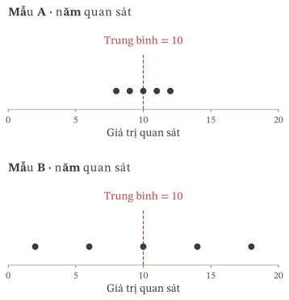
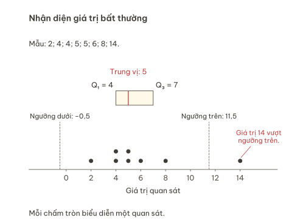
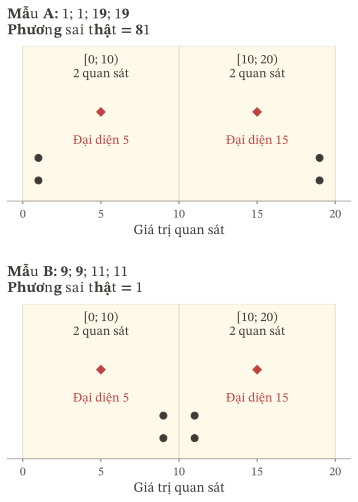

:::::::::::: {.zo-on-thi-package data-r1-title="Độ phân tán và so sánh dữ liệu" data-r1-code="R2-G02" data-r1-support-context="semantic" data-r1-lesson-count="5" data-r1-page-navigation="true"}

## Bắt đầu {#bat-dau}

Hai chuyến xe có cùng thời gian đi trung bình chưa chắc đem lại trải nghiệm giống nhau. Một chuyến thường mất gần $30$ phút; chuyến kia có hôm rất nhanh, có hôm rất chậm. Nếu chỉ biết trung bình, ta chưa biết thời gian từng ngày khác nhau đến mức nào.

Khoảng biến thiên, khoảng tứ phân vị, phương sai và độ lệch chuẩn giúp mô tả những mặt khác nhau của sự phân tán. Ta sẽ tìm hiểu ý nghĩa, cách tính và giới hạn của chúng, rồi dùng các số đo ấy cùng thông tin về trung tâm để so sánh dữ liệu.

**[Học xong, em cần làm được gì?]{#muc-tieu}**

::: {#r2g02-table-01 .table-scroll}
| Mục tiêu | Việc em cần làm được |
|---|---|
| Nhìn thấy điều số trung tâm chưa nói | Giải thích bằng hai mẫu cụ thể vì sao cùng trung bình chưa có nghĩa phân bố giống nhau. |
| Đo độ trải của mẫu gốc | Tính khoảng biến thiên, khoảng tứ phân vị; nhận diện giá trị bất thường theo quy tắc được nêu và giải thích việc cần kiểm tra thêm. |
| Đo phân tán quanh trung bình | Tính phương sai, độ lệch chuẩn trên danh sách và bảng tần số; giải thích mẫu số, đơn vị, trường hợp bằng $0$. |
| Làm việc với bảng nhóm | Tính bốn số đo từ bảng ghép nhóm; phân biệt số đo của bảng nhóm với số đo chính xác của mẫu gốc. |
| So sánh có căn cứ | Chọn số đo phù hợp; xử lí đổi đơn vị; viết kết luận đúng đối tượng, tiêu chí và phạm vi dữ liệu. |
:::

**Kiến thức cần có.** Biết sắp xếp số liệu, tìm trung bình và tứ phân vị, đọc khoảng, tần số và tần số tích lũy; biết bình phương và căn bậc hai. [Ôn nền](#on-nen) giúp kiểm lại thao tác đang thiếu. Phần trung bình và tứ phân vị được giải thích đầy đủ trong [Đọc dữ liệu và đo xu thế trung tâm](../r2_g01/index.qmd#bai-hoc).

**Chọn nơi bắt đầu.** Cần học hoặc học lại thì vào [Bài học](#bai-hoc); đã hiểu và muốn tự vận dụng thì vào [Luyện tập](#luyen-tap). Nếu đã chuẩn bị kĩ hoặc đủ tự tin, em có thể bắt đầu [Kiểm tra](#kiem-tra). [Ôn lại](#on-lai) dành cho việc tự huy động kiến thức sau khoảng trễ. Bỏ qua một phần chưa phải bằng chứng đã đạt mục tiêu của phần đó.

Lượt học chính dự kiến $5$–$6$ giờ, tùy kiến thức đã có; riêng Kiểm tra dự kiến $50$ phút trong một lượt. Đây là thời gian để lập kế hoạch, chưa gồm thời gian bổ sung nền và các lượt ôn. Có thể chia học và luyện thành nhiều buổi. Mỗi lượt Ôn lại dự kiến $20$–$30$ phút.

::: {#lich-on data-zo-review-calendar="prose"}

Em hoàn tất lượt chính khi các mục tiêu thiết yếu đã có bài làm tự lực phù hợp, các lỗi cản trở cách hiểu đã được xác nhận sau sửa, và đã hẹn ngày ôn. Giữ kết quả kiểm tra ban đầu riêng với phần làm sau hỗ trợ. Hẹn ôn sau khoảng [$2$–$3$ ngày](#luot1), [$7$ ngày](#luot2) và [$3$–$4$ tuần](#luot3) tính từ ngày hoàn tất lượt chính; điều chỉnh theo ngày thực tế và ghi rõ khoảng trễ đã trải qua.

:::

## Bài học {#bai-hoc}

::: {#dinh-huong .zo-lesson-intro}

Hai mẫu có cùng mức trung tâm có thể khác nhau thế nào, và dùng số đo nào để mô tả sự khác biệt ấy?

Ta sẽ bắt đầu từ những mẫu nhỏ để thấy từng giá trị tham gia vào số đo ra sao. Sau đó, khi chỉ còn bảng ghép nhóm, ta xem thông tin nào vẫn còn, thông tin nào phải thay bằng một cách ước lượng và kết luận nào được phép rút ra.

:::

::: {.lesson-toc}
:::

### Khởi động {#khoi-dong}

:::: {#nv01 .zo-learning-task data-zo-type="task" data-zo-task="R2G02-NV01" data-zo-function="function.warmup" data-zo-number="1" .zo-lesson-activity}

**[Nhiệm vụ 01]{.zo-activity-kind} — Kiểm lại những thao tác cần dùng**

a) Với mẫu $3;5;5;7;9$, tìm cỡ mẫu, trung bình, trung vị, tứ phân vị thứ nhất và thứ ba.

b) Một bảng có ba giá trị $2;4;6$ với tần số tương ứng $1;3;2$. Cỡ mẫu là bao nhiêu? Muốn tính trung bình có phải chia tổng $2+4+6$ cho $3$ không?

c) Tính $(-2)^2$ và căn bậc hai số học của $9$. Giá trị $10$ có thuộc khoảng $[5;10)$ không?

[Xem lời giải](#giai01). Nếu vướng tần số hoặc tứ phân vị, xem [Đọc mẫu và vị trí](#nen-doc); nếu vướng bình phương hoặc căn, xem [Phép tính cần dùng](#nen-tinh). Khi đã rõ thao tác, trở lại đây rồi tiếp tục.

::::

### 1. Cùng mức trung tâm, khác mức phân tán {#hoc-trung-tam data-zo-lesson="true"}

:::: {#gm01 .zo-learning-task data-zo-type="task" data-zo-task="R2G02-GM01" data-zo-function="function.guided_thinking" data-zo-number="1" .zo-lesson-activity}

**[Gợi mở 01]{.zo-activity-kind} — Một số trung bình có kể hết câu chuyện?**

Xét hai mẫu giả định:

$$
A:\ 8;9;10;11;12,\qquad B:\ 2;6;10;14;18.
$$

Trước khi tính, hãy hình dung vị trí của năm giá trị trong mỗi mẫu trên cùng một trục số. Những giá trị nào nằm gần $10$ hơn?

::::
<figure id="r2g02-cung_trung_tam" class="zo-statistical-figure" data-zo-role="context-illustration">

</figure>

Mỗi hàng có năm chấm. Vạch đứng tại $10$ chỉ trung bình chung; vị trí các chấm cho biết điều mà vạch ấy chưa mô tả. Tổng mỗi mẫu đều là $50$ và giá trị chính giữa đều là $10$, nên hai mẫu cùng trung bình, cùng trung vị. Tuy vậy, mẫu $A$ chỉ trải từ $8$ đến $12$, còn mẫu $B$ trải từ $2$ đến $18$.

Ta cần bổ sung một cách đo độ phân tán: mức độ các giá trị trải ra hoặc cách xa một vị trí trung tâm. Mỗi số đo chọn một phần thông tin khác nhau. Vì thế, trước câu “mẫu nào phân tán hơn?”, cần biết ta đang so sánh theo số đo nào và nhằm trả lời câu hỏi gì.

:::: {#nv02 .zo-learning-task data-zo-type="task" data-zo-task="R2G02-NV02" data-zo-function="function.self_check" data-zo-number="2" .zo-lesson-activity}

**[Nhiệm vụ 02]{.zo-activity-kind} — Trung bình còn thiếu thông tin gì?**

Tự kiểm hai số trung bình và hai trung vị ở trên. Viết một câu mô tả sự khác nhau của hai mẫu mà câu “cả hai có trung bình bằng $10$” chưa nói được. Chưa cần dùng công thức độ phân tán.

[Xem lời giải](#giai02).

::::

### 2. Đo độ trải bằng hai đầu mút và phần giữa {#hoc-khoang data-zo-lesson="true"}

::::::: {#khoảng-biến-thiên .zo-knowledge-section}

#### 2.1. Khoảng biến thiên

:::: {#gm02 .zo-learning-task data-zo-type="task" data-zo-task="R2G02-GM02" data-zo-function="function.guided_thinking" data-zo-number="2" .zo-lesson-activity}

**[Gợi mở 02]{.zo-activity-kind} — Biết hai đầu mút đã đủ chưa?**

Hai mẫu giả định $0;5;5;5;10$ và $0;0;5;10;10$ cùng có giá trị nhỏ nhất $0$, lớn nhất $10$. Những giá trị ở giữa hai đầu mút có được phân bố giống nhau không?

::::

Khoảng biến thiên của một mẫu không rỗng là

$$
R=x_{\max}-x_{\min}.
$$

Nó cho biết khoảng cách giữa hai giá trị xa nhau nhất của mẫu. Cả hai mẫu trong Gợi mở đều có $R=10$, nhưng mẫu thứ nhất có nhiều giá trị ở giữa hơn. Khoảng biến thiên dùng hai đầu mút và không ghi lại cách các giá trị còn lại phân bố.

:::::: {#vd01 .zo-learning-example data-zo-type="example" data-zo-unit="R2G02-VD01" .zo-lesson-activity}

**[Ví dụ 01]{.zo-activity-kind} — Một giá trị rất xa làm thay đổi khoảng biến thiên.** Mẫu giả định $4;5;5;6;7$ có $R=7-4=3$. Nếu thay riêng giá trị $7$ bằng $27$, khoảng biến thiên thành $27-4=23$, dù bốn giá trị còn lại giữ nguyên. Sự thay đổi lớn này báo rằng hai đầu mút đã xa nhau hơn; nó chưa nói phần lớn các giá trị đã giãn ra như thế nào.

::::::

:::::::

::::::: {#khoảng-tứ-phân-vị .zo-knowledge-section}

#### 2.2. Khoảng tứ phân vị

Để chú ý tới phần giữa, ta dùng các tứ phân vị $Q_1$ và $Q_3$. Với mẫu gốc có ít nhất hai quan sát, trước hết sắp xếp tăng dần. Quy ước đang dùng là: $Q_2$ là trung vị; $Q_1,Q_3$ là trung vị của nửa dưới và nửa trên, loại giá trị đứng chính giữa khỏi hai nửa khi cỡ mẫu lẻ.

Khoảng tứ phân vị là số

$$
\Delta_Q=Q_3-Q_1.
$$

Đây là độ dài khoảng từ $Q_1$ đến $Q_3$, không phải chính khoảng $[Q_1;Q_3]$. Nó mô tả độ trải của phần giữa theo thứ tự mẫu. Cách nói “phần giữa khoảng một nửa mẫu” không có nghĩa luôn đúng một nửa số quan sát nằm trong đoạn đóng $[Q_1;Q_3]$: các giá trị trùng nhau và quy ước tính tứ phân vị có thể làm số đếm khác đi.

:::::: {#vd02 .zo-learning-example data-zo-type="example" data-zo-unit="R2G02-VD02" .zo-lesson-activity}

**[Ví dụ 02]{.zo-activity-kind} — Tìm phần giữa.** Với mẫu giả định đã sắp xếp

$$
2;4;4;5;5;6;8;14,
$$

nửa dưới là $2;4;4;5$, nên $Q_1=\frac{4+4}{2}=4$. Nửa trên là $5;6;8;14$, nên $Q_3=\frac{6+8}{2}=7$. Do đó $\Delta_Q=3$, còn $R=12$.

Nếu chỉ đổi $14$ thành một giá trị lớn hơn $14$, hai vị trí dùng tính $Q_3$ vẫn mang giá trị $6$ và $8$: khoảng tứ phân vị giữ nguyên, trong khi khoảng biến thiên tăng. Điều đó giải thích vì sao khoảng tứ phân vị ít bị chi phối bởi một giá trị ở rất xa phần giữa. Đây không phải khẳng định nó bất biến trước mọi thay đổi dữ liệu.

::::::

:::::::

::::::: {#giá-trị-bất-thường-và-việc-kiểm-tra-dữ-liệu .zo-knowledge-section}

#### 2.3. Giá trị bất thường và việc kiểm tra dữ liệu

Một quy tắc phát hiện giá trị bất thường dùng hai ngưỡng

$$
L=Q_1-1{,}5\Delta_Q,\qquad U=Q_3+1{,}5\Delta_Q.
$$

Giá trị nhỏ hơn $L$ hoặc lớn hơn $U$ được xem là bất thường theo quy tắc này. Giá trị đúng bằng ngưỡng chưa bị đánh dấu. Ngưỡng là số tính từ mẫu, không nhất thiết là một giá trị quan sát.

Trong Ví dụ 02, $L=-0{,}5$ và $U=11{,}5$, nên $14$ bị đánh dấu. Có thể đó là lỗi nhập liệu, hoặc một quan sát hiếm nhưng đúng. Cần kiểm nguồn và điều kiện ghi nhận trước khi quyết định xử lí.

<figure id="r2g02-gia_tri_bat_thuong" class="zo-statistical-figure" data-zo-role="context-illustration">

</figure>

Hộp trải từ $Q_1$ đến $Q_3$; vạch trong hộp chỉ trung vị. Các chấm là số liệu. Hai vạch ngưỡng cho biết nơi bắt đầu cần kiểm tra theo quy tắc, không phải hai đầu mút thật của mẫu. Khi đọc một biểu đồ hộp khác, cần xem quy ước của hai đầu “râu”; có cách vẽ dùng các quan sát ngoài cùng chưa bị đánh dấu, có cách vẽ nhấn trực tiếp các ngưỡng.

::: {.zo-source-note}
Khoảng biến thiên, khoảng tứ phân vị và phát hiện giá trị bất thường được đối chiếu với Toán 10, Tập một — Kết nối tri thức với cuộc sống, Nhà xuất bản Giáo dục Việt Nam, Bài 14, trang 84–88. Hình minh họa phân biệt rõ ngưỡng tính toán với giá trị quan sát.
:::

:::: {#nv03 .zo-learning-task data-zo-type="task" data-zo-task="R2G02-NV03" data-zo-function="function.self_check" data-zo-number="3" .zo-lesson-activity}

**[Nhiệm vụ 03]{.zo-activity-kind} — Đánh dấu để kiểm tra**

Với mẫu ở Ví dụ 02, hãy tự tính lại $R,\Delta_Q,L,U$. Một bạn nói: “Xóa $14$ đi thì dữ liệu sẽ đúng hơn.” Em cần biết thêm điều gì trước khi chấp nhận việc xóa? Nếu chỉ đổi $14$ thành $24$, số đo nào trong $R,\Delta_Q$ thay đổi?

[Xem lời giải](#giai03). Đây là câu củng cố ngay sau ví dụ; không dùng nó làm bằng chứng độc lập của bài Kiểm tra.

::::

:::::::

### 3. Đo mức phân tán quanh số trung bình {#hoc-phuong-sai data-zo-lesson="true"}

::::::: {#vì-sao-không-cộng-trực-tiếp-các-độ-lệch .zo-knowledge-section}

#### 3.1. Vì sao không cộng trực tiếp các độ lệch?

:::: {#gm03 .zo-learning-task data-zo-type="task" data-zo-task="R2G02-GM03" data-zo-function="function.guided_thinking" data-zo-number="3" .zo-lesson-activity}

**[Gợi mở 03]{.zo-activity-kind} — Tổng bằng không có nghĩa là không phân tán?**

Mẫu giả định $2;4;6$ có trung bình $4$. Các độ lệch so với trung bình là $-2;0;2$, tổng bằng $0$. Nhưng ba giá trị rõ ràng không trùng nhau. Điều gì đã xảy ra trong phép cộng?

::::

Độ lệch có dấu cho biết giá trị nằm về bên nào của trung bình. Khi cộng, độ lệch âm và dương triệt tiêu nhau. Với mọi mẫu $x_1,\ldots,x_n$ có trung bình $\bar{x}$,

$$
\sum_{i=1}^{n}(x_i-\bar{x})
=\sum_{i=1}^{n}x_i-n\bar{x}=0.
$$

Vì vậy, tổng này không phân biệt được một mẫu tập trung với một mẫu trải rộng. Một cách giữ lại độ lớn của các độ lệch là bình phương chúng trước khi cộng.

:::::::

::::::: {#phương-sai .zo-knowledge-section}

#### 3.2. Phương sai

Với $n\ge1$, phương sai của mẫu là

$$
s^2=\frac{(x_1-\bar{x})^2+\cdots+(x_n-\bar{x})^2}{n}.
$$

Mỗi quan sát đóng góp một bình phương độ lệch; chia cho $n$ cho ta trung bình của những bình phương ấy. Giá trị càng cách xa trung bình thì đóng góp càng lớn, vì độ lệch đã được bình phương. Phương sai không phải bình phương của trung bình các độ lệch có dấu.

:::::: {#vd03 .zo-learning-example data-zo-type="example" data-zo-unit="R2G02-VD03" .zo-lesson-activity}

**[Ví dụ 03]{.zo-activity-kind} — Theo dõi từng đóng góp.** Mẫu giả định $2;4;6$ có các bình phương độ lệch là $4;0;4$, nên $s^2=\frac{8}{3}$. Nếu ba giá trị đều là $4$, mọi bình phương độ lệch bằng $0$, nên $s^2=0$.

::::::

Vì mỗi số hạng đều không âm, phương sai không âm. Phương sai bằng $0$ khi và chỉ khi mọi quan sát đều bằng trung bình, tức mọi giá trị trong mẫu bằng nhau. Điều này không đúng nếu thay phương sai bằng khoảng tứ phân vị: phần giữa có thể trùng nhau trong khi hai đầu vẫn khác.

Đôi khi việc tính thuận tiện hơn với công thức

$$
s^2=\frac{x_1^2+\cdots+x_n^2}{n}-\bar{x}^{\,2}.
$$

Thật vậy, khai triển $(x_i-\bar{x})^2=x_i^2-2x_i\bar{x}+\bar{x}^{\,2}$, cộng theo $i$ rồi dùng $\sum x_i=n\bar{x}$ cho công thức trên. Hai công thức cùng một số đo; công thức sau không có nghĩa lấy trung bình các bình phương rồi quên trừ $\bar{x}^{\,2}$.

:::::::

::::::: {#độ-lệch-chuẩn-đơn-vị-và-bảng-tần-số .zo-knowledge-section}

#### 3.3. Độ lệch chuẩn, đơn vị và bảng tần số

Độ lệch chuẩn là căn bậc hai số học của phương sai:

$$
s=\sqrt{s^2}.
$$

Nếu dữ liệu đo bằng phút, phương sai có đơn vị phút bình phương, còn độ lệch chuẩn có đơn vị phút. Lấy căn giúp đưa số đo về cùng đơn vị với dữ liệu. Độ lệch chuẩn mô tả độ lớn của sự phân tán quanh trung bình; nó không phải trung bình cộng của các khoảng cách tuyệt đối $|x_i-\bar{x}|$.

:::::: {#vd04 .zo-learning-example data-zo-type="example" data-zo-unit="R2G02-VD04" .zo-lesson-activity}

**[Ví dụ 04]{.zo-activity-kind} — Tần số là số lần đóng góp.** Một mẫu giả định có giá trị $1;3;5$ với tần số $2;4;2$. Có $n=8$ quan sát, trung bình bằng $3$. Hai quan sát mang giá trị $1$ đóng góp $2(1-3)^2$; bốn quan sát mang giá trị $3$ đóng góp $4(3-3)^2$; hai quan sát cuối đóng góp $2(5-3)^2$. Vì thế

$$
s^2=\frac{2(1-3)^2+4(3-3)^2+2(5-3)^2}{8}=2,\qquad s=\sqrt{2}.
$$

::::::

Với các giá trị $v_1,\ldots,v_k$ có tần số $f_1,\ldots,f_k$, đặt $n=\sum f_i>0$. Khi đó

$$
\bar{x}=\frac{\sum f_iv_i}{n},\qquad
s^2=\frac{\sum f_i(v_i-\bar{x})^2}{n}
=\frac{\sum f_iv_i^2}{n}-\bar{x}^{\,2}.
$$

Mẫu số là số quan sát, không phải số giá trị khác nhau hay số hàng của bảng. Khi mọi tần số cùng nhân với một số nguyên dương, cả tổng có trọng số lẫn cỡ mẫu cùng nhân với số ấy; trung bình, phương sai và độ lệch chuẩn theo các công thức trên giữ nguyên.

Một số máy tính hoặc phần mềm còn trả về độ lệch chuẩn với mẫu số $n-1$. Đó là số khác khi $n>1$ và phương sai khác $0$. Hãy kiểm công thức của kết quả đang chọn, thay vì chỉ dựa vào chữ “độ lệch chuẩn” trên màn hình. Các phép tính đang xét ở đây dùng trung bình bình phương độ lệch với mẫu số $n$.

::: {.zo-source-note}
Định nghĩa phương sai, độ lệch chuẩn và chú ý về mẫu số $n-1$ được đối chiếu với Toán 10, Tập một — Kết nối tri thức với cuộc sống, Nhà xuất bản Giáo dục Việt Nam, trang 86; công thức có tần số và dạng khai triển được đối chiếu thêm với Toán 12, Tập một cùng bộ sách, trang 80–81.
:::

:::: {#nv04 .zo-learning-task data-zo-type="task" data-zo-task="R2G02-NV04" data-zo-function="function.self_check" data-zo-number="4" .zo-lesson-activity}

**[Nhiệm vụ 04]{.zo-activity-kind} — Ba phép lấy trung bình khác nhau**

Với mẫu giả định $1;2;3;4;5$, tính trung bình mẫu, tổng độ lệch có dấu, phương sai và độ lệch chuẩn. Tính thêm trung bình các khoảng cách tuyệt đối tới trung bình. Hai số cuối có bằng nhau không?

[Xem lời giải](#giai04).

::::

:::::::

### 4. Khi chỉ còn bảng ghép nhóm {#hoc-ghep-nhom data-zo-lesson="true"}

:::: {#gm04 .zo-learning-task data-zo-type="task" data-zo-task="R2G02-GM04" data-zo-function="function.guided_thinking" data-zo-number="4" .zo-lesson-activity}

**[Gợi mở 04]{.zo-activity-kind} — Bảng còn giữ thông tin nào?**

Giả sử ta chỉ biết có hai giá trị thuộc $[0;10)$ và hai giá trị thuộc $[10;20)$. Có biết giá trị nhỏ nhất và lớn nhất thật sự là bao nhiêu không? Có biết mỗi giá trị cách trung bình bao xa không?

::::

Bảng giữ số quan sát trong từng khoảng, nhưng không giữ vị trí của từng giá trị bên trong khoảng. Để tính các số đặc trưng, ta phải quy định cách dùng những thông tin còn lại. Kết quả được tính xác định từ bảng theo quy tắc đó; khi dùng mô tả mẫu gốc, nó mang ý nghĩa xấp xỉ.

::::::: {#khoảng-biến-thiên-của-mẫu-ghép-nhóm .zo-knowledge-section}

#### 4.1. Khoảng biến thiên của mẫu ghép nhóm

Lấy đầu trái của nhóm đầu tiên có tần số dương và đầu phải của nhóm cuối cùng có tần số dương. Hiệu hai biên ấy là khoảng biến thiên của mẫu ghép nhóm. Các nhóm trống ở ngoài cùng không mở rộng phạm vi của dữ liệu thực sự có.

:::::: {#vd05 .zo-learning-example data-zo-type="example" data-zo-unit="R2G02-VD05" .zo-lesson-activity}

**[Ví dụ 05]{.zo-activity-kind} — Đầu mút của nhóm không phải quan sát nhỏ nhất, lớn nhất.** Một bảng giả định có các nhóm $[0;5),[5;10),[10;15),[15;20)$ với tần số $0;3;4;0$. Nhóm đầu có số liệu bắt đầu tại $5$, nhóm cuối có số liệu kết thúc tại $15$, nên khoảng biến thiên của mẫu ghép nhóm là $15-5=10$.

Với các nhóm nửa kín này, giá trị nhỏ nhất của mẫu gốc ít nhất bằng $5$, còn giá trị lớn nhất nhỏ hơn $15$. Vì vậy khoảng biến thiên thật của mẫu gốc nhỏ hơn $10$. Bảng chưa cho biết nó chính xác bằng bao nhiêu. Không thay các biên này bằng trung điểm để tính khoảng biến thiên của mẫu ghép nhóm.

::::::

:::::::

::::::: {#khoảng-tứ-phân-vị-từ-bảng-nhóm .zo-knowledge-section}

#### 4.2. Khoảng tứ phân vị từ bảng nhóm

Khi còn mẫu gốc, ta tìm tứ phân vị qua các vị trí trong dãy đã sắp xếp. Khi chỉ còn bảng nhóm, vị trí bên trong từng nhóm không được biết. Quy tắc ước lượng phân bổ tần số đều trên độ rộng của nhóm chứa tứ phân vị, rồi dùng tỉ lệ tần số để xác định phần độ rộng tính từ đầu trái.

Với $k=1$ hoặc $k=3$, mốc cần tìm là $\frac{kn}{4}$. Nếu nhóm chứa mốc này có đầu trái $L$, độ rộng $h>0$, tần số $f>0$ và tần số tích lũy trước nhóm là $F$, thì

$$
Q_k=L+\frac{\frac{kn}{4}-F}{f}h.
$$

Chọn nhóm có tần số dương đầu tiên mà tần số tích lũy đạt hoặc vượt $\frac{kn}{4}$. Khi mốc đúng bằng tần số tích lũy cuối nhóm, công thức cho biên phải; với các nhóm kề nhau, tính từ nhóm kế tiếp có số liệu ngay sát biên cũng cho cùng kết quả. Nếu có khoảng nhóm trống ngăn cách đúng tại mốc, phải làm rõ quy ước ước lượng; bảng không cho một vị trí tự nhiên duy nhất trong khoảng trống ấy.

:::::: {#vd06 .zo-learning-example data-zo-type="example" data-zo-unit="R2G02-VD06" .zo-lesson-activity}

**[Ví dụ 06]{.zo-activity-kind} — Ước lượng hai tứ phân vị.** Một bảng giả định ghi thời gian xử lí, tính bằng phút:

::: {#r2g02-table-02 .table-scroll}
| Thời gian | $[0;10)$ | $[10;20)$ | $[20;30)$ |
|---|---:|---:|---:|
| Số lượt | $2$ | $4$ | $2$ |
:::

Có $n=8$ lượt. Mốc $\frac n4=2$ nằm ở cuối nhóm đầu: $Q_1=0+\frac{2-0}{2}\cdot10=10$. Mốc $\frac{3n}{4}=6$ nằm ở cuối nhóm thứ hai: $Q_3=10+\frac{6-2}{4}\cdot10=20$. Khoảng tứ phân vị của mẫu ghép nhóm là $20-10=10$ phút.

Các giá trị $10$ và $20$ đến từ quy tắc nội suy, không khẳng định rằng trong mẫu gốc có hai quan sát đúng bằng chúng. Nếu biết thêm mẫu gốc, ta phải tính lại tứ phân vị từ mẫu ấy để có kết quả theo quy ước dành cho mẫu gốc.

::::::

:::::::

::::::: {#phương-sai-khi-thay-bằng-trung-điểm-nhóm .zo-knowledge-section}

#### 4.3. Phương sai khi thay bằng trung điểm nhóm

Với nhóm $[a_i;a_{i+1})$, dùng trung điểm

$$
m_i=\frac{a_i+a_{i+1}}{2}
$$

làm giá trị đại diện cho các quan sát trong nhóm. Nếu tần số nhóm là $f_i$, ta coi có $f_i$ bản sao của $m_i$ khi tính. Do đó

$$
\bar{x}_g=\frac{\sum f_im_i}{n},\qquad
s_g^2=\frac{\sum f_i(m_i-\bar{x}_g)^2}{n},\qquad
s_g=\sqrt{s_g^2}.
$$

Chỉ số $g$ nhắc rằng các số này được tính từ bảng ghép nhóm. Nó giúp phân biệt chúng với trung bình và phương sai thật khi ta đồng thời có mẫu gốc. Trong mỗi số hạng, trung điểm phải được so với chính trung bình có trọng số của các trung điểm.

:::::: {#vd07 .zo-learning-example data-zo-type="example" data-zo-unit="R2G02-VD07" .zo-lesson-activity}

**[Ví dụ 07]{.zo-activity-kind} — Tính từ ba nhóm.** Với bảng trong Ví dụ 06, trung điểm là $5;15;25$ phút, nên

$$
\bar{x}_g=\frac{2\cdot5+4\cdot15+2\cdot25}{8}=15,
$$
$$
s_g^2=\frac{2(5-15)^2+4(15-15)^2+2(25-15)^2}{8}=50.
$$

Phương sai là $50$ phút bình phương; độ lệch chuẩn là $\sqrt{50}\approx7{,}07$ phút. Số đo này dùng các trung điểm thay cho những thời gian chưa biết bên trong nhóm.

::::::

Việc thay thế có thể làm số đo cao hơn hoặc thấp hơn số đo thật. Chẳng hạn, hai mẫu giả định $1;1;19;19$ và $9;9;11;11$ đều có hai giá trị trong mỗi nhóm $[0;10),[10;20)$, cùng trung bình $10$. Phương sai thật lần lượt là $81$ và $1$. Bảng nhóm chung dùng trung điểm $5;15$, cho phương sai $25$.

<figure id="r2g02-cung_bang_nhom" class="zo-statistical-figure" data-zo-role="context-illustration">

</figure>

Các chấm tròn biểu diễn quan sát; dấu đại diện đặt ở trung điểm cho biết vị trí thay thế trong phép tính từ bảng. Cùng một bảng nhóm không thể khôi phục sự khác nhau giữa hai mẫu. Không có căn cứ để luôn coi phương sai ghép nhóm là lớn hơn hoặc luôn nhỏ hơn phương sai mẫu gốc.

::: {.zo-source-note}
Khoảng biến thiên và khoảng tứ phân vị ghép nhóm được đối chiếu với Toán 12, Tập một — Kết nối tri thức với cuộc sống, Nhà xuất bản Giáo dục Việt Nam, Bài 9, trang 75–79. Phương sai, độ lệch chuẩn và ý nghĩa xấp xỉ được đối chiếu với Bài 10, trang 80–81. Các phản ví dụ ở đây do ZO Math xây dựng và tính trực tiếp.
:::

:::: {#nv05 .zo-learning-task data-zo-type="task" data-zo-task="R2G02-NV05" data-zo-function="function.self_check" data-zo-number="5" .zo-lesson-activity}

**[Nhiệm vụ 05]{.zo-activity-kind} — Số đo nào đang được tính?**

Từ bảng ở Ví dụ 06, tự tính bốn số đo độ phân tán. Với mỗi số đo, ghi đơn vị và giải thích vì sao nó chưa xác định số đo chính xác của mẫu gốc. Nếu nhập máy tính, em nhập ba trung điểm với tần số nào và dùng cỡ mẫu nào?

[Xem lời giải](#giai05).

::::

:::::::

### 5. Chọn thước đo và viết kết luận {#hoc-so-sanh data-zo-lesson="true"}

:::: {#gm05 .zo-learning-task data-zo-type="task" data-zo-task="R2G02-GM05" data-zo-function="function.guided_thinking" data-zo-number="5" .zo-lesson-activity}

**[Gợi mở 05]{.zo-activity-kind} — Ít phân tán hơn có luôn tốt hơn?**

Giả sử hai cân dùng để đo một vật chuẩn $100$ g. Cân thứ nhất luôn báo $103$ g, cân thứ hai cho các giá trị gần $100$ g nhưng không hoàn toàn trùng nhau. Cân nào cho kết quả lặp lại ổn định hơn? Câu trả lời ấy đã cho biết cân nào gần chuẩn hơn chưa?

::::

::::::: {#chọn-số-đo-theo-điều-cần-biết .zo-knowledge-section}

#### 5.1. Chọn số đo theo điều cần biết

::: {#r2g02-table-03 .table-scroll}
| Điều cần mô tả | Số đo có thể dùng | Cần đọc kèm |
|---|---|---|
| Độ trải giữa hai đầu mút quan sát | Khoảng biến thiên | Giá trị cực đoan, cỡ mẫu và việc hai đầu mút có đúng hay không. |
| Độ trải phần giữa theo thứ tự mẫu | Khoảng tứ phân vị | Tứ phân vị, dạng phân bố và quy ước tính. |
| Phân tán quanh trung bình, có dùng mọi quan sát | Phương sai hoặc độ lệch chuẩn | Trung bình, đơn vị, các giá trị xa trung tâm, mức ghép nhóm. |
:::

Không nhất thiết phải tính đủ bốn số đo trong mọi bài. Câu hỏi về toàn bộ biên độ, phần giữa hay độ lệch quanh trung bình có thể cần những số đo khác nhau. Nếu hai số đo cho những thứ tự khác nhau giữa hai mẫu, hãy giải thích chúng đang nhìn vào phần thông tin nào; không tự chọn số có lợi cho kết luận muốn có.

Trước so sánh, kiểm đối tượng, đại lượng, đơn vị và điều kiện quan sát có tương ứng không. Độ lệch chuẩn theo milimét không thể so trực tiếp với độ lệch chuẩn theo xentimét. Các mẫu có mức trung bình rất khác nhau cũng không tự cho phép kết luận về “ổn định tương đối” chỉ từ độ lệch chuẩn tuyệt đối.

:::::::

::::::: {#cộng-cùng-một-số-và-đổi-đơn-vị .zo-knowledge-section}

#### 5.2. Cộng cùng một số và đổi đơn vị

Nếu thay từng giá trị $x_i$ bằng $y_i=x_i+b$, trung bình mới là $\bar{y}=\bar{x}+b$. Mỗi độ lệch mới bằng

$$
y_i-\bar{y}=(x_i+b)-(\bar{x}+b)=x_i-\bar{x}.
$$

Vì vậy phương sai và độ lệch chuẩn không đổi. Hai đầu mút và hai tứ phân vị cùng dịch thêm $b$, nên các hiệu $R,\Delta_Q$ cũng không đổi.

Nếu nhân từng giá trị với $a>0$, thứ tự được giữ; các độ lệch và các khoảng cách đều nhân với $a$. Do đó $R,\Delta_Q,s$ nhân với $a$, còn $s^2$ nhân với $a^2$. Điều kiện $a>0$ ở đây giữ nguyên thứ tự khi nói về các tứ phân vị; với đổi đơn vị thông thường như xentimét sang milimét, hệ số này là dương.

:::::: {#vd08 .zo-learning-example data-zo-type="example" data-zo-unit="R2G02-VD08" .zo-lesson-activity}

**[Ví dụ 08]{.zo-activity-kind} — Đổi đơn vị chiều dài.** Một mẫu chiều dài có độ lệch chuẩn $0{,}4$ cm và phương sai $0{,}16$ cm bình phương. Khi đổi sang milimét, mọi giá trị nhân với $10$: độ lệch chuẩn là $4$ mm, còn phương sai là $16$ mm bình phương. Không nhân cả hai số đo với cùng một hệ số.

::::::

:::::::

::::::: {#viết-câu-kết-luận-đủ-căn-cứ .zo-knowledge-section}

#### 5.3. Viết câu kết luận đủ căn cứ

Một câu kết luận cần nói rõ mẫu nào, đại lượng nào, số đo nào và điều nó cho thấy. Chẳng hạn: “Trong hai mẫu thời gian quan sát, tuyến $A$ có độ lệch chuẩn nhỏ hơn nên thời gian ít phân tán quanh trung bình của tuyến ấy hơn.” Nếu muốn chọn tuyến nhanh hơn, còn phải xem thời gian trung bình hoặc tiêu chí về thời gian chờ.

Độ lệch chuẩn nhỏ không bảo đảm mỗi quan sát đều gần trung bình; không tự cho biết tỉ lệ nằm trong một khoảng cố định quanh trung bình khi chưa có thông tin về phân bố. Nó cũng không chứng minh độ đúng so với chuẩn hay nguyên nhân của sự khác biệt. Những kết luận về toàn bộ quần thể hoặc tương lai cần thêm căn cứ về cách lấy mẫu và điều kiện áp dụng.

:::: {#nv06 .zo-learning-task data-zo-type="task" data-zo-task="R2G02-NV06" data-zo-function="function.self_check" data-zo-number="6" .zo-lesson-activity}

**[Nhiệm vụ 06]{.zo-activity-kind} — Viết lại một nhận xét**

Hai mẫu thời gian giao hàng giả định được đo bằng phút. Mẫu $A$ có trung bình $30$, độ lệch chuẩn $2$; mẫu $B$ có trung bình $35$, độ lệch chuẩn $1$. Một người kết luận: “$B$ tốt hơn vì độ lệch chuẩn nhỏ hơn.” Hãy viết hai nhận xét riêng về thời gian trung bình và độ phân tán. Muốn chọn dịch vụ còn cần nêu tiêu chí gì?

[Xem lời giải](#giai06).

::::

:::::::

### Khép lại Bài học

Hãy tự giải thích: vì sao hai mẫu cùng trung bình có thể khác độ phân tán; vì sao tổng độ lệch có dấu không đo được độ phân tán; vì sao độ lệch chuẩn có cùng đơn vị với dữ liệu; và vì sao một bảng nhóm không xác định lại được mọi số đo của mẫu gốc. Nếu còn phải dựa vào khẩu quyết mà chưa giải thích được, trở lại đúng mục liên quan trước khi tự luyện.

## Luyện tập {#phieu-luyen}

[]{#luyen-tap}

Tự làm từng chặng rồi đối chiếu. Nếu cần xem lại Bài học hoặc Ôn nền, ghi chỗ đã dùng hỗ trợ; sau đó trở về nhiệm vụ đang làm. Nhiệm vụ đã xem lời giải có thể dùng để học nhưng không trở lại thành câu mới chỉ vì làm lại vào ngày khác.

### Chặng 1 — Đọc và tính trên mẫu gốc {#chang1 data-zo-context="stage:1"}

Mục tiêu: tính đúng các số đo và giải thích phần thông tin mỗi số sử dụng.

:::: {#nv07 .zo-learning-task data-zo-type="task" data-zo-task="R2G02-NV07" data-zo-function="function.practice" data-zo-number="7"}

#### Nhiệm vụ 07 — Độ dài cánh bơi của chim Adélie

Dưới đây là độ dài cánh bơi, tính bằng mm, của mười quan sát có số đo đầu tiên thuộc loài chim cánh cụt Adélie năm 2007 trong bộ Palmer Penguins:

$$
181;186;195;193;190;181;195;193;190;186.
$$

Một dòng thiếu số đo đã được bỏ khỏi phép tính; không thay ô thiếu bằng $0$. Đây là mẫu trích theo thứ tự lưu, không được coi là mẫu ngẫu nhiên đại diện cho toàn loài.

a) Tìm trung bình, $R,Q_1,Q_3,\Delta_Q$.

b) Tính phương sai và độ lệch chuẩn, ghi đúng đơn vị. Giữ đủ chữ số khi tính và làm tròn độ lệch chuẩn đến hàng phần trăm.

c) Kiểm giá trị bất thường bằng quy tắc tứ phân vị. Viết một câu mô tả độ phân tán của mười quan sát; nêu một kết luận về toàn loài mà mẫu trích này chưa đủ bảo đảm.

::: {.zo-source-note}
Dữ liệu Palmer Penguins do Allison Horst, Alison Hill và Kristen Gorman cung cấp; số đo gốc được thu thập bởi Kristen Gorman và chương trình Palmer Station Antarctica LTER. Dùng các dòng dữ liệu 1, 2, 3, 5–11, cột độ dài cánh bơi, của bản nguồn đã đăng ký trong Đọc dữ liệu và đo xu thế trung tâm. Dòng 4 thiếu số đo; giấy phép dữ liệu CC0. Nguồn và cách trích được ghi cuối tài liệu.
:::

[Xem lời giải](#giai07).

::::

:::: {#nv08 .zo-learning-task data-zo-type="task" data-zo-task="R2G02-NV08" data-zo-function="function.practice" data-zo-number="8"}

#### Nhiệm vụ 08 — Cùng trung bình và khoảng biến thiên

Hai mẫu giả định $A:4;5;6;7;8$ và $B:4;6;6;6;8$.

a) So sánh trung bình và khoảng biến thiên.

b) Tính khoảng tứ phân vị và phương sai của mỗi mẫu. Giải thích vì sao kết quả ở ý a chưa đủ để coi hai mẫu phân tán giống nhau.

[Xem lời giải](#giai08).

::::

#### Điểm dừng 01 — Đã phân biệt các số đo chưa? {#dung01 .r1-checkpoint data-zo-type="checkpoint" data-r1-return-label="Điểm dừng 01 — Luyện tập, chặng 1"}

Đối chiếu cách sắp xếp, cỡ mẫu, tứ phân vị, mẫu số phương sai và đơn vị. Nếu nhầm phần thông tin của số đo, xem [mục 2](#hoc-khoang) rồi tự làm [Nhiệm vụ 22 — Cùng hai đầu mút](#nv22) nếu chưa gặp. Nếu nhầm bình phương/căn hoặc tần số, dùng đúng [Nhiệm vụ 23](#nv23) hoặc [24](#nv24). Bài sửa đạt chỉ xác nhận điểm vừa sửa; trở lại kiểm các mục tiêu còn lại của chặng.

### Chặng 2 — Tính từ bảng nhóm và hiểu phần chưa biết {#chang2 data-zo-context="stage:2"}

Mục tiêu: tính theo đúng biên nhóm, tần số và đại diện; phân biệt số đo từ bảng với số đo mẫu gốc.

:::: {#nv09 .zo-learning-task data-zo-type="task" data-zo-task="R2G02-NV09" data-zo-function="function.practice" data-zo-number="9"}

#### Nhiệm vụ 09 — Hai nhóm ngoài cùng không có số liệu

Một bảng giả định ghi thời gian hoàn thành công việc, tính bằng phút:

::: {#r2g02-table-04 .table-scroll}
| Thời gian | $[0;5)$ | $[5;10)$ | $[10;15)$ | $[15;20)$ | $[20;25)$ |
|---|---:|---:|---:|---:|---:|
| Số lượt | $0$ | $3$ | $6$ | $3$ | $0$ |
:::

Tính cỡ mẫu, trung bình và bốn số đo độ phân tán của mẫu ghép nhóm. Giải thích cách xử lí hai nhóm trống khi tìm khoảng biến thiên. Có xác định được khoảng biến thiên thật của mẫu gốc không?

[Xem lời giải](#giai09).

::::

:::: {#nv10 .zo-learning-task data-zo-type="task" data-zo-task="R2G02-NV10" data-zo-function="function.practice" data-zo-number="10"}

#### Nhiệm vụ 10 — Một bảng nhóm, hai khả năng

Hai mẫu giả định $A:2;2;18;18$ và $B:8;8;12;12$ được ghép vào các nhóm $[0;10)$ và $[10;20)$.

a) Lập bảng nhóm, tính phương sai thật của mỗi mẫu và phương sai từ bảng nhóm.

b) Phản bác cả hai khẳng định: “Ghép nhóm luôn làm phương sai tăng” và “Ghép nhóm luôn làm phương sai giảm”.

[Xem lời giải](#giai10).

::::

#### Điểm dừng 02 — Đã giữ đúng mức ước lượng chưa? {#dung02 .r1-checkpoint data-zo-type="checkpoint" data-r1-return-label="Điểm dừng 02 — Luyện tập, chặng 2"}

Cần tính đúng ở Nhiệm vụ 09 và dùng hai khả năng trong Nhiệm vụ 10 để giải thích điều bảng nhóm không xác định. Nếu nhầm biên hoặc coi kết quả là chính xác của mẫu gốc, xem [mục 4](#hoc-ghep-nhom), rồi dùng [Nhiệm vụ 25 — Bảng không giữ vị trí từng giá trị](#nv25) nếu còn mới. Nếu chỉ sai một phép tính, sửa phép tính và kiểm lại kết luận; không bỏ qua lỗi ý nghĩa vì đã bấm được đáp số.

### Chặng 3 — Đơn vị và kết luận {#chang3 data-zo-context="stage:3"}

Mục tiêu: so sánh bằng tiêu chí phù hợp và giữ đúng đơn vị.

:::: {#nv11 .zo-learning-task data-zo-type="task" data-zo-task="R2G02-NV11" data-zo-function="function.practice" data-zo-number="11"}

#### Nhiệm vụ 11 — Xentimét hay milimét?

Một mẫu chiều dài có trung bình $16$ cm, độ lệch chuẩn $0{,}4$ cm.

a) Tính phương sai theo cm, rồi đổi trung bình, phương sai và độ lệch chuẩn sang đơn vị mm.

b) Sau khi đổi sang mm, cộng $5$ mm vào từng giá trị. Ba số đo vừa nêu thay đổi thế nào? Giải thích qua độ lệch so với trung bình.

[Xem lời giải](#giai11).

::::

:::: {#nv12 .zo-learning-task data-zo-type="task" data-zo-task="R2G02-NV12" data-zo-function="function.practice" data-zo-number="12"}

#### Nhiệm vụ 12 — Lặp lại ổn định và gần chuẩn

Đo một vật chuẩn $100$ g, hai cân giả định cho các kết quả:

$$
A:\ 103;103;103,\qquad B:\ 99;100;101.
$$

So sánh trung bình, phương sai và khoảng cách từ trung bình đến chuẩn. Giải thích vì sao câu “cân có phương sai nhỏ hơn thì đo đúng hơn” chưa hợp lí.

[Xem lời giải](#giai12).

::::

#### Điểm dừng 03 — Câu kết luận có nói đúng điều đã đo? {#dung03 .r1-checkpoint data-zo-type="checkpoint" data-r1-return-label="Điểm dừng 03 — Luyện tập, chặng 3"}

Đọc lại đơn vị của phương sai và độ lệch chuẩn; trong câu kết luận, chỉ rõ đang nói sự phân tán, độ gần chuẩn hay giá trị trung bình. Nếu nhầm đổi đơn vị, dùng [Nhiệm vụ 27](#nv27). Nếu suy “ít phân tán hơn” thành “tốt hơn”, dùng [Nhiệm vụ 28](#nv28). Chỉ dùng câu chưa gặp để xác nhận sau sửa. Khi các mục tiêu đã rõ, có thể vào [Kiểm tra](#kiem-tra); chưa rõ thì tiếp tục phần cần thiết.

## Kiểm tra {#tu-kiem-tra}

[]{#kiem-tra}

Em có thể bắt đầu khi đã chuẩn bị kĩ hoặc đủ tự tin. Dự kiến $50$ phút, làm liền mạch trong một lượt; dùng máy tính cho phép tính số, trình bày căn cứ và kết luận. Không mở Bài học, Ôn nền, Lời giải hoặc Sửa lỗi khi đang làm. Nếu cần trợ giúp, kết thúc lượt tại đó, giữ bài làm ban đầu và ghi riêng phần sau hỗ trợ. Thang điểm đề xuất là $10$ điểm; đọc kết quả theo mục tiêu bên cạnh tổng điểm.

Các bảng và số đo ở phần này đều là giả định. Khi cần, làm tròn kết quả cuối đến hàng phần trăm; không làm tròn sớm các bước trung gian.

:::: {#nv13 .zo-learning-task data-zo-type="task" data-zo-task="R2G02-NV13" data-zo-function="function.test" data-zo-number="13"}

### Nhiệm vụ 13 — Thời gian chuẩn bị một đơn hàng

Tám lần quan sát cho thời gian, tính bằng phút:

$$
6;7;7;8;8;9;9;18.
$$

a) Tính trung bình, khoảng biến thiên và khoảng tứ phân vị.

b) Tính phương sai, độ lệch chuẩn và ghi đơn vị.

c) Kiểm giá trị bất thường bằng quy tắc tứ phân vị. Một nhân viên muốn loại ngay giá trị bị đánh dấu: hãy nêu việc cần làm trước khi quyết định.

::::

:::: {#nv14 .zo-learning-task data-zo-type="task" data-zo-task="R2G02-NV14" data-zo-function="function.test" data-zo-number="14"}

### Nhiệm vụ 14 — Chỉ còn bảng thời gian

Thời gian dùng một thiết bị, tính bằng phút, được ghi thành bảng:

::: {#r2g02-table-05 .table-scroll}
| Thời gian | $[10;20)$ | $[20;30)$ | $[30;40)$ | $[40;50)$ |
|---|---:|---:|---:|---:|
| Số lượt | $2$ | $6$ | $8$ | $4$ |
:::

a) Tính khoảng biến thiên và khoảng tứ phân vị của mẫu ghép nhóm.

b) Tính trung bình, phương sai, độ lệch chuẩn từ bảng.

c) Một báo cáo viết: “Độ lệch chuẩn chính xác của các thời gian gốc bằng kết quả vừa tính.” Hãy đánh giá câu này và giải thích.

::::

:::: {#nv15 .zo-learning-task data-zo-type="task" data-zo-task="R2G02-NV15" data-zo-function="function.test" data-zo-number="15"}

### Nhiệm vụ 15 — Đúng hay sai, vì sao?

Với mẫu không rỗng hoặc bảng có tổng tần số dương, xét các khẳng định:

a) Nhân mọi tần số với $2$ thì phương sai tính với mẫu số là tổng tần số giữ nguyên.

b) Cộng $3$ vào mọi giá trị thì phương sai tăng thêm $9$.

c) Phương sai bằng $0$ thì mọi giá trị của mẫu bằng nhau.

d) Từ bảng ghép nhóm luôn xác định được chính xác khoảng biến thiên của mẫu gốc.

e) Hai mẫu $0;2;4$ và $1;2;3$ có cùng trung bình nên cùng phương sai.

Nêu lí do hoặc phản ví dụ cho từng ý.

::::

:::: {#nv16 .zo-learning-task data-zo-type="task" data-zo-task="R2G02-NV16" data-zo-function="function.test" data-zo-number="16"}

### Nhiệm vụ 16 — Nhanh hơn hay ít biến động hơn?

Hai quy trình xử lí cùng loại yêu cầu có kết quả thống kê trên hai mẫu quan sát bằng phút:

::: {#r2g02-table-06 .table-scroll}
| Quy trình | Trung bình | Độ lệch chuẩn |
|---|---:|---:|
| $A$ | $12$ | $0{,}3$ |
| $B$ | $13$ | $0{,}1$ |
:::

a) So sánh thời gian trung bình và mức phân tán quanh trung bình.

b) Chỉ từ bảng này, có thể khẳng định mọi lượt của $A$ đều nhanh hơn mọi lượt của $B$ không?

c) Viết một câu lựa chọn có điều kiện theo tiêu chí mà em nêu rõ.

::::

### Điểm dừng 04 — Đọc kết quả sau khi kết thúc lượt {#dung04 .r1-checkpoint data-zo-type="checkpoint" data-r1-return-label="Điểm dừng 04 — sau Kiểm tra"}

Giữ bài làm ban đầu, rồi mở [Xem lời giải](#giai13). Nếu đã nhận trợ giúp giữa lượt, ghi rõ giới hạn phần tự lực. Không cộng điểm của bài chữa vào điểm ban đầu.

Đối chiếu từng nhiệm vụ sau khi kết thúc lượt: Nhiệm vụ 13: [Xem lời giải](#giai13), Nhiệm vụ 14: [Xem lời giải](#giai14), Nhiệm vụ 15: [Xem lời giải](#giai15), Nhiệm vụ 16: [Xem lời giải](#giai16).

::: {#r2g02-table-07 .table-scroll}
| Mục tiêu cần xác nhận | Bằng chứng | Tiêu chí | Nếu còn vướng |
|---|---|---|---|
| Cùng trung tâm chưa có nghĩa cùng phân tán | [Nhiệm vụ 15e](#nv15)| Tính hoặc chỉ ra độ lệch của hai mẫu để bác suy luận từ trung bình. | [Mục 1](#hoc-trung-tam); [Nhiệm vụ 22](#nv22). |
| Tính và đọc độ trải mẫu gốc | [Nhiệm vụ 13a,c](#nv13)| Tứ phân vị đúng; phát hiện bất thường đi kèm kiểm nguồn, không tự xóa. | Mục 2; Nhiệm vụ 26 hoặc 29. |
| Phương sai và độ lệch chuẩn | [Nhiệm vụ 13b](#nv13), [15a,c](#nv15)| Mẫu số, căn, đơn vị và lí do đúng. | Mục 3; Nhiệm vụ 23 hoặc 24. |
| Tính và hiểu bảng nhóm | [Nhiệm vụ 14](#nv14), [15d](#nv15)| Đúng biên, tần số, trung điểm, tứ phân vị; nêu mức xấp xỉ. | Mục 4; Nhiệm vụ 25. |
| Biến đổi và đơn vị | [Nhiệm vụ 13b](#nv13), [15b](#nv15)| Không nhầm đơn vị hoặc ảnh hưởng của phép cộng. | Mục 5.2; Nhiệm vụ 27. |
| So sánh có điều kiện | [Nhiệm vụ 16](#nv16)| Phân biệt tốc độ trung bình, phân tán và từng lượt; nêu tiêu chí. | Mục 5; Nhiệm vụ 28. |
:::

Một lỗi tính riêng lẻ cần được sửa và kiểm ảnh hưởng. Nếu còn nhầm cỡ mẫu, độ lệch chuẩn với khoảng cách trung bình, giá trị nhóm với mẫu gốc hoặc ý nghĩa kết luận, mục tiêu tương ứng chưa được xác nhận. Chọn đúng tuyến [Sửa lỗi](#sua-loi), tự làm câu phù hợp còn mới, rồi trở lại Điểm dừng này. Nếu câu đã gặp, không tính lại thành bằng chứng mới; ghi mục tiêu chưa xác nhận.

Khi đủ bằng chứng cho các mục tiêu thiết yếu, ghi ngày hoàn tất lượt chính và hẹn [Ôn lại](#on-lai). Một kết quả sau sửa chỉ xác nhận nội dung được thử, không chứng nhận toàn bộ gói hoặc độ bền sau khoảng trễ.

## Ôn lại {#on-lai}

Ghi ngày thực và số ngày từ khi hoàn tất lượt chính. Chọn lượt phù hợp; tự làm trước khi xem lời giải. Đề cung cấp dữ kiện cần hiểu tình huống, còn việc chọn công thức và cách giải do em tự huy động. Nếu cần hỗ trợ sau lần tự làm, giữ riêng hai phần. Không làm trước nhiệm vụ của lượt sau để bù thiếu bằng chứng cho lượt hiện tại.

### Lượt 1 — Sau khoảng 2–3 ngày {#luot1 data-zo-context="round:1"}

:::: {#nv17 .zo-learning-task data-zo-type="task" data-zo-task="R2G02-NV17" data-zo-function="function.review" data-zo-number="17"}

#### Nhiệm vụ 17 — Thời gian đi bộ tới điểm hẹn

Sáu thời gian giả định, tính bằng phút, là $3;4;5;6;7;11$. Tính trung bình và bốn số đo độ phân tán. Kiểm giá trị bất thường theo quy tắc tứ phân vị. Viết một câu giải thích vì sao khoảng biến thiên và khoảng tứ phân vị khác nhau.

Nếu mỗi thời gian đều tăng thêm $5$ phút, hãy dự đoán bốn số đo độ phân tán có thay đổi không. Giải thích bằng vị trí các giá trị và độ lệch quanh trung bình, không tính lại từng số đo.

[Xem lời giải](#giai17).

::::

#### Điểm dừng 05 {#dung05 .r1-checkpoint data-zo-type="checkpoint" data-r1-return-label="Điểm dừng 05 — Ôn lại, lượt 1"}

Lượt này lấy mẫu khả năng tính, phân biệt các số đo trên mẫu gốc và đọc giá trị bất thường. Nếu cần sửa, dùng mục 2–3 và đúng câu trong Sửa lỗi còn mới, rồi quay về đây. Ghi rõ phần tự huy động và phần sau hỗ trợ; chưa dùng lượt này để xác nhận bảng ghép nhóm.

### Lượt 2 — Sau khoảng 7 ngày {#luot2 data-zo-context="round:2"}

:::: {#nv18 .zo-learning-task data-zo-type="task" data-zo-task="R2G02-NV18" data-zo-function="function.review" data-zo-number="18"}

#### Nhiệm vụ 18 — Thời gian chờ nhận hàng

Bảng giả định ghi số phút chờ:

::: {#r2g02-table-08 .table-scroll}
| Thời gian | $[0;4)$ | $[4;8)$ | $[8;12)$ | $[12;16)$ |
|---|---:|---:|---:|---:|
| Số người | $1$ | $3$ | $4$ | $2$ |
:::

Tính trung bình và bốn số đo độ phân tán từ bảng. Nếu một người nói “mọi thời gian chờ đều cách trung bình không quá một độ lệch chuẩn”, bảng và những số vừa tính đã đủ chứng minh chưa? Giải thích.

Đối chiếu thêm một mẫu chưa ghép nhóm: $2;6;6;6;6;10$. Tính khoảng tứ phân vị và phương sai. Kết quả có cho phép nói “khoảng tứ phân vị bằng $0$ thì mọi quan sát bằng nhau” không?

[Xem lời giải](#giai18).

::::

#### Điểm dừng 06 {#dung06 .r1-checkpoint data-zo-type="checkpoint" data-r1-return-label="Điểm dừng 06 — Ôn lại, lượt 2"}

Lượt này kiểm việc tự chọn cách tính trên bảng nhóm và giữ đúng giới hạn kết luận. Cần giải thích được những chỗ thay bằng đại diện hoặc nội suy. Nếu vướng, quay mục 4–5 và Nhiệm vụ 25 nếu còn mới; sau hỗ trợ, trở lại đây ghi kết quả riêng.

Phần mẫu chưa ghép nhóm còn kiểm việc phân biệt khoảng tứ phân vị bằng $0$ với phương sai bằng $0$. Ghi riêng kết quả này với phần tính trên bảng nhóm.

### Lượt 3 — Sau khoảng 3–4 tuần {#luot3 data-zo-context="round:3"}

:::: {#nv19 .zo-learning-task data-zo-type="task" data-zo-task="R2G02-NV19" data-zo-function="function.review" data-zo-number="19"}

#### Nhiệm vụ 19 — Cùng một sản phẩm, hai điều cần kiểm

Hai dây chuyền giả định đóng sản phẩm có khối lượng chuẩn $200$ g. Trên hai mẫu quan sát, dây chuyền $A$ có trung bình $200$ g, độ lệch chuẩn $3$ g; dây chuyền $B$ có trung bình $198$ g, độ lệch chuẩn $1$ g.

a) Viết hai nhận xét riêng về trung bình so với chuẩn và độ phân tán.

b) Đổi độ lệch chuẩn, phương sai của hai mẫu sang đơn vị kg và kg bình phương.

c) Có thể kết luận dây chuyền nào có ít sản phẩm dưới $195$ g hơn chỉ từ bảng tóm tắt này không? Nêu thông tin cần thêm.

d) Một phép đo thời gian khác, tính bằng phút, được ghép thành ba nhóm $[0;4)$, $[4;8)$, $[8;12)$ với tần số lần lượt $1;2;1$. Tính phương sai từ bảng. Hai mẫu $C:1;5;7;11$ và $D:3;5;7;9$ có cùng bảng ấy không? Tính phương sai của mỗi mẫu rồi xét nhận định “phương sai ghép nhóm luôn lớn hơn phương sai mẫu gốc”.

[Xem lời giải](#giai19).

::::

#### Điểm dừng 07 {#dung07 .r1-checkpoint data-zo-type="checkpoint" data-r1-return-label="Điểm dừng 07 — Ôn lại, lượt 3"}

Lượt này kiểm việc diễn giải, đổi đơn vị và nhận ra thông tin chưa đủ. Nếu sai, dùng mục 5 hoặc tài nguyên số gần đúng–sai số khi nhầm độ phân tán với độ đúng. Ghi khả năng được xác nhận ở đúng khoảng trễ thực tế; hoàn thành ba lượt chưa có nghĩa đã kiểm mọi tình huống thống kê.

Ý d kiểm thêm việc tự tính sau khoảng trễ và nhận ra thông tin mất đi khi ghép nhóm. Nếu cần xem lại công thức, ghi rõ phần nào đã làm trước khi xem.

## Ôn nền {#on-nen}

Chọn đúng phần đang vướng. Sau khi học, tự làm câu ngắn rồi quay về nhiệm vụ đã gọi hỗ trợ; không cần đi qua toàn bộ Ôn nền nếu đã có đủ tiên quyết.

### Đọc mẫu và vị trí {#nen-doc data-zo-foundation="local"}

Trong bảng tần số, một hàng có giá trị $4$ với tần số $3$ nghĩa là giá trị $4$ xuất hiện ba lần, không phải một lần. Ví dụ, các giá trị $2;4$ với tần số $1;3$ tạo mẫu $2;4;4;4$, có $n=4$ và trung bình $\frac{2+3\cdot4}{4}=3{,}5$.

Khi tìm tứ phân vị mẫu gốc, sắp xếp rồi chia theo vị trí. Với $1;2;4;6;9$, bỏ giá trị đứng chính giữa $4$ khỏi hai nửa; $Q_1=\frac{1+2}{2}=1{,}5$, $Q_3=\frac{6+9}{2}=7{,}5$. Bỏ vị trí chính giữa không có nghĩa xóa mọi quan sát mang cùng giá trị ấy.

:::: {#nv20 .zo-learning-task data-zo-type="task" data-zo-task="R2G02-NV20" data-zo-function="function.foundation_confirmation" data-zo-number="20"}

**Nhiệm vụ 20 — Đếm đủ quan sát**

Các giá trị $2;5;8$ có tần số $2;3;1$. Viết mẫu dưới dạng danh sách, tìm cỡ mẫu, trung bình, $Q_1,Q_3$. Giá trị $5$ thuộc khoảng nào trong hai khoảng $[2;5)$ và $[5;8)$?

[Xem lời giải](#giai20). Nếu đạt, quay lại nhiệm vụ đang vướng; nếu chưa, đọc lại cách đếm và chia vị trí trước khi tính độ phân tán.

::::

### Phép tính cần dùng {#nen-tinh data-zo-foundation="local"}

Bình phương số âm cho số không âm: $(-3)^2=9$. Căn bậc hai số học của số không âm luôn không âm: $\sqrt9=3$. Trong mẫu $2;4$, trung bình $3$, nên tổng bình phương độ lệch là $(-1)^2+1^2=2$; phương sai bằng $1$ và độ lệch chuẩn bằng $1$.

**Theo dõi một phép tính có tần số.** Các số đo $2;4;6$ cm có tần số $1;2;1$, tức mẫu $2;4;4;6$. Có bốn quan sát, trung bình $4$ cm. Tổng bình phương độ lệch là $1(2-4)^2+2(4-4)^2+1(6-4)^2=8$ cm bình phương. Chia cho $4$ quan sát được $s^2=2$ cm bình phương; lấy căn được $s=\sqrt2$ cm. Chia cho ba giá trị khác nhau sẽ đếm sai mẫu.

**Điền tiếp trước khi đối chiếu.** Các số đo $2;4;5$ cm có tần số $1;1;2$. Cỡ mẫu và trung bình đều bằng $4$. Điền tổng bình phương độ lệch $1(2-4)^2+1(4-4)^2+2(5-4)^2=\ldots$, rồi tính phương sai và độ lệch chuẩn, kèm đơn vị.

::::: {.zo-learning-guidance}
::: {.zo-learning-summary}
Đối chiếu bước điền tiếp
:::

Tổng bằng $6$ cm bình phương; phương sai $\frac64=1{,}5$ cm bình phương, độ lệch chuẩn $\sqrt{1{,}5}$ cm. Hai quan sát bằng $5$ đóng góp hai lần. Nếu phải mở phần này để làm tiếp, đó là bước học có hỗ trợ.

:::::

:::: {#nv21 .zo-learning-task data-zo-type="task" data-zo-task="R2G02-NV21" data-zo-function="function.foundation_confirmation" data-zo-number="21"}

**Nhiệm vụ 21 — Bình phương trước hay cộng trước?**

Tính $(-4)^2+2^2$, $(-4+2)^2$ và $\sqrt{16}$. Dùng kết quả để giải thích vì sao không được cộng các độ lệch trước rồi mới bình phương khi tính tổng bình phương độ lệch.

Tiếp tục tự làm với các số đo $1;3;7$ cm có tần số $1;2;1$: tìm cỡ mẫu, trung bình, phương sai và độ lệch chuẩn. Nếu đổi tất cả số đo sang mm, phương sai và độ lệch chuẩn nhân với bao nhiêu? Giải thích bằng việc đổi từng độ lệch, không chỉ đổi kí hiệu đơn vị.

[Xem lời giải](#giai21). Đối chiếu thứ tự thao tác, số quan sát, tần số và đơn vị rồi trở về câu đang làm.

::::

### Số gần đúng, sai số và quy tròn

Nếu vướng giới hạn sai số, số chữ số thập phân hoặc việc làm tròn, mở [tài nguyên Số gần đúng, sai số và quy tròn](../_dung_chung/nen/so_gan_dung_sai_so.qmd). Tài nguyên có giải thích, ví dụ, bốn nhiệm vụ tự làm và lời giải riêng. Chọn đúng mục; ghi nơi đang dừng để trở về đây hoặc nhiệm vụ gốc sau khi tự kiểm.

## Sửa lỗi {#sua-loi}

Chỉ dùng sau khi đã giữ bài làm ban đầu; nếu đang Kiểm tra, phải kết thúc lượt trước. Xác định đúng bước sai, đọc phần tháo gỡ, rồi tự làm nhiệm vụ xác nhận còn mới. Câu đã đọc đề và lời giải không trở lại thành câu mới. Nếu không còn câu phù hợp chưa gặp, ghi “chưa xác nhận” và cần thêm nhiệm vụ, không đổi trạng thái chỉ vì đã đọc hiểu lời giải.

Chọn đúng nhiệm vụ từ bảng rồi mới mở đề. Chỉ đọc đề cũng có thể làm em quen với câu hỏi dù chưa xem lời giải; hãy ghi rõ đã xem gì. Làm lại vẫn có ích để luyện, nhưng không coi đó là lần đầu gặp bài.

::: {#r2g02-table-09 .table-scroll data-zo-remediation="bottlenecks-v1" data-zo-remediation-layout="question-remedy-v1"}
| Nút thắt nhận thức | Câu hỏi để kiểm lại | Cách tháo gỡ | Tự kiểm tra |
|---|---|---|---|
| Cùng trung bình hoặc cùng khoảng biến thiên thì phân tán giống nhau | Các quan sát ở giữa hai đầu mút có thể thay đổi không? | Đối chiếu thông tin mỗi số sử dụng ở [mục 1–2](#hoc-trung-tam). | [Nhiệm vụ 22 — Cùng hai đầu mút](#nv22). |
| Cộng độ lệch có dấu, hoặc gọi độ lệch chuẩn là trung bình khoảng cách tuyệt đối | Đang lấy trung bình của những số nào? | Viết riêng độ lệch, bình phương và khoảng cách ở [mục 3](#hoc-phuong-sai). | [Nhiệm vụ 23 — Ba cách tính](#nv23). |
| Chia cho số nhóm hoặc bỏ tần số | Mỗi giá trị đóng góp bao nhiêu lần? | Trải bảng thành mẫu; dùng tổng tần số ở [mục 3.3](#hoc-phuong-sai). | [Nhiệm vụ 24 — Hai giá trị, sáu quan sát](#nv24). |
| Dùng biên nhóm trống, chọn sai nhóm chứa tứ phân vị hoặc coi số đo nhóm là chính xác của mẫu gốc | Nhóm nào có số liệu, mốc cần tìm nằm ở đâu, bảng có cho từng giá trị không? | Xác định nhóm có số liệu, dùng tần số tích lũy và nhận rõ phần bị thay thế ở [mục 4](#hoc-ghep-nhom). | [Nhiệm vụ 25 — Bảng không giữ vị trí từng giá trị](#nv25); kiểm riêng phần tính đã sai và ý b. |
| Giá trị bất thường chắc chắn sai và phải xóa | Ngưỡng đã chứng minh nguyên nhân của giá trị ấy chưa? | Phân biệt quy tắc đánh dấu với việc kiểm nguồn ở [mục 2.3](#hoc-khoang). | [Nhiệm vụ 26 — Đánh dấu rồi làm gì?](#nv26). |
| Phương sai đổi đơn vị giống độ lệch chuẩn | Đơn vị nào đã bị bình phương? | Theo từng độ lệch khi đổi đơn vị ở [mục 5.2](#hoc-so-sanh). | [Nhiệm vụ 27 — Đổi đơn vị một lần nữa](#nv27). |
| Ít phân tán hơn là gần chuẩn hơn hoặc tốt hơn mọi mặt | Đang so với trung bình mẫu hay với một chuẩn? | Tách tiêu chí ở [mục 5](#hoc-so-sanh) và tài nguyên sai số. | [Nhiệm vụ 28 — Hai đặc điểm của phép đo](#nv28). |
| Khoảng tứ phân vị bằng không thì mọi số bằng nhau | Phần giữa trùng nhau có giữ được hai đầu không? | So sánh [định nghĩa khoảng tứ phân vị](#hoc-khoang) với [điều kiện phương sai bằng không](#hoc-phuong-sai). | [Nhiệm vụ 29 — Phần giữa cùng một giá trị](#nv29). |
:::

:::::::: {#xac-nhan-sua-loi data-zo-context="within:area.remediation"}

:::::: {#nv22 .zo-learning-task data-zo-type="task" data-zo-task="R2G02-NV22" data-zo-function="function.confirmation" data-zo-number="22"}

### Nhiệm vụ 22 — Cùng hai đầu mút

::::: {.zo-learning-guidance}
::: {.zo-learning-summary}
Mở đề nhiệm vụ này khi đã chọn để tự kiểm
:::

Hai mẫu giả định $A:1;2;5;8;9$ và $B:1;4;5;6;9$. So sánh trung bình, khoảng biến thiên và phương sai. Chỉ rõ một thông tin khoảng biến thiên bỏ qua.

[Xem lời giải](#giai22).

:::::
::::::

:::::: {#nv23 .zo-learning-task data-zo-type="task" data-zo-task="R2G02-NV23" data-zo-function="function.confirmation" data-zo-number="23"}

### Nhiệm vụ 23 — Ba cách tính

::::: {.zo-learning-guidance}
::: {.zo-learning-summary}
Mở đề nhiệm vụ này khi đã chọn để tự kiểm
:::

Với mẫu giả định $0;0;6$, tính tổng độ lệch có dấu, trung bình khoảng cách tuyệt đối tới trung bình và độ lệch chuẩn. Giải thích vì sao chúng không phải cùng một số đo.

[Xem lời giải](#giai23).

:::::
::::::

:::::: {#nv24 .zo-learning-task data-zo-type="task" data-zo-task="R2G02-NV24" data-zo-function="function.confirmation" data-zo-number="24"}

### Nhiệm vụ 24 — Hai giá trị, sáu quan sát

::::: {.zo-learning-guidance}
::: {.zo-learning-summary}
Mở đề nhiệm vụ này khi đã chọn để tự kiểm
:::

Giá trị $1$ xuất hiện $4$ lần, giá trị $3$ xuất hiện $2$ lần. Tính trung bình và phương sai của mẫu. Giải thích vì sao mẫu số không phải $2$. Nếu mọi tần số cùng gấp ba thì phương sai có đổi không?

[Xem lời giải](#giai24).

:::::
::::::

:::::: {#nv25 .zo-learning-task data-zo-type="task" data-zo-task="R2G02-NV25" data-zo-function="function.confirmation" data-zo-number="25"}

### Nhiệm vụ 25 — Bảng không giữ vị trí từng giá trị

::::: {.zo-learning-guidance}
::: {.zo-learning-summary}
Mở đề nhiệm vụ này khi đã chọn để tự kiểm
:::

Các nhóm $[0;4),[4;8),[8;12),[12;16)$ có tần số $0;2;2;0$.

a) Tính khoảng biến thiên, khoảng tứ phân vị và phương sai của mẫu ghép nhóm.

b) Cho một mẫu gốc phù hợp có khoảng biến thiên nhỏ hơn kết quả ý a. Giải thích vì sao bảng chưa cho phương sai chính xác của mẫu gốc.

[Xem lời giải](#giai25).

:::::
::::::

:::::: {#nv26 .zo-learning-task data-zo-type="task" data-zo-task="R2G02-NV26" data-zo-function="function.confirmation" data-zo-number="26"}

### Nhiệm vụ 26 — Đánh dấu rồi làm gì?

::::: {.zo-learning-guidance}
::: {.zo-learning-summary}
Mở đề nhiệm vụ này khi đã chọn để tự kiểm
:::

Mẫu giả định $5;5;6;6;6;7;7;20$. Tìm $Q_1,Q_3$, hai ngưỡng phát hiện bất thường và giá trị bị đánh dấu. Nêu hai khả năng cần phân biệt trước khi loại giá trị đó.

[Xem lời giải](#giai26).

:::::
::::::

:::::: {#nv27 .zo-learning-task data-zo-type="task" data-zo-task="R2G02-NV27" data-zo-function="function.confirmation" data-zo-number="27"}

### Nhiệm vụ 27 — Đổi đơn vị một lần nữa

::::: {.zo-learning-guidance}
::: {.zo-learning-summary}
Mở đề nhiệm vụ này khi đã chọn để tự kiểm
:::

Một mẫu chiều dài có phương sai $25$ cm bình phương. Tính độ lệch chuẩn theo cm, rồi phương sai và độ lệch chuẩn theo mm. Nếu cộng $100$ mm vào mọi số đo đã đổi đơn vị, hai số đo phân tán có thay đổi không?

[Xem lời giải](#giai27).

:::::
::::::

:::::: {#nv28 .zo-learning-task data-zo-type="task" data-zo-task="R2G02-NV28" data-zo-function="function.confirmation" data-zo-number="28"}

### Nhiệm vụ 28 — Hai đặc điểm của phép đo

::::: {.zo-learning-guidance}
::: {.zo-learning-summary}
Mở đề nhiệm vụ này khi đã chọn để tự kiểm
:::

Một vật chuẩn $50$ g được đo bằng hai thiết bị giả định. Mẫu kết quả của $A$ có trung bình $51$ g, độ lệch chuẩn $0{,}1$ g; của $B$ có trung bình $49{,}9$ g, độ lệch chuẩn $0{,}3$ g. Viết nhận xét riêng về độ phân tán và khoảng cách từ trung bình đến chuẩn. Có được nói mọi phép đo của $B$ đều gần chuẩn hơn mọi phép đo của $A$ không?

[Xem lời giải](#giai28).

:::::
::::::

:::::: {#nv29 .zo-learning-task data-zo-type="task" data-zo-task="R2G02-NV29" data-zo-function="function.confirmation" data-zo-number="29"}

### Nhiệm vụ 29 — Phần giữa cùng một giá trị

::::: {.zo-learning-guidance}
::: {.zo-learning-summary}
Mở đề nhiệm vụ này khi đã chọn để tự kiểm
:::

Mẫu giả định $3;8;8;8;8;8;8;13$. Tính khoảng tứ phân vị và phương sai. Dùng kết quả đánh giá câu “khoảng tứ phân vị bằng không thì mọi giá trị bằng nhau”.

[Xem lời giải](#giai29).

:::::
::::::

::::::::

### Sau khi tự kiểm tra

Đối chiếu đúng tiêu chí ở lời giải. Nếu đạt, ghi “đã xác nhận điểm này trong lượt” và quay về nhiệm vụ hoặc Điểm dừng đã gọi hỗ trợ: [Luyện tập](#luyen-tap), [sau Kiểm tra](#dung04), hoặc đúng [lượt Ôn lại](#on-lai). Nếu chưa đạt, đọc lại chỗ lập luận còn thiếu; không làm lặp một câu đã thuộc đáp án rồi nhận là bằng chứng mới.

## Nhật kí {#nhat-ky}

Ghi rõ kết quả ngay sau Ôn nền và kết quả tự làm ở buổi sau. Bước điền tiếp có hỗ trợ, bài tự làm ngay sau mẫu và bài ôn sau một khoảng thời gian cung cấp những thông tin khác nhau; không gộp thành một lần đạt.

[]{#nhat-ki}

Ghi khi có quyết định cần lưu hoặc kết thúc buổi học, không cần ghi sau từng phép tính. Mẫu giữ 14 trường của Nhật kí học tập dùng chung.

::: {#r2g02-table-10 .table-scroll}
| Trường | Em ghi |
|---|---|
| Ngày–giờ | … |
| Gói / mục tiêu | … |
| Nguồn phát hiện | … |
| Bài làm ban đầu | … |
| Mức hỗ trợ ban đầu | … |
| Bằng chứng quan sát | … |
| Phân loại | … |
| Mã lỗi hoặc mã Nền | … |
| Hành động | … |
| Bài khắc phục mới | … |
| Trạng thái sau sửa | … |
| Hẹn Ôn lại | … |
| Kết quả sau khoảng trễ | … |
| Quyết định tiếp theo | … |
:::

**Ví dụ ghi giả lập — không phải kết quả của một học sinh.**

::: {#r2g02-table-11 .table-scroll}
| Trường | Ví dụ ghi |
|---|---|
| Ngày–giờ | 29/10/2026, 19:30. |
| Gói / mục tiêu | Độ phân tán và so sánh dữ liệu / giữ đúng cỡ mẫu khi tính phương sai. |
| Nguồn phát hiện | Đối chiếu một bài luyện có bảng tần số. |
| Bài làm ban đầu | Chia tổng bình phương độ lệch có trọng số cho số hàng của bảng. |
| Mức hỗ trợ ban đầu | Tự làm, chưa xem lời giải. |
| Bằng chứng quan sát | Đã nhân từng đóng góp với tần số nhưng chưa dùng tổng tần số ở mẫu số. |
| Phân loại | Lỗi hiểu vai trò của tần số. |
| Mã lỗi hoặc mã Nền | Chia cho số nhóm thay vì số quan sát. |
| Hành động | Viết một bảng nhỏ thành danh sách; đọc lại ví dụ về tần số. |
| Bài khắc phục mới | Chọn câu xác nhận đúng lỗi, chưa xem trước; ghi tên câu khi thực sự chọn. |
| Trạng thái sau sửa | Chưa xác nhận vì chưa làm câu mới. |
| Hẹn Ôn lại | Kiểm riêng lỗi này ở buổi kế tiếp; chưa hẹn ôn toàn gói khi chưa hoàn tất lượt chính. |
| Kết quả sau khoảng trễ | Chưa có. |
| Quyết định tiếp theo | Tự làm câu xác nhận rồi quay về Điểm dừng của chặng. |
:::

Không điền sẵn “đã đạt”. Giữ bằng chứng tự lực, kết quả sau hỗ trợ và kết quả sau khoảng trễ là ba thông tin riêng.

## Lời giải {#loi-giai}

Đối chiếu sau khi tự làm. Với Kiểm tra, chỉ mở sau khi kết thúc toàn lượt. Mỗi lời giải dưới đây ứng với đúng nhiệm vụ mang cùng số; các bài sửa lỗi có thêm tiêu chí xác nhận.

### Bài học

:::: {#giai01 .r1-details .r1-solution .zo-learning-solution data-zo-task="R2G02-NV01"}
::: {.r1-summary .zo-learning-summary}
Lời giải Nhiệm vụ 01 — Kiểm lại những thao tác cần dùng
:::

a) $n=5$, $\bar{x}=\frac{29}{5}=5{,}8$; trung vị $5$, $Q_1=4$, $Q_3=8$. Hai nửa dùng tính tứ phân vị là $3;5$ và $7;9$.

b) Có $1+3+2=6$ quan sát. Trung bình là $\frac{1\cdot2+3\cdot4+2\cdot6}{6}=\frac{13}{3}$. Chia tổng ba giá trị cho $3$ đã bỏ qua số lần xuất hiện.

c) $(-2)^2=4$, $\sqrt9=3$; $10\notin[5;10)$ vì biên phải không được lấy.

::::
[Xem đề bài](#nv01).

:::: {#giai02 .r1-details .r1-solution .zo-learning-solution data-zo-task="R2G02-NV02"}
::: {.r1-summary .zo-learning-summary}
Lời giải Nhiệm vụ 02 — Trung bình còn thiếu thông tin gì?
:::

Hai tổng đều bằng $50$, cỡ mẫu đều $5$, nên trung bình bằng $10$. Giá trị chính giữa của mỗi mẫu là $10$. Tuy vậy, mẫu $A$ trải từ $8$ đến $12$, mẫu $B$ từ $2$ đến $18$; các giá trị ngoài cùng của $B$ cách trung tâm xa hơn. Câu trả lời phải chỉ ra sự khác nhau của vị trí các giá trị, không chỉ lặp lại hai trung bình.

::::
[Xem đề bài](#nv02).

:::: {#giai03 .r1-details .r1-solution .zo-learning-solution data-zo-task="R2G02-NV03"}
::: {.r1-summary .zo-learning-summary}
Lời giải Nhiệm vụ 03 — Đánh dấu để kiểm tra
:::

$R=12$, $Q_1=4$, $Q_3=7$, $\Delta_Q=3$; $L=-0{,}5$, $U=11{,}5$. Giá trị $14$ bị đánh dấu. Cần kiểm số liệu ghi gốc, đơn vị và điều kiện quan sát để phân biệt lỗi ghi nhận với một trường hợp hiếm nhưng thật. Thay $14$ bằng $24$ làm $R$ thành $22$, còn $\Delta_Q=3$ vì các vị trí quyết định hai tứ phân vị giữ nguyên.

::::
[Xem đề bài](#nv03).

:::: {#giai04 .r1-details .r1-solution .zo-learning-solution data-zo-task="R2G02-NV04"}
::: {.r1-summary .zo-learning-summary}
Lời giải Nhiệm vụ 04 — Ba phép lấy trung bình khác nhau
:::

Trung bình là $3$; các độ lệch $-2;-1;0;1;2$ cộng thành $0$. Tổng bình phương độ lệch bằng $10$, nên $s^2=2$ và $s=\sqrt2\approx1{,}41$. Trung bình khoảng cách tuyệt đối là $\frac{2+1+0+1+2}{5}=\frac65=1{,}2$, khác $\sqrt2$. Độ lệch chuẩn lấy căn sau khi lấy trung bình các bình phương, không lấy trung bình trực tiếp các khoảng cách tuyệt đối.

::::
[Xem đề bài](#nv04).

:::: {#giai05 .r1-details .r1-solution .zo-learning-solution data-zo-task="R2G02-NV05"}
::: {.r1-summary .zo-learning-summary}
Lời giải Nhiệm vụ 05 — Số đo nào đang được tính?
:::

Khoảng biến thiên $R_g=30$ phút; $Q_1=10$, $Q_3=20$, nên $\Delta_{Q,g}=10$ phút. Trung bình nhóm $15$ phút; phương sai $50$ phút bình phương, độ lệch chuẩn $\sqrt{50}\approx7{,}07$ phút.

Nhập trung điểm $5;15;25$ cùng tần số $2;4;2$, tổng tần số $8$. Hai biên ngoài không phải hai giá trị thật đã biết; tứ phân vị được nội suy; trung điểm thay các giá trị bên trong nhóm. Vì thiếu các giá trị gốc, không được gọi những số đo này là chính xác của mẫu gốc.

::::
[Xem đề bài](#nv05).

:::: {#giai06 .r1-details .r1-solution .zo-learning-solution data-zo-task="R2G02-NV06"}
::: {.r1-summary .zo-learning-summary}
Lời giải Nhiệm vụ 06 — Viết lại một nhận xét
:::

Trong hai mẫu đã quan sát, $A$ có thời gian trung bình thấp hơn $5$ phút; $B$ có độ lệch chuẩn nhỏ hơn nên thời gian ít phân tán quanh trung bình của chính nó hơn theo số đo này. Muốn chọn dịch vụ cần nêu ưu tiên, chẳng hạn thời gian trung bình hay tính ổn định, và có thể cần dữ liệu về trễ hạn. Độ lệch chuẩn nhỏ hơn chưa đủ cho kết luận “tốt hơn” mọi mặt.

::::
[Xem đề bài](#nv06).

### Luyện tập

:::: {#giai07 .r1-details .r1-solution .zo-learning-solution data-zo-task="R2G02-NV07"}
::: {.r1-summary .zo-learning-summary}
Lời giải Nhiệm vụ 07 — Độ dài cánh bơi của chim Adélie
:::

Mẫu sắp xếp là $181;181;186;186;190;190;193;193;195;195$. Tổng bằng $1\,890$ mm nên $\bar{x}=189$ mm. $R=195-181=14$ mm; nửa dưới có trung vị $186$, nửa trên có trung vị $193$, nên $\Delta_Q=7$ mm.

Tổng bình phương độ lệch quanh $189$ là

$$
2\cdot8^2+2\cdot3^2+2\cdot1^2+2\cdot4^2+2\cdot6^2=252.
$$

Do đó $s^2=25{,}2$ mm bình phương và $s\approx5{,}02$ mm. Hai ngưỡng là $175{,}5$ và $203{,}5$ mm; không giá trị nào bị đánh dấu. Có thể nói phần giữa của mười quan sát có khoảng tứ phân vị $7$ mm, hoặc nêu độ lệch chuẩn cùng mẫu và đơn vị. Chưa đủ căn cứ khẳng định độ lệch chuẩn của toàn loài Adélie bằng $5{,}02$ mm: đây chỉ là mẫu trích theo thứ tự lưu, quy mô nhỏ.

::::
[Xem đề bài](#nv07).

:::: {#giai08 .r1-details .r1-solution .zo-learning-solution data-zo-task="R2G02-NV08"}
::: {.r1-summary .zo-learning-summary}
Lời giải Nhiệm vụ 08 — Cùng trung bình và khoảng biến thiên
:::

Cả hai mẫu có trung bình $6$, khoảng biến thiên $4$. Với $A$, $Q_1=4{,}5$, $Q_3=7{,}5$, nên $\Delta_Q=3$; tổng bình phương độ lệch bằng $10$, phương sai $2$. Với $B$, $Q_1=5$, $Q_3=7$, nên $\Delta_Q=2$; tổng bình phương độ lệch bằng $8$, phương sai $1{,}6$. Mẫu $B$ có ba quan sát đúng ở trung bình, trong khi hai đầu mút giống $A$. Khoảng biến thiên chưa ghi lại sự tập trung ấy.

::::
[Xem đề bài](#nv08).

:::: {#giai09 .r1-details .r1-solution .zo-learning-solution data-zo-task="R2G02-NV09"}
::: {.r1-summary .zo-learning-summary}
Lời giải Nhiệm vụ 09 — Hai nhóm ngoài cùng không có số liệu
:::

$n=12$. Chỉ các nhóm từ $[5;10)$ tới $[15;20)$ có số liệu, nên $R_g=20-5=15$ phút. Tần số tích lũy của ba nhóm có số liệu là $3;9;12$. Mốc $\frac n4=3$ cho $Q_1=10$; mốc $\frac{3n}{4}=9$ cho $Q_3=15$; $\Delta_{Q,g}=5$ phút.

Các trung điểm có tần số dương là $7{,}5;12{,}5;17{,}5$, trung bình nhóm $12{,}5$ phút. Phương sai bằng $\frac{3\cdot25+6\cdot0+3\cdot25}{12}=12{,}5$ phút bình phương; độ lệch chuẩn $\sqrt{12{,}5}\approx3{,}54$ phút. Khoảng biến thiên thật chưa biết: ta chỉ biết giá trị nhỏ nhất ít nhất $5$, lớn nhất nhỏ hơn $20$, nên khoảng biến thiên thật nhỏ hơn $15$ phút.

::::
[Xem đề bài](#nv09).

:::: {#giai10 .r1-details .r1-solution .zo-learning-solution data-zo-task="R2G02-NV10"}
::: {.r1-summary .zo-learning-summary}
Lời giải Nhiệm vụ 10 — Một bảng nhóm, hai khả năng
:::

Cả hai bảng đều có tần số $2;2$. Trung bình hai mẫu đều $10$. Phương sai $A$ là $64$, phương sai $B$ là $4$. Dùng trung điểm $5;15$ với tần số $2;2$ được trung bình nhóm $10$ và phương sai $25$.

Với $A$, phương sai nhóm thấp hơn phương sai thật; với $B$, phương sai nhóm cao hơn phương sai thật. Hai trường hợp phản bác hai khẳng định “luôn tăng” và “luôn giảm”. Việc ghép nhóm làm mất vị trí trong nhóm, không quyết định một chiều sai khác cố định.

::::
[Xem đề bài](#nv10).

:::: {#giai11 .r1-details .r1-solution .zo-learning-solution data-zo-task="R2G02-NV11"}
::: {.r1-summary .zo-learning-summary}
Lời giải Nhiệm vụ 11 — Xentimét hay milimét?
:::

Phương sai ban đầu là $0{,}16$ cm bình phương. Đổi sang mm: trung bình $160$ mm, phương sai $16$ mm bình phương, độ lệch chuẩn $4$ mm. Cộng thêm $5$ mm vào mỗi giá trị làm trung bình thành $165$ mm; phương sai vẫn $16$, độ lệch chuẩn vẫn $4$ theo các đơn vị tương ứng, vì trung bình cũng tăng $5$ nên mọi độ lệch được giữ nguyên.

::::
[Xem đề bài](#nv11).

:::: {#giai12 .r1-details .r1-solution .zo-learning-solution data-zo-task="R2G02-NV12"}
::: {.r1-summary .zo-learning-summary}
Lời giải Nhiệm vụ 12 — Lặp lại ổn định và gần chuẩn
:::

Cân $A$: trung bình $103$ g, phương sai $0$, trung bình cách chuẩn $3$ g. Cân $B$: trung bình $100$ g, phương sai $\frac23$ g bình phương, trung bình trùng chuẩn. Mẫu kết quả $A$ lặp lại ổn định hơn theo phương sai, nhưng sai lệch có hệ thống so với chuẩn. Phương sai xét độ lệch quanh trung bình mẫu, không xét độ lệch quanh giá trị chuẩn.

::::
[Xem đề bài](#nv12).

### Kiểm tra — Chỉ đối chiếu sau khi kết thúc lượt

:::: {#giai13 .r1-details .r1-solution .zo-learning-solution data-zo-task="R2G02-NV13"}
::: {.r1-summary .zo-learning-summary}
Lời giải Nhiệm vụ 13 — Thời gian chuẩn bị một đơn hàng · 3 điểm
:::

a) $n=8$, tổng $72$, trung bình $9$ phút. $R=18-6=12$ phút. Hai nửa cho $Q_1=7$, $Q_3=9$, nên $\Delta_Q=2$ phút. **1,25 điểm:** trung bình 0,25; khoảng biến thiên 0,25; hai tứ phân vị 0,5; hiệu 0,25.

b) Tổng bình phương độ lệch so với $9$ là $9+4+4+1+1+0+0+81=100$. Do đó $s^2=12{,}5$ phút bình phương, $s\approx3{,}54$ phút. **1 điểm:** phương sai 0,5; căn và kết quả 0,25; đơn vị 0,25.

c) Ngưỡng dưới $7-1{,}5\cdot2=4$, ngưỡng trên $9+1{,}5\cdot2=12$; $18$ bị đánh dấu. Kiểm lại việc ghi giờ, đơn vị và tình huống chuẩn bị trước khi quyết định có lỗi số liệu hay có một đơn hàng thật sự kéo dài. **0,75 điểm:** ngưỡng 0,25; giá trị 0,25; giải thích cần kiểm thêm 0,25.

::::
[Xem đề bài](#nv13).

:::: {#giai14 .r1-details .r1-solution .zo-learning-solution data-zo-task="R2G02-NV14"}
::: {.r1-summary .zo-learning-summary}
Lời giải Nhiệm vụ 14 — Chỉ còn bảng thời gian · 3 điểm
:::

a) $n=20$, $R_g=50-10=40$ phút. Tần số tích lũy $2;8;16;20$.

$$
Q_1=20+\frac{5-2}{6}\cdot10=25,\qquad
Q_3=30+\frac{15-8}{8}\cdot10=38{,}75.
$$

Vậy $\Delta_{Q,g}=13{,}75$ phút. **1,25 điểm:** khoảng biến thiên 0,25; mỗi tứ phân vị 0,25; khoảng tứ phân vị 0,5.

b) Trung điểm $15;25;35;45$. Tổng có trọng số $640$ nên $\bar{x}_g=32$ phút. Tổng bình phương trung điểm có trọng số là $22\,100$:

$$
s_g^2=\frac{22\,100}{20}-32^2=81,\qquad s_g=9.
$$

Đơn vị lần lượt là phút bình phương và phút. **1,25 điểm:** trung bình 0,5; phương sai 0,5; độ lệch chuẩn và đơn vị 0,25.

c) Câu báo cáo chưa đúng. $9$ phút là độ lệch chuẩn tính từ trung điểm và tần số nhóm; bảng không cho từng thời gian thật bên trong nhóm. Không được gọi nó là số chính xác của mẫu gốc. **0,5 điểm:** phân biệt đối tượng 0,25; giải thích thông tin mất và phép thay thế 0,25.

::::
[Xem đề bài](#nv14).

:::: {#giai15 .r1-details .r1-solution .zo-learning-solution data-zo-task="R2G02-NV15"}
::: {.r1-summary .zo-learning-summary}
Lời giải Nhiệm vụ 15 — Đúng hay sai, vì sao? · 2,5 điểm
:::

a) Đúng. Trung bình giữ nguyên; tử số có trọng số và cỡ mẫu đều gấp đôi, nên phương sai không đổi.

b) Sai. Trung bình cũng tăng $3$, nên từng độ lệch quanh trung bình không đổi; phương sai giữ nguyên.

c) Đúng. Tổng các bình phương không âm bằng $0$ buộc từng bình phương bằng $0$.

d) Sai. Biên nhóm chỉ giới hạn vị trí của giá trị ngoài cùng; nhiều mẫu gốc có thể có cùng bảng nhóm và khoảng biến thiên khác nhau.

e) Sai. Hai trung bình đều bằng $2$, nhưng phương sai lần lượt là $\frac83$ và $\frac23$. Trung bình chưa ghi lại độ lớn của các độ lệch quanh nó.

Mỗi ý **0,5 điểm** khi kết luận kèm lí do hoặc phản ví dụ đúng; chỉ khoanh đúng mà chưa giải thích nhận 0,25 điểm mỗi ý.

::::
[Xem đề bài](#nv15).

:::: {#giai16 .r1-details .r1-solution .zo-learning-solution data-zo-task="R2G02-NV16"}
::: {.r1-summary .zo-learning-summary}
Lời giải Nhiệm vụ 16 — Nhanh hơn hay ít biến động hơn? · 1,5 điểm
:::

a) $A$ có thời gian trung bình thấp hơn $1$ phút; $B$ có độ lệch chuẩn nhỏ hơn, nên ít phân tán quanh trung bình của chính mẫu đó hơn theo số đo này. **0,5 điểm.**

b) Không. Trung bình và độ lệch chuẩn không cho từng giá trị hoặc hai đầu mút; chưa chứng minh mọi lượt của $A$ đều nhanh hơn mọi lượt của $B$. **0,5 điểm.**

c) Chẳng hạn: “Nếu ưu tiên thời gian trung bình trong hai mẫu quan sát, chọn $A$; nếu ưu tiên độ phân tán quanh trung bình nhỏ, $B$ đáp ứng tiêu chí ấy hơn.” Có thể chấp nhận lựa chọn khác khi tiêu chí rõ và được dữ liệu hỗ trợ. **0,5 điểm.**

::::
[Xem đề bài](#nv16) · [Đọc kết quả theo mục tiêu](#dung04).

### Ôn lại

:::: {#giai17 .r1-details .r1-solution .zo-learning-solution data-zo-task="R2G02-NV17"}
::: {.r1-summary .zo-learning-summary}
Lời giải Nhiệm vụ 17 — Thời gian đi bộ tới điểm hẹn
:::

Trung bình $6$ phút; $R=8$ phút. Hai nửa $3;4;5$ và $6;7;11$ cho $Q_1=4$, $Q_3=7$, nên $\Delta_Q=3$ phút. Tổng bình phương độ lệch bằng $9+4+1+0+1+25=40$; $s^2=\frac{20}{3}$ phút bình phương, $s\approx2{,}58$ phút.

Hai ngưỡng là $-0{,}5$ và $11{,}5$ phút; không có giá trị bị đánh dấu. Khoảng biến thiên dùng $3$ và $11$, còn khoảng tứ phân vị dùng các vị trí ở phần giữa; chúng mô tả hai mặt khác nhau, không có yêu cầu phải bằng nhau.

Khi cộng $5$ phút, các đầu mút, tứ phân vị và trung bình đều tăng $5$ phút. Các hiệu và độ lệch quanh trung bình giữ nguyên, nên cả bốn số đo độ phân tán không đổi.

::::
[Xem đề bài](#nv17) · [Điểm dừng 05](#dung05).

:::: {#giai18 .r1-details .r1-solution .zo-learning-solution data-zo-task="R2G02-NV18"}
::: {.r1-summary .zo-learning-summary}
Lời giải Nhiệm vụ 18 — Thời gian chờ nhận hàng
:::

$n=10$; trung điểm $2;6;10;14$; trung bình nhóm $8{,}8$ phút. $R_g=16$ phút. Mốc $2{,}5$ thuộc nhóm thứ hai, mốc $7{,}5$ thuộc nhóm thứ ba:

$$
Q_1=4+\frac{2{,}5-1}{3}\cdot4=6,\qquad
Q_3=8+\frac{7{,}5-4}{4}\cdot4=11{,}5.
$$

Do đó $\Delta_{Q,g}=5{,}5$ phút. Tổng bình phương trung điểm có trọng số là $904$; $s_g^2=\frac{904}{10}-8{,}8^2=12{,}96$ phút bình phương, $s_g=3{,}6$ phút.

Khoảng cách không quá một độ lệch chuẩn tới trung bình nhóm tương ứng với $[5{,}2;12{,}4]$. Bảng có một người chờ trong $[0;4)$, nên ít nhất một thời gian thật nằm ngoài khoảng này. Bảng không chứng minh nhận xét; trái lại, đã đủ bác nhận xét đó. Đây còn là ví dụ cho thấy độ lệch chuẩn không phải khoảng cách lớn nhất.

Với mẫu $2;6;6;6;6;10$, hai nửa đều có trung vị $6$, nên $Q_1=Q_3=6$ và $\Delta_Q=0$. Trung bình bằng $6$, nhưng $s^2=\frac{16+0+0+0+0+16}{6}=\frac{16}{3}>0$. Hai đầu mút vẫn khác $6$. Khoảng tứ phân vị bằng $0$ chưa buộc mọi quan sát bằng nhau.

::::
[Xem đề bài](#nv18) · [Điểm dừng 06](#dung06).

:::: {#giai19 .r1-details .r1-solution .zo-learning-solution data-zo-task="R2G02-NV19"}
::: {.r1-summary .zo-learning-summary}
Lời giải Nhiệm vụ 19 — Cùng một sản phẩm, hai điều cần kiểm
:::

a) Trung bình mẫu $A$ trùng chuẩn, trung bình mẫu $B$ thấp hơn chuẩn $2$ g. $B$ có độ lệch chuẩn nhỏ hơn nên ít phân tán quanh trung bình của chính nó hơn theo số đo này.

b) Một gam bằng $0{,}001$ kg. Độ lệch chuẩn của $A,B$ lần lượt là $0{,}003$ kg và $0{,}001$ kg; phương sai lần lượt $0{,}000009$ và $0{,}000001$ kg bình phương.

c) Chưa đủ. Cần biết số quan sát dưới ngưỡng hoặc phân bố dữ liệu cùng cỡ mẫu nếu so số sản phẩm; trung bình và độ lệch chuẩn chưa xác định số sản phẩm dưới $195$ g. Không dùng “phân tán ít” để thay cho việc đếm theo ngưỡng.

d) Trung điểm là $2;6;10$, cỡ mẫu $4$, trung bình nhóm $6$. Phương sai nhóm bằng $\frac{16+2\cdot0+16}{4}=8$ phút bình phương. Cả $C,D$ đều có tần số nhóm $1;2;1$ và trung bình $6$. Phương sai mẫu $C$ bằng $\frac{25+1+1+25}{4}=13$; của $D$ bằng $\frac{9+1+1+9}{4}=5$ phút bình phương. Vì $5<8<13$, giá trị từ bảng có thể thấp hơn hoặc cao hơn phương sai mẫu gốc; không phải một cận chung.

::::
[Xem đề bài](#nv19) · [Điểm dừng 07](#dung07).

### Ôn nền

:::: {#giai20 .r1-details .r1-solution .zo-learning-solution data-zo-task="R2G02-NV20"}
::: {.r1-summary .zo-learning-summary}
Lời giải Nhiệm vụ 20 — Đếm đủ quan sát
:::

Danh sách là $2;2;5;5;5;8$, cỡ mẫu $6$, trung bình $\frac{27}{6}=4{,}5$. Hai nửa cho $Q_1=2$, $Q_3=5$. Giá trị $5$ thuộc $[5;8)$ và không thuộc $[2;5)$. Đạt khi mỗi tần số được chuyển thành đúng số lần xuất hiện và giữ đúng biên nửa kín.

::::
[Xem đề bài](#nv20).

:::: {#giai21 .r1-details .r1-solution .zo-learning-solution data-zo-task="R2G02-NV21"}
::: {.r1-summary .zo-learning-summary}
Lời giải Nhiệm vụ 21 — Bình phương trước hay cộng trước?
:::

$(-4)^2+2^2=20$; $(-4+2)^2=4$; $\sqrt{16}=4$. Bình phương tổng và tổng các bình phương là hai biểu thức khác nhau. Đạt khi giải thích được thứ tự thao tác, không chỉ ghi ba đáp số.

Với mẫu có tần số: $n=4$, $\bar{x}=\frac{1+2\cdot3+7}{4}=3{,}5$ cm. Tổng bình phương độ lệch là $1\cdot6{,}25+2\cdot0{,}25+1\cdot12{,}25=19$ cm bình phương. Do đó $s^2=\frac{19}{4}=4{,}75$ cm bình phương và $s=\frac{\sqrt{19}}2$ cm. Đổi cm sang mm làm từng độ lệch gấp $10$, nên phương sai gấp $100$ thành $475$ mm bình phương, còn độ lệch chuẩn gấp $10$ thành $5\sqrt{19}$ mm. Bài ngay sau mẫu xác nhận bước vừa luyện; chưa đủ để kết luận em còn tự làm được ở buổi sau.

::::
[Xem đề bài](#nv21).

### Sửa lỗi

:::: {#giai22 .r1-details .r1-solution .zo-learning-solution data-zo-task="R2G02-NV22"}
::: {.r1-summary .zo-learning-summary}
Lời giải Nhiệm vụ 22 — Cùng hai đầu mút
:::

Hai mẫu cùng trung bình $5$ và $R=8$. Phương sai $A$ là $\frac{16+9+0+9+16}{5}=10$; phương sai $B$ là $\frac{16+1+0+1+16}{5}=6{,}8$. Đạt khi nêu rõ hai giá trị bên trong đã chuyển gần trung bình hơn nhưng hai đầu mút không đổi, nên khoảng biến thiên chưa phản ánh thay đổi ấy.

::::
[Xem đề bài](#nv22).

:::: {#giai23 .r1-details .r1-solution .zo-learning-solution data-zo-task="R2G02-NV23"}
::: {.r1-summary .zo-learning-summary}
Lời giải Nhiệm vụ 23 — Ba cách tính
:::

Trung bình bằng $2$. Tổng độ lệch có dấu là $-2-2+4=0$; trung bình khoảng cách tuyệt đối là $\frac83$; phương sai $\frac{4+4+16}{3}=8$, nên độ lệch chuẩn $2\sqrt2$. Đạt khi phân biệt sự triệt tiêu dấu, lấy trị tuyệt đối và bình phương rồi lấy căn.

::::
[Xem đề bài](#nv23).

:::: {#giai24 .r1-details .r1-solution .zo-learning-solution data-zo-task="R2G02-NV24"}
::: {.r1-summary .zo-learning-summary}
Lời giải Nhiệm vụ 24 — Hai giá trị, sáu quan sát
:::

$n=6$, $\bar{x}=\frac{4\cdot1+2\cdot3}{6}=\frac53$.

$$
s^2=\frac{4\left(1-\frac53\right)^2+2\left(3-\frac53\right)^2}{6}=\frac89.
$$

Có sáu đóng góp từ sáu quan sát, không phải hai. Gấp ba mọi tần số làm cả tổng có trọng số và cỡ mẫu gấp ba, giữ trung bình và phương sai. Đạt khi giải thích đúng mẫu số và tính bất biến này.

::::
[Xem đề bài](#nv24).

:::: {#giai25 .r1-details .r1-solution .zo-learning-solution data-zo-task="R2G02-NV25"}
::: {.r1-summary .zo-learning-summary}
Lời giải Nhiệm vụ 25 — Bảng không giữ vị trí từng giá trị
:::

Các nhóm có số liệu trải từ $4$ đến $12$, nên $R_g=8$. Có $n=4$; mốc $1$ thuộc $[4;8)$, mốc $3$ thuộc $[8;12)$. Nội suy cho $Q_1=4+\frac12\cdot4=6$, $Q_3=8+\frac{3-2}{2}\cdot4=10$, nên $\Delta_{Q,g}=4$. Trung điểm $6;10$ với tần số $2;2$ cho trung bình $8$, phương sai $4$.

Chẳng hạn mẫu $7;7;8;8$ phù hợp với bảng nhưng có khoảng biến thiên $1$, trung bình $7{,}5$ và phương sai $0{,}25$. Đạt đúng lỗi đang sửa khi bỏ đúng nhóm trống ngoài cùng, chọn đúng nhóm và nội suy đúng tứ phân vị nếu đó là chỗ đã sai, hoặc dùng một mẫu gốc cụ thể để chỉ ra số đo thật chưa được bảng xác định. Không lấy việc đúng một phép tính thay cho xác nhận các phép tính còn lại.

::::
[Xem đề bài](#nv25).

:::: {#giai26 .r1-details .r1-solution .zo-learning-solution data-zo-task="R2G02-NV26"}
::: {.r1-summary .zo-learning-summary}
Lời giải Nhiệm vụ 26 — Đánh dấu rồi làm gì?
:::

$Q_1=5{,}5$, $Q_3=7$, $\Delta_Q=1{,}5$. Hai ngưỡng $3{,}25$ và $9{,}25$, nên $20$ bị đánh dấu. Cần phân biệt lỗi nhập/đo với một quan sát hiếm nhưng đúng. Đạt khi tính đúng ngưỡng và không coi ngưỡng là bằng chứng tự động cho phép xóa.

::::
[Xem đề bài](#nv26).

:::: {#giai27 .r1-details .r1-solution .zo-learning-solution data-zo-task="R2G02-NV27"}
::: {.r1-summary .zo-learning-summary}
Lời giải Nhiệm vụ 27 — Đổi đơn vị một lần nữa
:::

Độ lệch chuẩn $5$ cm; đổi đơn vị được phương sai $2\,500$ mm bình phương và độ lệch chuẩn $50$ mm. Cộng $100$ mm vào mọi giá trị không đổi độ lệch so với trung bình, nên hai số đo phân tán giữ nguyên. Đạt khi phân biệt hệ số $10$ của độ lệch chuẩn với hệ số $100$ của phương sai.

::::
[Xem đề bài](#nv27).

:::: {#giai28 .r1-details .r1-solution .zo-learning-solution data-zo-task="R2G02-NV28"}
::: {.r1-summary .zo-learning-summary}
Lời giải Nhiệm vụ 28 — Hai đặc điểm của phép đo
:::

Mẫu $A$ ít phân tán quanh trung bình hơn theo độ lệch chuẩn. Trung bình mẫu $B$ gần chuẩn hơn: khoảng cách $0{,}1$ g so với $1$ g của $A$. Chưa biết từng giá trị nên không kết luận mọi phép đo của $B$ gần chuẩn hơn mọi phép đo của $A$. Đạt khi phân biệt so sánh độ phân tán, so sánh trung bình với chuẩn và khẳng định về từng quan sát.

::::
[Xem đề bài](#nv28).

:::: {#giai29 .r1-details .r1-solution .zo-learning-solution data-zo-task="R2G02-NV29"}
::: {.r1-summary .zo-learning-summary}
Lời giải Nhiệm vụ 29 — Phần giữa cùng một giá trị
:::

$Q_1=Q_3=8$, nên $\Delta_Q=0$. Trung bình $8$, tổng bình phương độ lệch $25+25=50$, nên $s^2=\frac{50}{8}=6{,}25$. Mẫu vẫn có $3$ và $13$. Đạt khi giải thích được khoảng tứ phân vị chỉ phản ánh phần giữa, còn điều kiện phương sai bằng $0$ liên quan đến mọi quan sát.

::::
[Xem đề bài](#nv29) · [Trở về nơi đã gọi hỗ trợ](#sua-loi).

## Nguồn và cách dùng dữ liệu {#nguon}

Chương trình xác định yêu cầu cần đạt; sách cung cấp định nghĩa, quy tắc và phạm vi nội dung. Lời giảng, ví dụ, nhiệm vụ, lời giải và các hình trong bản thảo được ZO Math biên soạn.

- **Chương trình giáo dục phổ thông môn Toán 2018**, Bộ Giáo dục và Đào tạo, trang 85–86: số gần đúng, sai số, số đo phân tán mẫu không ghép nhóm; trang 110: số đo phân tán mẫu ghép nhóm và yêu cầu giải thích, kết luận.
- **Toán 10, Tập một — Kết nối tri thức với cuộc sống**, Nhà xuất bản Giáo dục Việt Nam, Bài 12, trang 73–77; Bài 13, trang 78–81 về trung vị và tứ phân vị đã học ở Đọc dữ liệu và đo xu thế trung tâm; Bài 14, trang 84–88 về độ phân tán và giá trị bất thường.
- **Toán 12, Tập một — Kết nối tri thức với cuộc sống**, Nhà xuất bản Giáo dục Việt Nam, Bài 9, trang 75–79; Bài 10, trang 80–83. Bản đối chiếu thuộc bộ sách đã đăng ký trong hồ sơ khóa học.
- **Palmer Penguins**, Allison Horst, Alison Hill và Kristen Gorman: [giới thiệu dữ liệu](https://allisonhorst.github.io/palmerpenguins/), [bảng dữ liệu nguồn](https://raw.githubusercontent.com/allisonhorst/palmerpenguins/main/inst/extdata/penguins.csv). Nhiệm vụ 07 dùng số đo thật từ bản dữ liệu đã được lưu và đăng ký ở Đọc dữ liệu và đo xu thế trung tâm, không thay đổi giá trị hoặc điền ô thiếu. Dữ liệu này đã có thể được gặp trong Đọc dữ liệu và đo xu thế trung tâm, nên được dùng cho luyện tập có đối chiếu, không dùng làm bằng chứng dữ liệu chưa lộ của Kiểm tra.

Các bộ số còn lại là mẫu giả định có chủ đích để học và tự kiểm; chúng không phải số liệu khảo sát về một tổ chức hay một thiết bị có thật. Nhiệm vụ Kiểm tra, Ôn lại và xác nhận sau sửa có dữ liệu riêng; ví dụ đã giải không được tính lại thành bằng chứng độc lập.

::::::::::::
