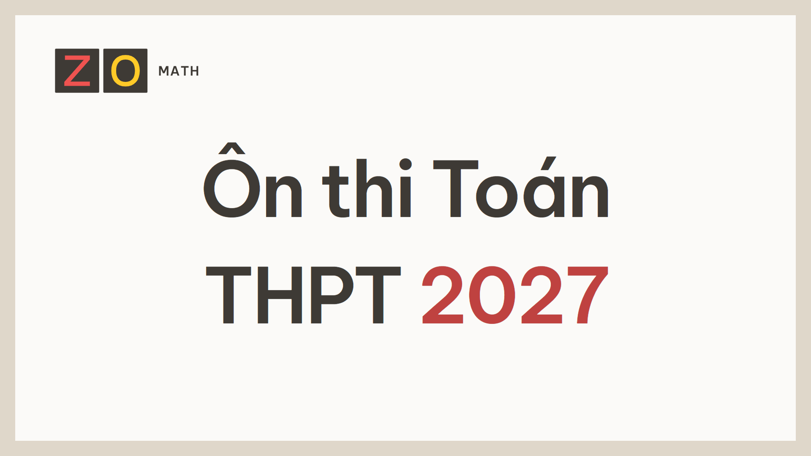
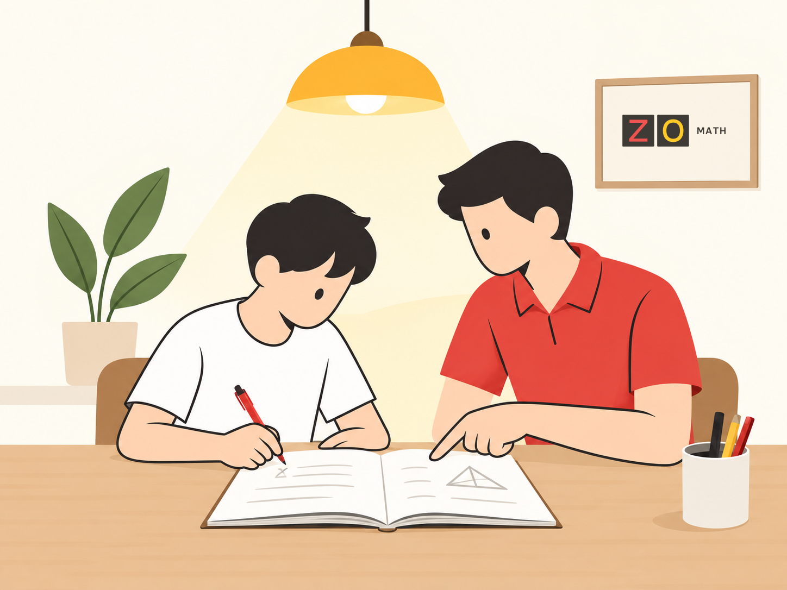

::: {.zo-on-thi-program .home-landing-content .reader-content}

::: {.home-section-nav data-home-tag="nav" aria-label="Trong trang Nhà"}

[Khám phá học liệu](#hoc-lieu-hien-co)

[Cách học](#học-theo-cách-nào)

[Học trực tiếp](#hoc-truc-tiep)

[Bảo trợ ZO Math](#ung-ho)

:::

::: {#giới-thiệu .home-hero data-home-tag="section" aria-labelledby="home-title"}

::: {.home-hero-copy}

[ZO Math · Học liệu miễn phí]{.role}

# Ôn thi Toán THPT [2027]{.home-year} {#home-title}



[Tài liệu tự học **miễn phí** dành cho học sinh ôn tập môn Toán: hiểu kiến thức, giải vấn đề và chuẩn bị cho kì thi tốt nghiệp THPT.]{.home-lead .home-paragraph}

[*Học trong kỉ nguyên trí tuệ nhân tạo, học để tìm lại chính mình.*]{.brand-thought .home-paragraph}

:::

::: {.home-journey data-home-tag="figure" aria-label="Minh họa hành trình học toán"}

{.journey-portrait data-home-width="1086" data-home-height="1448"}

:::

::: {#chương-trình-giúp-em-làm-gì .home-paper .home-reading-panel .home-introduction .home-video-introduction data-home-tag="section" aria-labelledby="home-purpose"}

::: {.home-video-copy}

[Giới thiệu khóa học]{.role}

## Học cách nghĩ trước một bài toán {#home-purpose}

Đọc một lời giải, em có thể hiểu từng bước. Nhưng khi đề bài thay đổi, làm thế nào để tự tìm được cách giải? Khóa Ôn thi Toán THPT 2027 của ZO Math giúp em rèn khả năng ấy từ việc hiểu kiến thức và điều kiện sử dụng.

Em được dẫn dắt bằng những câu hỏi: dữ kiện cho biết điều gì, vì sao có thể kết luận như vậy, nếu thay một điều kiện thì điều gì sẽ xảy ra? Công thức, bảng và hình được đặt trong mối liên hệ để em có cơ sở lựa chọn cách làm và giải thích suy nghĩ của mình.

Chính bài làm của em sẽ chỉ ra phần cần học tiếp. Một lỗi sai giúp em nhận ra điều chưa hiểu; một bài tự giải sau khi sửa giúp em kiểm chứng sự tiến bộ. Qua từng chủ đề, em dần biết mình đã làm được gì, cần ôn gì và chủ động chuẩn bị cho kì thi.

::: {.home-qmd-group .home-video-audience}

### Dành cho ai? {#dành-cho-ai}

Mọi học sinh chuẩn bị thi tốt nghiệp THPT 2027. Học liệu tự học được chia sẻ miễn phí.

:::

:::

::: {.home-video-media}

::: {.home-youtube data-youtube-id="SJ1bb9gWxDA" data-publish-at="2026-10-16T20:30:00+07:00"}

<button class="home-youtube-launch" type="button" disabled aria-label="Xem video giới thiệu khóa Ôn thi Toán THPT 2027">Xem video giới thiệu</button>

:::

[Video công bố lúc 20:30 ngày 16/10/2026 (giờ Việt Nam).]{.home-youtube-notice .home-paragraph aria-live="polite"}

[Giới thiệu khóa học · 4 phút 11 giây · [Xem trên YouTube](https://www.youtube.com/watch?v=SJ1bb9gWxDA)]{.home-video-caption .home-paragraph}

:::

:::

:::

::: {#hoc-lieu-hien-co .home-paper data-home-tag="section" aria-labelledby="home-catalog-title"}

[Học liệu hiện có]{.role}

## Hôm nay, em muốn học gì? {#home-catalog-title}

Chọn chủ đề cần ôn. [Nội dung các tài liệu có thể được chỉnh sửa và bổ sung.]{#trạng-thái-triển-khai}



::: {#bắt-đầu-từ-đâu .home-start}

### Chưa biết nên bắt đầu từ đâu? {.home-unanchored}

Khảo sát đầu vào giúp em chọn phần nên ôn trước. Đây không phải bài thi để xét điều kiện vào học: em không cần đạt một mức điểm mới được mở tài liệu.

[Làm khảo sát đầu vào [→]{aria-hidden="true"}](/content/thpt/on_thi_toan_thpt/hoc_lieu/d0/index.html){.home-action}

:::

:::

::: {#học-theo-cách-nào .home-paper .home-reading-panel data-home-tag="section" aria-labelledby="home-method-title"}

[Cách học]{.role}

## Học theo nhịp của em {#home-method-title}

Trong mỗi tài liệu theo chủ đề, em sẽ gặp bốn phần chính:

::: {.home-method-grid}

::: {.home-qmd-group}

::: {.home-qmd-group .home-method-heading}

[01]{.home-method-number aria-hidden="true"}

### Bài học {.home-unanchored}

:::

Em chưa học chủ đề này hoặc muốn hiểu lại cho rõ.

Tự trả lời các câu hỏi, rồi đọc giải thích và ví dụ. Chú ý vào lời giải và những điều kiện kèm theo.

:::

::: {.home-qmd-group}

::: {.home-qmd-group .home-method-heading}

[02]{.home-method-number aria-hidden="true"}

### Luyện tập {.home-unanchored}

:::

Em muốn tự giải quyết vấn đề và luyện tập cách vận dụng kiến thức.

Bài tập được chia thành các chặng. Cuối mỗi chặng có **Điểm dừng**: phần này hướng dẫn em xem lại bài làm để biết nên học tiếp hay luyện thêm chỗ nào.

:::

::: {.home-qmd-group}

::: {.home-qmd-group .home-method-heading}

[03]{.home-method-number aria-hidden="true"}

### Kiểm tra {.home-unanchored}

:::

Khi đã chuẩn bị kĩ hoặc đủ tự tin, em có thể làm bài Kiểm tra.

Hãy tự làm, không xem lời giải hay tìm trợ giúp trong lúc làm. Không chia bài Kiểm tra thành nhiều buổi. Làm xong, giữ bài làm để đối chiếu và xem mình cần cải thiện điều gì.

:::

::: {.home-qmd-group}

::: {.home-qmd-group .home-method-heading}

[04]{.home-method-number aria-hidden="true"}

### Ôn lại {.home-unanchored}

:::

Hẹn một ngày quay lại ôn tập. Đến ngày đó, mở phần Ôn lại và tự làm các câu hỏi trước khi xem lời giải.

Phần này giúp em biết kiến thức còn nhớ được đến đâu sau một thời gian.

:::

:::

::: {.home-method-tail}

Em không nhất thiết phải bắt đầu từ Bài học. Có thể vào Luyện tập hoặc Kiểm tra nếu thấy phù hợp, rồi quay lại phần cần học khi phát hiện chỗ chưa hiểu.

### Nếu đang làm bài mà bị vướng {.home-unanchored}

- Chưa hiểu kiến thức của chủ đề: xem lại phần liên quan trong **Bài học**.
- Quên kiến thức cần dùng: tìm trong **Ôn nền**. Em cũng có thể chọn tài liệu, công cụ hoặc trao đổi với người khác để hiểu chỗ đang vướng.
- Sau đó, quay lại chỗ dừng chân trước đó.

[Nếu cần trợ giúp, hãy kết thúc lượt Kiểm tra và giữ riêng bài đã tự làm trước khi mở phần hỗ trợ. Phần làm tiếp sau trợ giúp không tính vào kết quả tự lực của lượt ấy.]{.home-method-note .home-paragraph}

### Sau khi làm bài {.home-unanchored}

Mở **Lời giải** để đối chiếu cách làm, không chỉ đáp số. Nếu phát hiện lỗi, phần **Sửa lỗi** có những bài giúp em luyện lại chỗ đó.

Cuối buổi học, em có thể ghi vào **Nhật kí**: điều đã hiểu, chỗ còn vướng, việc sẽ làm tiếp và ngày hẹn Ôn lại.

:::

:::

::: {#tám-mạch .home-paper .home-reading-panel data-home-tag="section" aria-labelledby="home-strands-title"}

[Phạm vi kiến thức]{.role}

## Em sẽ ôn những gì? {#home-strands-title}

Chương trình bao gồm các chủ đề:

::: {.home-strands}



:::

Một bài toán có thể ẩn chứa kiến thức từ nhiều chủ đề. Vì vậy, bên cạnh việc ôn từng chủ đề, em còn cần luyện tập kết hợp chúng.

### Chuẩn bị cho kì thi {#lộ-trình}

Trước hết, tìm phần mình cần ôn và học lại kiến thức chưa vững. Sau đó, luyện những bài cần kết hợp nhiều kiến thức, luyện đề và xem lại các lỗi thường mắc. Gần ngày thi, dành thời gian củng cố những phần còn yếu.

Em có thể điều chỉnh việc ôn theo bài mình làm được và thời gian còn lại, không cần theo một lịch giống mọi người.

:::

::: {#hoc-truc-tiep .home-paper .home-reading-panel .home-service .home-service-feature data-home-tag="section" aria-labelledby="home-service-title"}

::: {.home-qmd-group .home-service-copy}

## Học trực tiếp cùng [ZO Math]{.home-service-brand-title} {#home-service-title}

### Xem bài làm của em {.home-unanchored}

Em mang theo bài đã làm và những câu hỏi còn vướng. Buổi trao đổi sẽ tập trung vào cách em nghĩ, chỗ chưa hiểu và cách tự học tiếp.

[Đây là dịch vụ có thu phí, tách biệt với tài liệu tự học miễn phí.]{.home-service-fee .home-paragraph}

::: {.home-service-accent aria-hidden="true"}
:::

:::

::: {.home-service-illustration data-home-tag="figure"}

{.home-service-art data-home-width="1448" data-home-height="1086" loading="lazy"}

:::

::: {.home-qmd-group .home-service-status}

### Chưa mở đăng kí {.home-unanchored}

Hình thức học, lịch và mức phí sẽ được thông báo khi sẵn sàng. Em vẫn có thể sử dụng tài liệu miễn phí mà không đăng kí học trực tiếp.

:::

:::

::: {#nguon-hoc-lieu .home-paper .home-reading-panel data-home-tag="section" aria-labelledby="home-trust-title"}

[Nguồn và cách sử dụng]{.role}

## Muốn tìm hiểu thêm? {#home-trust-title}

Mỗi gói học liệu đều có mục **Nguồn**, ghi những tài liệu được sử dụng khi biên soạn. Em có thể xem mục này khi muốn đọc thêm hoặc tìm hiểu một nội dung từ nơi khác.

::: {data-home-tag="details"}

### Học bằng trí tuệ nhân tạo {.home-summary}

Hãy tự thử trước. Nếu còn vướng, mà không có người chỉ bảo, em có thể nhờ công cụ giải thích hoặc gợi ý để em có thể bước tiếp và tự mình kết thúc vấn đề - không để công cụ làm thay em, giải quyết toàn bộ vấn đề.

Đặt câu hỏi với công cụ là một việc rất quan trọng, đừng xem nhẹ nó. Em phải tìm hiểu và luyện tập cách đặt câu hỏi hiệu quả. Xem đây là một năng lực thiết yếu trong học tập hiện đại.

Không dùng trí tuệ nhân tạo hoặc trợ giúp khác khi đang làm Kiểm tra.

:::

:::

::: {#cau-hoi-thuong-gap .home-paper .home-reading-panel .home-faq data-home-tag="section" aria-labelledby="home-faq-title"}

## Câu hỏi thường gặp {#home-faq-title}

::: {data-home-tag="details"}

### Nếu còn thiếu kiến thức lớp 10–11 thì sao? {.home-summary}

Em không cần ôn lại toàn bộ lớp 10–11 trước khi bắt đầu.

Khi gặp vấn đề cần kiến thức đã quên, hãy ôn đúng phần đó rồi quay lại làm tiếp. Ôn nền trong tài liệu là một nơi để tìm kiếm kiến thức đó. Em có thể dùng những nguồn trợ giúp khác phù hợp với mình.

Nếu kiến thức ấy chưa từng học, cần dành thời gian học trước khi tiếp tục từ chỗ đang vướng.

:::

::: {data-home-tag="details"}

### Có phải làm Khảo sát đầu vào trước khi học không? {.home-summary}

Không. Nếu đã biết mình cần ôn chủ đề nào, em có thể mở thẳng tài liệu của chủ đề đó.

:::

::: {data-home-tag="details"}

### Có thể học bằng PDF không? {.home-summary}

Trong tài liệu theo chủ đề có mục **Tải PDF**. Hãy đọc thông báo tại đó trước khi tải: bản PDF có thể chưa chứa những chỉnh sửa mới nhất của trang web.

Khảo sát đầu vào hiện dùng trên trang web.

:::

::: {data-home-tag="details"}

### Có cần trả phí để dùng tài liệu không? {.home-summary}

Không. Tài liệu tự học miễn phí. Việc bảo trợ ZO Math là tự nguyện; học trực tiếp là dịch vụ riêng có thu phí.

:::

:::

:::

::: {.home-support-copy}

Nếu tài liệu hữu ích với bạn, bạn có thể bảo trợ ZO Math tiếp tục biên soạn và chia sẻ.

Xem thông tin bảo trợ

:::
